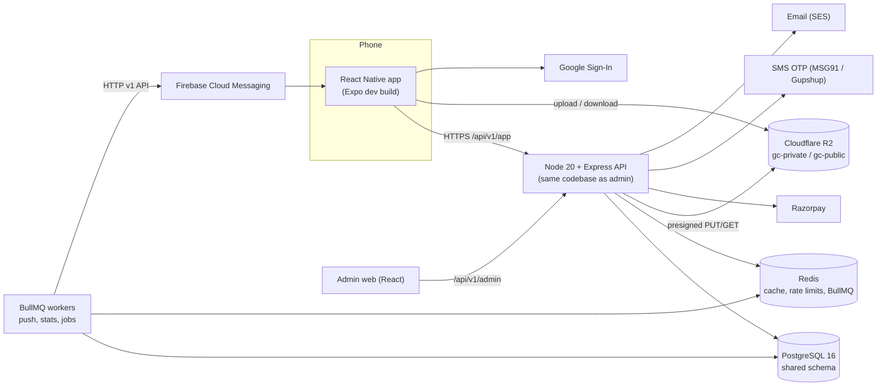
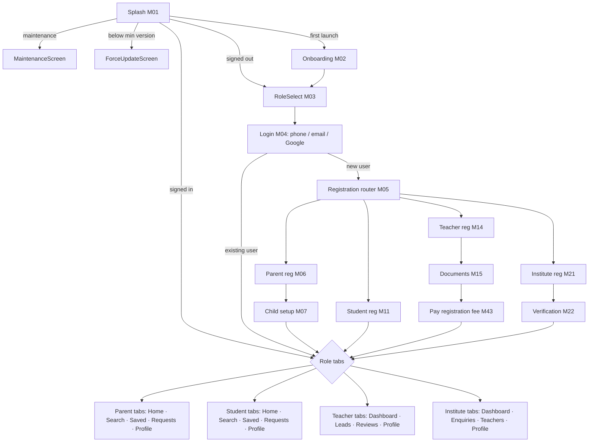

# 00 · Mobile Engineering Conventions (read first)

These rules apply to every module in this pack. Module files only describe what is specific to that module; anything not repeated there follows this document. The mobile app shares **one PostgreSQL database and one Express API codebase** with the admin portal (see the Admin SRS pack). Admin tables are reused as they are; the app adds 27 tables and 3 columns in migrations 100–154.

## 1. Architecture



- The app never talks to PostgreSQL, R2 credentials or FCM server keys directly. It only calls the API, uploads to presigned R2 URLs, and receives pushes.
- One Express app mounts `/api/v1/admin` (admin JWT audience `gc-admin`) and `/api/v1/app` (app JWT audience `gc-app`). A token for one audience is rejected by the other.
- Workers run the same code with a different entrypoint (`npm run worker`).

## 2. Tech stack (mobile)

| Concern | Choice | Notes |
| --- | --- | --- |
| Framework | React Native 0.76+ via **Expo SDK 52** with a **development build** (`expo prebuild`, EAS Build) | New Architecture on. Native modules (Firebase, Razorpay, Google Sign-In) work through config plugins. A bare React Native CLI project works identically; only the build commands differ. |
| Language | TypeScript `strict` | Shared Zod schemas and types from `packages/shared` |
| Navigation | React Navigation 7 (native stack + bottom tabs) | Typed route params; deep linking config in one file |
| Server state | TanStack Query v5 + `@tanstack/query-async-storage-persister` on MMKV | Offline cache, retries, background refetch |
| Client state | Zustand (small stores) | Session, onboarding flags, search filters, form drafts |
| Local storage | `react-native-mmkv` (encrypted instance for user data) · `expo-secure-store` for refresh token and install id | Never AsyncStorage for tokens |
| Forms | React Hook Form + `@hookform/resolvers/zod` | Same schema the API validates with |
| HTTP | `ky` (fetch) wrapper `lib/api.ts` | Envelope unwrap, refresh-on-401 single flight, headers |
| Lists | `@shopify/flash-list` | All lists longer than ~20 items |
| Images | `expo-image` (disk cache), `expo-image-picker`, `expo-image-manipulator`, `expo-document-picker` | Client-side compression before upload |
| Push | `@react-native-firebase/app` + `messaging`, `@notifee/react-native` for foreground display and Android channels | |
| Payments | `react-native-razorpay` (Standard Checkout) | UPI intent, cards, net banking, wallets |
| Google login | `@react-native-google-signin/google-signin` | Server verifies the ID token |
| OTP autofill | Android SMS Retriever (`react-native-otp-verify`), iOS `textContentType="oneTimeCode"` | |
| Network status | `@react-native-community/netinfo` | Drives offline banner and mutation queue |
| Sharing | `react-native-share` (WhatsApp target) + `expo-clipboard` | |
| Location | `expo-location` (foreground only, "while using") | Optional; city/area picker is the fallback |
| Animations | `react-native-reanimated` 3 | Keep to transitions and skeleton shimmer |
| i18n | `i18next` + `react-i18next`, `expo-localization` | English at launch; Hindi next (strings externalised from day one) |
| Monitoring | Sentry (`@sentry/react-native`) + Firebase Analytics (events gated by privacy setting) | |
| Tests | Jest + React Native Testing Library + MSW; **Maestro** for end-to-end flows | |
| OTA | `expo-updates` (EAS Update) for JS-only fixes | Native changes need a store release |

Minimum OS: **Android 8.0 (API 26)**, **iOS 15**. Design for a 2 GB RAM Android phone on 4G.

## 3. Repository layout

```
guruconnect/
  apps/
    api/                    Express (admin + app routes), workers
      src/modules/app/<module>/   router.ts, controller.ts, service.ts, repo.ts, schemas.ts (re-export shared), jobs.ts
    admin-web/              React admin portal (Admin SRS)
    mobile/
      app.config.ts         Expo config, plugins, deep link schemes, Firebase files per env
      src/
        app/                App.tsx, providers (QueryClient, Theme, i18n, ErrorBoundary), navigation/ (RootNavigator, linking.ts, types.ts)
        features/<module>/  screens/, components/, hooks/ (useXxxQuery, useXxxMutation), api.ts, store.ts (if any), __tests__/
        components/ui/      Button, TextField, OtpInput, Select, Chip, Card, Avatar, Badge, BottomSheet, Toast, Skeleton, EmptyState, ErrorState
        components/domain/  TeacherCard, InstituteCard, TrustScoreRing, VerifiedBadge, RatingStars, PriceTag, ChildChip, StatusPill
        lib/                api.ts, queryClient.ts, storage.ts, push.ts, upload.ts, format.ts (₹, dates IST), analytics.ts, errors.ts, deeplinks.ts
        theme/              tokens.ts (colours light/dark, spacing, radii, typography)
        i18n/               en.json, hi.json
  packages/shared/          zod schemas, enums, error codes, route names, fee codes
```

## 4. Navigation map



- Route names are `PascalCase` screen names, e.g. `TeacherProfile`, typed in `navigation/types.ts`. Modules list their screens in section 4.
- **Deep links:** custom scheme `gc://` and universal/app links on `https://guruconnect.in`. Canonical paths: `/t/<teacherPublicCode>`, `/i/<instituteSlug>`, `/s/<shareShortCode>`, `/r/<referralCode>`, `/leads/<id>`, `/demos/<id>`, `/notifications`, `/plans`. Links that need a signed-in user are stored and replayed after login.
- The role tab navigator is chosen from the `role` claim of the access token. A user has exactly one role in v1.

## 5. API conventions for the app

- **Base URL** `https://api.guruconnect.in/api/v1/app`. All paths in module files are relative to it.
- **Headers sent by every request:** `Authorization: Bearer <access>` (when signed in), `X-Install-Id` (uuid from secure store), `X-App-Version` (semver), `X-App-Build`, `X-Platform` (`android`/`ios`), `Accept-Language` (`en-IN`), `X-Request-Id` (uuid per request, echoed back). `Idempotency-Key` (uuid) on create actions marked in module files.
- **Envelope** (same as admin): success `{ "data": …, "meta": {…} }`; error `{ "error": { "code", "message", "details", "requestId" } }`. `message` is safe to show to users; the app maps known codes to its own translated copy.
- **IDs** are UUIDs. Human codes (`GC-T10241`, `LD-100231`) are for display and support only.
- **Money** in paise (integer). The app formats with `formatINR(paise)` → `₹1,999`.
- **Time:** API sends ISO 8601 UTC; the app displays Asia/Kolkata. Dates without time (`2026-09-29`) are IST calendar dates.
- **Pagination:** feeds and lists use **cursor pagination**: `?limit=20&cursor=<opaque>` → `meta.nextCursor` (null at the end). Search results use `?page=` only where totals matter (section 17 of each module says which).
- **Version gate:** every response carries `X-Min-App-Version`. If the app is below it, the API returns `426 APP_UPDATE_REQUIRED` for all calls except `/bootstrap`; the app routes to the Force Update screen.
- **Maintenance:** when `app.maintenance_mode` is true, all calls except `/bootstrap` return `503 MAINTENANCE`.
- **Rate limits:** default 120 requests/minute per user and 300/minute per IP; tighter limits are listed per endpoint.

### Standard error codes (app)

| Code | HTTP | Meaning | App behaviour |
| --- | --- | --- | --- |
| `AUTH_REQUIRED` | 401 | No/invalid token | Go to Login, keep intended deep link |
| `AUTH_TOKEN_EXPIRED` | 401 | Access token expired | Refresh once, retry the request |
| `AUTH_REFRESH_INVALID` | 401 | Refresh token revoked/expired/reused | Clear session, go to Login with message "Please sign in again." |
| `ACCOUNT_SUSPENDED` | 403 | `account_status` suspended/banned | Blocking screen with support contact and reason |
| `FORBIDDEN` | 403 | Wrong role or not the owner | Toast "You can't do that." |
| `ROLE_MISMATCH` | 409 | Signing in with a role different from the account's | Explain and offer to continue as the existing role |
| `REGISTRATION_REQUIRED` | 409 | Verified phone/email has no account yet | Route to registration with `registrationToken` |
| `OTP_INVALID` / `OTP_EXPIRED` / `OTP_LOCKED` | 422 / 410 / 429 | OTP checks | Inline error under the code field |
| `VALIDATION_FAILED` | 422 | Zod failed; `details[]` = `{ path, message }` | Map to form fields |
| `NOT_FOUND` | 404 | Missing or soft-deleted | "This is no longer available." with back button |
| `CONFLICT_STATE` | 409 | Action not allowed in current status | Show message, refetch |
| `CONFLICT_DUPLICATE` | 409 | Unique rule | Inline message |
| `VERSION_CONFLICT` | 409 | `If-Match` mismatch on profile edits | "Updated on another device. Review and save again." |
| `SUBSCRIPTION_REQUIRED` | 402 | Feature needs an active plan | Open plans sheet (M10/M13) |
| `LIMIT_REACHED` | 429 | Business limit (leads/day, children) | Show limit copy from `details.limit` |
| `BLOCKED` | 403 | One side blocked the other | "You can't contact this user." |
| `RATE_LIMITED` | 429 | Too many requests; `Retry-After` | Disable button until retry time |
| `APP_UPDATE_REQUIRED` | 426 | Below minimum version | Force Update screen |
| `MAINTENANCE` | 503 | Maintenance mode | Maintenance screen |
| `PAYMENT_FAILED` | 402 | Gateway declined / signature mismatch | Payment result screen with retry |
| `GATEWAY_ERROR` | 502 | SMS, R2, FCM or Razorpay down | Retry button; never lose form input |
| `FILE_TOO_LARGE` / `FILE_TYPE_NOT_ALLOWED` | 413 / 415 | Upload rules | Inline under the picker |
| `INTERNAL_ERROR` | 500 | Anything else | Generic error state with request id (long-press to copy) |

## 6. Authentication and sessions

- **Access token:** JWT RS256, 15 minutes, audience `gc-app`. Claims: `sub` (app_users.id), `role` (`parent|student|teacher|institute_staff`), `pid` (id in the role table: parents.id, students.id, teachers.id or institute_managers.id), `iid` (institute id for staff), `sid` (app_sessions.id). Kept **in memory only**.
- **Refresh token:** 256-bit random, 30-day sliding / 60-day absolute, stored in `expo-secure-store` (Keychain / Android Keystore). Stored server-side as SHA-256 in `app_sessions`. **Rotates on every refresh**; presenting an old token revokes the whole `token_family` (theft detection).
- **Registration token:** after a new phone/email is verified, the API returns a 30-minute JWT (`aud gc-register`, `sub` = verified contact, `role`) that is the only credential accepted by the registration endpoints. The account (`app_users` + role row) is created only when registration is submitted, so there are no half-created accounts.
- **Refresh flow in the app:** `lib/api.ts` catches `AUTH_TOKEN_EXPIRED`, runs one shared refresh promise, retries queued requests; on `AUTH_REFRESH_INVALID` it signs out.
- **Server middleware order:** `requestId → versionGate → maintenanceGate → rateLimit → authenticateApp → loadAccount (status check, cached 60 s in Redis) → requireRole(...) → validate(zod) → handler`.
- **Ownership:** every handler scopes queries by the token (`WHERE parent_id = :pid`), never by ids sent in the body.

## 7. State management rules

| Kind of state | Where | Example |
| --- | --- | --- |
| Server data | TanStack Query cache (persisted to MMKV) | profile, dashboard rails, search results, leads |
| Session | Zustand `useSession` (memory) + secure store (refresh token) | access token, role, pid |
| App flags | Zustand + MMKV | `onboardingSeenVersion`, `lastRole`, `pushPromptShownAt` |
| Form drafts | Zustand + encrypted MMKV, keyed per form | teacher registration steps, review draft |
| Filters | Zustand per search type, persisted | selected subject/class/city |
| Ephemeral UI | component state | open bottom sheet, selected tab |

- **Query keys** come from one factory per feature, e.g. `teacherKeys.detail(id)`, `searchKeys.teachers(filters)`. Mutations invalidate by key prefix.
- **Optimistic updates** only for reversible, idempotent actions (favourite, mark read, availability toggle). Roll back on error with a toast.
- Sign-out clears: query cache, all Zustand stores, encrypted MMKV, secure store refresh token; keeps `install_id` and onboarding flag.

## 8. Offline handling (global)

- `NetInfo` drives an **offline banner** ("You're offline. Showing saved results.").
- **Read:** persisted queries render instantly from cache (max age 24 h; cache busted on app version change). Screens show the cached time ("Updated 2 h ago") when offline.
- **Write:** three classes, stated per module:
  1. *Queue offline* — idempotent actions with a client-generated id (favourites, lead messages, notification read, availability edits). Stored in a persisted mutation queue, replayed in order on reconnect, deduplicated server-side by `client_message_id` / unique indexes.
  2. *Save draft, submit online* — forms (registration, reviews, complaints, child setup). The draft survives app restarts; the submit button is disabled offline with a hint.
  3. *Online only* — OTP, payments, uploads start, account deletion, anything with money or security. Button disabled offline.
- Uploads resume: if the app is killed mid-upload, the file is re-uploaded on next launch (presigned URLs are re-requested; `files` rows in `pending` are cleaned by a job after 24 h).

## 9. Push notifications (global)

- **Token lifecycle:** after sign-in the app calls `PUT /devices/me` with install id, FCM token and permission state; again on `onTokenRefresh` and on app foreground if the token changed. Sign-out calls `DELETE /devices/me`.
- **Permission timing:** never on first launch. Ask after a meaningful moment (parent: after first lead or saving a favourite; teacher: at the end of registration "Get notified when you're verified"; institute: after registration). Android 13+ uses the `POST_NOTIFICATIONS` runtime prompt; iOS uses provisional authorisation first where suitable. A pre-permission explainer sheet is shown before the OS prompt.
- **Android channels:** `leads` (high importance, sound), `account` (default), `payments` (default), `reviews` (default), `general` (low). Channel per category is set in the payload.
- **Payload** (FCM HTTP v1): `notification { title, body, image }` + `data { eventType, notificationId, deepLink, category, entityId }`; Android `collapse_key` per entity for updates; iOS `thread-id` per category; `badge` = unread count.
- **Server pipeline:** domain event → `NotificationService.notify(userId, template, data)` → insert `user_notifications` (dedupe key) → check preferences + quiet hours (21:30–08:00 IST unless urgent) → BullMQ `push` queue → FCM send to all active devices → update `push_status`; `UNREGISTERED` tokens revoke the device row.
- **Tap handling:** cold start (`getInitialNotification`), background (`onNotificationOpenedApp`), foreground (`onMessage` → notifee banner). All route through `deeplinks.open(deepLink)` and mark the notification read.
- Each module lists its events in section 16 as: event · recipient · title/body template · deep link · category · urgent?

## 10. File uploads (Cloudflare R2)

1. App picks a file; images are resized to max 2000 px long edge, JPEG quality 0.8, EXIF GPS stripped; PDFs ≤ 10 MB.
2. `POST /uploads/presign { purpose, mimeType, sizeBytes, fileName }` → `{ fileId, uploadUrl, headers, expiresAt }` (URL valid 10 min; R2 S3-compatible presigned PUT with `Content-Type` and `Content-Length` fixed).
3. App `PUT`s the bytes directly to R2 with progress.
4. `POST /uploads/:fileId/confirm` → API checks object size/type via `HEAD`, marks `files.status = 'active'`.
5. The module's own endpoint links the `fileId` (e.g. `POST /teacher/documents { fileId, docType }`).

| Purpose | Bucket | Allowed | Max |
| --- | --- | --- | --- |
| `avatar`, `teacher_photo`, `institute_logo`, `institute_cover`, `institute_gallery` | `gc-public` (served via `cdn.guruconnect.in`) | jpeg, png, webp | 5 MB |
| `teacher_document`, `institute_document` | `gc-private` | jpeg, png, pdf | 10 MB |
| `complaint_evidence`, `support_attachment` | `gc-private` | jpeg, png, pdf | 10 MB |

Private files are read through `GET /files/:id/url` (owner only, 60-second presigned GET). Identity documents are never shown back in full after upload: the app shows a thumbnail with the masked number.

## 11. Audit logs

App actions that change important data write `audit_logs` rows in the **same transaction**, with `actor_type = 'app_user'`, `actor_id = sub`, `module = 'app.<feature>'`, IP, user agent (`GuruConnect/1.2.0 (Android 14; SM-A546E)`) and request id. Logged: sign-in/out, session revocation, contact changes, registration, profile and fee changes, document uploads, children changes, reviews and replies, leads and demo actions, payments started, reports and blocks, privacy/consent changes, account deletion. Reads and searches are **not** audit-logged (they go to analytics). Sensitive values (OTP, tokens, document numbers, passwords) are never written to audit logs. Each module lists its events in section 20.

## 12. Data conventions

- UUID primary keys everywhere (`gen_random_uuid()`); join tables use composite keys.
- **Soft delete**: user-facing deletes set `deleted_at`; queries filter `deleted_at IS NULL`; unique indexes are partial on live rows. Hard deletes only in the account-erasure job (M54) and for expired OTPs/sessions (cleanup jobs).
- `updated_at` (trigger) is the version for optimistic locking: edits send `If-Match: <updatedAt>`.
- Children are minors: first name only, class, board, subjects, school name optional — no photo, no date of birth.

## 13. Security baseline

- TLS only; HSTS on the API. Certificate pinning for `api.guruconnect.in` is planned after launch (section 21 of M00).
- Tokens only in secure store/memory. Encrypted MMKV for cached personal data. No PII in logs, Sentry breadcrumbs or analytics (scrub phone, email, names).
- `FLAG_SECURE` (Android) and a privacy overlay on iOS app switcher for document upload/view, payment and OTP screens.
- Root/jailbreak detection is informational only (sent as a header, used in fraud scoring) — the app still works.
- Server: Zod validation on every input, parameterised SQL (Kysely), per-endpoint rate limits, ownership checks, output DTOs that never include other users' phone/email unless the contact is unlocked.
- Contact info in free text (bios, messages, reviews) is detected and masked until contact is unlocked, to keep payments on-platform and users safe.
- DPDP Act 2023: consent captured and stored (`user_consents`), purpose-limited analytics, user can download and delete data (M52, M54); users under 18 need verifiable parental consent (M11).

## 14. UI conventions

- Touch targets ≥ 48 dp; body text 16 sp; supports system font scaling up to 130% without clipping.
- Every data screen has four states: **loading** (skeleton), **empty** (illustration + one action), **error** (message + Retry), **content**. Pull-to-refresh on lists.
- Colour is never the only signal (status pills have text; trust score has a number).
- Primary actions sit in a sticky bottom bar on forms. Destructive actions ask for confirmation in a bottom sheet.
- Currency `₹1,999`; large numbers in Indian grouping (`1,23,456`); dates `Tue, 29 Sep · 6:00 PM`.
- Accessibility: `accessibilityLabel` on icon buttons, logical focus order, screen reader announcements for toasts and OTP errors.

## 15. Error handling pattern

- `AppErrorBoundary` at the navigator root (fallback screen with "Restart" and request id).
- `toAppError(e)` maps API codes to translated copy and to a UI action (`toast | inline | screen | signOut | upgrade`).
- Forms: `VALIDATION_FAILED.details[].path` → `setError(path)`; unknown paths → toast.
- Network: requests time out after 15 s (uploads 120 s); GET retried twice with backoff; mutations are not retried automatically unless idempotent.
- Every error screen shows a Retry and keeps user input.

## 16. Testing

- **Unit/component:** Jest + React Native Testing Library, MSW handlers generated from shared schemas. Every screen: renders each of the four states.
- **API:** Supertest against a disposable PostgreSQL (the schema in `sql/schema.sql`), seeded with `sql/seed/*`.
- **E2E:** Maestro flows for each module's happy path plus the listed edge cases, run on an Android emulator (API 34) and an iOS simulator in CI. OTP uses a test-mode provider where `+91 90000 0000x` numbers accept `123456` (disabled in production builds).
- **Devices:** manual pass on a 2 GB RAM Android 9/10 phone, a mid-range Android 14, and an iPhone SE-size screen.
- Each module's section 19 lists the scenarios; IDs are `T<module>.<n>`.

## 17. Performance budgets

Cold start to interactive ≤ 2.5 s on a mid-range Android; dashboard first content ≤ 1.5 s from cache; search results ≤ 800 ms API p95; JS bundle ≤ 6 MB; images from CDN with width parameters; lists virtualised with FlashList.

## 18. Definition of done (per module)

Screens match section 6; all four UI states; validation shared with the API; endpoints return the documented payloads and errors; ownership and role checks; audit events written; push events wired; offline behaviour as specified; analytics events named `<module>_<action>`; unit + API tests and the module's Maestro flow pass; strings in `en.json`; accessibility labels present.
