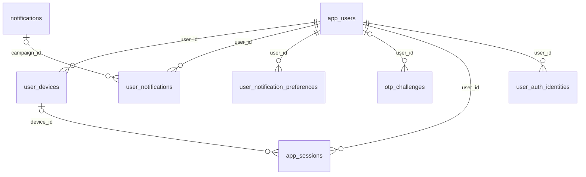
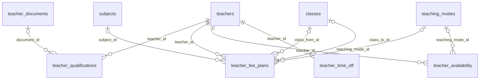
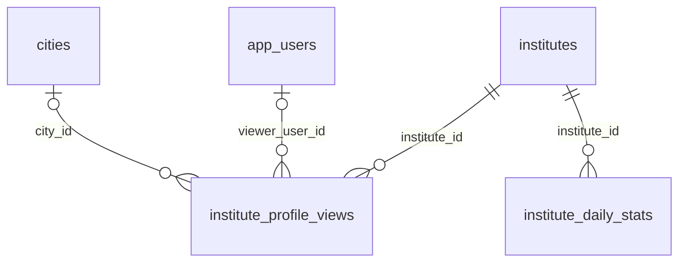
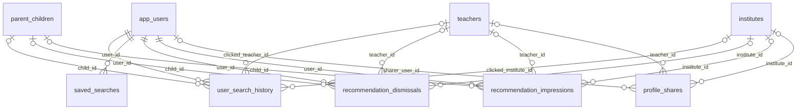
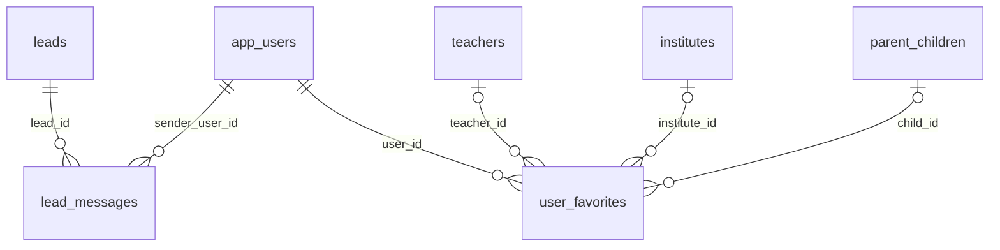
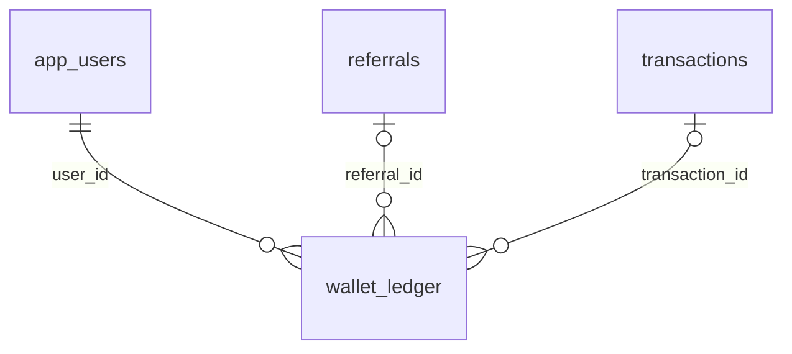
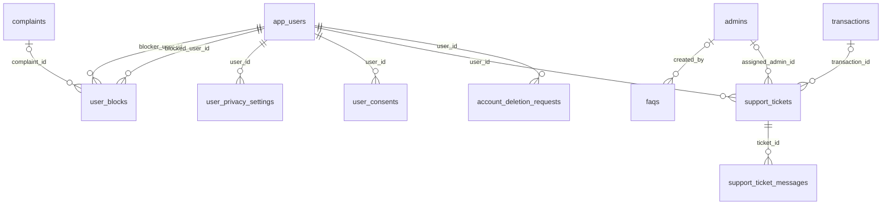

# 01 · Data Model (mobile additions)

The mobile app adds **27 new tables** and **3 columns on `app_users`** to the shared database described in the Admin SRS's `01-data-model.md`. Every new table uses a `uuid` primary key (`gen_random_uuid()`) except join/rollup tables, which use composite keys or a natural key (`user_notification_preferences (user_id, category)`, `institute_daily_stats (institute_id, stat_date)`). All tables use `timestamptz`, snake_case names, and the same soft-delete convention (`deleted_at`, partial unique indexes `WHERE deleted_at IS NULL`) as the admin schema.

## New tables by domain

### Platform & auth

New tables: `user_devices`, `user_notifications`, `user_notification_preferences`, `otp_challenges`, `app_sessions`, `user_auth_identities`

### Teacher

New tables: `teacher_qualifications`, `teacher_fee_plans`, `teacher_availability`, `teacher_time_off`

### Institute

New tables: `institute_profile_views`, `institute_daily_stats`

### Search & discovery

New tables: `user_search_history`, `saved_searches`, `recommendation_dismissals`, `recommendation_impressions`, `profile_shares`

### Reviews, leads & trust

New tables: `lead_messages`, `user_favorites`

### Payments & referrals

New tables: `wallet_ledger`

### Notifications, safety & settings

New tables: `user_blocks`, `user_privacy_settings`, `user_consents`, `faqs`, `support_tickets`, `support_ticket_messages`, `account_deletion_requests`

## All new tables

| Table | Module | Purpose | Columns |
| --- | --- | --- | --- |
| `user_devices` | [M00](modules/M00-mobile-platform-foundation.md) | Every app install a user has signed in on, with its FCM token. One row per (user, install). | 17 |
| `user_notifications` | [M00](modules/M00-mobile-platform-foundation.md) | The in-app notification inbox for every user: transactional events and copies of admin campaigns. | 16 |
| `user_notification_preferences` | [M00](modules/M00-mobile-platform-foundation.md) | Per-category push/email switches. Missing row = defaults (push on, email off). | 7 |
| `otp_challenges` | [M04](modules/M04-login.md) | One-time codes sent by SMS or email for login, sign-up, contact changes and account deletion. | 15 |
| `app_sessions` | [M04](modules/M04-login.md) | Refresh-token sessions for app users, one per signed-in install. Refresh tokens rotate on every use. | 13 |
| `user_auth_identities` | [M04](modules/M04-login.md) | Sign-in methods linked to an account: phone OTP, email + password, Google. | 13 |
| `teacher_qualifications` | [M14](modules/M14-teacher-registration.md) | Degrees and certifications a teacher lists during registration and in the profile builder. | 13 |
| `teacher_fee_plans` | [M17](modules/M17-teacher-profile-builder.md) | A teacher's fee structure: price per class group, subject and mode, per hour, per month or per course. | 17 |
| `teacher_availability` | [M19](modules/M19-teacher-availability.md) | Weekly recurring time windows when a teacher can take classes or demos (IST). | 10 |
| `teacher_time_off` | [M19](modules/M19-teacher-availability.md) | Dates when a teacher is unavailable (holidays, exams). Blocks demo booking and shows "Away" on the profile. | 8 |
| `institute_profile_views` | [M23](modules/M23-institute-dashboard.md) | Raw institute profile views from the app (one per viewer per institute per day). | 7 |
| `institute_daily_stats` | [M23](modules/M23-institute-dashboard.md) | Per-institute daily counters for the institute dashboard (written by the nightly job, today refreshed every 15 minutes). | 10 |
| `user_search_history` | [M27](modules/M27-teacher-search.md) | Searches made by a user, used for "Recent searches" and as a recommendation signal. Kept 180 days. | 11 |
| `saved_searches` | [M29](modules/M29-advanced-filters.md) | Named filter sets a user saved, with optional alerts when new matching teachers are approved. | 10 |
| `recommendation_dismissals` | [M30](modules/M30-recommendation-engine.md) | Teachers or institutes a user marked "Not interested" so they stop being recommended. | 7 |
| `recommendation_impressions` | [M30](modules/M30-recommendation-engine.md) | Recommendations shown to a user (sampled 100% at launch) to measure click-through and avoid showing the same card too often. | 11 |
| `profile_shares` | [M33](modules/M33-profile-sharing.md) | Each time a user shares a teacher or institute profile, with a short code for attribution. | 9 |
| `lead_messages` | [M37](modules/M37-contact-teacher.md) | In-app messages between the requester and the teacher / institute on a lead. Text only in v1. | 11 |
| `user_favorites` | [M40](modules/M40-favorite-teachers.md) | Teachers and institutes a user saved to their favourites. | 9 |
| `wallet_ledger` | [M46](modules/M46-referral-system.md) | Append-only ledger of GuruConnect wallet credits and debits (referral rewards, use at checkout, reversals). Balance = sum(amount_paise). | 10 |
| `user_blocks` | [M49](modules/M49-report-user.md) | Users one user has blocked. Blocked users can't contact, message or review the blocker. | 6 |
| `user_privacy_settings` | [M52](modules/M52-privacy-settings.md) | What a user shows to others and allows the platform to do with their data. | 9 |
| `user_consents` | [M52](modules/M52-privacy-settings.md) | Record of every consent given or withdrawn (terms, privacy policy, parental consent, marketing), as required by the DPDP Act 2023. | 10 |
| `faqs` | [M53](modules/M53-help-support.md) | Help-centre questions and answers shown in the app, by audience. | 13 |
| `support_tickets` | [M53](modules/M53-help-support.md) | Support requests raised from the app (not safety reports — those are complaints). | 17 |
| `support_ticket_messages` | [M53](modules/M53-help-support.md) | Conversation on a support ticket between the user and support staff. | 8 |
| `account_deletion_requests` | [M54](modules/M54-delete-account.md) | Account deletion requests with a 30-day grace period before data is erased or anonymised. | 12 |

## Columns added to existing (admin) tables

| Table | Column | Type | Added by | Purpose |
| --- | --- | --- | --- | --- |
| `app_users` | `preferred_language` | text | [M00](modules/M00-mobile-platform-foundation.md) | App language chosen by the user |
| `app_users` | `profile_photo_file_id` | uuid | [M00](modules/M00-mobile-platform-foundation.md) | Avatar for parents, students and institute staff (teachers use teachers.profile_photo_file_id) |
| `app_users` | `signup_source` | text | [M00](modules/M00-mobile-platform-foundation.md) | How the account was acquired |

## Foreign keys of the new tables

| Table | Column | References | Owner of reference | Required |
| --- | --- | --- | --- | --- |
| `account_deletion_requests` | `user_id` | `app_users` | Admin M00 | yes |
| `app_sessions` | `device_id` | `user_devices` | App M00 | no |
| `app_sessions` | `user_id` | `app_users` | Admin M00 | yes |
| `faqs` | `created_by` | `admins` | Admin M01 | no |
| `institute_daily_stats` | `institute_id` | `institutes` | Admin M22 | yes |
| `institute_profile_views` | `city_id` | `cities` | Admin M09 | no |
| `institute_profile_views` | `institute_id` | `institutes` | Admin M22 | yes |
| `institute_profile_views` | `viewer_user_id` | `app_users` | Admin M00 | no |
| `lead_messages` | `lead_id` | `leads` | Admin M38 | yes |
| `lead_messages` | `sender_user_id` | `app_users` | Admin M00 | yes |
| `otp_challenges` | `user_id` | `app_users` | Admin M00 | no |
| `profile_shares` | `institute_id` | `institutes` | Admin M22 | no |
| `profile_shares` | `sharer_user_id` | `app_users` | Admin M00 | no |
| `profile_shares` | `teacher_id` | `teachers` | Admin M16 | no |
| `recommendation_dismissals` | `child_id` | `parent_children` | Admin M29 | no |
| `recommendation_dismissals` | `institute_id` | `institutes` | Admin M22 | no |
| `recommendation_dismissals` | `teacher_id` | `teachers` | Admin M16 | no |
| `recommendation_dismissals` | `user_id` | `app_users` | Admin M00 | yes |
| `recommendation_impressions` | `child_id` | `parent_children` | Admin M29 | no |
| `recommendation_impressions` | `institute_id` | `institutes` | Admin M22 | no |
| `recommendation_impressions` | `teacher_id` | `teachers` | Admin M16 | no |
| `recommendation_impressions` | `user_id` | `app_users` | Admin M00 | yes |
| `saved_searches` | `user_id` | `app_users` | Admin M00 | yes |
| `support_ticket_messages` | `ticket_id` | `support_tickets` | App M53 | yes |
| `support_tickets` | `assigned_admin_id` | `admins` | Admin M01 | no |
| `support_tickets` | `transaction_id` | `transactions` | Admin M40 | no |
| `support_tickets` | `user_id` | `app_users` | Admin M00 | yes |
| `teacher_availability` | `teacher_id` | `teachers` | Admin M16 | yes |
| `teacher_availability` | `teaching_mode_id` | `teaching_modes` | Admin M14 | no |
| `teacher_fee_plans` | `class_from_id` | `classes` | Admin M11 | no |
| `teacher_fee_plans` | `class_to_id` | `classes` | Admin M11 | no |
| `teacher_fee_plans` | `subject_id` | `subjects` | Admin M12 | no |
| `teacher_fee_plans` | `teacher_id` | `teachers` | Admin M16 | yes |
| `teacher_fee_plans` | `teaching_mode_id` | `teaching_modes` | Admin M14 | no |
| `teacher_qualifications` | `document_id` | `teacher_documents` | Admin M16 | no |
| `teacher_qualifications` | `teacher_id` | `teachers` | Admin M16 | yes |
| `teacher_time_off` | `teacher_id` | `teachers` | Admin M16 | yes |
| `user_auth_identities` | `user_id` | `app_users` | Admin M00 | yes |
| `user_blocks` | `blocked_user_id` | `app_users` | Admin M00 | yes |
| `user_blocks` | `blocker_user_id` | `app_users` | Admin M00 | yes |
| `user_blocks` | `complaint_id` | `complaints` | Admin M43 | no |
| `user_consents` | `user_id` | `app_users` | Admin M00 | yes |
| `user_devices` | `user_id` | `app_users` | Admin M00 | yes |
| `user_favorites` | `child_id` | `parent_children` | Admin M29 | no |
| `user_favorites` | `institute_id` | `institutes` | Admin M22 | no |
| `user_favorites` | `teacher_id` | `teachers` | Admin M16 | no |
| `user_favorites` | `user_id` | `app_users` | Admin M00 | yes |
| `user_notification_preferences` | `user_id` | `app_users` | Admin M00 | yes |
| `user_notifications` | `campaign_id` | `notifications` | Admin M46 | no |
| `user_notifications` | `user_id` | `app_users` | Admin M00 | yes |
| `user_privacy_settings` | `user_id` | `app_users` | Admin M00 | yes |
| `user_search_history` | `child_id` | `parent_children` | Admin M29 | no |
| `user_search_history` | `clicked_institute_id` | `institutes` | Admin M22 | no |
| `user_search_history` | `clicked_teacher_id` | `teachers` | Admin M16 | no |
| `user_search_history` | `user_id` | `app_users` | Admin M00 | yes |
| `wallet_ledger` | `referral_id` | `referrals` | Admin M42 | no |
| `wallet_ledger` | `transaction_id` | `transactions` | Admin M40 | no |
| `wallet_ledger` | `user_id` | `app_users` | Admin M00 | yes |

## Conventions recap

- **Money:** `bigint` paise everywhere money appears (`wallet_ledger.amount_paise`), same as the admin schema — never a JS float.
- **OTP and session secrets:** `otp_challenges.code_hash` and `app_sessions.refresh_token_hash` store only HMAC/SHA-256 hashes, never plaintext codes or tokens.
- **Idempotency:** client-generated ids double as unique indexes so offline-queued writes are safe to replay — `lead_messages.client_message_id`, `wallet_ledger.idempotency_key`, `user_notifications.dedupe_key`, `support_ticket_messages.client_message_id`.
- **One-per-user uniqueness:** partial unique indexes enforce "one live X per user" without a service-layer race — `uq_user_devices_token`, `uq_user_favorites_teacher`/`_institute`, `uq_account_deletion_live`.
- **Append-only:** `otp_challenges`, `user_search_history`, `recommendation_impressions`, `wallet_ledger`, `profile_shares` are never updated in place by the app; only inserted (and soft-deleted where the user can clear history).
