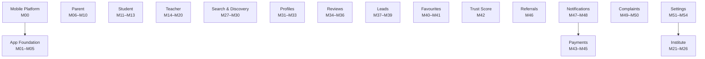

# GuruConnect Mobile App — Software Requirements Specification

Implementation-ready SRS for the GuruConnect **mobile app** (Parents, Students, Teachers, Institutes), split into **55 modules** (M0 platform foundation + the 54 requested modules) in build order. Stack: **React Native (Expo dev build) + TypeScript**, **Node.js 20 + Express 4** (same API codebase as the admin portal), **PostgreSQL 16** (same database), **Firebase Cloud Messaging**, **Cloudflare R2**, **Razorpay**.

This pack is a companion to the **GuruConnect Admin Web Portal SRS** (`guruconnect-admin-srs.zip` / its viewer) — they share one database and one backend codebase. Read `00-conventions.md` here first; it only states what's different for the mobile app and refers back to the admin conventions for anything already established there.

| | |
| --- | --- |
| Modules | 55 |
| Screens | 216 |
| New PostgreSQL tables | 27 (+ 3 columns added to `app_users`) |
| App API endpoints (`/api/v1/app`) | 240 |
| Roles | Parent, Student, Teacher, Institute staff |
| Estimated build effort | 180–220 developer-days (one React Native + one backend developer, in parallel where phases allow) |

## Development setup (the mobile app in this repo)

The app lives in `apps/mobile` (Expo, TypeScript). The backend is a separate project (`GuruBackend`, Express + Postgres) that serves `/api/v1/app`.

**Prerequisites:** Node 20+, the backend running locally, and the **Expo Go** app on your phone (same Wi-Fi as your PC).

```bash
# terminal 1 - backend
cd path/to/GuruBackend && npm run dev            # API on http://localhost:4000

# terminal 2 - app
cd apps/mobile
npm install
cp .env.example .env                             # set EXPO_PUBLIC_API_URL to http://<your PC's LAN IP>:4000/api/v1/app
npx expo start --go                              # scan the QR code with Expo Go
```

There is no SMS provider yet: the OTP appears in the backend terminal as `[dev-sms] OTP for +91...: 123456`.

```bash
cd apps/mobile
npx jest                                         # unit tests
npx tsc --noEmit                                 # typecheck
```

See `CLAUDE.md` for conventions and current build status.

## What's in this pack

```
guruconnect-mobile-srs/
  index.html                  Searchable viewer for everything below (open in any browser)
  README.md                   This file: build order, dependencies, how to apply the mobile migrations
  00-conventions.md           Read first: RN/Expo stack, navigation map, API conventions, auth & sessions, state, offline, push, uploads, security, testing
  01-data-model.md            New mobile tables + how they relate to the shared (admin) schema, by domain
  02-api-index.md             Every /api/v1/app endpoint with its auth requirement, grouped by module
  03-push-notification-catalogue.md  Every push/in-app event: recipient, template, deep link, category, urgency
  04-react-native-app-structure.md   Navigation map, screen route table, folder layout, shared components
  05-roadmap-and-enhancements.md     Delivery plan by phase and future enhancements per module
  modules/MNN-*.md             One file per module, 21 sections each
  sql/schema.sql               Whole SHARED schema in one file (admin migrations 000–048 + mobile migrations 100–154)
  sql/mobile_only.sql          Just the mobile additions (apply after the admin schema)
  sql/migrations/*.sql         One file per migration, admin and mobile, in numeric order
  sql/seed/001_rbac.sql, 002_reference_data.sql, 003_config.sql   Admin seeds (unchanged)
  sql/seed/004_mobile.sql      Mobile-only settings (OTP limits, quiet hours, FAQs, …)
```

## How each module file is organised

1 Module Purpose · 2 User Stories · 3 Business Rules & Logic · 4 Screen List · 5 Screen Flow & Navigation · 6 Screen Wireframe Description · 7 UI Components & Component Tree · 8 Validation Rules · 9 API Endpoints · 10 Request Payloads · 11 Response Payloads · 12 PostgreSQL Tables & Columns · 13 Relationships · 14 State Management · 15 Offline Handling · 16 Push Notification Requirements · 17 Security Rules · 18 Error Handling · 19 Testing Scenarios · 20 Audit Log Events · 21 Future Scalability Notes.

Sections 12–13 and the ER diagrams are generated from the SQL, so the docs and the database cannot drift apart.

## Implementation order

Build top to bottom. A module can start once everything in *Depends on* is merged — that includes admin-portal modules where noted (e.g. teacher verification needs Admin M16's queue to exist so there is something to approve into).

| # | Module | Phase | Roles | Depends on | New tables | Endpoints | Estimate |
| --- | --- | --- | --- | --- | --- | --- | --- |
| [M00](modules/M00-mobile-platform-foundation.md) | Mobile Platform Foundation | All app users (infrastructure used by every module) | M07, M08, M09, M10, M11, M12, M13, M14, M15 + Admin M00, Admin M04, Admin M07 | `user_devices`, `user_notifications`, `user_notification_preferences` | 9 | 5–6 days |
| [M01](modules/M01-splash-screen.md) | Splash Screen | Everyone (before sign-in and on every launch) | M00 + Admin M04 | — | 1 | 1–2 days |
| [M02](modules/M02-onboarding-screens.md) | Onboarding Screens | Everyone, signed out (first launch, or after an admin bumps the onboarding version) | M00, M01 | — | 0 | 1–2 days |
| [M03](modules/M03-authentication-selection.md) | Authentication Selection | Everyone, signed out | M00, M01, M02, M04 | — | 0 | 1 day |
| [M04](modules/M04-login.md) | Login | All (signed out) | M00, M03, M05 + Admin M01 | `otp_challenges`, `app_sessions`, `user_auth_identities` | 12 | 6–7 days |
| [M05](modules/M05-registration.md) | Registration | Registration token | M00, M04 | — | 2 | 2–3 days |
| [M06](modules/M06-parent-registration.md) | Parent Registration | Registration token | M00, M04, M05 | — | 1 | 3 days |
| [M07](modules/M07-parent-child-setup.md) | Parent Child Setup | Parent | M00, M06, M08, M30 | — | 5 | 4 days |
| [M08](modules/M08-parent-dashboard.md) | Parent Dashboard | Parent | M00, M06, M07, M30 + Admin M29, Admin M36, Admin M44 | — | 1 | 4–5 days |
| [M09](modules/M09-parent-profile.md) | Parent Profile | Parent | M00, M04, M06 + Admin M28 | — | 2 | 1–2 days |
| [M10](modules/M10-parent-subscription.md) | Parent Subscription | Parent | M00, M04, M43 + Admin M05, Admin M30, Admin M41 | — | 4 | 3 days |
| [M11](modules/M11-student-registration.md) | Student Registration | Registration token, Student | M00, M04, M05 + Admin M31, Admin M52 | — | 3 | 3–4 days |
| [M12](modules/M12-student-dashboard.md) | Student Dashboard | Student | M00, M11, M30 + Admin M36, Admin M44 | — | 1 | 3 days |
| [M13](modules/M13-student-subscription.md) | Student Subscription | Student | M00, M04, M10, M11, M43 + Admin M05, Admin M32, Admin M41 | — | 4 | 2 days |
| [M14](modules/M14-teacher-registration.md) | Teacher Registration | Registration token (account creation), Teacher (remaining steps) | M00, M05, M15 + Admin M16 | `teacher_qualifications` | 10 | 5–6 days |
| [M15](modules/M15-teacher-document-upload.md) | Teacher Document Upload | Teacher | M00, M14, M16, M43 | — | 4 | 4–5 days |
| [M16](modules/M16-teacher-verification-status.md) | Teacher Verification Status | Teacher | M15 + Admin M16 | — | 2 | 2–3 days |
| [M17](modules/M17-teacher-profile-builder.md) | Teacher Profile Builder | Teacher | M14, M16, M19 | `teacher_fee_plans` | 7 | 4–5 days |
| [M18](modules/M18-teacher-dashboard.md) | Teacher Dashboard | Teacher | M16, M17, M36, M38, M39 + Admin M21 | — | 1 | 3 days |
| [M19](modules/M19-teacher-availability.md) | Teacher Availability | Teacher | M16, M38 | `teacher_availability`, `teacher_time_off` | 5 | 3 days |
| [M20](modules/M20-teacher-notifications.md) | Teacher Notifications | Teacher (screen); the endpoints are shared and reused by every role via Module 47 | M00, M16, M34, M36, M37, M38, M41, M44 | — | 2 | 2–3 days |
| [M21](modules/M21-institute-registration.md) | Institute Registration | Institute owner signing up (registration token), invited institute staff joining (registration token), primary manager editing basics before review | M00, M04, M05, M10, M22, M24, M25 + Admin M09 | — | 2 | 4–5 days |
| [M22](modules/M22-institute-verification.md) | Institute Verification | Institute managers (upload, pay, submit), counsellors (view status only) | M00, M21, M23, M27, M40, M43, M53 + Admin M05 | — | 5 | 4–5 days |
| [M23](modules/M23-institute-dashboard.md) | Institute Dashboard | Institute managers and counsellors | M00, M22, M24, M25, M26, M32, M35, M39 + Admin M38 | `institute_profile_views`, `institute_daily_stats` | 1 | 3–4 days |
| [M24](modules/M24-institute-manager.md) | Institute Manager | Primary manager (the owner) and other managers — invite, edit and disable staff; edit the institute profile and batches; counsellors — view staff, profile and batches, no edits | M00, M21, M22, M23, M25 + Admin M24 | — | 10 | 4–5 days |
| [M25](modules/M25-institute-teacher-management.md) | Institute Teacher Management | Institute manager (add, edit, remove, assign, link), counsellor (view only), teacher (accept/decline a link invite from their own app) | M00, M16, M24 + Admin M26 | — | 8 | 3–4 days |
| [M26](modules/M26-institute-rating-display.md) | Institute Rating Display | Any signed-in user and limited public viewers (see the rating on a profile, search card or share link), institute staff (see the same numbers plus the next review date and history) | M00, M22, M23 + Admin M27, Admin M34 | — | 2 | 2–3 days |
| [M27](modules/M27-teacher-search.md) | Teacher Search | Learner (parent or student, browse also Public-limited on shared links) | M00, M07, M08, M18, M19, M20, M29, M31, M36, M42 + Admin M16 | `user_search_history` | 6 | 6–7 days |
| [M28](modules/M28-institute-search.md) | Institute Search | Learner (parent or student, browse also Public-limited) | M00, M24, M27, M32, M35 + Admin M22 | — | 1 | 3–4 days |
| [M29](modules/M29-advanced-filters.md) | Advanced Filters | Learner | M00, M17, M18, M19, M20, M27, M28 + Admin M16 | `saved_searches` | 5 | 4–5 days |
| [M30](modules/M30-recommendation-engine.md) | Recommendation Engine | Learner | M00, M07, M08, M12, M22, M27, M36, M37, M40 + Admin M16 | `recommendation_dismissals`, `recommendation_impressions` | 3 | 6–7 days |
| [M31](modules/M31-teacher-profile-view.md) | Teacher Profile View | Learner, Public (shared link, limited view) | M00, M17, M18, M19, M20, M27, M30, M33, M34, M36, M37, M38, M42 + Admin M16 | — | 2 | 5–6 days |
| [M32](modules/M32-institute-profile-view.md) | Institute Profile View | Learner, Public (limited) | M00, M24, M26, M27, M28, M33, M35, M39 + Admin M22 | — | 3 | 4–5 days |
| [M33](modules/M33-profile-sharing.md) | Profile Sharing | Any user (create a share), Public (resolve a shared link) | M00, M31, M32, M42 + Admin M42 | `profile_shares` | 3 | 3–4 days |
| [M34](modules/M34-teacher-reviews.md) | Teacher Reviews | Parents and students (write, edit, delete, report); any signed-in user (read); teachers (report reviews on their own profile) | M00, M31, M36, M37, M38, M49 + Admin M33, Admin M35, Admin M36 | — | 7 | 3–4 days |
| [M35](modules/M35-institute-reviews.md) | Institute Reviews | Parents and students (write, edit, delete, report); any signed-in user (read); institute managers and counsellors (reply, report) | M00, M26, M32, M34, M37, M38, M39 + Admin M27, Admin M34, Admin M35 | — | 9 | 3 days |
| [M36](modules/M36-teacher-reply-to-review.md) | Teacher Reply To Review | Teachers (read their reviews, reply, edit or delete a reply, report) | M00, M18, M34 + Admin M33, Admin M35 | — | 3 | 2 days |
| [M37](modules/M37-contact-teacher.md) | Contact Teacher | Parents and students (call, message, request a call-back); teachers (lead inbox, reply, call back, change status); institute staff use the same lead and message endpoints for enquiries (M39) | M00, M10, M13, M31, M38, M39, M43, M44, M49 + Admin M05, Admin M38, Admin M40, Admin M43 | `lead_messages` | 13 | 6–7 days |
| [M38](modules/M38-demo-class-request.md) | Demo Class Request | Parents and students (book, reschedule, cancel a demo and report the outcome); teachers (confirm, reschedule, mark complete or no-show); institute staff (confirm and manage campus visits) | M00, M19, M31, M37 + Admin M38, Admin M39 | — | 11 | 5–6 days |
| [M39](modules/M39-contact-institute.md) | Contact Institute | Parents and students (send an enquiry, message, call, book a campus visit); institute managers and counsellors (enquiry inbox, assignment, status, reply) | M00, M32, M37, M38 + Admin M25, Admin M26, Admin M38 | — | 3 | 2–3 days |
| [M40](modules/M40-favorite-teachers.md) | Favorite Teachers | Parents and students (save, tag, note, remove); no institute or teacher role | M00, M27, M30, M31 + Admin M16 | `user_favorites` | 4 | 2 days |
| [M41](modules/M41-favorite-institutes.md) | Favorite Institutes | Parents and students (save, tag, note, remove, compare); no institute or teacher role | M00, M26, M32, M40 + Admin M22, Admin M27 | — | 5 | 1–2 days |
| [M42](modules/M42-trust-score-display.md) | Trust Score Display | Any user (view a teacher's public score); teachers (view their own detailed breakdown, tips and history) | M00, M16, M17, M27, M31, M34 + Admin M36, Admin M37 | — | 3 | 3 days |
| [M43](modules/M43-payment-gateway.md) | Payment Gateway | Parents, students, teachers and institute managers (every paid action in the app) | M00, M04, M10, M46 + Admin M05, Admin M40, Admin M41 | — | 4 | 5–6 days |
| [M44](modules/M44-subscriptions.md) | Subscriptions | Parents and students (membership), teachers (registration renewal, premium and featured boosts), institute managers (registration renewal) | M10, M13, M43, M45, M47 + Admin M05, Admin M40, Admin M41 | — | 6 | 4–5 days |
| [M45](modules/M45-payment-history.md) | Payment History | Parents, students, teachers and institute managers (anyone who has paid GuruConnect) | M00, M43, M44 + Admin M40 | — | 4 | 2–3 days |
| [M46](modules/M46-referral-system.md) | Referral System | Parents, students (Learner Referral), teachers (Teacher Referral) and institute managers (Institute Referral) — any signed-in user who can invite or be invited | M00, M05, M33 + Admin M06, Admin M42 | `wallet_ledger` | 4 | 4–5 days |
| [M47](modules/M47-push-notifications.md) | Push Notifications | Any user (infrastructure and reference used by every other module) | M00, M20 + Admin M46 | — | 1 | 3–4 days |
| [M48](modules/M48-notification-center.md) | Notification Center | Any user | M00, M47 + Admin M46 | — | 4 | 2 days |
| [M49](modules/M49-report-user.md) | Report User | Parent, Student, Teacher, Institute staff (any signed-in role — "Any user") | M00, M37, M50 + Admin M36, Admin M43 | `user_blocks` | 4 | 4–5 days |
| [M50](modules/M50-complaint-history.md) | Complaint History | Any user (as reporter or as the reported party) | M49 + Admin M43 | — | 3 | 2–3 days |
| [M51](modules/M51-account-settings.md) | Account Settings | Any user (parent, student, teacher, institute staff) | M00, M04 + Admin M00 | — | 9 | 4–5 days |
| [M52](modules/M52-privacy-settings.md) | Privacy Settings | Any user | M00, M05, M06, M11, M14, M21, M51 + Admin M04 | `user_privacy_settings`, `user_consents` | 5 | 3 days |
| [M53](modules/M53-help-support.md) | Help & Support | Any user (FAQ browsing also Public, signed out) | M00, M40 | `faqs`, `support_tickets`, `support_ticket_messages` | 7 | 4 days |
| [M54](modules/M54-delete-account.md) | Delete Account | Any user | M04, M31, M40, M42, M46, M51 + Admin M28, Admin M40, Admin M43 | `account_deletion_requests` | 4 | 3–4 days |

## Phase dependency graph



**Ordering notes.**
- **M10/M13 (subscriptions) and M15/M22 (registration fees) need M43's payment API and `PaymentSheet` component.** Build M43 first, or ship M10/M13/M15/M22 in a "browse only" mode until it lands.
- **M08/M12 dashboards ship with simple rule-based ranking (v0)**, replaced by **M30**'s scored engine behind the same response shape — no screen changes needed when M30 lands.
- **Push delivery infrastructure** (device registration, notification inbox, `NotificationService`) is built once in **M00**; **M20** adds the preference screen; **M47** is the full event catalogue; **M48** is the inbox screen.
- **`user_consents`** is owned by **M52** but written at every registration flow (M05/M06/M11/M14/M21) and by M11's parental-consent flow — its migration (152) runs with all the others at the start, so there is no runtime ordering issue, only a documentation one.
- Every **admin-portal dependency** (e.g. M16 needs Admin M16's verification queue to review into, M43 needs Admin M40's webhook processing) means the admin backend for that area should exist before the mobile module is tested end-to-end; the mobile module's own screens can still be built in parallel against a mock.

## Running the database

This app **shares its database with the admin portal**. If you already applied the admin schema, apply only the mobile addition:

```bash
psql -v ON_ERROR_STOP=1 -d guruconnect -f sql/mobile_only.sql
for f in sql/seed/004_mobile.sql; do psql -v ON_ERROR_STOP=1 -d guruconnect -f "$f"; done
```

**Fresh database (both apps together):**

```bash
createdb guruconnect
psql -v ON_ERROR_STOP=1 -d guruconnect -f sql/schema.sql
for f in sql/seed/*.sql; do psql -v ON_ERROR_STOP=1 -d guruconnect -f "$f"; done
```

The full schema (admin + mobile, 98 tables) and all seeds (twice) were run on a clean PostgreSQL 16 database while building this pack with no errors.

## Confirm before go-live

- **Firebase project**: create it, add `google-services.json` / `GoogleService-Info.plist`, generate the FCM server key for the API.
- **Cloudflare R2**: create `gc-public` (CDN-fronted) and `gc-private` buckets, generate S3-compatible API tokens for presigned URLs.
- **SMS/OTP provider** (MSG91, Gupshup or similar) and **WhatsApp Business API** if `channel: whatsapp` is used for OTP.
- **Google Sign-In** OAuth client ids (Android SHA-1, iOS bundle id, Web client id for server-side verification).
- **Razorpay** Standard Checkout keys (shared with the admin portal's payment gateway).
- **App Store / Play Store listings** — `app.store_url_ios` is a placeholder until the App Store listing exists (see the admin pack's confirm list for prices and the grievance officer name, which the app also displays).
- **Play Integrity / App Attest, and TLS certificate pinning** are noted as v1.1 hardening in `00-conventions.md` §13 and each module's §17 — decide the timeline before launch if the threat model needs them at launch.

## Glossary

| Term | Meaning |
| --- | --- |
| Learner | A parent (on behalf of children) or a student using the app — used where a rule applies to both |
| Registration token | Short-lived JWT issued after a phone/email is OTP-verified; the only credential the four registration endpoints accept |
| Lead | An enquiry, call-back or demo request from a learner to a teacher or institute |
| Trust Score | 0–100 score per teacher; the app shows the same number and factors the admin panel computes (Admin M36) |
| Wallet | GuruConnect credit balance from referral rewards, usable at checkout (M43/M46) |
| Quiet hours | 21:30–08:00 IST window in which non-urgent push is held, not dropped |
| IST | All dates shown and grouped in Asia/Kolkata |
