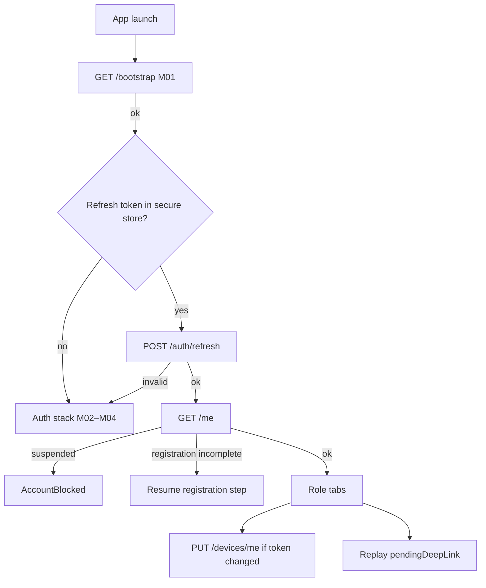
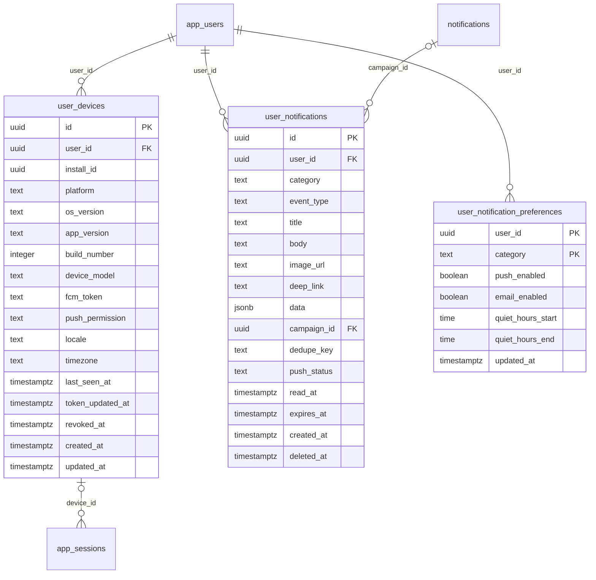

# Module 0 · Mobile Platform Foundation

> **Phase 0 · Mobile Platform** · **Used by:** All app users (infrastructure used by every module) · **Depends on:** Admin M00 (audit_logs, files, app_users), Admin M04 (system_settings), Admin M07–M15 (masters) · **New tables:** `user_devices`, `user_notifications`, `user_notification_preferences` · **Uses:** `app_users`, `files`, `audit_logs`, `system_settings`, `classes`, `subjects`, `boards`, `teaching_modes`, `teacher_categories`, `states`, `cities`, `areas` · **Build estimate:** 5–6 days

## 1. Module Purpose

The shared plumbing every other module relies on, built once before any feature screen: the app shell and providers, the API client (headers, envelope, token refresh, error mapping), secure session storage, the persisted query cache and offline mutation queue, device registration for push (FCM token per install), the notification inbox table and `NotificationService` on the server, presigned uploads to Cloudflare R2, cached master data (classes, subjects, boards, modes, categories, locations), analytics event batching, deep-link routing and the reusable UI kit. It also adds three columns to `app_users`.

## 2. User Stories

- As a **developer**, I want one API client that adds auth and device headers, refreshes tokens and maps errors so that feature modules only call typed hooks.
- As a **parent on a slow network**, I want screens to open instantly from saved data so that the app feels fast even on 3G.
- As a **teacher**, I want notifications to reach every phone I'm signed in on so that I never miss a lead.
- As a **user**, I want uploads to continue if I switch apps so that I don't have to redo a document photo.
- As **product**, I want consistent analytics events (screen views, taps, impressions) without collecting personal data.

## 3. Business Rules & Logic

**BR-0.1 App shell.** `App.tsx` mounts, in order: `SafeAreaProvider` → `GestureHandlerRootView` → `ThemeProvider` (light/dark tokens, follows system) → `I18nProvider` → `QueryClientProvider` (persisted) → `AppErrorBoundary` → `NavigationContainer` (linking config) → `RootNavigator`. Toast host and bottom-sheet host sit above the navigator.

**BR-0.2 API client (`lib/api.ts`).**
- Adds the standard headers from conventions §5; `X-Install-Id` is a uuid created on first launch and kept in secure store (survives sign-out, reset only on reinstall).
- Unwraps `{ data, meta }`; throws `AppError { code, message, details, status, requestId }` for error envelopes and network failures (`NETWORK_OFFLINE`, `NETWORK_TIMEOUT` are client-only codes).
- On `AUTH_TOKEN_EXPIRED` runs a **single-flight** refresh (M04 `POST /auth/refresh`) and retries the original request once. Concurrent 401s wait for the same promise.
- On `APP_UPDATE_REQUIRED` / `MAINTENANCE` emits a global event that the root navigator handles (M01 screens).
- Timeouts: 15 s default, 120 s for uploads. GETs retry twice (exponential backoff 1 s, 3 s) on network errors and 502/503/504; mutations never auto-retry unless the call passes `idempotent: true`.

**BR-0.3 Session storage.** Access token in memory (`useSession` Zustand store). Refresh token, install id and the encryption key for the encrypted MMKV instance in `expo-secure-store` (`keychainAccessible: AFTER_FIRST_UNLOCK`). Sign-out wipes query cache, stores, encrypted MMKV and the refresh token.

**BR-0.4 Query cache persistence.** TanStack Query persister on encrypted MMKV, `maxAge` 24 h, `buster` = app version, throttled writes (1 s). Queries opt out with `meta: { persist: false }` (OTP, payment status, presigned URLs, anything containing full phone numbers).

**BR-0.5 Offline mutation queue.** Mutations declared with `offline: 'queue'` are stored (key, variables, client id, created time) in MMKV when offline or when the request fails with a network error, and replayed FIFO on reconnect (`NetInfo` `isInternetReachable`). Items older than 7 days are dropped with a toast. The server makes each queued action idempotent (unique client id or natural unique index).

**BR-0.6 Device registration.** After sign-in and on each foreground: if FCM token, permission state or app version changed since the last successful call → `PUT /devices/me`. The server upserts on `(user_id, install_id)`; if the same FCM token is active on another user's row (shared phone), that row is revoked first (unique index `uq_user_devices_token`). Sign-out → `DELETE /devices/me` (revokes; best effort, also done server-side when the session is revoked).

**BR-0.7 NotificationService (server).** `notify(userId, { category, eventType, title, body, deepLink, data, dedupeKey, urgent })`: inserts `user_notifications` (ON CONFLICT on dedupe key does nothing → no duplicate push), reads preferences (missing row = push on), applies quiet hours from `notifications.quiet_hours` unless `urgent`, enqueues `push:send` with the notification id. The worker loads active devices and sends one FCM v1 request per token (batched, 500 per call), sets `push_status`, revokes devices whose token returns `UNREGISTERED`/`INVALID_ARGUMENT`. Quiet-hour pushes are delayed to the end of quiet hours, not dropped. Unread count for the app icon badge = count of unread, non-deleted rows (cached in Redis `unread:<userId>`, invalidated on insert/read).

**BR-0.8 Uploads to R2.** `POST /uploads/presign` validates purpose, MIME type and size against conventions §10, creates a `files` row (`status = 'pending'`, `storage_provider = 'r2'`, `uploaded_by_type = 'app_user'`), and returns a presigned PUT URL (10 min). `POST /uploads/:fileId/confirm` does a `HEAD` on the object, checks size and content type match, sets `status = 'active'`, and for `gc-public` purposes returns the CDN URL. Pending files older than 24 h are deleted by a job (object + row). A user may have at most 20 pending uploads.

**BR-0.9 Masters cache.** `GET /masters` returns all active classes, subjects (with class ranges), boards, teaching modes, teacher categories, states and cities in one payload with an `ETag` (hash of the masters' max `updated_at`). The app stores it in MMKV and sends `If-None-Match`; `304` keeps the cache. Areas are fetched per city (`GET /masters/areas?cityId=`), cached 7 days. `GET /bootstrap` (M01) includes `mastersVersion` so the app knows when to refresh.

**BR-0.10 Analytics events.** `POST /events` accepts batches of up to 50 events `{ name, ts, props, clientEventId }`, flushed every 30 s or on background. Names are `<module>_<action>` (e.g. `search_result_click`). Props must not contain names, phones, emails or free text. Events for impressions and profile views feed `teacher_profile_views`, `institute_profile_views`, `recommendation_impressions` server-side. If `allow_analytics` is false (M52), only operational events (`app_open`, `crash`) are sent.

**BR-0.11 Deep links.** `lib/deeplinks.ts` maps paths (conventions §4) to screens. Links needing auth are stored in `pendingDeepLink` and replayed after login/registration. Unknown links open Home with a toast "That link isn't available."

**BR-0.12 `GET /me`.** Returns the account summary used on every launch after bootstrap: user id, role, profile id, name, photo, language, account status, registration/verification state per role (e.g. teacher `verificationStatus`), unread notification count, subscription summary, feature flags. The app uses it to choose the tab navigator and to show blocking states (suspended, pending verification).

**BR-0.13 New `app_users` columns.** `preferred_language` (drives push/email language), `profile_photo_file_id` (parents, students, institute staff), `signup_source` (set at registration: `referral` when a code was used, `deep_link` when the install came from a share link, otherwise `organic`).

## 4. Screen List

| Screen | Route name | Purpose |
| --- | --- | --- |
| Root navigator | `Root` | Chooses Splash → Maintenance/ForceUpdate → Onboarding/Auth → role tabs |
| Global offline banner | (overlay) | Shows when offline; tap for details |
| Toast host | (overlay) | Success/error/info toasts |
| Error fallback | `ErrorFallback` | Crash fallback with Restart and request id |
| Account blocked | `AccountBlocked` | Shown when `/me` or any call returns `ACCOUNT_SUSPENDED` |
| Upload progress sheet | (bottom sheet) | Progress, retry and cancel for uploads |

## 5. Screen Flow & Navigation


Offline launch with a valid cached session: skip network calls, open role tabs from the cached `/me`, show the offline banner, refresh when online.

## 6. Screen Wireframe Description

**Offline banner** — 32 dp strip under the status bar, neutral dark background, cloud-off icon, text "You're offline. Showing saved data." Tapping expands to "Some actions will be sent when you're back online (2 waiting)." Disappears 2 s after reconnecting with "Back online".

**Error fallback** — centred illustration, heading "Something went wrong", body "Restart the app to continue. If this keeps happening, contact support.", primary button "Restart", small text "Error ID 3f2a…" (long-press copies).

**Account blocked** — lock icon, heading "Your account is on hold", reason from the server (e.g. "Suspended while we review a report"), "Until 12 Oct 2026" if temporary, buttons "Contact support" (opens M53) and "Sign out".

**Upload progress sheet** — file name, thumbnail, progress bar with percentage, "Uploading 2 of 3", buttons "Cancel" and, on failure, "Retry".

## 7. UI Components & Component Tree

```
App
├─ Providers (SafeArea, Gesture, Theme, I18n, QueryClient+Persister, ErrorBoundary)
├─ NavigationContainer (linking)
│  └─ RootNavigator
│     ├─ SplashStack (M01) · AuthStack (M02–M05) · RegistrationStack (M06/M11/M14/M21)
│     └─ ParentTabs | StudentTabs | TeacherTabs | InstituteTabs
├─ OfflineBanner
├─ ToastHost
└─ BottomSheetHost
```
Shared UI kit (`components/ui`): `Button` (primary/secondary/ghost/destructive, loading), `TextField` (label, helper, error, counter), `PhoneField` (+91 prefix, 10 digits), `OtpInput` (6 cells, autofill), `Select` / `MultiSelect` (bottom-sheet list with search), `Chip` / `ChipGroup`, `Card`, `Avatar` (initials fallback), `Badge`, `StatusPill`, `Skeleton`, `EmptyState`, `ErrorState` (message + Retry + request id), `ListFooterLoader`, `StickyActionBar`, `ConfirmSheet`, `ImagePickerField`, `DocumentPickerField`, `ProgressBar`, `SectionHeader`, `KeyValueRow`.

Domain components (`components/domain`), built here as shells and completed by their modules: `TeacherCard`, `InstituteCard`, `VerifiedBadge`, `TrustScoreRing`, `RatingStars`, `PriceTag`, `ChildChip`, `LocationPill`.

Hooks: `useApi`, `useMe`, `useMasters`, `useAreas(cityId)`, `useUpload(purpose)`, `useNetwork`, `useOfflineQueue`, `useDeepLink`, `useTrack(eventName)`.

## 8. Validation Rules

| Input | Rule |
| --- | --- |
| `PUT /devices/me` installId | uuid v4 |
| platform | `android` or `ios` |
| appVersion | semver `^\d+\.\d+\.\d+$` |
| fcmToken | 20–4,096 chars or null |
| pushPermission | granted, denied, not_determined, provisional |
| timezone | IANA name; default Asia/Kolkata |
| presign purpose | one of the purposes in conventions §10 |
| presign mimeType / sizeBytes | allowed for the purpose; size 1 byte – purpose max |
| fileName | 1–120 chars, no path separators |
| events batch | 1–50 events; name `^[a-z0-9_]{3,60}$`; props object ≤ 2 KB, no keys named phone, email, name, message |

## 9. API Endpoints

| Method | Path | Auth | Description |
| --- | --- | --- | --- |
| GET | /me | Any user | Account summary, role, profile id, flags, unread count |
| PUT | /devices/me | Any user | Register or update this install's device and FCM token |
| DELETE | /devices/me | Any user | Revoke this install's device (sign-out) |
| POST | /uploads/presign | Any user (and Registration token for registration uploads) | Create a pending file and presigned R2 PUT URL |
| POST | /uploads/:fileId/confirm | Any user | Verify the uploaded object and activate the file |
| GET | /files/:id/url | Any user (owner only) | 60-second presigned GET for a private file |
| GET | /masters | Public | Classes, subjects, boards, modes, categories, states, cities (ETag) |
| GET | /masters/areas | Public | Areas of a city (`?cityId=`) |
| POST | /events | Public (install) / Any user | Batched analytics and impression events |

## 10. Request Payloads

```json
// PUT /devices/me
{ "installId": "6f0e4c1a-5b7e-4a0e-9d8c-2f1b3c4d5e6f", "platform": "android", "osVersion": "14", "appVersion": "1.0.0", "buildNumber": 12,
  "deviceModel": "SM-A546E", "fcmToken": "eXk2…:APA91b…", "pushPermission": "granted", "locale": "en-IN", "timezone": "Asia/Kolkata" }

// POST /uploads/presign
{ "purpose": "teacher_document", "mimeType": "image/jpeg", "sizeBytes": 845213, "fileName": "aadhaar-front.jpg" }

// POST /events
{ "events": [ { "clientEventId": "0b1c…", "name": "search_result_click", "ts": "2026-09-26T10:12:03.120Z", "props": { "teacherId": "…", "position": 3, "rail": "search" } } ] }
```

## 11. Response Payloads

```json
// 200 GET /me
{ "data": { "userId": "…", "role": "parent", "profileId": "…", "fullName": "Lakshmi Venkatesh", "photoUrl": null, "language": "en", "accountStatus": "active",
  "registration": { "complete": true, "nextStep": null }, "teacher": null,
  "subscription": { "status": "trial", "planName": "Parent membership · Monthly", "endsAt": "2026-10-03T18:29:59Z" },
  "unreadNotifications": 3, "flags": { "messagesEnabled": true, "walletEnabled": true } } }

// 200 PUT /devices/me
{ "data": { "deviceId": "…", "pushEnabled": true } }

// 201 POST /uploads/presign
{ "data": { "fileId": "…", "uploadUrl": "https://<account>.r2.cloudflarestorage.com/gc-private/teacher-docs/…?X-Amz-Signature=…",
  "method": "PUT", "headers": { "Content-Type": "image/jpeg" }, "expiresAt": "2026-09-26T10:22:03Z" } }

// 200 POST /uploads/:fileId/confirm
{ "data": { "fileId": "…", "status": "active", "publicUrl": null } }

// 200 GET /masters   (ETag: "m-20260926-7f3a")
{ "data": { "version": "m-20260926-7f3a",
  "classes": [ { "id": "…", "name": "Class 5", "levelOrder": 7, "stage": "primary" } ],
  "subjects": [ { "id": "…", "name": "Mathematics", "classFromOrder": 1, "classToOrder": 14 } ],
  "boards": [ { "id": "…", "name": "CBSE" } ], "teachingModes": [ { "id": "…", "name": "Online", "code": "online" } ],
  "teacherCategories": [ { "id": "…", "name": "School Tutor" } ], "states": [ { "id": "…", "name": "Karnataka" } ],
  "cities": [ { "id": "…", "name": "Bengaluru", "stateId": "…" } ] } }
```

## 12. PostgreSQL Tables & Columns

**New tables owned by this module** (migration `sql/migrations/100_app_m00_mobile_app_foundation_devices_notification_inbox_notification_preferences.sql`)

### `user_devices`

Every app install a user has signed in on, with its FCM token. One row per (user, install).

| Column | Type | Null | Default | Constraints / References | Description |
| --- | --- | --- | --- | --- | --- |
| `id` | uuid | no | gen_random_uuid() | PK | Primary key |
| `user_id` | uuid | no | — | FK → `app_users.id` (on delete cascade) | Owner |
| `install_id` | uuid | no | — | — | Random id generated on first launch and kept in secure storage |
| `platform` | text | no | — | CHECK platform IN ('android','ios') | OS |
| `os_version` | text | yes | — | — | e.g. 14 |
| `app_version` | text | no | — | — | Semver of the build, e.g. 1.2.0 |
| `build_number` | integer | yes | — | — | Store build number |
| `device_model` | text | yes | — | — | e.g. SM-A546E |
| `fcm_token` | text | yes | — | — | Firebase Cloud Messaging token; NULL when push permission denied |
| `push_permission` | text | no | 'not_determined' | CHECK push_permission IN ('granted','denied','not_determined','provisional') | OS permission state |
| `locale` | text | yes | — | — | e.g. en-IN |
| `timezone` | text | no | 'Asia/Kolkata' | — | IANA timezone |
| `last_seen_at` | timestamptz | no | now() | — | Last API call from this install |
| `token_updated_at` | timestamptz | yes | — | — | When fcm_token last changed |
| `revoked_at` | timestamptz | yes | — | — | Set on logout / token UNREGISTERED |
| `created_at` | timestamptz | no | now() | — | First sign-in on this install |
| `updated_at` | timestamptz | no | now() | — | Updated |

<details><summary>DDL</summary>

```sql
CREATE TABLE user_devices (
  id uuid PRIMARY KEY DEFAULT gen_random_uuid(), -- Primary key
  user_id uuid NOT NULL REFERENCES app_users(id) ON DELETE CASCADE, -- Owner
  install_id uuid NOT NULL, -- Random id generated on first launch and kept in secure storage
  platform text NOT NULL CHECK (platform IN ('android','ios')), -- OS
  os_version text, -- e.g. 14
  app_version text NOT NULL, -- Semver of the build, e.g. 1.2.0
  build_number integer, -- Store build number
  device_model text, -- e.g. SM-A546E
  fcm_token text, -- Firebase Cloud Messaging token; NULL when push permission denied
  push_permission text NOT NULL DEFAULT 'not_determined' CHECK (push_permission IN ('granted','denied','not_determined','provisional')), -- OS permission state
  locale text, -- e.g. en-IN
  timezone text NOT NULL DEFAULT 'Asia/Kolkata', -- IANA timezone
  last_seen_at timestamptz NOT NULL DEFAULT now(), -- Last API call from this install
  token_updated_at timestamptz, -- When fcm_token last changed
  revoked_at timestamptz, -- Set on logout / token UNREGISTERED
  created_at timestamptz NOT NULL DEFAULT now(), -- First sign-in on this install
  updated_at timestamptz NOT NULL DEFAULT now() -- Updated
);
CREATE UNIQUE INDEX uq_user_devices_install ON user_devices (user_id, install_id);
CREATE UNIQUE INDEX uq_user_devices_token ON user_devices (fcm_token) WHERE fcm_token IS NOT NULL AND revoked_at IS NULL;
CREATE INDEX idx_user_devices_user_active ON user_devices (user_id) WHERE revoked_at IS NULL;
CREATE TRIGGER trg_user_devices_updated BEFORE UPDATE ON user_devices FOR EACH ROW EXECUTE FUNCTION set_updated_at();
```

</details>

**Indexes:** `uq_user_devices_install` (unique) on `(user_id, install_id)`; `uq_user_devices_token` (unique) on `(fcm_token) WHERE fcm_token IS NOT NULL AND revoked_at IS NULL`; `idx_user_devices_user_active` on `(user_id) WHERE revoked_at IS NULL`

### `user_notifications`

The in-app notification inbox for every user: transactional events and copies of admin campaigns.

| Column | Type | Null | Default | Constraints / References | Description |
| --- | --- | --- | --- | --- | --- |
| `id` | uuid | no | gen_random_uuid() | PK | Primary key |
| `user_id` | uuid | no | — | FK → `app_users.id` (on delete cascade) | Recipient |
| `category` | text | no | — | CHECK category IN ('account','verification','leads','demos','reviews','payments','subscription','referral','complaints','recommendations','announcements') | Preference bucket |
| `event_type` | text | no | — | — | Machine event, e.g. teacher.approved, lead.received, review.published |
| `title` | text | no | — | — | Max 65 chars |
| `body` | text | no | — | — | Max 240 chars |
| `image_url` | text | yes | — | — | Optional rich image (CDN URL) |
| `deep_link` | text | yes | — | — | App route opened on tap, e.g. gc://leads/<id> |
| `data` | jsonb | no | '{}'::jsonb | — | Extra payload, e.g. {"leadId":"…"} |
| `campaign_id` | uuid | yes | — | FK → `notifications.id` (on delete set null) | Set when the item comes from an admin campaign |
| `dedupe_key` | text | yes | — | — | Prevents duplicates when an event is retried, e.g. lead.received:<leadId> |
| `push_status` | text | no | 'pending' | CHECK push_status IN ('pending','sent','failed','skipped_pref','skipped_quiet_hours','no_device') | Push outcome |
| `read_at` | timestamptz | yes | — | — | Opened in the inbox or via push tap |
| `expires_at` | timestamptz | yes | — | — | Hidden after this (e.g. time-limited offers) |
| `created_at` | timestamptz | no | now() | — | Created |
| `deleted_at` | timestamptz | yes | — | — | Soft delete (user swiped away) |

<details><summary>DDL</summary>

```sql
CREATE TABLE user_notifications (
  id uuid PRIMARY KEY DEFAULT gen_random_uuid(), -- Primary key
  user_id uuid NOT NULL REFERENCES app_users(id) ON DELETE CASCADE, -- Recipient
  category text NOT NULL CHECK (category IN ('account','verification','leads','demos','reviews','payments','subscription','referral','complaints','recommendations','announcements')), -- Preference bucket
  event_type text NOT NULL, -- Machine event, e.g. teacher.approved, lead.received, review.published
  title text NOT NULL, -- Max 65 chars
  body text NOT NULL, -- Max 240 chars
  image_url text, -- Optional rich image (CDN URL)
  deep_link text, -- App route opened on tap, e.g. gc://leads/<id>
  data jsonb NOT NULL DEFAULT '{}'::jsonb, -- Extra payload, e.g. {"leadId":"…"}
  campaign_id uuid REFERENCES notifications(id) ON DELETE SET NULL, -- Set when the item comes from an admin campaign
  dedupe_key text, -- Prevents duplicates when an event is retried, e.g. lead.received:<leadId>
  push_status text NOT NULL DEFAULT 'pending' CHECK (push_status IN ('pending','sent','failed','skipped_pref','skipped_quiet_hours','no_device')), -- Push outcome
  read_at timestamptz, -- Opened in the inbox or via push tap
  expires_at timestamptz, -- Hidden after this (e.g. time-limited offers)
  created_at timestamptz NOT NULL DEFAULT now(), -- Created
  deleted_at timestamptz -- Soft delete (user swiped away)
);
CREATE UNIQUE INDEX uq_user_notifications_dedupe ON user_notifications (user_id, dedupe_key) WHERE dedupe_key IS NOT NULL;
CREATE INDEX idx_user_notifications_inbox ON user_notifications (user_id, created_at DESC) WHERE deleted_at IS NULL;
CREATE INDEX idx_user_notifications_unread ON user_notifications (user_id) WHERE read_at IS NULL AND deleted_at IS NULL;
```

</details>

**Indexes:** `uq_user_notifications_dedupe` (unique) on `(user_id, dedupe_key) WHERE dedupe_key IS NOT NULL`; `idx_user_notifications_inbox` on `(user_id, created_at DESC) WHERE deleted_at IS NULL`; `idx_user_notifications_unread` on `(user_id) WHERE read_at IS NULL AND deleted_at IS NULL`

### `user_notification_preferences`

Per-category push/email switches. Missing row = defaults (push on, email off).

| Column | Type | Null | Default | Constraints / References | Description |
| --- | --- | --- | --- | --- | --- |
| `user_id` | uuid | no | — | PK; FK → `app_users.id` (on delete cascade) | Owner |
| `category` | text | no | — | PK; CHECK category IN ('account','verification','leads','demos','reviews','payments','subscription','referral','complaints','recommendations','announcements') | Bucket |
| `push_enabled` | boolean | no | true | — | Send push for this category |
| `email_enabled` | boolean | no | false | — | Send email for this category |
| `quiet_hours_start` | time | yes | — | — | Local start of do-not-disturb, e.g. 22:00 |
| `quiet_hours_end` | time | yes | — | — | Local end, e.g. 07:00 |
| `updated_at` | timestamptz | no | now() | — | Updated |

**Table constraints:** `PRIMARY KEY (user_id, category)`

<details><summary>DDL</summary>

```sql
CREATE TABLE user_notification_preferences (
  user_id uuid NOT NULL REFERENCES app_users(id) ON DELETE CASCADE, -- Owner
  category text NOT NULL CHECK (category IN ('account','verification','leads','demos','reviews','payments','subscription','referral','complaints','recommendations','announcements')), -- Bucket
  push_enabled boolean NOT NULL DEFAULT true, -- Send push for this category
  email_enabled boolean NOT NULL DEFAULT false, -- Send email for this category
  quiet_hours_start time, -- Local start of do-not-disturb, e.g. 22:00
  quiet_hours_end time, -- Local end, e.g. 07:00
  updated_at timestamptz NOT NULL DEFAULT now(), -- Updated
  PRIMARY KEY (user_id, category)
);

CREATE TRIGGER trg_user_notification_preferences_updated BEFORE UPDATE ON user_notification_preferences FOR EACH ROW EXECUTE FUNCTION set_updated_at();
```

</details>

**Columns this module adds to existing tables**

- `app_users.preferred_language` text — App language chosen by the user

  ```sql
  ALTER TABLE app_users ADD COLUMN preferred_language text NOT NULL DEFAULT 'en' CHECK (preferred_language IN ('en','hi','kn','ta','te','mr','bn'));
  ```
- `app_users.profile_photo_file_id` uuid — Avatar for parents, students and institute staff (teachers use teachers.profile_photo_file_id)

  ```sql
  ALTER TABLE app_users ADD COLUMN profile_photo_file_id uuid REFERENCES files(id) ON DELETE SET NULL;
  ```
- `app_users.signup_source` text — How the account was acquired

  ```sql
  ALTER TABLE app_users ADD COLUMN signup_source text CHECK (signup_source IN ('organic','referral','campaign','admin_created','deep_link'));
  ```

**Existing tables this module reads or writes** (full definitions in the owning module)

| Table | Owner | Purpose |
| --- | --- | --- |
| `app_users` | Admin M00 | Login identity for every mobile app account (parent, student, teacher, institute staff). Role profiles hang off this table. |
| `files` | Admin M00 | Metadata for every uploaded object stored in S3 / Cloudflare R2. Binary content never touches PostgreSQL. |
| `audit_logs` | Admin M00 | Append-only record of every admin action and security event. Never updated or deleted by the application. |
| `system_settings` | Admin M04 | Typed key–value settings that change platform behaviour without a deploy. |
| `classes` | Admin M11 | Grades and levels learners study at, from Class 1 to competitive exam preparation. |
| `subjects` | Admin M12 | Subjects, exams and skills teachers can teach. |
| `boards` | Admin M13 | Education boards and curricula, e.g. CBSE, ICSE, state boards, IB. |
| `teaching_modes` | Admin M14 | How classes are delivered, e.g. Online, Offline at teacher's place, Home tuition, Hybrid. |
| `teacher_categories` | Admin M15 | Types of teacher shown as categories and used in parent preferences, e.g. Home Tutor, Coaching Faculty. |
| `states` | Admin M08 | States and union territories within a country. |
| `cities` | Admin M09 | Cities where teachers and institutes can be listed. |
| `areas` | Admin M10 | Localities within a city, used for "nearby" search and teacher coverage. |

- `app_users`: this module reads `account_status` on every request (cached) and adds three columns (below).
- `files`: rows created by presign with `storage_provider = 'r2'` (new default set in migration 100), `uploaded_by_type = 'app_user'`.
- `system_settings`: public keys are served through M01 `/bootstrap`; `notifications.quiet_hours` is read by NotificationService.
- Masters (`classes` … `areas`) are read-only for the app.

## 13. Relationships

**Foreign keys of new tables**

- `user_devices.user_id` → `app_users` — required, many-to-one, on delete **cascade**
- `user_notifications.user_id` → `app_users` — required, many-to-one, on delete **cascade**
- `user_notifications.campaign_id` → `notifications` — optional, many-to-one, on delete **set null**
- `user_notification_preferences.user_id` → `app_users` — required, many-to-one, on delete **cascade**

**Entity relationship diagram**



## 14. State Management

- `useSession` (Zustand, memory): `{ accessToken, role, userId, profileId, instituteId, setTokens(), clear() }`.
- `useAppFlags` (Zustand + MMKV): `{ installId, onboardingSeenVersion, lastRole, pushPromptShownAt, pendingDeepLink }`.
- `useOfflineQueue` (Zustand + MMKV): `{ items: QueuedMutation[], enqueue(), flush(), remove() }`.
- Query keys: `meKeys.me`, `mastersKeys.all`, `mastersKeys.areas(cityId)`. `useMe` has `staleTime` 60 s and refetches on app foreground.
- Upload state lives in `useUpload` (per call site) — `{ progress, status: idle|presigning|uploading|confirming|done|error, fileId }`.

## 15. Offline Handling

- `GET /me` and `GET /masters` are persisted; the app can start fully offline with a cached session.
- `PUT /devices/me` is queued (latest wins — the queue keeps only the newest device update).
- `POST /events` batches are kept in MMKV (max 500 events) and flushed when online.
- Uploads: online only to start; if interrupted, the sheet shows "Paused — will resume when online" and restarts from presign on reconnect.

## 16. Push Notification Requirements

This module provides the delivery infrastructure; it sends no events of its own. Android channels are created at first launch: `leads` (high), `account`, `payments`, `reviews` (default), `general` (low). The app handles notification taps in the three states described in conventions §9 and marks the item read via M48.

## 17. Security Rules

- Refresh token and install id only in secure store; encrypted MMKV key generated per install.
- `/files/:id/url` checks ownership (`uploaded_by_id = sub`) or a module-specific rule (e.g. a complaint attachment visible to its reporter only).
- Presigned URLs are single-object, short-lived, and never cached or logged.
- `/events` is rate limited (60 batches/min per install) and rejects PII keys; IPs are truncated before storage in analytics.
- `/masters` and `/bootstrap` are public but cached at the CDN edge for 5 minutes.
- Screens flagged `secure` (documents, OTP, payments) enable `FLAG_SECURE` / iOS snapshot blur through a `useSecureScreen()` hook.

## 18. Error Handling

| Scenario | Code | App behaviour |
| --- | --- | --- |
| No network | `NETWORK_OFFLINE` (client) | Offline banner; cached data; queued actions |
| Request timed out | `NETWORK_TIMEOUT` (client) | Retry button in ErrorState |
| Access token expired | `AUTH_TOKEN_EXPIRED` | Silent refresh + retry |
| Refresh invalid | `AUTH_REFRESH_INVALID` | Sign out → Login with message |
| Account suspended | `ACCOUNT_SUSPENDED` | AccountBlocked screen |
| Upload URL expired before PUT | R2 403 | Re-presign automatically once |
| Uploaded object doesn't match presign | `FILE_TYPE_NOT_ALLOWED` / `FILE_TOO_LARGE` | Inline error on the picker, file row deleted |
| Too many pending uploads | `LIMIT_REACHED` | "Finish or cancel your other uploads first." |
| Unknown deep link | — | Home + toast |

## 19. Testing Scenarios

- T0.1 Launch with no session → Auth stack; with a valid refresh token → role tabs; with a revoked token → Login with "Please sign in again."
- T0.2 Two requests get 401 at the same time → exactly one `/auth/refresh` call; both retried once.
- T0.3 Airplane mode: app opens from cache, banner visible; favourite added offline is sent once on reconnect (server sees one row).
- T0.4 FCM token changes → `PUT /devices/me` sent once; same token signed in on another account → first account's device revoked.
- T0.5 Upload 9.8 MB PDF succeeds; 10.5 MB rejected client-side; mismatched Content-Type rejected on confirm.
- T0.6 Kill the app mid-upload → upload resumes after relaunch; pending file cleaned after 24 h if abandoned.
- T0.7 `/masters` returns 304 with matching ETag; cache refreshes when `mastersVersion` changes.
- T0.8 Events containing a `phone` prop are rejected with `VALIDATION_FAILED`; analytics off → only operational events sent.
- T0.9 NotificationService called twice with the same dedupe key → one inbox row, one push.
- T0.10 Push during quiet hours (non-urgent) is delivered at 08:00 IST; urgent push delivered immediately.

## 20. Audit Log Events

| Event | When |
| --- | --- |
| `app.device_registered` | First `PUT /devices/me` for an install (platform, app version; no token) |
| `app.device_revoked` | `DELETE /devices/me` or token invalidated |
| `app.file_uploaded` | Upload confirmed (purpose, size, mime; no file name for identity documents) |

## 21. Future Scalability Notes

- Certificate pinning (TrustKit / `react-native-ssl-public-key-pinning`) with a backup pin once the API domain is stable.
- Play Integrity API and Apple App Attest tokens on sensitive calls (OTP request, payments) to block emulators and scripted abuse.
- Move analytics to a dedicated pipeline (e.g. PostHog / BigQuery) when event volume passes ~5M/day.
- Partition `user_notifications` by month and archive items older than 12 months.
- Offline-first local database (WatermelonDB) only if a future feature needs heavy offline editing; the query cache is enough for v1.
