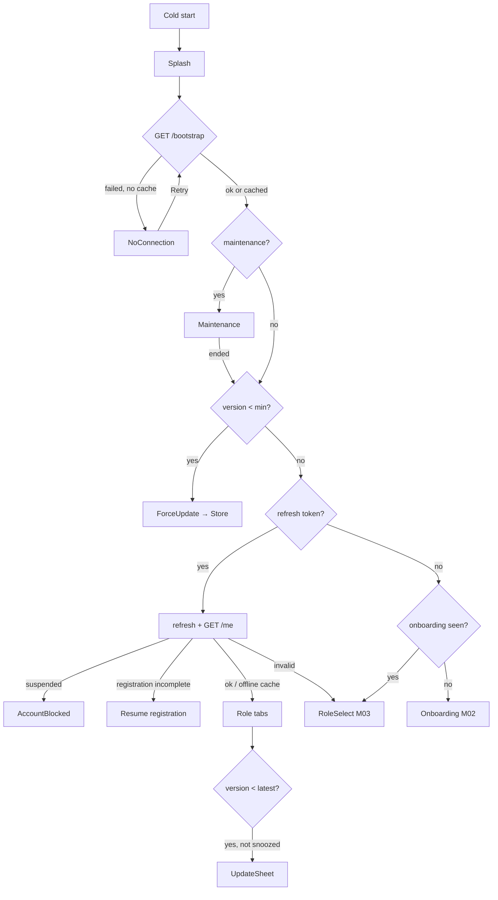

# Module 1 · Splash Screen

> **Phase 1 · App Foundation** · **Used by:** Everyone (before sign-in and on every launch) · **Depends on:** M00; Admin M04 (settings for versions and maintenance) · **New tables:** none · **Uses:** `system_settings` · **Build estimate:** 1–2 days

## 1. Module Purpose

The first screen on every cold start. It shows the GuruConnect logo while the app loads its configuration from `GET /bootstrap`, then decides where to go: maintenance screen, forced update, optional update prompt, onboarding, login, registration resume, or the user's home. The brief's `app_versions` and `maintenance_settings` tables are implemented as admin-editable keys in `system_settings` (Admin M04), so admins change versions and maintenance without a deploy.

## 2. User Stories

- As a **user**, I want the app to open quickly and tell me clearly if it is down for maintenance so that I'm not stuck on a blank screen.
- As a **user on an old version**, I want to be told to update, with a button to the store, so that the app keeps working.
- As an **admin**, I want to force everyone below a version to update when an API change breaks old builds.
- As a **returning user**, I want to land directly on my home screen without signing in again.

## 3. Business Rules & Logic

**BR-1.1 Launch sequence (target ≤ 2.5 s to first interactive screen on a mid-range Android).**
1. Native splash (static logo on brand background) shows while JS loads — `expo-splash-screen.preventAutoHideAsync()`.
2. JS splash (same image, plus a small spinner after 800 ms) renders; the native splash is hidden to avoid a flash.
3. In parallel: read secure store (refresh token, install id), read cached bootstrap and `/me`, call `GET /bootstrap` (timeout 5 s).
4. Evaluate gates in this order: **maintenance → force update → session → onboarding → optional update**.

**BR-1.2 Maintenance.** If `maintenance.enabled` is true → `Maintenance` screen with the admin message and expected end time. The screen polls `/bootstrap` every 60 s while open and on "Try again"; when maintenance ends the app continues the launch sequence. Admins listed in `maintenance.allowInstallIds` (QA devices, settings key optional) bypass it.

**BR-1.3 Version check.** Compare the running version (`expo-application` `nativeApplicationVersion`) with the platform's values:
- below `minVersion` (`app.android_min_version` / `app.ios_min_version`) → `ForceUpdate` screen (no dismiss, back button exits app on Android).
- below `latestVersion` but ≥ min → optional update bottom sheet **after** reaching home, at most once per 3 days per latest version (`updatePromptDismissedFor` in MMKV).
- Semver comparison; build number ignored. The API independently enforces the minimum with `426 APP_UPDATE_REQUIRED` (conventions §5).

**BR-1.4 Bootstrap failure.** Network error or timeout: if a cached bootstrap (≤ 7 days old) exists, continue with it and show the offline banner; if no cache (very first launch offline) show the `NoConnection` state with Retry.

**BR-1.5 Session routing.** Refresh token present → `POST /auth/refresh` then `GET /me` (M00). Result:
- `ACCOUNT_SUSPENDED` → AccountBlocked (M00).
- registration incomplete (`/me.registration.nextStep`) → resume that registration step (M06/M07/M11/M14/M15/M21/M22).
- otherwise → role tabs. Offline with a cached `/me` → role tabs from cache.
No token → if `onboardingSeenVersion < app.onboarding_version` → Onboarding (M02), else RoleSelect (M03).

**BR-1.6 Deep link on launch.** A link that opened the app is captured before routing (`Linking.getInitialURL()` / notification tap) and stored as `pendingDeepLink`; it is replayed after the gates pass (and after login if needed).

**BR-1.7 What bootstrap returns.** Public settings only (`is_public = true`): platform versions, update message, store URLs, maintenance state/message/end, onboarding version, enabled login methods, support contacts, legal URLs, feature flags, limits the app displays (max children, review min chars), `mastersVersion`, server time (to detect wrong device clocks > 5 min — shows a hint because OTP and payments can fail).

**BR-1.8 Caching.** `/bootstrap` is cached at the CDN for 60 s (no user data) and in MMKV on the device. Response is < 5 KB.

## 4. Screen List

| Screen | Route name | Purpose |
| --- | --- | --- |
| Splash | `Splash` | Logo while bootstrap, session and caches load |
| Maintenance | `Maintenance` | Admin message, expected end time, Try again |
| Force update | `ForceUpdate` | Blocks the app below the minimum version, opens the store |
| Optional update sheet | `UpdateSheet` (modal) | Suggests updating; dismissible |
| No connection | `NoConnection` | First launch without internet and no cached bootstrap |

## 5. Screen Flow & Navigation



## 6. Screen Wireframe Description

**Splash** — full-screen brand background (light: white with the green logo mark centred; dark: near-black). Logo 120 dp. Below it, after 800 ms, a small 20 dp spinner. Bottom: "GuruConnect" wordmark and tagline "Find a teacher you can trust" in 14 sp muted text. No buttons.

**Maintenance** — illustration of tools at top third; heading "We'll be right back"; body = admin message (max 3 lines); if end time: "Expected back by 6:30 PM today"; primary button "Try again"; secondary text link "Contact support" showing email and phone as selectable text.

**Force update** — app icon 72 dp; heading "Update required"; body = `app.update_message`; small text "You have 1.0.3 · Required 1.2.0"; primary button "Update now" (opens Play Store / App Store URL from bootstrap); no close button.

**Optional update sheet** — bottom sheet: heading "New version available", body = update message, buttons "Update" (primary) and "Later".

**No connection** — cloud-off icon, heading "No internet connection", body "Connect to Wi-Fi or mobile data to set up GuruConnect.", button "Retry".

## 7. UI Components & Component Tree

```
SplashScreen
├─ BrandLogo
├─ DelayedSpinner (800 ms)
└─ useLaunchSequence()  → returns next route; handles bootstrap, refresh, /me, deep link capture
MaintenanceScreen
├─ Illustration · Heading · MessageText · EndTimeText
├─ Button "Try again" (loading state)
└─ SupportContact (selectable email/phone)
ForceUpdateScreen
├─ AppIcon · Heading · MessageText · VersionLine
└─ Button "Update now" → Linking.openURL(storeUrl)
UpdateSheet (BottomSheet)
NoConnectionScreen (reuses ErrorState)
```
`useBootstrap()` (TanStack Query, key `bootstrapKeys.current`, `staleTime` 60 s, persisted) and `compareSemver(a, b)` utility (unit-tested).

## 8. Validation Rules

- Client: version strings validated with `^\d+\.\d+\.\d+$`; invalid admin values are ignored (treated as no gate) and reported to Sentry.
- Server: settings are validated by Admin M04 when saved (semver type, URL type). `/bootstrap` never returns keys marked `is_public = false`.
- Maintenance end time must be in the future to be shown; otherwise the line is hidden.

## 9. API Endpoints

| Method | Path | Auth | Description |
| --- | --- | --- | --- |
| GET | /bootstrap | Public | Versions, maintenance, store URLs, onboarding version, login methods, flags, public limits, masters version, server time |

## 10. Request Payloads

```json
// GET /bootstrap   (headers: X-Platform: android, X-App-Version: 1.0.3, X-Install-Id: …)
```

## 11. Response Payloads

```json
// 200 GET /bootstrap
{ "data": {
  "serverTime": "2026-09-26T10:15:00Z",
  "app": { "platform": "android", "currentVersion": "1.0.3", "minVersion": "1.2.0", "latestVersion": "1.3.1", "updateRequired": true, "updateAvailable": true,
           "updateMessage": "A new version of GuruConnect is available with improvements and fixes.", "storeUrl": "https://play.google.com/store/apps/details?id=in.guruconnect.app" },
  "maintenance": { "enabled": false, "message": null, "endsAt": null },
  "onboardingVersion": 1,
  "auth": { "phoneOtp": true, "email": true, "google": true, "otpResendAfterSeconds": 30 },
  "support": { "email": "support@guruconnect.in", "phone": "+918047182200", "whatsapp": "+918047182200", "hours": "Mon–Sat, 9 AM–7 PM" },
  "legal": { "termsUrl": "https://guruconnect.in/terms", "privacyUrl": "https://guruconnect.in/privacy", "refundUrl": "https://guruconnect.in/refunds" },
  "limits": { "parentMaxChildren": 3, "reviewMinChars": 30, "studentMinAgeWithoutConsent": 18 },
  "features": { "messagesEnabled": true, "walletEnabled": true },
  "mastersVersion": "m-20260926-7f3a" } }

// 200 during maintenance (bootstrap itself still answers)
{ "data": { "maintenance": { "enabled": true, "message": "We are upgrading GuruConnect. Please try again in a little while.", "endsAt": "2026-09-26T13:00:00Z" }, "…": "…" } }
```

## 12. PostgreSQL Tables & Columns


**Existing tables this module reads or writes** (full definitions in the owning module)

| Table | Owner | Purpose |
| --- | --- | --- |
| `system_settings` | Admin M04 | Typed key–value settings that change platform behaviour without a deploy. |

| Brief's table | Implemented as (`system_settings.key`) |
| --- | --- |
| `app_versions` | `app.android_min_version`, `app.android_latest_version`, `app.ios_min_version`, `app.ios_latest_version`, `app.update_message`, `app.store_url_android`, `app.store_url_ios` |
| `maintenance_settings` | `app.maintenance_mode`, `app.maintenance_message`, `app.maintenance_ends_at` |
| (onboarding) | `app.onboarding_version` |

All keys are seeded by `sql/seed/003_config.sql` (admin) and `sql/seed/004_mobile.sql`. Every change made in the admin panel is audited there (Admin M04), which gives the version history the brief asked for. If per-release notes and staged rollouts are needed later, add an `app_releases` table (section 21).

## 13. Relationships

No database relationships (client-side module).

## 14. State Management

- `bootstrapKeys.current` — persisted query; the whole app reads flags from `useBootstrap().data`.
- `useAppFlags`: `onboardingSeenVersion`, `updatePromptDismissedFor: { version, at }`, `pendingDeepLink`.
- Launch state machine inside `useLaunchSequence` (not global): `booting → gating → routing → done`, exposed to tests.

## 15. Offline Handling

- Cached bootstrap up to 7 days old is accepted; older cache is treated as missing (shows NoConnection on first-run devices only).
- Maintenance and force-update decisions made from cache are re-checked as soon as the network returns.
- Offline with a cached session goes straight to role tabs (M00 BR-0.3/0.4).

## 16. Push Notification Requirements

None sent by this module. A notification tap that cold-starts the app passes through Splash; its deep link is replayed after the gates (BR-1.6).

## 17. Security Rules

- `/bootstrap` is public and contains no user data; response is identical for all users of a platform/version (safe to CDN-cache).
- Store URLs come from the server but are only opened if the host is `play.google.com` or `apps.apple.com` (prevents a compromised setting redirecting users).
- Wrong device clock (> 5 min from `serverTime`) is surfaced as a hint, not blocked.

## 18. Error Handling

| Scenario | Handling |
| --- | --- |
| `/bootstrap` timeout (> 5 s) with cache | Continue with cache, offline banner |
| `/bootstrap` fails, no cache | NoConnection screen, Retry |
| Refresh token invalid | Clear session → RoleSelect (no error message on splash; Login shows "Please sign in again.") |
| `/me` fails with network error but cached `/me` exists | Continue to role tabs from cache |
| `/me` returns 500 | ErrorState with Retry on the splash; "Sign out" link after 2 failures |
| Store cannot open (no Play Store, e.g. Huawei) | Toast with the store URL as selectable text |

## 19. Testing Scenarios

- T1.1 Min version 1.2.0, app 1.0.3 → ForceUpdate; back button exits; "Update now" opens the Play Store URL.
- T1.2 Latest 1.3.1, app 1.2.5 → home, then UpdateSheet once; "Later" suppresses it for 3 days.
- T1.3 Maintenance on → Maintenance screen; admin turns it off → "Try again" continues to home without restart.
- T1.4 First launch offline → NoConnection; after reconnect → Onboarding.
- T1.5 Cached session offline → role tabs within 1.5 s.
- T1.6 Revoked refresh token → RoleSelect, then Login shows "Please sign in again."
- T1.7 App opened from a `https://guruconnect.in/t/GC-T10241` link while signed out → after login, teacher profile opens.
- T1.8 Server time 10 min ahead of device → clock hint shown on the Login screen.
- T1.9 Registration incomplete teacher (documents step) → resumes at M15 Documents.
- T1.10 `compareSemver` unit tests: 1.10.0 > 1.9.9, 1.2.0 = 1.2.0, invalid input returns null.

## 20. Audit Log Events

None. `/bootstrap` is a public read. Admin changes to version and maintenance settings are audited by Admin M04.

## 21. Future Scalability Notes

- `app_releases` table (platform, version, notes, rollout %, min OS) for staged rollouts and "What's new" screens.
- Server-driven feature flags per user segment (e.g. GrowthBook) delivered in bootstrap.
- Remote-config onboarding content and seasonal splash artwork.
- Per-city maintenance (e.g. payments down only) using feature flags instead of a global switch.
