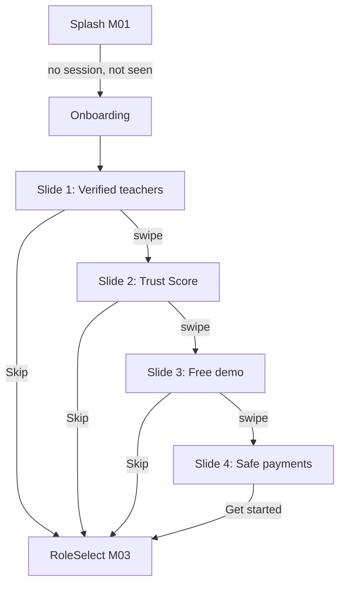

# Module 2 · Onboarding Screens

> **Phase 1 · App Foundation** · **Used by:** Everyone, signed out (first launch, or after an admin bumps the onboarding version) · **Depends on:** M00 (bootstrap, app flags), M01 (Splash routes here) · **New tables:** none · **Build estimate:** 1–2 days

## 1. Module Purpose

A short, swipeable slide carousel shown once before `RoleSelect` (M03), explaining what GuruConnect is and why it can be trusted: verified teachers, an honest Trust Score, free demo classes before paying, and safe on-platform payments. It is entirely client-side — no API of its own — and is skipped for anyone who already has a session (Splash routes signed-in users straight to their role tabs). An admin can force it to show again for signed-out installs by bumping `app.onboarding_version` in `system_settings` (Admin M04); no app release is needed.

## 2. User Stories

- As a **first-time user**, I want a quick, honest explanation of what the app does before I'm asked to sign in, so that I trust it enough to hand over my phone number.
- As a **parent on a slow connection**, I want the onboarding slides to appear instantly with no spinner, so that the first impression of the app isn't a loading screen.
- As a **returning user who already has an account**, I never want to see onboarding again, even if the admin changes the slide content.
- As a **low-vision user**, I want to skip straight to sign-in with one accessible tap, so that I'm not forced through slides I can't read comfortably.
- As **product**, I want to update the slide copy or images without an app store release, so that we can react to what new users are confused about.

## 3. Business Rules & Logic

**BR-2.1 Trigger.** Splash (M01, BR-1.5) shows `Onboarding` only when there is no refresh token **and** `useAppFlags.onboardingSeenVersion < bootstrap.onboardingVersion` (default seeded value `1`, key `app.onboarding_version`). Any signed-in launch — even offline from a cached session — bypasses onboarding entirely regardless of version; onboarding is a pre-account experience only, never re-shown to an existing account.
**BR-2.2 Slide content (4 fixed slides, English only at launch; strings in `en.json` from day one for the Hindi rollout).**
1. **Find verified teachers** — Aadhaar, PAN and certificates checked before anyone appears in search.
2. **See an honest Trust Score** — built from verification, real reviews and complaint history, not payment.
3. **Book a free demo first** — try a class before you commit to a plan.
4. **Pay safely, in the app** — Razorpay-secured payments, refund protection, and support that responds.
Each slide is `{ illustration, heading (≤ 40 chars), body (≤ 110 chars) }`, bundled as local assets (no CDN fetch, so the very first offline launch still works).
**BR-2.3 Navigation.** Horizontal paging with a dot indicator (4 dots, active dot 24 dp wide, others 8 dp). `Skip` sits top-right on slides 1–3 (44×44 dp touch target). Slide 4 replaces `Skip`/`Next` with a single primary button `Get started`. Swiping past slide 4 does nothing (no wrap-around).
**BR-2.4 Persistence.** Tapping `Skip` or `Get started` writes `useAppFlags.onboardingSeenVersion = bootstrap.onboardingVersion` to MMKV synchronously, then navigates to `RoleSelect` (M03). If the write fails (corrupt storage), navigation still proceeds — onboarding may show once more next launch, which is a cosmetic-only failure mode.
**BR-2.5 Version bump re-show.** When an admin increases `app.onboarding_version` (Admin M04), only installs that are **currently signed out** see the slides again on their next launch; an install that is signed in never sees it, even after signing out later that session, until the *next* cold start re-evaluates BR-2.1 with a fresh `onboardingSeenVersion` comparison.
**BR-2.6 No network calls.** The screen reads `bootstrap.onboardingVersion` (already fetched by Splash, M01) and nothing else; there is no dedicated onboarding endpoint.
**BR-2.7 Accessibility.** Each slide's illustration has `accessibilityLabel` matching its heading; dots are not individually focusable (decorative); `Skip` and `Get started` have 48 dp minimum touch height and are the first two elements in swipe/tab order after the slide content.

## 4. Screen List

| Screen | Route name | Purpose |
| --- | --- | --- |
| Onboarding | `Onboarding` | Full-screen 4-slide swipeable carousel |

## 5. Screen Flow & Navigation


Back button on Android moves to the previous slide, not out of the app; pressing back on slide 1 exits the app (it is the first screen in the signed-out stack). There is no error state — the screen never calls the network.

## 6. Screen Wireframe Description

**Onboarding, slide 1 of 4** — full-bleed illustration (top 55% of screen, a parent and teacher on a video call over a soft green background), heading "Find verified teachers", body "Aadhaar, PAN and certificates checked before anyone appears in search.", dot row (● ○ ○ ○) centred below the body, `Skip` text button top-right (16 sp, muted).

**Slide 2** — illustration of a star rating and a shield badge, heading "See an honest Trust Score", body "Built from verification, real reviews and complaint history — never bought.", dots (○ ● ○ ○).

**Slide 3** — illustration of a calendar with a "Free" tag, heading "Book a free demo first", body "Try a class before you commit to a plan.", dots (○ ○ ● ○).

**Slide 4** — illustration of a phone with a UPI/card icon and a lock, heading "Pay safely, in the app", body "Razorpay-secured payments, refund protection, and support that responds.", dots (○ ○ ○ ●), sticky bottom button "Get started" (primary, full width) replaces the `Skip` link.

## 7. UI Components & Component Tree

```
OnboardingScreen
├─ SlideCarousel (FlashList, horizontal, pagingEnabled, 4 items)
│  └─ OnboardingSlide({ illustration, heading, body })
├─ DotIndicator({ count: 4, activeIndex })
├─ SkipButton               (hidden on slide 4)
└─ StickyActionBar          (only rendered on slide 4: "Get started")
```
`useOnboarding()` — reads `bootstrap.onboardingVersion`, exposes `markSeen()` which writes `useAppFlags.onboardingSeenVersion` and calls `navigation.replace('RoleSelect')`. No other hooks; the slide content array is a static constant (`onboardingSlides.ts`), not fetched.

## 8. Validation Rules

No user input on this screen. The only "value" handled is the onboarding version number read from bootstrap, which is validated by M01 (BR-1.7 public settings are typed by Admin M04 on save); a missing or non-numeric value is treated as `1` (never blocks the carousel).

## 9. API Endpoints

| Method | Path | Auth | Description |
| --- | --- | --- | --- |
| — | — | — | None. This module has no endpoints; it reads `onboardingVersion` from M01's `GET /bootstrap`. |

## 10. Request Payloads

No requests. The screen makes no network calls of its own.

## 11. Response Payloads

No responses. See M01 `@responses` for the `bootstrap.onboardingVersion` field this module reads.

## 12. PostgreSQL Tables & Columns

No database tables. This module is client-side only.

## 13. Relationships

No database relationships (client-side module).

## 14. State Management

- Reads `bootstrapKeys.current` (M01) for `onboardingVersion`; no query of its own.
- Writes `useAppFlags.onboardingSeenVersion` (Zustand + MMKV, shared store owned by M00) — the only state this module touches.
- No TanStack Query keys, no mutations, nothing persisted beyond that one flag.

## 15. Offline Handling

Fully offline-first: all illustrations and copy are bundled in the app binary, so the carousel renders identically with or without network. `markSeen()` is a local MMKV write and never queues or waits for connectivity.

## 16. Push Notification Requirements

None. This screen is shown before any device is registered for push (M00 BR-0.6 registration happens after sign-in).

## 17. Security Rules

No PII is collected or displayed. The screen is not `FLAG_SECURE` (nothing sensitive on it). No tokens, no rate limits — there is nothing to abuse on a client-only screen.

## 18. Error Handling

| Scenario | Code | HTTP | App behaviour |
| --- | --- | --- | --- |
| MMKV write fails when marking seen | — (client-only) | — | Navigation to RoleSelect proceeds anyway; onboarding may reappear once more next launch — cosmetic only, never blocks sign-in |
| `bootstrap.onboardingVersion` missing/malformed | — (client-only) | — | Treated as version `1`; carousel still shows correctly for a true first launch |

## 19. Testing Scenarios

- T2.1 First-ever launch, no cached flags → Onboarding shows; Maestro flow `onboarding_first_launch`.
- T2.2 Swipe left through all 4 slides; dot indicator updates each time; swiping past slide 4 does nothing.
- T2.3 Tap `Skip` on slide 2 → lands on RoleSelect; `onboardingSeenVersion` is written immediately (check MMKV).
- T2.4 Tap `Get started` on slide 4 → lands on RoleSelect.
- T2.5 Relaunch after seeing onboarding, still signed out → RoleSelect directly, no carousel.
- T2.6 Admin bumps `app.onboarding_version` from 1 to 2 → next signed-out launch on the same install shows the carousel again; a signed-in install on another test device does not see it.
- T2.7 First launch fully offline (airplane mode) → carousel still renders from bundled assets, no error state, no spinner.
- T2.8 Android hardware back on slide 1 → app exits; on slide 3 → returns to slide 2.
- T2.9 Screen reader on: each illustration announces its heading text via `accessibilityLabel`; `Skip` and `Get started` are reachable by a single swipe-right gesture.
- T2.10 System font scaled to 130% → slide 2's body text (the longest) does not clip or overlap the dot indicator.

## 20. Audit Log Events

None. The screen changes no server-side data and involves no account — there is nothing to attribute an audit event to (no `user_id` exists yet).

## 21. Future Scalability Notes

- Personalise slide order or copy by acquisition channel (e.g. a teacher-focused variant for institute referral links) using the same `onboardingVersion` mechanism, versioned per audience segment.
- A/B test slide copy through a remote-config layer once one exists (see M00 scalability).
- Video or Lottie illustrations instead of static images once bundle size budget (conventions §17, 6 MB) allows it.
- Track `onboarding_slide_viewed` / `onboarding_skipped` analytics events (M00 `POST /events`) to see where users drop off, once the analytics pipeline can slice by slide index.
