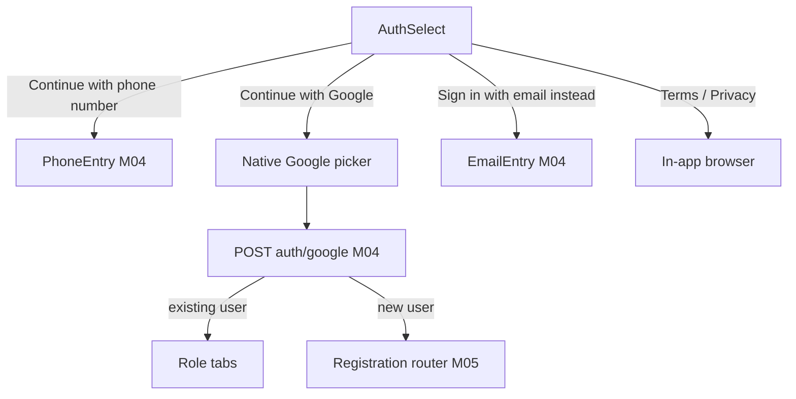

# Module 3 · Authentication Selection

> **Phase 1 · App Foundation** · **Used by:** Everyone, signed out · **Depends on:** M00, M01, M02; M04 (screens this module hands off to) · **New tables:** none · **Build estimate:** 1 day

## 1. Module Purpose

The single front door into sign-in: one screen offering "Continue with phone number" (primary), "Continue with Google" and a small "Sign in with email instead" link. It decides nothing about role — role is chosen later, during registration (M05) — it only chooses *which credential flow* the person takes into Login (M04). It is client-only: the choice just navigates into M04's phone, email or Google screens, which do the actual API calls.

## 2. User Stories

- As a **new parent**, I want one clear "Continue with phone number" button so that I don't have to think about which sign-in method to pick.
- As a **teacher who prefers Gmail**, I want a one-tap Google option so that I skip typing a password.
- As a **returning user without SMS signal**, I want an email option so that I can still sign in.
- As **product**, I want to hide a sign-in method instantly (e.g. Google outage) without an app release, so that support isn't flooded with a broken button.

## 3. Business Rules & Logic

**BR-3.1 Method visibility.** Buttons are shown/hidden from `bootstrap.auth` (M01): `phoneOtp` (always true in v1; phone OTP cannot be disabled, it is the only method that also identifies India-only users reliably), `email` (`auth.email_login_enabled`), `google` (`auth.google_login_enabled`). If both `email` and `google` are false, only the phone button shows and the divider/links are hidden.
**BR-3.2 Order and prominence.** Phone is always the primary full-width button (highest conversion, matches conventions §2 OTP autofill investment). Google is a secondary full-width button directly below it, with the standard Google "G" mark and "Continue with Google" text (per Google's branding guidelines — no custom colours on the G). Email is a plain text link below a thin "or" divider, not a button — it is a fallback, not a first choice.
**BR-3.3 Navigation, not authentication.** Tapping **Phone** pushes M04's `PhoneEntry` screen (collects the number, calls `POST /auth/otp/request`). Tapping **Email** pushes M04's `EmailEntry` screen (email + password, or a link to switch to "email OTP instead"). Tapping **Google** does *not* navigate anywhere first — it immediately opens the native Google account picker (`GoogleSignin.signIn()`); on success the resulting ID token is sent straight to M04's `POST /auth/google` from this screen's own handler, and the result (existing user → home; new user → registration) is what decides the next screen, exactly as it would from inside M04.
**BR-3.4 Legal footer.** Below the buttons, small centred text: "By continuing, you agree to our Terms of Service and Privacy Policy." Both phrases are tappable links opening `legal.termsUrl` / `legal.privacyUrl` (from bootstrap) in an in-app browser tab (`expo-web-browser`), never leaving the app or requiring sign-in.
**BR-3.5 No account created here.** No account, OTP challenge or registration token is created by this screen itself; those only start once a method is chosen and its M04 screen (or the Google handler) makes its first API call.
**BR-3.6 Back behaviour.** `AuthSelect` is the base of the signed-out stack after Onboarding. Android hardware back exits the app with a "Press back again to exit" toast (2-second window) rather than exiting on the first press, to avoid accidental exits while re-reading the legal footer.
**BR-3.7 Offline.** If the device has no cached bootstrap at all (very first launch, offline — see M01 BR-1.4 `NoConnection`), this screen is never reached; Splash keeps the user on `NoConnection` until a bootstrap response (fresh or cached) exists. Once reached, the screen itself never blocks on network — only the method screens it hands off to do.

## 4. Screen List

| Screen | Route name | Purpose |
| --- | --- | --- |
| Auth select | `AuthSelect` | Choose phone, Google or email to continue |

## 5. Screen Flow & Navigation


Back from `PhoneEntry` or `EmailEntry` returns here; a cancelled Google picker (user dismisses it) simply stays on `AuthSelect` with no error shown (cancellation is not a failure).

## 6. Screen Wireframe Description

**AuthSelect** — vertically centred content on a plain white (dark: near-black) background. GuruConnect logo mark, 64 dp, top third. Heading "Welcome to GuruConnect" (24 sp, bold). Subtext "Find a teacher you can trust" (16 sp, muted). Below, stacked with 12 dp gaps: primary full-width button "Continue with phone number" (phone icon, left-aligned icon + centred text); secondary full-width button "Continue with Google" (white background, grey border, Google G icon); thin horizontal divider with centred "or" (12 sp, muted); text link "Sign in with email instead" (centred, 15 sp, underlined on press). Fixed footer (not sticky-scrolling, always visible): two-line legal text with the Terms/Privacy links underlined.

## 7. UI Components & Component Tree

```
AuthSelectScreen
├─ BrandLogo · Heading · Subtext
├─ Button "Continue with phone number" (primary) → navigate PhoneEntry
├─ Button "Continue with Google" (secondary, GoogleIcon) → useGoogleSignIn()
├─ Divider "or"                          (hidden if email disabled)
├─ TextLink "Sign in with email instead" → navigate EmailEntry   (hidden if email disabled)
└─ LegalFooter (Terms, Privacy)          → openInAppBrowser(url)
```
`useAuthMethods()` — derives `{ showPhone, showGoogle, showEmail }` from `useBootstrap().data.auth`. `useGoogleSignIn()` — wraps `GoogleSignin.hasPlayServices()` → `signIn()` → posts the ID token to M04's `googleLogin` mutation; surfaces `GATEWAY_ERROR` (Play Services missing/outdated) and silent cancellation separately.

## 8. Validation Rules

No form fields on this screen. The only implicit "input" is which button is tapped, and visibility of each is already gated by BR-3.1 so a hidden method can never be tapped.

## 9. API Endpoints

| Method | Path | Auth | Description |
| --- | --- | --- | --- |
| — | — | — | None owned here. Phone/email navigation is client-only; Google immediately calls M04 `POST /auth/google` (documented there) directly from this screen's handler. |

## 10. Request Payloads

No requests of this module's own. See M04 `@requests` for `POST /auth/google`, which this screen's Google button triggers directly.

## 11. Response Payloads

No responses of this module's own. See M04 `@responses` for the `POST /auth/google` result this screen acts on (route to Home or to Registration).

## 12. PostgreSQL Tables & Columns

No database tables. This module is client-side only.

## 13. Relationships

No database relationships (client-side module).

## 14. State Management

- Reads `bootstrapKeys.current` (M01) for `auth.phoneOtp/email/google` flags — no store of its own.
- `useAppFlags.lastRole` (if present, from a previous session on this install) is read only to decide which role tab to warm the query cache for *after* Google login succeeds — it never changes which buttons are shown.

## 15. Offline Handling

The screen itself renders fully from the cached bootstrap (no additional network call). Phone/email buttons remain tappable offline (they only navigate); Google's button is disabled with a small inline "Needs internet" hint when `NetInfo` reports no connection, since the native picker and the server verification both require network.

## 16. Push Notification Requirements

None. No device is registered yet at this point (M00 BR-0.6 happens after a session exists).

## 17. Security Rules

No credentials are entered or stored on this screen. The Google ID token is passed in memory straight from the native SDK callback to the API call and is never persisted, logged or cached (client `meta: { persist: false }` on that call, per M00 BR-0.4). The in-app browser opens only `guruconnect.in` URLs from bootstrap (never an arbitrary link).

## 18. Error Handling

| Scenario | Code | HTTP | App behaviour |
| --- | --- | --- | --- |
| Google Play Services missing/outdated | `GATEWAY_ERROR` (client-mapped) | — | Toast "Google Sign-In isn't available on this device. Try phone or email." |
| User cancels the Google picker | — (not an error) | — | Silently stays on AuthSelect; no toast |
| Offline, Google tapped | `NETWORK_OFFLINE` (client) | — | Google button shows "Needs internet"; phone/email still work |
| Both email and Google disabled by admin | — (config) | — | Divider and email link hidden; only the phone button renders |

## 19. Testing Scenarios

- T3.1 All three methods enabled → all three controls visible in BR-3.2 order; Maestro flow `auth_select_all_methods`.
- T3.2 `auth.google_login_enabled = false` → Google button hidden, phone and email still shown.
- T3.3 `auth.email_login_enabled = false` and Google disabled → only the phone button and legal footer render.
- T3.4 Tap "Continue with phone number" → lands on `PhoneEntry` with an empty field.
- T3.5 Tap "Continue with Google", complete picker with an existing account's email → lands on role tabs.
- T3.6 Tap "Continue with Google", cancel the native picker → remains on AuthSelect, no error toast.
- T3.7 Tap "Sign in with email instead" → lands on `EmailEntry`.
- T3.8 Tap "Terms of Service" → in-app browser opens `legal.termsUrl`; back button returns to AuthSelect without navigating away from the app.
- T3.9 Airplane mode → phone/email buttons still navigate; Google button shows "Needs internet" and is disabled.
- T3.10 Android back on AuthSelect → toast "Press back again to exit"; second back within 2 s exits the app.

## 20. Audit Log Events

None. No account or server data changes on this screen — the eventual sign-in (Google) is audited by M04, not here.

## 21. Future Scalability Notes

- Apple Sign-In alongside Google once the iOS App Store guideline requirement is confirmed to apply (mandatory when any third-party social login is offered).
- WhatsApp OTP as a channel alongside SMS (schema already supports `channel = 'whatsapp'` on `otp_challenges`) if SMS delivery cost or reliability becomes an issue.
- Remember the last successful method per install (`useAppFlags.lastAuthMethod`) and visually promote it to the top on return visits.
- Single Tap / One Tap Google prompt (no button press) for returning Google users, once product wants a more aggressive default.
