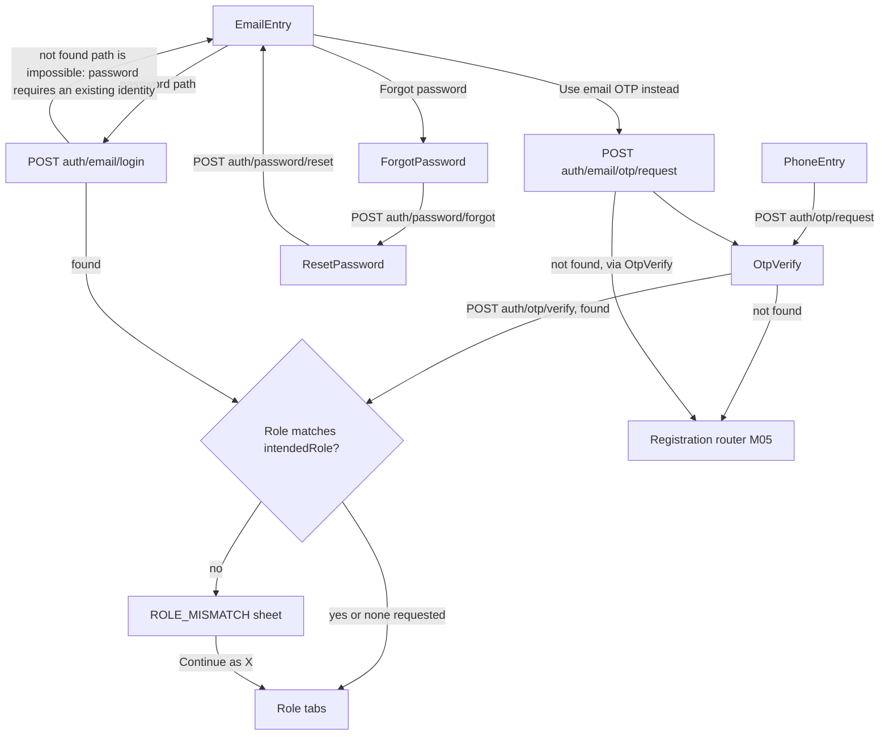
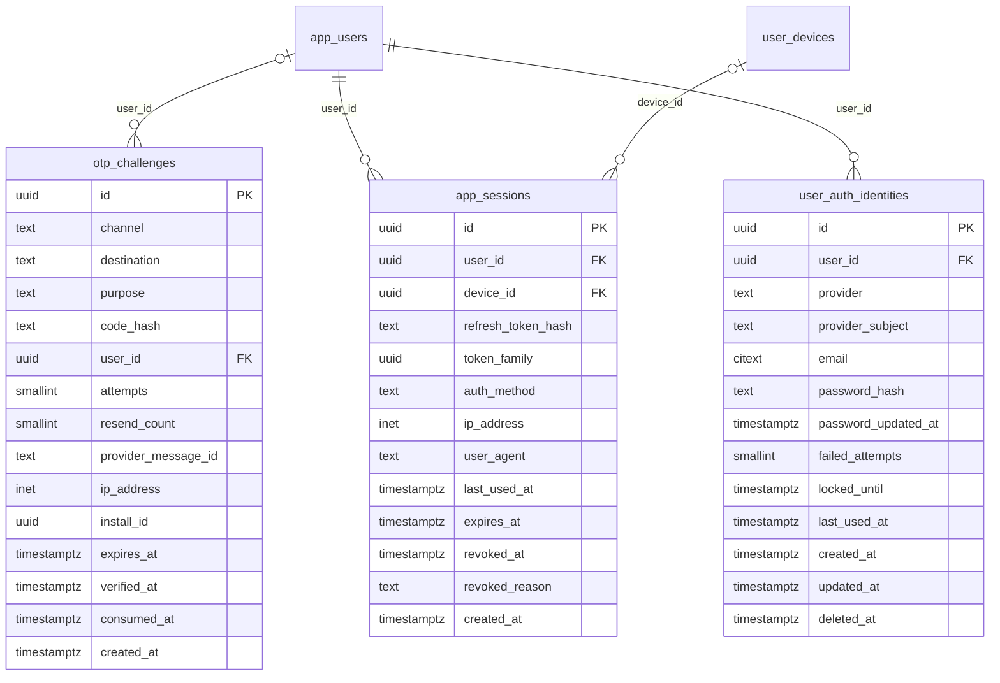

# Module 4 · Login

> **Phase 1 · App Foundation** · **Used by:** All (signed out) · **Depends on:** M00 (session storage, device registration), M03 (entry screens), M05 (registration handoff); Admin M01 (rotation/reuse-detection pattern this module mirrors) · **New tables:** `otp_challenges`, `app_sessions`, `user_auth_identities` · **Uses:** `app_users`, `user_devices` · **Build estimate:** 6–7 days

## 1. Module Purpose

Every way into a GuruConnect account: phone OTP (the default and only method that cannot be disabled), email + password, email OTP for people who forget their password or haven't set one, Google Sign-In with server-side ID-token verification, and the session machinery every other module relies on — refresh with rotation and theft detection, logout, logout-all, and a sessions list. It owns the three identity tables (`otp_challenges`, `app_sessions`, `user_auth_identities`) and decides, for every successful credential check, whether the phone/email belongs to an existing account (log in) or not (hand back a 30-minute `registrationToken` for M05). It also detects and explains `ROLE_MISMATCH` when a sign-in was entered from a role-specific context that doesn't match the account found.

## 2. User Stories

- As a **new parent**, I want to type my phone number, get a 6-digit code by SMS, and be either signed in or moved straight to registration, so that I never have to think about "do I have an account already?".
- As a **teacher without cell signal on the school Wi-Fi**, I want to sign in with email and password so that I'm not blocked by SMS delivery.
- As a **returning user who forgot their password**, I want to reset it with an OTP emailed to me, without calling support.
- As a **user who tapped a teacher-referral link intending to join as a teacher**, I want to be told clearly if that phone already has a Parent account, and be offered to continue as a parent instead of silently landing in the wrong app experience.
- As a **security-conscious user**, I want to see every device I'm signed in on and sign one out, so that a lost phone doesn't keep my account open.
- As **product**, I want a stolen refresh token to be useless the moment it's replayed, so that a leaked token from an old device backup can't quietly re-enter an account.

## 3. Business Rules & Logic

**BR-4.1 Phone OTP request.** `POST /auth/otp/request { phone }`.
1. Normalise to E.164 (`+91##########`); reject non-Indian numbers in v1 (`VALIDATION_FAILED`).
2. Resend guard: if an unconsumed `otp_challenges` row exists for `(destination = phone, purpose = 'login')` created less than `auth.otp_resend_after_seconds` (30 s) ago, return `429 RATE_LIMITED` with `Retry-After` = remaining seconds — no new SMS is sent.
3. Hourly guard: count challenges for this destination in the last hour; at `auth.otp_max_per_hour` (5) → `429 OTP_LOCKED` "Too many codes requested. Try again in an hour."; a secondary IP guard (20/hour per IP) catches spraying across numbers.
4. Generate a code of `auth.otp_length` (6) digits, HMAC-SHA256 it with a server-side pepper into `code_hash` (raw code never stored or logged), insert `otp_challenges` (`channel='sms'`, `purpose='login'`, `destination=phone`, `expires_at = now() + auth.otp_ttl_seconds` (5 min), `ip_address`, `install_id` from `X-Install-Id`), send via the SMS provider (MSG91/Gupshup), store `provider_message_id`.
5. Response: `{ challengeId, expiresInSeconds: 300, resendAfterSeconds: 30 }`. In non-production builds, numbers `+91 90000 0000x` are test-mode and the code is always `123456` (conventions §16); real SMS is never sent for these.
**BR-4.2 OTP verify (channel-agnostic — used for phone SMS and email OTP alike).** `POST /auth/otp/verify { challengeId, code, intendedRole? }`.
1. Load the challenge; `NOT FOUND` or already `consumed_at` → `410 OTP_EXPIRED`. Past `expires_at` → `410 OTP_EXPIRED`.
2. Compare `code_hash`. Wrong code → `attempts += 1`; at `attempts = 5` set `consumed_at = now()` (the challenge is burned) and return `429 OTP_LOCKED` "Too many wrong attempts. Request a new code."; below 5 → `422 OTP_INVALID` with the attempts remaining in `details.attemptsLeft`.
3. Correct code → `verified_at = now()`, `consumed_at = now()` (single use).
4. Resolve the account: for `channel = 'sms'`, look up `user_auth_identities` where `provider = 'phone'`, `provider_subject = destination`, `deleted_at IS NULL`; for `channel = 'email'`, `provider = 'password'` **or** any identity whose `email = destination` (a phone-first user who later added the same email is still "found").
5. **No account found** → issue a `registrationToken` (BR-4.8) with `contactType` matching the channel and `subject = destination`; response `409 REGISTRATION_REQUIRED { registrationToken, contactType, expiresInSeconds: 1800 }`. The app routes to M05.
6. **Account found** → `account_status` check: `suspended`/`banned` → `403 ACCOUNT_SUSPENDED` with the reason and any `until` date; otherwise apply the **role-mismatch check** (BR-4.11); on a match (or no `intendedRole` sent), issue a session (BR-4.9, `auth_method='otp'`) and return it plus the `/me`-shaped user summary (BR-0.12).
**BR-4.3 Email + password login.** `POST /auth/email/login { email, password, intendedRole? }`. Rate limit 8/minute per (IP, email). Load `user_auth_identities` where `provider='password'`, `provider_subject = lower(email)`, `deleted_at IS NULL`. Not found → run a dummy Argon2id verify (constant time) and return `401 AUTH_INVALID_CREDENTIALS` "Email or password is incorrect." (never reveals which is wrong, never distinguishes "no account" here — a user with no password identity is told the same thing and pointed to "Forgot password?", which itself never confirms account existence). `locked_until > now()` → `423`-mapped as `429 OTP_LOCKED`-style lockout using the same `AUTH_ACCOUNT_LOCKED`-shaped payload as Admin M01 (`details.lockedUntil`). Verify Argon2id (`m=19456, t=2, p=1`); wrong → `failed_attempts += 1`, at 5 set `locked_until = now() + 15 min`, return `AUTH_INVALID_CREDENTIALS`. Correct → reset `failed_attempts`, `last_used_at = now()`, role-mismatch check (BR-4.11), issue session `auth_method='password'`.
**BR-4.4 Email OTP request (passwordless path — forgotten password, or a user who registered by email OTP and never set one).** `POST /auth/email/otp/request { email }`. Same resend/hourly guards as BR-4.1 but keyed on `(destination=email, purpose='login')`, `channel='email'`, delivered via SES. Deliberately does **not** reveal whether the email has an account — same response shape whether it does or not — so this doubles safely as the entry point for a brand-new email-based sign-up. Verification is the same `POST /auth/otp/verify` as phone (BR-4.2); an email-OTP login always sets `auth_method='email_otp'` on the resulting session.
**BR-4.5 Forgot password.** `POST /auth/password/forgot { email }`. Always sends an OTP if a `password` identity exists for that email (silently no-ops otherwise) and always returns the same `202`-style body `{ sent: true }` — no account enumeration. Challenge: `channel='email'`, `purpose='reset_password'`. Same rate limits as BR-4.4.
**BR-4.6 Reset password.** `POST /auth/password/reset { challengeId, code, newPassword }`. Verifies the challenge inline (same wrong-code/expiry rules as BR-4.2, `purpose` must be `reset_password`, single use) — this endpoint does its own verification rather than calling `/auth/otp/verify` first, because a successful verify here must *not* create a session or registration token. On success: policy-check `newPassword` (8–72 chars, at least one letter and one digit, must not equal the local part of the email or the phone on file), set a new Argon2id hash on the `password` identity (`password_updated_at = now()`, `failed_attempts = 0`, `locked_until = null`), and **revoke every `app_sessions` row for that user** (`revoked_reason='password_changed'`) so a device that stole the old password is signed out everywhere; send a "Your password was changed" email/push. If the identity doesn't exist yet (email-OTP-only user resetting for the first time), this call *creates* the `password` identity instead of updating one, linked to the same `user_id` found via the email's other identities.
**BR-4.7 Google Sign-In.** `POST /auth/google { idToken, intendedRole? }`. Server verifies the token: signature against Google's published JWKS, `iss = accounts.google.com` or `https://accounts.google.com`, `aud` ∈ the app's Android/iOS/Web OAuth client ids, `exp` in the future; extract `sub`, `email`, `email_verified`, `name`, `picture`. `email_verified = false` → `422 VALIDATION_FAILED` "Verify your Google account's email address first." Lookup `user_auth_identities` `provider='google'`, `provider_subject = sub`. Found → role-mismatch check, issue session `auth_method='google'`. Not found but `email` matches a **different** existing identity (phone or password user who used the same email) → **auto-link**: insert a new `provider='google'` row onto that same `user_id` (`email = google email`), audit `app.identity_linked`, log in normally. Not found at all → `registrationToken` with `contactType='google'`, `subject = sub`, plus `prefill: { fullName: name, photoUrl: picture }` for M05/M06 to pre-populate the name field.
**BR-4.8 Registration tokens.** JWT, `aud = gc-register`, 30-minute expiry, claims `{ sub: <verified phone|email|google-sub>, contactType: 'phone'|'email'|'google', prefill?, iat, exp }`. Stateless — no DB row — so it is naturally single-purpose (M05/M06/M11/M14/M21 only accept this audience) and expires on its own; there is nothing to revoke server-side, so a user who abandons registration simply gets a new one by verifying again.
**BR-4.9 Session issuance (`issueSession`, shared helper called by this module and by M06/M11/M14/M21 at the end of registration).** In one transaction: update the identity's `last_used_at`; resolve `role = app_users.user_type` and `pid` = the id in the matching role table (`parents`/`students`/`teachers`/`institute_managers`) by `user_id` (for a brand-new registration this row was just inserted by the caller); look up an existing `user_devices` row for `(user_id, install_id)` — if present, use its `id` as `device_id`, else leave `device_id` null (it is attached on the next `PUT /devices/me`, M00 BR-0.6); generate a 256-bit random refresh token and a new `token_family` (new family per login, not per device — so `logout-all` and reuse-detection scope correctly to "everywhere this user is signed in", not just one device lineage); insert `app_sessions` (`refresh_token_hash = sha256(token)`, `expires_at = now() + 60 days`, `auth_method`); mint the access JWT (RS256, 15 min, `aud=gc-app`, claims `sub, role, pid, iid` (institute id, staff only), `sid = app_sessions.id`). Response returns `{ accessToken, expiresIn: 900, refreshToken, session: { id }, user: <same shape as GET /me, M00 BR-0.12> }`.
**BR-4.10 Refresh with rotation and reuse detection.** `POST /auth/refresh { refreshToken }` (no access token required — this is how an expired one is replaced).
1. Hash the presented token and look it up by the unique index on `app_sessions.refresh_token_hash`.
2. **Found, not revoked, not expired** → this is the current, valid token for its session: update that same row's `refresh_token_hash` to a freshly generated token (rotation is an in-place update, not a new row — one row per signed-in device for the life of the session), bump `last_used_at`, extend the sliding window (`expires_at = min(created_at + 60 days, now() + 30 days)`). Before overwriting, cache `redis SET rt:used:<old_hash> = token_family EX 86400` (24 h grace/detection window). Mint a new access token from the same claims. Return the new pair.
3. **Not found by hash** → check `redis GET rt:used:<hash>`. **Present** → this exact token was already rotated out once and is being replayed (theft signal): revoke every `app_sessions` row in that `token_family` (`revoked_reason='reuse_detected'`), delete the family's active devices' push ability is unaffected (devices stay registered, only sessions die), send a "We signed you out everywhere for your security" push/email, audit `app.token_reuse_detected`, return `401 AUTH_REFRESH_INVALID`. **Absent** → token is simply unknown/garbage (expired-and-purged, or forged): plain `401 AUTH_REFRESH_INVALID`, no special handling (indistinguishable from reuse to the caller, by design — only the server-side audit trail tells them apart).
4. Revoked (`revoked_at` set, e.g. by logout/logout-all/password change) → `401 AUTH_REFRESH_INVALID`, no special messaging beyond conventions §5's generic "Please sign in again."
5. Nightly job hard-deletes `app_sessions` rows revoked or expired more than 30 days ago and `otp_challenges` rows older than 24 h (cleanup exemption to soft-delete-everywhere, per conventions §12).
**BR-4.11 ROLE_MISMATCH.** Some entry points carry an `intendedRole` (`parent|student|teacher|institute_staff`) alongside the credential — the two current sources are an institute's "invite a teacher" SMS/email link (`gc://r/<code>` opened with a stored `pendingDeepLink` that implies `teacher`) and a role-specific referral code validated at M05. When `intendedRole` is present on `otp/verify`, `email/login` or `google`, and an existing account is found whose `app_users.user_type` differs from it, the session is **not** issued; the API returns `409 ROLE_MISMATCH { details: { actualRole: 'parent' } }` instead. The app shows "This phone number already has a Parent account — continue as Parent?" with buttons "Continue as Parent" (re-submits the same verified challenge/credential with `intendedRole` omitted, which always succeeds) and "Use a different number/account". Without `intendedRole` (the overwhelming majority of logins — plain AuthSelect entry), the account's real role is simply used; mismatch can never happen.
**BR-4.12 Logout / logout-all.** `POST /auth/logout` (Any user): revokes the caller's own session (`sid` from the access token, `revoked_reason='logout'`); the app then calls M00 `DELETE /devices/me` and clears local state (conventions §7). `POST /auth/logout-all` (Any user): revokes every non-revoked `app_sessions` row for the user (`revoked_reason='logout_all'`), including the caller's own — the app must treat its own next request as signed-out immediately rather than waiting for a 401.
**BR-4.13 Sessions list and single revoke.** `GET /auth/sessions` (Any user): active (`revoked_at IS NULL`, `expires_at > now()`) sessions for the caller, joined to `user_devices` via `device_id` for a device label (platform + model) when linked, else "Unknown device"; flags `isCurrent` by comparing `sid`. `DELETE /auth/sessions/:id` (Any user, ownership enforced — `user_id = sub`): revokes that one session (`revoked_reason='logout'`); revoking the current session behaves like `/auth/logout`.
**BR-4.14 Combined abuse/lockout limits (reference table).**

| Mechanism | Table.column | Limit | Effect |
| --- | --- | --- | --- |
| OTP resend cooldown | `otp_challenges` (by destination+purpose) | 30 s (`auth.otp_resend_after_seconds`) | `429 RATE_LIMITED`, `Retry-After` |
| OTP requests per hour | `otp_challenges` count | 5 (`auth.otp_max_per_hour`) | `429 OTP_LOCKED` |
| OTP wrong-code attempts | `otp_challenges.attempts` | 5 | `429 OTP_LOCKED`, challenge burned |
| OTP validity | `otp_challenges.expires_at` | 5 min (`auth.otp_ttl_seconds`) | `410 OTP_EXPIRED` |
| Password wrong attempts | `user_auth_identities.failed_attempts` | 5 | `locked_until = +15 min`, `AUTH_INVALID_CREDENTIALS` |
| Email/password login rate | per (IP, email) | 8/min | `429 RATE_LIMITED` |
| Refresh reuse | Redis `rt:used:<hash>` | any replay | whole `token_family` revoked |

## 4. Screen List

| Screen | Route name | Purpose |
| --- | --- | --- |
| Phone entry | `PhoneEntry` | Collect and submit the phone number |
| OTP verify | `OtpVerify` | 6-digit code entry with autofill, used for phone and email |
| Email entry | `EmailEntry` | Email + password, with a link to email-OTP instead |
| Forgot password | `ForgotPassword` | Collect email to send a reset OTP |
| Reset password | `ResetPassword` | Enter the OTP and a new password together |
| Active sessions | `ActiveSessions` | List signed-in devices; sign one (or all) out |

## 5. Screen Flow & Navigation


Back from `OtpVerify` returns to `PhoneEntry`/`EmailEntry` and offers "Resend code" only after the 30-second cooldown. `ResetPassword` success returns to `EmailEntry` with a success toast, not straight into a session (the user signs in explicitly with the new password, confirming they remember it).

## 6. Screen Wireframe Description

**PhoneEntry** — heading "What's your number?", `PhoneField` (fixed "+91" prefix, 10-digit input, numeric keyboard), helper text "We'll text you a code to confirm it's you.", sticky button "Send code" (disabled until 10 digits entered).

**OtpVerify** — heading "Enter the code", subtext "Sent to +91 98765 43210" (masked destination shown in full here since the user just entered it), `OtpInput` (6 cells, autofill via SMS Retriever on Android / `textContentType="oneTimeCode"` on iOS), inline error under the cells on wrong code ("Incorrect code. 3 attempts left."), text link "Resend code" (greyed with a 30 s countdown, then active), sticky button "Verify" (also auto-submits on the 6th digit).

**EmailEntry** — heading "Sign in with email", `TextField` email (keyboard type email, autocomplete), `TextField` password (secure entry, eye toggle), text link "Forgot password?" right-aligned under the password field, sticky button "Sign in"; below a divider, text link "Sign in with a one-time code instead" (switches the screen into email-OTP mode: password field hides, button becomes "Send code").

**ForgotPassword** — heading "Reset your password", body "Enter the email on your account. We'll send you a code.", `TextField` email, sticky button "Send code".

**ResetPassword** — heading "Check your email", subtext "Enter the code and a new password.", `OtpInput` (6 cells), `TextField` new password (secure entry, live strength hint: "8+ characters, letters and numbers"), sticky button "Reset password".

**ActiveSessions** — list of `SessionRow` cards: device label ("Android · SM-A546E" or "Unknown device"), "This device" badge on the current one, last active ("Active now" / "2 days ago"), IP city if resolvable, trailing "Sign out" text button per row (hidden on the current row, which instead shows nothing destructive inline); bottom of the list, a plain-text danger link "Sign out of all devices" opens a `ConfirmSheet` ("This signs you out everywhere, including this device.").

## 7. UI Components & Component Tree

```
PhoneEntryScreen        → PhoneField, StickyActionBar("Send code")
OtpVerifyScreen         → OtpInput(autofill), ResendLink(countdown), StickyActionBar("Verify")
EmailEntryScreen        → TextField×2, TextLink("Forgot password?"), ModeToggle(password|otp), StickyActionBar
ForgotPasswordScreen    → TextField(email), StickyActionBar("Send code")
ResetPasswordScreen     → OtpInput, TextField(newPassword), PasswordStrengthHint, StickyActionBar
ActiveSessionsScreen    → FlashList(SessionRow), ConfirmSheet("Sign out of all devices")
RoleMismatchSheet       → BottomSheet(message, Button "Continue as {role}", Button "Use a different account")
```
Hooks: `usePhoneOtpRequestMutation()`, `useOtpVerifyMutation()`, `useEmailLoginMutation()`, `useEmailOtpRequestMutation()`, `useForgotPasswordMutation()`, `useResetPasswordMutation()`, `useGoogleSignIn()` (M03), `useSessionsQuery()`, `useRevokeSessionMutation(id)`, `useLogoutMutation()`, `useLogoutAllMutation()`.

## 8. Validation Rules

| Field | Rule | Message shown |
| --- | --- | --- |
| phone | `^\+91[6-9]\d{9}$` after normalisation | "Enter a valid 10-digit mobile number." |
| code | exactly 6 digits | "Enter the 6-digit code." |
| email | RFC-valid, ≤ 254 chars, lower-cased before send | "Enter a valid email address." |
| password (login) | 1–128 chars (policy not re-checked at login) | "Enter your password." |
| newPassword | 8–72 chars, ≥ 1 letter and ≥ 1 digit, ≠ email local-part/phone | "Use 8+ characters with letters and numbers." |
| challengeId | uuid, required on verify/reset | — (never shown; carried internally) |
| idToken | non-empty JWT string from the Google SDK | "Google Sign-In failed. Try again." |
| intendedRole | one of `parent,student,teacher,institute_staff`, optional | — (internal; never a user-facing field) |

## 9. API Endpoints

| Method | Path | Auth | Description |
| --- | --- | --- | --- |
| POST | /auth/otp/request | Public | Send a phone OTP (rate limited: 5/hour/phone, 30 s resend) |
| POST | /auth/otp/verify | Public | Verify a phone or email OTP; logs in, or returns a registrationToken |
| POST | /auth/email/login | Public | Email + password sign-in (rate limited: 8/min per IP+email) |
| POST | /auth/email/otp/request | Public | Send an email OTP for passwordless sign-in (same limits as phone) |
| POST | /auth/password/forgot | Public | Send a password-reset OTP by email (never confirms account existence) |
| POST | /auth/password/reset | Public | Verify the reset OTP and set a new password; revokes all sessions |
| POST | /auth/google | Public | Google ID-token sign-in, with auto-link and auto-registration handoff |
| POST | /auth/refresh | Public (refresh token) | Rotate the refresh token; detects and punishes reuse |
| POST | /auth/logout | Any user | Revoke the current session |
| POST | /auth/logout-all | Any user | Revoke every session of this account |
| GET | /auth/sessions | Any user | List this account's active sessions |
| DELETE | /auth/sessions/:id | Any user (owner only) | Revoke one session by id |

## 10. Request Payloads

```json
// POST /auth/otp/request
{ "phone": "+919876543210" }

// POST /auth/otp/verify
{ "challengeId": "3f2a1c9e-…", "code": "482913" }

// POST /auth/email/login
{ "email": "lakshmi.v@gmail.com", "password": "••••••••••" }

// POST /auth/email/otp/request
{ "email": "lakshmi.v@gmail.com" }

// POST /auth/password/forgot
{ "email": "lakshmi.v@gmail.com" }

// POST /auth/password/reset
{ "challengeId": "9b7e2f10-…", "code": "119284", "newPassword": "Mango47Street" }

// POST /auth/google
{ "idToken": "eyJhbGciOiJSUzI1NiIs…", "intendedRole": null }

// POST /auth/refresh
{ "refreshToken": "vR3n9q…64-bytes-base64url" }

// DELETE /auth/sessions/:id   (no body)
```

## 11. Response Payloads

```json
// 200 POST /auth/otp/request
{ "data": { "challengeId": "3f2a1c9e-…", "expiresInSeconds": 300, "resendAfterSeconds": 30 } }

// 200 POST /auth/otp/verify (existing user)
{ "data": { "accessToken": "eyJhbGciOiJSUzI1NiIs…", "expiresIn": 900, "refreshToken": "vR3n9q…",
  "session": { "id": "c9b1…" },
  "user": { "userId": "…", "role": "parent", "profileId": "…", "fullName": "Lakshmi Venkatesh", "accountStatus": "active", "registration": { "complete": true, "nextStep": null } } } }

// 409 POST /auth/otp/verify (new user)
{ "error": { "code": "REGISTRATION_REQUIRED", "message": "Let's set up your account.",
  "details": { "registrationToken": "eyJhbGciOiJSUzI1NiIs…", "contactType": "phone", "expiresInSeconds": 1800 }, "requestId": "…" } }

// 429 POST /auth/otp/verify (locked)
{ "error": { "code": "OTP_LOCKED", "message": "Too many wrong attempts. Request a new code.", "details": {}, "requestId": "…" } }

// 409 POST /auth/email/login (role mismatch)
{ "error": { "code": "ROLE_MISMATCH", "message": "This account is registered as a Parent.", "details": { "actualRole": "parent" }, "requestId": "…" } }

// 200 GET /auth/sessions
{ "data": [ { "id": "c9b1…", "deviceLabel": "Android · SM-A546E", "isCurrent": true, "lastUsedAt": "2026-09-26T10:58:00Z", "createdAt": "2026-09-20T06:10:00Z" },
  { "id": "7ad4…", "deviceLabel": "iOS · iPhone 13", "isCurrent": false, "lastUsedAt": "2026-09-24T14:02:00Z", "createdAt": "2026-08-01T09:00:00Z" } ] }

// 401 POST /auth/refresh (reused token)
{ "error": { "code": "AUTH_REFRESH_INVALID", "message": "Please sign in again.", "details": {}, "requestId": "…" } }
```

## 12. PostgreSQL Tables & Columns

**New tables owned by this module** (migration `sql/migrations/104_app_m04_login_otp_sessions_sign_in_identities.sql`)

### `otp_challenges`

One-time codes sent by SMS or email for login, sign-up, contact changes and account deletion.

| Column | Type | Null | Default | Constraints / References | Description |
| --- | --- | --- | --- | --- | --- |
| `id` | uuid | no | gen_random_uuid() | PK | Primary key; returned to the app as challengeId |
| `channel` | text | no | — | CHECK channel IN ('sms','email','whatsapp') | Delivery channel |
| `destination` | text | no | — | — | E.164 phone or lower-case email |
| `purpose` | text | no | — | CHECK purpose IN ('login','signup','change_phone','change_email','reset_password','delete_account','parent_consent') | Why the code was sent |
| `code_hash` | text | no | — | — | HMAC-SHA256 of the 6-digit code (never stored in plain text) |
| `user_id` | uuid | yes | — | FK → `app_users.id` (on delete cascade) | Known user, if any |
| `attempts` | smallint | no | 0 | CHECK attempts BETWEEN 0 AND 5 | Wrong-code attempts |
| `resend_count` | smallint | no | 0 | — | Resends of this challenge |
| `provider_message_id` | text | yes | — | — | SMS/email provider id for delivery tracking |
| `ip_address` | inet | yes | — | — | Requesting IP |
| `install_id` | uuid | yes | — | — | Requesting install |
| `expires_at` | timestamptz | no | — | — | created_at + 5 minutes |
| `verified_at` | timestamptz | yes | — | — | Successful verification |
| `consumed_at` | timestamptz | yes | — | — | Used to issue a session or token (single use) |
| `created_at` | timestamptz | no | now() | — | Sent |

<details><summary>DDL</summary>

```sql
CREATE TABLE otp_challenges (
  id uuid PRIMARY KEY DEFAULT gen_random_uuid(), -- Primary key; returned to the app as challengeId
  channel text NOT NULL CHECK (channel IN ('sms','email','whatsapp')), -- Delivery channel
  destination text NOT NULL, -- E.164 phone or lower-case email
  purpose text NOT NULL CHECK (purpose IN ('login','signup','change_phone','change_email','reset_password','delete_account','parent_consent')), -- Why the code was sent
  code_hash text NOT NULL, -- HMAC-SHA256 of the 6-digit code (never stored in plain text)
  user_id uuid REFERENCES app_users(id) ON DELETE CASCADE, -- Known user, if any
  attempts smallint NOT NULL DEFAULT 0 CHECK (attempts BETWEEN 0 AND 5), -- Wrong-code attempts
  resend_count smallint NOT NULL DEFAULT 0, -- Resends of this challenge
  provider_message_id text, -- SMS/email provider id for delivery tracking
  ip_address inet, -- Requesting IP
  install_id uuid, -- Requesting install
  expires_at timestamptz NOT NULL, -- created_at + 5 minutes
  verified_at timestamptz, -- Successful verification
  consumed_at timestamptz, -- Used to issue a session or token (single use)
  created_at timestamptz NOT NULL DEFAULT now() -- Sent
);
CREATE INDEX idx_otp_challenges_dest ON otp_challenges (destination, created_at DESC);
CREATE INDEX idx_otp_challenges_expiry ON otp_challenges (expires_at) WHERE consumed_at IS NULL;
```

</details>

**Indexes:** `idx_otp_challenges_dest` on `(destination, created_at DESC)`; `idx_otp_challenges_expiry` on `(expires_at) WHERE consumed_at IS NULL`

### `app_sessions`

Refresh-token sessions for app users, one per signed-in install. Refresh tokens rotate on every use.

| Column | Type | Null | Default | Constraints / References | Description |
| --- | --- | --- | --- | --- | --- |
| `id` | uuid | no | gen_random_uuid() | PK | Session id (sid claim in the JWT) |
| `user_id` | uuid | no | — | FK → `app_users.id` (on delete cascade) | Owner |
| `device_id` | uuid | yes | — | FK → `user_devices.id` (on delete set null) | Install the session belongs to |
| `refresh_token_hash` | text | no | — | — | SHA-256 of the current refresh token |
| `token_family` | uuid | no | — | — | Rotation family; reuse of an old token revokes the family |
| `auth_method` | text | no | — | CHECK auth_method IN ('otp','password','google','email_otp') | How the session started |
| `ip_address` | inet | yes | — | — | IP at creation |
| `user_agent` | text | yes | — | — | App user agent, e.g. GuruConnect/1.2.0 (Android 14) |
| `last_used_at` | timestamptz | no | now() | — | Last refresh |
| `expires_at` | timestamptz | no | — | — | Absolute expiry (created_at + 60 days, sliding 30 days) |
| `revoked_at` | timestamptz | yes | — | — | Logout, reuse detection, password change, account deletion |
| `revoked_reason` | text | yes | — | CHECK revoked_reason IN ('logout','logout_all','reuse_detected','password_changed','account_suspended','account_deleted','expired','admin') | Why revoked |
| `created_at` | timestamptz | no | now() | — | Signed in |

<details><summary>DDL</summary>

```sql
CREATE TABLE app_sessions (
  id uuid PRIMARY KEY DEFAULT gen_random_uuid(), -- Session id (sid claim in the JWT)
  user_id uuid NOT NULL REFERENCES app_users(id) ON DELETE CASCADE, -- Owner
  device_id uuid REFERENCES user_devices(id) ON DELETE SET NULL, -- Install the session belongs to
  refresh_token_hash text NOT NULL, -- SHA-256 of the current refresh token
  token_family uuid NOT NULL, -- Rotation family; reuse of an old token revokes the family
  auth_method text NOT NULL CHECK (auth_method IN ('otp','password','google','email_otp')), -- How the session started
  ip_address inet, -- IP at creation
  user_agent text, -- App user agent, e.g. GuruConnect/1.2.0 (Android 14)
  last_used_at timestamptz NOT NULL DEFAULT now(), -- Last refresh
  expires_at timestamptz NOT NULL, -- Absolute expiry (created_at + 60 days, sliding 30 days)
  revoked_at timestamptz, -- Logout, reuse detection, password change, account deletion
  revoked_reason text CHECK (revoked_reason IN ('logout','logout_all','reuse_detected','password_changed','account_suspended','account_deleted','expired','admin')), -- Why revoked
  created_at timestamptz NOT NULL DEFAULT now() -- Signed in
);
CREATE UNIQUE INDEX uq_app_sessions_token ON app_sessions (refresh_token_hash);
CREATE INDEX idx_app_sessions_user_active ON app_sessions (user_id) WHERE revoked_at IS NULL;
CREATE INDEX idx_app_sessions_family ON app_sessions (token_family);
```

</details>

**Indexes:** `uq_app_sessions_token` (unique) on `(refresh_token_hash)`; `idx_app_sessions_user_active` on `(user_id) WHERE revoked_at IS NULL`; `idx_app_sessions_family` on `(token_family)`

### `user_auth_identities`

Sign-in methods linked to an account: phone OTP, email + password, Google.

| Column | Type | Null | Default | Constraints / References | Description |
| --- | --- | --- | --- | --- | --- |
| `id` | uuid | no | gen_random_uuid() | PK | Primary key |
| `user_id` | uuid | no | — | FK → `app_users.id` (on delete cascade) | Owner |
| `provider` | text | no | — | CHECK provider IN ('phone','password','google') | Method |
| `provider_subject` | text | no | — | — | E.164 phone, lower-case email, or Google `sub` |
| `email` | citext | yes | — | — | Email reported by Google / used for password login |
| `password_hash` | text | yes | — | — | Argon2id hash (provider = password only) |
| `password_updated_at` | timestamptz | yes | — | — | Last password change |
| `failed_attempts` | smallint | no | 0 | — | Consecutive wrong passwords |
| `locked_until` | timestamptz | yes | — | — | Lockout after 5 wrong passwords (15 minutes) |
| `last_used_at` | timestamptz | yes | — | — | Last successful sign-in with this method |
| `created_at` | timestamptz | no | now() | — | Linked |
| `updated_at` | timestamptz | no | now() | — | Updated |
| `deleted_at` | timestamptz | yes | — | — | Unlinked (soft delete) |

**Table constraints:** `CONSTRAINT ck_user_auth_identities_password CHECK ((provider = 'password') = (password_hash IS NOT NULL))`

<details><summary>DDL</summary>

```sql
CREATE TABLE user_auth_identities (
  id uuid PRIMARY KEY DEFAULT gen_random_uuid(), -- Primary key
  user_id uuid NOT NULL REFERENCES app_users(id) ON DELETE CASCADE, -- Owner
  provider text NOT NULL CHECK (provider IN ('phone','password','google')), -- Method
  provider_subject text NOT NULL, -- E.164 phone, lower-case email, or Google `sub`
  email citext, -- Email reported by Google / used for password login
  password_hash text, -- Argon2id hash (provider = password only)
  password_updated_at timestamptz, -- Last password change
  failed_attempts smallint NOT NULL DEFAULT 0, -- Consecutive wrong passwords
  locked_until timestamptz, -- Lockout after 5 wrong passwords (15 minutes)
  last_used_at timestamptz, -- Last successful sign-in with this method
  created_at timestamptz NOT NULL DEFAULT now(), -- Linked
  updated_at timestamptz NOT NULL DEFAULT now(), -- Updated
  deleted_at timestamptz, -- Unlinked (soft delete)
  CONSTRAINT ck_user_auth_identities_password CHECK ((provider = 'password') = (password_hash IS NOT NULL))
);
CREATE UNIQUE INDEX uq_user_auth_identities_subject ON user_auth_identities (provider, provider_subject) WHERE deleted_at IS NULL;
CREATE INDEX idx_user_auth_identities_user ON user_auth_identities (user_id) WHERE deleted_at IS NULL;
CREATE TRIGGER trg_user_auth_identities_updated BEFORE UPDATE ON user_auth_identities FOR EACH ROW EXECUTE FUNCTION set_updated_at();
```

</details>

**Indexes:** `uq_user_auth_identities_subject` (unique) on `(provider, provider_subject) WHERE deleted_at IS NULL`; `idx_user_auth_identities_user` on `(user_id) WHERE deleted_at IS NULL`

**Existing tables this module reads or writes** (full definitions in the owning module)

| Table | Owner | Purpose |
| --- | --- | --- |
| `app_users` | Admin M00 | Login identity for every mobile app account (parent, student, teacher, institute staff). Role profiles hang off this table. |
| `user_devices` | App M00 | Every app install a user has signed in on, with its FCM token. One row per (user, install). |

- `otp_challenges`: this module is the sole writer. `purpose` used here: `login` (phone/email OTP sign-in), `reset_password`. `destination` is always normalised (E.164 phone or lower-case email) before insert so lookups by `(destination, purpose)` are exact-match. `attempts` and `resend_count` are read on every request to enforce BR-4.14; `consumed_at` makes every challenge single-use regardless of outcome. M06/M11/M14/M21 also write here with `purpose='signup'` when a registration form needs to verify a *second* contact (e.g. a parent who registered by email adding a mandatory mobile number) — this module's verify endpoint treats `purpose='signup'` identically to `login` except that it does **not** issue a session or registration token; it just marks the challenge verified for the calling registration endpoint to check.
- `app_sessions`: one row per signed-in device for the life of that sign-in; refresh rotation updates the row in place (BR-4.10) rather than inserting a new one, so `token_family` only changes across separate logins, never across refreshes of the same login.
- `user_auth_identities`: a single `user_id` may hold up to three rows (`phone`, `password`, `google`), added over time via this module (BR-4.7 auto-link) and via M51 Account Settings; `uq_user_auth_identities_subject` keeps a phone/email/Google-sub from being claimed by two live accounts at once.
- `app_users`: `account_status` is read on every login (suspended/banned block sign-in); `auth_provider` is set once at registration to the method first used and is display-only afterwards (all subsequent logins can use any linked identity).
- `user_devices`: read (never written) to resolve `app_sessions.device_id` at issuance time and to render device labels on `GET /auth/sessions`.

## 13. Relationships

**Foreign keys of new tables**

- `otp_challenges.user_id` → `app_users` — optional, many-to-one, on delete **cascade**
- `app_sessions.user_id` → `app_users` — required, many-to-one, on delete **cascade**
- `app_sessions.device_id` → `user_devices` — optional, many-to-one, on delete **set null**
- `user_auth_identities.user_id` → `app_users` — required, many-to-one, on delete **cascade**

**Entity relationship diagram**



## 14. State Management

- `useSession` (Zustand, memory; owned by M00): populated by every successful login/refresh/registration with `{ accessToken, role, userId, profileId, instituteId }`.
- Local per-screen form state (React Hook Form) for phone/email/code/password fields; not persisted (secure, one-time entry).
- `sessionKeys.list` (TanStack Query) — `GET /auth/sessions`, `staleTime` 0 (always refetch on `ActiveSessions` focus), invalidated after `useRevokeSessionMutation` and `useLogoutAllMutation`.
- No query is persisted from this module (`meta: { persist: false }` on every mutation and on `sessionKeys.list` — session data must never sit in the offline cache, per M00 BR-0.4).

## 15. Offline Handling

Everything here is **online only** (conventions §8 class 3): OTP send/verify, password login, Google, refresh, logout, session revoke. Every button on every screen in this module is disabled with "Needs internet" when `NetInfo` reports no connection; there is nothing to queue — a stale credential attempt replayed later would be confusing and insecure. `GET /auth/sessions` is not persisted and simply shows a loading/error state offline rather than stale device data.

## 16. Push Notification Requirements

| Event | Recipient | Title / Body | Deep link | Category | Urgent |
| --- | --- | --- | --- | --- | --- |
| Password changed | Account owner | "Your password was changed" / "If this wasn't you, contact support immediately." | `gc://account/security` | account | yes |
| Signed out everywhere (reuse detected) | Account owner | "We signed you out for your security" / "A sign-in token was reused from another device. Please sign in again." | `gc://login` | account | yes |
| New device signed in (optional, only when > 1 active session already existed) | Account owner | "New sign-in to your account" / "{deviceLabel} · {city}" | `gc://account/security` | account | no |

## 17. Security Rules

- OTP codes are never logged, returned in any response, or written to `audit_logs`/Sentry; only `code_hash` exists at rest.
- Argon2id for both admin-mirrored password hashing here; passwords are never logged, and `VALIDATION_FAILED` responses never echo the submitted password back.
- Refresh tokens live only in `expo-secure-store` on the device and as a SHA-256 hash server-side (conventions §6); the raw value is never in a query string, log line or analytics event.
- Every login flow enforces ownership implicitly (a session's claims are the only source of `user_id`/`role`/`pid` for every other module — never trust a body-supplied id).
- `PhoneEntry`, `OtpVerify`, `EmailEntry` (password mode), `ForgotPassword`, `ResetPassword` are `FLAG_SECURE` screens (credentials on screen).
- Constant-time comparison for both OTP hash and password hash checks; unknown email/phone and wrong password/code return visually identical errors (no account enumeration).
- Rate limits in BR-4.14 apply per destination **and** per IP so a single attacker can't spread attempts across many numbers from one connection, nor hammer one number from many.

## 18. Error Handling

| Scenario | Code | HTTP | App behaviour |
| --- | --- | --- | --- |
| OTP resent before cooldown | `RATE_LIMITED` | 429 | Resend link stays disabled with the returned `Retry-After` countdown |
| Too many OTP requests/hour | `OTP_LOCKED` | 429 | "Too many codes requested. Try again in an hour." |
| Wrong OTP code | `OTP_INVALID` | 422 | Inline error under the code cells, attempts-left shown |
| OTP expired | `OTP_EXPIRED` | 410 | "This code has expired." + auto-focus "Resend code" |
| 5 wrong OTP attempts | `OTP_LOCKED` | 429 | "Too many wrong attempts. Request a new code."; Verify button disabled, must go back and resend |
| Wrong email/password | `AUTH_INVALID_CREDENTIALS` | 401 | "Email or password is incorrect." under the password field |
| Password locked (5 fails) | `AUTH_ACCOUNT_LOCKED` | 423 | "Too many attempts. Try again after {time}." |
| Account suspended/banned | `ACCOUNT_SUSPENDED` | 403 | Blocking screen (M00) with reason and support link |
| Role differs from intended context | `ROLE_MISMATCH` | 409 | `RoleMismatchSheet` — "Continue as {actualRole}" or switch account |
| No account on OTP/Google verify | `REGISTRATION_REQUIRED` | 409 | Routes to M05 with the returned `registrationToken` |
| Google email not verified | `VALIDATION_FAILED` | 422 | "Verify your Google account's email address first." |
| Refresh token revoked/reused/unknown | `AUTH_REFRESH_INVALID` | 401 | Clear session → AuthSelect, "Please sign in again." |
| Reset OTP wrong/expired | `OTP_INVALID` / `OTP_EXPIRED` | 422 / 410 | Inline under the code cells on ResetPassword |
| New password fails policy | `VALIDATION_FAILED` | 422 | Inline under the field, live checklist |

## 19. Testing Scenarios

- T4.1 Phone OTP happy path: request → SMS test code `123456` on a test number → verify → existing user → role tabs. Maestro flow `login_phone_otp`.
- T4.2 Phone OTP, unknown number → `REGISTRATION_REQUIRED` with a `registrationToken` → lands on M05.
- T4.3 Wrong OTP code 5 times → `OTP_LOCKED`, Verify disabled, "Resend code" required to try again.
- T4.4 Resend tapped at 20 s → `RATE_LIMITED`; at 31 s → new SMS sent, old challenge's remaining attempts irrelevant (new `challengeId`).
- T4.5 Email + password happy path with an existing password identity → role tabs.
- T4.6 5 wrong passwords → `AUTH_ACCOUNT_LOCKED` with a countdown; correct password before the countdown ends is still rejected.
- T4.7 "Forgot password" → OTP emailed → `ResetPassword` with correct code and a valid new password → success toast → `EmailEntry`; old sessions on another test device are now signed out (refresh fails with `AUTH_REFRESH_INVALID`).
- T4.8 Google Sign-In with an email matching an existing phone-registered parent → auto-linked, logs in, `user_auth_identities` gains a `google` row; second Google sign-in with the same account reuses it (no duplicate row, `uq_user_auth_identities_subject`).
- T4.9 Institute teacher-invite deep link (`intendedRole=teacher`) verified against a phone that already has a Parent account → `ROLE_MISMATCH` sheet → "Continue as Parent" logs in as the parent.
- T4.10 Refresh rotation: refresh once → success, new token; replay the **old** token → `AUTH_REFRESH_INVALID` and every session in that family is revoked (assert via `GET /auth/sessions` on the other device returning empty/401).
- T4.11 `GET /auth/sessions` shows two devices; `DELETE /auth/sessions/:otherId` revokes only that one; the calling device's session and query cache are untouched.
- T4.12 `POST /auth/logout-all` from device A → device B's next `/auth/refresh` returns `AUTH_REFRESH_INVALID`.
- T4.13 Airplane mode on every screen in this module → all primary buttons disabled with "Needs internet"; no request is queued.

## 20. Audit Log Events

| Event | When | Details |
| --- | --- | --- |
| `app.login_succeeded` | Any successful login | method, ip, device |
| `app.login_failed` | Wrong password/OTP, account locked | method, reason, ip (no phone/email/code) |
| `app.identity_linked` | Google auto-linked to an existing account | provider, user id |
| `app.logout` / `app.logout_all` | Explicit sign-out | session id(s) |
| `app.session_revoked` | `DELETE /auth/sessions/:id` | session id |
| `app.token_reuse_detected` | Refresh replay detected | token family, sessions revoked count |
| `app.password_reset` | Reset completed | sessions revoked count (no password) |

## 21. Future Scalability Notes

- Move JWT signing to a KMS-backed key with `kid` rotation and a JWKS endpoint, matching Admin M01's future notes.
- WhatsApp as a third OTP channel (schema-ready, `otp_challenges.channel = 'whatsapp'`) where SMS deliverability is poor.
- Device attestation (Play Integrity / App Attest) gating `/auth/otp/request` and `/auth/google` to cut scripted OTP abuse further than rate limits alone.
- Step-up re-authentication (short-lived "sensitive action" token) before payment method changes or account deletion, instead of relying solely on the 15-minute access token's age.
- Passkeys (WebAuthn) as a fourth identity provider once React Native support is mature enough for a 2 GB RAM Android baseline.
