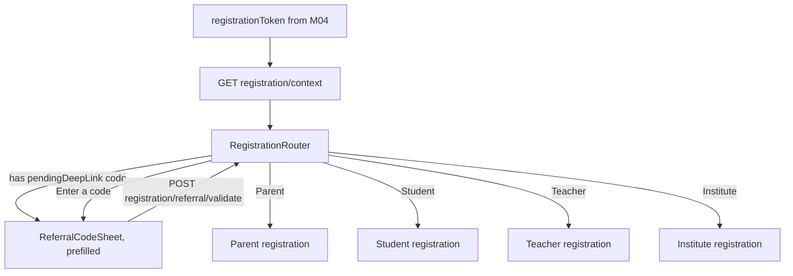
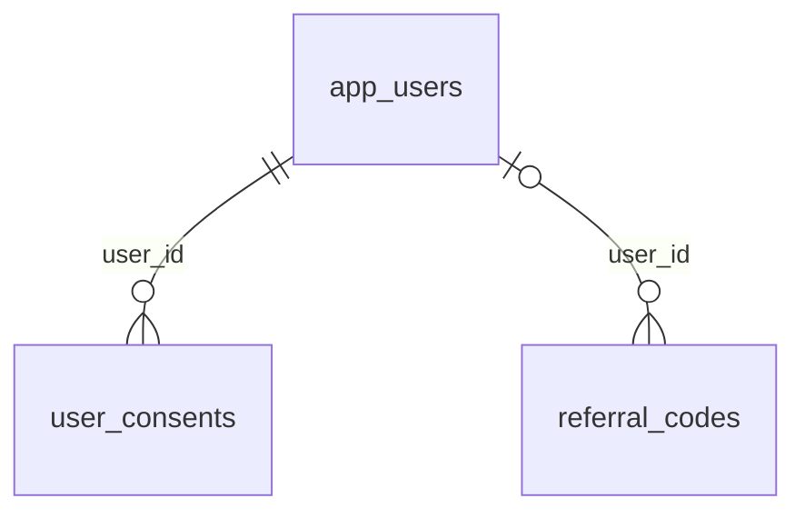

# Module 5 · Registration

> **Phase 1 · App Foundation** · **Used by:** Registration token · **Depends on:** M04 (issues the registrationToken this whole module requires), M00 (masters, uploads for later steps) · **New tables:** none · **Uses:** `app_users`, `user_consents`, `referral_codes` · **Build estimate:** 2–3 days

## 1. Module Purpose

The router a brand-new user lands on right after M04 verifies their phone, email or Google account and finds no existing `app_users` row. It has no role of its own — it lets the person choose Parent, Student, Teacher or Institute, tells the chosen role's screen (M06/M11/M14/M21) everything it needs to prefill (verified contact, Google name/photo, a referral code from a deep link), validates a referral code before it's submitted, and defines the one contract every role's submit endpoint follows: capture terms/privacy consent in the same transaction that creates the account, and let the form survive the app being killed mid-fill.

## 2. User Stories

- As a **new user who just verified their phone**, I want to be asked once, plainly, "Who are you signing up as?" so that I'm not shown irrelevant fields for a role I'm not.
- As a **user who opened an institute's referral link**, I want my referral code already filled in so that I don't have to type or remember it.
- As a **teacher filling a long registration form**, I want my progress saved if I get a call and the app gets killed, so that I don't start over.
- As **legal/compliance**, I want every account creation to record exactly which version of the Terms and Privacy Policy was agreed to, so that we can answer a DPDP Act data request.
- As a **low-connectivity student**, I want the role choice and referral check to work even on a bad connection, so that a slow 2G moment doesn't strand me on this screen.

## 3. Business Rules & Logic

**BR-5.1 Entry.** The only way to reach this module is holding a `registrationToken` (M04 BR-4.8, `aud=gc-register`, 30 min). Every endpoint here — and every role's submit endpoint in M06/M11/M14/M21 — verifies that audience and rejects anything else with `401 AUTH_REQUIRED`. An expired token routes back to M04's entry screen with "That took a while — let's verify your number again."
**BR-5.2 `GET /registration/context`.** Returns everything the role-picker and the next form need without another round trip: `contactType` and the verified value (phone shown in full since the user just typed it, email likewise), `prefill` (from Google, if `contactType='google'`: `fullName`, `photoUrl`), the four role tiles with a one-line description each, the current `legal.termsUrl/version` and `privacyUrl/version` (mirrors M01 bootstrap's `legal` block so this screen doesn't need a second bootstrap fetch), and `referralCode` pre-filled from `useAppFlags.pendingDeepLink` if it matches `/r/<code>` (BR-5.3 still re-validates it before use — a stored deep link is a hint, not a fact).
**BR-5.3 `POST /registration/referral/validate { code }`.** Looks up `referral_codes` case-insensitively (`upper(code)`), `is_active = true`, not expired (`expires_at IS NULL OR expires_at > now()`); for a personal code checks the owner's account is not suspended; for a campaign code checks its `usage_limit` hasn't been reached (count of `referrals` rows against it, read via M42's helper — this module never writes `referrals`, only previews). No `program_code` filter is applied here — a `TEACHER_REFERRAL` code is shown as valid even before the user has picked "Teacher", since the role tiles haven't been chosen yet; the role-specific submit endpoint (M06/M11/M14/M21) does the final program-match check when the referral is actually recorded. Response: `{ valid: true, programCode, ownerFirstName }` (masked, e.g. "Lakshmi") or `{ valid: false, reason }` with `reason ∈ invalid|expired|limit_reached|disabled` — never a hard error, so the UI can show an inline message and let the user continue without a code.
**BR-5.4 Role choice is client-only.** There is no `POST /registration/role` — tapping a tile just navigates to that role's own stack (M06/M11/M14/M21), carrying the `registrationToken`, the validated `referralCode` (or none), and any `prefill` forward as route params. If the user backs out and picks a different tile, nothing server-side needs to be undone (no state was created yet).
**BR-5.5 Shared draft persistence contract.** Every role's multi-field form (all four; Parent's is short but still covered) saves its in-progress values to `useRegistrationDraft(role)` — Zustand + encrypted MMKV, keyed `registrationDraft:<role>:<registrationTokenSubjectHash>` so a draft never leaks across a different verified contact reusing the app. The draft is written on every field blur (debounced 500 ms), restored on screen mount, and cleared only on a **successful** submit (BR-5.6) — an error leaves the draft intact so the user can retry without retyping. Drafts older than 24 h are ignored and cleared (the `registrationToken` they belong to would be long expired anyway).
**BR-5.6 Shared consent contract.** Every role's submit endpoint, inside the same database transaction that inserts `app_users` and the role table, inserts exactly two `user_consents` rows: `consent_type='terms', document_version=<legal.termsVersion at submit time>, granted=true, method='checkbox'` and the same for `consent_type='privacy_policy'`, both with `ip_address` and `install_id` from the request. `document_version` is **not** re-read from the possibly-stale `GET /registration/context` response the client cached — the server re-reads the live `system_settings` legal keys at submit time, so a version bump mid-fill is still recorded correctly. Marketing consent, when the form includes an opt-in checkbox, writes a third `consent_type='marketing'` row with `granted` matching the checkbox state (a false/declined marketing choice is still recorded — DPDP Act requires proof of the choice either way, not just of consent).
**BR-5.7 Shared submit order (documented once here, implemented once per role module).** 1) Re-verify the `registrationToken` and re-check the phone/email/Google-sub it names is still unclaimed (`CONFLICT_DUPLICATE` if another registration on a second device won the race). 2) Re-validate any `referralCode` against the role's actual program (`LEARNER_REFERRAL` for Parent/Student, `TEACHER_REFERRAL` for Teacher, `INSTITUTE_REFERRAL` for Institute) — a code valid for the wrong program is simply ignored (`referralApplied: false` in the response), never a hard error. 3) Insert `app_users`. 4) Insert the role table row. 5) Insert `user_auth_identities` row(s) for the method(s) verified. 6) If a referral applied, insert the `referrals` row (M42 owns that table; this is the one write every registration endpoint makes into it). 7) Insert the consent rows (BR-5.6). 8) Call M04's `issueSession` helper (BR-4.9) — Parent and Student land signed in immediately; Teacher and Institute also get a session (so they can resume registration if the app is killed) but their `/me.registration.nextStep` is non-null until documents/verification are done. 9) Clear the local draft (BR-5.5) and fire `app.<role>_registered` audit + analytics.
**BR-5.8 One contact, one account.** Because `uq_app_users_phone_live` and `uq_user_auth_identities_subject` are both partial-unique on live rows, step 1 of BR-5.7 is a belt-and-braces re-check, not the only guard — a genuine race (two devices submitting the same phone within the same second) is caught by the database constraint and surfaces as `409 CONFLICT_DUPLICATE` either way.

## 4. Screen List

| Screen | Route name | Purpose |
| --- | --- | --- |
| Registration router | `RegistrationRouter` | Choose Parent / Student / Teacher / Institute |
| Referral code sheet | `ReferralCodeSheet` (bottom sheet) | Enter/confirm a referral code before continuing |

## 5. Screen Flow & Navigation


Back from `RegistrationRouter` returns to M04's entry screen (AuthSelect), discarding the registration token — the user must verify their contact again to return here, which is intentional friction against abandoned-then-retried sign-ups piling up half-typed drafts.

## 6. Screen Wireframe Description

**RegistrationRouter** — heading "Welcome! Who's signing up?", subtext "You verified {maskedContact}." Four large tappable tiles, each with an icon, title and one line: "Parent — Find a teacher for your child", "Student — Find a teacher for yourself (18+, or with a parent's OK)", "Teacher — Get discovered by families near you", "Institute — List your coaching centre or school". Below the tiles, a plain-text link "Have a referral code?" opening the sheet if no code is already applied; once a code is applied it shows instead as a small dismissible chip "Referral: SCHOOLFAIR26 ✕".

**ReferralCodeSheet** — bottom sheet, heading "Enter a referral code", `TextField` (auto-uppercase, placeholder "e.g. LAKSHMI50"), inline status after a 400 ms debounce: green check "Valid — Lakshmi's code" or muted "We couldn't find that code" (never a red error — a bad code is not a form mistake, just informational), sticky button "Apply" (disabled until a code validates, or the sheet can be dismissed with no code at all via an "X").

## 7. UI Components & Component Tree

```
RegistrationRouterScreen
├─ Header (maskedContact)
├─ RoleTile × 4 ({ icon, title, subtitle, onPress })
├─ ReferralChip                    (shown once a code is applied)
└─ TextLink "Have a referral code?" (hidden once applied)
ReferralCodeSheet (BottomSheet)
├─ TextField (auto-uppercase)
├─ ValidationStatus (idle | checking | valid | not_found)
└─ StickyActionBar "Apply"
```
`useRegistrationContext()` (TanStack Query, key `registrationKeys.context`, not persisted — tied to a one-time token). `useReferralValidateMutation()` (debounced from the text field). `useRegistrationDraft(role)` — the shared hook every role module's form calls (BR-5.5).

## 8. Validation Rules

| Field | Rule | Message shown |
| --- | --- | --- |
| referralCode | 4–20 chars, `^[A-Za-z0-9]+$`, uppercased before send | "Codes are letters and numbers only." |
| registrationToken | must be present and unexpired (checked server-side on every call) | "That took a while — let's verify your number again." |

## 9. API Endpoints

| Method | Path | Auth | Description |
| --- | --- | --- | --- |
| GET | /registration/context | Registration token | Verified contact, prefill, legal versions, pending referral hint |
| POST | /registration/referral/validate | Registration token | Check a code without applying it (Idempotency-Key not needed — read-only) |

## 10. Request Payloads

```json
// POST /registration/referral/validate
{ "code": "SCHOOLFAIR26" }
```

## 11. Response Payloads

```json
// 200 GET /registration/context
{ "data": { "contactType": "phone", "verifiedValue": "+919876543210", "prefill": null,
  "roles": [ { "code": "parent", "title": "Parent", "subtitle": "Find a teacher for your child" },
             { "code": "student", "title": "Student", "subtitle": "Find a teacher for yourself" },
             { "code": "teacher", "title": "Teacher", "subtitle": "Get discovered by families near you" },
             { "code": "institute", "title": "Institute", "subtitle": "List your coaching centre or school" } ],
  "legal": { "termsVersion": "terms-2026-09", "termsUrl": "https://guruconnect.in/terms", "privacyVersion": "privacy-2026-09", "privacyUrl": "https://guruconnect.in/privacy" },
  "referralCode": null } }

// 200 POST /registration/referral/validate (valid)
{ "data": { "valid": true, "programCode": "LEARNER_REFERRAL", "ownerFirstName": "Lakshmi" } }

// 200 POST /registration/referral/validate (not found)
{ "data": { "valid": false, "reason": "invalid" } }
```

## 12. PostgreSQL Tables & Columns


**Existing tables this module reads or writes** (full definitions in the owning module)

| Table | Owner | Purpose |
| --- | --- | --- |
| `app_users` | Admin M00 | Login identity for every mobile app account (parent, student, teacher, institute staff). Role profiles hang off this table. |
| `user_consents` | App M52 | Record of every consent given or withdrawn (terms, privacy policy, parental consent, marketing), as required by the DPDP Act 2023. |
| `referral_codes` | Admin M42 | One personal referral code per app user. |

- `app_users`: read-only here (existence checks in BR-5.8); written by the role-specific submit endpoints, not by this module.
- `user_consents`: this module owns no writes to it either — BR-5.6/5.7 are the contract M06/M11/M14/M21 implement; this module only reads the live legal versions (via `system_settings`, not `user_consents` itself) to hand them to the client for display.
- `referral_codes`: read-only lookup in `POST /registration/referral/validate`; the eventual `referrals` row is written by whichever role module's submit endpoint applies the code (BR-5.7 step 6), which is why this module lists `referral_codes` under "uses" but never `referrals`.

## 13. Relationships


**Entity relationship diagram** (tables this module uses; `admins` omitted)



## 14. State Management

- `registrationKeys.context` — not persisted (one-time token, no value in caching across app restarts).
- `useRegistrationFlags` (Zustand, memory): `{ referralCode, referralValid, programCode }` — cleared the moment a role tile is tapped and handed forward as route params, not re-derived from a global store inside the role screens.
- `useRegistrationDraft(role)` (Zustand + encrypted MMKV) — shared shape `{ values: Record<string, unknown>, savedAt }` per role; this module defines the hook, M06/M11/M14/M21 are its only callers.

## 15. Offline Handling

`GET /registration/context` and referral validation are **online only** (conventions §8 class 3 — the whole registration token is time-boxed and worthless to cache). The role tiles themselves render from the already-fetched context, so a brief connectivity blip after context loads doesn't kick the user out; tapping a tile while offline is still allowed (pure navigation) but the destination form's own submit is blocked until connectivity returns, same as any other online-only write.

## 16. Push Notification Requirements

None. No account exists yet for any of these calls to notify.

## 17. Security Rules

- The `registrationToken` is the only credential; it is never stored (memory-only route param / one query), never logged, and expires in 30 minutes with no server-side revocation needed (BR-4.8).
- Referral validation never reveals a personal code owner's phone/email, only a first name — enough for "Lakshmi's code" reassurance, not enough to identify or contact them.
- No `FLAG_SECURE` needed (nothing on screen is sensitive); the maskedContact under the heading is already partially masked for phone (email is shown in full, matching what the user just typed at M04).

## 18. Error Handling

| Scenario | Code | HTTP | App behaviour |
| --- | --- | --- | --- |
| Registration token expired/invalid | `AUTH_REQUIRED` | 401 | Route to M04 entry, "let's verify your number again" |
| Referral code malformed | `VALIDATION_FAILED` | 422 | Inline under the field |
| Referral code not found/expired/disabled/limit reached | — (200, `valid:false`) | 200 | Muted inline "We couldn't find that code"; Apply stays disabled, sheet can still be dismissed with none |
| Context fetch fails (network) | `NETWORK_OFFLINE` / `INTERNAL_ERROR` | — / 500 | ErrorState with Retry; role tiles are not shown until context loads |

## 19. Testing Scenarios

- T5.1 Fresh registrationToken → `GET /registration/context` returns the four roles and no referral; Maestro flow `registration_router_basic`.
- T5.2 Opened from `gc://r/SCHOOLFAIR26` → context's `referralCode` is prefilled and shown as an applied chip without an extra tap.
- T5.3 Type a valid code manually → green "Valid — Lakshmi's code"; type a nonsense code → muted "We couldn't find that code", Apply stays disabled.
- T5.4 Tap "Teacher" → lands on M14 with `registrationToken`, `referralCode` (if any) and no prefill (phone contact type has none).
- T5.5 Google contactType → `prefill.fullName`/`photoUrl` present in context and pre-fill the next screen's name/photo fields.
- T5.6 Registration token expires while sitting on `RegistrationRouter` (wait 30 min) → next action returns `AUTH_REQUIRED` → routed back to M04.
- T5.7 Kill the app mid-fill on M06 (Parent) → relaunch, verify the same contact again → draft is restored from `registrationDraft:parent:<hash>` (values still present, new token).
- T5.8 A code valid for `TEACHER_REFERRAL` is entered while the user later picks "Parent" at the tile screen → M06's submit still succeeds but `referralApplied:false` (BR-5.7 step 2), no `referrals` row created.
- T5.9 Two devices submit registration for the same phone number within the same second → one succeeds, the other gets `CONFLICT_DUPLICATE` (BR-5.8).
- T5.10 Airplane mode on `RegistrationRouter` → tiles are visible and tappable (context already loaded); the next screen's submit button is disabled until connectivity returns.

## 20. Audit Log Events

None directly — `GET /registration/context` and referral validation are reads with no account yet to attribute them to. Each role's actual `app.<role>_registered` event (BR-5.7 step 9) is audited by that role's own module (M06/M11/M14/M21).

## 21. Future Scalability Notes

- A fifth "I'm not sure" tile that asks two quick questions (age, "do you teach or do you want a teacher?") and recommends a role, for users confused by the four-way choice.
- Server-driven role tile ordering/copy (A/B test "Teacher" vs "Institute" phrasing) once remote config exists.
- Multi-role accounts (e.g. a parent who is also a part-time tutor) — out of scope for v1 ("a user has exactly one role", conventions §4); would need a role-switch flow and a rethink of `app_users.user_type` as the sole role source.
- Save-and-resume by email link ("finish signing up later") for the longer Teacher/Institute forms, instead of relying solely on the on-device encrypted draft.
