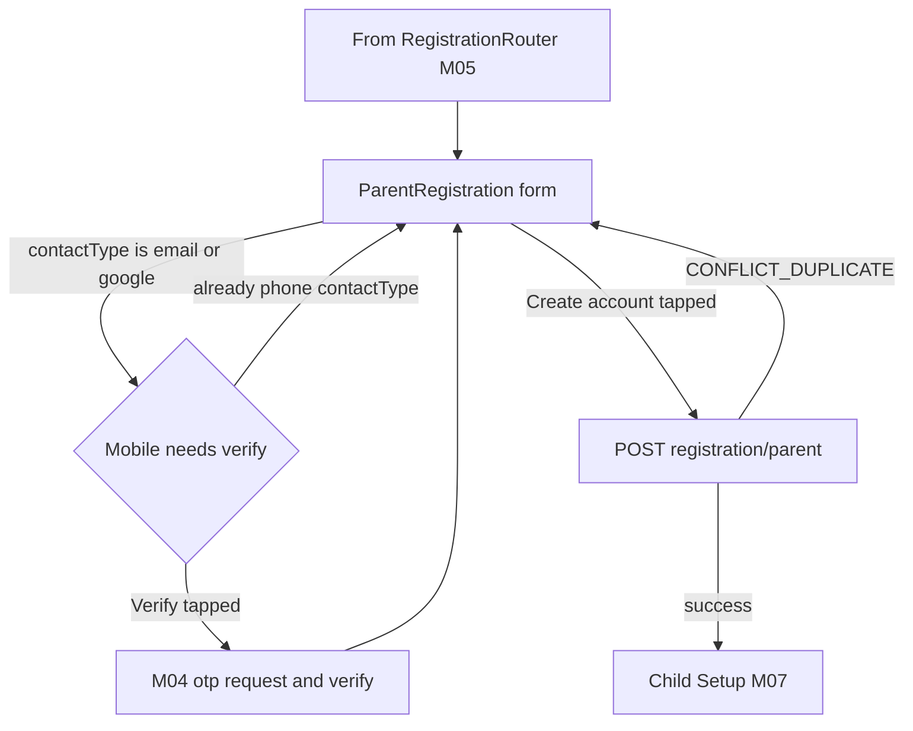
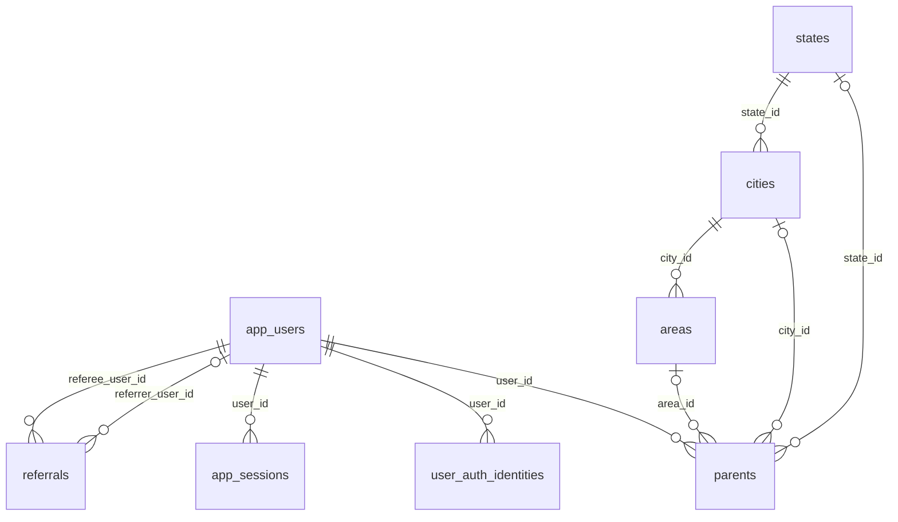

# Module 6 · Parent Registration

> **Phase 2 · Parent** · **Used by:** Registration token · **Depends on:** M05 (router, shared consent/draft/referral contract), M04 (OTP verify for a secondary mobile, issueSession), M00 (masters for state/city/area) · **New tables:** none · **Uses:** `app_users`, `parents`, `user_auth_identities`, `app_sessions`, `states`, `cities`, `areas`, `referrals` · **Build estimate:** 3 days

## 1. Module Purpose

The shortest of the four registration forms: name, mobile, email, city, state and an optional area. One screen, one submit, and — because it is the highest-volume role by far — one transaction that creates `app_users`, `parents`, the auth identity/identities, an optional `referrals` row, both consent rows and a live session, so a parent lands straight in Child Setup (M07) with no extra steps.

## 2. User Stories

- As a **parent who verified by phone**, I want the form to already know my number so that I only type my name, email and location.
- As a **parent who signed up with Google**, I want my name pre-filled from my Google account so that I don't retype it.
- As a **parent who signed up by email**, I want to be asked for a mobile number too, verified right there, because teachers and support need a phone number that actually reaches me.
- As a **parent in a small town**, I want to skip the area field if my locality isn't listed, so that a missing dropdown entry doesn't block me from signing up.
- As **operations**, I want a referral code applied at sign-up recorded properly so that the referrer gets credit once I subscribe.

## 3. Business Rules & Logic

**BR-6.1 Fields.** `fullName` (required), `mobile` (required — see BR-6.2 for when it needs its own verification), `email` (optional), `stateId` (required), `cityId` (required, must belong to `stateId`), `areaId` (optional, must belong to `cityId`). No date of birth, no photo, no password field — the account's sign-in method is whatever was already verified to reach this screen (BR-6.3).
**BR-6.2 Mobile number handling by contact type.** If `registrationToken.contactType = 'phone'`, `mobile` is pre-filled read-only with the verified number and needs nothing further. If `contactType` is `'email'` or `'google'`, the form shows an **editable** mobile field with its own inline "Verify" step: tapping it calls M04 `POST /auth/otp/request` (this module reuses that endpoint directly, it does not duplicate OTP-sending logic) and then `POST /auth/otp/verify` with `purpose` resolved server-side to `signup` (BR-4.2's channel-agnostic verify, called with the same shape but no session/registrationToken is returned for a `signup`-purpose challenge — just a verified flag); the resulting `challengeId` is submitted alongside the form as `mobileOtpChallengeId`. The registration submit re-checks that challenge: `channel='sms'`, `verified_at IS NOT NULL`, `destination = body.mobile` exactly, and not already consumed by a different account (a challenge can only ever back one account, checked by a short-lived Redis claim `otp:claimed:<challengeId>` set at submit time to stop a replay across two submits).
**BR-6.3 Transaction (single DB transaction).**
1. Re-verify the `registrationToken` (M05 BR-5.7 step 1); re-check the phone and email (if given) are still unclaimed by any live `app_users`/`user_auth_identities` row → `409 CONFLICT_DUPLICATE` otherwise.
2. If `mobileOtpChallengeId` was required (BR-6.2), re-validate it as described.
3. Validate `stateId`/`cityId`/`areaId` are active and correctly nested (`422 VALIDATION_FAILED` "Pick an area in the selected city." if not).
4. If a `referralCode` was carried from M05, re-validate it against `program_code = 'LEARNER_REFERRAL'` specifically (M05 BR-5.7 step 2) — a code for a different program is silently dropped (`referralApplied:false`).
5. Insert `app_users` (`user_type='parent'`, `phone=mobile`, `email`, `full_name=fullName`, `auth_provider` = the method from `registrationToken.contactType` (`otp`→`otp`, `email`→`password` if a password identity is being created alongside, else the email-OTP path stores `auth_provider='otp'` too since there's no password), `account_status='active'`, `signup_source` = `'referral'` if a code applied, else `'deep_link'` if `useAppFlags.pendingDeepLink` was present at registration start, else `'organic'`).
6. Insert `parents` (`user_id`, `public_code` auto-generated, `full_name`, `email`, `phone=mobile`, `state_id`, `city_id`, `area_id`, `account_status='active'`, `referral_code_used` = the applied code's text or null).
7. Insert `user_auth_identities`: always one `provider='phone'` row for `mobile` (`last_used_at=now()` only if this *was* the method used to reach the screen — otherwise `last_used_at=null`, it's simply now available for future logins); plus one `provider='google'` row if `contactType='google'` (`provider_subject` = the Google `sub` from the registrationToken, not re-verified — it was already verified by M04 to mint the token); email-only sign-ups with no password chosen do not get a `provider='password'` row here (they can set one later from Account Settings, or simply keep using email-OTP to sign in).
8. If the referral applied: insert `referrals` (`referral_code_id`, `referrer_user_id` from the code, `referee_user_id` = the new user, `referral_setting_id` = the program's current active version, `status='pending'`).
9. Insert the two mandatory `user_consents` rows (M05 BR-5.6), plus a third `marketing` row if the form's marketing checkbox was shown and interacted with.
10. Call `issueSession` (M04 BR-4.9) with `auth_method` matching whichever identity was actually used to reach this screen (`otp`, `google`, or `email_otp`).
11. Commit. Response returns the same `{ accessToken, refreshToken, session, user }` shape as M04 login, with `user.registration.nextStep = 'child_setup'`.
**BR-6.4 Mandatory next step.** A parent account with zero live `parent_children` rows always has `registration.nextStep = 'child_setup'` in `/me` (M00 BR-0.12) until at least one child is added (M07); Splash (M01 BR-1.5) and Home routing both honour this — there is no way to reach the Parent Home dashboard with no children on file. This is enforced by M07, not re-implemented here; this module only sets the initial condition (a parent with no children yet).
**BR-6.5 Idempotency.** The client sends `Idempotency-Key` on submit (a uuid generated once when the form is first opened, reused on retry) so a network timeout followed by an automatic retry can't create two `parents` rows for one registrationToken; the server caches the first successful response body against that key for 24 h and replays it on an exact retry rather than re-running the transaction.

## 4. Screen List

| Screen | Route name | Purpose |
| --- | --- | --- |
| Parent registration | `ParentRegistration` | Name, mobile (+ inline verify if needed), email, state/city/area |

## 5. Screen Flow & Navigation


There is no back-and-forth once submitted — a successful `POST /registration/parent` always advances straight to Child Setup; the back gesture on `ParentRegistration` itself returns to `RegistrationRouter` (role choice), discarding this form's draft only if the user then picks a different role.

## 6. Screen Wireframe Description

**ParentRegistration** — heading "Tell us about you", then, top-to-bottom: `TextField` "Full name" (placeholder "Lakshmi Venkatesh"), `PhoneField` "Mobile number" (+91, read-only with a small "Verified" check icon when `contactType='phone'`; otherwise editable with a trailing text button "Verify" that opens the `OtpVerify` sheet inline and turns into the same "Verified" check on success), `TextField` "Email (optional)" (placeholder "lakshmi.v@gmail.com", pre-filled and read-only if `contactType='email'`), `Select` "State" (bottom-sheet list with search, placeholder "Karnataka"), `Select` "City" (disabled until a state is chosen, placeholder "Bengaluru"), `Select` "Area (optional)" (disabled until a city is chosen, placeholder "Koramangala"), optional marketing checkbox "Send me offers and tips by WhatsApp/email" (unchecked by default), sticky button "Create account" (disabled until name, verified mobile, state and city are all present).

## 7. UI Components & Component Tree

```
ParentRegistrationScreen
├─ TextField "Full name"
├─ PhoneField "Mobile number" (+ inline OtpVerifySheet when editable)
├─ TextField "Email (optional)"
├─ Select "State" · Select "City" (depends on state) · Select "Area (optional)" (depends on city)
├─ Checkbox "Marketing opt-in"
└─ StickyActionBar "Create account"
```
`useRegistrationDraft('parent')` (M05) restores/saves every field on blur. `useStatesQuery()`/`useCitiesQuery(stateId)`/`useAreasQuery(cityId)` reuse M00's masters cache. `useMobileVerify()` wraps the inline OTP request/verify pair and exposes `{ status: idle|sending|verifying|verified, challengeId }`. `useParentRegistrationMutation()` — `Idempotency-Key` generated once per form-open via `useRef`.

## 8. Validation Rules

| Field | Rule | Message shown |
| --- | --- | --- |
| fullName | 2–100 chars | "Enter your name." |
| mobile | `^\+91[6-9]\d{9}$`; must carry a matching verified `mobileOtpChallengeId` unless `contactType='phone'` | "Verify your mobile number to continue." |
| email | optional; RFC-valid, ≤ 254 chars | "Enter a valid email address." |
| stateId | required, active | "Choose your state." |
| cityId | required, active, belongs to `stateId` | "Choose your city." |
| areaId | optional, active, belongs to `cityId` | "Pick an area in the selected city." |
| referralCode (carried, read-only here) | see M05 BR-5.3 | — |

## 9. API Endpoints

| Method | Path | Auth | Description |
| --- | --- | --- | --- |
| POST | /registration/parent | Registration token | Create the parent account, identities and session in one transaction (Idempotency-Key) |

## 10. Request Payloads

```json
// POST /registration/parent
{ "fullName": "Lakshmi Venkatesh", "mobile": "+919876543210", "mobileOtpChallengeId": null,
  "email": "lakshmi.v@gmail.com", "stateId": "…karnataka…", "cityId": "…bengaluru…", "areaId": "…koramangala…",
  "marketingOptIn": true, "referralCode": "SCHOOLFAIR26" }
```

## 11. Response Payloads

```json
// 201 POST /registration/parent
{ "data": { "accessToken": "eyJhbGciOiJSUzI1NiIs…", "expiresIn": 900, "refreshToken": "vR3n9q…",
  "session": { "id": "c9b1…" },
  "user": { "userId": "…", "role": "parent", "profileId": "…", "fullName": "Lakshmi Venkatesh", "accountStatus": "active",
    "registration": { "complete": false, "nextStep": "child_setup" } },
  "referralApplied": true } }

// 409 POST /registration/parent (duplicate)
{ "error": { "code": "CONFLICT_DUPLICATE", "message": "An account already exists with this phone number.", "details": {}, "requestId": "…" } }
```

## 12. PostgreSQL Tables & Columns


**Existing tables this module reads or writes** (full definitions in the owning module)

| Table | Owner | Purpose |
| --- | --- | --- |
| `app_users` | Admin M00 | Login identity for every mobile app account (parent, student, teacher, institute staff). Role profiles hang off this table. |
| `parents` | Admin M28 | Parent profile, one per parent app account. |
| `user_auth_identities` | App M04 | Sign-in methods linked to an account: phone OTP, email + password, Google. |
| `app_sessions` | App M04 | Refresh-token sessions for app users, one per signed-in install. Refresh tokens rotate on every use. |
| `states` | Admin M08 | States and union territories within a country. |
| `cities` | Admin M09 | Cities where teachers and institutes can be listed. |
| `areas` | Admin M10 | Localities within a city, used for "nearby" search and teacher coverage. |
| `referrals` | Admin M42 | One row per referred user, tracking qualification, fraud checks and reward payout. |

- `parents`: this module is the sole inserter for the app; `public_code` uses the existing `seq_parent_code` default, no app-side generation needed. `suspended_*` columns are never touched here (admin-only, M28).
- `app_users`: `signup_source` set per BR-6.3 step 5, matching M00's BR-0.13 column definition exactly.
- `user_auth_identities`: this module inserts rows but never the `password_hash` — a parent who registered by email/Google without setting a password has no `provider='password'` row until they add one later (M51).
- `app_sessions`: created via M04's shared `issueSession`; this module supplies only `auth_method`, not the row shape.
- `referrals`: written only when a `LEARNER_REFERRAL`-program code validated against this submission; `referral_setting_id` is resolved fresh at submit time (never from a value cached since M05's earlier preview).
- `states`/`cities`/`areas`: read-only, validated for nesting and `is_active` before insert.

## 13. Relationships


**Entity relationship diagram** (tables this module uses; `admins` omitted)



## 14. State Management

- `registrationDraft:parent:<hash>` (M05 shared hook) — `{ fullName, mobile, email, stateId, cityId, areaId, marketingOptIn }`.
- `useMobileVerify` — local component state only (`idle|sending|verifying|verified`), not persisted (an unverified in-flight OTP challenge should never survive an app restart as "verified").
- `mastersKeys.*` reused from M00's persisted masters cache — states/cities/areas render instantly even on a slow connection.

## 15. Offline Handling

The form itself can be filled offline (draft persistence, M05 BR-5.5) except the state/city/area pickers need the masters cache to already be warm (it usually is, fetched at Splash) — if not cached, the pickers show a loading skeleton and an offline hint. `Verify` (mobile OTP) and the final `Create account` submit are **online only** (conventions §8 class 3); the sticky button is disabled with "Needs internet" until connectivity returns, and the typed values are never lost while waiting.

## 16. Push Notification Requirements

None sent by this module at submit time; the very first push a parent might see is the pre-permission explainer after their first favourite or lead, per conventions §9 — registration itself does not prompt for push permission.

## 17. Security Rules

- `ParentRegistration` is not `FLAG_SECURE` (no credentials entered here — the credential was already verified at M04).
- The inline mobile OTP reuses M04's rate limits and lockouts verbatim (BR-4.1/4.14) — this module adds no separate throttle, only the extra "must belong to this submit" claim check (BR-6.2's Redis claim).
- Ownership: every field in the request is attributed to the `registrationToken`'s verified contact server-side; the client cannot register an account for a phone/email it hasn't verified by supplying it in the body alone.

## 18. Error Handling

| Scenario | Code | HTTP | App behaviour |
| --- | --- | --- | --- |
| Phone or email already registered (race) | `CONFLICT_DUPLICATE` | 409 | "An account already exists with this phone number." — offers "Sign in instead" back to M04 |
| Area doesn't belong to the chosen city | `VALIDATION_FAILED` | 422 | "Pick an area in the selected city." |
| Mobile not verified (email/google contact type) | `VALIDATION_FAILED` | 422 | `details.reason = "mobile_not_verified"`; Create account stays disabled until Verify succeeds |
| Registration token expired mid-fill | `AUTH_REQUIRED` | 401 | Route back to M04; draft is preserved for the next attempt |
| Referral code for the wrong program | — (200, `referralApplied:false`) | 201 | Account still created; no special message, referral chip simply disappears from the next screen |

## 19. Testing Scenarios

- T6.1 Phone-contact happy path: mobile pre-filled and marked verified, fill name/state/city, submit → session issued, `nextStep='child_setup'`. Maestro flow `parent_registration_phone`.
- T6.2 Email-contact path: mobile field editable, tap Verify, receive test OTP, verify, then submit → succeeds with both a `phone` and no `password` identity row.
- T6.3 Google-contact path: name pre-filled from Google prefill, editable but correct by default; submit creates both `phone` and `google` identity rows.
- T6.4 Submit with an unverified mobile (Verify never tapped) → `VALIDATION_FAILED`, `details.reason="mobile_not_verified"`.
- T6.5 Area selected for a city that isn't the chosen one (forced via a stale cached list) → `VALIDATION_FAILED` "Pick an area in the selected city."
- T6.6 Valid `LEARNER_REFERRAL` code applied → response `referralApplied:true` and a `referrals` row exists with `status='pending'`.
- T6.7 A `TEACHER_REFERRAL` code carried from M05 → submit still succeeds, `referralApplied:false`, no `referrals` row.
- T6.8 Duplicate submit with the same `Idempotency-Key` after a timeout → the cached first response is replayed, no second `parents` row created.
- T6.9 Kill the app after typing name/email but before submit → relaunch, re-verify the same phone → draft restores exactly those fields.
- T6.10 Airplane mode with a filled form → `Create account` disabled with "Needs internet"; typed values remain after reconnecting.

## 20. Audit Log Events

| Event | When | Details |
| --- | --- | --- |
| `app.parent_registered` | Successful submit | city, referral applied (yes/no), signup source |

## 21. Future Scalability Notes

- Optional profile photo at registration once product wants richer parent profiles (currently deferred to M09 Parent Profile, post-registration).
- Auto-detect city from `expo-location` (foreground only) to pre-select the state/city pickers, falling back to the manual pickers exactly as today.
- Multi-language registration form once Hindi strings ship (conventions §2 i18n), reusing the same fields.
- Bulk/import registration for schools onboarding many parents at once (an admin-portal feature, not this app screen) — noted for Admin portal additions if requested later.
