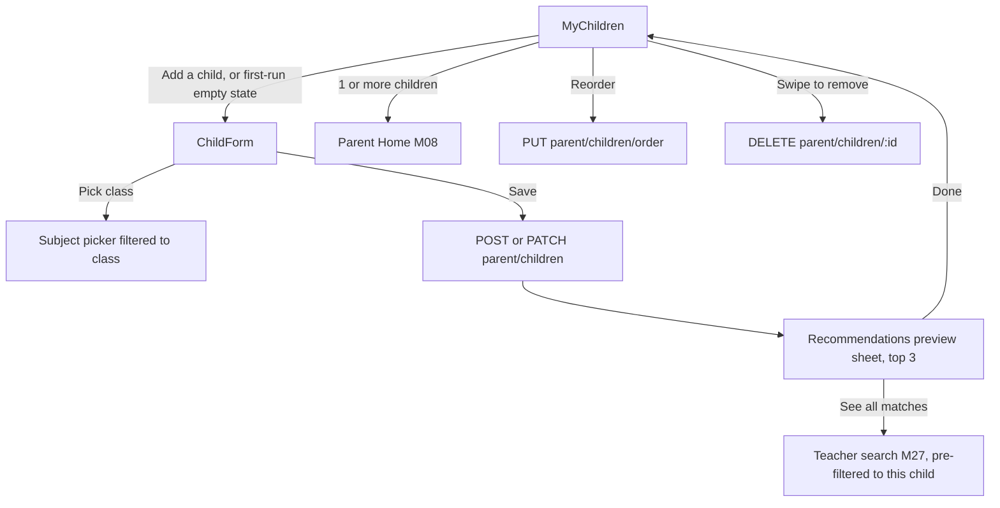
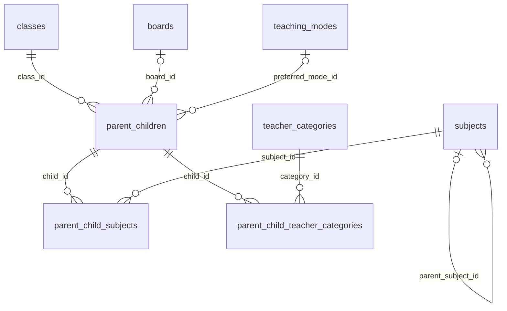

# Module 7 · Parent Child Setup

> **Phase 2 · Parent** · **Used by:** Parent · **Depends on:** M06 (a parent account must exist), M00 (masters), M08/M30 (consume the recommendations this module triggers) · **New tables:** none · **Uses:** `parent_children`, `parent_child_subjects`, `parent_child_teacher_categories`, `classes`, `boards`, `subjects`, `teaching_modes`, `teacher_categories` · **Build estimate:** 4 days

## 1. Module Purpose

The screen every new parent must complete before reaching Home: add each child they're finding a teacher for — first name, class, board, the subjects needed (filtered to what's actually offered at that class), optionally a preferred teaching mode and the kinds of teacher wanted — up to `limits.parent_max_children` children (seeded at 3). Every save recomputes that child's recommendations and previews the top 3 matches inline, so a parent sees the platform actually working before they've paid anything. It is the single richest input to both the v0 rule-based dashboard (M08) and, later, the full recommendation engine (M30) — both read the same per-child cache this module invalidates.

## 2. User Stories

- As a **new parent with two children**, I want to add both, each with their own class and subjects, so that recommendations are right for each child separately, not blended together.
- As a **parent whose child just moved up a grade**, I want to edit the class and have the subject list update to match, without accidentally keeping a subject that's no longer taught at that level.
- As a **parent who isn't sure what "teaching mode" means yet**, I want that field to be optional so that it never blocks me from finishing.
- As a **parent with three children already added**, I want a clear message when I try to add a fourth, so that I understand the limit rather than thinking the app is broken.
- As a **parent on a slow connection**, I want to see at least a rough set of matches for my child right after saving, even before the full search screen loads, so that I feel the wait was worth it.

## 3. Business Rules & Logic

**BR-7.1 Child limit.** A parent may have 1…`limits.parent_max_children` (default 3, from bootstrap `limits.parentMaxChildren`) live (`deleted_at IS NULL`) `parent_children` rows. `POST /parent/children` re-checks the live count server-side at insert time (never trusts the client's cached count) and returns `409 LIMIT_REACHED { details: { reason: "max_children", limit: 3, current: 3 } }` past the limit — the setting is admin-editable, so the server value always wins over whatever the app last cached from bootstrap.
**BR-7.2 Fields.** `childName` — **first name only**, 1–40 chars, letters and spaces (data minimisation for minors, conventions §12: no date of birth, no photo, no school-leaving-certificate — just enough to personalise recommendations and the UI). `classId` — required. `boardId` — optional; if the chosen board has a non-null `state_id` (a state board), it must equal the parent's `parents.state_id`, **or** the board's `type` is `national`/`international`/`university`/`other` (a Karnataka parent can still pick "CBSE" or "Other", just not, say, "Maharashtra State Board"). `subjectIds` — 0–6, each must be offered for the chosen class (BR-7.3). `categoryIds` (teacher types wanted) — 0–4, from `teacher_categories`. `preferredModeId` — optional, from `teaching_modes`. `schoolName` — optional free text, ≤ 120 chars (kept for context, never shown to teachers before contact unlock).
**BR-7.3 Subject filtering by class.** A subject is offered for a class when `subjects.min_class_order IS NULL OR subjects.min_class_order <= classes.level_order` **and** `subjects.max_class_order IS NULL OR subjects.max_class_order >= classes.level_order`, compared against the **chosen** class's `level_order`. The subject picker (a searchable multi-select sheet) is filtered live to only offered subjects the moment a class is picked; it is empty and disabled until a class is chosen. Changing an already-saved child's class to one where a previously-chosen subject no longer qualifies **silently drops** that subject from the saved set (server-side, on `PATCH`) and the response includes `droppedSubjects: [...]` so the app can show a one-line toast ("Removed Physics — not offered for Class 5") rather than a blocking error.
**BR-7.4 Create.** `POST /parent/children { childName, classId, boardId?, subjectIds[], categoryIds[], preferredModeId?, schoolName? }` (Idempotency-Key). In one transaction: re-check BR-7.1's limit, insert `parent_children` (`sort_order` = current max + 1), insert `parent_child_subjects`/`parent_child_teacher_categories` join rows. Then, **synchronously, before responding** (BR-7.6): compute and cache the child's recommendations and return the top 3 inline as `recommendationsPreview`.
**BR-7.5 Edit and reorder.** `PATCH /parent/children/:id` (If-Match, any subset of BR-7.2's fields) applies BR-7.3's drop-on-class-change rule, then re-triggers BR-7.6 exactly as create does (any field change can change who's a good match). `PUT /parent/children/order { orderedIds: [...] }` sets `sort_order` to each id's index in the array — purely cosmetic (the child switcher's order), never touches recommendations.
**BR-7.6 Recommendation trigger — what "recompute" means.** On every create or qualifying edit (class, board, subjects, categories or mode changed — a pure `childName`/`schoolName`/reorder edit does **not** trigger this): 1) delete the Redis cache key `rec:<childId>` (M29 FR-29.4's cache, shared with the admin-side debug view) so it can never serve a stale list; 2) run the same scoring formula inline for a synchronous top-3 preview: eligible teachers are `approved`, `active`, with a `teacher_classes` row matching the child's class (board `NULL` or equal), scored `5 (class) + 3×(category match count) + 3×(subject match count) + 1×(mode match) + trust_score/100 + 0.5×(within 4 km of the parent's area)`; 3) write the full top-20 back into `rec:<childId>` (6-hour TTL) so the immediately-following dashboard (M08, v0 rule-based ranking reading this exact cache) and, once it ships, M30's `GET /recommendations` (same cache key, same formula, replacing this module's inline scoring with its own richer one behind the same contract) both see fresh data without recomputing again. If fewer than 3 teachers qualify, `recommendationsPreview` returns whatever is available (0–3) rather than padding with irrelevant results.
**BR-7.7 Delete.** `DELETE /parent/children/:id` (soft: `deleted_at`). The join rows (`parent_child_subjects`/`parent_child_teacher_categories`) are left in place (harmless — every query joins through `parent_children.deleted_at IS NULL`); the `rec:<childId>` cache key is deleted; any `user_favorites`/`user_search_history` rows that reference the child keep doing so (`ON DELETE SET NULL` only fires on a hard delete, which never happens here) and simply stop being offered as a "for {childName}" filter option once the child no longer appears in the switcher.
**BR-7.8 Empty state gate (ties to M06 BR-6.4).** With zero live children, the parent cannot reach Home; the child list screen shows a mandatory empty state with no way to skip, and the tab bar itself is not rendered until the first child is saved successfully.

## 4. Screen List

| Screen | Route name | Purpose |
| --- | --- | --- |
| My children | `MyChildren` | List of children (or the mandatory empty state), add/reorder entry point |
| Add / edit child | `ChildForm` (modal) | Name, class, board, subjects, categories, mode |
| Recommendations preview | (bottom sheet, shown after save) | Top 3 matches for the just-saved child |

## 5. Screen Flow & Navigation


The preview sheet always appears after a successful save (create or a qualifying edit); "Done" returns to `MyChildren`, where the tab bar becomes visible for the first time once at least one child exists. A non-qualifying edit (name/school/reorder only) returns straight to `MyChildren` with no preview sheet.

## 6. Screen Wireframe Description

**MyChildren (empty state)** — illustration of a parent and child, heading "Add your first child", body "We'll recommend teachers based on their class, board and subjects.", sticky button "Add a child" (no skip option, no back-to-Home).

**MyChildren (populated)** — header "My children (2 of 3)"; child cards, each: avatar-style initial chip, name "Aarav", subtitle "Class 5 · CBSE · Mathematics, English +1", trailing chevron opening `ChildForm` in edit mode, long-press to drag-reorder; below the cards, if under the limit, a dashed "+ Add another child" card; at the limit (3 of 3), the add card is replaced by muted text "You've reached the maximum of 3 children."

**ChildForm** — heading "Add a child" (or "Edit {childName}"), `TextField` "Child's first name" (placeholder "Aarav"), `Select` "Class" (bottom sheet, e.g. "Class 5"), `Select` "Board (optional)" (e.g. "CBSE"), `MultiSelect` "Subjects needed" (chip-style, disabled with helper "Choose a class first" until `classId` is set; once set, shows only offered subjects e.g. Mathematics, English, Science, Hindi, EVS for Class 5), `MultiSelect` "Type of teacher (optional)" (e.g. "Home Tutor", "School Teacher"), `Select` "Preferred mode (optional)" (e.g. "Home tuition"), `TextField` "School name (optional)", sticky button "Save child".

**Recommendations preview (bottom sheet)** — heading "3 teachers found for Aarav", three compact `TeacherCard` rows (photo, name, Trust Score ring, one-line "Class 5 · Mathematics · 2.1 km"), sticky button "See all matches" (primary) and text link "Done" (secondary, dismisses to `MyChildren`). If fewer than 3 matched: heading "{n} teacher{s} found for Aarav" (n could be 0 — "We'll notify you as soon as a match appears nearby.").

## 7. UI Components & Component Tree

```
MyChildrenScreen
├─ EmptyState "Add your first child"           (zero children)
├─ ChildCard × N ({ child, onEdit, onDelete, dragHandle })
└─ AddChildCard (dashed) | LimitReachedText     (below limit | at limit)
ChildForm (modal)
├─ TextField "Child's first name"
├─ Select "Class" · Select "Board (optional)"
├─ MultiSelect "Subjects needed"   (filtered by class)
├─ MultiSelect "Type of teacher (optional)"
├─ Select "Preferred mode (optional)"
├─ TextField "School name (optional)"
└─ StickyActionBar "Save child"
RecommendationsPreviewSheet
├─ Heading ("{n} teachers found for {childName}")
├─ TeacherCard × up to 3 (variant="compact")
└─ StickyActionBar "See all matches" + TextLink "Done"
```
Hooks: `useChildrenQuery()` (list), `useAddChildMutation()`, `useEditChildMutation(id)`, `useDeleteChildMutation(id)`, `useReorderChildrenMutation()`, `useSubjectsForClass(classId)` (derives from the already-cached masters payload, no extra network call), `TeacherCard({ teacher, onPress, onFavourite, variant: "compact"|"full" })` (shared component, M00 shell + completed by M31 profile view).

## 8. Validation Rules

| Field | Rule | Message shown |
| --- | --- | --- |
| childName | 1–40 chars, letters and spaces only | "Enter your child's first name." |
| classId | required, active class | "Choose a class." |
| boardId | optional, active; state board must match the parent's state or be national/international/university/other | "Choose a board available in your state." |
| subjectIds | 0–6, each valid for `classId` (BR-7.3) | "Physics isn't offered for Class 5." / "Choose up to 6 subjects." |
| categoryIds | 0–4, active teacher categories | "Choose up to 4 teacher types." |
| preferredModeId | optional, active | — |
| schoolName | optional, ≤ 120 chars | "Keep the school name under 120 characters." |

## 9. API Endpoints

| Method | Path | Auth | Description |
| --- | --- | --- | --- |
| GET | /parent/children | Parent | List this parent's children |
| POST | /parent/children | Parent | Add a child; triggers recompute and returns a top-3 preview (Idempotency-Key) |
| PATCH | /parent/children/:id | Parent (owner only, If-Match) | Edit a child; re-triggers recompute on a qualifying field change |
| DELETE | /parent/children/:id | Parent (owner only) | Remove a child (soft) |
| PUT | /parent/children/order | Parent | Reorder the child switcher |

## 10. Request Payloads

```json
// POST /parent/children
{ "childName": "Aarav", "classId": "…class-5…", "boardId": "…cbse…",
  "subjectIds": ["…mathematics…", "…english…"], "categoryIds": ["…home-tutor…"], "preferredModeId": null, "schoolName": "Delhi Public School" }

// PUT /parent/children/order
{ "orderedIds": ["…child-rohan…", "…child-aarav…", "…child-priya…"] }
```

## 11. Response Payloads

```json
// 201 POST /parent/children
{ "data": { "id": "…child-aarav…", "childName": "Aarav", "class": { "id": "…", "name": "Class 5" }, "board": { "id": "…", "shortName": "CBSE" },
  "subjects": ["Mathematics", "English"], "teacherCategories": ["Home Tutor"], "preferredMode": null, "schoolName": "Delhi Public School",
  "createdAt": "2026-09-26T10:15:00Z" },
  "meta": { "recommendationsPreview": [
    { "teacherId": "…", "fullName": "Dr. Ananya Iyer", "trustScore": 82, "score": 12.4, "distanceKm": 2.1, "subjectsMatched": ["Mathematics"] },
    { "teacherId": "…", "fullName": "Imran Qureshi", "trustScore": 74, "score": 11.9, "distanceKm": 3.4, "subjectsMatched": ["Mathematics","English"] },
    { "teacherId": "…", "fullName": "Sowmya Rao", "trustScore": 69, "score": 10.2, "distanceKm": 1.6, "subjectsMatched": ["English"] }
  ] } }

// 200 PATCH /parent/children/:id  (class changed, a subject no longer fits)
{ "data": { "id": "…", "childName": "Aarav", "class": { "id": "…", "name": "Class 9" }, "subjects": ["Mathematics"], "…": "…" },
  "meta": { "droppedSubjects": ["English"], "recommendationsPreview": [ "…" ] } }

// 409 POST /parent/children (limit reached)
{ "error": { "code": "LIMIT_REACHED", "message": "You can add up to 3 children.", "details": { "reason": "max_children", "limit": 3, "current": 3 }, "requestId": "…" } }
```

## 12. PostgreSQL Tables & Columns


**Existing tables this module reads or writes** (full definitions in the owning module)

| Table | Owner | Purpose |
| --- | --- | --- |
| `parent_children` | Admin M29 | Children a parent is finding teachers for. Drives per-child recommendations. |
| `parent_child_subjects` | Admin M29 | Subjects needed for a child. |
| `parent_child_teacher_categories` | Admin M29 | Types of teacher the parent wants for a child (Home Tutor, Competitive Exam Faculty, …). |
| `classes` | Admin M11 | Grades and levels learners study at, from Class 1 to competitive exam preparation. |
| `boards` | Admin M13 | Education boards and curricula, e.g. CBSE, ICSE, state boards, IB. |
| `subjects` | Admin M12 | Subjects, exams and skills teachers can teach. |
| `teaching_modes` | Admin M14 | How classes are delivered, e.g. Online, Offline at teacher's place, Home tuition, Hybrid. |
| `teacher_categories` | Admin M15 | Types of teacher shown as categories and used in parent preferences, e.g. Home Tutor, Coaching Faculty. |

- `parent_children`: this module is the only app-side writer; admins may also edit/soft-delete via Admin M29 (support corrections), which is why every read here filters `deleted_at IS NULL` and never assumes it's the sole author of history.
- `parent_child_subjects` / `parent_child_teacher_categories`: fully replaced (delete-then-reinsert the join rows) on every `PATCH` that changes `subjectIds`/`categoryIds`, rather than diffed — simpler and cheap at ≤ 6/≤ 4 rows per child.
- `classes`/`subjects`/`boards`/`teaching_modes`/`teacher_categories`: read-only masters, already cached from M00 `GET /masters`; this module adds no new master-data endpoint, only the class-based subject filter (BR-7.3) computed client-side from the cached payload (and re-validated server-side on every write).

## 13. Relationships


**Entity relationship diagram** (tables this module uses; `admins` omitted)



## 14. State Management

- `childrenKeys.list` (TanStack Query, persisted — this is exactly the kind of "profile" data conventions §7 caches for instant offline reads) — invalidated after every add/edit/delete/reorder mutation.
- `useChildFormDraft` (per M05's shared draft hook, keyed `registrationDraft:parent:children:<childId|"new">`) — though child setup is post-registration, the same encrypted-MMKV draft pattern is reused so a half-filled `ChildForm` survives an app kill exactly like the registration forms do.
- No optimistic update for add/edit (the response's `recommendationsPreview` must come from the server — nothing to optimistically show); reorder **is** optimistic (instant local reorder, rolled back with a toast if `PUT /parent/children/order` fails).

## 15. Offline Handling

`GET /parent/children` is persisted and renders instantly from cache (offline banner shown if stale). Add/edit/delete are **save draft, submit online** (conventions §8 class 2): the form can be filled entirely offline and the draft survives a restart, but `Save child` is disabled with "Needs internet — we'll show matches once you're back online" until connectivity returns (a recommendations preview genuinely cannot be computed offline). Reorder is **queue offline** (class 1, idempotent, latest-wins) since it's cosmetic only.

## 16. Push Notification Requirements

| Event | Recipient | Title / Body | Deep link | Category | Urgent |
| --- | --- | --- | --- | --- | --- |
| New match appears later for a child with zero matches at save time | Parent | "A teacher for {childName} just joined" / "{teacherName} teaches {subject} near you." | `gc://t/{teacherPublicCode}` | recommendations | no |
No push at save time itself — the in-app preview sheet (BR-7.6) already shows the result synchronously; the push above only fires later, from the same recommendation-recompute job triggered elsewhere (a newly approved teacher), for a child that previously had none.

## 17. Security Rules

- Ownership: every endpoint scopes by the parent id resolved from the access token (`pid` claim), never a `parentId` in the body or query — a parent can only ever see or edit their own children.
- Children are minors: `childName` is first-name-only by validation (BR-7.2); no photo, DOB or full name is ever accepted, requested or displayed anywhere in this module, matching conventions §12.
- `ChildForm` is not `FLAG_SECURE` — nothing sensitive is shown, and children's names are already visible throughout the app (dashboard, search filters) once added.
- The recommendation preview never exposes a teacher's phone/email (contact stays locked until a lead is created and unlocked, M37) — only name, photo, Trust Score and distance.

## 18. Error Handling

| Scenario | Code | HTTP | App behaviour |
| --- | --- | --- | --- |
| Already at the child limit | `LIMIT_REACHED` | 409 | "You can add up to 3 children." — Add card replaced by the limit message |
| Subject not offered for the chosen class | `VALIDATION_FAILED` | 422 | "Physics isn't offered for Class 5." under the subject picker |
| More than 6 subjects / 4 categories selected | `VALIDATION_FAILED` | 422 | "Choose up to 6 subjects." / "Choose up to 4 teacher types." |
| Board doesn't match the parent's state | `VALIDATION_FAILED` | 422 | "Choose a board available in your state." |
| Stale edit (another device changed the child first) | `VERSION_CONFLICT` | 409 | "Updated on another device. Review and save again." — refetches before re-showing the form |
| Editing/deleting a child that isn't the caller's | `FORBIDDEN` | 403 | Toast "You can't do that." (should be unreachable from the UI; defence in depth) |

## 19. Testing Scenarios

- T7.1 Add Child 1 (Aarav, Class 5, Mathematics+English) → preview sheet shows up to 3 matches; child appears in `MyChildren`. Maestro flow `child_setup_add_first`.
- T7.2 Add Child 2 (Priya, Class 9) and Child 3 (Rohan, Class 11) → "3 of 3" header; the "+ Add another child" card is replaced by the limit message.
- T7.3 Attempt a 4th add via a direct API replay (bypassing the now-hidden UI control) → `409 LIMIT_REACHED`.
- T7.4 Pick Class 5 in `ChildForm` → subject picker shows only Class-5-eligible subjects (e.g. no "Organic Chemistry"); switch to Class 11 → picker refreshes to Class-11-eligible subjects, previously chosen out-of-range subjects are cleared client-side before save.
- T7.5 Edit a saved child's class from 9 to 5 where a previously chosen subject no longer fits → response includes `droppedSubjects`, app shows the removal toast, saved subject list no longer contains it.
- T7.6 Choose a state-board that isn't the parent's state and isn't marked national/international/university/other → `VALIDATION_FAILED` "Choose a board available in your state."
- T7.7 Drag-reorder two children → optimistic instant reorder; kill network before the `PUT` completes → reverts with a toast on failure.
- T7.8 Delete a child → soft-deleted, disappears from `MyChildren` and from the child-filter chips on Search/Recommendations; the underlying `parent_child_subjects` rows are left in the database (verified via a direct query in the API test, not user-visible).
- T7.9 Offline: form fills and draft persists; `Save child` disabled with "Needs internet"; reconnect → save proceeds and the preview sheet appears.
- T7.10 A child with zero matching teachers at save time (rural pincode, uncommon subject) → preview sheet shows "0 teachers found for {childName}" with the "notify me" copy, not an error state.
- T7.11 Two devices edit the same child concurrently (stale `If-Match`) → the second save gets `VERSION_CONFLICT`.

## 20. Audit Log Events

| Event | When | Details |
| --- | --- | --- |
| `app.child_added` | `POST /parent/children` succeeds | class, subjects count, categories count |
| `app.child_updated` | `PATCH` with a qualifying field change | changed fields, dropped subjects if any |
| `app.child_removed` | `DELETE` succeeds | child id |

## 21. Future Scalability Notes

- Learning-to-rank recommendations using actual lead/demo outcomes per child, replacing the fixed BR-7.6 weights once M30 has enough signal (module map build-order note: M30 replaces the v0 formula behind the same `rec:<childId>` cache contract, no app change needed).
- A "similar to {childName}" quick-copy when adding a second child with the same class/subjects (common for twins or close-in-age siblings).
- Push the moment a class transition is likely (e.g. April board-year rollover) prompting parents to review each child's class before the new academic year's search results shift under them.
- Per-child content recommendations (blog posts filtered by class, Admin M45) surfaced on the child's card once that module exists.
