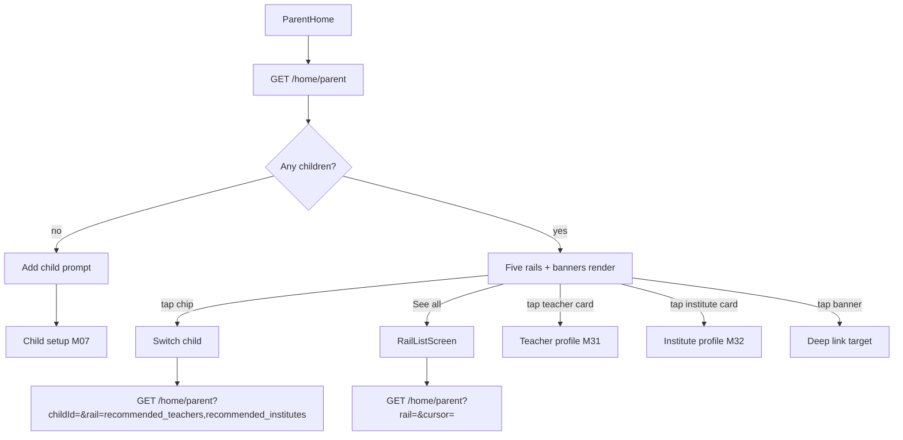
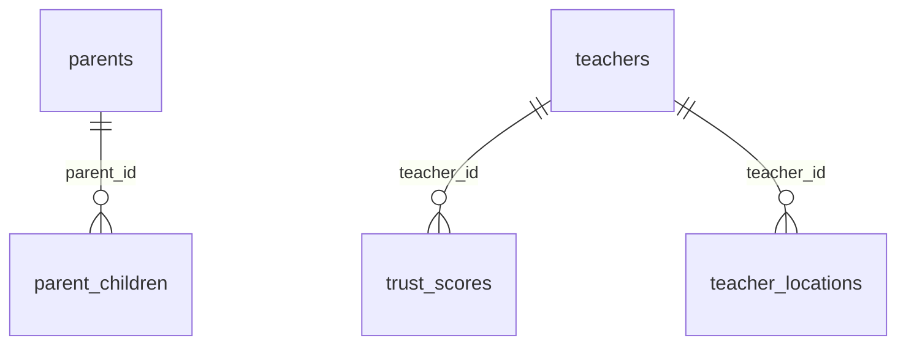

# Module 8 · Parent Dashboard

> **Phase 2 · Parent** · **Used by:** Parent · **Depends on:** M00, M06, M07 (children); Admin M29 (children/recommendation contract), Admin M36 (trust score), Admin M44 (banners); replaced ranking: M30 · **New tables:** none · **Uses:** `parent_children`, `parents`, `teachers`, `institutes`, `trust_scores`, `teacher_locations`, `banners` · **Build estimate:** 4–5 days

## 1. Module Purpose

The parent's home screen: a child switcher, promotional banners and five ranked rails of teachers and institutes — Recommended Teachers, Recommended Institutes, Nearby Teachers, Top Rated Teachers and Verified Teachers. Everything loads from one call so the screen is interactive from cache in under 1.5 s. This module ships a rule-based **v0** ranking; Module 30 (Recommendation Engine) later swaps the scoring behind the same `GET /home/parent` response, so the app never changes.

## 2. User Stories

- As a **parent with two children**, I want to switch between them and see teachers matched to each child's class and subjects so that I don't mix up recommendations.
- As a **parent on a slow connection in Hubballi**, I want the dashboard to open instantly from what I saw last, with a small "Updated 3 h ago" note, so that I'm not staring at spinners.
- As a **new parent with no children added yet**, I want the dashboard to prompt me to add a child instead of showing empty rails.
- As a **parent**, I want to see verified and top-rated teachers near me even before I've picked a specific subject so that I can browse.
- As a **parent**, I want to tap a seasonal banner and land on the right screen (a search, the plans screen, a blog) without extra taps.

## 3. Business Rules & Logic

**BR-8.1 One call, five rails.** `GET /home/parent` returns, in one response: the parent's children (for the switcher), banners, and the first page of all five rails scoped to the selected child (`childId`, defaults to the child with the lowest `sort_order`, or `null` if the parent has none). Each rail has its own cursor for "See all"; passing `?rail=<code>&cursor=` on the same endpoint returns one rail's next page (used by "See all" and pull-to-refresh of a single rail), so there is exactly one owned endpoint.

| Rail code | Shown as | Child-specific |
| --- | --- | --- |
| `recommended_teachers` | Recommended Teachers | yes |
| `recommended_institutes` | Recommended Institutes | yes |
| `nearby_teachers` | Nearby Teachers | no (parent's city/area) |
| `top_rated_teachers` | Top Rated Teachers | no (parent's city) |
| `verified_teachers` | Verified Teachers | no (parent's city) |
Rails default to 10 cards on the combined call and 20 on a "See all" page; `limit` 1–20.

**BR-8.2 Eligibility (every rail).** Teachers: `teachers.verification_status = 'approved'`, `teachers.account_status = 'active'`. Institutes: `institutes.verification_status = 'approved'`, `institutes.account_status = 'active'`. Both exclude rows the parent dismissed (`recommendation_dismissals`, Module 30 table — read here so v0 also respects "Not interested") and rows in `user_blocks` either direction.

**BR-8.3 Recommended Teachers (v0 formula, per child).** Candidates: teachers with a `teacher_classes` row matching the child's `class_id` (board `NULL` or equal to the child's `board_id`). Score, identical to Admin Module 29's FR‑29.4 so admin and app explain the same number:
```
score = 5                                          -- class always matches (filter)
      + 3 × matchedCategories(child, teacher)       -- 0..4, teacher_categories overlap
      + 3 × matchedSubjects(child, teacher)         -- 0..6, teacher_subjects overlap
      + 1 × (teacher offers child.preferred_mode_id ? 1 : 0)   -- 0 if no preference set
      + trust_scores.score / 100                    -- 0..1
      + 0.5 × (teacher has a teacher_locations row in the parent's area, radius covers it ? 1 : 0)
```
Ties broken by `trust_scores.score` desc, then `teachers.rating_avg` desc, then `random()` seeded per day (so the order is stable for a day, not identical for every parent). Top 20 per child computed and cached in Redis `home:rec:teacher:<childId>` for 6 hours; invalidated when the child's class/board/subjects/categories/mode change (Module 7) or when a matched teacher's `teacher_classes`/`teacher_subjects`/`teacher_categories`/`teacher_locations`/verification status changes (a targeted cache-bust, not a full flush). A child with 0 candidates shows the rail's empty state, not a hidden rail.

**BR-8.4 Recommended Institutes (v0 formula, per child).** Candidates: approved institutes in the child's `city_id` (parent's `city_id`, from `parents`). Score (v0, coarser than teachers because institute-level subject/class mapping is Module 24/26 data, added properly in Module 30):
```
score = 3 × (institute.area_id = child's area ? 1 : 0)
      + 2 × (institute.is_premium ? 1 : 0)
      + institute.overall_rating              -- 0..5, admin evaluation
      + institute.user_rating_avg / 2          -- 0..2.5
```
Top 20 cached in Redis `home:rec:institute:<childId>` for 6 hours, invalidated on institute rating/status change or child location change.

**BR-8.5 Nearby Teachers.** Approved teachers with a `teacher_locations` row where `area_id = parent.area_id`, or (if none in-area) `city_id = parent.city_id`; ordered by `is_primary` desc, then `travel_radius_km` asc (a smaller radius reads as "closer"), then `trust_scores.score` desc. Cached in Redis `home:nearby:<cityId>:<areaId>` for 15 minutes (shared across parents in the same area — not personalised). If the parent has no `area_id` set, the rail falls back to city-only and its header shows "Near {city}" instead of "Near {area}".

**BR-8.6 Top Rated Teachers.** Approved teachers in the parent's city with `rating_count ≥ 5`, ordered by `rating_avg` desc, then `trust_scores.score` desc. Cached `home:topRated:<cityId>` 15 minutes.

**BR-8.7 Verified Teachers.** Approved teachers in the parent's city with `is_verified_badge = true`, ordered by `trust_scores.score` desc, then `rating_avg` desc. Cached `home:verified:<cityId>` 15 minutes.

**BR-8.8 Banners.** `home_top` (max 3, shown as a carousel) and `home_middle` (max 2, shown as single cards between rails) placements are fetched by re-using Module 44's serving query (`audience IN ('all','parents')`, city match, active window, priority desc, max 5 combined) — this module does not define a second banner endpoint; it calls the same `BannerService.getForPlacement` function and embeds the result so the whole screen is one round trip. Impressions and clicks are sent through `POST /events` (Module 0) with names `home_banner_impression` / `home_banner_click` and `{ bannerId, placement }`; a nightly job (Module 44) aggregates these into `banners.impressions` / `.clicks`.

**BR-8.9 Child switcher.** Chips show each child's first name in `parent_children.sort_order`; the active chip is bold with an underline. Switching child re-fetches only the two per-child rails (`recommended_teachers`, `recommended_institutes`); the other three rails and banners stay mounted. A "+ Add child" chip at the end opens Module 7. Zero children: the switcher is replaced by a single card "Add your first child to get matched teachers" with a button that opens Module 7, and all rails run in "no child" mode (recommended rails hidden; nearby/top rated/verified still show, since they need no child).

**BR-8.10 Rail pagination ("See all").** Tapping a rail's "See all" opens `RailListScreen` with `GET /home/parent?rail=<code>&childId=&cursor=` (cursor pagination, `meta.nextCursor`), same eligibility and order as the rail, page size 20. It is a read-through of the same cached list for `recommended_*` rails (cursor indexes into the cached top-20; beyond position 20 it falls through to a live query with the same formula, uncached).

**BR-8.11 Freshness.** `GET /home/parent` response carries `meta.rails = { [code]: { cachedAt } }` per rail so the app can show "Updated {relative time}" and knows when to silently refetch (rail cache older than its TTL) versus serve straight from the app's own query cache.

**BR-8.12 Replacement by Module 30.** When Module 30 ships, `resolveRailScore` for `recommended_teachers`/`recommended_institutes` is swapped for the trained/heavier scorer; the request/response shape, cache keys and cache TTLs are unchanged, so this module's screens need no change. `nearby`/`top_rated`/`verified` are not touched by Module 30 (they are not personalised).

## 4. Screen List

| Screen | Route name | Purpose |
| --- | --- | --- |
| Parent home | `ParentHome` | Child switcher, banners, five rails |
| Rail list | `RailListScreen` | Full paginated list for one rail |
| No children card | (embedded in `ParentHome`) | Prompt to add the first child |

## 5. Screen Flow & Navigation


Back from `RailListScreen` and from a profile returns to `ParentHome` at the same scroll position (state preserved, not refetched unless stale per BR-8.11).

## 6. Screen Wireframe Description

**ParentHome** — header "Hi, Lakshmi" with a bell icon (unread badge, opens M48) and avatar (opens M09). Below it, a horizontal chip row: "Aarav" (active, underlined), "Riya", "+ Add child". Home-top banner carousel (16:7 image, dot indicator, auto-advances 5 s, pauses on touch). Then, per rail, a `SectionHeader` ("Recommended Teachers for Aarav" · "See all") and a horizontal `FlashList` of `TeacherCard`s (photo, name, verified badge if any, category, "₹{fee}/hr" or "Fee on request", rating stars + count, trust score ring, distance chip if known, "Book free demo" quick action). A home-middle banner card sits between the second and third rail. Institute rail uses `InstituteCard` (logo, name, type, city/area, overall rating stars, "25 teachers" count, Premium ribbon if any). Empty rail: illustration + "No matches yet — try widening your child's subjects" with a button to Module 7. Loading: 4 skeleton cards per rail. Error (a single rail failed): inline "Couldn't load this — Retry" without breaking the rest of the screen. Pull-to-refresh re-fetches the whole dashboard.

**No children card** — illustration of a child with books, heading "Add your first child", body "Tell us their class and subjects so we can match the right teachers.", button "Add child".

**RailListScreen** — header with the rail's title and child chip (if per-child); vertical `FlashList` (2-column grid on tablets) of the same cards; `ListFooterLoader` while fetching the next cursor page; empty and error states as above.

## 7. UI Components & Component Tree

```
ParentHome
├─ HomeHeader (greeting, bell, avatar)
├─ ChildSwitcher (ChipGroup)
├─ BannerCarousel (home_top)
├─ RailSection × 5
│  ├─ SectionHeader (title, "See all")
│  └─ HorizontalList<TeacherCard | InstituteCard>
├─ BannerCard (home_middle)
└─ NoChildrenCard
RailListScreen
├─ RailHeader
└─ FlashList<TeacherCard | InstituteCard> (paginated)
```
- `TeacherCard({ teacher, distanceKm?, onPress, onFavourite, onDemoPress, variant: 'rail' | 'grid' })`, `InstituteCard({ institute, onPress, onFavourite, variant })`.
- Hooks: `useParentHome(childId?)` (the combined call), `useRail(code, childId?, { enabled })` (infinite query for "See all"), `useChildSwitcher()` (Zustand: `selectedChildId`, persisted).

## 8. Validation Rules

| Field | Rule | Message shown |
| --- | --- | --- |
| childId (query) | uuid, must belong to the signed-in parent | — (server 403, client never sends another parent's id) |
| rail (query) | one of the five rail codes or absent | — |
| cursor | opaque string from a previous `meta.nextCursor` | — |
| limit | integer 1–20, default 10 (20 on `RailListScreen`) | — |

## 9. API Endpoints

| Method | Path | Auth | Description |
| --- | --- | --- | --- |
| GET | /home/parent | Parent | Children, banners and five rails (`?childId=&rail=&cursor=&limit=`) |

## 10. Request Payloads

```json
// GET /home/parent
// GET /home/parent?childId=1b2c3d4e-5f60-4a1b-8c2d-3e4f5a6b7c8d
// GET /home/parent?rail=recommended_teachers&childId=1b2c3d4e-5f60-4a1b-8c2d-3e4f5a6b7c8d&cursor=eyJvIjoyMH0&limit=20
```

## 11. Response Payloads

```json
// 200 GET /home/parent
{ "data": {
  "children": [ { "id": "1b2c3d4e-5f60-4a1b-8c2d-3e4f5a6b7c8d", "childName": "Aarav", "classLabel": "Class 10", "sortOrder": 0 },
                { "id": "9f0e1d2c-3b4a-4958-8677-56453423120f", "childName": "Riya", "classLabel": "Class 5", "sortOrder": 1 } ],
  "selectedChildId": "1b2c3d4e-5f60-4a1b-8c2d-3e4f5a6b7c8d",
  "banners": { "home_top": [ { "id": "…", "title": "Board exams in 90 days", "imageUrl": "https://cdn.guruconnect.in/banners/exam90.webp", "deepLink": "gc://search?classId=…" } ], "home_middle": [] },
  "rails": {
    "recommended_teachers": { "items": [ { "teacherId": "…", "publicCode": "GC-T10241", "fullName": "Dr. Ananya Iyer", "photoUrl": "https://cdn.guruconnect.in/t/…jpg",
      "categoryName": "Competitive Exam Faculty", "feePerHourPaise": 80000, "ratingAvg": 4.8, "ratingCount": 62, "trustScore": 91.4, "isVerifiedBadge": true,
      "distanceLabel": "3.2 km", "score": 12.9 } ], "nextCursor": "eyJvIjoxMH0", "cachedAt": "2026-09-26T09:00:00Z" },
    "recommended_institutes": { "items": [ { "instituteId": "…", "name": "Brightway Coaching Centre", "slug": "brightway-coaching-bengaluru", "logoUrl": "…",
      "overallRating": 4.5, "userRatingAvg": 4.3, "teacherCount": 18, "isPremium": true, "score": 8.05 } ], "nextCursor": null, "cachedAt": "2026-09-26T09:00:00Z" },
    "nearby_teachers": { "items": [ { "teacherId": "…", "fullName": "Imran Qureshi", "areaLabel": "Koramangala", "distanceLabel": "Near you", "ratingAvg": 4.6 } ], "nextCursor": "…", "cachedAt": "…" },
    "top_rated_teachers": { "items": [ "…" ], "nextCursor": "…", "cachedAt": "…" },
    "verified_teachers": { "items": [ "…" ], "nextCursor": "…", "cachedAt": "…" } } } }

// 200 GET /home/parent (no children yet)
{ "data": { "children": [], "selectedChildId": null, "banners": { "home_top": [], "home_middle": [] },
  "rails": { "recommended_teachers": null, "recommended_institutes": null,
    "nearby_teachers": { "items": [ "…" ], "nextCursor": "…", "cachedAt": "…" },
    "top_rated_teachers": { "items": [ "…" ], "nextCursor": "…", "cachedAt": "…" },
    "verified_teachers": { "items": [ "…" ], "nextCursor": "…", "cachedAt": "…" } } } }
```

## 12. PostgreSQL Tables & Columns


**Existing tables this module reads or writes** (full definitions in the owning module)

| Table | Owner | Purpose |
| --- | --- | --- |
| `parent_children` | Admin M29 | Children a parent is finding teachers for. Drives per-child recommendations. |
| `parents` | Admin M28 | Parent profile, one per parent app account. |
| `teachers` | Admin M16 | Teacher profile and verification state. One row per teacher app account. |
| `institutes` | Admin M22 | Coaching centres, tuition centres, schools and academies. Rated by GuruConnect after verification. |
| `trust_scores` | Admin M36 | Current trust score per teacher with its factor breakdown. |
| `teacher_locations` | Admin M20 | Cities and areas a teacher serves, with travel radius for home tuition. |
| `banners` | Admin M44 | Promotional banners in the mobile app. |

- `parent_children`: read for the switcher (`child_name`, `class_id`, `sort_order`) and to compute the per-child rails (`class_id`, `board_id`, `preferred_mode_id` and the two junction tables via Module 7).
- `parents`: read `city_id`, `area_id` to scope the three non-personalised rails and Recommended Institutes.
- `teachers`, `institutes`: read verification/account status, rating and premium/verified flags for cards; never returns `phone`/`email`.
- `trust_scores`: read `score` for ranking and the card's trust ring; this module never writes it.
- `teacher_locations`: read for Nearby and for the distance term of BR-8.3.
- `banners`: read through Module 44's serving function for `home_top`/`home_middle`; this module writes nothing to it (impressions/clicks are aggregated by Module 44's job from `POST /events`).

## 13. Relationships


**Entity relationship diagram** (tables this module uses; `admins` omitted)



## 14. State Management

- `useChildSwitcher` (Zustand + MMKV): `{ selectedChildId, setSelectedChildId() }`; seeded from the server's `selectedChildId` on first load, then sticky across sessions.
- Query keys: `homeKeys.parent(childId)` (persisted, `staleTime` = the rail's own TTL from `meta.rails[*].cachedAt`, refetch on app foreground), `homeKeys.rail(code, childId)` for `RailListScreen`'s infinite query (not persisted beyond the first page).
- Switching a child does not clear `homeKeys.parent(oldChildId)` from cache — chips flip instantly to cached data while `recommended_teachers`/`recommended_institutes` refetch in the background.
- Invalidation: Module 7 child add/edit/delete invalidates `homeKeys.parent(*)`; favouriting a card (Module 40) optimistically updates its `isFavourite` flag inside the cached rail item.

## 15. Offline Handling

- The whole combined response is persisted (`meta: { persist: true }`); a parent opens the dashboard fully from cache offline, with "Updated {time}" on each rail and the global offline banner.
- `RailListScreen` beyond the first cached page is online-only ("You're offline — showing recent recommendations only.").
- Banner and card taps that need a network call (favourite, demo request) queue per their own module (Module 40, Module 38); tapping through to a profile works from any cached rail item.

## 16. Push Notification Requirements

None from this module. Rail contents change silently; Module 30 may later add a "New teacher matches your child" push, and Module 44 owns banner campaign pushes.

## 17. Security Rules

- `childId` is always checked against `parent_children.parent_id = :pid`; another parent's child id → `FORBIDDEN`.
- Cards never include a teacher's or institute's phone/email; contact requires Module 37/39's unlock flow.
- Banner `deepLink` is opened only through `lib/deeplinks.ts`'s allow-list (conventions §4/Module 44 FR‑44.5), never as a raw `WebView` URL.
- Redis rail caches are keyed by opaque ids only, never contain PII, and are city/area-scoped (not personal) for the three shared rails.

## 18. Error Handling

| Scenario | Code | HTTP | App behaviour |
| --- | --- | --- | --- |
| childId belongs to another parent | `FORBIDDEN` | 403 | Toast "You can't do that."; falls back to the default child |
| Unknown rail code | `VALIDATION_FAILED` | 422 | Client bug guard only; ignored by the UI |
| Parent has no city/area set | — | 200 | Nearby/Top rated/Verified show "Set your area" card linking to Module 9 |
| One rail's Redis lookup fails | — | 200 (rail degrades) | That rail computes live (uncached) once; if that also fails the rail shows inline Retry |
| Stale cursor (rail list changed) | `NOT_FOUND` on a specific item, ignored | 200 | Skipped row; pagination continues |

## 19. Testing Scenarios

- T8.1 (Maestro `parent_home_load`) Parent with 2 children opens Home → both chips render, Aarav selected by default, all 5 rails populated.
- T8.2 Switch chip to Riya → only Recommended Teachers/Institutes refetch; Nearby/Top Rated/Verified keep their scroll position and data.
- T8.3 Parent with 0 children → No-children card shown; recommended rails absent; nearby/top-rated/verified still show for the parent's city.
- T8.4 Child's subjects changed in Module 7 → Recommended Teachers cache for that child is invalidated within 5 s; next open shows updated order.
- T8.5 Airplane mode → dashboard opens fully from cache with "Updated 2 h ago" and the offline banner; "See all" beyond cache shows the offline message.
- T8.6 See all on Recommended Teachers → `RailListScreen` paginates past the cached top 20 into a live (uncached) tail without duplicates.
- T8.7 Two teachers tie on score → order is stable across two loads the same day (seeded random), and differs the next day.
- T8.8 Parent taps a `home_top` banner → `home_banner_click` event sent once; deep link to `gc://search?classId=…` opens Search pre-filtered.
- T8.9 Parent blocks a teacher (Module 49) → that teacher disappears from every rail on next refresh.
- T8.10 Concurrent requests for two different children (fast chip double-tap) → responses applied in request order, no flicker to the wrong child's cards.
- T8.11 One rail's dependency (Redis) times out → the other four rails still render; the failed rail shows Retry, not a full-screen error.

## 20. Audit Log Events

None — dashboard reads are not audit-logged (conventions §11). Impressions and clicks are analytics events (`home_rail_impression`, `home_banner_impression`, `home_banner_click`) via `POST /events`, feeding `teacher_profile_views`/`institute_profile_views` per conventions §9's analytics note, not an audit trail.

## 21. Future Scalability Notes

- Replace the v0 formulas with Module 30's learned scorer without any app change (BR-8.12).
- Precompute rail caches in a nightly/streaming job instead of on first request, to remove the cold-cache latency spike after a child edit.
- A "For You" mixed rail blending teachers and institutes once click-through data exists.
- Per-rail A/B testing of card layout and copy, keyed by `algo_version` (reusing Module 30's column).
- Server-driven layout (rail order and count configurable by admin/segment) once more rail types exist.
