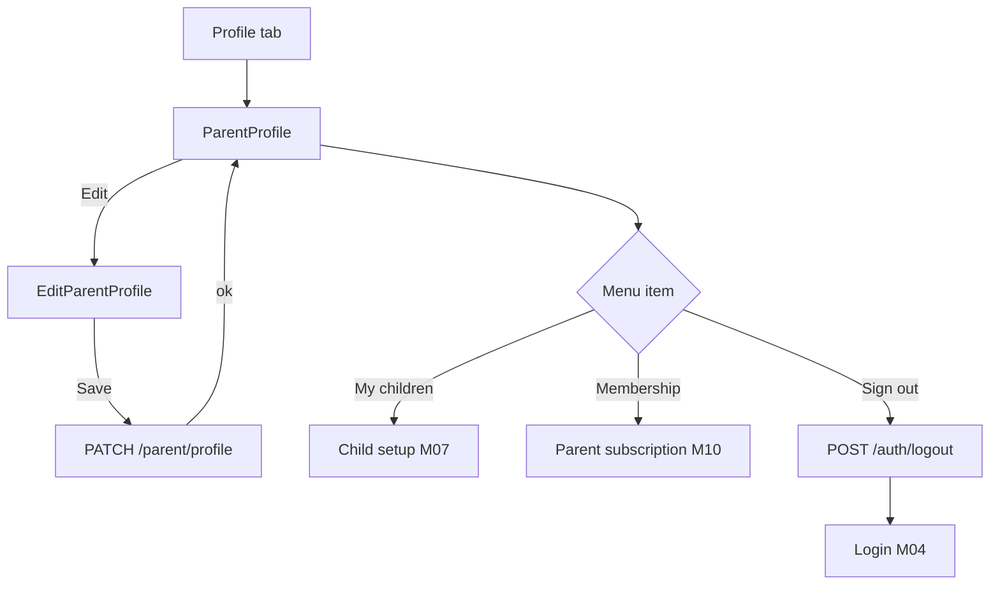
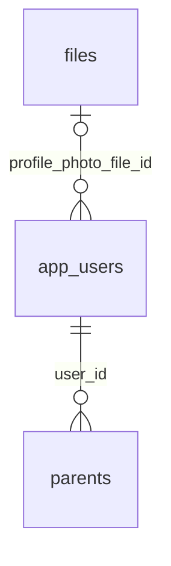

# Module 9 · Parent Profile

> **Phase 2 · Parent** · **Used by:** Parent · **Depends on:** M00 (uploads), M04 (contact verification), M06 (registration); Admin M28 (parents directory) · **New tables:** none · **Uses:** `parents`, `app_users`, `files` · **Build estimate:** 1–2 days

## 1. Module Purpose

The parent's own profile: name, photo, phone/email (read-only here — changed from Module 51 Account Settings), city/area, and the account actions a parent reaches from their tab (children, subscription, privacy, support, sign out). This module owns just the profile view/edit; children live in Module 7, subscription in Module 10, notifications in Module 20/48, privacy in Module 52.

## 2. User Stories

- As a **parent**, I want to add a profile photo so that my teacher and institute contacts feel more personal (photos never leave `gc-public`, they're optional).
- As a **parent who moved from Mysuru to Bengaluru**, I want to update my city and area so that my Nearby rail and recommendations stay relevant.
- As a **parent**, I want one screen that lists my children, subscription and settings so that I don't hunt through menus.
- As a **low-connectivity parent**, I want my profile edits saved as soon as I'm back online, without losing what I typed.

## 3. Business Rules & Logic

**BR-9.1 Read.** `GET /parent/profile` returns `full_name`, `photoUrl` (via `profile_photo_file_id` → `files`/CDN), masked `phone`/`email` (full values are for display only, taken from `app_users`; editing them routes to Module 51), `city`, `area`, `publicCode`, `createdAt`, plus summary counts (children count, unread notifications) used by the profile screen's header — not by the dashboard.

**BR-9.2 Edit.** `PATCH /parent/profile` (`If-Match: <updatedAt>`) updates `full_name`, `city_id`, `area_id`, `profile_photo_file_id` (from a completed Module 0 upload, purpose `avatar`). Changing `city_id` clears `area_id` unless the new area belongs to the new city. In one transaction: update `parents`, and if `profile_photo_file_id` changed also update `app_users.profile_photo_file_id` (Module 0's shared column, since the avatar is shown across the app header) — write `audit_logs` (`module = 'app.parent_profile'`).

**BR-9.3 City/area change side effects.** A changed `city_id`/`area_id` invalidates Module 8's non-personalised rail caches for both the old and new `(cityId, areaId)` pairs is unnecessary (those are shared caches, not per-parent); instead it invalidates this parent's own `homeKeys.parent(*)` client-side query cache so the next dashboard load re-scopes Nearby/Top Rated/Verified immediately.

**BR-9.4 Photo upload.** Standard Module 0 flow (`presign` purpose `avatar` → PUT → `confirm`); client-side crop to a 1:1 square before upload, max 5 MB, jpeg/png/webp. Removing the photo (`profile_photo_file_id: null`) reverts to initials avatar.

**BR-9.5 Profile menu.** The Profile tab (not a separate endpoint) shows: My children (Module 7) with child count, Membership (Module 10) with the current plan name/status, Notification settings (Module 20), Privacy (Module 52), Payment history (Module 45), Refer & earn (Module 46), Help & support (Module 53), Report a problem (Module 49), Delete account (Module 54), Sign out.

**BR-9.6 Sign out.** `POST /auth/logout` (Module 4) then local clear per conventions §7; "Sign out of all devices" opens Module 51's session list.

## 4. Screen List

| Screen | Route name | Purpose |
| --- | --- | --- |
| Parent profile | `ParentProfile` | Header, summary, menu list |
| Edit profile | `EditParentProfile` | Name, photo, city/area form |

## 5. Screen Flow & Navigation


Back from `EditParentProfile` without saving discards the draft after a confirm sheet if fields changed.

## 6. Screen Wireframe Description

**ParentProfile** — header card: avatar (tap → full-screen viewer or "Change photo" if own), "Lakshmi Venkatesh", masked phone "+91 98450 XXXXX", "Bengaluru · Koramangala", "Member since Mar 2026", edit (pencil) icon top-right. Summary row: "2 children" chip, plan chip "Parent membership · Trial ends in 4 days" (tap → Module 10). Menu list (`KeyValueRow` with chevron): the items in BR-9.5, grouped under "Account", "Payments", "Support"; Sign out in red at the bottom with a confirm sheet "Sign out of GuruConnect?".

**EditParentProfile** — sticky header "Edit profile", fields: Full name (text, "e.g. Lakshmi Venkatesh"), photo picker (circle with camera badge), City (select, bottom sheet with search), Area (select, disabled until a city is picked, "e.g. Koramangala"). Read-only rows below a divider: Phone and Email with "Change" links that navigate to Module 51 (not editable here). Sticky button "Save changes" (disabled until a field changes; spinner while saving; disabled offline with "Saved when you're back online" — see @offline).

## 7. UI Components & Component Tree

```
ParentProfile
├─ ProfileHeader (avatar, name, phone masked, location, memberSince)
├─ SummaryRow (children chip, plan chip)
└─ MenuList (grouped KeyValueRow)
EditParentProfile
├─ AvatarPicker (ImagePickerField, crop 1:1)
├─ TextField (fullName)
├─ Select (city) → Select (area, dependent)
├─ ReadOnlyRow (phone) · ReadOnlyRow (email) → "Change" link
└─ StickyActionBar → Button "Save changes"
```
- `useParentProfile()`, `useUpdateParentProfileMutation()`, `useUpload('avatar')` (Module 0).

## 8. Validation Rules

Shared schema `ParentProfileInputSchema` (`packages/shared/parent.ts`).

| Field | Rule | Message shown |
| --- | --- | --- |
| fullName | 2–100 chars, letters/spaces/dot/hyphen | "Enter your full name." |
| cityId | active city | "Choose a city." |
| areaId | optional; must belong to cityId | "Choose an area in {city}, or leave it blank." |
| profilePhotoFileId | optional; an `active` file the caller owns, purpose `avatar` | "That photo didn't upload. Try again." |
| If-Match | required; stale → `VERSION_CONFLICT` | "Updated on another device. Review and save again." |

## 9. API Endpoints

| Method | Path | Auth | Description |
| --- | --- | --- | --- |
| GET | /parent/profile | Parent | Own profile and summary counts |
| PATCH | /parent/profile | Parent | Update name, photo, city/area (If-Match) |

## 10. Request Payloads

```json
// PATCH /parent/profile   (If-Match: "2026-09-20T11:00:00Z")
{ "fullName": "Lakshmi Venkatesh", "cityId": "b6b0b2f0-1a2b-4c3d-9e4f-5a6b7c8d9e0f", "areaId": "c7c1c3f1-2b3c-5d4e-af5a-6b7c8d9e0f1a",
  "profilePhotoFileId": "d8d2d4a2-3c4d-6e5f-b06b-7c8d9e0f1a2b" }
```

## 11. Response Payloads

```json
// 200 GET /parent/profile
{ "data": { "id": "…", "publicCode": "GC-P30412", "fullName": "Lakshmi Venkatesh", "photoUrl": "https://cdn.guruconnect.in/avatars/…jpg",
  "phoneMasked": "+91 98450 XXXXX", "emailMasked": "l***i@gmail.com", "city": { "id": "…", "name": "Bengaluru" }, "area": { "id": "…", "name": "Koramangala" },
  "childrenCount": 2, "unreadNotifications": 3, "memberSince": "2026-03-14T00:00:00Z", "updatedAt": "2026-09-20T11:00:00Z" } }

// 200 PATCH /parent/profile
{ "data": { "id": "…", "fullName": "Lakshmi Venkatesh", "photoUrl": "…", "city": { "id": "…", "name": "Bengaluru" }, "area": { "id": "…", "name": "Koramangala" }, "updatedAt": "2026-09-26T10:05:00Z" } }

// 409 PATCH /parent/profile
{ "error": { "code": "VERSION_CONFLICT", "message": "Updated on another device. Review and save again.", "details": {}, "requestId": "…" } }
```

## 12. PostgreSQL Tables & Columns


**Existing tables this module reads or writes** (full definitions in the owning module)

| Table | Owner | Purpose |
| --- | --- | --- |
| `parents` | Admin M28 | Parent profile, one per parent app account. |
| `app_users` | Admin M00 | Login identity for every mobile app account (parent, student, teacher, institute staff). Role profiles hang off this table. |
| `files` | Admin M00 | Metadata for every uploaded object stored in S3 / Cloudflare R2. Binary content never touches PostgreSQL. |

- `parents`: this module reads and writes `full_name`, `city_id`, `area_id`; reads `public_code`, `created_at`; never touches `account_status` (Module 28/51 territory) or `referral_code_used`.
- `app_users`: reads masked `phone`/`email`/`phone_verified_at`; writes `profile_photo_file_id` alongside `parents` in the same transaction (shared avatar column, conventions §12).
- `files`: `profile_photo_file_id` must reference an `active`, `visibility = 'public'` row owned by this user.

## 13. Relationships


**Entity relationship diagram** (tables this module uses; `admins` omitted)



## 14. State Management

- Query keys: `parentProfileKeys.me` (persisted, `staleTime` 5 min).
- `useUpdateParentProfileMutation` invalidates `parentProfileKeys.me` and `meKeys.me` (name/photo shown in the app header) on success; on `city_id`/`area_id` change it also invalidates `homeKeys.parent(*)` (Module 8, client-side only, no refetch until the tab is revisited).
- Edit form state is a React Hook Form instance backed by `ParentProfileInputSchema`; not a Zustand draft (single screen, no multi-step flow), but unsaved changes are kept in MMKV as `profileDraft` so a killed app resumes the edit (cleared on save or explicit discard).

## 15. Offline Handling

- `GET /parent/profile` is persisted; the profile screen opens instantly offline.
- `PATCH /parent/profile` is *save draft, submit online* (conventions §8 class 2): the Save button is disabled offline with "You're offline — changes will be enabled when you're back online." (money/security-free but touches `If-Match`, so it is not queued blindly to avoid silent conflicts).
- Avatar upload is online-only (Module 0 rule).

## 16. Push Notification Requirements

None. Profile changes are not announced; a phone/email change (Module 51) sends its own OTP-confirmation push.

## 17. Security Rules

- Ownership: `parent_id` resolved from the token (`pid`), never from the request body.
- Phone/email are masked in every response from this endpoint; the unmasked value is only ever shown on the device that owns it, inside Module 51.
- `FLAG_SECURE` is not required here (no documents/OTP/payment), but the avatar viewer respects the system screenshot setting.
- `profilePhotoFileId` ownership is checked (`files.uploaded_by_id = sub`) before linking, preventing a parent linking another user's uploaded file.

## 18. Error Handling

| Scenario | Code | HTTP | App behaviour |
| --- | --- | --- | --- |
| Area doesn't belong to the chosen city | `VALIDATION_FAILED` | 422 | Inline under Area |
| Stale edit (If-Match mismatch) | `VERSION_CONFLICT` | 409 | "Updated on another device. Review and save again." + refetch |
| Photo file not owned / not active | `VALIDATION_FAILED` | 422 | "That photo didn't upload. Try again." |
| Save attempted offline | — (client-blocked) | — | Save button disabled with offline hint |

## 19. Testing Scenarios

- T9.1 (Maestro `parent_profile_edit`) Open profile → Edit → change name and city → Save → profile reflects new name/city; Module 8 rails reflect the new city on next dashboard visit.
- T9.2 Pick a city, then an area from a different city (stale UI state) → client resets area selection automatically.
- T9.3 Upload a 6 MB photo → rejected client-side before presign.
- T9.4 Two devices edit the same parent concurrently → second Save gets `VERSION_CONFLICT`, refetches, re-applies its change.
- T9.5 Kill the app mid-edit → relaunch → `EditParentProfile` reopens with the unsaved draft restored.
- T9.6 Go offline mid-edit → Save button disables; reconnect → Save enables and succeeds with the same If-Match (refetches first if stale).
- T9.7 Remove profile photo (`profilePhotoFileId: null`) → avatar falls back to initials "LV" everywhere (header, cards on Module 8 impossible since parents aren't shown there, but the app header and Module 51 update).
- T9.8 Sign out from the menu → confirm sheet → session cleared, Login screen shown.
- T9.9 Tap "Change" next to phone → navigates to Module 51's phone-change flow, not editable inline.
- T9.10 Screen reader: every menu row announces its label and that it opens a new screen.

## 20. Audit Log Events

| Event | When | Details |
| --- | --- | --- |
| `app.parent_profile_updated` | `PATCH /parent/profile` succeeds | changed fields (name, city, area, photo changed: yes/no) |

## 21. Future Scalability Notes

- Multiple guardians per family (co-parent access) once the product needs it — today one `app_users` row = one parent.
- Address book (multiple saved addresses for different children/schools) if home-tuition logistics need it.
- Profile completeness meter (mirroring the teacher one, Module 17) to nudge photo/area completion, which improves Nearby/Recommended relevance.
