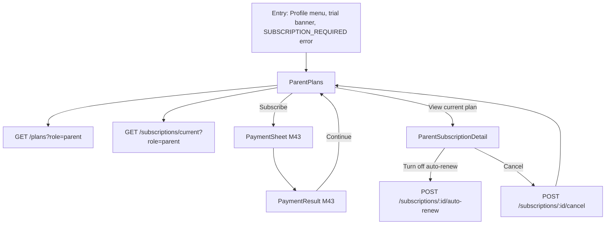
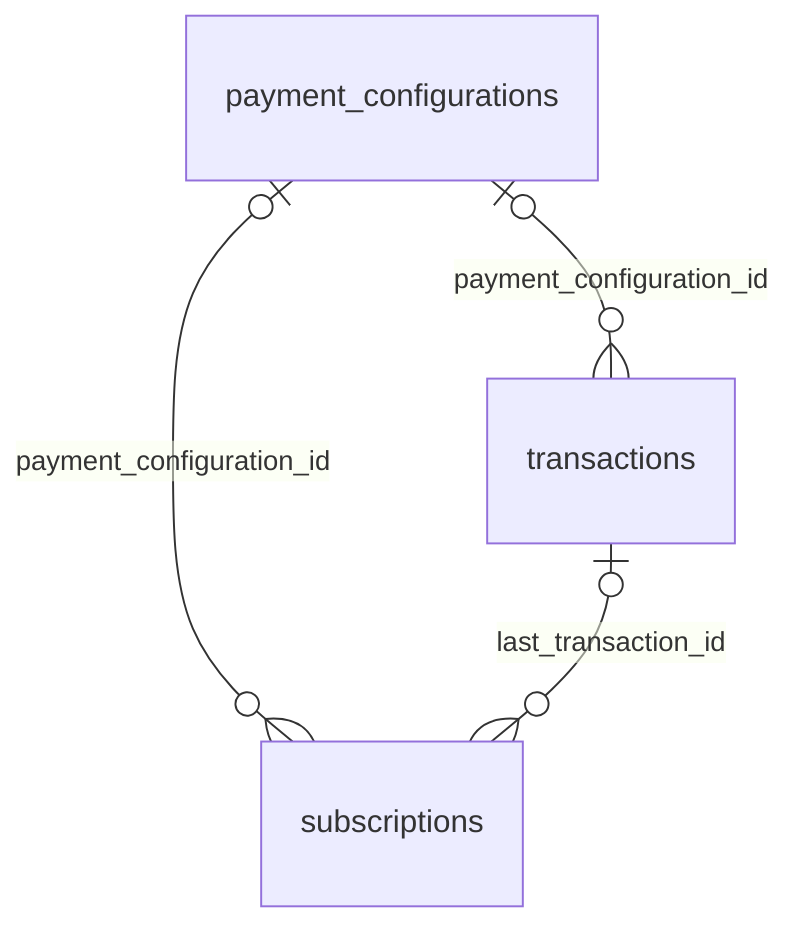

# Module 10 · Parent Subscription

> **Phase 2 · Parent** · **Used by:** Parent · **Depends on:** M00, M04, M43 (payment gateway and PaymentSheet — see build-order note below); Admin M05 (pricing), Admin M30, Admin M41 (subscription engine) · **New tables:** none · **Uses:** `subscriptions`, `payment_configurations`, `transactions`, `parents` · **Build estimate:** 3 days

## 1. Module Purpose

Membership purchase and renewal for parents: trial, monthly and yearly plans, current status, auto-renew control and cancellation. This module owns `GET /plans` and `GET /subscriptions/current`, both re-used as-is by Module 13 (student subscription, `?role=student`) and Module 44 (boosts reuse the same subscription read model). Contact with teachers, demo bookings and full profile access are gated on having a live subscription (`trial`/`active`/`grace`/`free_access`); this module is where a parent gets one.

**Build-order note.** Purchasing calls Module 43's `POST /payments/orders` and opens its `PaymentSheet`. Build Module 43's API and `PaymentSheet` component before wiring this module's Pay button; until then this module ships in "view plans" mode (plans and current status visible, Subscribe button disabled with "Payments coming soon").

## 2. User Stories

- As a **new parent**, I want a 7-day free trial with full access so that I can try contacting a couple of teachers before paying.
- As a **parent whose trial is ending tomorrow**, I want a clear banner and an easy way to subscribe so that I don't lose access mid-search.
- As a **parent who pays yearly**, I want to see exactly when my membership renews and turn off auto-renew if I don't want to continue.
- As a **parent in a city where GuruConnect made membership free during launch**, I want full access without seeing a paywall.
- As a **parent on a slow connection**, I want the plans screen to load from cache so I can at least see prices while my payment can't go through yet.

## 3. Business Rules & Logic

**BR-10.1 Plans.** `GET /plans?role=parent` reads the **active** `payment_configurations` for `PARENT_SUBSCRIPTION_MONTHLY` and `PARENT_SUBSCRIPTION_YEARLY` (Admin M05 `resolveFee`, same function Module 43 uses so the price shown here is exactly what checkout will charge) and returns both cards with `isEnabled`, `amountPaise`, `billingPeriod`, `validityDays`, `trialDays`, a computed per-month figure for the yearly card, and whether the parent is trial-eligible (BR-10.2). A disabled plan is omitted from the list, not shown greyed out (Admin M05 FR-5.10); if **both** are disabled the screen shows "Membership is free right now" (the parent already has `free_access`, Admin M41 FR‑41.5).

**BR-10.2 Trial eligibility.** A parent is trial-eligible only if they have never had a `subscriptions` row with `subscriber_type = 'parent'` before (any status) — i.e. first purchase only; `trial_days` comes from whichever plan's active version they buy first, and Module 43/Admin M41 create the `trial` row on first successful purchase of a fee whose `trial_days > 0`. The plans screen shows "{n}-day free trial, then {price}" only when eligible; otherwise "{price}, billed {period}".

**BR-10.3 Current status.** `GET /subscriptions/current?role=parent` returns the parent's single live-or-most-recent `subscriptions` row (the `uq_subscriptions_one_live` row if one exists, else the latest by `created_at`): `status`, `feeCode`, plan name, `startsAt`, `endsAt`/`trialEndsAt`, `autoRenew`, `daysLeft`, and `canPurchase` (false only when a live `active`/`grace` row has `endsAt` more than 30 days away — Module 43 BR‑43.9 — since a nearer renewal can be bought now and queued).

**BR-10.4 Purchase.** The Subscribe button opens Module 43's `PaymentSheet` with `feeCode`, `context: {}`, `returnTo: { route: 'ParentSubscription' }`. This module defines no purchase endpoint of its own; on `PaymentResult` success it invalidates `subscriptionKeys.current('parent')` and `planKeys.parent` and shows a success banner on return ("Your membership is active till {date}").

**BR-10.5 Auto-renew.** Toggling off calls Admin/shared `POST /subscriptions/:id/auto-renew { enabled: false }` (Module 44 owns the enum; this module's UI just confirms "You'll keep access until {endsAt}, then your membership won't renew." and calls the shared endpoint with the parent's own subscription id — ownership checked `user_id = sub`). Turning auto-renew **on** is not supported from this screen in v1 (no stored mandate re-activation flow yet); the parent buys the next period manually near expiry instead.

**BR-10.6 Cancel.** `POST /subscriptions/:id/cancel { mode: 'at_period_end' | 'immediately', reason }` (shared endpoint, ownership-checked). `immediately` is offered only within 24 hours of first purchase (a lightweight cooling-off window) and always shows the refund policy link; after 24 hours only `at_period_end` is offered. A refund, if any, is requested through Module 45's flow, not created here.

**BR-10.7 Fee switched off / on.** When `PARENT_SUBSCRIPTION_*` is disabled (Admin M05), existing paid parents keep their period; new/lapsed parents get `free_access` (Admin M41 FR‑41.5) and this screen shows a "Free access" state with no Subscribe button. Re-enabling either moves them to a fresh trial (`subscriptions.free_access_to_trial_on_enable`, default true, from `system_settings`) or ends access with 3 days' notice; either way the parent gets a push (BR-10.9) and the screen reflects the new state on next open.

**BR-10.8 Renewal reminder.** 7 days before `endsAt` (if `auto_renew`), Admin M41's job sets `renewal_reminder_sent_at` and this module's push template fires (BR‑10.9); the plans screen shows "Renews on {date} for {price}" from that point.

## 4. Screen List

| Screen | Route name | Purpose |
| --- | --- | --- |
| Plans | `ParentPlans` | Plan cards, current status banner, Subscribe |
| Subscription detail | `ParentSubscriptionDetail` | Status, dates, auto-renew toggle, cancel |

## 5. Screen Flow & Navigation


A `SUBSCRIPTION_REQUIRED` error anywhere in the app (e.g. trying to unlock a contact with an expired plan) opens `ParentPlans` as a modal; back closes it and returns to the blocked action.

## 6. Screen Wireframe Description

**ParentPlans** — status banner at top, colour and copy by state: trial → amber "Trial ends in 4 days" with a Subscribe button inline; active/auto-renew → green "Active · renews 26 Oct for ₹1,999"; grace → red "Payment failed — renew now to keep access"; free_access → neutral "Membership is free right now, courtesy of GuruConnect." Below, two plan cards side by side (yearly marked "Best value — save 44%" when its per-month price beats monthly): plan name, price big, "≈ ₹167/month" for yearly, trial line if eligible, bullet list ("Unlimited teacher contacts", "Free demo bookings", "Priority support"), sticky-per-card button "Subscribe" (or "Current plan" disabled state on the active one). Footer link "View my subscription" → detail screen. Loading: two skeleton cards. Payments-not-ready mode: buttons read "Coming soon" (disabled) with a tooltip.

**ParentSubscriptionDetail** — plan name and status pill at top; `PeriodProgress`-style bar from start to end with days-left label; rows: "Started" date, "Renews/Ends" date, "Auto-renew" (Switch, confirm sheet on turning off), "Price paid" ₹ amount; section "Cancel membership" (destructive text button) opening a bottom sheet with mode choice (disabled `immediately` after 24 h, greyed with "Only available within 24 hours of purchase"), reason (optional, free text ≤300 chars), and a link to the refund policy; primary button in the sheet "Confirm cancellation".

## 7. UI Components & Component Tree

```
ParentPlans
├─ StatusBanner (variant by subscription status)
├─ PlanCard × 2 (monthly, yearly)
└─ Link "View my subscription"
ParentSubscriptionDetail
├─ PlanHeader (name, status pill)
├─ PeriodProgress
├─ KeyValueRow × 4
├─ AutoRenewRow (Switch + ConfirmSheet)
└─ CancelSection → CancelSheet (mode radio, reason, refund policy link)
```
- `PlanCard({ plan, isCurrent, trialEligible, onSubscribe, disabled })`.
- Hooks: `usePlans('parent')`, `useSubscriptionCurrent('parent')`, `useAutoRenewMutation()`, `useCancelSubscriptionMutation()`.

## 8. Validation Rules

| Field | Rule | Message shown |
| --- | --- | --- |
| cancel.mode | `at_period_end` or `immediately`; `immediately` only within 24 h of `starts_at` | "You can only cancel immediately within 24 hours of subscribing." |
| cancel.reason | optional, ≤ 300 chars | — |
| auto-renew.enabled | must be `false` (turning on unsupported here) | — |

## 9. API Endpoints

This module owns no new endpoints; it reads and calls shared ones (Admin M41/App M43/M44 scope), always with `role=parent` and ownership enforced server-side by the token.

| Method | Path | Auth | Description |
| --- | --- | --- | --- |
| GET | /plans | Any user | Active plans for the caller's role (`?role=parent`) |
| GET | /subscriptions/current | Any user | Caller's current/most recent subscription (`?role=parent`) |
| POST | /subscriptions/:id/auto-renew | Any user (owner) | Turn auto-renew off |
| POST | /subscriptions/:id/cancel | Any user (owner) | Cancel now or at period end |

## 10. Request Payloads

```json
// GET /plans?role=parent

// GET /subscriptions/current?role=parent

// POST /subscriptions/4a5b6c7d-8e9f-4a1b-9c2d-3e4f5a6b7c8d/auto-renew
{ "enabled": false }

// POST /subscriptions/4a5b6c7d-8e9f-4a1b-9c2d-3e4f5a6b7c8d/cancel
{ "mode": "at_period_end", "reason": "Found a teacher through a friend" }
```

## 11. Response Payloads

```json
// 200 GET /plans?role=parent
{ "data": [
  { "feeCode": "PARENT_SUBSCRIPTION_MONTHLY", "name": "Parent membership · Monthly", "amountPaise": 29900, "billingPeriod": "monthly", "validityDays": 30,
    "trialDays": 7, "trialEligible": true, "perMonthPaise": 29900 },
  { "feeCode": "PARENT_SUBSCRIPTION_YEARLY", "name": "Parent membership · Yearly", "amountPaise": 199900, "billingPeriod": "yearly", "validityDays": 365,
    "trialDays": 7, "trialEligible": true, "perMonthPaise": 16658, "bestValue": true } ] }

// 200 GET /subscriptions/current?role=parent
{ "data": { "id": "4a5b6c7d-8e9f-4a1b-9c2d-3e4f5a6b7c8d", "feeCode": "PARENT_SUBSCRIPTION_MONTHLY", "planName": "Parent membership · Monthly",
  "status": "trial", "startsAt": "2026-09-22T10:00:00Z", "trialEndsAt": "2026-09-29T10:00:00Z", "endsAt": null, "autoRenew": false, "daysLeft": 3, "canPurchase": true } }

// 200 POST /subscriptions/:id/cancel
{ "data": { "id": "4a5b6c7d-…", "status": "active", "cancelledAt": null, "endsAt": "2026-10-22T10:00:00Z", "autoRenew": false, "message": "You'll keep access until 22 Oct 2026." } }

// 409 POST /subscriptions/:id/cancel   (immediately after 24h)
{ "error": { "code": "VALIDATION_FAILED", "message": "You can only cancel immediately within 24 hours of subscribing.", "details": { "path": "mode" }, "requestId": "…" } }
```

## 12. PostgreSQL Tables & Columns


**Existing tables this module reads or writes** (full definitions in the owning module)

| Table | Owner | Purpose |
| --- | --- | --- |
| `subscriptions` | Admin M41 | Paid access periods for parents, students, teachers and institutes, including trials. |
| `payment_configurations` | Admin M05 | One row per version of each fee. The app charges whichever version is active at payment time. |
| `transactions` | Admin M40 | Every payment attempt through Razorpay, plus refunds and reward payouts. Amounts in paise. |
| `parents` | Admin M28 | Parent profile, one per parent app account. |

- `subscriptions`: read-only here except for the two shared write endpoints (`auto-renew`, `cancel`), which are owned by Admin M41 and reused with `subscriber_type = 'parent'` enforced from the token, not the body.
- `payment_configurations`: read via `resolveFee` for plan cards; never written.
- `transactions`: read only to show "Price paid" (`subscriptions.last_transaction_id → transactions.amount_paise`).
- `parents`: read to check the subscriber identity (`user_id = sub`); no columns written.

## 13. Relationships


**Entity relationship diagram** (tables this module uses; `admins` omitted)



## 14. State Management

- Query keys: `planKeys.parent` (persisted, `staleTime` 5 min — prices rarely change), `subscriptionKeys.current('parent')` (persisted, `staleTime` 60 s, refetch on foreground so a renewal/expiry reflects promptly).
- `useAutoRenewMutation`/`useCancelSubscriptionMutation` invalidate `subscriptionKeys.current('parent')` and `meKeys.me` (subscription summary shown in `/me`) on success; no optimistic update (state changes are consequential, confirmed server-first).
- Payment success (Module 43) invalidates the same keys (BR-10.4).

## 15. Offline Handling

- `GET /plans` and `GET /subscriptions/current` are persisted; the screen opens from cache offline with "Updated {time}".
- Subscribe, auto-renew toggle and cancel are **online only** (conventions §8 class 3 — money/state-changing); all three buttons are disabled offline with a hint.

## 16. Push Notification Requirements

| Event | Recipient | Title / Body | Deep link | Category | Urgent |
| --- | --- | --- | --- | --- | --- |
| `subscription.trial_ending` | Parent | "Your trial ends tomorrow" / "Subscribe to keep contacting teachers without interruption." | `gc://plans` | subscription | no |
| `subscription.renewal_reminder` | Parent | "Renews in 7 days" / "Your {plan} renews on {date} for {price}." | `gc://plans` | subscription | no |
| `subscription.grace_started` | Parent | "Payment failed" / "We couldn't renew your membership. Update payment within 3 days to avoid losing access." | `gc://plans` | subscription | yes |
| `subscription.expired` | Parent | "Membership ended" / "Subscribe again to keep contacting teachers." | `gc://plans` | subscription | no |
| `subscription.moved_to_free_access` / `.moved_to_trial` | Parent | "Membership is now free" / "on your {plan} switch from free" | `gc://plans` | subscription | no |
In-app inbox mirrors all of the above (Module 48); none are `urgent` except the grace start (protects against a lapse the parent didn't notice).

## 17. Security Rules

- Every action resolves the subscription id against the caller's own `user_id`/role; a parent can never act on another user's subscription (`FORBIDDEN`, not `NOT_FOUND`, to avoid leaking existence — actually returns `NOT_FOUND` per conventions to avoid confirming the id belongs to someone: "This is no longer available.").
- No card, UPI or bank data is handled here — purchase entirely delegates to Module 43's `PaymentSheet`.
- Cancellation reason free text is scanned by the same contact-info masking as reviews (conventions §13) before being stored, in case a parent pastes a phone number by habit.

## 18. Error Handling

| Scenario | Code | HTTP | App behaviour |
| --- | --- | --- | --- |
| Cancel `immediately` after 24 h | `VALIDATION_FAILED` | 422 | Inline in the cancel sheet; only `at_period_end` enabled |
| Auto-renew off on a non-live subscription | `CONFLICT_STATE` | 409 | Toast "Only an active plan can have auto-renew changed." |
| Cancel on an already-cancelled subscription | `CONFLICT_STATE` | 409 | Toast + refetch |
| Acting on another user's subscription id | `NOT_FOUND` | 404 | "This is no longer available." |
| Buy while `active` with > 30 days left | `CONFLICT_STATE` (`already_subscribed`, from M43) | 409 | Toast "You already have an active plan till {date}." |

## 19. Testing Scenarios

- T10.1 (Maestro `parent_subscribe_trial`) New parent opens Plans → both cards show "7-day free trial" → Subscribe on Yearly → PaymentSheet → pay → returns with "Active" banner and trial dates removed on next fetch (server started the paid period immediately per Module 43/Admin M41 FR‑41.2).
- T10.2 Existing parent (already had a trial before) → cards show no trial line, straight price.
- T10.3 Turn off auto-renew on an active plan → confirm sheet → status stays `active`, `autoRenew:false`, "Renews" copy becomes "Ends 22 Oct 2026, no further charge."
- T10.4 Cancel `immediately` at hour 25 after purchase → blocked client-side and server-side with the same message.
- T10.5 Grace period: simulate a failed renewal → red banner shown, `subscription.grace_started` push received, still full access.
- T10.6 Admin disables both parent fees mid-session → next `GET /plans` returns an empty list → screen shows "Membership is free right now."
- T10.7 Offline → Subscribe/auto-renew/cancel buttons disabled; cached status still visible.
- T10.8 `SUBSCRIPTION_REQUIRED` thrown while unlocking a contact → ParentPlans opens as a modal; back returns to the contact screen unchanged.
- T10.9 Two devices both open the cancel sheet; one cancels first → the second's action gets `CONFLICT_STATE` and refetches to show the new state.
- T10.10 Renewal reminder push tap → deep link opens ParentPlans directly (not the notification inbox).

## 20. Audit Log Events

| Event | When | Details |
| --- | --- | --- |
| `app.subscription_auto_renew_disabled` | Toggle off succeeds | subscription id, reason (none for this action) |
| `app.subscription_cancel_requested` | Cancel succeeds | subscription id, mode, reason |
Purchase, capture and system transitions (trial→active, grace, expiry, free_access) are audited by Module 43 and Admin M41 as `system`/payment actors, not duplicated here.

## 21. Future Scalability Notes

- Family/multi-child plan tiers (e.g. a higher tier unlocking simultaneous demo scheduling for 3+ children).
- In-app plan comparison with usage stats ("You contacted 6 teachers this month").
- Win-back offer screen for `expired`/`cancelled` parents (Admin M30's future coupon codes, Admin M05 §21).
- Re-enable auto-renew from the app once a stored-mandate re-authorisation flow exists (Razorpay recurring token refresh).
