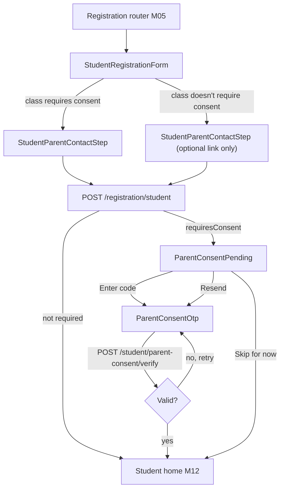
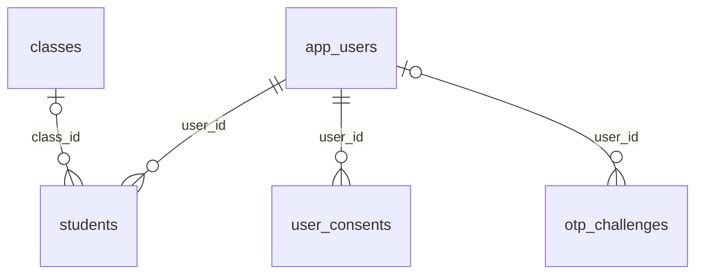

# Module 11 · Student Registration

> **Phase 3 · Student** · **Used by:** Registration token, Student · **Depends on:** M00, M04, M05 (registration context/referral); Admin M31 (student directory, parent link, minors), Admin M52 (consent record); parent-side confirmation of an account link is admin-mediated (see BR-11.9) · **New tables:** none · **Uses:** `students`, `app_users`, `user_consents`, `otp_challenges`, `classes` · **Build estimate:** 3–4 days

## 1. Module Purpose

Turns a verified phone/email (a `Registration token`) into a student account: name, class, board, school, subjects of interest, and city/area. Because many students are minors, this module implements the DPDP Act 2023 requirement for **verifiable parental consent**: a student whose class falls below the platform's no-consent threshold cannot contact a teacher until a parent confirms an OTP sent to the parent's own phone. It also lets the student name an existing parent's phone to be linked to that parent's account (confirmed by support, per Admin M31), without requiring a parent-side app action in v1.

## 2. User Stories

- As a **Class 11 aspirant (JEE)** signing up on my own, I want to register with just my class, board and subjects, with no parental step, so that I can start browsing immediately.
- As a **Class 8 student**, I want the app to be upfront that my parent needs to approve, with a clear "why" and a fast SMS step, so that I'm not confused mid-registration.
- As a **parent whose child is registering**, I want a one-tap SMS code to approve, without installing anything, so that I don't have to learn the app myself.
- As a **student whose mother already has a GuruConnect account**, I want to mention her number so demo bookings show up for her too.
- As a **student on a flaky connection in a small town**, I want my registration form saved as a draft so a dropped signal doesn't make me start over.

## 3. Business Rules & Logic

**BR-11.1 Entry.** Reached from Login (M04) after a new phone/email is verified (`REGISTRATION_REQUIRED`) with role intent `student`, or from Role Select (M03). `GET /registration/context` (M05) supplies masters needed by the form (classes, boards) and whether a referral code was pre-filled from a deep link.

**BR-11.2 Fields.** Name (full name, own), Class (required), Board (optional — state boards filtered to the student's chosen state via city, else "Other"), School/college name (optional), Subjects of interest (0–6, multi-select — see BR-11.8 for how these are used), City (required), Area (optional, dependent on city), and, only if the class requires it (BR-11.3), a parent's name and phone.

**BR-11.3 Minor determination (DPDP proxy).** The app does not collect a student's date of birth (data-minimisation, conventions §12). "Under 18" is operationalised the same way as Admin M31 FR‑31.6: `requiresConsent = classes.level_order(classId) < classes.level_order('Class 9')` (i.e. below secondary school). `system_settings['students.min_age_without_consent']` (default 18) is the number shown in the app's help text and Terms; the class threshold is the mechanism that implements it without collecting an age. When `requiresConsent`, the parent's name and phone become required fields and the form shows an inline notice: "Since {name} is in {class}, a parent needs to approve by SMS after this step."

**BR-11.4 Submit (`POST /registration/student`, registration token, idempotent by token — a token can only be redeemed once).** In one transaction:
1. Create `app_users` (`user_type = 'student'`, contact from the token, `account_status = 'active'`, `signup_source` per conventions BR‑0.13).
2. Create `students` (`public_code` auto `GC-S…`, `full_name`, `class_id`, `board_id`, `school_name`, `city_id`, `area_id`, `parent_name`, `parent_phone`, `parental_consent = requiresConsent ? 'pending' : 'not_required'`, `referral_code_used`).
3. Insert `user_consents`: `terms` and `privacy_policy` (`method = 'checkbox'`, `document_version` from `GET /registration/context`), and `marketing` if the optional box was ticked. **Not** yet `data_processing_minor`/`parental_consent` — those are only written once a parent actually confirms (BR-11.7), never at submission.
4. If `parentPhone` exactly matches the `phone` of a live (`deleted_at IS NULL`), active `parents` row, set `students.parent_id` and `parent_link_status = 'pending'` (Admin M31 confirms this manually when the parent calls in, per its FR‑31.4 story — there is no self-serve parent-side confirmation screen in v1; see BR‑11.9).
5. If `requiresConsent`, create the first `otp_challenges` row (BR-11.6) and send the SMS.
6. Issue the app's normal session (access + refresh token, `app_sessions` row) — the student is signed in immediately regardless of consent status; consent only gates contacting teachers (BR-11.7).
7. Write `audit_logs` (`module = 'app.student_registration'`, `actor_type = 'app_user'`).
A second submit with the same (already-consumed) registration token → `AUTH_REQUIRED` (token already used); the client should not retry automatically.

**BR-11.5 Subjects are a cold-start signal, not a stored profile (schema request).** The schema has no `student_subjects` table (only `parent_child_subjects` exists, for children). The 0–6 `subjectIds` chosen here are cached in Redis `student:coldstart:<userId>` for 30 days and read once by Module 12's dashboard to bias its v0 ranking before real signals (favourites, search history, leads) accumulate; they are **not** persisted to Postgres and cannot be edited later in v1. A durable `student_subjects` junction table (mirroring `parent_child_subjects`) is the natural follow-up — see Schema requests in the module summary.

**BR-11.6 Parental consent OTP (`otp_challenges`, `purpose = 'parent_consent'`).** `channel = 'sms'`, `destination = students.parent_phone`, 6-digit code (`auth.otp_length`), hashed (`code_hash`), `expires_at = now() + 24h` (longer than login OTP since the parent may not check their phone right away), `resend_count`, `attempts`. SMS text: "{studentName} added you as their parent on GuruConnect. Enter {code} in their app to approve, or ignore to do nothing. Code valid 24 hours." The code is meant to be read by the parent and typed into the **student's own device** (no separate parent app flow in v1) — the OTP being sent to a distinct phone number the parent controls is what makes the consent "verifiable" against a self-declared checkbox.

**BR-11.7 Consent request/verify.**
- `POST /student/parent-consent/request` (Student, no body) resends the code to `students.parent_phone` if `parental_consent = 'pending'`; cooldown `auth.otp_resend_after_seconds` (30 s), max `auth.otp_max_per_hour` (5) per student. `CONFLICT_STATE` if `parental_consent` is already `confirmed`/`not_required`.
- `POST /student/parent-consent/verify { code }` (Student) checks the latest non-consumed, non-expired `otp_challenges` row for this student: on match, in one transaction, set `students.parental_consent = 'confirmed'`, `parental_consent_at = now()`, consume the challenge (`consumed_at`), and insert **two** `user_consents` rows: `parental_consent` and `data_processing_minor` (both `granted = true`, `method = 'otp'`, `guardian_phone = students.parent_phone`, `document_version` = the current privacy policy version). 5 wrong codes → `OTP_LOCKED` for 15 minutes (conventions §5); expired → `OTP_EXPIRED` with a Resend action.
- There is no in-app "decline" action: a parent who objects contacts support, who sets `parental_consent = 'declined'` (Admin M31), which the app shows as a blocking screen (BR-11.8).

**BR-11.8 What pending/declined consent blocks.** While `parental_consent = 'pending'`, the student can sign in, browse, search and save favourites, but every contact/demo action (Module 37, 38) returns `FORBIDDEN` with `details.reason = "parental_consent_pending"`; the app shows a persistent banner on Home ("Ask your parent to approve — Resend code") instead of hiding the whole app, so the student isn't locked out of exploring. `declined` blocks the same actions and additionally shows a full "Contact support" screen with no dismiss, since continuing to use the platform against a parent's stated objection isn't appropriate for a minor account.

**BR-11.9 Parent account linking is admin-mediated in v1.** Setting `parent_link_status = 'pending'` at BR‑11.4 step 4 does not notify the parent's app (no confirm/decline endpoint exists for this in the current module map) — it is a hint for support, matching Admin M31's own story ("Support Admin … link a student to their parent's account when the parent asks"). The registration screen tells the student: "If {parentName} already has a GuruConnect account, they can confirm the link by calling support." This is independent of parental consent (BR-11.3–11.7): a Class 12 student with no consent requirement can still optionally link a parent's account for visibility into their demo bookings.

**BR-11.10 Draft persistence.** The multi-field form is a Zustand + encrypted MMKV draft (`studentRegistrationDraft`), restored on relaunch until submitted or the registration token expires (30 minutes) — after expiry the draft is kept but the student is routed back through phone verification (M04) before resubmitting.

## 4. Screen List

| Screen | Route name | Purpose |
| --- | --- | --- |
| Student details | `StudentRegistrationForm` | Name, class, board, school, subjects, city/area |
| Parent contact | `StudentParentContactStep` | Parent name/phone (shown only when required or offered) |
| Consent pending | `ParentConsentPending` | Explains the SMS step; resend, help |
| Consent OTP | `ParentConsentOtp` | 6-digit code entry (typed by the parent) |

## 5. Screen Flow & Navigation


"Skip for now" from `ParentConsentPending` reaches Home with the persistent banner (BR-11.8); it is not a dead end.

## 6. Screen Wireframe Description

**StudentRegistrationForm** — header "Tell us about yourself"; fields: Full name (text, "e.g. Aarav Kumar"), Class (select, bottom sheet grouped by stage), Board (select, "e.g. CBSE", optional), School/college (text, optional, "e.g. National Public School, Koramangala"), Subjects of interest (multi-select chips, up to 6, helper "We'll use this to show you relevant teachers until you start searching"), City (select with search), Area (select, disabled until city chosen). Sticky button "Continue".

**StudentParentContactStep** — when `requiresConsent`: banner "Since Aarav is in Class 8, a parent needs to approve by SMS after this step." with a "Why?" link opening a sheet explaining DPDP consent in plain language; fields Parent's name (text) and Parent's phone (`PhoneField`, +91 prefix), both required. When not required: same fields under a collapsed "Add a parent's number (optional)" disclosure, both optional, helper "So they can see your demo bookings too." Sticky button "Finish sign-up" (label "Continue to approval" when consent is required).

**ParentConsentPending** — illustration of a phone with a message bubble; heading "Ask your parent to approve"; body "We sent a code to +91 98450 XXXXX. Ask them to read it to you, or hand them your phone." button **Enter code**; secondary "Resend code" (disabled with a 30 s countdown right after sending); text link "Skip for now — you can still browse" routing to Home with the banner.

**ParentConsentOtp** — `OtpInput` (6 cells, no autofill — the SMS is not addressed to this device), helper "Entered by your parent", countdown "Code expires in 23h 58m", "Resend code" link, error text under the input for wrong/expired code, sticky button **Approve**.

## 7. UI Components & Component Tree

```
StudentRegistrationForm
├─ TextField (fullName)
├─ Select (classId) → Select (boardId)
├─ TextField (schoolName)
├─ ChipGroup (subjectIds, max 6)
├─ Select (cityId) → Select (areaId)
└─ StickyActionBar → Button "Continue"
StudentParentContactStep
├─ ConsentNoticeBanner (shown only if required) + "Why?" sheet
├─ TextField (parentName) · PhoneField (parentPhone)
└─ StickyActionBar → Button "Finish sign-up" / "Continue to approval"
ParentConsentPending
├─ Illustration · Heading · Body (masked parent phone)
├─ Button "Enter code" · TextLink "Resend code" (cooldown) · TextLink "Skip for now"
ParentConsentOtp
├─ OtpInput (6 cells) · CountdownText · TextLink "Resend code"
└─ StickyActionBar → Button "Approve"
```
- `useRegistrationContext()`, `useSubmitStudentRegistrationMutation()`, `useRequestParentConsentMutation()`, `useVerifyParentConsentMutation()`.
- Shared schema `StudentRegistrationInputSchema` (`packages/shared/registration.ts`) drives both `StudentRegistrationForm` and `StudentParentContactStep` (two steps of one schema, split for a shorter form per screen).

## 8. Validation Rules

| Field | Rule | Message shown |
| --- | --- | --- |
| fullName | 2–100 chars, letters/spaces/dot | "Enter your full name." |
| classId | active class | "Choose your class." |
| boardId | optional, active board | — |
| schoolName | optional, ≤ 120 chars | — |
| subjectIds | 0–6, active subjects | "Pick up to 6 subjects." |
| cityId | active city | "Choose a city." |
| areaId | optional; must belong to cityId | — |
| parentName | 2–100; required when `requiresConsent` | "Enter your parent's name." |
| parentPhone | E.164; required when `requiresConsent`, optional otherwise; not equal to the student's own verified phone | "Enter a valid phone number." / "This can't be your own number." |
| code (verify) | 6 digits | "Enter the 6-digit code." |

## 9. API Endpoints

| Method | Path | Auth | Description |
| --- | --- | --- | --- |
| POST | /registration/student | Registration token | Create the student account (Idempotency-Key = the registration token's `jti`) |
| POST | /student/parent-consent/request | Student | Resend the parental consent OTP |
| POST | /student/parent-consent/verify | Student | Verify the parent's OTP and confirm consent |

## 10. Request Payloads

```json
// POST /registration/student
{ "fullName": "Aarav Kumar", "classId": "c1a2s3s4-0008-4a1b-9c2d-3e4f5a6b7c8d", "boardId": "b0a1r2d3-0001-4a1b-9c2d-3e4f5a6b7c8d",
  "schoolName": "National Public School, Koramangala", "subjectIds": ["s1u2b3j4-0001", "s1u2b3j4-0002"],
  "cityId": "c1t2y3-0001-4a1b-9c2d-3e4f5a6b7c8d", "areaId": "a1r2e3a4-0007-4a1b-9c2d-3e4f5a6b7c8d",
  "parentName": "Lakshmi Venkatesh", "parentPhone": "+919845012345",
  "consents": { "terms": true, "privacyPolicy": true, "marketing": false }, "referralCode": null }

// POST /student/parent-consent/request

// POST /student/parent-consent/verify
{ "code": "482913" }
```

## 11. Response Payloads

```json
// 201 POST /registration/student
{ "data": { "userId": "…", "role": "student", "studentId": "…", "publicCode": "GC-S50141", "accessToken": "eyJ…", "refreshToken": "5f3a…",
  "parentalConsent": "pending", "parentPhoneMasked": "+91 98450 XXXXX", "nextStep": "parent_consent" } }

// 201 POST /registration/student   (Class 11, no consent needed)
{ "data": { "userId": "…", "role": "student", "studentId": "…", "publicCode": "GC-S50142", "accessToken": "…", "refreshToken": "…",
  "parentalConsent": "not_required", "parentPhoneMasked": null, "nextStep": null } }

// 200 POST /student/parent-consent/verify
{ "data": { "parentalConsent": "confirmed", "parentalConsentAt": "2026-09-26T11:20:00Z" } }

// 422 POST /student/parent-consent/verify   (wrong code)
{ "error": { "code": "OTP_INVALID", "message": "That code isn't right. 3 attempts left.", "details": { "attemptsLeft": 3 }, "requestId": "…" } }

// 403 POST /leads   (blocked while pending, shown by Module 37)
{ "error": { "code": "FORBIDDEN", "message": "Ask your parent to approve before contacting a teacher.", "details": { "reason": "parental_consent_pending" }, "requestId": "…" } }
```

## 12. PostgreSQL Tables & Columns


**Existing tables this module reads or writes** (full definitions in the owning module)

| Table | Owner | Purpose |
| --- | --- | --- |
| `students` | Admin M31 | Student profile, one per student app account. |
| `app_users` | Admin M00 | Login identity for every mobile app account (parent, student, teacher, institute staff). Role profiles hang off this table. |
| `user_consents` | App M52 | Record of every consent given or withdrawn (terms, privacy policy, parental consent, marketing), as required by the DPDP Act 2023. |
| `otp_challenges` | App M04 | One-time codes sent by SMS or email for login, sign-up, contact changes and account deletion. |
| `classes` | Admin M11 | Grades and levels learners study at, from Class 1 to competitive exam preparation. |

- `students`: this module inserts the row and later updates only `parental_consent`, `parental_consent_at`, `parent_id`, `parent_link_status` (BR-11.4/11.7); every other admin-editable field (suspend, delete) is Admin M31's.
- `app_users`: inserted at registration; `preferred_language`, `signup_source` set per conventions BR-0.13.
- `user_consents`: `terms`/`privacy_policy`/`marketing` at submission; `parental_consent`/`data_processing_minor` only on verified consent (BR-11.7) — never written speculatively.
- `otp_challenges`: `purpose = 'parent_consent'` rows created/consumed by BR-11.6/11.7; login OTP (`purpose = 'signup'`) belongs to Module 4 and is already spent by the time this module runs.
- `classes`: read-only, for the level-order threshold (BR-11.3) and board filtering.

## 13. Relationships


**Entity relationship diagram** (tables this module uses; `admins` omitted)



## 14. State Management

- `useRegistrationDraft` (Zustand + encrypted MMKV, key `studentRegistrationDraft`): all form fields, `step: 'details' | 'parent' | 'submitted'`.
- Query keys: `registrationContextKeys.current` (persisted, short `staleTime`); consent screens poll nothing (the student explicitly re-checks by resending/verifying, no background polling of a phone-based flow).
- On successful submit, `useSession.setTokens()` signs the student in immediately (BR-11.4 step 6); `meKeys.me` is fetched fresh so the role-tab navigator switches to Student tabs even while consent is pending.

## 15. Offline Handling

- The form itself is a *save draft, submit online* flow (conventions §8 class 2): fields persist across app restarts; "Continue"/"Finish sign-up" are disabled offline with a hint.
- `POST /student/parent-consent/request` and `/verify` are **online only** (OTP, conventions §8 class 3).

## 16. Push Notification Requirements

| Event | Recipient | Title / Body | Deep link | Category | Urgent |
| --- | --- | --- | --- | --- | --- |
| `student.parental_consent_confirmed` | Student | "Your parent approved!" / "You can now contact teachers and book demos." | `gc://home` | account | no |
| `student.parental_consent_declined` | Student | "Account on hold" / "Your parent asked us to hold your account. Contact support for help." | `gc://support` | account | yes |
The OTP itself is SMS, not a push (the parent has no app session). In-app only: the pending banner on Home is derived from `/me`, not a stored notification.

## 17. Security Rules

- The registration token (`aud gc-register`) is the only credential `POST /registration/student` accepts; it is single-use and scoped to the verified contact, so no account can be created for a phone/email the student doesn't control.
- `parentPhone` is validated to differ from the student's own verified phone (prevents a student self-approving by entering their own number).
- OTP codes are hashed (`code_hash`), rate-limited (BR-11.6/11.7), and never logged or sent to Sentry/analytics.
- `students.parent_phone`/`parent_name` are visible to the student who entered them and to admins with `students.read`; they are never shown to other app users.
- Consent-gated actions check `students.parental_consent` server-side on every attempt (Module 37/38), never trusting a cached client flag.

## 18. Error Handling

| Scenario | Code | HTTP | App behaviour |
| --- | --- | --- | --- |
| Registration token already used | `AUTH_REQUIRED` | 401 | Route back to Login; "Please verify your number again." |
| Class requires consent but no parent phone given | `VALIDATION_FAILED` | 422 | Inline on `parentPhone`, form won't submit |
| Parent phone equals the student's own number | `VALIDATION_FAILED` | 422 | "This can't be your own number." |
| Consent OTP expired (> 24 h) | `OTP_EXPIRED` | 410 | "That code expired." + Resend |
| Consent OTP wrong 5 times | `OTP_LOCKED` | 429 | "Too many attempts. Try again in 15 minutes." |
| Resend before cooldown | `RATE_LIMITED` | 429 | Countdown shown on the button |
| Verify when already confirmed | `CONFLICT_STATE` | 409 | Toast + route to Home |
| Contact action while pending/declined | `FORBIDDEN` (`parental_consent_pending`/`_declined`) | 403 | Banner (pending) or blocking screen (declined) from Module 37/38 |

## 19. Testing Scenarios

- T11.1 (Maestro `student_registration_minor`) Class 8 student registers with a parent phone → account created, signed in, `ParentConsentPending` shown; parent's number receives the SMS (test-mode provider); entering the correct code on `ParentConsentOtp` confirms consent and clears the Home banner.
- T11.2 (Maestro `student_registration_adult`) Class 12 student registers with no parent phone → straight to Home, `parentalConsent: "not_required"`, no banner.
- T11.3 Attempt `POST /leads` while `parental_consent = 'pending'` → 403 `parental_consent_pending`; banner deep-links to `ParentConsentPending`.
- T11.4 Wrong code 5 times → `OTP_LOCKED` for 15 minutes; correct code after the lock clears succeeds.
- T11.5 Resend twice within 30 s → second call `RATE_LIMITED`; after 30 s it succeeds and invalidates the previous code.
- T11.6 Registration with a `parentPhone` matching an existing parent account → `students.parent_id` set, `parent_link_status = 'pending'`; Admin M31's student detail shows "Link pending" for support to confirm.
- T11.7 Kill the app mid-form after entering class and subjects → relaunch → `StudentRegistrationForm` restores the draft.
- T11.8 Registration token expires (31 minutes) before submit → submit fails `AUTH_REQUIRED`; draft is kept, student re-verifies phone and resumes on the same form.
- T11.9 "Skip for now" from `ParentConsentPending` → Home opens with the persistent banner; tapping the banner returns to `ParentConsentPending` (not the OTP screen directly, since the code may have expired).
- T11.10 Offline on `StudentRegistrationForm` → Continue disabled with an offline hint; back online → enabled, submits normally.
- T11.11 `subjectIds` chosen at registration influence Module 12's first Recommended Teachers rail before any search has happened; after 30 days (or first real search), the cold-start hint is ignored even if the Redis key hasn't expired exactly on schedule.

## 20. Audit Log Events

| Event | When | Details |
| --- | --- | --- |
| `app.student_registered` | Account created | class, board, city, consent required: yes/no |
| `app.parental_consent_requested` | OTP sent/resent | resend count |
| `app.parental_consent_confirmed` | Verify succeeds | — (no OTP value logged) |

## 21. Future Scalability Notes

- **Schema request:** a `student_subjects` table (mirroring `parent_child_subjects`) to make subject interest durable and editable, replacing the 30-day Redis cold-start hint (BR-11.5).
- **Schema request / v1.1 feature:** a parent-side confirm/decline endpoint and push for a pending account link, removing the current admin-mediated step (BR-11.9).
- A short in-app explainer video for "Why does my parent need to approve?" to raise consent completion rate.
- Email as a fallback parental-consent channel for households where the parent's number can't receive SMS reliably.
- Re-verification of consent if the student's class crosses back below the threshold is not applicable (class only increases), but a periodic re-confirmation (e.g. yearly) could be added if regulation requires it.
