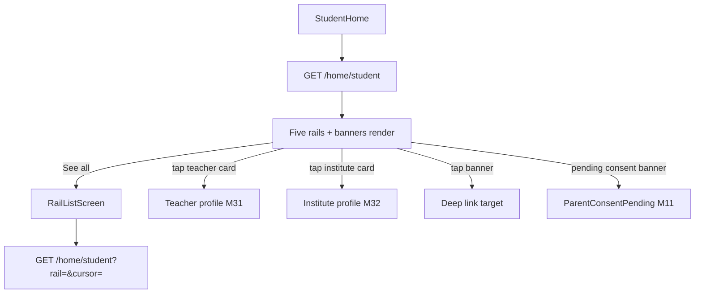
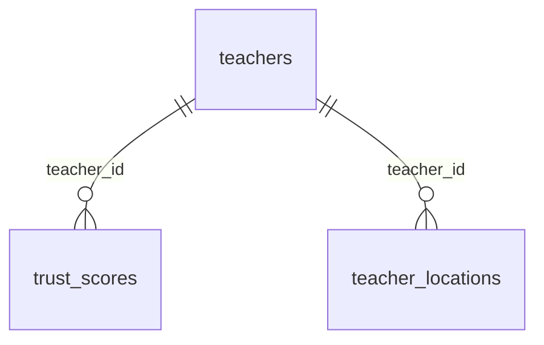

# Module 12 · Student Dashboard

> **Phase 3 · Student** · **Used by:** Student · **Depends on:** M00, M11 (registration, cold-start subjects); Admin M36 (trust score), Admin M44 (banners); replaced ranking: M30 · **New tables:** none · **Uses:** `students`, `teachers`, `institutes`, `trust_scores`, `teacher_locations`, `banners` · **Build estimate:** 3 days

## 1. Module Purpose

The student's home screen: banners plus four ranked rails — Recommended Teachers, Recommended Institutes, Nearby Teachers, Top Rated Teachers and Verified Teachers, mirroring Module 8's shape but for a single learner rather than a family of children. There is no child switcher; "Recommended" is scoped to the student themself, seeded at first run by Module 11's cold-start subject hint and, from then on, by the student's own search and favourite activity. Like Module 8, this ships a v0 rule-based ranking that Module 30 later swaps in behind the same response.

## 2. User Stories

- As a **new student straight out of registration**, I want relevant teachers on my very first Home screen, before I've searched for anything, so that the app feels useful immediately.
- As a **JEE aspirant**, I want Verified and Top Rated teachers in my city visible even while I'm still deciding what to search for.
- As a **student with pending parental consent**, I want to browse fully so that being on hold doesn't feel like the app is broken.
- As a **student on a 2G connection in a small town**, I want the dashboard to render from cache instantly.

## 3. Business Rules & Logic

**BR-12.1 One call, four rails.** `GET /home/student` returns banners and the first page of four rails (no child switcher, unlike Module 8): `recommended_teachers`, `recommended_institutes`, `nearby_teachers`, `top_rated_teachers`, `verified_teachers` is folded together with top-rated the same way Module 8 keeps them separate — this module keeps all **five** rail codes identical to Module 8's set for a consistent client component (`RailSection` is shared between M08 and M12). `?rail=<code>&cursor=&limit=` pages one rail, exactly as Module 8's BR-8.1.

**BR-12.2 Eligibility.** Same as Module 8 BR-8.2: `verification_status = 'approved'`, `account_status = 'active'`, excluding this student's `recommendation_dismissals` and `user_blocks` in either direction. Parental-consent status (Module 11) does **not** affect what the dashboard shows — only contacting (Module 37/38) is gated — so a pending student still gets full, useful browsing.

**BR-12.3 Recommended Teachers (v0, per student).** Because `students` has no subject/category preference table (unlike `parent_children`), candidates are scored from three signals, each optional and additive so a brand-new student still gets a reasonable list:
```
score = 2 × (class match: teacher has a teacher_classes row for students.class_id, board NULL or equal)
      + 2 × coldStartSubjectMatch      -- 0 or 1, from Module 11's Redis cold-start hint (0 after it expires/clears)
      + 3 × searchAffinitySubjectMatch -- 0..1, share of this student's last 20 `user_search_history` filters.subjectIds that overlap the teacher's subjects (0 with no search history)
      + 1 × favouriteCategoryMatch     -- 1 if the teacher's category appears among this student's `user_favorites` teachers' categories, else 0
      + trust_scores.score / 100
      + 0.5 × (teacher_locations row in the student's area, radius covers it ? 1 : 0)
```
A student with none of the three signals yet (no class set, no cold-start hint, no history, no favourites) falls back to Top Rated + Verified teachers in their city, and the rail header reads "Popular near you" instead of "Recommended for you" until a real signal exists.

**BR-12.4 Recommended Institutes.** Same formula as Module 8 BR-8.4, using the student's own `city_id`/`area_id` instead of a child's.

**BR-12.5 Nearby / Top Rated / Verified.** Identical logic and cache keys to Module 8 BR-8.5–8.7, scoped by `students.city_id`/`area_id` (these caches are shared across parents and students in the same city/area — one `home:nearby:<cityId>:<areaId>` entry serves both modules).

**BR-12.6 Banners.** Same mechanism as Module 8 BR-8.8 (reuses Module 44's `BannerService.getForPlacement`), with `audience IN ('all','students')`.

**BR-12.7 Cache keys and freshness.** `home:rec:teacher:student:<studentId>` / `home:rec:institute:student:<studentId>`, 6 hours, invalidated when the student's `class_id`/`city_id`/`area_id` changes (Module 51 account edit — students have no Module-9-equivalent profile editor beyond Account Settings) or a new search/favourite changes the top affinity signal (targeted bust, not full flush, same as Module 8). `meta.rails[*].cachedAt` is returned exactly as in Module 8's BR-8.11.

**BR-12.8 Replacement by Module 30.** As Module 8 BR-8.12 — request/response shape and cache keys are unchanged when Module 30's engine takes over `recommended_teachers`/`recommended_institutes`.

## 4. Screen List

| Screen | Route name | Purpose |
| --- | --- | --- |
| Student home | `StudentHome` | Banners, five rails |
| Rail list | `RailListScreen` | Full paginated list for one rail (shared component with Module 8) |

## 5. Screen Flow & Navigation



## 6. Screen Wireframe Description

**StudentHome** — header "Hi, Aarav" with bell (M48) and avatar (M51, since students have no dedicated profile screen beyond Account Settings). If `parentalConsent = 'pending'`, a dismiss-free banner sits above the banners carousel: "Ask your parent to approve to contact teachers — Resend code" (tap → M11 `ParentConsentPending`). Below: `BannerCarousel` (`home_top`), then the five `RailSection`s exactly as Module 8's wireframe (same `TeacherCard`/`InstituteCard` components), a `home_middle` banner card between the second and third rail. Empty/loading/error per rail exactly as Module 8. First-run state (no signals yet) shows "Popular near you" header on the recommended-teachers rail instead of "Recommended for you".

## 7. UI Components & Component Tree

Reuses Module 8's component tree verbatim (`BannerCarousel`, `RailSection`, `TeacherCard`, `InstituteCard`, `RailListScreen`) with a student-specific `useStudentHome()` hook in place of `useParentHome(childId)` (no child parameter) and a `PendingConsentBanner` component unique to this module.
- Hooks: `useStudentHome()`, `useRail(code, { enabled })` (shared factory, parametrised by role), `usePendingConsentBanner()` (reads `/me.student.parentalConsent`).

## 8. Validation Rules

| Field | Rule |
| --- | --- |
| rail (query) | one of the five rail codes or absent |
| cursor | opaque string from `meta.nextCursor` |
| limit | integer 1–20, default 10 (20 on `RailListScreen`) |

## 9. API Endpoints

| Method | Path | Auth | Description |
| --- | --- | --- | --- |
| GET | /home/student | Student | Banners and five rails (`?rail=&cursor=&limit=`) |

## 10. Request Payloads

```json
// GET /home/student
// GET /home/student?rail=recommended_teachers&cursor=eyJvIjoxMH0&limit=20
```

## 11. Response Payloads

```json
// 200 GET /home/student
{ "data": {
  "parentalConsent": "pending",
  "banners": { "home_top": [ { "id": "…", "title": "JEE Main 2027 crash course", "imageUrl": "…", "deepLink": "gc://search?subjectId=…" } ], "home_middle": [] },
  "rails": {
    "recommended_teachers": { "header": "Recommended for you", "items": [ { "teacherId": "…", "fullName": "Meera Nair", "categoryName": "Competitive Exam Faculty",
      "feePerHourPaise": 70000, "ratingAvg": 4.7, "ratingCount": 41, "trustScore": 88.2, "isVerifiedBadge": true, "distanceLabel": "5.1 km", "score": 6.9 } ],
      "nextCursor": "…", "cachedAt": "2026-09-26T09:00:00Z" },
    "recommended_institutes": { "header": "Recommended for you", "items": [ "…" ], "nextCursor": null, "cachedAt": "…" },
    "nearby_teachers": { "items": [ "…" ], "nextCursor": "…", "cachedAt": "…" },
    "top_rated_teachers": { "items": [ "…" ], "nextCursor": "…", "cachedAt": "…" },
    "verified_teachers": { "items": [ "…" ], "nextCursor": "…", "cachedAt": "…" } } } }
```

## 12. PostgreSQL Tables & Columns


**Existing tables this module reads or writes** (full definitions in the owning module)

| Table | Owner | Purpose |
| --- | --- | --- |
| `students` | Admin M31 | Student profile, one per student app account. |
| `teachers` | Admin M16 | Teacher profile and verification state. One row per teacher app account. |
| `institutes` | Admin M22 | Coaching centres, tuition centres, schools and academies. Rated by GuruConnect after verification. |
| `trust_scores` | Admin M36 | Current trust score per teacher with its factor breakdown. |
| `teacher_locations` | Admin M20 | Cities and areas a teacher serves, with travel radius for home tuition. |
| `banners` | Admin M44 | Promotional banners in the mobile app. |

- `students`: reads `class_id`, `board_id`, `city_id`, `area_id`, `parental_consent` (for the banner); writes nothing.
- `teachers`, `institutes`, `trust_scores`, `teacher_locations`, `banners`: identical read-only use to Module 8.

## 13. Relationships


**Entity relationship diagram** (tables this module uses; `admins` omitted)



## 14. State Management

- Query keys: `homeKeys.student` (persisted, `staleTime` from `meta.rails[*].cachedAt`), `homeKeys.studentRail(code)` for `RailListScreen`.
- Module 11's cold-start Redis key is server-side only; the client has no local state for it beyond what the rail response already reflects.
- Favouriting (Module 40) optimistically updates the cached rail item's `isFavourite` flag, as in Module 8.

## 15. Offline Handling

Identical to Module 8: the combined response is persisted and renders fully offline with "Updated {time}"; `RailListScreen` beyond the cached page is online-only.

## 16. Push Notification Requirements

None from this module (as Module 8); Module 11 owns the parental-consent pushes, Module 44 owns banner campaign pushes.

## 17. Security Rules

- No `childId`-equivalent parameter exists, so there is no cross-tenant id to validate beyond the token's own `sub`.
- Cards never include a teacher's/institute's phone/email. Banner deep links are allow-listed exactly as Module 8.
- The pending-consent banner reads only a status enum from `/me`, never the parent's phone (already masked by Module 11's own screens).

## 18. Error Handling

| Scenario | Code | HTTP | App behaviour |
| --- | --- | --- | --- |
| Unknown rail code | `VALIDATION_FAILED` | 422 | Ignored by the UI (client bug guard) |
| Student has no city/area set | — | 200 | Nearby/Top rated/Verified show "Set your area" linking to Account Settings (Module 51) |
| A rail's cache lookup fails | — | 200 (degrades) | That rail computes live once; Retry shown only if that also fails |

## 19. Testing Scenarios

- T12.1 (Maestro `student_home_load`) New student (just registered, Class 11, no consent needed) opens Home → banners and all five rails render; Recommended Teachers header reads "Popular near you" (no signals yet).
- T12.2 Student with a cold-start subject hint from registration → Recommended Teachers is biased toward matching-subject teachers on first load.
- T12.3 Student searches for "Physics" three times (Module 27) → within the cache TTL, Recommended Teachers shifts toward Physics teachers (search-affinity term).
- T12.4 Student with `parentalConsent = 'pending'` → banner shown on Home; tapping it opens `ParentConsentPending`; browsing and favouriting still work.
- T12.5 Airplane mode → dashboard opens fully from cache with the offline banner.
- T12.6 Student blocks a teacher (Module 49) → that teacher disappears from every rail on next refresh.
- T12.7 See all on Nearby Teachers → paginates correctly past the cached page.
- T12.8 Student changes city in Account Settings (Module 51) → next Home load re-scopes Nearby/Top Rated/Verified to the new city.
- T12.9 One rail's Redis dependency fails → the other four still render; only the failed rail shows Retry.
- T12.10 Student with no favourites, no search history and an expired cold-start hint → Recommended Teachers falls back cleanly to city Top Rated/Verified ordering, not an empty rail.

## 20. Audit Log Events

None — dashboard reads are not audit-logged (conventions §11), matching Module 8.

## 21. Future Scalability Notes

- Fold the cold-start/search-affinity/favourite-category signals into Module 30's proper feature set once it ships, rather than three ad-hoc terms.
- A durable `student_subjects` table (Module 11's schema request) would remove the 30-day cold-start expiry edge case entirely.
- Exam-goal-based rails (e.g. "For JEE Main" curated by admins) once Module 45's blog/content tagging by class extends to subjects.
- Per-rail impression/click analytics feeding Module 30's training data, as Module 8.
