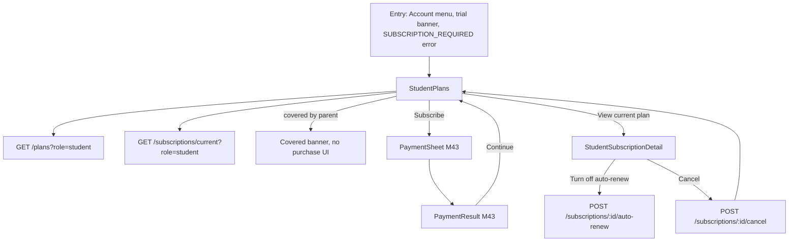
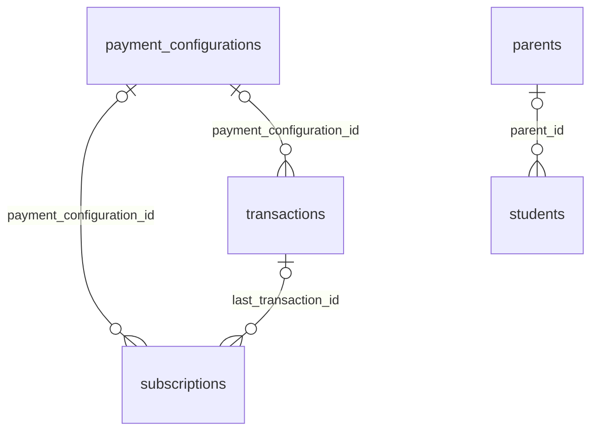

# Module 13 · Student Subscription

> **Phase 3 · Student** · **Used by:** Student · **Depends on:** M00, M04, M11, M43 (payment gateway and PaymentSheet — same build-order note as M10); Admin M05 (pricing), Admin M32, Admin M41 (subscription engine) · **New tables:** none · **Uses:** `subscriptions`, `payment_configurations`, `transactions`, `students`, `parents` · **Build estimate:** 2 days

## 1. Module Purpose

Membership purchase and renewal for students — the same job Module 10 does for parents, reusing its owned `GET /plans` and `GET /subscriptions/current` with `role=student`, `STUDENT_SUBSCRIPTION_MONTHLY`/`_YEARLY` fee codes, and the student-specific trial rule: a limited number of free contacts during the trial instead of (or alongside) a time-boxed trial, and a "covered by parent's plan" shortcut for linked students.

**Build-order note.** As Module 10: purchasing opens Module 43's `PaymentSheet`; until Module 43 ships, this module shows plans and status only, with the Subscribe button disabled ("Payments coming soon").

## 2. User Stories

- As a **student without a linked parent**, I want a free trial with a limited number of teacher contacts so that I can try the platform before paying.
- As a **student whose mother already has an active parent membership**, I want to see that I'm already covered, without being asked to pay again.
- As a **scholarship student**, I want to know if support has granted me free access, and see that clearly instead of a paywall.
- As a **student who used up their trial contacts early**, I want a clear nudge to subscribe rather than a confusing dead end.

## 3. Business Rules & Logic

**BR-13.1 Plans.** `GET /plans?role=student` mirrors Module 10 BR-10.1 for `STUDENT_SUBSCRIPTION_MONTHLY`/`_YEARLY`, via the same `resolveFee` used by Module 43. `trialEligible` mirrors Module 10 BR-10.2 (first-ever student subscription only).

**BR-13.2 Trial shape for students.** A student's trial (`subscriptions.status = 'trial'`, `trial_ends_at` from the fee's `trial_days`) additionally carries a **free-contact allowance**: `system_settings['limits.student_trial_free_contacts']` (default 5). `GET /subscriptions/current?role=student` returns `trialContactsUsed`/`trialContactsLimit` alongside the usual fields; Module 37 (Contact Teacher) decrements the allowance on each new lead created during a trial and returns `SUBSCRIPTION_REQUIRED` once it reaches the limit, even if `trial_ends_at` hasn't passed yet — whichever comes first ends trial access. `trialContactsUsed` is computed live as `count(leads where requester_user_id = sub and created_at >= subscriptions.starts_at)`, not stored on the subscription row, so it is always exact.

**BR-13.3 One trial per phone/device (Admin M32 FR‑32.2).** A registration or subsequent purchase attempt from a device fingerprint that already hosts another trial account skips the trial: the first subscription created for that account is `active` (goes straight through Module 43's checkout) rather than `trial`. The app never explains "why no trial" beyond the plan card simply showing the price with no trial line (`trialEligible: false`); the reason is logged server-side only (`trial_blocked: device_reused`, an app analytics event, not shown to the user).

**BR-13.4 Covered by parent's plan.** If `students.parent_id` is set, `parent_link_status = 'confirmed'`, and that parent's `subscriptions` row (`subscriber_type = 'parent'`) is live (`trial`, `active`, `grace`, `free_access`), the student is treated as fully covered: `GET /subscriptions/current?role=student` returns `status: 'covered_by_parent'` (a client-facing status distinct from the six database enum values — computed, never written to `subscriptions`), `canPurchase: false`, and Module 37/38 skip the subscription check entirely for this student. No student `subscriptions` row is created while covered. If the parent's plan later lapses, the student falls back to their own trial/paid status (creating a fresh trial only if BR‑13.1's eligibility still holds, i.e. it's genuinely their first time).

**BR-13.5 Purchase, auto-renew, cancel.** Identical mechanics to Module 10 BR-10.4–10.6, with `feeCode` from the student fee codes and `returnTo: { route: 'StudentSubscription' }`. Purchasing is hidden entirely (not just disabled) while `covered_by_parent` (BR-13.4).

**BR-13.6 Fee switched off/on and renewal reminders.** Same as Module 10 BR-10.7–10.8, scoped to `subscriber_type = 'student'`.

## 4. Screen List

| Screen | Route name | Purpose |
| --- | --- | --- |
| Plans | `StudentPlans` | Plan cards, current status (including "Covered by parent"), Subscribe |
| Subscription detail | `StudentSubscriptionDetail` | Status, dates, trial contacts remaining, auto-renew, cancel |

## 5. Screen Flow & Navigation



## 6. Screen Wireframe Description

**StudentPlans** — status banner: trial → amber "Trial: 3 of 5 free contacts left · ends in 6 days"; covered → blue "You're covered by Lakshmi Venkatesh's membership — no need to subscribe" with no plan cards below, just a "Learn more" link explaining the arrangement; active/grace/free_access banners identical in style to Module 10. Plan cards (Monthly/Yearly) as Module 10, prices from the student fee codes (₹199/₹1,499 at launch). Footer link "View my subscription".

**StudentSubscriptionDetail** — as Module 10's, with an extra row when trial: "Free contacts used" as a small progress bar "3 of 5 used" plus helper "Contacting a teacher uses one, whether or not they reply." Covered-by-parent state replaces the whole detail screen with a single card: parent's name, "Their {plan} covers you until {date}" (or "no end date" for yearly/free_access), and a note that cancelling is only possible from the parent's own account (Module 10).

## 7. UI Components & Component Tree

Reuses Module 10's `PlanCard`, `PeriodProgress`, `AutoRenewRow`, `CancelSection` components; adds `TrialContactsBar({ used, limit })` and `CoveredByParentCard({ parentName, until })`.
- Hooks: `usePlans('student')`, `useSubscriptionCurrent('student')`, `useAutoRenewMutation()`, `useCancelSubscriptionMutation()` (all shared with Module 10, parametrised by role).

## 8. Validation Rules

Identical to Module 10 BR-10 validation table, with `role=student` fixed by the route (not user-editable) and fee codes restricted to `STUDENT_SUBSCRIPTION_MONTHLY`/`_YEARLY`.

## 9. API Endpoints

This module owns no new endpoints; it reuses Module 10's shared ones with `role=student`.

| Method | Path | Auth | Description |
| --- | --- | --- | --- |
| GET | /plans | Any user | Active plans for the caller's role (`?role=student`) |
| GET | /subscriptions/current | Any user | Caller's current/most recent subscription, or `covered_by_parent` (`?role=student`) |
| POST | /subscriptions/:id/auto-renew | Any user (owner) | Turn auto-renew off |
| POST | /subscriptions/:id/cancel | Any user (owner) | Cancel now or at period end |

## 10. Request Payloads

```json
// GET /plans?role=student

// GET /subscriptions/current?role=student
```

## 11. Response Payloads

```json
// 200 GET /plans?role=student
{ "data": [
  { "feeCode": "STUDENT_SUBSCRIPTION_MONTHLY", "name": "Student membership · Monthly", "amountPaise": 19900, "billingPeriod": "monthly", "validityDays": 30, "trialDays": 7, "trialEligible": true, "perMonthPaise": 19900 },
  { "feeCode": "STUDENT_SUBSCRIPTION_YEARLY", "name": "Student membership · Yearly", "amountPaise": 149900, "billingPeriod": "yearly", "validityDays": 365, "trialDays": 7, "trialEligible": true, "perMonthPaise": 12492, "bestValue": true } ] }

// 200 GET /subscriptions/current?role=student   (trial with contacts remaining)
{ "data": { "id": "…", "feeCode": "STUDENT_SUBSCRIPTION_MONTHLY", "planName": "Student membership · Monthly", "status": "trial",
  "startsAt": "2026-09-20T09:00:00Z", "trialEndsAt": "2026-09-27T09:00:00Z", "daysLeft": 1, "trialContactsUsed": 3, "trialContactsLimit": 5, "canPurchase": true } }

// 200 GET /subscriptions/current?role=student   (covered by parent)
{ "data": { "status": "covered_by_parent", "coveredBy": { "parentId": "…", "parentName": "Lakshmi Venkatesh", "planName": "Parent membership · Yearly", "until": "2027-09-26T10:48:00Z" }, "canPurchase": false } }
```

## 12. PostgreSQL Tables & Columns


**Existing tables this module reads or writes** (full definitions in the owning module)

| Table | Owner | Purpose |
| --- | --- | --- |
| `subscriptions` | Admin M41 | Paid access periods for parents, students, teachers and institutes, including trials. |
| `payment_configurations` | Admin M05 | One row per version of each fee. The app charges whichever version is active at payment time. |
| `transactions` | Admin M40 | Every payment attempt through Razorpay, plus refunds and reward payouts. Amounts in paise. |
| `students` | Admin M31 | Student profile, one per student app account. |
| `parents` | Admin M28 | Parent profile, one per parent app account. |

- `subscriptions`, `payment_configurations`, `transactions`: same read/shared-write scope as Module 10, filtered to `subscriber_type = 'student'`.
- `students`: read `parent_id`, `parent_link_status` to compute `covered_by_parent` (BR-13.4); read `class_id`/`city_id` for nothing subscription-specific.
- `parents`: read the linked parent's live subscription status only when `parent_link_status = 'confirmed'`; no other parent data is exposed to the student.

## 13. Relationships


**Entity relationship diagram** (tables this module uses; `admins` omitted)



## 14. State Management

- Query keys: `planKeys.student`, `subscriptionKeys.current('student')` — same persistence/staleTime rules as Module 10.
- `trialContactsUsed` is not cached separately; it is part of the `subscriptionKeys.current('student')` payload and is invalidated whenever Module 37 creates a lead during a trial (so the bar updates right after a contact, not just on next app foreground).

## 15. Offline Handling

Identical to Module 10: plans/current status persisted and readable offline; Subscribe/auto-renew/cancel are online-only.

## 16. Push Notification Requirements

| Event | Recipient | Title / Body | Deep link | Category | Urgent |
| --- | --- | --- | --- | --- | --- |
| `subscription.trial_contacts_low` | Student | "1 free contact left" / "Subscribe to keep contacting teachers without limits." | `gc://plans` | subscription | no |
| `subscription.trial_ending` | Student | "Your trial ends tomorrow" / same copy as Module 10 | `gc://plans` | subscription | no |
| `subscription.renewal_reminder` / `.grace_started` / `.expired` / `.moved_to_free_access` / `.moved_to_trial` | Student | Same templates as Module 10, student-scoped | `gc://plans` | subscription | grace only |
`trial_contacts_low` fires once, when `trialContactsUsed = trialContactsLimit − 1`, from Module 37's contact-creation path.

## 17. Security Rules

- Same ownership model as Module 10 (`user_id = sub` on every subscription action).
- `covered_by_parent` reveals only the parent's first name and plan name/end date to the student — never the parent's phone/email or payment history.
- Trial-abuse signals (`trial_blocked: device_reused`) are analytics-only, never shown to the user and never exposed through this API (conventions §13 — device fingerprint is never PII the client can read back).

## 18. Error Handling

Same table as Module 10 BR-10 errors, plus:

| Scenario | Code | HTTP | App behaviour |
| --- | --- | --- | --- |
| Purchase attempted while `covered_by_parent` | `CONFLICT_STATE` (`covered_by_parent`) | 409 | Toast "You're covered by your parent's membership."; UI shouldn't have shown Subscribe at all |
| Contact attempted after trial contacts exhausted (pre-`trial_ends_at`) | `SUBSCRIPTION_REQUIRED` | 402 | Module 37 opens `StudentPlans` |

## 19. Testing Scenarios

- T13.1 (Maestro `student_subscribe_trial`) New unlinked student → Plans shows 7-day trial with 5 free contacts → contacts 5 teachers → 6th contact attempt blocked with `SUBSCRIPTION_REQUIRED` even though 2 trial days remain.
- T13.2 Student with `parent_link_status = 'confirmed'` and the parent on an active yearly plan → Plans shows "Covered by parent", no plan cards, Subscribe hidden.
- T13.3 Parent's plan expires → student's own trial/paid state takes over on next check; if the student never had a subscription row, a fresh trial starts.
- T13.4 Second registration on the same device fingerprint → new account's first subscription is `active` from first payment, no trial line shown on Plans.
- T13.5 4th of 5 trial contacts made → `subscription.trial_contacts_low` push received.
- T13.6 Subscribe on Yearly → PaymentSheet → pay → trial ends immediately, `active` starts (Module 43/Admin M41 FR-41.2), contacts become unlimited.
- T13.7 Turn off auto-renew, then cancel at period end → same behaviour and messages as Module 10 T10.3/T10.9.
- T13.8 Offline → Subscribe/auto-renew/cancel disabled; cached status (including trial contacts remaining) still visible.
- T13.9 Admin grants a scholarship (`programTag: 'scholarship'`, Admin M32 FR‑32.3) → student's Plans shows `free_access`-equivalent "active" state with `price_paise = 0`, no trial UI.
- T13.10 `SUBSCRIPTION_REQUIRED` thrown from a demo booking attempt (Module 38) → `StudentPlans` opens as a modal; back returns to the booking screen.

## 20. Audit Log Events

| Event | When | Details |
| --- | --- | --- |
| `app.subscription_auto_renew_disabled` / `app.subscription_cancel_requested` | Same triggers as Module 10 | subscription id, mode/reason |
Trial-contact decrements are not separately audited (derived from `leads`, already audited by Module 37); `covered_by_parent` computation is read-only and not an event.

## 21. Future Scalability Notes

- Exam-season short plans (e.g. 90-day JEE crash plan) as additional fee codes, per Admin M32 §21.
- A visible "why no trial" state for device-reuse cases if support tickets show it's confusing (currently silent by design, BR-13.3).
- Institutional/school bulk licences that would set many students to `free_access` at once (Admin M32 §21).
- Merge trial-contacts tracking into Module 30's engine so "contacts remaining" also informs recommendation urgency messaging (e.g. nudge to contact a strong match before contacts run out).
