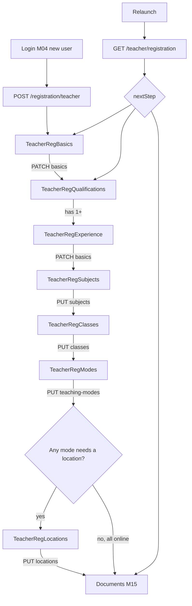
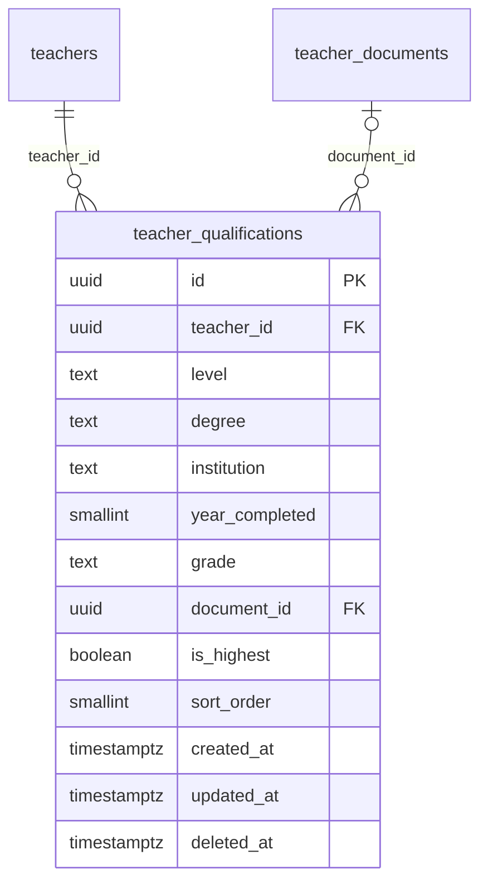

# Module 14 · Teacher Registration

> **Phase 4 · Teacher** · **Used by:** Registration token (account creation), Teacher (remaining steps) · **Depends on:** M00, M05 (registration context, consents); Admin M16 (teachers state machine); leads to M15 · **New tables:** `teacher_qualifications` · **Uses:** `teachers`, `teacher_subjects`, `teacher_classes`, `teacher_teaching_modes`, `teacher_locations`, `teacher_categories` · **Build estimate:** 5–6 days

## 1. Module Purpose

The seven-step wizard that turns a phone-verified registration token into a `teachers` row in `verification_status = 'draft'`, fully described (personal details, qualifications, experience, subjects, classes, teaching modes, locations) so that Module 15 has everything it needs to accept documents and submit for verification. Every step writes straight to its server table as it is completed — there are no lost drafts if the app is killed — while a local Zustand draft holds the in-progress screen so a half-typed field survives a rotation or a brief network drop. A progress indicator and a resumable `nextStep` keep a teacher who registers on a train and finishes on Wi-Fi from ever starting over.

## 2. User Stories

- As a **new teacher**, I want to register once with my phone number and pick up exactly where I left off if I close the app, so that a slow evening doesn't cost me my progress.
- As a **school teacher tutoring part-time**, I want to add two qualifications and mark my B.Ed. as the highest, so that verification sees my strongest credential first.
- As a **home tutor with no fixed classroom**, I want to register as "Home tuition" only and skip picking a fixed address until I add a serviceable area, so that I'm not blocked by a step that doesn't apply to me.
- As a **teacher on a 2G connection in a small town**, I want each step saved the moment I tap Next, so that I don't have to redo my qualifications if the app crashes on the next screen.
- As a **teacher who mistyped their category**, I want to go back and change my primary category before I submit, so that I show up in the right search results.

## 3. Business Rules & Logic

**BR-14.1 Account creation.** `POST /registration/teacher` (Registration token, `aud gc-register`, role `teacher`) is the only entry point. In one transaction: insert `app_users` (`phone` from the token's verified contact, `role = 'teacher'`, `signup_source` per conventions §13, `preferred_language`), insert `teachers` (`user_id`, `full_name`, `gender`, `date_of_birth`, `category_id`, `verification_status = 'draft'`, `account_status = 'active'`, `profile_completeness = 0`), insert `user_consents` (terms + privacy, `accepted_at = now()`, owned by M52), apply `referralCode` if present (validated the same way as M05 `POST /registration/referral/validate`; stored for M46 to pay out once the teacher is approved), create an `app_sessions` row and issue access + refresh tokens exactly like `POST /auth/refresh` (conventions §6). Response includes the new `teacherId`, tokens, and `nextStep: "qualification"`. A registration token already consumed (an `app_users` row already exists for that phone) returns `CONFLICT_STATE` and the app routes to Login instead.
**BR-14.2 Step order and ownership.** Personal details (this endpoint) → Qualification → Experience → Subjects → Classes → Teaching modes → Locations → (Module 15 Documents). "Personal details" and "Experience" are both partial edits of the `teachers` row and share one endpoint, `PATCH /teacher/registration/basics` (If-Match on `teachers.updated_at`): the Personal Details screen sends `{ fullName, gender, dateOfBirth, email, categoryId, languages }`; the Experience screen sends `{ experienceYears, highestQualification, bio, feePerHourPaise, demoAvailable }`. Both are optional partial payloads — only the fields present are validated and updated.
**BR-14.3 Progress and resume.** `GET /teacher/registration` returns the current draft (`teachers` row + qualifications + subjects + classes + modes + locations), `completedSteps` (each step is "complete" per the rule in BR-14.4) and `nextStep` (first incomplete step, or `"documents"` when all seven are done). `GET /me` (M00) surfaces the same `nextStep` under `registration.nextStep` so Splash (M01) resumes the wizard on relaunch without a second network call once `/me` is cached.
**BR-14.4 Step completion rules.**

| Step | Complete when |
| --- | --- |
| Personal details | `full_name`, `gender`, `date_of_birth`, `category_id` set |
| Qualification | ≥ 1 row in `teacher_qualifications` |
| Experience | `experience_years` and `highest_qualification` set |
| Subjects | ≥ 1 row in `teacher_subjects` |
| Classes | ≥ 1 row in `teacher_classes` |
| Teaching modes | ≥ 1 row in `teacher_teaching_modes` |
| Locations | ≥ 1 row in `teacher_locations`, OR every selected teaching mode has `requires_location = false` (pure online tutor) |
**BR-14.5 Qualifications (owns `teacher_qualifications`).** `POST /teacher/qualifications { level, degree, institution, yearCompleted, grade, isHighest }` appends a row (`sort_order` = current max + 1). `PATCH /teacher/qualifications/:id` edits one row (ownership: `teacher_id = pid`). `DELETE /teacher/qualifications/:id` soft-deletes (`deleted_at`); at least one qualification must remain once the step is marked complete elsewhere (deleting the last one is allowed while still in `draft` — it simply un-completes the step). Setting `isHighest: true` unsets it on every other row of the same teacher in the same transaction (`is_highest` is not a database-unique constraint — enforced in the service layer since a teacher may have zero qualifications marked highest transiently while editing). `document_id` is written later by Module 15 when the teacher attaches a certificate to a qualification; it is never set from this module.
**BR-14.6 Replace-set steps (subjects, classes, teaching modes, locations).** Each of `PUT /teacher/subjects`, `PUT /teacher/classes`, `PUT /teacher/teaching-modes`, `PUT /teacher/locations` replaces the whole set for the teacher in one transaction (diffed: insert new, delete removed, update changed — same pattern as Admin M18). Limits: subjects 1–10 with exactly one `isPrimary` (auto-promotes the first item if none is flagged, matching Admin FR-18.2); classes 1–20, each optionally paired with a `boardId`; teaching modes 1–4 (the full active `teaching_modes` list); locations 0–5, each `{ cityId, areaId?, isPrimary, travelRadiusKm?, addressLine?, latitude?, longitude? }` with exactly one `isPrimary` when the set is non-empty. A location is required unless every chosen teaching mode has `requires_location = false` (BR-14.4); the Locations screen shows "Skip — you teach online only" only in that case.
**BR-14.7 Category change guard.** Changing `categoryId` after subjects have been added shows a confirmation ("Your subjects were set up for {old category}. Review them next.") but does not clear the subject set — the teacher is taken back to the Subjects step.
**BR-14.8 Locking during review.** The four replace-set endpoints (subjects, classes, teaching-modes, locations) and the qualification endpoints check `teachers.verification_status IN ('draft', 'approved')`; any other status (`pending`, `under_review`, `reupload_requested`, `rejected`) returns `409 CONFLICT_STATE` with `details.reason = "verification_in_progress"` so an application being actively reviewed can't shift mid-review. `draft` is the registration wizard itself; `approved` is these same six endpoints reused, unchanged, as Module 17's Subjects / Classes / Teaching modes / Locations / Qualifications editors after launch — Module 17 owns no separate endpoints for these. `PATCH /teacher/registration/basics` is narrower and **draft-only**: once approved, the equivalent personal/experience fields are edited through Module 17's `PATCH /teacher/profile` instead (which additionally requires a reason for identity-linked fields, per Admin FR-17.3). While `reupload_requested`, only Module 15's document endpoints are open; while `pending`/`under_review`/`rejected`, nothing in Modules 14, 15 or 17 is editable until Module 16's resubmit flow or a support-assisted re-application returns the teacher to `draft`.
**BR-14.9 Side effects.** After every write in this module: recompute `teachers.profile_completeness` using the Admin M17 formula (photo 15, bio ≥ 100 chars 10, qualification 10, experience 5, ≥ 1 subject 15, ≥ 1 class 10, ≥ 1 location or online mode 10, fee 5, languages 5, ≥ 1 certificate approved 15 — the last two are always 0 until Module 15/17 run, so a fresh draft tops out at 60); write no audit row per keystroke, only per successful step save (conventions §11); emit `teacher.registration_step_saved` for analytics (event name only, no PII).
**BR-14.10 Rate limits.** `POST /registration/teacher` is limited to 5 attempts per registration token (a token is single-use regardless — a second call after success returns `CONFLICT_STATE`); qualification/set-replace endpoints are limited to 30 requests/minute per teacher (protects against a runaway autosave loop).

## 4. Screen List

| Screen | Route name | Purpose |
| --- | --- | --- |
| Registration intro | `TeacherRegIntro` | Explains the 7 steps + document upload + optional fee before starting |
| Personal details | `TeacherRegBasics` | Name, gender, DOB, email, category, languages |
| Qualifications | `TeacherRegQualifications` | List of qualifications added so far, "Add qualification" |
| Add/edit qualification | `TeacherRegQualificationForm` (modal) | Level, degree, institution, year, grade, highest toggle |
| Experience | `TeacherRegExperience` | Years, highest qualification text, bio, indicative fee, demo toggle |
| Subjects | `TeacherRegSubjects` | Multi-select subjects grouped by category, primary picker, experience per subject |
| Classes | `TeacherRegClasses` | Multi-select classes, optional board per class |
| Teaching modes | `TeacherRegModes` | Chip multi-select (Online, Home tuition, At teacher's place, Hybrid) |
| Locations | `TeacherRegLocations` | City/area picker, radius slider, "Skip" when online-only |

## 5. Screen Flow & Navigation


Back from any step returns to the previous completed step, never out of the wizard (Android back shows a "Finish later?" confirmation that keeps the draft). Reaching `nextStep: "documents"` lands on Module 15.

## 6. Screen Wireframe Description

**Registration intro** — illustration of the four steps (Profile → Documents → Verification → Live); heading "Let's get you verified"; three bullet lines ("Takes about 10 minutes", "Documents reviewed within 24 hours", "₹499 one-time registration fee" — hidden entirely when `TEACHER_REGISTRATION` is disabled per M05); sticky button "Start".

**Personal details** — progress bar "Step 1 of 7"; fields: Full name (placeholder "As on your Aadhaar", text), Gender (segmented: Female/Male/Other/Prefer not to say), Date of birth (date picker, must be 18+), Email (optional, placeholder "ananya.iyer@gmail.com"), Category (bottom-sheet single-select: Home Tutor, Coaching Faculty, Online Tutor, Institute Faculty…), Languages (chip multi-select: English, Hindi, Kannada, Tamil…). Sticky "Next".

**Qualifications** — progress "Step 2 of 7"; empty state "Add your first qualification" with illustration; once added, a card per qualification: "M.Sc. Physics · Bangalore University · 2010 · Highest" with edit/delete icons; "+ Add qualification" outline button; sticky "Next" disabled until ≥ 1 row.

**Add qualification (sheet)** — Level (select: Secondary, Senior secondary, Diploma, Graduate, Postgraduate, Doctorate, Professional, Certification), Degree (text, "M.Sc. Physics"), Institution (text, "Bangalore University"), Year completed (number, 1960–2026), Grade (optional text, "First class"), "This is my highest qualification" (switch). Buttons "Cancel" / "Save".

**Experience** — progress "Step 3 of 7"; Experience in years (stepper, 0–60), Highest qualification (auto-filled from the qualification marked highest, editable text), About you (bio textarea, 0/2,000, placeholder "I've taught JEE Physics for 14 years and focus on..."), Indicative fee per hour (₹ input, helper "You can set detailed plans later in your profile"), "I offer a free demo class" (switch, default on). Sticky "Next".

**Subjects** — progress "Step 4 of 7"; search box; subjects grouped by category (Academic, Competitive exam, Skills) as checkable rows with an experience-years stepper once checked; a star icon marks the primary subject (tap to change); footer "3 selected · 10 max"; sticky "Next" disabled at 0 selected.

**Classes** — progress "Step 5 of 7"; grouped by stage (Primary, Middle, Secondary, Senior secondary, Competitive); each row a class chip with an optional board dropdown once selected; sticky "Next".

**Teaching modes** — progress "Step 6 of 7"; four large selectable cards (Online, Home tuition, At teacher's place, Hybrid) with a one-line description each; sticky "Next".

**Locations** — progress "Step 7 of 7" (or hidden entirely with a single confirmation card "You teach only online — no location needed. Continue." when every selected mode has `requiresLocation = false`); otherwise: City picker, Area picker (searchable, filtered by city), travel radius slider (2–25 km, shown only for Home tuition), address line (optional, placeholder "Koramangala 5th Block"), "+ Add another area" (up to 5), one marked "Primary"; sticky "Finish profile — continue to documents".

## 7. UI Components & Component Tree

```
TeacherRegistrationStack
├─ RegistrationProgressHeader (step n of 7, back)
├─ TeacherRegIntroScreen
├─ TeacherRegBasicsScreen
│  └─ BasicsForm (TextField, PhoneField(disabled, from token), DatePickerField, Select, ChipGroup)
├─ TeacherRegQualificationsScreen
│  ├─ QualificationCard({ qualification, onEdit, onDelete })
│  └─ QualificationFormSheet (BottomSheet)
├─ TeacherRegExperienceScreen
├─ TeacherRegSubjectsScreen
│  └─ SubjectPickerRow({ subject, checked, isPrimary, experienceYears, onToggle, onPrimary, onExperienceChange })
├─ TeacherRegClassesScreen
│  └─ ClassPickerRow({ klass, checked, boardId, onToggle, onBoardChange })
├─ TeacherRegModesScreen
│  └─ ModeCard({ mode, selected, onToggle })
└─ TeacherRegLocationsScreen
   └─ LocationCard({ location, onEdit, onDelete, onSetPrimary })
```
Hooks: `useTeacherRegistrationQuery()` (`teacherRegKeys.context`), `useSaveBasicsMutation()`, `useQualificationMutations()`, `useReplaceSubjectsMutation()`, `useReplaceClassesMutation()`, `useReplaceModesMutation()`, `useReplaceLocationsMutation()`, `useRegistrationDraft()` (Zustand, per-step local fields before save). `TeacherRegistrationSchema` (`packages/shared`) is a discriminated union of the seven step schemas, re-exported per step as `TeacherBasicsSchema`, `TeacherQualificationSchema`, etc.

## 8. Validation Rules

| Field | Rule | Message shown |
| --- | --- | --- |
| fullName | 2–100 chars | "Enter your full name as on your ID" |
| gender | one of female, male, other, undisclosed | "Select an option" |
| dateOfBirth | age ≥ 18 and ≤ 90 | "You must be at least 18 to register as a teacher" |
| email | valid email, optional | "Enter a valid email" |
| categoryId | active teacher category | "Choose a category" |
| languages | 1–10 from the supported list | "Add at least one language" |
| level (qualification) | one of secondary…certification | "Select a level" |
| degree | 2–120 chars | "Enter your degree or certification name" |
| institution | 2–120 chars | "Enter your institution name" |
| yearCompleted | 1960–current year | "Enter a valid year" |
| grade | ≤ 40 chars, optional | — |
| experienceYears | 0–60, ≤ age − 16 | "Experience can't exceed your working years" |
| highestQualification | 2–120 chars | "Enter your highest qualification" |
| bio | ≤ 2,000 chars, no phone/email/URL patterns | "Remove phone numbers, emails or links" |
| feePerHourPaise | 0–1,00,000 paise (₹1,000/hour), optional | "Enter a fee up to ₹1,000/hour" |
| subjects.items | 1–10, unique subjectId, exactly one isPrimary | "Add at least one subject" |
| subjects.experienceYears | 0–60, optional | — |
| classes.items | 1–20, unique classId | "Add at least one class" |
| teachingModes.items | 1–4, unique, active only | "Select at least one teaching mode" |
| locations.items | 0–5; required unless all modes are online-only; exactly one isPrimary when non-empty | "Add a city you teach in" |
| locations.travelRadiusKm | 2–25, required when Home tuition is selected | "Set how far you're willing to travel" |

## 9. API Endpoints

| Method | Path | Auth | Description |
| --- | --- | --- | --- |
| POST | /registration/teacher | Registration token | Create the app_users + teachers draft, issue session (Idempotency-Key) |
| GET | /teacher/registration | Teacher | Current draft, completed steps, nextStep |
| PATCH | /teacher/registration/basics | Teacher | Update personal-details or experience fields (If-Match) |
| POST | /teacher/qualifications | Teacher | Add a qualification |
| PATCH | /teacher/qualifications/:id | Teacher | Edit a qualification |
| DELETE | /teacher/qualifications/:id | Teacher | Remove a qualification |
| PUT | /teacher/subjects | Teacher | Replace the subject set |
| PUT | /teacher/classes | Teacher | Replace the class set |
| PUT | /teacher/teaching-modes | Teacher | Replace the teaching-mode set |
| PUT | /teacher/locations | Teacher | Replace the location set |

## 10. Request Payloads

```json
// POST /registration/teacher   (Authorization: Bearer <registration token>, Idempotency-Key: 7c1e…)
{ "fullName": "Kavya Menon", "gender": "female", "dateOfBirth": "1994-06-12", "categoryId": "…home-tutor…", "referralCode": "RAHUL482" }

// PATCH /teacher/registration/basics   (If-Match: "2026-09-26T09:00:11.000Z")
{ "experienceYears": 4, "highestQualification": "B.Sc., B.Ed. (Primary)", "bio": "I teach Maths and Science for Classes 6-10 with a focus on CBSE board exams.", "feePerHourPaise": 60000, "demoAvailable": true }

// POST /teacher/qualifications
{ "level": "postgraduate", "degree": "M.Sc. Physics", "institution": "Bangalore University", "yearCompleted": 2010, "grade": "First class", "isHighest": true }

// PUT /teacher/subjects
{ "items": [ { "subjectId": "…physics…", "isPrimary": true, "experienceYears": 14 }, { "subjectId": "…jee-advanced…", "isPrimary": false, "experienceYears": 8 } ] }

// PUT /teacher/locations
{ "items": [ { "cityId": "…bengaluru…", "areaId": "…koramangala…", "isPrimary": true, "travelRadiusKm": 8, "addressLine": "5th Block, Koramangala" } ] }
```

## 11. Response Payloads

```json
// 201 POST /registration/teacher
{ "data": { "teacherId": "3fa1…", "accessToken": "eyJhbGciOi…", "refreshToken": "8f2c…", "role": "teacher", "nextStep": "qualification" } }

// 200 GET /teacher/registration
{ "data": {
  "teacher": { "id": "…", "fullName": "Kavya Menon", "gender": "female", "dateOfBirth": "1994-06-12", "categoryId": "…", "verificationStatus": "draft",
              "experienceYears": 4, "highestQualification": "B.Sc., B.Ed. (Primary)", "bio": "…", "feePerHourPaise": 60000, "demoAvailable": true, "updatedAt": "2026-09-26T09:00:11.000Z" },
  "qualifications": [ { "id": "…", "level": "postgraduate", "degree": "M.Sc. Physics", "institution": "Bangalore University", "yearCompleted": 2010, "isHighest": true, "sortOrder": 1 } ],
  "subjects": [], "classes": [], "teachingModes": [], "locations": [],
  "completedSteps": ["personal","qualification","experience"], "nextStep": "subjects" } }

// 409 PUT /teacher/subjects  (already submitted)
{ "error": { "code": "CONFLICT_STATE", "message": "Your application is already under review and can't be edited here.", "details": { "reason": "verification_in_progress" }, "requestId": "…" } }
```

## 12. PostgreSQL Tables & Columns

**New tables owned by this module** (migration `sql/migrations/114_app_m14_teacher_registration_qualifications.sql`)

### `teacher_qualifications`

Degrees and certifications a teacher lists during registration and in the profile builder.

| Column | Type | Null | Default | Constraints / References | Description |
| --- | --- | --- | --- | --- | --- |
| `id` | uuid | no | gen_random_uuid() | PK | Primary key |
| `teacher_id` | uuid | no | — | FK → `teachers.id` (on delete cascade) | Owner |
| `level` | text | no | — | CHECK level IN ('secondary','senior_secondary','diploma','graduate','postgraduate','doctorate','professional','certification') | Level |
| `degree` | text | no | — | — | e.g. M.Sc. Physics, B.Ed. |
| `institution` | text | no | — | — | University / board / body |
| `year_completed` | smallint | yes | — | CHECK year_completed BETWEEN 1960 AND 2100 | Year |
| `grade` | text | yes | — | — | e.g. 78% / 8.4 CGPA (optional) |
| `document_id` | uuid | yes | — | FK → `teacher_documents.id` (on delete set null) | Supporting certificate (Module 15) |
| `is_highest` | boolean | no | false | — | Shown on cards; mirrors teachers.highest_qualification |
| `sort_order` | smallint | no | 0 | — | Display order |
| `created_at` | timestamptz | no | now() | — | Created |
| `updated_at` | timestamptz | no | now() | — | Updated |
| `deleted_at` | timestamptz | yes | — | — | Soft delete |

<details><summary>DDL</summary>

```sql
CREATE TABLE teacher_qualifications (
  id uuid PRIMARY KEY DEFAULT gen_random_uuid(), -- Primary key
  teacher_id uuid NOT NULL REFERENCES teachers(id) ON DELETE CASCADE, -- Owner
  level text NOT NULL CHECK (level IN ('secondary','senior_secondary','diploma','graduate','postgraduate','doctorate','professional','certification')), -- Level
  degree text NOT NULL, -- e.g. M.Sc. Physics, B.Ed.
  institution text NOT NULL, -- University / board / body
  year_completed smallint CHECK (year_completed BETWEEN 1960 AND 2100), -- Year
  grade text, -- e.g. 78% / 8.4 CGPA (optional)
  document_id uuid REFERENCES teacher_documents(id) ON DELETE SET NULL, -- Supporting certificate (Module 15)
  is_highest boolean NOT NULL DEFAULT false, -- Shown on cards; mirrors teachers.highest_qualification
  sort_order smallint NOT NULL DEFAULT 0, -- Display order
  created_at timestamptz NOT NULL DEFAULT now(), -- Created
  updated_at timestamptz NOT NULL DEFAULT now(), -- Updated
  deleted_at timestamptz -- Soft delete
);
CREATE INDEX idx_teacher_qualifications_teacher ON teacher_qualifications (teacher_id, sort_order) WHERE deleted_at IS NULL;
CREATE UNIQUE INDEX uq_teacher_qualifications_highest ON teacher_qualifications (teacher_id) WHERE is_highest AND deleted_at IS NULL;
CREATE TRIGGER trg_teacher_qualifications_updated BEFORE UPDATE ON teacher_qualifications FOR EACH ROW EXECUTE FUNCTION set_updated_at();
```

</details>

**Indexes:** `idx_teacher_qualifications_teacher` on `(teacher_id, sort_order) WHERE deleted_at IS NULL`; `uq_teacher_qualifications_highest` (unique) on `(teacher_id) WHERE is_highest AND deleted_at IS NULL`

**Existing tables this module reads or writes** (full definitions in the owning module)

| Table | Owner | Purpose |
| --- | --- | --- |
| `teachers` | Admin M16 | Teacher profile and verification state. One row per teacher app account. |
| `teacher_subjects` | Admin M18 | Subjects a teacher teaches. |
| `teacher_classes` | Admin M19 | Classes (and optionally boards) a teacher covers. |
| `teacher_teaching_modes` | Admin M20 | Teaching modes a teacher offers (Online, Home tuition, …). |
| `teacher_locations` | Admin M20 | Cities and areas a teacher serves, with travel radius for home tuition. |
| `teacher_categories` | Admin M15 | Types of teacher shown as categories and used in parent preferences, e.g. Home Tutor, Coaching Faculty. |

| Column | Written by this module |
| --- | --- |
| `teachers.full_name`, `.gender`, `.date_of_birth`, `.email`, `.category_id`, `.languages` | `PATCH /teacher/registration/basics` (personal-details fields) |
| `teachers.experience_years`, `.highest_qualification`, `.bio`, `.fee_per_hour_paise`, `.demo_available` | `PATCH /teacher/registration/basics` (experience fields) |
| `teachers.profile_completeness` | recomputed after every write in this module (BR-14.9) |
| `teacher_qualifications.*` | owned outright — `document_id` is left null here, set later by Module 15 |
| `teacher_subjects`, `teacher_classes`, `teacher_teaching_modes`, `teacher_locations` | replace-set writes (BR-14.6) |
`teacher_categories`, `subjects`, `classes`, `boards`, `teaching_modes`, `cities`, `areas` are read-only lookups served by `GET /masters` (Module 0).

## 13. Relationships

**Foreign keys of new tables**

- `teacher_qualifications.teacher_id` → `teachers` — required, many-to-one, on delete **cascade**
- `teacher_qualifications.document_id` → `teacher_documents` — optional, many-to-one, on delete **set null**

**Entity relationship diagram**



## 14. State Management

- `useTeacherRegistrationDraft` (Zustand + encrypted MMKV, keyed `teacherReg`): per-step in-progress field values, cleared on successful save of that step and entirely on reaching `nextStep: "documents"`.
- Query key `teacherRegKeys.context` — the whole `GET /teacher/registration` payload; every mutation invalidates it (and, for subjects/classes, also `mastersKeys.all` is left untouched since masters don't change).
- `useSaveBasicsMutation`, one `useQualification{Add,Edit,Delete}Mutation`, `useReplace{Subjects,Classes,Modes,Locations}Mutation` — each optimistic only for the in-flight step's own screen (rolls the list back on error with a toast), never cross-step.

## 15. Offline Handling

- `GET /teacher/registration` is persisted; the wizard can be reviewed offline but every save button is disabled offline with "Connect to save this step" (registration writes are conventions §8 class 2 — draft locally, submit online).
- The local Zustand draft survives app restarts and offline periods; nothing is queued for background replay (unlike favourites) because step order and validation must be confirmed by the server before advancing.
- `POST /registration/teacher` is online-only (class 3, like OTP and payments) since it creates the account and issues tokens.

## 16. Push Notification Requirements

None from this module. The teacher gets no push until Module 15 submits for review (Module 16/20 then send verification-status pushes). The end of registration (after Locations, before Documents) is the point Module 20 prompts for notification permission ("Get notified the moment you're verified").

## 17. Security Rules

- Every write endpoint scopes by `teacher_id` derived from the access token's `pid`, never from the body.
- `POST /registration/teacher` accepts only a `gc-register` token whose `role` claim is `teacher`; any other role is `403 FORBIDDEN`.
- `PATCH /teacher/registration/basics` (draft-only) and the qualification/replace-set endpoints (draft or approved) reject in every other status (BR-14.8), so a teacher can never edit these fields while an application is actively under review.
- Bio is scanned for phone numbers, emails and URLs (same regex as Admin FR-17.5) and rejected with `VALIDATION_FAILED`, keeping contact off-platform even before verification.
- No document upload happens in this module, so `FLAG_SECURE` is not required on these screens.

## 18. Error Handling

| Scenario | Code | HTTP | App behaviour |
| --- | --- | --- | --- |
| Registration token expired/invalid | `AUTH_REQUIRED` | 401 | Back to phone verification |
| Token already used (account exists) | `CONFLICT_STATE` | 409 | Route to Login |
| Write while under review (`reason: verification_in_progress`) | `CONFLICT_STATE` | 409 | Toast + route to Verification status (M16) |
| Stale edit on basics | `VERSION_CONFLICT` | 409 | "Updated on another device. Review and save again." refetch and reopen |
| More than 10 subjects / 20 classes / 4 modes / 5 locations | `VALIDATION_FAILED` | 422 | Inline count warning at the limit |
| Two primary subjects/locations sent | `VALIDATION_FAILED` | 422 | Client blocks before submit; server double-checks |
| Bio contains a phone/email/URL | `VALIDATION_FAILED` | 422 | Inline under the bio field |
| Location required but none given | `VALIDATION_FAILED` (`reason: location_required`) | 422 | Banner "Add at least one city you teach in" |
| Network error mid-step | `NETWORK_OFFLINE` / `GATEWAY_ERROR` | — | Local draft kept; Retry button; Next stays disabled |

## 19. Testing Scenarios

- T14.1 Happy path: register → 7 steps → lands on Documents with `nextStep: "documents"`. Maestro flow `teacher_registration_happy_path`.
- T14.2 Kill the app after saving Qualifications, relaunch → `GET /teacher/registration` resumes at Experience with the qualification intact.
- T14.3 Registering with an under-18 date of birth is rejected client-side and server-side.
- T14.4 Adding a second qualification with `isHighest: true` unsets the first; `GET /teacher/registration` shows only one highest.
- T14.5 Selecting only "Online" as a teaching mode skips the Locations screen entirely; `completedSteps` includes `locations` without any row.
- T14.6 Selecting "Home tuition" and leaving Locations empty blocks Next with `location_required`.
- T14.7 Editing basics after Module 15 has submitted the application (`verification_status = 'pending'`) returns 409 and the app shows "Your application is already under review."
- T14.8 Offline: opening any step shows cached data but every Save/Next button is disabled with a hint.
- T14.9 Stale `If-Match` on `PATCH /teacher/registration/basics` (edited on another device) surfaces the conflict message and reloads the latest basics.
- T14.10 11th subject in `PUT /teacher/subjects` is rejected with `VALIDATION_FAILED` before any row changes (transaction rolled back, existing 10 untouched).
- T14.11 A valid referral code on `POST /registration/teacher` is recorded and visible later in Module 46 once the teacher is approved.
- T14.12 Concurrent duplicate `POST /registration/teacher` with the same `Idempotency-Key` returns the same `teacherId` and tokens without creating a second row.

## 20. Audit Log Events

| Event | When | Details |
| --- | --- | --- |
| `app.teacher_registered` | Account created | category, referral code used (boolean) |
| `app.teacher_registration_step_saved` | Any step successfully saved | step name |
| `app.teacher_qualification_added` / `_updated` / `_deleted` | Qualification changes | qualification id, level, isHighest |
| `app.teacher_subjects_set` / `_classes_set` / `_modes_set` / `_locations_set` | Replace-set writes | added, removed counts |

## 21. Future Scalability Notes

- Server-side draft validation shared with Admin M16's manual-creation form (`FR-16.10`) so both entry points enforce identical rules.
- A "resume by SMS link" flow (deep link straight to `nextStep`) for teachers who abandon the wizard, driven by a reminder job reading `teachers.verification_status = 'draft'` and `created_at` age.
- Bulk-import qualifications from a resume/CV photo via OCR as an optional shortcut before manual entry.
- Category-specific step sets (e.g. institute-affiliated teachers skip Locations) once Module 25 institute-linked teachers are common.
