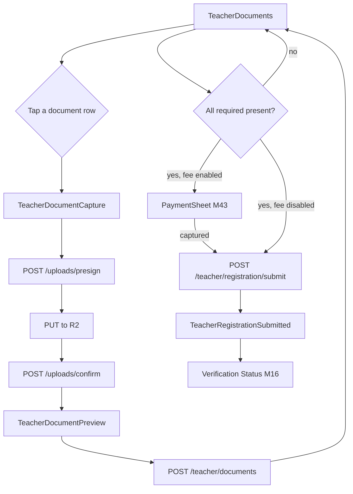
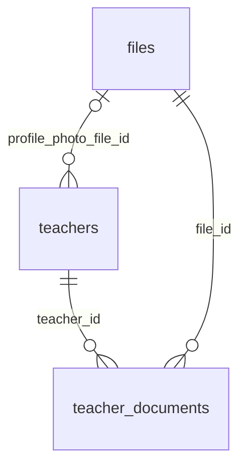

# Module 15 · Teacher Document Upload

> **Phase 4 · Teacher** · **Used by:** Teacher · **Depends on:** M00 (presign/confirm, FLAG_SECURE); M14 (registration draft complete); M43 (registration fee); leads to M16 · **New tables:** none · **Uses:** `teacher_documents`, `files`, `teachers` · **Build estimate:** 4–5 days

## 1. Module Purpose

Collects the identity and qualification evidence a teacher must provide before GuruConnect will show them in search: Aadhaar, PAN, education certificates, an optional professional certificate and experience letter, and a verification selfie ("photo") compared against the Aadhaar photo by Admin M16's automated checks. Every file goes to the private R2 bucket through Module 0's presign/confirm flow; identity numbers are masked immediately and only an HMAC hash is kept for duplicate detection. Once every required document is present, the teacher pays the registration fee (if one is configured) and submits, moving `teachers.verification_status` from `draft` to `pending` and handing the case to the Admin M16 queue.

## 2. User Stories

- As a **new teacher**, I want to photograph my Aadhaar and PAN with my phone camera and see instantly that they uploaded, so that I don't wonder if it worked.
- As a **teacher who typed my Aadhaar number wrong**, I want to see only the masked number afterwards and re-upload if it's wrong, so that I'm never shown my own full number by mistake and don't have to guess if it saved correctly.
- As a **teacher whose certificate photo came out blurry**, I want to replace it before I submit, so that I'm not rejected for something I can still fix myself.
- As a **teacher registering when the launch promotion has registration free**, I want to submit without being asked to pay, so that I'm not blocked by a fee that doesn't apply to me.
- As a **teacher on a weak connection**, I want an interrupted upload to resume, not restart from zero, so that a large certificate scan isn't wasted data.

## 3. Business Rules & Logic

**BR-15.1 Preconditions.** `GET`/`POST`/`DELETE /teacher/documents` require `teachers.verification_status IN ('draft', 'reupload_requested')` (uploading or replacing a flagged document works in both states); any other status is `409 CONFLICT_STATE` (`reason: not_editable`) and the app routes to Module 16 Verification Status instead. `POST /teacher/registration/submit` (BR-15.8) is narrower: it only fires the **first-time** `draft → pending` transition and requires `verification_status = 'draft'` exactly — the corresponding `reupload_requested → pending` transition after a re-upload is a different endpoint, owned and detailed by Module 16 (`POST /teacher/verification/resubmit`), not this module; this module's role in that path ends at uploading the replacement document. The Documents screen itself is reachable only once Module 14's seven steps are complete (`nextStep = "documents"`); reaching it earlier redirects to the first incomplete step.
**BR-15.2 Upload flow (per document).** 1) Camera or gallery/file picker per `doc_type`, resized/compressed per conventions §10 (images) or kept as-is for PDF (certificates only). 2) `POST /uploads/presign { purpose: "teacher_document", mimeType, sizeBytes, fileName }` (Module 0) → presigned PUT to `gc-private`. 3) App `PUT`s the file with progress. 4) `POST /uploads/:fileId/confirm`. 5) `POST /teacher/documents { docType, fileId, title?, docNumber? }` creates or replaces the current document for that type in one transaction: if a current row of the same `doc_type` exists, set its `is_current = false`; insert a new row with `version = previous + 1` (or `1`), `is_current = true`, `status = 'submitted'`. For `aadhaar` and `pan`, `docNumber` is required, sent once over TLS, never stored or logged in full: the server strips spaces/case, computes `doc_number_masked` (Aadhaar → `"XXXX XXXX " + last4`; PAN → first character + `"XXXXX"` + last 4 characters) and `doc_number_hash = HMAC-SHA256(normalisedNumber, docHashKey)` (key in KMS, conventions §13); the request body field is discarded after this step and never appears in any response, log or audit row.
**BR-15.3 Document types and rules.** `aadhaar` and `pan`: exactly one current row each, `docNumber` required, image or PDF. `education_certificate`: 1–5 current rows allowed simultaneously (each is its own "slot", not replaced by a new upload unless the teacher explicitly deletes and re-adds — see BR-15.5), `title` required (e.g. "B.Ed., Bangalore University 2010"); may optionally be linked to a `teacher_qualifications` row via `qualificationId` in the request, which is written to `teacher_qualifications.document_id`. `professional_certificate` and `experience_letter`: 0–5 current rows, optional, same slot behaviour as certificates. `photo`: exactly one current row, a live selfie (camera capture only — the picker is disabled for this type to discourage uploading an old photo), used only for the automated face-match check (Admin FR-16.4) and never shown publicly; it is unrelated to the public profile photo the teacher sets later in Module 17 (`teachers.profile_photo_file_id`).
**BR-15.4 Duplicate hint.** After an Aadhaar or PAN upload, the app calls nothing extra — duplicate checking against other teachers' current documents is Admin M16's automated check (FR-16.4), run when the teacher submits, not shown to the teacher. If the *same* teacher re-uploads an Aadhaar with a hash identical to their own previous rejected upload, the app shows an informational note ("This looks the same as your last upload — check your camera focus") client-side only (compares to the last known masked value locally; no extra call).
**BR-15.5 Delete / replace.** `DELETE /teacher/documents/:id` is allowed only on the current version of `education_certificate`, `professional_certificate` or `experience_letter` (multi-slot types) and only while `verification_status = 'draft'` — since nothing has been reviewed yet, the row is hard-deleted along with a request to clean up the `files` row (soft `status = 'deleted'`, object removed by the nightly job). `aadhaar`, `pan` and `photo` cannot be deleted, only replaced (a fresh `POST /teacher/documents` supersedes the current row as in BR-15.2); this keeps exactly one current identity/photo row at all times, matching `uq_teacher_documents_current_identity`. While `verification_status = 'reupload_requested'`, `DELETE` is disabled entirely — the teacher may only upload a replacement for the document(s) Module 16 flagged (each new upload via BR-15.2 automatically supersedes the flagged version); once every flagged document has a new `submitted` row, the teacher taps "Resend for review" (Module 16 `POST /teacher/verification/resubmit`), which this module does not own.
**BR-15.6 Required set for submission.** `GET /teacher/documents` reports readiness: current `aadhaar` present, current `pan` present, ≥ 1 current `education_certificate`, current `photo` present. All four are mandatory; `professional_certificate` and `experience_letter` are optional and never block submission.
**BR-15.7 Registration fee gate.** The Documents screen's sticky action reads `GET /api/v1/app/pricing` (Module 5, via Module 43's `GET /payments/quote?feeCode=TEACHER_REGISTRATION`) for the current `TEACHER_REGISTRATION` fee. If `enabled = false`, the button is "Submit for verification" and skips straight to BR-15.8. If `enabled = true`, the button is "Pay ₹{amount} & submit": tapping it runs the Module 43 payment flow (`GET /payments/quote` → `POST /payments/orders` → Razorpay Checkout → `POST /payments/verify`); on a captured payment the app immediately calls `POST /teacher/registration/submit { transactionId }`.
**BR-15.8 Submit (first submission only).** `POST /teacher/registration/submit { transactionId? }` requires `verification_status = 'draft'`: 1) re-checks BR-15.6's required set and the fee precondition (`transactionId` required and its transaction `status = 'captured'`, `fee_code = 'TEACHER_REGISTRATION'`, `payer = teacher's user_id`, unused by another teacher, only when the fee is enabled); 2) in one transaction sets `teachers.verification_status = 'pending'`, `submitted_at = now()`, `registration_transaction_id = transactionId` (or `NULL` when the fee is disabled); 3) writes `teacher_verification_logs` (`action = 'submitted'`, `from_status = 'draft'`, `to_status = 'pending'`); 4) audits `app.teacher_registration_submitted`; 5) sends the teacher a confirmation push/in-app message ("We've received your application — most reviews finish within 24 hours."). A teacher whose status is already `pending`/`under_review`/`approved` gets `CONFLICT_STATE`; a teacher in `reupload_requested` gets a clear `CONFLICT_STATE` pointing at Module 16's "Resend for review" action instead (no fee is ever charged twice).
**BR-15.9 Idempotency.** `POST /teacher/registration/submit` is idempotent on `teacher_id` — a duplicate double-tap after the first success simply returns the already-`pending` state (`200`, not a new log row) as long as no other write has moved the status since.

## 4. Screen List

| Screen | Route name | Purpose |
| --- | --- | --- |
| Documents overview | `TeacherDocuments` | Checklist of the four required + two optional document types with status |
| Document capture | `TeacherDocumentCapture` | Camera / picker for one document, with a masked-number field for Aadhaar/PAN |
| Document preview | `TeacherDocumentPreview` | Thumbnail + masked number before confirming upload |
| Payment sheet | (reused from M43) `PaymentSheet` | Razorpay checkout for the registration fee |
| Submitted confirmation | `TeacherRegistrationSubmitted` | "Under review" screen, links to Verification Status (M16) |

## 5. Screen Flow & Navigation


Back from Capture/Preview without confirming discards the local file and returns to the overview with nothing changed. A failed payment returns to the overview with the fee button still showing "Pay & submit".

## 6. Screen Wireframe Description

**Documents overview** — header "Upload your documents"; four rows in order Aadhaar, PAN, Education certificate(s), Photo, each with an icon, status pill (Not uploaded / Uploaded / Uploaded · under review flagged with a reason chip only when `reupload_requested`) and a chevron; below, a collapsed "Optional" section (Professional certificate, Experience letter) expandable; footer summary "2 of 4 required uploaded"; sticky button, disabled until all four required are present, reading "Pay ₹499 & submit" or "Submit for verification".

**Document capture (Aadhaar/PAN)** — camera viewfinder with a document-shaped guide overlay; below the shutter, a text field "Aadhaar number" (12-digit grouped `XXXX XXXX XXXX`, masked-as-you-type after the first 8 digits) or "PAN number" (10-char, auto-uppercase); helper text "We only store the last 4 digits — never the full number."; `FLAG_SECURE` active; sticky "Use this photo".

**Document capture (certificate/photo)** — for certificates: "Take photo" and "Choose from files" (PDF allowed) plus a Title field ("e.g. B.Ed., Bangalore University 2010") and an optional "Link to a qualification" picker (from Module 14's list); for photo: camera-only with a face-oval guide and the line "A clear, recent selfie — no filters or sunglasses."

**Document preview** — thumbnail, masked number line ("XXXX XXXX 2978") for identity docs, title for certificates; buttons "Retake" and "Looks good — upload".

**Submitted confirmation** — checkmark illustration; heading "Application submitted"; body "We're reviewing your documents. Most applications are decided within 24 hours."; button "See verification status" → Module 16; small text "You'll get a notification the moment there's an update."

## 7. UI Components & Component Tree

```
TeacherDocumentsScreen
├─ DocumentChecklistRow({ docType, status, thumbnailUrl, reasonChip, onPress })
├─ OptionalDocumentsSection (collapsible)
└─ StickyActionBar (fee-aware label, disabled state)
TeacherDocumentCaptureScreen
├─ CameraView / DocumentPickerField
├─ DocNumberField (Aadhaar/PAN masking-as-you-type, `useSecureScreen()`)
└─ QualificationLinkPicker (certificates only)
TeacherDocumentPreviewScreen
└─ MaskedNumberRow · ThumbnailCard
```
Hooks: `useTeacherDocumentsQuery()` (`teacherDocKeys.list`), `useUploadDocumentMutation(docType)` (wraps `useUpload('teacher_document')` then `POST /teacher/documents`), `useDeleteDocumentMutation()`, `useSubmitRegistrationMutation()`, `useRegistrationFeeQuery()` (reads Module 43's pricing quote for `TEACHER_REGISTRATION`).

## 8. Validation Rules

| Field | Rule | Message shown |
| --- | --- | --- |
| docType | one of aadhaar, pan, education_certificate, professional_certificate, experience_letter, photo | — |
| file (aadhaar/pan/photo) | jpeg/png, ≤ 10 MB | "Choose a JPG or PNG under 10 MB" |
| file (certificate/experience_letter) | jpeg/png/pdf, ≤ 10 MB | "Choose a JPG, PNG or PDF under 10 MB" |
| docNumber (aadhaar) | 12 digits, passes Verhoeff checksum | "Enter a valid 12-digit Aadhaar number" |
| docNumber (pan) | `^[A-Z]{5}[0-9]{4}[A-Z]$` | "Enter a valid PAN, e.g. ABCDE1234F" |
| title (certificate types) | 2–120 chars | "Give this document a short title" |
| qualificationId | optional, must belong to this teacher | — |
| transactionId (submit) | required and `captured` when the fee is enabled | "Complete payment before submitting" |

## 9. API Endpoints

| Method | Path | Auth | Description |
| --- | --- | --- | --- |
| GET | /teacher/documents | Teacher | Current documents per type, readiness for submit |
| POST | /teacher/documents | Teacher | Add or replace the current document of a type (Idempotency-Key) |
| DELETE | /teacher/documents/:id | Teacher | Remove a multi-slot document (draft only) |
| POST | /teacher/registration/submit | Teacher | Submit for verification (Idempotency-Key) |

## 10. Request Payloads

```json
// POST /teacher/documents
{ "docType": "aadhaar", "fileId": "7c1e4b2a-…", "docNumber": "491234567890" }

// POST /teacher/documents  (certificate, linked to a qualification)
{ "docType": "education_certificate", "fileId": "9a0d…", "title": "M.Sc. Physics, Bangalore University 2010", "qualificationId": "…" }

// POST /teacher/registration/submit
{ "transactionId": "b3f0b7b1-…" }
```

## 11. Response Payloads

```json
// 200 GET /teacher/documents
{ "data": {
  "documents": {
    "aadhaar": { "id": "…", "status": "submitted", "numberMasked": "XXXX XXXX 2978", "thumbnailUrl": "https://…signed…", "version": 1 },
    "pan": { "id": "…", "status": "submitted", "numberMasked": "AXXXXX123F", "version": 1 },
    "education_certificate": [ { "id": "…", "title": "M.Sc. Physics, Bangalore University 2010", "status": "submitted", "version": 1 } ],
    "professional_certificate": [], "experience_letter": [], "photo": { "id": "…", "status": "submitted", "version": 1 } },
  "readyToSubmit": true, "missing": [] } }

// 201 POST /teacher/documents
{ "data": { "id": "…", "docType": "aadhaar", "status": "submitted", "numberMasked": "XXXX XXXX 2978", "version": 1 } }

// 200 POST /teacher/registration/submit
{ "data": { "verificationStatus": "pending", "submittedAt": "2026-09-26T09:40:00Z" } }

// 409 POST /teacher/registration/submit  (missing documents)
{ "error": { "code": "VALIDATION_FAILED", "message": "Upload all required documents before submitting.", "details": { "missing": ["photo"] }, "requestId": "…" } }
```

## 12. PostgreSQL Tables & Columns


**Existing tables this module reads or writes** (full definitions in the owning module)

| Table | Owner | Purpose |
| --- | --- | --- |
| `teacher_documents` | Admin M16 | Every uploaded verification document version. Only one current version per teacher and type. |
| `files` | Admin M00 | Metadata for every uploaded object stored in S3 / Cloudflare R2. Binary content never touches PostgreSQL. |
| `teachers` | Admin M16 | Teacher profile and verification state. One row per teacher app account. |

| Column | Written by this module |
| --- | --- |
| `teacher_documents.*` | owned by Admin M16; this module inserts new versions and flips `is_current`; never sets `status` to anything but `submitted`, never touches `reviewed_by`/`reviewed_at`/`review_note` (admin-only) |
| `teachers.verification_status`, `.submitted_at`, `.registration_transaction_id` | `POST /teacher/registration/submit` |
| `teacher_verification_logs` (`submitted`/`resubmitted`) | written alongside the status change, same transaction |
`files` rows are created by Module 0's presign; this module only references `file_id` and marks abandoned certificate files for cleanup on delete.

## 13. Relationships


**Entity relationship diagram** (tables this module uses; `admins` omitted)



## 14. State Management

- Query key `teacherDocKeys.list` — the whole `GET /teacher/documents` payload; every upload/delete invalidates it.
- `useUpload('teacher_document')` (Module 0) drives the per-file `{ progress, status }` shown on the capture screen; not persisted (uploads are always resumed from a fresh presign, per conventions §8).
- No Zustand store beyond the ephemeral in-flight capture (camera frame, entered doc number) which is never persisted to MMKV or query cache (PII).

## 15. Offline Handling

- `GET /teacher/documents` is persisted so the checklist renders offline, but every action (capture, upload, delete, submit) is online-only (conventions §8 class 3 — security/PII/money) and disabled with "Connect to upload documents."
- An upload interrupted mid-transfer resumes on next launch by re-presigning (Module 0 BR-0.8); the local file bytes are kept in the app's cache directory until confirmed.
- Payment for the registration fee follows Module 43's offline rules (online only, never queued).

## 16. Push Notification Requirements

| Event | Recipient | Title / Body | Deep link | Category | Urgent |
| --- | --- | --- | --- | --- | --- |
| Registration submitted | Teacher | "Application submitted" / "We're reviewing your documents. Most reviews finish within 24 hours." | `gc://teacher/verification` | verification | No |
No push for individual document uploads — only the submission confirmation (also shown in-app immediately, so the push mainly reaches a backgrounded app).

## 17. Security Rules

- Every document row is scoped to `teacher_id = pid`; a teacher can never read or list another teacher's documents.
- Aadhaar/PAN numbers are never persisted in full and never appear in any response after the initial `POST /teacher/documents` call (which itself returns only the masked value) — not in logs, Sentry breadcrumbs, or audit rows.
- `docHashKey` (HMAC key) lives in KMS; only the verification service can compute or compare hashes.
- `TeacherDocumentCaptureScreen` and `TeacherDocumentPreviewScreen` enable `FLAG_SECURE` (Android) and the iOS app-switcher privacy overlay (conventions §13) for the whole time an identity number or document image is on screen.
- Private files are only ever fetched through Module 0's 60-second signed `GET /files/:id/url`, requested lazily per row, never bulk-downloaded.
- Rate limit: 20 document writes/hour and 5 submit attempts/hour per teacher.

## 18. Error Handling

| Scenario | Code | HTTP | App behaviour |
| --- | --- | --- | --- |
| Wrong status for editing (`pending`/`approved`/etc.) | `CONFLICT_STATE` (`not_editable`) | 409 | Route to Verification Status (M16) |
| Invalid Aadhaar checksum / PAN format | `VALIDATION_FAILED` | 422 | Inline under the number field |
| File too large / wrong type | `FILE_TOO_LARGE` / `FILE_TYPE_NOT_ALLOWED` | 413/415 | Inline under the picker, retake prompted |
| Submit with missing required docs | `VALIDATION_FAILED` (`details.missing[]`) | 422 | Overview highlights the missing rows |
| Submit with fee enabled but no captured payment | `VALIDATION_FAILED` (`reason: payment_required`) | 422 | Reopens the payment sheet |
| Delete an identity/photo document | `FORBIDDEN` | 403 | "Upload a new one instead — Aadhaar can't be removed." |
| Delete while `reupload_requested` | `CONFLICT_STATE` | 409 | "Upload a replacement instead of deleting." |
| Duplicate double-submit | — (idempotent) | 200 | No-op, same confirmation screen |

## 19. Testing Scenarios

- T15.1 Happy path: upload all four required docs, fee enabled, pay, submit → `TeacherRegistrationSubmitted`. Maestro flow `teacher_document_submit_happy_path`.
- T15.2 Registration fee disabled (`TEACHER_REGISTRATION.enabled = false`) → sticky button reads "Submit for verification" and no payment sheet appears.
- T15.3 Invalid Aadhaar checksum is rejected before any upload starts.
- T15.4 Re-uploading Aadhaar creates version 2, sets version 1 `is_current = false`; `GET /teacher/documents` shows only version 2.
- T15.5 Deleting a second education certificate removes only that row; the first remains current.
- T15.6 Attempting to delete the Aadhaar document returns 403.
- T15.7 Submitting with `photo` missing is blocked with `missing: ["photo"]`.
- T15.8 Killing the app mid-upload of a PDF certificate resumes and completes after relaunch.
- T15.9 A teacher in `reupload_requested` can only upload replacements for the flagged types; `DELETE` is blocked entirely.
- T15.10 Calling `POST /teacher/registration/submit` while `verification_status = 'reupload_requested'` is rejected with `CONFLICT_STATE`, directing the teacher to Module 16's resubmit action.
- T15.11 Double-tapping "Submit" after a successful submit returns the same `pending` state without a duplicate verification log row.
- T15.12 Offline: the Documents screen renders from cache; every action shows "Connect to upload documents" and is disabled.

## 20. Audit Log Events

| Event | When | Details |
| --- | --- | --- |
| `app.teacher_document_uploaded` | Each successful `POST /teacher/documents` | doc type, version (never the file name for identity documents, per conventions §11) |
| `app.teacher_document_deleted` | Successful delete | doc type, version |
| `app.teacher_registration_submitted` | Successful submit | fee code, transaction id (if any), from status |

## 21. Future Scalability Notes

- DigiLocker / UIDAI e-KYC integration to skip manual number entry and photo upload entirely (Admin M16 §21 already anticipates this).
- Client-side document-quality pre-check (blur/glare detection) before upload to cut reupload-requested rates.
- Allow a teacher to start verification with only Aadhaar + PAN and add certificates later, once Admin policy supports partial submission.
- Move the OCR/face-match vendor calls (today triggered on submit) to run per-upload for faster feedback, once vendor cost allows it.
