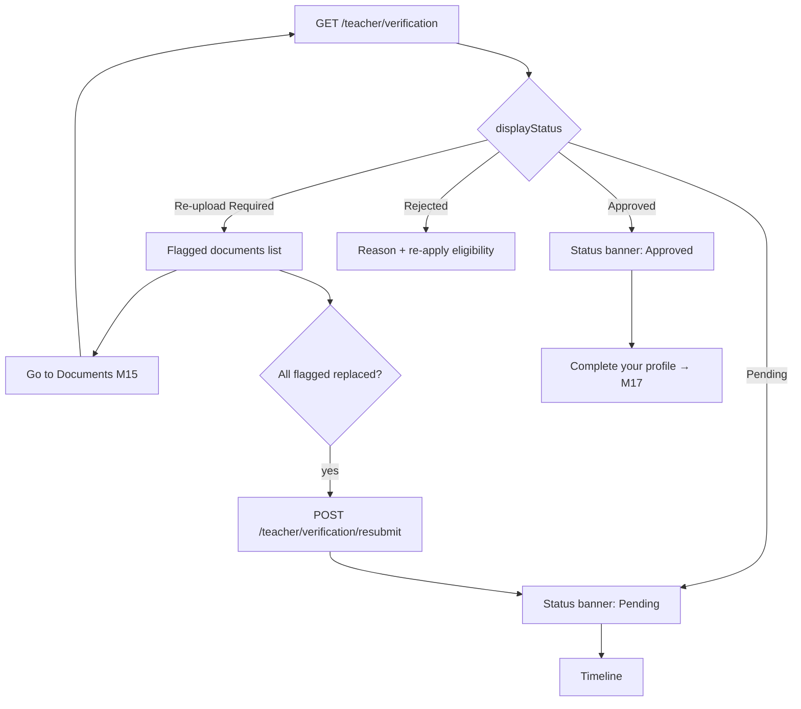
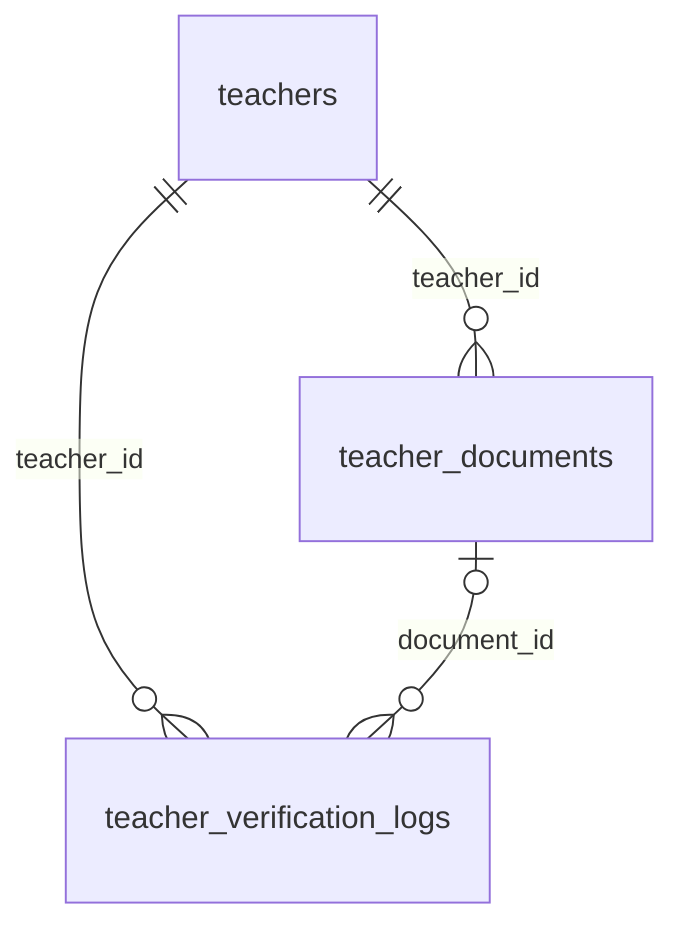

# Module 16 · Teacher Verification Status

> **Phase 4 · Teacher** · **Used by:** Teacher · **Depends on:** M15 (documents submitted); Admin M16 (queue, decisions, logs) · **New tables:** none · **Uses:** `teachers`, `teacher_documents`, `teacher_verification_logs` · **Build estimate:** 2–3 days

## 1. Module Purpose

The single screen a teacher checks after submitting: where their application stands, which documents (if any) need attention, and a full timeline of what's happened. It translates the six internal `teachers.verification_status` values into four things a teacher actually needs to see — Pending, Approved, Rejected, Re-upload Required — while still showing per-document detail from `teacher_documents.status` so a teacher whose Aadhaar is already approved but whose certificate is still being checked isn't left guessing. It also owns the resubmit action that returns a `reupload_requested` teacher to the queue after they've replaced the flagged documents in Module 15.

## 2. User Stories

- As a **teacher waiting on my first application**, I want to see "Pending" with roughly how long it usually takes, so that I don't call support after just two hours.
- As a **teacher asked to re-upload my PAN**, I want to see exactly which document and why, so that I fix the right thing the first time.
- As a **teacher who has re-uploaded everything that was flagged**, I want one clear button to send it back, so that I know my case is back in the queue.
- As a **rejected teacher**, I want to understand why and whether I can try again, so that I'm not stuck with no path forward.
- As a **newly approved teacher**, I want a clear "You're verified" moment, so that I know I can now be found by parents.

## 3. Business Rules & Logic

**BR-16.1 Status mapping.** `teachers.verification_status` maps to the app-facing status as: `draft` → not shown (this screen is only reachable after Module 15's submit); `pending` and `under_review` → **Pending** (both are "we're reviewing it" from the teacher's side — the internal claim/assignment mechanics of Admin M16 are never exposed); `reupload_requested` → **Re-upload Required**; `approved` → **Approved**; `rejected` → **Rejected**. `GET /teacher/verification` returns both the raw `verificationStatus` (for deep-link/analytics use) and the mapped `displayStatus`.
**BR-16.2 Document checklist.** For each of the six `teacher_documents.doc_type` values with a current row, the screen shows `teacher_documents.status` as one of: Uploaded (submitted), Approved, Needs re-upload (reupload_requested, with `review_note` shown verbatim — it is always teacher-safe copy per Admin FR-16.5/validation), Rejected (with `review_note`). A missing optional type (`professional_certificate`, `experience_letter`) shows nothing. This lets a teacher see partial progress (e.g. "3 of 4 approved") while the overall status is still Pending.
**BR-16.3 Non-internal notes.** `teacher_verification_logs` rows with `is_internal = false` are shown in the timeline as messages from GuruConnect (e.g. a reviewer's non-internal note); `is_internal = true` rows are never returned by this endpoint at all — the API filters them server-side, not the client.
**BR-16.4 Timeline.** `GET /teacher/verification` includes the last 20 `teacher_verification_logs` rows for the teacher (oldest first), each rendered as one of: "Application submitted" (`submitted`), "Re-submitted" (`resubmitted`), a per-document line "{doc type} approved/needs changes" (`document_approved`/`document_rejected`/`reupload_requested`, using `document_id` to label the type), "Application approved" (`approved`), "Application rejected" (`rejected`, with the rejection reason in plain copy — see BR-16.6), "Verified badge granted" (`badge_granted`, shown only if `is_verified_badge`). `assigned`, `note_added` (internal), and `auto_check` rows are never surfaced.
**BR-16.5 Approved.** When `displayStatus = 'Approved'`, the screen also shows whether the Verified badge was granted (`teachers.is_verified_badge`) and a "Complete your profile" call to action into Module 17 (fee plans, availability, bio) since a bare-minimum approved profile ranks poorly in search.
**BR-16.6 Rejected.** Shows `teachers.rejection_reason_code` translated to teacher-safe copy (e.g. `NAME_MISMATCH` → "The name on your documents didn't match.") and `rejection_note`. Per Admin FR-16.9, a rejected teacher may re-apply: the screen shows "You can apply again in {n} days" counting 30 days from `rejected_at`, or "You can apply again" with a button once that window has passed — re-applying is a fresh `POST /registration/teacher`-style flow handled by Admin support resetting the record to `draft` (out of this module's scope; the button simply deep-links to Module 5's registration-context check, which routes appropriately). `FORGED_DOCUMENT` rejections additionally show a permanent "This account can't reapply — contact support" state (the account is suspended server-side; `GET /me` already reflects `ACCOUNT_SUSPENDED` and Module 0 routes to `AccountBlocked` before this screen would even load).
**BR-16.7 Resubmit.** `POST /teacher/verification/resubmit` requires `teachers.verification_status = 'reupload_requested'` and that every current document with `status IN ('reupload_requested', 'rejected')` at the time re-upload was requested now has a newer current version with `status = 'submitted'` (Module 15 uploads already guarantee this — a fresh upload always creates a new current row with `status = 'submitted'`). In one transaction: `teachers.verification_status = 'pending'` (NOT `submitted_at`, which keeps its original value so Admin M16's SLA clock is unaffected — Admin FR-16.7); insert `teacher_verification_logs` (`action = 'resubmitted'`, `from_status = 'reupload_requested'`, `to_status = 'pending'`); audit `app.teacher_verification_resubmitted`; push/in-app confirmation. If any flagged document still shows `reupload_requested`/`rejected`, the call fails with `VALIDATION_FAILED` (`details.pending[]` lists the doc types still outstanding) and the button stays labelled "Upload the remaining documents first" client-side.
**BR-16.8 Polling and push.** The screen refetches on foreground and pulls to refresh; it also listens for the `verification` push category (Module 20) to invalidate and refetch immediately rather than waiting for the next foreground, so a teacher who has the app open in the background sees the update the moment the push arrives.

## 4. Screen List

| Screen | Route name | Purpose |
| --- | --- | --- |
| Verification status | `TeacherVerificationStatus` | Status banner, document checklist, timeline, resubmit / re-apply action |
| Rejection detail | (sheet within the same screen) | Reason and re-apply eligibility |

## 5. Screen Flow & Navigation


"Go to Documents" reopens Module 15 scoped to only the flagged types; back returns here. A push in the `verification` category deep-links straight to this screen from anywhere in the app.

## 6. Screen Wireframe Description

**Pending** — top banner (amber, clock icon) "Under review"; sub-line "Submitted 2 days ago · Most applications are decided within 24 hours"; document checklist below with per-row status pills (Uploaded / Approved) — no action needed, purely informational; timeline card ("Application submitted — 24 Sep, 10:15 AM"); no buttons except "Contact support" as a text link.

**Re-upload Required** — top banner (red, alert icon) "Action needed"; a card per flagged document: icon, name ("PAN card"), reason in plain copy ("The image is blurry — please retake it in good light."), button "Re-upload" → Module 15 scoped to that type; once every flagged item shows "Replaced ✓", a sticky button appears "Send back for review" → `POST /teacher/verification/resubmit`.

**Approved** — top banner (green, check icon, confetti once on first view) "You're verified!"; badge chip if `isVerifiedBadge`; card "Your profile is 62% complete" with a progress bar and button "Complete your profile" → Module 17; timeline below.

**Rejected** — top banner (grey, cross icon) "Application not approved"; reason line in plain copy; either "You can apply again in 18 days" (disabled button) or "Apply again" (enabled) depending on the 30-day window; "Contact support" link. `FORGED_DOCUMENT` case instead shows "This account can't be used to register — contact support" with no re-apply path at all.

## 7. UI Components & Component Tree

```
TeacherVerificationStatusScreen
├─ StatusBanner({ displayStatus, submittedAt, isVerifiedBadge })
├─ DocumentChecklistCard({ documents }) (reused shape from M15, read-plus-action here)
├─ VerificationTimeline({ events })
├─ RejectionCard({ reasonText, reapplyEligibleAt, blocked })
└─ StickyActionBar (context-dependent: none / "Send back for review" / "Complete your profile" / "Apply again")
```
Hooks: `useTeacherVerificationQuery()` (`teacherVerificationKeys.status`, `staleTime` 30 s, refetch on foreground and on `verification` push), `useResubmitMutation()`.

## 8. Validation Rules

| Field | Rule | Message shown |
| --- | --- | --- |
| Resubmit precondition | every previously flagged document has a newer `submitted` version | "Upload the remaining documents first" |
No user-entered fields on this screen beyond the resubmit action itself (no body).

## 9. API Endpoints

| Method | Path | Auth | Description |
| --- | --- | --- | --- |
| GET | /teacher/verification | Teacher | Mapped status, document checklist, timeline |
| POST | /teacher/verification/resubmit | Teacher | Return a reupload_requested application to the queue |

## 10. Request Payloads

```json
// GET /teacher/verification
// POST /teacher/verification/resubmit   (no body)
```

## 11. Response Payloads

```json
// 200 GET /teacher/verification  (Re-upload Required)
{ "data": {
  "verificationStatus": "reupload_requested", "displayStatus": "reupload_required", "submittedAt": "2026-09-20T05:10:00Z",
  "isVerifiedBadge": false,
  "documents": [
    { "docType": "aadhaar", "status": "approved" },
    { "docType": "pan", "status": "reupload_requested", "reviewNote": "The image is blurry — please retake it in good light.", "replaced": false },
    { "docType": "education_certificate", "status": "approved" },
    { "docType": "photo", "status": "approved" } ],
  "canResubmit": false,
  "timeline": [ { "at": "2026-09-20T05:10:00Z", "event": "submitted", "label": "Application submitted" },
                { "at": "2026-09-22T11:00:00Z", "event": "document_rejected", "label": "PAN needs changes", "docType": "pan" } ] } }

// 200 GET /teacher/verification  (Rejected)
{ "data": { "verificationStatus": "rejected", "displayStatus": "rejected", "rejectionReasonCode": "NAME_MISMATCH",
  "rejectionNote": "The name on your PAN card doesn't match your Aadhaar. Please re-apply with matching documents.",
  "rejectedAt": "2026-08-20T09:00:00Z", "canReapplyAt": "2026-09-19T09:00:00Z", "reapplyBlocked": false } }

// 422 POST /teacher/verification/resubmit
{ "error": { "code": "VALIDATION_FAILED", "message": "Upload the remaining documents first.", "details": { "pending": ["pan"] }, "requestId": "…" } }
```

## 12. PostgreSQL Tables & Columns


**Existing tables this module reads or writes** (full definitions in the owning module)

| Table | Owner | Purpose |
| --- | --- | --- |
| `teachers` | Admin M16 | Teacher profile and verification state. One row per teacher app account. |
| `teacher_documents` | Admin M16 | Every uploaded verification document version. Only one current version per teacher and type. |
| `teacher_verification_logs` | Admin M16 | Timeline of every verification event for a teacher, shown in the review screen. |

This module only reads. `teachers.verification_status` is written by Admin M16 (claim/approve/reject) and by this module's `POST /teacher/verification/resubmit` (the only write it owns: `reupload_requested → pending`, `submitted_at` untouched). `teacher_documents.status`/`review_note` are admin-written (Admin M16) or reset to `submitted` by Module 15 uploads. `teacher_verification_logs` rows are inserted by Admin M16, Module 15 (`submitted`) and this module (`resubmitted`); this module filters out `is_internal = true` rows before returning the timeline.

## 13. Relationships


**Entity relationship diagram** (tables this module uses; `admins` omitted)



## 14. State Management

- Query key `teacherVerificationKeys.status`; invalidated by the resubmit mutation and by a `verification`-category push (Module 0's deep-link/inbox handling calls `queryClient.invalidateQueries` directly, bypassing the normal foreground-only refetch).
- No Zustand store; nothing here needs to survive navigation beyond the query cache.

## 15. Offline Handling

- `GET /teacher/verification` is persisted (read-only screens work offline, showing "Updated 3 h ago").
- `POST /teacher/verification/resubmit` is online-only (conventions §8 class 3 — it changes a security-relevant workflow state); the button is disabled offline with a hint.

## 16. Push Notification Requirements

| Event | Recipient | Title / Body | Deep link | Category | Urgent |
| --- | --- | --- | --- | --- | --- |
| Document approved | Teacher | "Document approved" / "Your {docType} has been approved." | `gc://teacher/verification` | verification | No |
| Re-upload requested | Teacher | "Action needed on your application" / "We need a clearer copy of your {docType}." | `gc://teacher/verification` | verification | No |
| Application approved | Teacher | "You're verified! 🎉" / "Your GuruConnect profile is now live. Complete it to start getting leads." | `gc://teacher/verification` | verification | Yes |
| Application rejected | Teacher | "Update on your application" / "Your application wasn't approved this time." | `gc://teacher/verification` | verification | No |
All are sent by Admin M16's actions (Module 0's `NotificationService`) and Module 15's submit confirmation; this module only consumes them to refresh its own screen (BR-16.8).

## 17. Security Rules

- `GET /teacher/verification` and `POST /teacher/verification/resubmit` are scoped to `teacher_id = pid`; a teacher can never see another teacher's verification detail.
- Only teacher-safe copy ever reaches the app: `review_note`/`rejection_note` are validated admin-side to be free of internal jargon (Admin validation rules), but this endpoint additionally strips any note flagged `is_internal` regardless of source table, as defence in depth.
- No document thumbnails are shown on this screen (that's Module 15's job while editable); this screen is read-mostly and does not need `FLAG_SECURE`.

## 18. Error Handling

| Scenario | Code | HTTP | App behaviour |
| --- | --- | --- | --- |
| Teacher not yet submitted (`draft`) | `NOT_FOUND` | 404 | Redirect to Module 14/15 instead of showing this screen |
| Resubmit with documents still flagged | `VALIDATION_FAILED` (`details.pending[]`) | 422 | Button stays "Upload the remaining documents first", list highlighted |
| Resubmit when status isn't `reupload_requested` | `CONFLICT_STATE` | 409 | Refetch; screen just shows the current (already-changed) status |
| Network error on load | `NETWORK_OFFLINE` / `GATEWAY_ERROR` | — | Cached status shown with "Updated Xh ago"; Retry banner |

## 19. Testing Scenarios

- T16.1 `pending` and `under_review` both render as "Under review" with no functional difference visible to the teacher.
- T16.2 One document `reupload_requested`, others `approved` → checklist shows 3/4 approved and only the flagged one actionable.
- T16.3 Resubmit blocked while the flagged PAN hasn't been re-uploaded; unblocked immediately after Module 15 uploads a new current PAN version.
- T16.4 Successful resubmit sets status to Pending in the UI without a page reload and keeps the original submitted-at date shown ("Submitted 6 days ago", not reset to today).
- T16.5 Approved teacher sees the Verified badge chip only when `isVerifiedBadge` is true.
- T16.6 Rejected with `NAME_MISMATCH` shows the 30-day re-apply countdown; after the countdown, "Apply again" becomes enabled.
- T16.7 Rejected with `FORGED_DOCUMENT` never shows a re-apply path (this state is in practice unreachable in-app since the account is suspended first, but the copy is tested in isolation).
- T16.8 A `verification` push arriving while the screen is open triggers an immediate refetch, not just on next foreground.
- T16.9 Internal-only log rows (`is_internal = true`, `assigned`, `note_added`, `auto_check`) never appear in the rendered timeline (asserted against a fixture with mixed rows).
- T16.10 Offline: cached "Pending" status renders with a staleness hint; the resubmit button is disabled with "Connect to send this back for review."

## 20. Audit Log Events

| Event | When | Details |
| --- | --- | --- |
| `app.teacher_verification_resubmitted` | Successful resubmit | from status, documents that were replaced |

## 21. Future Scalability Notes

- Estimated review time shown from a rolling p50 of Admin M16's actual decision times instead of the fixed "24 hours" copy.
- In-app chat with the verification team for edge cases, reusing Module 53's support-ticket infrastructure instead of "Contact support" as a bare link.
- Push-driven live timeline updates via a lightweight WebSocket/SSE channel once polling load becomes noticeable at scale.
- Self-service re-application flow that resets a rejected teacher to `draft` directly from the app (today requires Admin support), once the 30-day rule is stable enough to automate safely.
