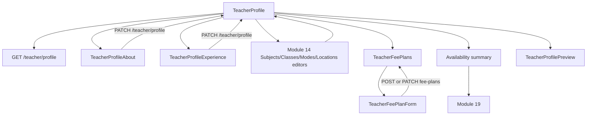
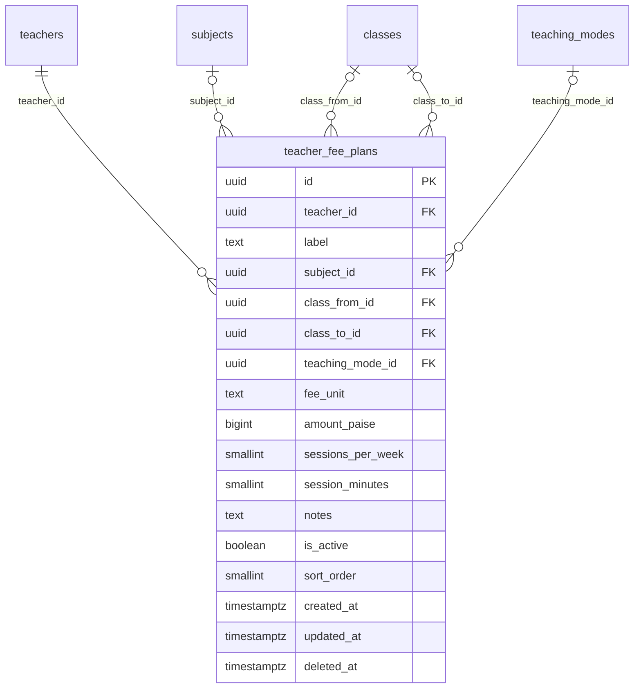

# Module 17 · Teacher Profile Builder

> **Phase 4 · Teacher** · **Used by:** Teacher · **Depends on:** M14 (reuses its subjects/classes/teaching-modes/locations/qualification endpoints while approved); M16 (approved status); links to M19 (availability) · **New tables:** `teacher_fee_plans` · **Uses:** `teachers`, `teacher_qualifications`, `teacher_subjects`, `teacher_classes` · **Build estimate:** 4–5 days

## 1. Module Purpose

The teacher's "Profile" tab: everything that makes an approved teacher's public listing complete and competitive — About (bio, photo), Experience, Languages, Subjects and Classes (reusing Module 14's own editors), a Fee Structure builder (owns `teacher_fee_plans`), and a link out to Availability (Module 19). It computes and shows the same profile-completeness percentage Admin M17 computes server-side, so a teacher always sees the identical number an admin would. A live preview screen renders the profile exactly as parents see it, so a teacher can check their own listing before it goes live in search.

## 2. User Stories

- As a **newly approved teacher**, I want to see my profile is only 60% complete and exactly what's missing, so that I know what to do next to start getting leads.
- As a **teacher with three different fee structures** (per hour, per month for a batch, per course for exam prep), I want to list all three clearly, so that parents know my pricing upfront.
- As a **teacher who corrected a typo in my name after approval**, I want that change to be tracked so support can see why it changed, so that I'm not accused of impersonation later.
- As a **teacher checking my own listing**, I want to see my profile exactly as a parent would, so that I can catch anything that looks wrong before a parent does.
- As a **teacher who just got approved**, I want a single screen to reach Subjects, Classes, Fees and Availability instead of hunting through menus, so that finishing my profile doesn't feel like a chore.

## 3. Business Rules & Logic

**BR-17.1 Access gate.** `GET /teacher/profile` and `GET /teacher/profile/preview` work in every `verification_status` (a not-yet-approved teacher can review their draft data, shown with a "Not visible to parents yet" watermark on the preview). Every write endpoint (`PATCH /teacher/profile`, all `/teacher/fee-plans` writes) requires `verification_status = 'approved'`; any other status returns `409 CONFLICT_STATE` (`reason: not_approved`) and the screen shows the Module 16 verification banner instead of edit controls. Subjects, Classes, Teaching modes and Locations sections on this tab are read-only summaries that deep-link into Module 14's own editors (BR-14.8 already gates those to `draft`/`approved`).
**BR-17.2 Profile fields.** `PATCH /teacher/profile { fullName?, gender?, dateOfBirth?, email?, categoryId?, languages?, experienceYears?, highestQualification?, bio?, feePerHourPaise?, demoAvailable?, profilePhotoFileId?, reason? }` (If-Match on `teachers.updated_at`) — a superset partial update of the same columns Module 14 sets during registration, now available post-approval. `fullName` and `dateOfBirth` are identity-linked: changing either on an approved teacher requires `reason` (10–500 chars) and writes a `teacher_verification_logs` row (`action = 'note_added'`, `is_internal = true`, `metadata: { profile_changed_after_approval: true, field, oldValue, newValue }`) so Admin M16/M17 see it in the timeline, matching Admin FR-17.3; it does **not** change `verification_status`. `profilePhotoFileId` must reference a `files` row with `purpose = 'teacher_photo'`, `status = 'active'`, uploaded by this teacher (Module 0 presign, public bucket) — this is the public listing photo, distinct from the private verification selfie Module 15 collected.
**BR-17.3 Fee plans (owns `teacher_fee_plans`).** `POST /teacher/fee-plans { label, subjectId?, classFromId?, classToId?, teachingModeId?, feeUnit, amountPaise, sessionsPerWeek?, sessionMinutes?, notes? }` appends a plan (`sortOrder` = max + 1, `isActive = true`). `PATCH /teacher/fee-plans/:id` edits one (ownership-scoped). `DELETE /teacher/fee-plans/:id` soft-deletes (`deleted_at`) — plans are never hard-deleted since they may be referenced from a lead or demo conversation history. `GET /teacher/fee-plans` (folded into `GET /teacher/profile`) lists active plans ordered by `sort_order`. Limit: 1–12 active plans per teacher.
**BR-17.4 Fee plan validation logic.** `classFromId`'s `level_order` (Module 0 masters) must be ≤ `classToId`'s; `subjectId`, if set, must be one of the teacher's current `teacher_subjects`; `teachingModeId`, if set, must be one of the teacher's current `teacher_teaching_modes`; `feeUnit = 'per_hour'` requires `sessionMinutes` (15–180); `per_month`/`per_course` require `sessionsPerWeek` (1–14). `amountPaise` follows the same ceiling as Admin FR-17.5: 0–1,00,00,000 paise (₹1,00,000), sense-checked client-side against `per_hour` plans over ₹10,000/hour with a soft confirmation ("That's an unusually high rate — are you sure?").
**BR-17.5 Profile completeness (matches Admin FR-17.8 exactly).** Recomputed after every write from this module or from Module 14's reused endpoints (subjects/classes/locations/qualifications) and written to `teachers.profile_completeness`: photo 15 (`profile_photo_file_id` set), bio 10 (`bio` ≥ 100 chars), qualification 10 (≥ 1 `teacher_qualifications` row), experience 5 (`experience_years` set), subjects 15 (≥ 1 `teacher_subjects` row), classes 10 (≥ 1 `teacher_classes` row), locations 10 (≥ 1 `teacher_locations` row OR every teaching mode is online-only), fee 5 (≥ 1 active `teacher_fee_plans` row OR `fee_per_hour_paise` set), languages 5 (≥ 1 language), certificate 15 (≥ 1 `teacher_documents` of type `education_certificate` with `status = 'approved'` — the only factor this module cannot itself satisfy; it can only reach 85 until Module 16's admin approves a certificate). `GET /teacher/profile` returns the total plus a per-item checklist (`{ key, label, earned, of }`) driving the "Complete your profile" card.
**BR-17.6 Preview.** `GET /teacher/profile/preview` returns the same shape Module 31 (public Teacher Profile View) would show a parent — trust score, rating, fee plans, availability summary from Module 19, verified badge — so the teacher sees exactly what's public. While not `approved`, every field is still returned but the response carries `visibleToParents: false` and the app renders a "Preview only — not visible until approved" banner over it.
**BR-17.7 Availability link.** This tab shows a summary card ("3 weekly slots · Demos available Mon–Fri evenings") read from Module 19's own endpoint (`GET /teacher/availability`, called by this screen, not owned here) with a "Manage availability" button that navigates to Module 19; no availability data is written from this module.

## 4. Screen List

| Screen | Route name | Purpose |
| --- | --- | --- |
| Profile home | `TeacherProfile` | Completeness card, section list (About, Subjects, Classes, Modes, Locations, Fees, Availability), preview button |
| About editor | `TeacherProfileAbout` | Photo, bio, languages, category |
| Experience editor | `TeacherProfileExperience` | Years, highest qualification, indicative fee, demo toggle |
| Fee plans list | `TeacherFeePlans` | List of fee plans, add/edit/delete, reorder |
| Fee plan editor | `TeacherFeePlanForm` (sheet) | Label, subject, class range, mode, unit, amount, sessions |
| Profile preview | `TeacherProfilePreview` | Read-only render of the public profile |

## 5. Screen Flow & Navigation


Any section save returns to the Profile home with the completeness card updated in place (no full reload). "Preview" is reachable from the home screen's app bar at any time.

## 6. Screen Wireframe Description

**Profile home** — header with avatar, name, verified badge, trust-score ring (read-only, links to Module 42 for the breakdown); completeness bar "72% complete" with an expandable "What's missing" list ("Add a certificate for +15%"); section rows: About, Subjects (3), Classes (5), Teaching modes (2), Locations (1), Fee plans (2), Availability ("3 slots this week"); sticky footer link "Preview my profile".

**About editor** — Photo (tap to change, `expo-image-picker` + crop to square), Bio (textarea, counter 0/2,000, helper "Parents see the first two lines in search — make them count"), Languages (chip multi-select), Category (select, shows the confirmation from Module 14 BR-14.7 if changed after subjects exist); sticky "Save".

**Fee plans list** — card per plan: "Physics · Class 9–12 · Online · ₹1,200/hour"; swipe-to-delete; "+ Add fee plan" button; empty state "Add your pricing so parents know what to expect."

**Fee plan editor (sheet)** — Label (text, "JEE Physics batch"), Subject (optional select, from the teacher's own subjects), Class range (two selects, from–to), Teaching mode (select, from the teacher's own modes), Fee unit (segmented: Per hour / Per month / Per course), Amount (₹ input), Sessions per week (stepper, shown for month/course), Session length in minutes (stepper, shown for per-hour), Notes (optional, ≤ 200 chars); buttons "Cancel" / "Save".

**Profile preview** — exact re-use of Module 31's `TeacherProfileView` component tree in read-only mode, with a top banner "This is how parents see your profile" (green, if approved) or "Preview only — not visible until you're approved" (amber, otherwise).

## 7. UI Components & Component Tree

```
TeacherProfileScreen
├─ CompletenessCard({ percent, missing[] })
├─ ProfileSectionRow (About / Subjects / Classes / Modes / Locations / Fees / Availability)
└─ PreviewButton
TeacherProfileAboutScreen / TeacherProfileExperienceScreen
├─ ImagePickerField (crop 1:1)
├─ TextField (bio, counter)
└─ ChipGroup (languages)
TeacherFeePlansScreen
├─ FeePlanCard({ plan, onEdit, onDelete })
└─ FeePlanFormSheet (Select×3, SegmentedControl, MoneyInput, Stepper×2)
TeacherProfilePreviewScreen (reuses components/domain/TeacherCard family read-only)
```
Hooks: `useTeacherProfileQuery()` (`teacherProfileKeys.detail`), `useSaveProfileMutation()`, `useFeePlan{Add,Edit,Delete}Mutation()`, `useTeacherProfilePreviewQuery()`, `useTeacherAvailabilitySummaryQuery()` (thin wrapper calling Module 19's endpoint).

## 8. Validation Rules

| Field | Rule | Message shown |
| --- | --- | --- |
| fullName / dateOfBirth (if changed) | same as Module 14; `reason` 10–500 chars required | "Tell us why you're changing this" |
| bio | ≤ 2,000 chars, no phone/email/URL | "Remove phone numbers, emails or links" |
| profilePhotoFileId | active `teacher_photo` file owned by this teacher | "Upload a photo first" |
| feePlans.label | 2–60 chars | "Give this plan a short name" |
| feePlans.feeUnit | per_hour, per_month, per_course | — |
| feePlans.amountPaise | 0–1,00,00,000 paise | "Enter a valid amount" |
| feePlans.sessionMinutes | 15–180, required for per_hour | "Enter a class length" |
| feePlans.sessionsPerWeek | 1–14, required for per_month/per_course | "Enter sessions per week" |
| feePlans count | 1–12 active plans | "You can add up to 12 fee plans" |
| feePlans.subjectId / teachingModeId | must belong to the teacher's own sets | "Add this subject/mode to your profile first" |

## 9. API Endpoints

| Method | Path | Auth | Description |
| --- | --- | --- | --- |
| GET | /teacher/profile | Teacher | Full profile, completeness checklist, fee plans |
| PATCH | /teacher/profile | Teacher | Edit About/Experience fields (If-Match) |
| GET | /teacher/profile/preview | Teacher | Public-shaped preview |
| GET | /teacher/fee-plans | Teacher | List active fee plans |
| POST | /teacher/fee-plans | Teacher | Add a fee plan |
| PATCH | /teacher/fee-plans/:id | Teacher | Edit a fee plan |
| DELETE | /teacher/fee-plans/:id | Teacher | Remove a fee plan |

## 10. Request Payloads

```json
// PATCH /teacher/profile   (If-Match: "2026-09-26T09:00:11.000Z")
{ "bio": "I've taught JEE Physics for 14 years, focusing on problem-solving speed for the exam.", "languages": ["English","Hindi","Kannada"], "profilePhotoFileId": "…" }

// POST /teacher/fee-plans
{ "label": "JEE Physics batch", "subjectId": "…physics…", "classFromId": "…class-11…", "classToId": "…class-12…", "teachingModeId": "…online…",
  "feeUnit": "per_month", "amountPaise": 400000, "sessionsPerWeek": 3, "notes": "Group batch of up to 8 students" }
```

## 11. Response Payloads

```json
// 200 GET /teacher/profile
{ "data": { "teacher": { "id": "…", "fullName": "Dr. Ananya Iyer", "bio": "…", "languages": ["English","Hindi"], "photoUrl": "https://cdn.guruconnect.in/…",
  "experienceYears": 14, "highestQualification": "Ph.D. Physics, IISc Bengaluru", "feePerHourPaise": 120000, "demoAvailable": true, "isVerifiedBadge": true,
  "verificationStatus": "approved", "updatedAt": "…" },
  "completeness": { "percent": 85, "items": [ { "key": "certificate", "label": "An approved certificate", "earned": 0, "of": 15 } ] },
  "subjects": [ { "subjectId": "…", "name": "Physics", "isPrimary": true } ], "classes": [ { "classId": "…", "name": "Class 12", "boardName": "CBSE" } ],
  "feePlans": [ { "id": "…", "label": "JEE Physics batch", "feeUnit": "per_month", "amountPaise": 400000, "sessionsPerWeek": 3 } ] } }

// 201 POST /teacher/fee-plans
{ "data": { "id": "…", "label": "JEE Physics batch", "feeUnit": "per_month", "amountPaise": 400000, "sessionsPerWeek": 3, "sortOrder": 3 } }

// 409 PATCH /teacher/profile  (not approved)
{ "error": { "code": "CONFLICT_STATE", "message": "Complete verification before editing your public profile.", "details": { "reason": "not_approved" }, "requestId": "…" } }
```

## 12. PostgreSQL Tables & Columns

**New tables owned by this module** (migration `sql/migrations/117_app_m17_teacher_profile_builder_fee_structure.sql`)

### `teacher_fee_plans`

A teacher's fee structure: price per class group, subject and mode, per hour, per month or per course.

| Column | Type | Null | Default | Constraints / References | Description |
| --- | --- | --- | --- | --- | --- |
| `id` | uuid | no | gen_random_uuid() | PK | Primary key |
| `teacher_id` | uuid | no | — | FK → `teachers.id` (on delete cascade) | Owner |
| `label` | text | no | — | — | e.g. Class 11–12 Physics · Online |
| `subject_id` | uuid | yes | — | FK → `subjects.id` (on delete restrict) | NULL = all subjects the teacher teaches |
| `class_from_id` | uuid | yes | — | FK → `classes.id` (on delete restrict) | Lowest class covered |
| `class_to_id` | uuid | yes | — | FK → `classes.id` (on delete restrict) | Highest class covered |
| `teaching_mode_id` | uuid | yes | — | FK → `teaching_modes.id` (on delete restrict) | NULL = any mode |
| `fee_unit` | text | no | — | CHECK fee_unit IN ('per_hour','per_month','per_course') | Billing unit |
| `amount_paise` | bigint | no | — | CHECK amount_paise BETWEEN 5000 AND 50000000 | ₹50 to ₹5,00,000 |
| `sessions_per_week` | smallint | yes | — | CHECK sessions_per_week BETWEEN 1 AND 14 | For per_month plans |
| `session_minutes` | smallint | yes | — | CHECK session_minutes BETWEEN 30 AND 240 | Length of one session |
| `notes` | text | yes | — | — | e.g. Includes weekly test, max 200 chars |
| `is_active` | boolean | no | true | — | Hidden when false |
| `sort_order` | smallint | no | 0 | — | Display order |
| `created_at` | timestamptz | no | now() | — | Created |
| `updated_at` | timestamptz | no | now() | — | Updated |
| `deleted_at` | timestamptz | yes | — | — | Soft delete |

<details><summary>DDL</summary>

```sql
CREATE TABLE teacher_fee_plans (
  id uuid PRIMARY KEY DEFAULT gen_random_uuid(), -- Primary key
  teacher_id uuid NOT NULL REFERENCES teachers(id) ON DELETE CASCADE, -- Owner
  label text NOT NULL, -- e.g. Class 11–12 Physics · Online
  subject_id uuid REFERENCES subjects(id) ON DELETE RESTRICT, -- NULL = all subjects the teacher teaches
  class_from_id uuid REFERENCES classes(id) ON DELETE RESTRICT, -- Lowest class covered
  class_to_id uuid REFERENCES classes(id) ON DELETE RESTRICT, -- Highest class covered
  teaching_mode_id uuid REFERENCES teaching_modes(id) ON DELETE RESTRICT, -- NULL = any mode
  fee_unit text NOT NULL CHECK (fee_unit IN ('per_hour','per_month','per_course')), -- Billing unit
  amount_paise bigint NOT NULL CHECK (amount_paise BETWEEN 5000 AND 50000000), -- ₹50 to ₹5,00,000
  sessions_per_week smallint CHECK (sessions_per_week BETWEEN 1 AND 14), -- For per_month plans
  session_minutes smallint CHECK (session_minutes BETWEEN 30 AND 240), -- Length of one session
  notes text, -- e.g. Includes weekly test, max 200 chars
  is_active boolean NOT NULL DEFAULT true, -- Hidden when false
  sort_order smallint NOT NULL DEFAULT 0, -- Display order
  created_at timestamptz NOT NULL DEFAULT now(), -- Created
  updated_at timestamptz NOT NULL DEFAULT now(), -- Updated
  deleted_at timestamptz -- Soft delete
);
CREATE INDEX idx_teacher_fee_plans_teacher ON teacher_fee_plans (teacher_id, sort_order) WHERE deleted_at IS NULL;
CREATE TRIGGER trg_teacher_fee_plans_updated BEFORE UPDATE ON teacher_fee_plans FOR EACH ROW EXECUTE FUNCTION set_updated_at();
```

</details>

**Indexes:** `idx_teacher_fee_plans_teacher` on `(teacher_id, sort_order) WHERE deleted_at IS NULL`

**Existing tables this module reads or writes** (full definitions in the owning module)

| Table | Owner | Purpose |
| --- | --- | --- |
| `teachers` | Admin M16 | Teacher profile and verification state. One row per teacher app account. |
| `teacher_qualifications` | App M14 | Degrees and certifications a teacher lists during registration and in the profile builder. |
| `teacher_subjects` | Admin M18 | Subjects a teacher teaches. |
| `teacher_classes` | Admin M19 | Classes (and optionally boards) a teacher covers. |

| Column | Written by this module |
| --- | --- |
| `teachers.full_name`, `.gender`, `.date_of_birth`, `.email`, `.category_id`, `.languages`, `.experience_years`, `.highest_qualification`, `.bio`, `.fee_per_hour_paise`, `.demo_available`, `.profile_photo_file_id` | `PATCH /teacher/profile`, approved teachers only |
| `teachers.profile_completeness` | recomputed after every write here or via Module 14's reused endpoints (BR-17.5) |
| `teacher_fee_plans.*` | owned outright by this module |
`teacher_qualifications`, `teacher_subjects`, `teacher_classes` are read here (summary rows, completeness inputs) and written only through Module 14's endpoints.

## 13. Relationships

**Foreign keys of new tables**

- `teacher_fee_plans.teacher_id` → `teachers` — required, many-to-one, on delete **cascade**
- `teacher_fee_plans.subject_id` → `subjects` — optional, many-to-one, on delete **restrict**
- `teacher_fee_plans.class_from_id` → `classes` — optional, many-to-one, on delete **restrict**
- `teacher_fee_plans.class_to_id` → `classes` — optional, many-to-one, on delete **restrict**
- `teacher_fee_plans.teaching_mode_id` → `teaching_modes` — optional, many-to-one, on delete **restrict**

**Entity relationship diagram**



## 14. State Management

- Query key `teacherProfileKeys.detail` — the whole `GET /teacher/profile` payload; every mutation here and every Module 14 replace-set mutation invalidates it (cross-feature invalidation by key prefix `teacherProfileKeys` and `teacherRegKeys`, since both read the same underlying `teachers` row).
- `teacherProfileKeys.preview` for the preview screen, `staleTime` 0 (always fresh — a teacher checking their own listing wants the latest).
- No Zustand store; fee-plan and about/experience forms are local React Hook Form state until saved.

## 15. Offline Handling

- `GET /teacher/profile` and `GET /teacher/profile/preview` are persisted; the whole tab is readable offline with a staleness hint.
- Fee-plan writes and `PATCH /teacher/profile` are **save draft, submit online** (conventions §8 class 2): the form keeps unsent edits locally and disables Save with "Connect to save changes", rather than silently queuing (unlike a favourite toggle, a profile edit should be seen and confirmed, not fired-and-forgotten).

## 16. Push Notification Requirements

None from this module directly. A completed profile crossing 80% triggers an in-app (not push) nudge card on the Dashboard (Module 18) suggesting the next missing item; Module 20 is not asked to push for profile completeness.

## 17. Security Rules

- Every endpoint scopes by `teacher_id = pid`; ownership checked on every fee-plan id.
- `PATCH /teacher/profile` blocks writes unless `verification_status = 'approved'` (BR-17.1); identity-linked field changes are logged even though they don't change verification state, giving support a paper trail (BR-17.2).
- Bio is scanned for phone numbers, emails and URLs (same rule as Module 14), keeping contact off-platform.
- `profilePhotoFileId` must be `gc-public` and owned by the caller — a teacher cannot set another user's uploaded file as their photo.

## 18. Error Handling

| Scenario | Code | HTTP | App behaviour |
| --- | --- | --- | --- |
| Write while not approved | `CONFLICT_STATE` (`not_approved`) | 409 | Section rows show a lock icon; tapping shows the verification banner |
| Identity field changed without reason | `VALIDATION_FAILED` | 422 | Inline "Tell us why you're changing this" |
| Bio contains contact details | `VALIDATION_FAILED` | 422 | Inline under bio |
| Stale edit (`If-Match`) | `VERSION_CONFLICT` | 409 | "Updated elsewhere. Review and save again." |
| Fee plan references a subject/mode not on the profile | `VALIDATION_FAILED` | 422 | "Add this to your profile first" with a shortcut |
| 13th fee plan | `VALIDATION_FAILED` (`reason: max_fee_plans`) | 422 | "You can add up to 12 fee plans" |
| Photo file not active/owned | `VALIDATION_FAILED` | 422 | "Upload a photo first" |

## 19. Testing Scenarios

- T17.1 Approved teacher edits bio and languages, saves, sees completeness update from 70% to 80% immediately. Maestro flow `teacher_profile_edit_happy_path`.
- T17.2 Non-approved teacher (`pending`) sees every section locked except read-only view and preview with the "not visible" banner.
- T17.3 Changing `fullName` on an approved teacher without a reason is rejected; with a reason, it saves and a `teacher_verification_logs` row appears (verified via Module 16's timeline in an integration test).
- T17.4 Adding a fee plan referencing a subject not in `teacher_subjects` is rejected until the subject is added via Module 14's Subjects editor.
- T17.5 Completeness caps at 85% with zero approved certificates and reaches 100% once Admin M16 approves one (cross-module fixture).
- T17.6 13th fee plan is rejected; deleting one first allows a 12th to be added again.
- T17.7 Preview screen for an unapproved teacher shows `visibleToParents: false` and the amber banner; for an approved teacher it matches Module 31's public shape field-for-field.
- T17.8 Stale `If-Match` on `PATCH /teacher/profile` surfaces the version-conflict message.
- T17.9 Offline: About/Experience/Fee-plan screens render cached data; every Save button is disabled with "Connect to save changes."
- T17.10 Deleting a fee plan referenced in an open lead's conversation history still succeeds (soft delete; history keeps showing the old label via the row's `deleted_at`, not a hard removal).

## 20. Audit Log Events

| Event | When | Details |
| --- | --- | --- |
| `app.teacher_profile_updated` | `PATCH /teacher/profile` succeeds | changed fields |
| `app.teacher_identity_field_changed` | `fullName`/`dateOfBirth` changed on an approved teacher | field, reason |
| `app.teacher_fee_plan_added` / `_updated` / `_deleted` | Fee plan writes | plan id, label, amount |

## 21. Future Scalability Notes

- Fee plan templates by category (pre-filled suggestions for "Home Tutor" vs "Coaching Faculty") to speed up setup.
- A/B testing bio prompts or structured bio fields (a short "teaching philosophy" prompt) to lift profile-view-to-lead conversion.
- Multi-photo galleries (classroom photos) once Module 32-style galleries prove valuable for institutes and are extended to teachers.
- Inline "profile score vs. similar teachers in your city" benchmark once Module 21 analytics support percentile comparisons.
