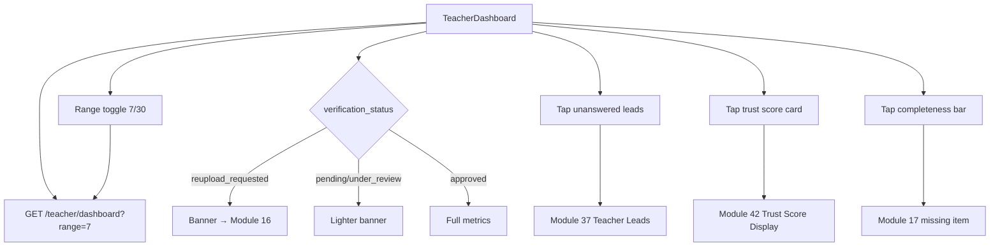

# Module 18 · Teacher Dashboard

> **Phase 4 · Teacher** · **Used by:** Teacher · **Depends on:** M16 (approved status), M17 (completeness nudge), M36 (trust score), M38 (leads), M39 (demos), Admin M21 (roll-up job that feeds teacher_daily_stats) · **New tables:** none · **Uses:** `teacher_daily_stats`, `teacher_profile_views`, `leads`, `teacher_reviews`, `trust_scores` · **Build estimate:** 3 days

## 1. Module Purpose

The first screen an approved teacher sees: how many people looked at their profile, how many leads and demos came from it, what their rating and trust score look like, and what needs attention right now (unanswered leads, a low completeness score, a document still needing re-upload). Every number here reads from the same `teacher_daily_stats` roll-up Admin M21 already computes nightly and hourly-for-today, so a teacher and an admin looking at the same teacher never see different figures.

## 2. User Stories

- As a **teacher who just started getting leads**, I want to see today's numbers alongside the last 7 and 30 days, so that I know if things are improving.
- As a **teacher with 4 unanswered leads**, I want that to be the first thing I see, so that I don't lose a family who's still waiting.
- As a **teacher whose profile is only 60% complete**, I want a clear nudge on what to add next, so that I can improve my ranking without digging through menus.
- As a **teacher whose trust score dropped**, I want to see why (a factor breakdown), so that I know what to fix.
- As a **teacher between classes on 3G**, I want the dashboard to load fast from cache, so that I can check my numbers in a spare minute.

## 3. Business Rules & Logic

**BR-18.1 Range.** `GET /teacher/dashboard?range=7|30` (default 7) aggregates `teacher_daily_stats` rows for `stat_date` in the last N days (IST calendar days, today included and refreshed hourly per Admin FR-21.2): `profileViews` = Σ `profile_views`, `uniqueViewers` = Σ `unique_viewers` (an approximation — daily uniques are not deduplicated across days, matching Admin M21's own totals so the two screens never disagree), `leadRequests` = Σ `lead_requests`, `demoRequests` = Σ `demo_requests`, `demosCompleted` = Σ `demos_completed`, `reviewsPublished` = Σ `reviews_published`, `avgRating` = Σ `rating_sum` / Σ `reviews_published` (null if zero). A `previousPeriod` block repeats the same aggregation for the N days before that, giving each tile a delta ("↑ 18% vs last 7 days").
**BR-18.2 Live counters (not from the roll-up).** `unansweredLeads` = count of the teacher's `leads` with `status IN ('new','viewed')` and `created_at < now() - interval '24 hours'` (matches Admin FR-38.4's "unanswered" definition); `openLeads` = count with `status IN ('new','viewed','contacted')`; `upcomingDemos` = count of `demo_requests` with `status IN ('requested','confirmed','reschedule_proposed')` and a start at or after now. These read live, not from yesterday's roll-up, since they drive an action banner that must be current.
**BR-18.3 Response rate.** `responseRatePct` = leads with `first_response_at` set within 24 h of `created_at` ÷ non-spam leads created in the selected range (matches Admin FR-38.4/FR-21.3 exactly, computed the same way so a teacher's number matches what an admin sees on their profile). `medianFirstResponseMinutes` over the same set.
**BR-18.4 Trust score card.** Reads `trust_scores` (current `score`, band: `excellent` ≥ 90, `good` 80–89, `fair` 60–79, `poor` < 60 — the same bands Admin M36's simulate endpoint uses) and the top-line factor with the most room to improve (the factor with the largest gap between its current value and 100, weighted by its weight) as a single suggestion line, e.g. "Add a certificate to improve your score" — the full breakdown itself is Module 42's job; this card only teases it with one line and a "See details" link.
**BR-18.5 Completeness nudge.** Shows `teachers.profile_completeness` (Module 17) as a compact bar only while < 100; tapping it deep-links to the single highest-value missing item from Module 17's checklist (BR-17.5), not the whole Profile tab, to keep the action obvious.
**BR-18.6 Recent activity feed.** The five most recent events across `leads` (`created`, `converted`), `teacher_reviews` (`published`) and `demo_requests` (`completed`, `no_show`) for this teacher, merged and sorted by time, each a one-line row with an icon and a deep link (to Module 37 Contact Teacher / Module 39 Demo detail / Module 34 review).
**BR-18.7 Verification/document banners.** If `verification_status = 'reupload_requested'`, the dashboard's top banner is the Module 16 action ("2 documents need your attention") ahead of everything else — a teacher who can't yet appear in search shouldn't be shown lead metrics as if things are normal. If `pending`/`under_review`, a lighter "Your application is under review" banner is shown above the (still-visible, currently-empty) metric tiles.
**BR-18.8 Refresh.** Pull-to-refresh and refetch on foreground; `staleTime` 60 s (matches the hourly-for-today roll-up cadence — more frequent polling wouldn't show new numbers anyway).

## 4. Screen List

| Screen | Route name | Purpose |
| --- | --- | --- |
| Teacher dashboard | `TeacherDashboard` | KPI tiles, trust score card, completeness nudge, unanswered-leads banner, recent activity |

## 5. Screen Flow & Navigation


The range toggle refetches in place without navigation; tapping any tile or banner always leaves the dashboard (no in-place drill-down beyond the toggle).

## 6. Screen Wireframe Description

**Dashboard (approved, healthy)** — greeting "Good morning, Dr. Iyer"; range toggle segmented "7 days / 30 days"; 2×3 KPI grid: Profile views (1,284, ↑18%), Leads (37, ↑9%), Demos (18 requested · 11 completed), Reviews (6 new · 4.83 avg), Response rate (94.6%), Trust score (94 · Excellent ring); below, an amber banner only if `unansweredLeads > 0` ("3 leads waiting more than 24 hours — reply now"); completeness bar only if < 100%; "Recent activity" list (5 rows, icon + one line + relative time); pull-to-refresh.

**Dashboard (under review)** — same layout with a top banner "Your application is under review — most decisions are made within 24 hours" (Module 16 link); KPI tiles show "—" with a caption "Numbers appear once you're approved" instead of zeros (avoids reading as "nobody is interested").

**Dashboard (re-upload required)** — red banner at the very top, above the greeting: "Action needed: 2 documents need your attention" → Module 16, styled the same as Module 16's own banner for consistency.

## 7. UI Components & Component Tree

```
TeacherDashboardScreen
├─ StatusBanner (verification-status aware, reused from M16's StatusBanner)
├─ RangeToggle (7/30)
├─ KpiTile({ label, value, delta, icon }) × 6
├─ TrustScoreCard({ score, band, suggestion })
├─ CompletenessNudge({ percent, nextItemLabel })
├─ UnansweredLeadsBanner({ count })
└─ RecentActivityList({ items })
```
Hooks: `useTeacherDashboardQuery(range)` (`teacherDashboardKeys.summary(range)`), no mutations — this screen is read-only.

## 8. Validation Rules

| Param | Rule |
| --- | --- |
| range | `7` or `30` only |
No user-entered fields.

## 9. API Endpoints

| Method | Path | Auth | Description |
| --- | --- | --- | --- |
| GET | /teacher/dashboard | Teacher | KPIs, trust score, completeness, unanswered leads, recent activity |

## 10. Request Payloads

```json
// GET /teacher/dashboard?range=7
```

## 11. Response Payloads

```json
// 200 GET /teacher/dashboard?range=7
{ "data": {
  "verificationStatus": "approved",
  "range": 7, "period": { "from": "2026-09-20", "to": "2026-09-26" },
  "kpis": { "profileViews": { "value": 1284, "deltaPct": 18.4 }, "uniqueViewers": { "value": 1011, "deltaPct": 12.1 },
            "leadRequests": { "value": 37, "deltaPct": 9.0 }, "demoRequests": { "value": 18, "deltaPct": -4.2 },
            "demosCompleted": { "value": 11, "deltaPct": 22.0 }, "reviewsPublished": { "value": 6, "deltaPct": 0 }, "avgRating": { "value": 4.83 } },
  "responseRatePct": 94.6, "medianFirstResponseMinutes": 22,
  "trustScore": { "score": 94.10, "band": "excellent", "suggestion": "Add a professional certificate to reach 97+" },
  "profileCompleteness": { "percent": 85, "nextItem": { "key": "certificate", "label": "Get a certificate approved", "points": 15 } },
  "unansweredLeads": 0, "openLeads": 4, "upcomingDemos": 3,
  "recentActivity": [ { "type": "lead_converted", "at": "2026-09-25T18:20:00Z", "label": "Lead from Lakshmi V. converted", "deepLink": "gc://leads/…" },
                       { "type": "review_published", "at": "2026-09-24T10:00:00Z", "label": "New 5★ review from a parent", "deepLink": "gc://teacher/reviews/…" } ] } }

// 200 GET /teacher/dashboard  (pending)
{ "data": { "verificationStatus": "pending", "range": 7, "kpis": null, "trustScore": null, "profileCompleteness": null, "unansweredLeads": 0, "recentActivity": [] } }
```

## 12. PostgreSQL Tables & Columns


**Existing tables this module reads or writes** (full definitions in the owning module)

| Table | Owner | Purpose |
| --- | --- | --- |
| `teacher_daily_stats` | Admin M21 | Daily roll-up per teacher, written by a nightly job. All analytics screens read from here. |
| `teacher_profile_views` | Admin M21 | Raw profile-view events from the app. High volume; partition by month when it exceeds ~50M rows. |
| `leads` | Admin M38 | Enquiries and call-back requests from parents/students to a teacher or institute. |
| `teacher_reviews` | Admin M33 | Reviews of teachers by parents and students. Only published reviews count toward ratings and trust. |
| `trust_scores` | Admin M36 | Current trust score per teacher with its factor breakdown. |

This module only reads. `teacher_daily_stats` (Admin M21) is summed over the requested range; `leads` and `demo_requests` are queried live for the two counters in BR-18.2 (indexed by `idx_leads_teacher (teacher_id, status, created_at DESC)` and `idx_demo_requests_teacher_time`); `teacher_reviews` supplies the recent-activity feed's `published` events (`teacher_id`, `status = 'published'`); `trust_scores` supplies the score card.

## 13. Relationships

No database relationships (client-side module).

## 14. State Management

- Query key `teacherDashboardKeys.summary(range)`; `staleTime` 60 s, refetch on foreground and pull-to-refresh; switching the range toggle is a separate cached query key so flipping back to a previously viewed range is instant.
- No Zustand store; the range toggle is local screen state persisted only within the session (resets to 7 on next cold start).

## 15. Offline Handling

- Persisted query; the dashboard renders from cache with a staleness hint ("Updated 3 h ago") when offline. No writes originate from this screen, so there is nothing to queue.

## 16. Push Notification Requirements

None from this module. The banners and tiles react to state already pushed by Modules 16, 20, 37 and 39; this screen has no push events of its own.

## 17. Security Rules

- Scoped entirely to `teacher_id = pid`; no other teacher's numbers are ever computable from this endpoint.
- `recentActivity` never includes a requester's phone or email (masked the same way Module 37/38 mask them); it only names the requester by first name + last initial, matching how Admin FR-38's masking is applied on the app side.

## 18. Error Handling

| Scenario | Code | HTTP | App behaviour |
| --- | --- | --- | --- |
| Invalid range value | `VALIDATION_FAILED` | 422 | Falls back to 7 client-side (the picker never sends an invalid value in practice) |
| Not yet approved | — (200, `kpis: null`) | 200 | Metrics hidden, status banner shown instead |
| Network error | `NETWORK_OFFLINE` / `GATEWAY_ERROR` | — | Cached dashboard with staleness hint; Retry banner if no cache exists |

## 19. Testing Scenarios

- T18.1 Approved teacher with activity in both periods shows correct deltas (`deltaPct` matches `(current-previous)/previous*100` fixture).
- T18.2 Pending teacher sees the "under review" banner and null metrics, not zeros.
- T18.3 `reupload_requested` teacher sees the red banner above the greeting, taking visual priority over everything else.
- T18.4 `unansweredLeads > 0` shows the amber banner; tapping it opens Module 37 filtered to unanswered.
- T18.5 Trust score band boundaries: 90.0 → excellent, 89.99 → good, 60.0 → fair, 59.99 → poor.
- T18.6 Completeness nudge picks the highest-point missing item, not the first one alphabetically (fixture: certificate 15 pts beats languages 5 pts even though languages sorts first).
- T18.7 Switching from 7 to 30 days refetches and both are cached independently (going back to 7 doesn't trigger a network call within `staleTime`).
- T18.8 Zero reviews in the period → `avgRating` is `null`, rendered as "No reviews yet" not "0.0★".
- T18.9 Offline: dashboard renders from cache with "Updated Xh ago"; pull-to-refresh shows the offline toast instead of spinning forever.
- T18.10 Recent activity never shows a requester's full phone/email even when the underlying lead has `contactUnlocked: true`.

## 20. Audit Log Events

None. This is a read-only analytics screen; no audit rows are written (conventions §11 — reads are not audit-logged).

## 21. Future Scalability Notes

- City/subject percentile benchmarks ("Top 15% for JEE Physics in Bengaluru") once Admin M21's leaderboard data is safe to expose per-teacher without revealing competitors' identities.
- Push-driven live tile updates for high-value events (a lead just arrived) instead of a 60-second staleTime, via a lightweight event channel.
- Exportable monthly summary (PDF) for a teacher's own records, reusing Module 45's payment-history export patterns.
- A goals feature ("Get to 10 reviews this month") once enough usage data exists to make goals meaningful rather than arbitrary.
