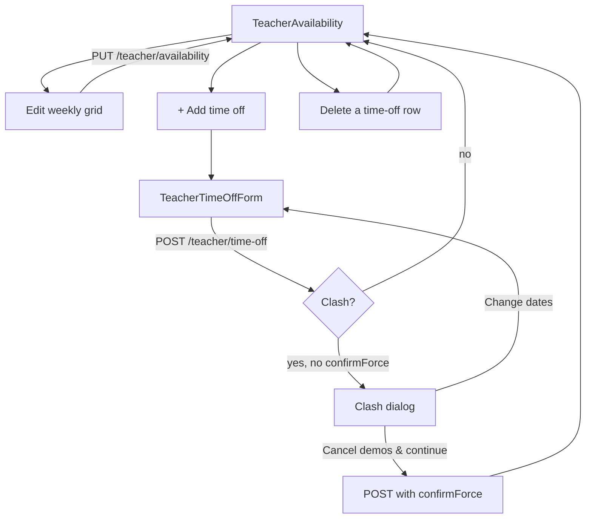
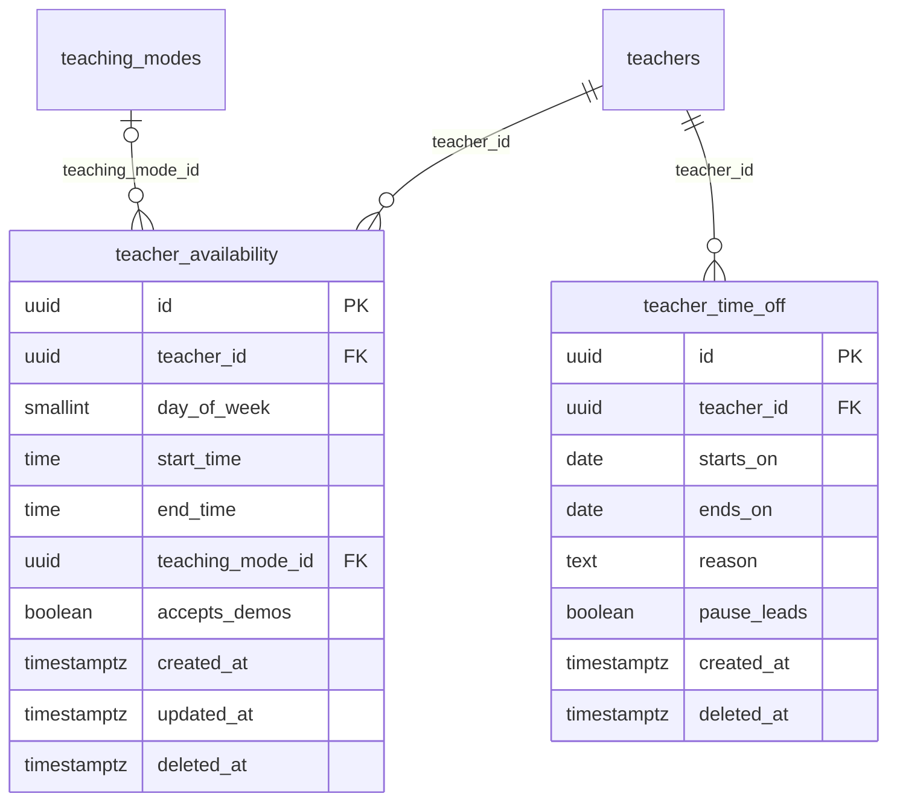

# Module 19 · Teacher Availability

> **Phase 4 · Teacher** · **Used by:** Teacher · **Depends on:** M16 (approved); read by M38 (Demo Class Request) to generate bookable demo slots and by Module 31/17 to show availability summaries · **New tables:** `teacher_availability`, `teacher_time_off` · **Uses:** `demo_requests` · **Build estimate:** 3 days

## 1. Module Purpose

Lets an approved teacher declare the weekly hours they can take classes or demo requests, and mark date ranges they're away (exams, travel, illness) so demo booking blocks those dates and the profile shows "Away" instead of silently going unanswered. Module 38 reads these two tables (plus existing `demo_requests`) to compute the actual bookable slots a parent sees — this module owns the input, not the slot-generation algorithm.

## 2. User Stories

- As a **teacher who only takes classes after 5 PM on weekdays**, I want to set that once as a recurring weekly window, so that parents never see or request a morning demo I can't give.
- As a **teacher going on a 10-day family trip**, I want to mark those dates as time off so that I don't get demo requests I'll have to decline.
- As a **teacher with two confirmed demos during dates I'm about to block off**, I want to be warned and choose what happens to them, so that a family isn't quietly cancelled without my knowing.
- As a **teacher who teaches online in the evening and in person on weekends**, I want separate windows per mode, so that my online slots don't get offered to someone wanting a home visit.
- As a **teacher recovering from a short illness**, I want to pause new leads for a few days without losing my profile or existing conversations, so that I come back to a fair inbox, not one I abandoned.

## 3. Business Rules & Logic

**BR-19.1 Weekly windows (owns `teacher_availability`).** `PUT /teacher/availability { items: [{ dayOfWeek, startTime, endTime, teachingModeId?, acceptsDemos }] }` replaces the whole set in one transaction (same replace-set pattern as Module 14/18's set endpoints): insert new, delete removed, update changed. `dayOfWeek` 0 (Sunday) – 6 (Saturday), IST. 0–5 windows per day; windows on the same day must not overlap **regardless of `teachingModeId`** (a teacher is one person and can only be in one window at a time even if one window is tagged "online" and another "home tuition"). `teachingModeId`, if set, must be one of the teacher's own `teacher_teaching_modes` (Module 14); if omitted, the window applies to any of the teacher's modes. `acceptsDemos` marks whether Module 38 may offer this window for a **free demo** (a teacher might keep weekday evenings for paying students only and reserve weekend slots for demos).
**BR-19.2 Time off (owns `teacher_time_off`).** `POST /teacher/time-off { startsOn, endsOn, reason?, pauseLeads }` adds a date range (inclusive, IST calendar dates). Ranges for the same teacher must not overlap each other; max 10 active (non-expired) ranges at a time; `endsOn − startsOn` ≤ 90 days. `pauseLeads: true` additionally hides the teacher from new lead/demo requests for the duration (BR-19.4) and shows "Away until {date}" on the public profile (Module 31); `pauseLeads: false` only blocks new demo slots in that range (Module 38) without otherwise affecting lead visibility — e.g. a teacher who is simply not available for demos this week but still wants enquiry messages.
**BR-19.3 Clash with existing demos.** Creating a `teacher_time_off` row (with either `pauseLeads` value) checks `demo_requests` for this teacher with `status IN ('requested','confirmed','reschedule_proposed')` and a start (`confirmed_start_at` or, if not yet confirmed, `requested_start_at`) inside `[startsOn 00:00 IST, endsOn 23:59 IST]`. If any are found and the request did not pass `confirmForce: true`, the call returns `409 CONFLICT_STATE` with the list of affected demos (`{ demoId, requesterName, startAt }`) so the app can show "You have 2 demos in this range — Cancel them / Choose different dates". With `confirmForce: true`, the time-off row is created and, in the same transaction, every affected demo is set to `status = 'cancelled'`, `cancelled_by = 'teacher'`, `cancel_reason = 'Teacher marked this period as time off'`; both sides are notified (Module 38's cancellation push, not duplicated here) and the underlying lead is left open (matches Admin FR-39's cancellation semantics — a cancelled demo doesn't close the lead).
**BR-19.4 Effect of an active time off with `pauseLeads = true`.** While `now()` (IST date) falls inside such a range: the teacher does not appear in Module 27 Teacher Search's default results (an explicit-name or shared-link view still works, marked "Away"); Module 37 blocks new leads to this teacher with `BLOCKED`-style messaging ("This teacher is away until {date}. Try again later or explore similar teachers.") — existing open leads and their messages remain fully usable; Module 38 shows no bookable demo slots for the range. None of this changes `teachers.account_status` or `verification_status` — it is a visibility flag read by those other modules, not a suspension.
**BR-19.5 Deleting time off.** `DELETE /teacher/time-off/:id` removes it early (hard delete — nothing references it once removed; any demos already cancelled by BR-19.3 stay cancelled, they are not un-cancelled). Deleting a range that has already fully elapsed is a no-op cleanup allowed at any time.
**BR-19.6 Reads for other modules.** `GET /teacher/availability` returns the weekly windows plus the active/upcoming time-off ranges in one payload; this is what the Profile Builder's Availability card (Module 17 BR-17.7) and the Dashboard summarise. Module 38's slot generation and Module 31's public "Availability" section call the same underlying data through their own read paths (documented there), not through this module's endpoints, to keep read-scaling independent of the teacher-facing screen.

## 4. Screen List

| Screen | Route name | Purpose |
| --- | --- | --- |
| Availability | `TeacherAvailability` | Weekly grid editor + time-off list |
| Time off form | `TeacherTimeOffForm` (sheet) | Date range, reason, pause-leads toggle |
| Time-off clash confirm | (dialog within the sheet) | Lists affected demos, Cancel-them / Change-dates |

## 5. Screen Flow & Navigation



## 6. Screen Wireframe Description

**Availability** — header "Your availability"; a 7-column weekly grid (Sun–Sat) with tappable time blocks per day showing existing windows as coloured bars labelled with the mode ("Online 6–9 PM"); "+ Add window" per day opens a time-range picker with an optional mode select and "Accepts demo requests" toggle; below the grid, a "Time off" list (upcoming ranges as cards: "3–12 Oct · Family trip · Leads paused" with a delete icon) and "+ Add time off"; sticky "Save" only enabled while the weekly grid has unsaved changes (time-off writes save immediately per row, no batch step).

**Time off form (sheet)** — Start date / End date (calendar range picker, ≤ 90 days), Reason (optional text, "Family trip"), "Pause new leads while I'm away" (switch, default on, helper "Turns off new enquiries and demo requests until you're back — your existing conversations still work."); button "Save".

**Clash dialog** — heading "You have demos during this time"; list of affected demos (name, date/time); body "If you continue, these will be cancelled and the families notified."; buttons "Cancel these demos & continue" (destructive) and "Choose different dates" (default).

## 7. UI Components & Component Tree

```
TeacherAvailabilityScreen
├─ WeeklyGrid({ windows, onAddWindow, onEditWindow, onRemoveWindow })
├─ TimeOffList({ items, onAdd, onDelete })
└─ TimeOffFormSheet
   └─ ClashDialog({ affectedDemos, onConfirm, onChangeDates })
```
Hooks: `useTeacherAvailabilityQuery()` (`teacherAvailabilityKeys.all`), `useSaveAvailabilityMutation()` (replace-set), `useAddTimeOffMutation()`, `useDeleteTimeOffMutation()`.

## 8. Validation Rules

| Field | Rule | Message shown |
| --- | --- | --- |
| dayOfWeek | 0–6 | — |
| startTime / endTime | `HH:mm`, endTime > startTime, window ≥ 30 min | "End time must be after start time" |
| windows per day | 0–5, non-overlapping | "This overlaps another window on the same day" |
| teachingModeId | optional, one of the teacher's own modes | — |
| startsOn / endsOn (time off) | dates, endsOn ≥ startsOn, span ≤ 90 days, startsOn ≥ today | "Pick a range up to 90 days" |
| reason | ≤ 200 chars, optional | — |
| active time-off ranges | ≤ 10, non-overlapping with each other | "You already have time off marked for these dates" |

## 9. API Endpoints

| Method | Path | Auth | Description |
| --- | --- | --- | --- |
| GET | /teacher/availability | Teacher | Weekly windows + time-off ranges |
| PUT | /teacher/availability | Teacher | Replace the weekly window set |
| GET | /teacher/time-off | Teacher | List time-off ranges |
| POST | /teacher/time-off | Teacher | Add a time-off range (Idempotency-Key) |
| DELETE | /teacher/time-off/:id | Teacher | Remove a time-off range early |

## 10. Request Payloads

```json
// PUT /teacher/availability
{ "items": [ { "dayOfWeek": 1, "startTime": "18:00", "endTime": "21:00", "teachingModeId": "…online…", "acceptsDemos": true },
             { "dayOfWeek": 6, "startTime": "10:00", "endTime": "13:00", "teachingModeId": "…home-tuition…", "acceptsDemos": true } ] }

// POST /teacher/time-off
{ "startsOn": "2026-10-03", "endsOn": "2026-10-12", "reason": "Family trip", "pauseLeads": true }

// POST /teacher/time-off   (retry after clash)
{ "startsOn": "2026-10-03", "endsOn": "2026-10-12", "reason": "Family trip", "pauseLeads": true, "confirmForce": true }
```

## 11. Response Payloads

```json
// 200 GET /teacher/availability
{ "data": { "windows": [ { "id": "…", "dayOfWeek": 1, "startTime": "18:00", "endTime": "21:00", "teachingMode": "Online", "acceptsDemos": true } ],
  "timeOff": [ { "id": "…", "startsOn": "2026-10-03", "endsOn": "2026-10-12", "reason": "Family trip", "pauseLeads": true } ] } }

// 409 POST /teacher/time-off  (clash)
{ "error": { "code": "CONFLICT_STATE", "message": "You have demos scheduled during this time.", "details": {
  "affectedDemos": [ { "demoId": "…", "requesterName": "Lakshmi V.", "startAt": "2026-10-05T12:30:00Z" } ] }, "requestId": "…" } }

// 201 POST /teacher/time-off  (with confirmForce)
{ "data": { "id": "…", "startsOn": "2026-10-03", "endsOn": "2026-10-12", "pauseLeads": true, "cancelledDemoCount": 2 } }
```

## 12. PostgreSQL Tables & Columns

**New tables owned by this module** (migration `sql/migrations/119_app_m19_teacher_availability.sql`)

### `teacher_availability`

Weekly recurring time windows when a teacher can take classes or demos (IST).

| Column | Type | Null | Default | Constraints / References | Description |
| --- | --- | --- | --- | --- | --- |
| `id` | uuid | no | gen_random_uuid() | PK | Primary key |
| `teacher_id` | uuid | no | — | FK → `teachers.id` (on delete cascade) | Owner |
| `day_of_week` | smallint | no | — | CHECK day_of_week BETWEEN 1 AND 7 | ISO day: 1 = Monday … 7 = Sunday |
| `start_time` | time | no | — | — | Local start, e.g. 16:00 |
| `end_time` | time | no | — | — | Local end, e.g. 20:00 |
| `teaching_mode_id` | uuid | yes | — | FK → `teaching_modes.id` (on delete restrict) | NULL = any mode |
| `accepts_demos` | boolean | no | true | — | Demo slots can be booked in this window |
| `created_at` | timestamptz | no | now() | — | Created |
| `updated_at` | timestamptz | no | now() | — | Updated |
| `deleted_at` | timestamptz | yes | — | — | Soft delete |

**Table constraints:** `CONSTRAINT ck_teacher_availability_window CHECK (end_time > start_time AND end_time - start_time >= interval '30 minutes')`

<details><summary>DDL</summary>

```sql
CREATE TABLE teacher_availability (
  id uuid PRIMARY KEY DEFAULT gen_random_uuid(), -- Primary key
  teacher_id uuid NOT NULL REFERENCES teachers(id) ON DELETE CASCADE, -- Owner
  day_of_week smallint NOT NULL CHECK (day_of_week BETWEEN 1 AND 7), -- ISO day: 1 = Monday … 7 = Sunday
  start_time time NOT NULL, -- Local start, e.g. 16:00
  end_time time NOT NULL, -- Local end, e.g. 20:00
  teaching_mode_id uuid REFERENCES teaching_modes(id) ON DELETE RESTRICT, -- NULL = any mode
  accepts_demos boolean NOT NULL DEFAULT true, -- Demo slots can be booked in this window
  created_at timestamptz NOT NULL DEFAULT now(), -- Created
  updated_at timestamptz NOT NULL DEFAULT now(), -- Updated
  deleted_at timestamptz, -- Soft delete
  CONSTRAINT ck_teacher_availability_window CHECK (end_time > start_time AND end_time - start_time >= interval '30 minutes')
);
CREATE INDEX idx_teacher_availability_teacher ON teacher_availability (teacher_id, day_of_week, start_time) WHERE deleted_at IS NULL;
CREATE INDEX idx_teacher_availability_search ON teacher_availability (day_of_week, start_time, end_time) WHERE deleted_at IS NULL;
CREATE TRIGGER trg_teacher_availability_updated BEFORE UPDATE ON teacher_availability FOR EACH ROW EXECUTE FUNCTION set_updated_at();
```

</details>

**Indexes:** `idx_teacher_availability_teacher` on `(teacher_id, day_of_week, start_time) WHERE deleted_at IS NULL`; `idx_teacher_availability_search` on `(day_of_week, start_time, end_time) WHERE deleted_at IS NULL`

### `teacher_time_off`

Dates when a teacher is unavailable (holidays, exams). Blocks demo booking and shows "Away" on the profile.

| Column | Type | Null | Default | Constraints / References | Description |
| --- | --- | --- | --- | --- | --- |
| `id` | uuid | no | gen_random_uuid() | PK | Primary key |
| `teacher_id` | uuid | no | — | FK → `teachers.id` (on delete cascade) | Owner |
| `starts_on` | date | no | — | — | First day off |
| `ends_on` | date | no | — | — | Last day off (inclusive) |
| `reason` | text | yes | — | — | Private note, max 120 chars |
| `pause_leads` | boolean | no | false | — | Stop new leads during the period |
| `created_at` | timestamptz | no | now() | — | Created |
| `deleted_at` | timestamptz | yes | — | — | Soft delete |

**Table constraints:** `CONSTRAINT ck_teacher_time_off_range CHECK (ends_on >= starts_on AND ends_on - starts_on <= 90)`

<details><summary>DDL</summary>

```sql
CREATE TABLE teacher_time_off (
  id uuid PRIMARY KEY DEFAULT gen_random_uuid(), -- Primary key
  teacher_id uuid NOT NULL REFERENCES teachers(id) ON DELETE CASCADE, -- Owner
  starts_on date NOT NULL, -- First day off
  ends_on date NOT NULL, -- Last day off (inclusive)
  reason text, -- Private note, max 120 chars
  pause_leads boolean NOT NULL DEFAULT false, -- Stop new leads during the period
  created_at timestamptz NOT NULL DEFAULT now(), -- Created
  deleted_at timestamptz, -- Soft delete
  CONSTRAINT ck_teacher_time_off_range CHECK (ends_on >= starts_on AND ends_on - starts_on <= 90)
);
CREATE INDEX idx_teacher_time_off_teacher ON teacher_time_off (teacher_id, starts_on) WHERE deleted_at IS NULL;
```

</details>

**Indexes:** `idx_teacher_time_off_teacher` on `(teacher_id, starts_on) WHERE deleted_at IS NULL`

**Existing tables this module reads or writes** (full definitions in the owning module)

| Table | Owner | Purpose |
| --- | --- | --- |
| `demo_requests` | Admin M39 | Free demo class bookings and their outcome. |

| Column | Written by this module |
| --- | --- |
| `teacher_availability.*` | owned outright (replace-set) |
| `teacher_time_off.*` | owned outright |
| `demo_requests.status`, `.cancelled_by`, `.cancel_reason` | set to `cancelled` only as the BR-19.3 side effect of a confirmed time-off clash — this module never otherwise touches `demo_requests` |

## 13. Relationships

**Foreign keys of new tables**

- `teacher_availability.teacher_id` → `teachers` — required, many-to-one, on delete **cascade**
- `teacher_availability.teaching_mode_id` → `teaching_modes` — optional, many-to-one, on delete **restrict**
- `teacher_time_off.teacher_id` → `teachers` — required, many-to-one, on delete **cascade**

**Entity relationship diagram**



## 14. State Management

- Query key `teacherAvailabilityKeys.all` — both windows and time-off in one payload; every mutation invalidates it.
- No Zustand store; the weekly grid keeps local unsaved edits in React state until "Save", matching the "review before you save" feel of a schedule (not autosaved per tap, unlike Module 14's replace-set screens, since a mis-tapped window is easy to make and easy to want to undo before committing).

## 15. Offline Handling

- `GET /teacher/availability` is persisted; the screen renders offline with a staleness hint.
- All writes here are **save draft, submit online** (conventions §8 class 2): the weekly grid's unsaved edits survive an app restart in memory-backed form state for the current session, but the Save/Add buttons are disabled offline with "Connect to save your availability."

## 16. Push Notification Requirements

| Event | Recipient | Title / Body | Deep link | Category | Urgent |
| --- | --- | --- | --- | --- | --- |
| Demo cancelled by time off | Requester (parent/student) | "Your demo was cancelled" / "{Teacher} marked this time as unavailable. Find another slot or teacher." | `gc://demos/:id` | demos | No |
Sent as part of Module 38's normal demo-cancellation notification pipeline when BR-19.3's `confirmForce` path runs; this module triggers the state change, Module 38/0 own the actual push template.

## 17. Security Rules

- Every read/write is scoped to `teacher_id = pid`.
- `pauseLeads` visibility (BR-19.4) is enforced server-side in Module 27/37/38's own queries (a filter on `teacher_time_off`), not by hiding data client-side, so it can't be bypassed by an old cached app build.
- Cancelling demos via BR-19.3 requires the explicit `confirmForce: true` the teacher only sends after seeing the clash dialog — the server never silently cancels a demo the teacher hasn't been shown.

## 18. Error Handling

| Scenario | Code | HTTP | App behaviour |
| --- | --- | --- | --- |
| Overlapping windows same day | `VALIDATION_FAILED` | 422 | Inline on the grid, new window highlighted |
| More than 5 windows in a day | `VALIDATION_FAILED` | 422 | "Up to 5 windows per day" |
| Time-off clash without `confirmForce` | `CONFLICT_STATE` | 409 | Clash dialog shown |
| Overlapping time-off ranges | `VALIDATION_FAILED` | 422 | "You already have time off marked for these dates" |
| 11th active time-off range | `VALIDATION_FAILED` (`reason: max_time_off`) | 422 | "Remove an old range first" |
| Delete a non-existent/foreign time-off id | `NOT_FOUND` | 404 | Toast, list refetched |

## 19. Testing Scenarios

- T19.1 Saving two non-overlapping windows on Monday succeeds; a third overlapping one is rejected before any write.
- T19.2 Adding time off with no clashing demos succeeds immediately with `cancelledDemoCount: 0`.
- T19.3 Adding time off overlapping one confirmed demo returns 409 with that demo listed; retrying with `confirmForce: true` cancels it and the requester is notified (asserted via Module 38's mocked notify call).
- T19.4 `pauseLeads: false` time off blocks Module 38 demo slots for the range but a new lead (enquiry) can still be sent (cross-module fixture against Module 37).
- T19.5 Deleting an upcoming time-off range removes it from `GET /teacher/availability`; a demo already cancelled by BR-19.3 stays cancelled.
- T19.6 11th active time-off range is rejected until one is deleted or expires.
- T19.7 A window without `teachingModeId` is treated as applying to all the teacher's modes when Module 38 generates slots (fixture asserts against Module 38's slot generator, not this module).
- T19.8 Offline: the weekly grid renders cached windows; Save/Add are disabled with "Connect to save your availability."
- T19.9 `endsOn` before `startsOn` is rejected client-side and server-side.
- T19.10 A time-off range longer than 90 days is rejected.

## 20. Audit Log Events

| Event | When | Details |
| --- | --- | --- |
| `app.teacher_availability_set` | `PUT /teacher/availability` succeeds | window count |
| `app.teacher_time_off_added` | `POST /teacher/time-off` succeeds | dates, pauseLeads, cancelledDemoCount |
| `app.teacher_time_off_removed` | `DELETE /teacher/time-off/:id` succeeds | dates |

## 21. Future Scalability Notes

- Per-slot granularity (15/30-minute bookable slots with capacity) instead of open windows, once Module 38 needs finer-grained scheduling than "somewhere in this window."
- Google/Outlook calendar two-way sync so a teacher's external calendar drives availability automatically (Admin M39 §21 already anticipates this on the demo side).
- Recurring time off (e.g. "every Sunday") as a lighter-weight alternative to one-off ranges, if teachers ask for it often enough to justify the added complexity.
- Per-window capacity (a coaching-institute teacher accepting multiple students in the same online slot) once group classes are modelled.
