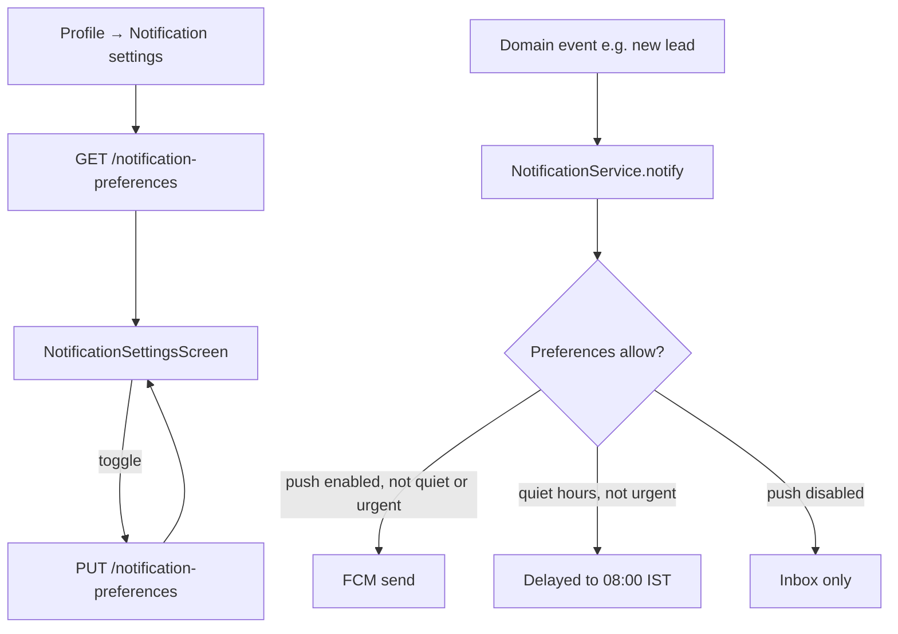

# Module 20 · Teacher Notifications

> **Phase 4 · Teacher** · **Used by:** Teacher (screen); the endpoints are shared and reused by every role via Module 47 · **Depends on:** M00 (NotificationService, device registration); M16 (verification pushes), M37/M38 (lead/demo pushes), M34/M36 (review pushes), M41/M44 (subscription pushes) all call the shared service this module's preferences gate · **New tables:** none · **Uses:** `user_notifications`, `user_notification_preferences`, `user_devices` · **Build estimate:** 2–3 days

## 1. Module Purpose

Owns the one notification-preferences screen and its two endpoints (`GET`/`PUT /notification-preferences`) shared by every role in the app — a parent, student, teacher or institute manager all land on the same screen shape, reading and writing the same `user_notification_preferences` table. This module also documents, for the Teacher role specifically, the full catalogue of alerts a teacher receives (new lead, unanswered-lead reminder, demo reminders, verification updates, review received, subscription expiry) so a developer building any of those triggering modules (M16, M37, M38, M39, M34, M41, M44) knows the exact category, urgency and copy to send through Module 0's `NotificationService`, without redefining the preferences plumbing in each of them.

## 2. User Stories

- As a **teacher**, I want to turn off review-received emails but keep the push, so that my inbox isn't full but my phone still buzzes.
- As a **teacher who just went live**, I want new leads to always reach me immediately, even during my quiet hours, so that I don't lose a family to a faster-responding teacher.
- As a **teacher who forgot to reply to a lead**, I want a gentle reminder a few hours later, so that a busy day doesn't cost me a student.
- As a **parent** (reusing the same screen), I want to mute promotional announcements without missing anything about my child's demo, so that the app doesn't feel noisy.
- As a **teacher who set quiet hours differently for leads than for everything else**, I want that respected, so that only what truly can't wait wakes me up.

## 3. Business Rules & Logic

**BR-20.1 Categories.** The eleven categories are fixed by the `user_notification_preferences.category` enum: `account`, `verification`, `leads`, `demos`, `reviews`, `payments`, `subscription`, `referral`, `complaints`, `recommendations`, `announcements`. `GET /notification-preferences` returns all eleven for the caller's role (a missing row defaults to `pushEnabled: true, emailEnabled: false`, per Module 0 BR-0.7/schema default), each with an optional per-category `quietHoursStart`/`quietHoursEnd` override (null = use the platform default 21:30–08:00 IST, conventions §9). Only categories relevant to the caller's role are shown (e.g. a parent never sees `verification`); for the Teacher role the visible set is `account`, `verification`, `leads`, `demos`, `reviews`, `payments`, `subscription`, `referral`, `complaints`, `announcements` (`recommendations` is learner-only).
**BR-20.2 Locked categories.** `account` and `payments` cannot have push disabled (they carry security/session and money-relevant information); `PUT` with `pushEnabled: false` for either is rejected client-side (the toggle is disabled, greyed, with a lock icon and helper "Security and payment alerts can't be turned off") and, defensively, server-side (`VALIDATION_FAILED`). Email remains toggleable for every category including these two.
**BR-20.3 Save.** `PUT /notification-preferences { items: [{ category, pushEnabled, emailEnabled, quietHoursStart?, quietHoursEnd? }] }` upserts every row in one transaction (`ON CONFLICT (user_id, category) DO UPDATE`); a category omitted from the array is left unchanged (this is a partial upsert, not a replace-set, since the fixed category list never needs deletion). Each row's `updated_at` drives no `If-Match` — a genuine multi-device race here just means "last write wins" on a low-stakes settings screen, so no optimistic-lock friction is added.
**BR-20.4 New lead (urgent, category `leads`).** Sent by Module 37 the moment a lead's `target_type = 'teacher'` row is inserted: `urgent: true` (bypasses quiet hours entirely, conventions §9) since a fast reply materially affects whether the family picks this teacher. Title "New lead!" · body "{requesterFirstName} is looking for a {subject} teacher for {class}." · deep link `gc://teacher/leads/:id`.
**BR-20.5 Unanswered-lead reminder (category `leads`).** A job scans `leads` with `target_type = 'teacher'`, `status IN ('new','viewed')`; sends a non-urgent reminder at `created_at + 6h` (dedupe key `lead_reminder_1:<leadId>`) and again at `created_at + 20h` (`lead_reminder_2:<leadId>`) if still unanswered, then stops (Module 38's own lifecycle closes it at 30 days without further reminders from this rule). Title "Still waiting for your reply" · body "{requesterFirstName}'s enquiry has been open for {n} hours." · deep link `gc://teacher/leads/:id`. Each dedupe key ensures at most one send per milestone even if the job re-runs.
**BR-20.6 Demo reminders (category `demos`).** Sent by Module 38/39's own reminder job 1 hour before `confirmed_start_at` to both the teacher and the requester; documented here for completeness of the teacher's alert catalogue. Title "Demo in 1 hour" · body "Your demo with {requesterFirstName} starts at {time}." · deep link `gc://demos/:id`.
**BR-20.7 Verification updates (category `verification`).** Document approved / re-upload requested / application approved / application rejected — full templates and urgency already specified in Module 16's `@push` table; cross-referenced here as the same category a teacher can (mostly) not disable in practice (push is technically toggleable for `verification` unlike `account`/`payments`, but the app strongly discourages it with a confirmation: "You may miss updates about your application.").
**BR-20.8 Review received (category `reviews`).** Sent by Module 34/36 when a `teacher_reviews` row transitions to `status = 'published'` for this teacher. Non-urgent. Title "New review" · body "{rating}★ — \"{comment, truncated to 60 chars}…\"" · deep link `gc://teacher/reviews/:id`.
**BR-20.9 Subscription / boost expiry (category `subscription`).** For a teacher with an active `is_premium`/`is_featured` period (Module 44 boosts) or an active `subscriptions` row, a job sends reminders at 7, 3 and 1 day(s) before expiry (dedupe key `sub_expiry_<days>:<subscriptionOrBoostId>`), non-urgent. Title "Your {planName} listing expires soon" · body "{n} days left. Renew to keep your premium placement in search." · deep link `gc://plans`.
**BR-20.10 Quiet hours interaction.** For every non-urgent category, Module 0's `NotificationService` (BR-0.7) checks the category's own `quiet_hours_start`/`quiet_hours_end` if set, else the platform default; a push landing inside quiet hours is delayed to the end of the window, never dropped. `urgent: true` (new lead only, among this module's rules) always bypasses quiet hours regardless of category override.

## 4. Screen List

| Screen | Route name | Purpose |
| --- | --- | --- |
| Notification settings | `NotificationSettings` | Per-category push/email toggles, optional quiet hours per category |

## 5. Screen Flow & Navigation



## 6. Screen Wireframe Description

**Notification settings** — header "Notifications"; list of rows, each a category with a one-line description ("Leads — New enquiries and messages"), a push toggle and an email toggle side by side; `account` and `payments` rows show both toggles but push is a locked/disabled switch with a small lock icon; tapping a row's chevron (optional, advanced) reveals "Custom quiet hours for this category" with two time pickers, default "Same as your general quiet hours (9:30 PM–8 AM)"; changes save immediately per toggle (no sticky Save button — this is a settings screen, not a form).

## 7. UI Components & Component Tree

```
NotificationSettingsScreen
├─ CategoryRow({ category, label, description, pushEnabled, emailEnabled, locked, onTogglePush, onToggleEmail })
└─ QuietHoursEditor({ start, end, onChange }) (expandable per row)
```
Hooks: `useNotificationPreferencesQuery()` (`notificationPrefKeys.all`), `useUpdatePreferenceMutation()` (optimistic per-row toggle, rolled back on error).

## 8. Validation Rules

| Field | Rule | Message shown |
| --- | --- | --- |
| category | one of the eleven enum values | — |
| pushEnabled (account, payments) | must be `true` | "Security and payment alerts can't be turned off" |
| quietHoursStart / quietHoursEnd | valid `HH:mm`, both set together or both null | "Set both a start and end time" |

## 9. API Endpoints

| Method | Path | Auth | Description |
| --- | --- | --- | --- |
| GET | /notification-preferences | Any user | Current per-category push/email settings |
| PUT | /notification-preferences | Any user | Update one or more categories |

## 10. Request Payloads

```json
// PUT /notification-preferences
{ "items": [ { "category": "reviews", "pushEnabled": true, "emailEnabled": false },
             { "category": "leads", "pushEnabled": true, "emailEnabled": true, "quietHoursStart": null, "quietHoursEnd": null } ] }
```

## 11. Response Payloads

```json
// 200 GET /notification-preferences
{ "data": { "items": [
  { "category": "leads", "label": "Leads", "description": "New enquiries and messages", "pushEnabled": true, "emailEnabled": true, "locked": false, "quietHoursStart": null, "quietHoursEnd": null },
  { "category": "verification", "label": "Verification", "description": "Application and document updates", "pushEnabled": true, "emailEnabled": false, "locked": false },
  { "category": "payments", "label": "Payments", "description": "Payments and receipts", "pushEnabled": true, "emailEnabled": true, "locked": true } ] } }

// 422 PUT /notification-preferences  (locking violation)
{ "error": { "code": "VALIDATION_FAILED", "message": "Security and payment alerts can't be turned off.", "details": { "path": "items[2].pushEnabled" }, "requestId": "…" } }
```

## 12. PostgreSQL Tables & Columns


**Existing tables this module reads or writes** (full definitions in the owning module)

| Table | Owner | Purpose |
| --- | --- | --- |
| `user_notifications` | App M00 | The in-app notification inbox for every user: transactional events and copies of admin campaigns. |
| `user_notification_preferences` | App M00 | Per-category push/email switches. Missing row = defaults (push on, email off). |
| `user_devices` | App M00 | Every app install a user has signed in on, with its FCM token. One row per (user, install). |

| Column | Written by this module |
| --- | --- |
| `user_notification_preferences.*` | owned outright (upsert per category) |
`user_notifications` (the inbox) and `user_devices` (FCM tokens) are read by Module 0's `NotificationService`/worker when deciding whether and how to deliver; this module never writes them directly — it only supplies the on/off and quiet-hours inputs that service reads before sending.

## 13. Relationships

No database relationships (client-side module).

## 14. State Management

- Query key `notificationPrefKeys.all`; each toggle is an optimistic mutation on its own row (rolled back with a toast on failure), invalidated on success to pick up the server's canonical `locked` flags.
- No Zustand store.

## 15. Offline Handling

- `GET /notification-preferences` is persisted; the screen renders offline with a staleness hint.
- Toggle writes are **queue offline** (conventions §8 class 1 — idempotent, small, safe to replay): a toggle flipped offline is queued and replayed FIFO on reconnect, with the UI showing the optimistic state immediately and a small "pending sync" indicator per row while offline.

## 16. Push Notification Requirements

| Event | Recipient | Title / Body | Deep link | Category | Urgent |
| --- | --- | --- | --- | --- | --- |
| New lead | Teacher | "New lead!" / "{requester} is looking for a {subject} teacher for {class}." | `gc://teacher/leads/:id` | leads | Yes |
| Unanswered-lead reminder (6h, 20h) | Teacher | "Still waiting for your reply" / "{requester}'s enquiry has been open for {n} hours." | `gc://teacher/leads/:id` | leads | No |
| Demo reminder (1h before) | Teacher | "Demo in 1 hour" / "Your demo with {requester} starts at {time}." | `gc://demos/:id` | demos | No |
| Document approved / re-upload / application approved / rejected | Teacher | (see Module 16 §16) | `gc://teacher/verification` | verification | No (approval is urgent — see M16) |
| Review received | Teacher | "New review" / "{rating}★ — \"{comment}…\"" | `gc://teacher/reviews/:id` | reviews | No |
| Subscription/boost expiring (7/3/1 days) | Teacher | "Your {planName} listing expires soon" / "{n} days left. Renew to keep your premium placement." | `gc://plans` | subscription | No |
Every row here is filtered through this module's preferences (BR-20.1–20.3) before Module 0's worker sends it; a category with `pushEnabled: false` still writes the `user_notifications` inbox row (Module 48 still shows it) but skips the FCM send (`push_status = 'skipped_pref'`).

## 17. Security Rules

- `GET`/`PUT /notification-preferences` are scoped to `sub` (the caller's own `app_users.id`); no user can read or change another user's preferences.
- Locked categories (BR-20.2) are enforced server-side even though the client also disables the control, since a modified/old client build must not be able to silence security or payment alerts.
- No PII is included in any push body beyond a first name and non-sensitive counts/subjects (conventions §13 — no full phone numbers, no document numbers).

## 18. Error Handling

| Scenario | Code | HTTP | App behaviour |
| --- | --- | --- | --- |
| Disable push on `account`/`payments` | `VALIDATION_FAILED` | 422 | Toggle snaps back with the lock helper text |
| Only one of quietHoursStart/End set | `VALIDATION_FAILED` | 422 | Inline "Set both a start and end time" |
| Unknown category in payload | `VALIDATION_FAILED` | 422 | Ignored row highlighted, others still saved |
| Network error mid-toggle | `NETWORK_OFFLINE` | — | Optimistic state kept, queued for replay (offline class 1) |

## 19. Testing Scenarios

- T20.1 Toggling `reviews` push off then back on round-trips correctly and the FCM send is skipped/resumed accordingly (integration test against a stubbed `NotificationService`).
- T20.2 Attempting to disable `payments` push is rejected both client-side (button disabled) and server-side (direct API call in the test).
- T20.3 A new lead push is delivered at 11:45 PM IST (inside quiet hours) immediately, because `urgent: true` bypasses quiet hours.
- T20.4 An unanswered-lead reminder at the 6-hour mark is sent exactly once even if the reminder job runs twice in that window (dedupe key asserted).
- T20.5 A teacher with `leads` push disabled still gets the lead in their in-app inbox (Module 48) with `push_status = 'skipped_pref'`.
- T20.6 Custom quiet hours set only on `demos` (e.g. 22:00–06:00) don't affect delivery timing for `leads`.
- T20.7 Toggling a preference while offline updates the UI immediately and replays once reconnected, resulting in exactly one server-side row update (not one per offline toggle if the user flips it twice offline — the queue coalesces to the latest value per category).
- T20.8 A parent opening the same `NotificationSettingsScreen` sees `recommendations` in their list and does not see `verification`, confirming the role-filtered category set (BR-20.1).
- T20.9 Subscription-expiry reminders fire at 7, 3 and 1 days before `featured_until`/`premium_until` and never twice for the same milestone.
- T20.10 Offline: the screen renders cached preferences with a staleness hint; toggles remain interactive (queued), unlike a class-3 online-only screen.

## 20. Audit Log Events

| Event | When | Details |
| --- | --- | --- |
| `app.notification_preference_updated` | Each successful `PUT` row change | category, pushEnabled, emailEnabled |

## 21. Future Scalability Notes

- WhatsApp Business API as a channel for `leads`/`demos` categories once the platform supports it (per Admin M46 §21), reusing the same category/preference model.
- Per-device preferences (mute this specific phone but not a tablet) once multi-device usage is common enough to justify it.
- Smarter default nudging ("Teachers who enable lead push reply 3× faster") shown once during onboarding rather than left to discovery.
- A monthly digest email per category as a lower-frequency alternative to per-event email, once email volume needs it.
