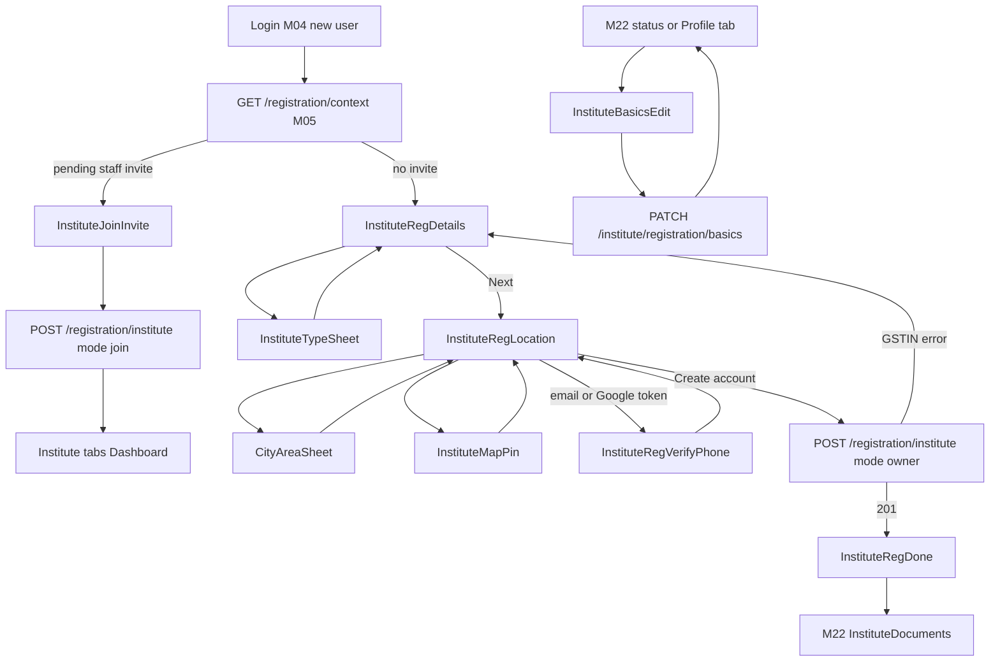
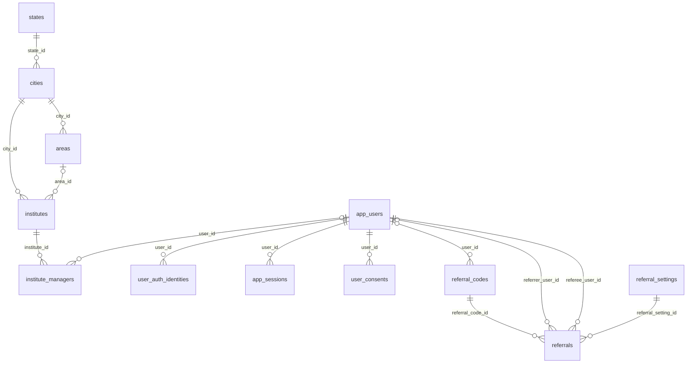

# Module 21 · Institute Registration

> **Phase 5 · Institute** · **Used by:** Institute owner signing up (registration token), invited institute staff joining (registration token), primary manager editing basics before review · **Depends on:** M00, M04, M05, M22 (next step), M24 (staff invites); Admin M09, M10, M22, M25 · **New tables:** none · **Uses:** `app_users`, `institutes`, `institute_managers`, `user_auth_identities`, `app_sessions`, `user_consents`, `referral_codes`, `referrals`, `referral_settings`, `states`, `cities`, `areas`, `audit_logs` · **Build estimate:** 4–5 days

## 1. Module Purpose

Lets the owner of a coaching centre, tuition centre, school or academy create a GuruConnect institute account in two short steps: institute and owner details (Institute Name, Owner Name, Mobile, Email, Institute type, optional GSTIN) and location (address, city, area, PIN code, map pin). One submit creates, in a single database transaction, the owner's `app_users` row (`user_type = 'institute_staff'`), the `institutes` row in `draft`, and the owner's `institute_managers` row as the primary manager, then signs the owner in and sends them to document upload (M22). The same endpoint also lets a person invited by an institute manager (M24) join that institute as a manager or counsellor. Before the application is submitted for review, the primary manager can correct these basics.

## 2. User Stories

- As an **institute owner** in Koramangala, I want to register my coaching centre with its GST number and exact map location so that parents nearby can find it after verification.
- As an **owner without a GST registration** (small tuition centre), I want GST to be optional so that I can still join.
- As an **owner on a patchy 3G connection**, I want my half-filled form to survive the app closing so that I don't retype everything.
- As an **institute counsellor** invited by my manager, I want to sign in with my phone and join the institute in one step so that I can start answering enquiries.
- As an **owner**, I want to fix a typo in the institute name before GuruConnect reviews it so that the listing is right from day one.

## 3. Business Rules & Logic

**BR-21.1 Who can register.** Only a caller holding a registration token (conventions §6) with `role = institute_staff`, issued by M04 after a new phone or email is verified, can call `POST /registration/institute`. One app account has one role and belongs to one institute in v1 (`iid` claim). The person who registers is the **owner**: they become the institute's primary manager (`staff_role = 'manager'`, `is_primary = true`). Ownership can later be transferred only by GuruConnect support (Admin M25 FR-25.5).

**BR-21.2 Owner mobile must be verified.**
- Token issued for a phone → the Mobile field is prefilled and locked.
- Token issued for an email or Google sign-in → the Location step cannot be submitted until the owner verifies a mobile with M04 `POST /auth/otp/request` (`purpose = signup`) and `POST /auth/otp/verify`, sent with the current registration token; M04 returns a new registration token carrying both contacts (M05 shared rule). The email is then already verified.
- The mobile must not belong to any live `app_users` row (`deleted_at IS NULL`); otherwise `409 CONFLICT_DUPLICATE`, `details.reason = "phone_in_use"`.
- The owner mobile is stored in `app_users.phone`, `institute_managers.phone` and, as the institute's official number, `institutes.phone` (editable later only through support, M24 BR-24.6).

**BR-21.3 Steps.**
1. **Institute & owner** — Institute Name, Institute type, Owner Name, Mobile, Email, GSTIN (optional).
2. **Location** — Address, City, Area, PIN code, map pin, terms and privacy consent, optional referral code (field shown only when `GET /registration/context` (M05) reports the `INSTITUTE_REFERRAL` program enabled; it is off at launch).
The draft is saved to encrypted MMKV after every field change (debounced 500 ms) under `draft:instituteRegistration:<tokenSub>` and deleted on success or after 7 days.

**BR-21.4 GSTIN validation (client and server, `isValidGstin(gstin, stateCode)` in packages/shared).**
1. Normalise: trim, remove spaces, upper-case. Empty → stored as NULL.
2. Pattern `^\d{2}[A-Z]{5}\d{4}[A-Z][1-9A-Z]Z[0-9A-Z]$` (15 chars: 2-digit state code, 10-char PAN, entity number, `Z`, check character).
3. Checksum: with the alphabet `0123456789ABCDEFGHIJKLMNOPQRSTUVWXYZ`, for each of the first 14 characters at index `i` (0-based) take `v = indexOf(char)`, `p = v × (i even ? 1 : 2)`, add `floor(p / 36) + (p mod 36)` to `sum`. Check character = alphabet[`(36 − sum mod 36) mod 36`]. It must equal the 15th character. Example: `29AAGCA4321M1ZJ` is valid; `29AAGCA4321M1ZK` fails.
4. The first two digits must equal the GST state code of the selected city's state. `GST_STATE_CODES` in packages/shared maps `states.code` to the GST code (KA → 29, MH → 27, DL → 07, TN → 33, TG → 36, KL → 32, WB → 19, GJ → 24, UP → 09, RJ → 08, AP → 37, and the rest of the official list). Because the city is chosen in step 2, the client re-checks the state match when the city changes and moves the user back to step 1 with the error if it no longer matches.
5. Server only: another live institute (`deleted_at IS NULL`, `verification_status <> 'rejected'`) with the same `gstin` → `409 CONFLICT_DUPLICATE`, `details.reason = "gstin_in_use"`. The other institute's name is never revealed to the app. The GST portal lookup of legal name and address is done later by Admin M22 FR-22.5, not at registration.

**BR-21.5 Location rules.**
- `cityId`: an active city (`cities.is_active`). Cities with `is_serviceable = false` are selectable with a "Launching soon" tag; the institute can register and be verified but is not listed in search (M28) until the city is serviceable.
- `areaId`: required; active and belonging to the city.
- `pincode`: `^[1-9][0-9]{5}$`. Typing a PIN first filters the area list to areas of the city whose `areas.pincodes` contain it and auto-selects when exactly one matches. If the chosen area's `pincodes` is non-empty and does not contain the PIN, the app shows a soft warning ("560095 isn't usually in Koramangala. Please check.") but allows saving; Admin M22 FR-22.5 flags it.
- **Map pin**: required. The pin starts at the area's `latitude/longitude`, else the city's, else Bengaluru centre. The owner drags the map under a fixed centre pin or taps "Use my current location" (foreground permission requested only on that tap, `expo-location`). Stored as `latitude`, `longitude` rounded to 6 decimals. If the city has coordinates, the pin must be within 40 km of them (haversine) → otherwise `VALIDATION_FAILED` "The pin is too far from Bengaluru. Move it to your institute." Maps use `react-native-maps` (Google Maps SDK on Android with the key injected by the Expo config plugin from an EAS secret; Apple Maps on iOS).

**BR-21.6 Owner registration — server steps (`mode = "owner"`), one transaction.**
1. Middleware: registration token valid (`aud gc-register`, `role institute_staff`, not expired, `jti` not yet used — checked in Redis), `Idempotency-Key` present. A repeated key within 24 h returns the stored response.
2. Validate `InstituteRegistrationSchema`; re-check phone uniqueness, GSTIN rules, city/area/PIN, pin distance.
3. `INSERT app_users` (`user_type = 'institute_staff'`, `phone`, `phone_verified_at = now()`, `email`, `email_verified_at` only if the token verified the email, `full_name = ownerName`, `auth_provider` from the token: `otp` / `password` / `google`, `account_status = 'active'`, `preferred_language` from `Accept-Language` (default `en`), `signup_source` per M00 BR-0.13).
4. `INSERT user_auth_identities` for each verified method (M04 rules: `phone` always; `google` or `password` when used).
5. `INSERT institutes` (`name`, `slug` per BR-21.7, `institute_type`, `phone = owner mobile`, `email`, `gstin`, `address_line`, `city_id`, `area_id`, `pincode`, `latitude`, `longitude`, `verification_status = 'draft'`, `account_status = 'active'`). `public_code` comes from the sequence (`GC-I2143`).
6. `INSERT institute_managers` (`institute_id`, `user_id`, `full_name`, `email`, `phone`, `designation = 'Owner'`, `staff_role = 'manager'`, `is_primary = true`, `status = 'active'`, `invited_at = NULL`, `accepted_at = now()`).
7. `INSERT user_consents` two rows (`terms`, `privacy_policy`; `granted = true`, `method = 'checkbox'`, `document_version` from the request, IP, install id).
8. Referral (only if a valid code was sent and the program is enabled): `INSERT referrals` (`status = 'pending'`), qualifying event `institute_approved` (M46 / Admin M42).
9. Create the session (M04 service: `app_sessions` row, refresh token) and `INSERT audit_logs` `app.institute_registered`.
10. Commit; mark the token `jti` used; send the welcome email if an email exists. The response carries the tokens and `nextStep = "institute_documents"`.
Any failure rolls everything back — there are never half-created institutes.

**BR-21.7 Slug.** `slugify(name + " " + areaName)` (lower-case, ASCII, hyphens, max 80 chars), e.g. `apex-jee-academy-koramangala`. On collision append `-2`, `-3` … (checked against `uq_institutes_slug`). The slug is fixed at registration; a name change before submission regenerates it; after approval only admins change it.

**BR-21.8 Join as invited staff (`mode = "join"`).** `GET /registration/context` (M05) lists pending invites for the token's phone (from `institute_managers` with `status = 'invited'`, `user_id IS NULL`, same `phone`). The person sees "Join Apex JEE Academy as Counsellor" and submits `{ mode: "join", inviteId, fullName, consents }`. Checks: invite exists, still `invited`, `invited_at` within 72 h (else `CONFLICT_STATE`, `details.reason = "invite_expired"` — the manager can resend, M24 BR-24.3), phone equals the token phone, institute not deleted and `account_status = 'active'`. Transaction: `INSERT app_users` (as step 3, `full_name = fullName`), identities, consents, then `UPDATE institute_managers SET user_id, full_name, status = 'active', accepted_at = now()`, session, audit `app.institute_staff_joined`. After commit M24's "staff joined" push goes to the inviting manager and the primary manager. `nextStep = null` (staff land on the Dashboard tab).

**BR-21.9 Editing basics before review.** `PATCH /institute/registration/basics` (If-Match = `institutes.updated_at`), caller must be an active `manager` of the institute. Allowed while `verification_status` is `draft` or `docs_requested`, or `rejected` with `rejected_at` ≥ 30 days ago (the first edit moves `rejected → draft`, clearing `rejection_reason_code` and `rejection_note`, and writes nothing to the verification log). In `pending`, `under_review`, `visit_scheduled` and `evaluation_done` → `CONFLICT_STATE`, `details.reason = "in_review"`; after `approved` → `CONFLICT_STATE`, `details.reason = "approved_use_profile"` (M24 handles profile edits and support requests). Editable fields: name, instituteType, ownerName (updates `app_users.full_name` and the primary's `institute_managers.full_name`), email (institute email only; account email changes go through M51), gstin, address, city, area, pincode, pin. The owner mobile is not editable here. Changing the city clears the area and requires a new pin; changing the name regenerates the slug (BR-21.7).

**BR-21.10 After success.** The app stores the tokens (M04), invalidates `meKeys.me`, clears the draft, shows the push pre-permission sheet ("Get notified when your institute is verified", conventions §9), then opens M22 Documents. `GET /me` for institute staff returns `institute { id, name, staffRole, isPrimary, verificationStatus }` and `registration.nextStep` = `institute_documents` (draft, required documents missing), `institute_submit` (documents complete, not submitted) or `null`. Splash (M01 BR-1.5) resumes at that step.

**BR-21.11 Abuse limits.** `POST /registration/institute` is limited to 5 calls per hour per install and 2 successful owner registrations per install per 30 days (`LIMIT_REACHED`, `details.reason = "install_registrations"`). Duplicate detection across GSTIN, registration number and phone happens again in Admin M22 FR-22.5.

## 4. Screen List

| Screen | Route name | Purpose |
| --- | --- | --- |
| Institute & owner details | `InstituteRegDetails` | Step 1 of 2: name, type, owner name, mobile, email, GSTIN |
| Institute type sheet | `InstituteTypeSheet` (bottom sheet) | Pick one of the 8 institute types |
| Location | `InstituteRegLocation` | Step 2 of 2: address, city, area, PIN, pin preview, consent, create account |
| City / area picker | `CityAreaSheet` (bottom sheet) | Searchable list of cities, then areas of the city |
| Map pin picker | `InstituteMapPin` (modal) | Full-screen map with fixed centre pin |
| Verify mobile | `InstituteRegVerifyPhone` | Only for email/Google sign-ups: phone OTP (M04 components) |
| Join institute | `InstituteJoinInvite` | Invited staff: confirm name, accept terms, join |
| Registration done | `InstituteRegDone` | Success, then documents |
| Edit registration details | `InstituteBasicsEdit` | Same fields, before submission or after docs are requested |

## 5. Screen Flow & Navigation


Back from Location returns to Details with values kept; back from Details asks "Leave registration? Your details are saved on this phone." and returns to Login. `InstituteRegDone` replaces the registration stack, so back never returns to the form.

## 6. Screen Wireframe Description

**InstituteRegDetails** — header "Register your institute", progress "Step 1 of 2" bar. Fields top to bottom:
- "Institute name" — placeholder "e.g. Apex JEE Academy", default keyboard, auto-capitalise words, counter 0/120.
- "Institute type" — select field showing "Choose type" → opens InstituteTypeSheet (radio list: Coaching centre · Tuition centre · School · Music school · Coding academy · Language institute · Sports academy · Other, each with a one-line hint, e.g. "Coaching centre — JEE, NEET, board exam coaching").
- "Owner name" — placeholder "e.g. Suresh Menon", helper "The person responsible for this institute".
- "Mobile" — `PhoneField` "+91 98450 12345"; locked with a green "Verified" tick when the token is a phone; otherwise editable with helper "We'll verify this number on the next step".
- "Email" — placeholder "e.g. contact@apexjee.in", email keyboard, lower-cased.
- "GSTIN (optional)" — placeholder "e.g. 29AAGCA4321M1ZJ", `autoCapitalize="characters"`, max 15, live check icon; helper "Skip if your institute isn't GST registered".
Sticky bar: "Next" (disabled until required fields are valid).

**InstituteRegLocation** — header "Where is your institute?", "Step 2 of 2".
- "Address" — multiline 2 rows, placeholder "e.g. 3rd Floor, 80 Feet Road, 6th Block", counter 0/200.
- "City" — select "Choose city" → CityAreaSheet (search box "Search city", list "Bengaluru, Karnataka"; non-serviceable cities show a "Launching soon" chip).
- "Area" — select "Choose area" (disabled until city) → areas list with search.
- "PIN code" — number pad, 6 digits, placeholder "560034"; soft warning line under the field when it doesn't match the area.
- Map preview card 160 dp high with the pin and caption "Koramangala, Bengaluru"; button "Set exact location" (or "Adjust pin" once set) → InstituteMapPin.
- Checkbox "I agree to the Terms and Privacy Policy" (links open in-app browser).
- "Referral code (optional)" — shown only when the program is on.
Sticky bar: "Create institute account" (loading "Creating…"). Offline: button disabled with hint "Connect to the internet to create your account."

**InstituteMapPin** — full-screen map, fixed pin in the centre with the shadow lifting while dragging, top search-free header "Move the map to your entrance", floating button (bottom-right) "Use my current location", bottom card with "Lat 12.935200, Long 77.624500" in small text and primary "Confirm location". If location permission is denied: toast "Location is off. Move the map to set the pin."

**InstituteRegVerifyPhone** — heading "Verify your mobile", body "We sent a 6-digit code to +91 98450 12345", `OtpInput` with autofill, "Resend in 0:30", button "Verify". Secure screen (FLAG_SECURE).

**InstituteJoinInvite** — institute logo (or initials avatar), heading "Join Apex JEE Academy", sub-text "Suresh Menon invited you as Counsellor", field "Your name" prefilled from the invite ("Kavita Rao"), terms checkbox, sticky "Join institute". Expired invite state: clock icon, "This invite has expired", body "Ask Suresh Menon to send it again.", button "Back to sign in".

**InstituteRegDone** — check illustration, heading "Apex JEE Academy is registered", body "Next, upload your registration certificate, PAN or GST certificate, owner Aadhaar and at least 6 campus photos. Verification usually takes 5 working days.", code line "Institute ID GC-I2143", primary "Upload documents", text button "I'll do it later" (goes to Dashboard, which shows the verification card).

**InstituteBasicsEdit** — header "Edit registration details", same fields in one scroll view grouped "Institute", "Owner", "Location"; the mobile shows read-only. Banner at top when status is `docs_requested`: "GuruConnect asked for changes. Update details and documents, then send for review." Sticky "Save changes". Locked state (in review): read-only fields with banner "Details can't be changed while GuruConnect reviews your application."

## 7. UI Components & Component Tree

```
RegistrationStack (M05)
├─ InstituteRegDetailsScreen
│  ├─ StepHeader (step 1 of 2)
│  ├─ TextField name · SelectField type → InstituteTypeSheet
│  ├─ TextField ownerName · PhoneField mobile (locked | editable)
│  ├─ TextField email · GstinField
│  └─ StickyActionBar "Next"
├─ InstituteRegLocationScreen
│  ├─ TextField address (multiline)
│  ├─ SelectField city → CityAreaSheet · SelectField area → CityAreaSheet
│  ├─ PincodeField (+ PinAreaHint)
│  ├─ MapPreviewCard → InstituteMapPinModal
│  ├─ ConsentCheckbox · ReferralCodeField (conditional)
│  └─ StickyActionBar "Create institute account"
├─ InstituteRegVerifyPhoneScreen (OtpInput from M04)
├─ InstituteJoinInviteScreen
└─ InstituteRegDoneScreen
InstituteBasicsEditScreen (Institute Profile stack)
```
- `GstinField({ value, onChange, stateCode, error })` — upper-cases, shows ✓ when `isValidGstin` passes, inline messages from the validation table.
- `PincodeField({ cityId, value, onChange, onAreaMatch })` — uses `useAreas(cityId)` to suggest the area.
- `MapPreviewCard({ lat, lng, label, onEdit })` and `InstituteMapPinModal({ initial, cityCentre, onConfirm })` — `react-native-maps` `MapView` with `onRegionChangeComplete`; distance check against the city centre done client-side too.
- `CityAreaSheet({ mode: 'city' | 'area', cityId, onSelect })` — uses `useMasters()` and `useAreas(cityId)` (M00).
- Hooks: `useInstituteRegDraft()` (Zustand + MMKV), `useRegistrationContext()` (M05), `useRegisterInstituteMutation()`, `useJoinInstituteMutation()`, `useUpdateInstituteBasicsMutation()`, `useInstituteProfileQuery()` (M24, to prefill the edit screen).

## 8. Validation Rules

Shared schemas in packages/shared: `InstituteRegistrationSchema` (owner mode), `InstituteJoinSchema`, `InstituteBasicsPatchSchema` (all fields optional, same rules), `isValidGstin()`.

| Field | Rule | Message shown |
| --- | --- | --- |
| instituteName | 3–120 chars after trim; letters, digits, spaces and `. , & ' ( ) - /`; not only digits | "Enter your institute's name (3–120 characters)." |
| instituteType | one of coaching_centre, tuition_centre, school, music_school, coding_academy, language_institute, sports_academy, other | "Choose the type of institute." |
| ownerName | 2–100 chars; letters, spaces, `. ' -` | "Enter the owner's full name." |
| mobile | `+91` and 10 digits starting 6–9 | "Enter a valid 10-digit mobile number." |
| mobile (server) | not used by a live account; verified in the registration token | "This number already has a GuruConnect account. Sign in instead." |
| email | valid email, ≤ 254 chars, stored lower-case | "Enter a valid email address." |
| gstin | optional; BR-21.4 pattern | "Enter a valid 15-character GSTIN." |
| gstin checksum | BR-21.4 step 3 | "This GSTIN doesn't look right. Check the last character." |
| gstin state | first 2 digits = GST code of the city's state | "This GSTIN is registered in another state." |
| gstin (server) | not used by another live institute | "This GSTIN is already registered on GuruConnect. Contact support if this is your institute." |
| addressLine | 5–200 chars | "Enter the full address (at least 5 characters)." |
| cityId | active city | "Choose your city." |
| areaId | active area in the city | "Choose your area." |
| pincode | `^[1-9][0-9]{5}$` | "Enter a 6-digit PIN code." |
| latitude / longitude | −90…90 / −180…180, 6 decimals, both present, ≤ 40 km from city centre | "Set your institute's location on the map." / "The pin is too far from Bengaluru. Move it to your institute." |
| consents.terms / consents.privacy | must be true; `documentVersion` non-empty | "Please accept the Terms and Privacy Policy." |
| referralCode | optional, 4–20 chars `[A-Z0-9]`, validated by M05 | "This referral code isn't valid." |
| inviteId (join) | uuid of a pending invite for this phone | "This invite is no longer valid." |
| fullName (join) | 2–100 chars as ownerName | "Enter your full name." |

## 9. API Endpoints

| Method | Path | Auth | Description |
| --- | --- | --- | --- |
| POST | /registration/institute | Registration token | `mode = owner`: create owner account + draft institute + primary manager in one transaction; `mode = join`: accept a staff invite. Returns session tokens (Idempotency-Key). 5/hour per install |
| PATCH | /institute/registration/basics | Institute staff (manager) | Edit registration details while `draft`, `docs_requested` or re-applying after rejection (If-Match). 30/hour |

Uses: M05 `GET /registration/context`, `POST /registration/referral/validate`; M04 `POST /auth/otp/request`, `POST /auth/otp/verify`; M00 `GET /masters`, `GET /masters/areas`; M24 `GET /institute/profile` (prefill for editing).

## 10. Request Payloads

```json
// POST /registration/institute   (Authorization: Bearer <registrationToken>, Idempotency-Key: 2b7c…)
{ "mode": "owner",
  "institute": { "name": "Apex JEE Academy", "instituteType": "coaching_centre", "email": "contact@apexjee.in", "gstin": "29AAGCA4321M1ZJ",
                 "addressLine": "3rd Floor, 80 Feet Road, 6th Block", "cityId": "5b1e…blr", "areaId": "9c2d…kor", "pincode": "560034",
                 "latitude": 12.935214, "longitude": 77.624481 },
  "owner": { "fullName": "Suresh Menon", "mobile": "+919845012345" },
  "consents": { "terms": true, "privacy": true, "documentVersion": "2026-09" },
  "referralCode": null }

// POST /registration/institute   (join mode)
{ "mode": "join", "inviteId": "e41a…", "fullName": "Kavita Rao", "consents": { "terms": true, "privacy": true, "documentVersion": "2026-09" } }

// PATCH /institute/registration/basics   (If-Match: "2026-09-26T09:41:07.412Z")
{ "name": "Apex JEE & NEET Academy", "gstin": null, "pincode": "560095" }
```

## 11. Response Payloads

```json
// 201 POST /registration/institute (owner)
{ "data": {
  "session": { "accessToken": "eyJhbGciOiJSUzI1NiIs…", "expiresIn": 900, "refreshToken": "q8V…", "sessionId": "…" },
  "user": { "id": "…", "role": "institute_staff", "profileId": "…managerId…", "fullName": "Suresh Menon" },
  "institute": { "id": "…", "publicCode": "GC-I2143", "slug": "apex-jee-academy-koramangala", "name": "Apex JEE Academy", "verificationStatus": "draft",
                 "staffRole": "manager", "isPrimary": true },
  "nextStep": "institute_documents" } }

// 201 POST /registration/institute (join)
{ "data": { "session": { "accessToken": "…", "expiresIn": 900, "refreshToken": "…", "sessionId": "…" },
  "user": { "id": "…", "role": "institute_staff", "profileId": "…", "fullName": "Kavita Rao" },
  "institute": { "id": "…", "name": "Apex JEE Academy", "verificationStatus": "approved", "staffRole": "counsellor", "isPrimary": false }, "nextStep": null } }

// 200 PATCH /institute/registration/basics
{ "data": { "id": "…", "name": "Apex JEE & NEET Academy", "slug": "apex-jee-neet-academy-koramangala", "gstin": null, "pincode": "560095",
            "verificationStatus": "docs_requested", "updatedAt": "2026-09-26T10:02:55.120Z" } }

// 422 GSTIN in another state
{ "error": { "code": "VALIDATION_FAILED", "message": "Please check the highlighted fields.",
  "details": [ { "path": "institute.gstin", "message": "This GSTIN is registered in another state." } ], "requestId": "…" } }

// 409 GSTIN already used
{ "error": { "code": "CONFLICT_DUPLICATE", "message": "This GSTIN is already registered on GuruConnect. Contact support if this is your institute.",
  "details": { "reason": "gstin_in_use", "path": "institute.gstin" }, "requestId": "…" } }
```

## 12. PostgreSQL Tables & Columns


**Existing tables this module reads or writes** (full definitions in the owning module)

| Table | Owner | Purpose |
| --- | --- | --- |
| `app_users` | Admin M00 | Login identity for every mobile app account (parent, student, teacher, institute staff). Role profiles hang off this table. |
| `institutes` | Admin M22 | Coaching centres, tuition centres, schools and academies. Rated by GuruConnect after verification. |
| `institute_managers` | Admin M25 | App accounts that act for an institute. Exactly one active primary manager; counsellors can only handle leads. |
| `user_auth_identities` | App M04 | Sign-in methods linked to an account: phone OTP, email + password, Google. |
| `app_sessions` | App M04 | Refresh-token sessions for app users, one per signed-in install. Refresh tokens rotate on every use. |
| `user_consents` | App M52 | Record of every consent given or withdrawn (terms, privacy policy, parental consent, marketing), as required by the DPDP Act 2023. |
| `referral_codes` | Admin M42 | One personal referral code per app user. |
| `referrals` | Admin M42 | One row per referred user, tracking qualification, fraud checks and reward payout. |
| `referral_settings` | Admin M06 | Versioned rules for each referral program. One active version per program. |
| `states` | Admin M08 | States and union territories within a country. |
| `cities` | Admin M09 | Cities where teachers and institutes can be listed. |
| `areas` | Admin M10 | Localities within a city, used for "nearby" search and teacher coverage. |
| `audit_logs` | Admin M00 | Append-only record of every admin action and security event. Never updated or deleted by the application. |

- `app_users`: one row per owner or joining staff member, `user_type = 'institute_staff'`.
- `institutes`: created in `draft` with the basics; `phone` = owner mobile; `slug`, `public_code` generated; `latitude/longitude` from the pin. Other profile columns (about, logo, facilities, capacity, fees) are filled later in M24.
- `institute_managers`: owner row `staff_role = 'manager'`, `is_primary = true`, `status = 'active'`, `designation = 'Owner'`; join mode updates the invited row (`user_id`, `status = 'active'`, `accepted_at`). The unique index `uq_institute_managers_primary` guarantees one live primary.
- `user_consents`, `user_auth_identities`, `app_sessions`, `referrals`: written through the shared M04/M05 services inside the same transaction.
- `states.code` is read to find the GST state code for the GSTIN check.

## 13. Relationships


**Entity relationship diagram** (tables this module uses; `admins` omitted)



## 14. State Management

- `useInstituteRegDraft` (Zustand + encrypted MMKV): `{ step, details: { name, instituteType, ownerName, mobile, email, gstin }, location: { addressLine, cityId, areaId, pincode, latitude, longitude }, referralCode, updatedAt, setDetails(), setLocation(), clear() }`.
- Query keys: `registrationKeys.context`, `mastersKeys.all`, `mastersKeys.areas(cityId)`, `instituteKeys.profile` (M24), `meKeys.me`.
- After `useRegisterInstituteMutation` / `useJoinInstituteMutation` success: `useSession.setTokens()`, invalidate `meKeys.me`, clear the draft, reset navigation to the institute stack.
- After `useUpdateInstituteBasicsMutation`: invalidate `instituteKeys.profile`, `instituteKeys.verification`, `meKeys.me`. No optimistic updates (server regenerates the slug).

## 15. Offline Handling

- Masters and areas come from the M00 cache, so both steps can be filled offline.
- Class 2 (save draft, submit online): the form draft survives restarts; "Create institute account", "Join institute" and "Save changes" are disabled offline with the hint "Connect to the internet to continue."
- The map needs network for tiles; offline, the map preview shows "Map needs internet" and the pin can be set when back online.
- If the registration token expired while the user was offline (30 min), submit returns `AUTH_REQUIRED` with `details.reason = "registration_token_expired"`; the app goes to Login with "Please verify your number again to finish." and restores the draft afterwards.

## 16. Push Notification Requirements

| Event | Recipient | Title / Body | Deep link | Category | Urgent |
| --- | --- | --- | --- | --- | --- |
| Draft not submitted 24 h, 72 h, 7 days after registration | Primary manager | "Finish verifying Apex JEE Academy" / "Upload your documents so parents can find you." | `/institute/documents` | verification | No |
| Invited staff joined (sent by this module, template owned by M24) | Inviter and primary manager | "Kavita Rao joined your team" / "They can now answer enquiries as Counsellor." | `/institute/staff` | account | No |

Registration itself sends no push (the device is registered only after sign-in); the owner gets a welcome email when an email is present. Reminders stop as soon as the institute leaves `draft`.

## 17. Security Rules

- The registration token is single-use (`jti` stored in Redis for its lifetime) and only valid for `/registration/*` and M04 OTP calls.
- The account is created only on successful submit; no pre-created rows can be hijacked.
- Server never trusts `mobile` from the body when the token carries a phone: the token's phone is used.
- The GSTIN duplicate message never reveals the other institute; lookups are exact-match and rate limited with the endpoint.
- Join mode: invite must match the token's phone exactly; invite ids are uuids and never guessable; expired or disabled invites are rejected.
- `PATCH /institute/registration/basics` checks `institute_managers.staff_role = 'manager'` and `status = 'active'` for the token's `pid` and `iid`; counsellors get `FORBIDDEN`.
- No PII in analytics: events `institute_reg_step_completed { step }`, `institute_reg_submitted { instituteType, hasGstin }`.

## 18. Error Handling

| Scenario | Code | HTTP | App behaviour |
| --- | --- | --- | --- |
| Invalid field (incl. GSTIN format, checksum, state) | `VALIDATION_FAILED` | 422 | Map `details[].path` to the field; GSTIN errors jump back to step 1 |
| Mobile already has an account | `CONFLICT_DUPLICATE` (`phone_in_use`) | 409 | Sheet "This number already has an account" with "Sign in" |
| GSTIN used by another institute | `CONFLICT_DUPLICATE` (`gstin_in_use`) | 409 | Inline under GSTIN + "Contact support" link (M53) |
| Registration token expired | `AUTH_REQUIRED` (`registration_token_expired`) | 401 | Login with "Please verify your number again to finish."; draft kept |
| Staff invite expired | `CONFLICT_STATE` (`invite_expired`) | 409 | Expired invite state on InstituteJoinInvite |
| Edit basics while in review / approved | `CONFLICT_STATE` (`in_review` / `approved_use_profile`) | 409 | Read-only screen with the banner; refetch |
| Stale edit | `VERSION_CONFLICT` | 409 | "Updated on another device. Review and save again." and reload values |
| Counsellor edits basics | `FORBIDDEN` | 403 | Toast "Only a manager can change these details." |
| Too many registrations from this phone | `LIMIT_REACHED` (`install_registrations`) | 429 | "You've registered the maximum number of institutes from this phone. Contact support." |
| Too many attempts | `RATE_LIMITED` | 429 | Disable the button until `Retry-After` |
| Network / 5xx | `GATEWAY_ERROR` / `INTERNAL_ERROR` | 502 / 500 | Retry button; form values kept |

## 19. Testing Scenarios

- T21.1 Happy path (Maestro `institute_registration_happy`): phone OTP → both steps → pin set → account created; DB has one `app_users` (`institute_staff`), one `institutes` (`draft`), one `institute_managers` (`manager`, primary, active); lands on M22 Documents.
- T21.2 Same `Idempotency-Key` sent twice (double tap / retry after timeout) → one set of rows; second call returns the same 201 body.
- T21.3 GSTIN `29AAGCA4321M1ZJ` with a Bengaluru city passes; `29AAGCA4321M1ZK` fails checksum; `27AAPFU0939F1ZV` with Bengaluru fails the state check.
- T21.4 GSTIN of an existing approved institute → 409 `gstin_in_use`; message contains no institute name.
- T21.5 GSTIN left empty → stored NULL; registration succeeds.
- T21.6 PIN 560095 with area Koramangala (pincodes 560034, 560095) → no warning; PIN 560001 → soft warning but save succeeds.
- T21.7 Pin 55 km from Bengaluru centre → 422 on the pin; moving it inside 40 km succeeds.
- T21.8 Google sign-up: Location step requires phone OTP; after verification the new token carries both contacts and the account has `email_verified_at` set.
- T21.9 Kill the app on step 2 → relaunch → draft restored with all fields; after success the draft is gone.
- T21.10 Registration token older than 30 min → `AUTH_REQUIRED`; after re-login the draft is restored and submit works.
- T21.11 Join mode: invite created 2 h ago → account created and `institute_managers.status = 'active'`, `user_id` set; inviter receives the "joined your team" push. Invite 80 h old → `invite_expired`.
- T21.12 Force a failure after the `institutes` insert (test hook) → no `app_users`, `institutes` or `institute_managers` row remains.
- T21.13 PATCH basics in `docs_requested` succeeds and regenerates the slug; in `pending` → `in_review`; from a counsellor → `FORBIDDEN`; with an old If-Match → `VERSION_CONFLICT`.
- T21.14 Rejected 31 days ago: PATCH basics moves the institute to `draft`; rejected 10 days ago → `CONFLICT_STATE`.

## 20. Audit Log Events

| Event | When | Details |
| --- | --- | --- |
| `app.institute_registered` | Owner registration committed | institute id, public code, type, city, hasGstin, signup source |
| `app.institute_staff_joined` | Invited staff accepted via join mode | institute id, staff id, staff role |
| `app.institute_basics_updated` | PATCH basics saved | changed field names with old/new values (GSTIN stored masked to last 4) |
| `app.institute_reapplied` | First edit after a rejection moved the status to `draft` | previous rejection reason code |

## 21. Future Scalability Notes

- GST portal (GSTN public API) lookup during registration to prefill the legal name and address and warn on mismatch.
- Google Places autocomplete for the address with automatic pin placement.
- Branches: a `parent_institute_id` so chains register several centres under one owner account.
- Owner identity through DigiLocker e-KYC instead of an uploaded Aadhaar image.
- Allow one person to belong to several institutes (institute switcher in the app) by moving `iid` from the token into a selected-institute header.
- Admin portal additions: none; registrations appear in Admin M22's queue once submitted, and drafts are visible in the Admin M24 directory with status `draft`.
