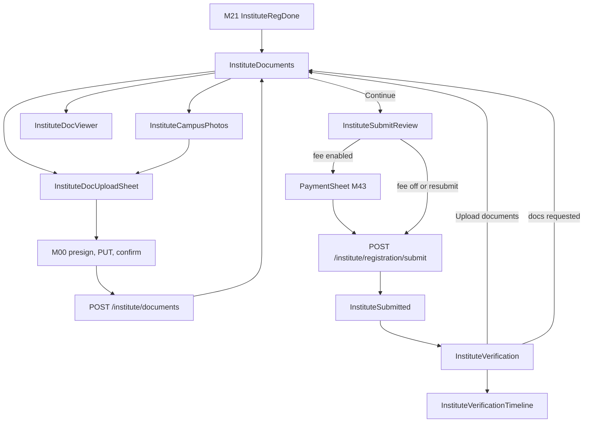
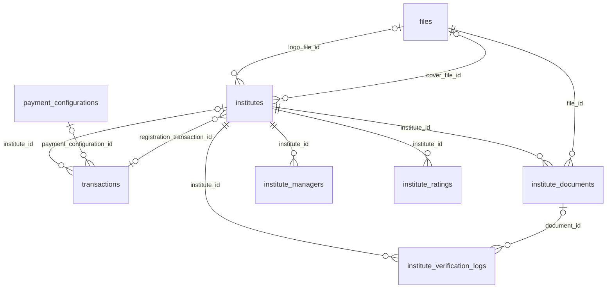

# Module 22 · Institute Verification

> **Phase 5 · Institute** · **Used by:** Institute managers (upload, pay, submit), counsellors (view status only) · **Depends on:** M00 (uploads), M21, M43 (registration fee), M53 (support); Admin M05, M22, M23, M27, M40 · **New tables:** none · **Uses:** `institutes`, `institute_documents`, `institute_verification_logs`, `institute_managers`, `files`, `transactions`, `payment_configurations`, `institute_ratings`, `audit_logs` · **Build estimate:** 4–5 days

## 1. Module Purpose

Takes a registered institute from `draft` to a GuruConnect decision. Managers upload the required documents (registration certificate, PAN or GST certificate, owner Aadhaar, at least 6 campus photos) to the private R2 bucket, pay the `INSTITUTE_REGISTRATION` fee through M43 when that fee is enabled, and submit the application. The module then shows where the application is — every `institutes.verification_status` value including `docs_requested`, `visit_scheduled` and `evaluation_done` — with a manager-visible timeline from `institute_verification_logs`, re-upload requests with admin notes, evaluation visit details, and the approval or rejection outcome. Counsellors see the status but not the documents.

## 2. User Stories

- As an **institute manager**, I want a checklist that shows exactly which documents are missing so that I can submit in one sitting.
- As a **manager**, I want to photograph the registration certificate with my phone camera so that I don't need a scanner.
- As a **manager**, I want to know the date and time of the evaluation visit and what to prepare so that the campus is ready.
- As a **manager whose certificate was cut off**, I want to see the reviewer's note and re-upload only that document so that my application moves again quickly.
- As an **institute counsellor**, I want to see whether we're verified yet so that I can answer parents who ask.

## 3. Business Rules & Logic

**BR-22.1 Status machine (`institutes.verification_status`) as seen in the app.**

| Status | Set by | App title | What managers can do |
| --- | --- | --- | --- |
| `draft` | M21 registration; re-apply after rejection | "Finish your application" | Upload, replace, delete documents; edit basics (M21); pay; submit |
| `pending` | This module on submit / resubmit | "Submitted — waiting for review" | View only |
| `under_review` | Admin M22 opens the case | "Documents are being checked" | View only |
| `docs_requested` | Admin M22 FR-22.4 | "Action needed: update documents" | Re-upload flagged documents, edit basics, resubmit |
| `visit_scheduled` | Admin M23 FR-23.1 | "Evaluation visit on Tue, 29 Sep · 11:00 AM" | View visit details; contact support to reschedule |
| `evaluation_done` | Admin M27 rating submitted | "Evaluation complete — decision within 2 working days" | View only |
| `approved` | Admin M23 FR-23.3 | "Verified" | Add/replace campus photos, fire NOC, other documents |
| `rejected` | Admin M23 FR-23.4 | "Application not approved" | Read reason; re-apply after 30 days (M21 BR-21.9 / BR-22.4) |

Allowed app transitions: `draft → pending` (submit), `docs_requested → pending` (resubmit), `rejected → draft` (first edit or upload once `rejected_at + 30 days ≤ now`). All other transitions belong to Admin M22/M23/M27. SLA copy shown: "Documents are usually checked within 48 hours; the full decision takes about 5 working days."

**BR-22.2 Required and optional documents (`institute_documents.doc_type`).**

| Type | Required | Count (current rows) | Extra input | Stored |
| --- | --- | --- | --- | --- |
| `registration_certificate` | Yes | 1 | "Registration number" 4–40 chars `[A-Za-z0-9/-]` | `institutes.registration_number` |
| `pan` | Yes, unless `gst_certificate` is uploaded | 1 | "PAN" `^[A-Z]{5}[0-9]{4}[A-Z]$` | `doc_number_masked` = first 3 + `XXXXX` + last 2, e.g. `AAGXXXXX1M` |
| `gst_certificate` | Yes, unless `pan` is uploaded | 1 | none; requires `institutes.gstin` (the app asks for it and saves it through M21 PATCH basics first) | — |
| `manager_aadhaar` | Yes | 1 (front side, number visible) | "Last 4 digits of Aadhaar" `^\d{4}$` | `doc_number_masked` = `XXXX XXXX 4821` |
| `campus_photo` | Yes | 6–20, images only | "Caption" 2–60 chars, e.g. "Classroom A", "Test hall", "Entrance" | `caption` |
| `fire_safety_noc` | No | 0–1 | none | — |
| `other` | No | 0–3 | "What is this?" 2–60 chars | `caption` |
The full PAN and Aadhaar numbers are never sent to or stored by the server; the app sends only the masked form it builds locally. Admins read numbers from the image (Admin M22 unmask permission).

**BR-22.3 Upload and link.**
1. App compresses images (conventions §10), then M00 `POST /uploads/presign { purpose: "institute_document" }` → PUT to `gc-private` → `POST /uploads/:fileId/confirm`.
2. `POST /institute/documents { fileId, docType, caption?, docNumberMasked?, registrationNumber?, replaceDocumentId? }` (Idempotency-Key). Server checks: caller is an active manager of `iid`; the file was uploaded by the caller, has purpose `institute_document`, is confirmed and not linked to another document; type-specific inputs (BR-22.2); status allows uploads (BR-22.4); count limits.
3. Versioning in one transaction: for single-slot types the current row of that type → `is_current = false`, new row `version = old.version + 1`, `status = 'submitted'`. For `campus_photo` and `other`, `replaceDocumentId` points at the row being replaced (same rule); without it a new slot starts at `version = 1`.
4. `registration_certificate` also updates `institutes.registration_number`.
5. Campus photos stay private; when admins publish the gallery (Admin M24 FR-24.7) the worker copies approved photos to `gc-public` as `institute_gallery` files.

**BR-22.4 When uploads are allowed.** `draft` and `docs_requested`: any type. `approved`: only `campus_photo`, `fire_safety_noc`, `other` (new rows start `submitted` and are reviewed in Admin M22; they don't change the status). `rejected`: only after 30 days; the first upload moves the institute to `draft` (same as M21 BR-21.9). `pending`, `under_review`, `visit_scheduled`, `evaluation_done` → `CONFLICT_STATE`, `details.reason = "in_review"`. In `docs_requested`, documents whose current row is `approved` cannot be replaced (`CONFLICT_STATE`, `details.reason = "already_approved"`). Max 30 uploads per institute per day (`LIMIT_REACHED`, `details.reason = "document_uploads_daily"`).

**BR-22.5 Delete.** `DELETE /institute/documents/:id` only for a current row with `status = 'submitted'` and `reviewed_at IS NULL`, while the institute is `draft` or `docs_requested`. The row is removed, its file marked `deleted` (object removed by the M00 cleanup job), and the previous version of that slot (if any) becomes current again. Reviewed documents are never deleted — they are replaced.

**BR-22.6 Registration fee (M43).** The fee is resolved with Admin M05 `resolveFee('INSTITUTE_REGISTRATION')` (launch placeholder ₹2,999/year, GST inclusive). It is **required** when the resolved version `is_enabled` and the institute is submitting from `draft` and has no qualifying payment. A qualifying payment is a `transactions` row with `purpose = 'institute_registration'`, `institute_id = iid`, `status = 'captured'` and `refunded_amount_paise = 0`, referenced by `institutes.registration_transaction_id`. Flow:
1. Review screen shows the price from M43 `GET /payments/quote?feeCode=INSTITUTE_REGISTRATION` and the button "Pay ₹2,999 & submit".
2. M43 `POST /payments/orders { feeCode: "INSTITUTE_REGISTRATION", instituteId }` → Razorpay checkout (`PaymentSheet`) → M43 `POST /payments/verify`.
3. M43's fulfilment for `institute_registration` sets `institutes.registration_transaction_id` and calls `InstituteVerificationService.submitIfReady(instituteId)` (defined here), which runs BR-22.7 if every precondition is met. So a manager who closes the app after paying is still submitted.
4. The app then calls `POST /institute/registration/submit`; if already submitted it returns 200 with the current status (idempotent).
Fee disabled → no payment step; button "Submit for review". Resubmission from `docs_requested` never charges again. After rejection the fee is refunded by Admin M23/M40 (reason `institute_rejected`); a re-application from `draft` must pay again. The yearly institute subscription starts on approval (Admin M23 FR-23.3, Admin M41), not here.

**BR-22.7 Submit — `POST /institute/registration/submit` (Idempotency-Key), one transaction.**
1. Lock the institute row (`SELECT … FOR UPDATE`). Caller is an active `manager`.
2. Status must be `draft` or `docs_requested` (already `pending` → return 200 unchanged).
3. Preconditions, each failing with `CONFLICT_STATE` and `details.reason`: `documents_incomplete` (BR-22.2 counts, with `details.missing[]`), `documents_need_update` (a current document is `rejected` or `reupload_requested`), `basics_incomplete` (email or pin missing), `fee_unpaid` (BR-22.6, with `details.quote`).
4. `UPDATE institutes SET verification_status = 'pending', submitted_at = now()` (resubmission also resets `submitted_at` so the SLA clock restarts).
5. `INSERT institute_verification_logs` (`action = 'submitted'` or `'resubmitted'`, `from_status`, `to_status = 'pending'`, `is_internal = false`, `admin_id = NULL`, `metadata = { documents: 11, campusPhotos: 8, feeTransactionId }`).
6. `INSERT audit_logs` (`app.institute_submitted` / `app.institute_resubmitted`).
7. After commit: in-app notification to all active managers ("Application submitted"), and the Admin M22 queue counter cache is purged.

**BR-22.8 Status payload — `GET /institute/verification`.** Returns: status, app title and body copy (server-provided so admins' wording stays consistent), a 4-step stepper (Documents → Review → Evaluation → Decision) with each step `done | current | todo | action`, the document checklist summary, fee state, visit details, rejection details, and the first 20 timeline entries. Visit details come from the latest non-internal `visit_scheduled` log (`metadata.method`, `metadata.visitAt`, `note` as "What to prepare"). Rejection shows `rejection_reason_code` mapped to plain copy (FAKE_REGISTRATION "We couldn't confirm your registration", ADDRESS_NOT_FOUND "We couldn't find the institute at this address", UNSAFE_PREMISES "The campus didn't meet safety requirements", UNQUALIFIED_FACULTY "Faculty qualifications couldn't be confirmed", DUPLICATE "This institute is already listed", DOCS_NOT_PROVIDED "Required documents weren't provided", OTHER "See the note from our team"), `rejection_note`, refund state and `reapplyAfter = rejected_at + 30 days`. When approved, it includes the current rating summary (M26) and `badge: true|false`.

**BR-22.9 Timeline.** Only rows with `is_internal = false`, newest first, cursor pages of 20 (`?timelineCursor=`). The actor is shown as "GuruConnect team" for admin rows and the manager's name for app rows; admin names are never returned. Action copy: submitted "Application submitted", resubmitted "Sent for review again", document_approved "{Document} approved", document_rejected "{Document} rejected", reupload_requested "{Document} needs a new upload", docs_requested "Changes requested", visit_scheduled "Evaluation visit scheduled", visit_completed "Evaluation visit completed", evaluation_saved "Evaluation completed", approved "Institute verified", rejected "Application not approved", badge_granted "Verified badge added", badge_revoked "Verified badge removed", suspended "Listing paused", activated "Listing active again", note_added "Message from GuruConnect".

**BR-22.10 Viewing documents.** `GET /institute/documents` returns current rows plus the last 2 superseded versions per slot, each with status, `review_note`, masked number and a thumbnail flag. Managers open a document through M00 `GET /files/:id/url` (60 s); the module-specific ownership rule is: the file belongs to an `institute_documents` row of the caller's institute and the caller is an active manager. `manager_aadhaar` files are never returned to the app after upload (the rule denies them): the app shows an ID-card icon with `XXXX XXXX 4821`.

**BR-22.11 Reminders (worker, daily 10:00 IST).** `draft` 24 h / 72 h / 7 days after registration (M21 push); `docs_requested` 48 h and 5 days after the request without resubmission; visit reminder 24 h before `visitAt`. Each reminder has a dedupe key `inst-rem:<instituteId>:<kind>:<n>`.

## 4. Screen List

| Screen | Route name | Purpose |
| --- | --- | --- |
| Verification status | `InstituteVerification` | Status hero, stepper, next action, visit or rejection card, recent timeline |
| Documents checklist | `InstituteDocuments` | Required and optional document rows with status and actions |
| Upload document sheet | `InstituteDocUploadSheet` (bottom sheet) | Source choice (camera, gallery, PDF), extra input, upload progress |
| Campus photos | `InstituteCampusPhotos` | Grid of campus photos with captions, add and replace |
| Document viewer | `InstituteDocViewer` (modal) | Secure preview of an uploaded document with review note |
| Review and submit | `InstituteSubmitReview` | Summary, fee, "Pay & submit" or "Submit for review" |
| Payment | `PaymentSheet` (M43) | Razorpay checkout |
| Submitted | `InstituteSubmitted` | Confirmation with expected timelines |
| Full timeline | `InstituteVerificationTimeline` | Paged timeline |

## 5. Screen Flow & Navigation


Back from `InstituteSubmitted` goes to `InstituteVerification` (the Profile tab stack), never back to the review screen. A push about this module opens `InstituteVerification`.

## 6. Screen Wireframe Description

**InstituteVerification** — header "Verification". Hero card: status pill (e.g. amber "Action needed"), title "Action needed: update documents", body "Our team asked for a clearer registration certificate.", primary button in the card depending on status ("Upload documents", "Review & submit", "View visit details"). Below, a horizontal stepper Documents ✓ · Review ● · Evaluation · Decision. Status-specific cards:
- `visit_scheduled`: "Evaluation visit" card — "Site visit · Tue, 29 Sep · 11:00 AM", "What to prepare: Please keep the test hall and fire exits accessible.", text button "Need another time? Contact support".
- `rejected`: "Why it wasn't approved" — mapped reason + note, "Fee refund of ₹2,999 is being processed" when applicable, "You can re-apply from 26 Oct 2026" (button "Re-apply" enabled from that date → InstituteDocuments).
- `approved`: green "Verified" badge, "GuruConnect rating ★ 4.5" chip (M26), "Verified on 26 Sep 2026".
Section "Timeline" — last 5 entries (icon, text, "26 Sep, 5:40 PM", note in a quote box when present), link "See full timeline". Counsellors see the same screen without action buttons and with the line "Your manager handles documents."

**InstituteDocuments** — header "Documents", progress line "4 of 5 required items done". Sections "Required" and "Optional". Each row: icon, title ("Registration certificate"), status pill (Not uploaded · Uploaded · Approved · Re-upload needed · Rejected), masked detail ("PAN AAGXXXXX1M"), reviewer note in a red box for rejected / re-upload ("The certificate is cut off at the bottom. Please upload the full page including the seal."), trailing action ("Upload", "Replace", "View"). "PAN or GST certificate" is one row with a segmented choice. "Campus photos 6 of 6 minimum" row opens InstituteCampusPhotos. Empty state not applicable (rows always shown). Sticky bar: "Continue" (enabled when the checklist is complete) — in `docs_requested` it reads "Send for review".

**InstituteDocUploadSheet** — title "Upload registration certificate", tips list ("All four corners visible", "No glare", "PDF up to 10 MB"), three buttons "Take photo", "Choose from gallery", "Upload PDF"; after picking: thumbnail, extra field (e.g. "Registration number" placeholder "KA/BLR/SE/2019/04521"), progress bar "Uploading 62%", buttons "Cancel" and "Save document". Secure screen.

**InstituteCampusPhotos** — header "Campus photos", helper "Add at least 6: entrance, classrooms, test hall, washrooms, drinking water, fire exit." 3-column grid; each tile shows the photo, caption, status dot; tap → action sheet "Replace", "Edit caption" (only before review), "Delete" (only unreviewed). "+ Add photo" tile until 20. Caption prompt after each photo: field "Caption" placeholder "e.g. Classroom A".

**InstituteDocViewer** — full-screen image or PDF (pinch zoom), top bar with type and version "v2 · Uploaded 26 Sep", status pill, review note. FLAG_SECURE / iOS blur. For `manager_aadhaar`: no image, card "Owner Aadhaar · XXXX XXXX 4821 · For your security we don't show ID documents after upload."

**InstituteSubmitReview** — header "Review & submit". Sections: "Institute" (name, type, address, GSTIN) with "Edit" (→ M21 InstituteBasicsEdit), "Documents" (count summary with ✓), "Registration fee" card: "Institute registration · ₹2,999 incl. GST · valid 12 months after approval", note "Refunded if your institute isn't approved." Checkbox "I confirm these documents are genuine and belong to this institute." Sticky: "Pay ₹2,999 & submit" or "Submit for review".

**InstituteSubmitted** — illustration, heading "Application submitted", body "We'll check your documents within 48 hours. If everything is in order, we'll schedule an evaluation visit.", button "Go to dashboard".

**InstituteVerificationTimeline** — list with day separators ("Today", "24 Sep"), infinite scroll, loading skeleton rows, error state with Retry.

## 7. UI Components & Component Tree

```
InstituteVerificationScreen
├─ VerificationHeroCard (status pill, title, body, primary action)
├─ VerificationStepper
├─ VisitCard | RejectionCard | VerifiedCard (with InstituteRatingChip from M26)
└─ TimelineList (preview 5) → InstituteVerificationTimelineScreen
InstituteDocumentsScreen
├─ ChecklistProgress
├─ DocumentRow × n (DocStatusPill, ReviewNoteBox, action button)
├─ PanOrGstRow (segmented)
├─ CampusPhotosRow → InstituteCampusPhotosScreen (PhotoTile grid)
└─ StickyActionBar
InstituteDocUploadSheet (DocumentPickerField, ImagePickerField, UploadProgress)
InstituteDocViewerModal
InstituteSubmitReviewScreen (SummarySection × 3, FeeCard, ConfirmCheckbox, PaymentSheet from M43)
```
- `DocumentRow({ slot, onUpload, onReplace, onView, disabled })` — `slot = { docType, required, current, history }`.
- `VerificationHeroCard({ status, title, body, action, onAction })`.
- `FeeCard({ quote, paid })` — formats with `formatINR`.
- Hooks: `useInstituteVerificationQuery()`, `useInstituteTimelineInfinite()`, `useInstituteDocumentsQuery()`, `useUploadInstituteDocument()` (wraps M00 `useUpload('institute_document')` + `POST /institute/documents`), `useDeleteInstituteDocumentMutation()`, `useSubmitInstituteMutation()`, `usePaymentFlow('INSTITUTE_REGISTRATION')` (M43).

## 8. Validation Rules

Shared schemas: `InstituteDocumentInputSchema`, `InstituteSubmitSchema`.

| Field | Rule | Message shown |
| --- | --- | --- |
| fileId | uuid of a confirmed `institute_document` file uploaded by the caller | "Upload failed. Please try again." |
| file type / size | jpeg, png, pdf ≤ 10 MB; campus photos jpeg/png only | "Use a JPG, PNG or PDF up to 10 MB." / "Campus photos must be JPG or PNG." |
| docType | one of the 7 types; allowed in the current status (BR-22.4) | "You can't change this document right now." |
| registrationNumber | 4–40 chars `[A-Za-z0-9/-]`, required for `registration_certificate` | "Enter the registration number as printed." |
| docNumberMasked (PAN) | built on device from `^[A-Z]{5}[0-9]{4}[A-Z]$` input; server accepts `^[A-Z]{3}X{5}[0-9A-Z]{2}$` | "Enter a valid 10-character PAN." |
| docNumberMasked (Aadhaar) | built from 4 digits; server accepts `^XXXX XXXX \d{4}$` | "Enter the last 4 digits of the Aadhaar number." |
| caption | 2–60 chars, required for `campus_photo` and `other` | "Add a short caption, e.g. Classroom A." |
| campus photo count | ≤ 20 current | "You can add up to 20 campus photos." |
| other count | ≤ 3 current | "You can add up to 3 other documents." |
| replaceDocumentId | current row of the same institute and type | "This document was already replaced." |
| confirmGenuine (submit) | must be true | "Please confirm the documents are genuine." |

## 9. API Endpoints

| Method | Path | Auth | Description |
| --- | --- | --- | --- |
| GET | /institute/verification | Institute staff | Status, stepper, checklist summary, fee, visit/rejection details, first 20 timeline entries (`?timelineCursor=` for more) |
| GET | /institute/documents | Institute staff (manager) | Current documents per slot with the last 2 versions and review notes |
| POST | /institute/documents | Institute staff (manager) | Link an uploaded file as a new document or version (Idempotency-Key). 30/day per institute |
| DELETE | /institute/documents/:id | Institute staff (manager) | Delete an unreviewed current document; previous version becomes current |
| POST | /institute/registration/submit | Institute staff (manager) | Submit or resubmit for review (Idempotency-Key); idempotent when already pending |

Uses: M00 `POST /uploads/presign`, `POST /uploads/:fileId/confirm`, `GET /files/:id/url`; M43 `GET /payments/quote`, `POST /payments/orders`, `POST /payments/verify`, `GET /payments/:id/status`; M21 `PATCH /institute/registration/basics`; M53 `POST /support/tickets`.

## 10. Request Payloads

```json
// POST /institute/documents   (Idempotency-Key: 7d1e…)
{ "fileId": "a3f0…", "docType": "registration_certificate", "registrationNumber": "KA/BLR/SE/2019/04521" }

// POST /institute/documents   (replace a campus photo)
{ "fileId": "c9e2…", "docType": "campus_photo", "caption": "Test hall", "replaceDocumentId": "5b77…" }

// POST /institute/documents   (owner Aadhaar — only the masked number leaves the phone)
{ "fileId": "d410…", "docType": "manager_aadhaar", "docNumberMasked": "XXXX XXXX 4821" }

// POST /institute/registration/submit   (Idempotency-Key: 91ab…)
{ "confirmGenuine": true }
```

## 11. Response Payloads

```json
// 200 GET /institute/verification
{ "data": {
  "status": "docs_requested", "title": "Action needed: update documents", "body": "Our team asked for a clearer registration certificate.",
  "stepper": [ { "key": "documents", "state": "action" }, { "key": "review", "state": "todo" }, { "key": "evaluation", "state": "todo" }, { "key": "decision", "state": "todo" } ],
  "checklist": { "requiredDone": 4, "requiredTotal": 5, "missing": [], "needsUpdate": ["registration_certificate"], "campusPhotos": 8 },
  "fee": { "required": false, "paid": true, "feeCode": "INSTITUTE_REGISTRATION", "amountPaise": 299900, "transactionId": "…" },
  "visit": null, "rejection": null, "rating": null, "badge": false, "submittedAt": "2026-09-24T07:12:40Z",
  "timeline": [ { "id": "…", "action": "docs_requested", "text": "Changes requested", "by": "GuruConnect team", "note": "Please upload the full registration certificate including the seal.", "at": "2026-09-25T11:20:03Z" },
                { "id": "…", "action": "submitted", "text": "Application submitted", "by": "Suresh Menon", "note": null, "at": "2026-09-24T07:12:40Z" } ],
  "canAct": true },
  "meta": { "timelineNextCursor": null } }

// 200 GET /institute/verification (visit scheduled, excerpt)
{ "data": { "status": "visit_scheduled", "title": "Evaluation visit on Tue, 29 Sep · 11:00 AM",
  "visit": { "method": "site_visit", "visitAt": "2026-09-29T05:30:00Z", "prepare": "Please keep the test hall and fire exits accessible." }, "…": "…" } }

// 200 GET /institute/documents
{ "data": [
  { "docType": "registration_certificate", "required": true, "current": { "id": "…", "version": 2, "status": "submitted", "reviewNote": null, "fileId": "…", "mimeType": "application/pdf", "createdAt": "…" },
    "history": [ { "id": "…", "version": 1, "status": "reupload_requested", "reviewNote": "The certificate is cut off at the bottom. Please upload the full page including the seal." } ] },
  { "docType": "manager_aadhaar", "required": true, "current": { "id": "…", "version": 1, "status": "approved", "docNumberMasked": "XXXX XXXX 4821", "viewable": false } },
  { "docType": "campus_photo", "required": true, "items": [ { "id": "…", "caption": "Entrance", "status": "approved", "fileId": "…", "viewable": true } ] } ] }

// 201 POST /institute/documents
{ "data": { "id": "…", "docType": "registration_certificate", "version": 2, "status": "submitted", "isCurrent": true } }

// 200 POST /institute/registration/submit
{ "data": { "status": "pending", "submittedAt": "2026-09-26T10:15:00Z", "expectedDocReviewBy": "2026-09-28T10:15:00Z" } }

// 409 submit without payment
{ "error": { "code": "CONFLICT_STATE", "message": "Pay the registration fee to submit your application.",
  "details": { "reason": "fee_unpaid", "quote": { "feeCode": "INSTITUTE_REGISTRATION", "amountPaise": 299900, "gstInclusive": true } }, "requestId": "…" } }
```

## 12. PostgreSQL Tables & Columns


**Existing tables this module reads or writes** (full definitions in the owning module)

| Table | Owner | Purpose |
| --- | --- | --- |
| `institutes` | Admin M22 | Coaching centres, tuition centres, schools and academies. Rated by GuruConnect after verification. |
| `institute_documents` | Admin M22 | Institute verification documents and campus photos, versioned like teacher documents. |
| `institute_verification_logs` | Admin M23 | Timeline of institute verification events. |
| `institute_managers` | Admin M25 | App accounts that act for an institute. Exactly one active primary manager; counsellors can only handle leads. |
| `files` | Admin M00 | Metadata for every uploaded object stored in S3 / Cloudflare R2. Binary content never touches PostgreSQL. |
| `transactions` | Admin M40 | Every payment attempt through Razorpay, plus refunds and reward payouts. Amounts in paise. |
| `payment_configurations` | Admin M05 | One row per version of each fee. The app charges whichever version is active at payment time. |
| `institute_ratings` | Admin M27 | Evaluations by GuruConnect admins. The latest submitted version is current and drives the public rating. |
| `audit_logs` | Admin M00 | Append-only record of every admin action and security event. Never updated or deleted by the application. |

- `institute_documents`: inserted by `POST /institute/documents` (versioning per BR-22.3); `status`, `review_note`, `reviewed_*` are written only by Admin M22.
- `institute_verification_logs`: this module inserts `submitted` / `resubmitted` rows (`admin_id` NULL, `is_internal = false`) and reads non-internal rows for the timeline.
- `institutes`: reads `verification_status`, `rejection_*`, `submitted_at`, `registration_transaction_id`; writes `verification_status`, `submitted_at`, `registration_number`.
- `transactions` / `payment_configurations`: read to decide whether the fee is required and paid; created by M43.
- `institute_ratings`: the current row is read for the approved summary (through M26's service).

## 13. Relationships


**Entity relationship diagram** (tables this module uses; `admins` omitted)



## 14. State Management

- Query keys: `instituteKeys.verification`, `instituteKeys.timeline` (infinite), `instituteKeys.documents`. Verification and documents are persisted; `staleTime` 30 s; refetch on focus and when a `verification` push arrives in the foreground.
- `useUploadQueue` (Zustand + MMKV, per module): `{ items: [{ localUri, docType, caption, docNumberMasked, replaceDocumentId, state }], add(), retry(), remove() }` so interrupted uploads resume (conventions §8).
- After `POST /institute/documents` or `DELETE`: invalidate `instituteKeys.documents`, `instituteKeys.verification`, `meKeys.me`. After submit: invalidate the same plus `dashboardKeys.institute` (M23). No optimistic updates (server decides versions).
- After M43 payment success: invalidate `instituteKeys.verification`, then call submit.

## 15. Offline Handling

- Status, documents list and timeline render from cache with "Updated 2 h ago".
- Uploads are online only to start; the picked file and its inputs stay in `useUploadQueue`, and the sheet shows "Paused — will upload when you're online". On reconnect the queue presigns again and continues.
- Submit and payment are online only (class 3); buttons disabled offline with "Connect to the internet to submit."

## 16. Push Notification Requirements

| Event | Recipient | Title / Body | Deep link | Category | Urgent |
| --- | --- | --- | --- | --- | --- |
| Submitted / resubmitted | All active managers | In-app only: "Application submitted" / "We'll check your documents within 48 hours." | `/institute/verification` | verification | No |
| Documents requested (Admin M22 FR-22.4; also SMS + email) | All active managers | "Action needed for Apex JEE Academy" / "Please re-upload: Registration certificate." | `/institute/documents` | verification | No |
| Visit scheduled / rescheduled (Admin M23) | All active managers | "Evaluation visit on Tue, 29 Sep" / "Site visit at 11:00 AM. Tap to see what to prepare." | `/institute/verification` | verification | No |
| Visit tomorrow (reminder job) | All active managers | "Evaluation visit tomorrow" / "11:00 AM at your campus. Keep the test hall and fire exits accessible." | `/institute/verification` | verification | No |
| Approved (Admin M23) | All staff | "Apex JEE Academy is verified" / "Your GuruConnect rating is 4.5. Parents can now find you." | `/institute/verification` | verification | Yes |
| Rejected (Admin M23) | All active managers | "Application not approved" / "Tap to see the reason and next steps." | `/institute/verification` | verification | No |
| Badge revoked / listing suspended (Admin M23/M24) | All staff | "Your listing is paused" / "Contact support to know more." | `/institute/verification` | account | Yes |
| Docs requested reminder 48 h / 5 days | All active managers | "Your application is waiting" / "Re-upload the requested documents to continue." | `/institute/documents` | verification | No |
Admin-triggered events are sent through `NotificationService` by the admin services using the templates defined here (`institute.docs_requested`, `institute.visit_scheduled`, …).

## 17. Security Rules

- Every endpoint scopes by `iid` from the token; document ids from other institutes return `NOT_FOUND`.
- Document endpoints need an active `manager`; counsellors get `FORBIDDEN` on `/institute/documents` and only read the status payload (which contains no file ids).
- Files live in `gc-private`; view URLs are 60 s and never cached or persisted. Aadhaar images are never returned after upload.
- Full PAN and Aadhaar numbers never reach the server, logs or analytics; only masked forms are stored.
- Upload, viewer and payment screens use `useSecureScreen()` (FLAG_SECURE / iOS blur).
- Admin names, internal notes (`is_internal = true`) and reviewer ids are never returned.
- Submit locks the institute row, so two managers submitting at once produce one log entry.

## 18. Error Handling

| Scenario | Code | HTTP | App behaviour |
| --- | --- | --- | --- |
| Upload while in review | `CONFLICT_STATE` (`in_review`) | 409 | Toast "Documents are locked while we review your application."; refetch |
| Replace an approved document during docs_requested | `CONFLICT_STATE` (`already_approved`) | 409 | Toast "This document is already approved." |
| File too large / wrong type | `FILE_TOO_LARGE` / `FILE_TYPE_NOT_ALLOWED` | 413 / 415 | Inline under the picker |
| Too many uploads today | `LIMIT_REACHED` (`document_uploads_daily`) | 429 | "You've reached today's upload limit. Try again tomorrow." |
| Submit with missing documents | `CONFLICT_STATE` (`documents_incomplete`) | 409 | Scroll to the first missing row and highlight it |
| Submit with rejected/re-upload documents | `CONFLICT_STATE` (`documents_need_update`) | 409 | Highlight the rows with notes |
| Submit without fee | `CONFLICT_STATE` (`fee_unpaid`) | 409 | Show the fee card and "Pay & submit" |
| Payment failed | `PAYMENT_FAILED` | 402 | M43 result screen with Retry; documents untouched |
| Counsellor opens documents | `FORBIDDEN` | 403 | Toast "Only a manager can manage documents." |
| Document deleted on another device | `NOT_FOUND` | 404 | Refetch the list |
| R2 unavailable | `GATEWAY_ERROR` | 502 | Upload paused with Retry |

## 19. Testing Scenarios

- T22.1 Happy path (Maestro `institute_verification_submit`): upload certificate, PAN, Aadhaar last 4, 6 photos → Review → Pay ₹2,999 (Razorpay test mode) → status `pending`, one `submitted` log row, `registration_transaction_id` set.
- T22.2 Fee disabled in Admin M05 → no fee card; "Submit for review" moves to `pending` without a transaction.
- T22.3 App killed right after payment capture → M43 fulfilment calls `submitIfReady`; on relaunch the status is `pending`.
- T22.4 Submit with 5 campus photos → `documents_incomplete` with `missing: ["campus_photo"]`.
- T22.5 Admin requests re-upload of the certificate → push received; Documents shows the note; replacing it creates version 2 and "Send for review" moves to `pending` with a `resubmitted` log; no second payment.
- T22.6 Upload in `under_review` → `in_review`; replacing an approved PAN in `docs_requested` → `already_approved`.
- T22.7 Delete an unreviewed version 2 → version 1 is current again; deleting a reviewed document → `CONFLICT_STATE`.
- T22.8 Aadhaar: request body contains only `XXXX XXXX 4821`; `GET /files/:id/url` for that file returns `FORBIDDEN`; viewer shows the masked card.
- T22.9 Counsellor: status screen visible without buttons; `GET /institute/documents` → 403.
- T22.10 Timeline hides `is_internal` rows and shows "GuruConnect team" as the actor for admin rows.
- T22.11 Offline: pick a photo → queued; reconnect → uploads and links once (Idempotency-Key reused).
- T22.12 Two managers submit simultaneously → one `pending` transition, one log row; the second call returns 200 unchanged.
- T22.13 Rejected 31 days ago → upload moves the status to `draft` and the fee is required again.

## 20. Audit Log Events

| Event | When | Details |
| --- | --- | --- |
| `app.institute_document_uploaded` | Document or new version linked | doc type, version, replaced id (no file name for Aadhaar/PAN) |
| `app.institute_document_deleted` | Unreviewed document deleted | doc type, version |
| `app.institute_submitted` | Draft submitted | documents count, fee transaction id |
| `app.institute_resubmitted` | Resubmitted after changes were requested | documents replaced |

## 21. Future Scalability Notes

- In-app document scanner with edge detection and automatic crop (ML Kit document scanner on Android, VisionKit on iOS).
- DigiLocker pull for the owner's Aadhaar and PAN instead of images.
- Self-service visit rescheduling with slots published by evaluators.
- Video walkthrough upload (for `video_walkthrough` evaluations) with resumable multipart uploads to R2.
- Admin portal additions: publishing the gallery (Admin M24 FR-24.7) must copy approved `campus_photo` files from `gc-private` to `gc-public` as `institute_gallery` files.
