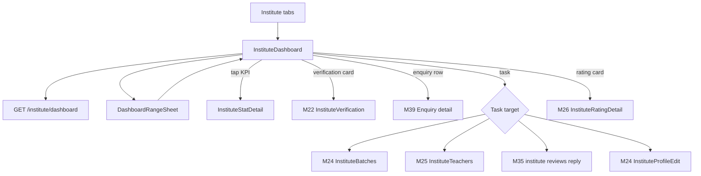
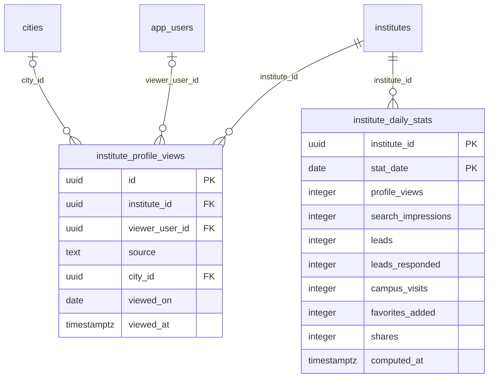

# Module 23 · Institute Dashboard

> **Phase 5 · Institute** · **Used by:** Institute managers and counsellors · **Depends on:** M00, M22, M24, M25, M26, M32 (records views), M39 (enquiries), M35 (review replies); Admin M38 (response-rate definition) · **New tables:** `institute_profile_views`, `institute_daily_stats` · **Uses:** `institutes`, `leads`, `institute_reviews`, `institute_teachers`, `institute_batches`, `institute_managers`, `demo_requests`, `user_favorites`, `profile_shares`, `cities` · **Build estimate:** 3–4 days

## 1. Module Purpose

The home tab for institute staff. It shows how the institute is doing — profile views, enquiries, response rate, reviews, GuruConnect and user ratings, teachers and batches — for the last 7, 30 or 90 days with comparison to the previous period, plus the newest enquiries and a short list of tasks (finish verification, add batches, complete teacher ID checks, reply to reviews). It owns the two stats tables: `institute_profile_views` (raw views recorded when someone opens the institute's profile) and `institute_daily_stats` (per-day counters written by a job). Before approval the dashboard focuses on verification progress; counsellors get an enquiry-focused version.

## 2. User Stories

- As an **institute manager**, I want to see how many parents viewed our profile and enquired this month so that I know whether GuruConnect is working for us.
- As a **manager**, I want to see our response rate so that I can make sure counsellors call parents back within a day.
- As an **institute counsellor**, I want the newest enquiries at the top of my home screen so that I can respond first thing in the morning.
- As a **new institute owner**, I want the dashboard to tell me what's left before we go live so that I don't miss a step.
- As a **manager on a slow connection**, I want the dashboard to open instantly with yesterday's numbers so that I can check it anywhere.

## 3. Business Rules & Logic

**BR-23.1 What the dashboard shows.**

| Institute state | Manager | Counsellor |
| --- | --- | --- |
| `draft`, `docs_requested`, `rejected` | Verification card (M22 hero copy + action), setup tasks, KPIs hidden with "Your stats start once you're verified" | Verification card without action |
| `pending` … `evaluation_done` | Verification card (progress), setup tasks (profile, batches, teachers can be done now) | Verification card |
| `approved` + `account_status = active` | KPI grid, trend chart, recent enquiries, tasks, rating card | Enquiry KPIs (enquiries, response rate), recent enquiries, review replies task |
| `account_status = suspended` | Red banner "Your listing is paused. Contact support." + frozen KPIs | Same banner |

**BR-23.2 KPI definitions.** Range `r` = last 7, 30 or 90 IST days including today; previous period = the same number of days before it. Delta % = `(current − previous) / previous × 100`, rounded to a whole number; hidden when previous = 0.

| KPI | Formula |
| --- | --- |
| Profile views | `SUM(institute_daily_stats.profile_views)` over the range (unique viewers per day) |
| Enquiries | `SUM(leads)` over the range (non-spam institute leads) |
| Response rate | `SUM(leads_responded) / SUM(leads)` over the range **excluding today** (leads need 24 h to count); shown when the denominator ≥ 5, else "Not enough enquiries yet"; plus median first-response minutes from `leads.first_response_at − created_at` for the same leads (live query, max 500 rows) |
| Reviews | Published `institute_reviews` in the range; total `institutes.user_rating_count`; unreplied = published with `institute_reply IS NULL` |
| Rating | `institutes.overall_rating`, `infrastructure_score`, `faculty_score` (M26), `user_rating_avg` |
| Teachers | `institute_teachers` with `status = 'active'`, with `status = 'id_pending'`, and the limit `limits.institute_max_teachers` (25) |
| Batches | Active `institute_batches` (`is_active`, `deleted_at IS NULL`), `SUM(seats_available)`, batches with `starts_on` in the next 14 days |
| Secondary | Search impressions, campus visit requests, favourites added, shares — sums of the matching daily columns |
The response-rate rule matches Admin M38 FR-38.4 (answered within 24 h ÷ non-spam leads).

**BR-23.3 Recording profile views (`InstituteViewRecorder.record`, used by M32).** Called when `GET /institutes/:idOrSlug` returns a full profile.
1. Skip when the viewer is staff of that institute, when the institute is not `approved`, or when the `User-Agent` is a known bot.
2. Signed-in viewer: `INSERT institute_profile_views (institute_id, viewer_user_id, source, city_id) ON CONFLICT (institute_id, viewer_user_id, viewed_on) DO NOTHING` — one row per viewer per institute per IST day.
3. Anonymous viewer (shared link): dedupe in Redis `ipv:<instituteId>:<installId or ip>:<yyyymmdd>` (TTL 36 h); insert with `viewer_user_id = NULL` only on the first hit.
4. `source` from the route param `src` (`search`, `recommendation`, `dashboard`, `favorites`, `share_link`, `notification`, else `other`); `city_id` = viewer's city (parent/student profile or the M27 search city).
5. The insert is fire-and-forget after the response (failures logged, never shown).

**BR-23.4 Daily stats job (`institute-stats`, BullMQ).** Every 15 minutes it recomputes **today and yesterday** (IST) for institutes with any activity since the last run; at 00:30 IST it finalises the day before yesterday for all approved institutes. Upsert on `(institute_id, stat_date)`:
- `profile_views` = count of `institute_profile_views` rows with `viewed_on = stat_date`.
- `search_impressions` = Redis counter `stats:inst_impr:<date>` hash field `<instituteId>` (incremented by M28 once per result page render), read and persisted.
- `leads` = `leads` with `target_type = 'institute'`, this institute, created on `stat_date` (IST), `status <> 'spam'`, `deleted_at IS NULL`.
- `leads_responded` = of those, `first_response_at − created_at ≤ 24 h`.
- `campus_visits` = `demo_requests` with this `institute_id` created on `stat_date`.
- `favorites_added` = `user_favorites` (`target_type = 'institute'`) created on `stat_date`, not deleted.
- `shares` = `profile_shares` with this `institute_id` created on `stat_date`.
- `computed_at = now()`. A lead later marked spam is removed from the counters on the next recompute of its day (the admin action enqueues a recompute for that day).

**BR-23.5 Tasks list (max 4, in this order, only for managers unless noted).** Finish verification (not approved) · Add logo and cover (either missing) · Add your first batch (0 active batches) · Add teachers (0 non-removed teachers) · "3 teachers haven't completed ID checks" (id_pending older than 3 days) · "2 reviews waiting for a reply" (managers and counsellors) · "4 new enquiries not opened" (status `new` older than 2 h; managers and counsellors). Each task deep-links to its screen.

**BR-23.6 Recent enquiries.** Latest 3 leads for the institute (open statuses first: `new`, `viewed`) with requester display name (first name + initial), subject, class, age ("12 min ago") and status pill; tap opens M39 enquiry detail. Contact details are never included here.

**BR-23.7 Caching and freshness.** `GET /institute/dashboard` is cached in Redis 60 s per `(institute, range, role)`; lead creation and review publish purge it. The response carries `computedAt` (latest `institute_daily_stats.computed_at` in the range) and the app shows "Updated 10 min ago". Pull-to-refresh bypasses the Redis cache once per 30 s.

**BR-23.8 Retention.** `institute_profile_views` rows older than 13 months are deleted monthly (the daily stats keep the totals). `institute_daily_stats` rows are kept for the life of the institute.

**BR-23.9 Weekly summary.** Monday 10:00 IST job sends each approved institute's active managers a summary push if the last 7 days had at least one view or enquiry; response rate below 50% (with ≥ 5 enquiries) adds an alert push the same day.

## 4. Screen List

| Screen | Route name | Purpose |
| --- | --- | --- |
| Dashboard | `InstituteDashboard` | Home tab: verification card or KPIs, trend chart, recent enquiries, tasks |
| Range picker | `DashboardRangeSheet` (bottom sheet) | Choose 7, 30 or 90 days |
| Stat detail | `InstituteStatDetail` | Daily bars for one KPI with the previous-period line and a short explainer |

## 5. Screen Flow & Navigation


The dashboard is the root of the Dashboard tab; Android back on it exits the app (standard tab behaviour).

## 6. Screen Wireframe Description

**InstituteDashboard (approved, manager)** — header: logo avatar, "Apex JEE Academy", Verified tick, bell icon with unread badge (M48). Range chip "Last 30 days ▾" (opens DashboardRangeSheet). Muted line "Updated 10 min ago".
- KPI grid 2 × 3 cards, each: label, big number, delta chip ("▲ 18%" green text + arrow, "▼ 6%" red text + arrow):
  "Profile views 1,284 ▲ 18%" · "Enquiries 41 ▲ 5%" · "Response rate 83% · median 42 min" · "Reviews 12 new · 486 total" · "Teachers 6 active · 2 ID pending · of 25" · "Batches 3 active · 14 seats left".
- Rating card: "GuruConnect rating ★ 4.5" + "Infrastructure 8.8/10 · Faculty 9.1/10" + "Parents rate you 4.7 (486)" → M26.
- Trend chart card "Views and enquiries": 30 thin bars (views) with a line (enquiries), x-axis dates "1 Sep … 26 Sep"; tap a bar shows a tooltip "24 Sep · 52 views · 3 enquiries".
- "Recent enquiries" section with 3 rows: "Lakshmi V. · Physics · Class 12 · 12 min ago · New" and link "See all enquiries" (Enquiries tab, M39).
- "To do" section: up to 4 task rows with icon, text and chevron ("2 reviews waiting for a reply").
- Secondary stats row (small text): "Shown in search 9,420 · Visit requests 7 · Saved by 38 · Shared 11".
Empty state (approved, no activity yet): illustration, "No activity yet", "Complete your profile and add batches to appear higher in search.", button "Add a batch".

**InstituteDashboard (before approval)** — header as above without Verified tick. Large verification card from M22 ("Submitted — waiting for review", stepper, button). "While you wait" task list (logo, batches, teachers). KPI area replaced by a muted card "Your stats start once you're verified".

**InstituteDashboard (counsellor)** — KPIs "Enquiries" and "Response rate" only, recent enquiries (5 rows), "To do" limited to enquiries and review replies. No teacher, batch or fee items.

**DashboardRangeSheet** — radio list "Last 7 days", "Last 30 days", "Last 90 days"; choice remembered on the device.

**InstituteStatDetail** — header = KPI name ("Profile views"), big total with delta, bar chart per day for the range with the previous period as a faint line, table below (date, value) for the last 14 days, explainer text ("A view is one person opening your profile on a day. Several visits by the same person on the same day count once."). Loading skeleton; error state with Retry.

## 7. UI Components & Component Tree

```
InstituteDashboardScreen
├─ DashboardHeader (logo, name, VerifiedBadge, NotificationBell)
├─ RangeChip → DashboardRangeSheet
├─ VerificationCard (M22 hero, shown before approval)
├─ KpiGrid → KpiCard × n → InstituteStatDetailScreen
├─ InstituteRatingCard (M26 InstituteRatingChip + ScoreBars)
├─ TrendChartCard (MiniBarLineChart on react-native-svg)
├─ RecentEnquiriesList → EnquiryRow (M39)
├─ TaskList → TaskRow
└─ SecondaryStatsRow
```
- `KpiCard({ label, value, delta, sublabel, onPress, loading })` — formats numbers in Indian grouping; delta text always includes the arrow and sign (colour not the only signal).
- `MiniBarLineChart({ series, compareSeries, height, onSelect })` — `react-native-svg`, max 90 points, accessible summary label ("Views rose from 38 to 52 per day").
- `TaskRow({ task, onPress })` — `task = { key, text, deepLink }`.
- Hooks: `useInstituteDashboardQuery(range)`, `useInstituteStatSeriesQuery(kpi, range)` (reads the same endpoint with `?kpi=`), `useDashboardRange()` (Zustand + MMKV).

## 8. Validation Rules

Shared schema: `InstituteDashboardQuerySchema`.

| Field | Rule | Message shown |
| --- | --- | --- |
| range | `7d`, `30d` or `90d`; default `30d` | Invalid values fall back to 30 days (no message) |
| kpi | optional; one of `views`, `enquiries`, `response_rate`, `reviews`, `impressions`, `visits`, `favorites`, `shares` | "This chart isn't available." |
| src (profile view recording, M32) | one of the `institute_profile_views.source` values; unknown → `other` | none |

## 9. API Endpoints

| Method | Path | Auth | Description |
| --- | --- | --- | --- |
| GET | /institute/dashboard | Institute staff | Dashboard for the caller's institute and role (`?range=7d|30d|90d`, optional `?kpi=` returns the daily series for one KPI). Redis-cached 60 s |

Uses: M22 `GET /institute/verification` (card content is embedded in this response, no second call), M39 `GET /institute/enquiries` (see all), M26 rating service. Profile views are recorded inside M32 `GET /institutes/:idOrSlug`.

## 10. Request Payloads

```json
// GET /institute/dashboard?range=30d
// GET /institute/dashboard?range=30d&kpi=views
```

## 11. Response Payloads

```json
// 200 GET /institute/dashboard?range=30d   (manager, approved)
{ "data": {
  "institute": { "id": "…", "name": "Apex JEE Academy", "logoUrl": "https://cdn.guruconnect.in/inst/…/logo.webp", "verificationStatus": "approved", "accountStatus": "active", "isVerifiedBadge": true },
  "viewer": { "staffRole": "manager", "isPrimary": true },
  "range": { "key": "30d", "from": "2026-08-28", "to": "2026-09-26" },
  "verificationCard": null,
  "kpis": {
    "profileViews": { "value": 1284, "previous": 1088, "deltaPct": 18 },
    "enquiries": { "value": 41, "previous": 39, "deltaPct": 5 },
    "responseRate": { "valuePct": 83, "sample": 38, "medianFirstResponseMinutes": 42 },
    "reviews": { "newInRange": 12, "total": 486, "unreplied": 2 },
    "rating": { "overall": 4.5, "infrastructure": 8.8, "faculty": 9.1, "userAvg": 4.7, "userCount": 486 },
    "teachers": { "active": 6, "idPending": 2, "limit": 25 },
    "batches": { "active": 3, "seatsAvailable": 14, "startingSoon": 1 } },
  "secondary": { "searchImpressions": 9420, "campusVisits": 7, "favoritesAdded": 38, "shares": 11 },
  "series": [ { "date": "2026-09-25", "views": 52, "enquiries": 3 }, { "date": "2026-09-26", "views": 31, "enquiries": 1 } ],
  "recentEnquiries": [ { "id": "…", "publicCode": "LD-240987", "requesterName": "Lakshmi V.", "subject": "Physics", "class": "Class 12", "status": "new", "createdAt": "2026-09-26T09:58:00Z" } ],
  "tasks": [ { "key": "reply_reviews", "text": "2 reviews waiting for a reply", "deepLink": "/institute/reviews" },
             { "key": "teacher_ids", "text": "2 teachers haven't completed ID checks", "deepLink": "/institute/teachers" } ],
  "computedAt": "2026-09-26T10:00:04Z" } }

// 200 GET /institute/dashboard (pending, excerpt)
{ "data": { "institute": { "verificationStatus": "pending", "…": "…" }, "kpis": null,
  "verificationCard": { "status": "pending", "title": "Submitted — waiting for review", "body": "We'll check your documents within 48 hours.", "action": null },
  "tasks": [ { "key": "add_batch", "text": "Add your first batch", "deepLink": "/institute/batches/new" } ] } }

// 200 GET /institute/dashboard?range=30d&kpi=views
{ "data": { "kpi": "views", "total": 1284, "previousTotal": 1088, "points": [ { "date": "2026-08-28", "value": 38, "previous": 30 } ] } }
```

## 12. PostgreSQL Tables & Columns

**New tables owned by this module** (migration `sql/migrations/123_app_m23_institute_dashboard_views_and_daily_stats.sql`)

### `institute_profile_views`

Raw institute profile views from the app (one per viewer per institute per day).

| Column | Type | Null | Default | Constraints / References | Description |
| --- | --- | --- | --- | --- | --- |
| `id` | uuid | no | gen_random_uuid() | PK | Primary key |
| `institute_id` | uuid | no | — | FK → `institutes.id` (on delete cascade) | Viewed institute |
| `viewer_user_id` | uuid | yes | — | FK → `app_users.id` (on delete set null) | Viewer (NULL for shared-link visitors) |
| `source` | text | no | — | CHECK source IN ('search','recommendation','dashboard','favorites','share_link','notification','other') | Entry point |
| `city_id` | uuid | yes | — | FK → `cities.id` (on delete set null) | Viewer's city |
| `viewed_on` | date | no | (now() AT TIME ZONE 'Asia/Kolkata')::date | — | IST day, for de-duplication |
| `viewed_at` | timestamptz | no | now() | — | Time |

<details><summary>DDL</summary>

```sql
CREATE TABLE institute_profile_views (
  id uuid PRIMARY KEY DEFAULT gen_random_uuid(), -- Primary key
  institute_id uuid NOT NULL REFERENCES institutes(id) ON DELETE CASCADE, -- Viewed institute
  viewer_user_id uuid REFERENCES app_users(id) ON DELETE SET NULL, -- Viewer (NULL for shared-link visitors)
  source text NOT NULL CHECK (source IN ('search','recommendation','dashboard','favorites','share_link','notification','other')), -- Entry point
  city_id uuid REFERENCES cities(id) ON DELETE SET NULL, -- Viewer's city
  viewed_on date NOT NULL DEFAULT (now() AT TIME ZONE 'Asia/Kolkata')::date, -- IST day, for de-duplication
  viewed_at timestamptz NOT NULL DEFAULT now() -- Time
);
CREATE UNIQUE INDEX uq_institute_profile_views_daily ON institute_profile_views (institute_id, viewer_user_id, viewed_on) WHERE viewer_user_id IS NOT NULL;
CREATE INDEX idx_institute_profile_views_inst ON institute_profile_views (institute_id, viewed_at DESC);
```

</details>

**Indexes:** `uq_institute_profile_views_daily` (unique) on `(institute_id, viewer_user_id, viewed_on) WHERE viewer_user_id IS NOT NULL`; `idx_institute_profile_views_inst` on `(institute_id, viewed_at DESC)`

### `institute_daily_stats`

Per-institute daily counters for the institute dashboard (written by the nightly job, today refreshed every 15 minutes).

| Column | Type | Null | Default | Constraints / References | Description |
| --- | --- | --- | --- | --- | --- |
| `institute_id` | uuid | no | — | PK; FK → `institutes.id` (on delete cascade) | Institute |
| `stat_date` | date | no | — | PK | IST day |
| `profile_views` | integer | no | 0 | — | Unique viewers |
| `search_impressions` | integer | no | 0 | — | Times shown in search results |
| `leads` | integer | no | 0 | — | Enquiries received |
| `leads_responded` | integer | no | 0 | — | Enquiries answered within 24 h |
| `campus_visits` | integer | no | 0 | — | Demo / visit requests |
| `favorites_added` | integer | no | 0 | — | Added to favourites |
| `shares` | integer | no | 0 | — | Profile shares |
| `computed_at` | timestamptz | no | now() | — | Last computed |

**Table constraints:** `PRIMARY KEY (institute_id, stat_date)`

<details><summary>DDL</summary>

```sql
CREATE TABLE institute_daily_stats (
  institute_id uuid NOT NULL REFERENCES institutes(id) ON DELETE CASCADE, -- Institute
  stat_date date NOT NULL, -- IST day
  profile_views integer NOT NULL DEFAULT 0, -- Unique viewers
  search_impressions integer NOT NULL DEFAULT 0, -- Times shown in search results
  leads integer NOT NULL DEFAULT 0, -- Enquiries received
  leads_responded integer NOT NULL DEFAULT 0, -- Enquiries answered within 24 h
  campus_visits integer NOT NULL DEFAULT 0, -- Demo / visit requests
  favorites_added integer NOT NULL DEFAULT 0, -- Added to favourites
  shares integer NOT NULL DEFAULT 0, -- Profile shares
  computed_at timestamptz NOT NULL DEFAULT now(), -- Last computed
  PRIMARY KEY (institute_id, stat_date)
);

```

</details>

**Existing tables this module reads or writes** (full definitions in the owning module)

| Table | Owner | Purpose |
| --- | --- | --- |
| `institutes` | Admin M22 | Coaching centres, tuition centres, schools and academies. Rated by GuruConnect after verification. |
| `leads` | Admin M38 | Enquiries and call-back requests from parents/students to a teacher or institute. |
| `institute_reviews` | Admin M34 | Reviews of institutes by parents and students. |
| `institute_teachers` | Admin M26 | Teachers listed under an institute. Added, edited and removed only by an institute manager (or an admin). |
| `institute_batches` | Admin M24 | Courses and batches an institute runs, shown on its public profile. |
| `institute_managers` | Admin M25 | App accounts that act for an institute. Exactly one active primary manager; counsellors can only handle leads. |
| `demo_requests` | Admin M39 | Free demo class bookings and their outcome. |
| `user_favorites` | App M40 | Teachers and institutes a user saved to their favourites. |
| `profile_shares` | App M33 | Each time a user shares a teacher or institute profile, with a short code for attribution. |
| `cities` | Admin M09 | Cities where teachers and institutes can be listed. |

- `institute_profile_views`: written only by `InstituteViewRecorder` (BR-23.3); read by the stats job; pruned after 13 months.
- `institute_daily_stats`: written only by the `institute-stats` job (BR-23.4); read by this module and by Admin M50 institute reports.
- `leads`, `institute_reviews`, `institute_teachers`, `institute_batches`, `demo_requests`, `user_favorites`, `profile_shares` are read-only here (counts and the 3 latest enquiries).

## 13. Relationships

**Foreign keys of new tables**

- `institute_profile_views.institute_id` → `institutes` — required, many-to-one, on delete **cascade**
- `institute_profile_views.viewer_user_id` → `app_users` — optional, many-to-one, on delete **set null**
- `institute_profile_views.city_id` → `cities` — optional, many-to-one, on delete **set null**
- `institute_daily_stats.institute_id` → `institutes` — required, many-to-one, on delete **cascade**

**Entity relationship diagram**



## 14. State Management

- Query keys: `dashboardKeys.institute(range)`, `dashboardKeys.instituteKpi(kpi, range)`; persisted; `staleTime` 60 s; refetch on tab focus and app foreground.
- `useDashboardRange` (Zustand + MMKV): `{ range: '30d', setRange() }`.
- Invalidated by other modules: lead actions (M39), review replies (M35), batch and teacher changes (M24/M25), verification changes (M22), and any foreground push with category `leads`, `reviews` or `verification`.
- No mutations in this module.

## 15. Offline Handling

- Read-only screen: renders the last cached dashboard for the selected range with the offline banner and "Updated 3 h ago"; switching to an uncached range shows "Connect to the internet to see this range."
- Chart and KPI detail use cached series when available.
- No writes.

## 16. Push Notification Requirements

| Event | Recipient | Title / Body | Deep link | Category | Urgent |
| --- | --- | --- | --- | --- | --- |
| Weekly summary (Mon 10:00 IST) | Active managers of approved institutes with activity | "Your week on GuruConnect" / "142 profile views and 9 enquiries last week. Response rate 83%." | `/institute/dashboard` | account | No |
| Response rate below 50% (weekly check, ≥ 5 enquiries) | Active managers | "Parents are waiting" / "Only 4 of 10 enquiries got a reply within a day. Faster replies rank you higher." | `/institute/enquiries` | leads | No |
Enquiry, review and verification pushes are defined by M39, M35 and M22.

## 17. Security Rules

- Scoped by `iid`; role from `institute_managers` (active row for `pid`), never from the request.
- Counsellor responses omit teacher, batch, fee and secondary stats fields entirely (not just hidden in the UI).
- Recent enquiries show requester first name + initial only; no phone, email or child details.
- `institute_profile_views` never exposes viewer identities to the institute — only counts leave the server.
- View recording ignores the institute's own staff and dedupes per viewer per day, so staff and repeat visits can't inflate numbers; anonymous views are capped by the Redis key.

## 18. Error Handling

| Scenario | Code | HTTP | App behaviour |
| --- | --- | --- | --- |
| Staff row disabled while using the app | `FORBIDDEN` | 403 | Sign out with "Your access to this institute was removed." (M24) |
| Institute suspended | — | 200 | Suspension banner from the payload |
| Unknown `kpi` | `VALIDATION_FAILED` | 422 | Stat detail shows "This chart isn't available." |
| Stats not computed yet (new institute) | — | 200 | KPIs show 0 with "Stats update every 15 minutes." |
| Network / 5xx | `GATEWAY_ERROR` / `INTERNAL_ERROR` | 502 / 500 | Cached dashboard + toast; ErrorState with Retry when no cache |

## 19. Testing Scenarios

- T23.1 Happy path (Maestro `institute_dashboard_view`): approved manager sees six KPI cards, rating card, chart and 3 recent enquiries; switching to 7 days refetches.
- T23.2 Same parent opens the institute profile 5 times in a day → one `institute_profile_views` row; next IST day → second row.
- T23.3 Staff member opens their own institute's profile → no row inserted.
- T23.4 Shared-link anonymous opens from the same install twice → one row with `viewer_user_id` NULL.
- T23.5 Stats job: 10 leads today, 8 answered within 24 h yesterday → `leads_responded` counts only those within 24 h; a lead marked spam disappears from `leads` on the next recompute.
- T23.6 Response rate with 4 enquiries in range → "Not enough enquiries yet"; with 10 → percentage shown and matches the Admin M38 stats for the same range.
- T23.7 Delta hidden when the previous period is 0; delta text contains an arrow and sign.
- T23.8 Pending institute → verification card, `kpis` null, tasks for batches and teachers.
- T23.9 Counsellor response contains no `teachers`, `batches`, `secondary` keys.
- T23.10 Offline with cache → dashboard renders with "Updated …"; switching to an uncached range shows the offline message.
- T23.11 Weekly summary sent Monday 10:00 IST only to institutes with activity; dedupe key prevents duplicates on job retry.
- T23.12 Suspended institute → red banner, KPIs frozen, enquiry tasks hidden.

## 20. Audit Log Events

None. The dashboard and view recording are reads; views and counters are analytics data, not audited actions.

## 21. Future Scalability Notes

- Partition `institute_profile_views` by month once it passes ~20M rows; move the job to incremental aggregation from an event stream.
- Funnel view (impression → view → enquiry → visit → enrolled) using `demo_requests.outcome`.
- Benchmarks: "Institutes like yours in Koramangala get 22 enquiries a month" from anonymised city/type medians.
- Per-counsellor response metrics once enquiries record which staff member responded.
- CSV export of daily stats for owners.
- Admin portal additions: none; Admin M50 institute reports read `institute_daily_stats`.
