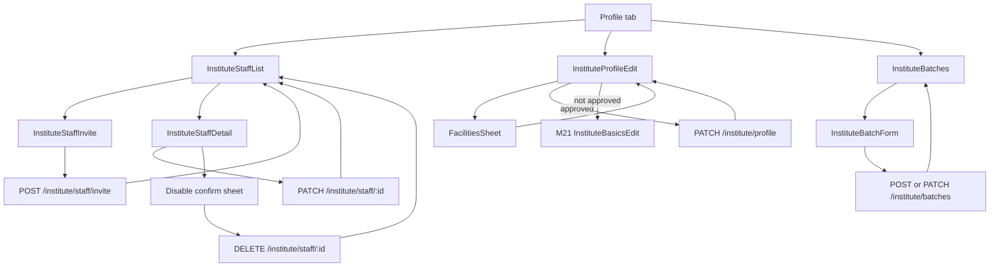
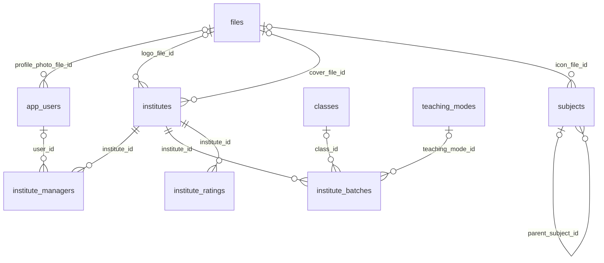

# Module 24 · Institute Manager

> **Phase 5 · Institute** · **Used by:** Primary manager (the owner) and other managers — invite, edit and disable staff; edit the institute profile and batches; counsellors — view staff, profile and batches, no edits · **Depends on:** M00, M21 (owner/primary manager created there), M22 (verification status gates profile edits), M23 (dashboard tasks deep-link here); Admin M24, M25 · **New tables:** none · **Uses:** `institute_managers`, `app_users`, `institutes`, `institute_batches`, `institute_ratings`, `classes`, `subjects`, `teaching_modes`, `files`, `audit_logs` · **Build estimate:** 4–5 days

## 1. Module Purpose

Gives an institute's manager control of the team and the public profile. Any active manager can invite a new counsellor or manager by phone, edit their designation and role, and disable an account that has left; exactly one primary manager exists per institute and cannot be changed, demoted or disabled from the app (only GuruConnect support can replace one, Admin M25 FR-25.5). The same module edits everything about the institute's public listing that isn't part of registration — about, contact, logo, cover, facilities, capacity, fees — and the courses and batches shown on the profile. Counsellors can see the team, profile and batches but never change them; every write here checks `institute_managers.staff_role = 'manager'` and `status = 'active'` on the server, not just in the UI.

## 2. User Stories

- As the **owner of Apex JEE Academy**, I want to invite my centre head as a manager and two front-desk staff as counsellors by phone so that they can start working without me sharing my login.
- As a **manager**, I want to disable a counsellor who left last month so that she can't see new enquiries any more.
- As a **manager**, I want to add a "JEE 2027 weekend batch" with seats and fee so that parents searching see it on our profile.
- As a **counsellor**, I want to see who else is on the team and browse our batches so that I can answer a parent's question, even though I can't edit them.
- As a **manager updating fees after a price change**, I want the edit to go live immediately without needing GuruConnect's approval so that the profile is always current.

## 3. Business Rules & Logic

**BR-24.1 Roles (server-enforced on every endpoint in this module and in M25).**

| Capability | Primary manager | Manager | Counsellor |
| --- | --- | --- | --- |
| View/respond to enquiries (M39), assign to a teacher | ✓ | ✓ | ✓ |
| View staff list, institute profile, batches | ✓ | ✓ | ✓ |
| Edit institute profile (about, contact, logo, cover, facilities, capacity, fees) | ✓ | ✓ | — |
| Add / edit / remove batches | ✓ | ✓ | — |
| Add / edit / remove institute teachers, assign subjects & classes (M25) | ✓ | ✓ | — |
| Invite / edit / disable staff | ✓ | ✓ | — |
| Reply to reviews (M35), registration documents and fee (M21/M22) | ✓ | ✓ | — |
| Change own `is_primary`, disable the primary manager | — | — | — |
Every write endpoint loads the caller's `institute_managers` row by `(institute_id = iid, user_id = sub)` and requires `staff_role = 'manager'` and `status = 'active'`; a disabled or counsellor caller gets `FORBIDDEN`. `is_primary` is never editable from the app — only Admin M25 FR-25.5 can replace the primary manager.

**BR-24.2 Staff list — `GET /institute/staff`.** Returns every non-... row for the institute (`invited`, `active`, `disabled`, newest-first within status group: active managers, active counsellors, invited, then disabled), each with `id`, `fullName`, `phone` (masked for counsellors, full for managers — see BR-24.10), `email`, `designation`, `staffRole`, `isPrimary`, `status`, `invitedAt`, `acceptedAt`, `disabledAt`, `lastActiveAt` (from `app_users` / `app_sessions`, managers only), and `inviteExpired` (`status = 'invited'` and `invited_at < now() − 72h`). Counts `{ managers, counsellors, invitedPending }` are included for the sticky "Invite" bar's limit hint.

**BR-24.3 Invite — `POST /institute/staff/invite`, one transaction.**
1. Caller is an active manager. `InstituteStaffInviteSchema`: `fullName` 2–100 chars, `phone` E.164, `staffRole` (`manager`|`counsellor`), `designation` optional ≤ 60 chars.
2. Phone uniqueness: another row for this institute with `status <> 'disabled'` and the same phone → if that row's `status = 'invited'`, this call is treated as a **resend** (step 4) instead of an error; if `status = 'active'`, `409 CONFLICT_DUPLICATE`, `details.reason = "already_on_team"`.
3. Limit: counting rows with `status IN ('invited','active')`, at most **3 managers** and **10 counsellors** per institute (matches Admin M25 validation); over the limit → `409 CONFLICT_STATE`, `details.reason = "max_managers"` / `"max_counsellors"`, `details.limit`.
4. Resend path: `UPDATE institute_managers SET full_name, designation, staff_role, invited_at = now()` on the existing invited row, at most once per 15 minutes (else `429 RATE_LIMITED`). New path: `INSERT institute_managers (institute_id, full_name, phone, designation, staff_role, is_primary = false, status = 'invited', invited_at = now(), created_by = NULL)`.
5. Send an SMS: "Suresh Menon invited you to join Apex JEE Academy on GuruConnect as Counsellor. Open the GuruConnect app and sign in with this number." (no token in the link — the invitee signs in normally with M04 OTP; M05 `GET /registration/context` then surfaces the pending invite and M21 BR-21.8 completes the join).
6. `INSERT audit_logs` `app.institute_staff_invited`.
7. The invite is valid for **72 hours** (`invited_at`); after that `GET /institute/staff` marks it `inviteExpired: true` and the only action is resend (step 4); Admin M25 can also resend.
10/hour per institute (Idempotency-Key not required — resend is naturally idempotent).

**BR-24.4 Edit staff — `PATCH /institute/staff/:id`, If-Match on `institute_managers.updated_at`.**
- Target must belong to the caller's institute and not be the primary manager (`is_primary = true` → `409 CONFLICT_STATE`, `details.reason = "cannot_edit_primary"`, message points to support, M53).
- While `status = 'invited'`: `fullName`, `phone` (re-checked for uniqueness), `designation`, `staffRole` are all editable (correcting a typo before they join).
- While `status = 'active'`: only `designation` and `staffRole` are editable — `fullName`, `phone` and `email` are the person's own account fields, changed through M51 Account Settings, not here.
- Promoting a counsellor to manager, or adding a second/third manager, is blocked at the 3-manager limit (`409 CONFLICT_STATE`, `details.reason = "max_managers"`); demoting a manager to counsellor is always allowed (never drops below one active manager because the primary is untouched here).
- `INSERT audit_logs` `app.institute_staff_role_changed` when `staffRole` changes; the affected staff member is notified (BR-24.9).

**BR-24.5 Disable — `DELETE /institute/staff/:id { reason }`.**
- Target must belong to the caller's institute; the primary manager can never be disabled from the app (`409 CONFLICT_STATE`, `details.reason = "cannot_disable_primary"`). A manager **can** disable themselves (e.g. leaving the institute) — the call succeeds and immediately signs the caller out.
- `reason` 10–500 chars (shown only to admins and the disabled person, never to other staff).
- One transaction: `UPDATE institute_managers SET status = 'disabled', disabled_at = now(), disabled_reason = reason`; if `user_id IS NOT NULL`, revoke every `app_sessions` row for that `user_id` (same effect as sign-out-everywhere, M04) so any signed-in device is logged out on its next call with `FORBIDDEN` (conventions §5 "Wrong role or not the owner" — the app then shows "Your access to this institute was removed." and returns to Login, matching M23's error table). `INSERT audit_logs` `app.institute_staff_disabled`.
- A disabled row can be re-enabled only by GuruConnect support (Admin M25); the app has no "enable" endpoint (re-inviting the same phone after disabling creates a fresh invite instead, since the old row's `status <> 'invited'`... actually a disabled phone still blocks a new invite at step 2 of BR-24.3 — support removes/re-enables the old row first).

**BR-24.6 Institute profile — `GET/PATCH /institute/profile`, If-Match on `institutes.updated_at`.**
- `GET` is open to any active staff (managers and counsellors); `PATCH` requires an active manager.
- Allowed only while `institutes.verification_status = 'approved'` (regardless of `account_status`, except BR-24.8). Before approval: `409 CONFLICT_STATE`, `details.reason = "use_registration_basics"` — the app routes to M21 `InstituteBasicsEdit` instead, which owns edits during `draft`/`docs_requested`/recently-`rejected`. While `pending`, `under_review`, `visit_scheduled` or `evaluation_done`: `409 CONFLICT_STATE`, `details.reason = "in_review"` (same family of errors M21 and M22 already use).
- Fields, two groups:
  - **Starred** (needs `reason` 10–500 chars; logged as `profile_changed_after_approval`): `name`, `instituteType`, `establishedYear`, `registrationNumber`, `gstin` (same `isValidGstin` rule as M21), `addressLine`, `cityId`, `areaId`, `pincode`, `latitude`/`longitude` (same 40 km rule as M21 BR-21.5).
  - **Unstarred** (no reason): `email`, `website`, `about` (≤ 3,000 chars), `logoFileId`, `coverFileId`, `facilities[]` (from the fixed list: `ac_classrooms`, `cctv`, `library`, `science_lab`, `computer_lab`, `test_centre`, `parking`, `wheelchair_access`, `drinking_water`, `separate_washrooms`, `sound_proof_rooms`, `instrument_library`, `sports_ground`, `other`), `classrooms`, `seatingCapacity`, `studentCount`, `feeMinPaise`/`feeMaxPaise` (min ≤ max).
  - The owner's mobile (`institutes.phone`) is never editable here (BR-21.2 — support only).
- Changing `cityId` or `facilities` also sets the institute's current `institute_ratings` row's `next_review_due = today` (bringing the next GuruConnect evaluation forward, matching Admin FR-24.3), inside the same transaction as the profile update.
- Changing `name` regenerates the `slug` (BR-21.7 algorithm); changing `cityId` clears `areaId` and requires new coordinates, exactly as M21 BR-21.9.
- `INSERT audit_logs` `app.institute_profile_updated` (changed field names; starred changes include the reason; GSTIN stored masked to last 4).

**BR-24.7 Photos.** `logoFileId`/`coverFileId` point at confirmed `institute_logo`/`institute_cover` uploads (M00, `gc-public`, ≤ 5 MB). The public campus-photo **gallery** stays owned by M22 (approved `campus_photo` documents, published by Admin M24 FR-24.7) — this module can only set which uploaded file is the logo and which is the cover, not reorder the gallery.

**BR-24.8 Suspension.** While `institutes.account_status = 'suspended'`, `PATCH /institute/profile` and every batch write return `409 CONFLICT_STATE`, `details.reason = "suspended"`; `GET`s still work so staff can see the paused banner and current data.

**BR-24.9 Batches — `GET/POST/PATCH/DELETE /institute/batches(/:id)`.** Writes need an active manager; reads are open to counsellors (they see which batch a lead is asking about, M39). Allowed at any `verification_status` (a new institute can add batches before approval, per M23's task list) as long as the institute isn't deleted and not suspended (BR-24.8). Fields: `name` 3–80 chars, `subjectIds` 1–6 active `subjects`, `classId` active `classes`, `teachingModeId` active `teaching_modes`, `scheduleText` ≤ 120 chars, `seatsTotal` 1–1,000, `seatsAvailable` 0…`seatsTotal`, `feePaise` 0…1,00,00,000, `feePeriod` (`one_time`|`monthly`|`quarterly`|`yearly`), `startsOn` ≥ today − 365 days, `isActive`. Max **50 active batches** per institute (`409 CONFLICT_STATE`, `details.reason = "max_batches"`). Delete is a soft delete (`deleted_at`, `is_active = false`); deleted batches never come back. `INSERT audit_logs` `app.institute_batch_created` / `_updated` / `_deleted`.

**BR-24.10 Phone masking.** Counsellors see other staff's phones masked (`+91 98XXX XX122`) in `GET /institute/staff`; managers see full numbers (they may need to call a colleague). Nobody outside the institute's own staff ever sees these rows.

**BR-24.11 Rate limits.** `POST /institute/staff/invite` 10/hour per institute; `PATCH /institute/staff/:id` and `DELETE` 30/hour; `PATCH /institute/profile` 20/hour; batch writes 60/hour per institute.

## 4. Screen List

| Screen | Route name | Purpose |
| --- | --- | --- |
| Staff list | `InstituteStaffList` | Team directory: primary, managers, counsellors, invited, disabled |
| Invite staff | `InstituteStaffInvite` (bottom sheet) | Name, phone, role, designation |
| Staff detail | `InstituteStaffDetail` | View/edit one staff member's role and designation; disable |
| Institute profile edit | `InstituteProfileEdit` | About, contact, address, facilities, capacity, fees, logo, cover |
| Facilities picker | `FacilitiesSheet` (bottom sheet) | Multi-select checklist of the 14 facility tags |
| Batches | `InstituteBatches` | List of courses/batches with seats and fee |
| Batch form | `InstituteBatchForm` (bottom sheet) | Add / edit one batch |

## 5. Screen Flow & Navigation


Disabling yourself (BR-24.5) exits the whole navigator to Login, not back to `InstituteStaffList`. Counsellors reach every screen here read-only; edit and invite controls are simply not rendered for them (the API would 403 anyway).

## 6. Screen Wireframe Description

**InstituteStaffList** — header "Team", sticky "Invite staff" (managers only). Sections "Owner", "Managers", "Counsellors", "Invited", "Disabled" — each row: avatar/initials, name, designation ("Centre Head"), phone (masked for counsellors), role badge, status pill ("Invite expired" in amber with "Resend"). Owner row shows a crown icon and "Primary — contact support to change" instead of a chevron. Empty invited/disabled sections are hidden.

**InstituteStaffInvite** — title "Invite a team member". Fields: "Full name" (placeholder "e.g. Kavita Rao"), "Mobile" (`PhoneField`), segmented "Role" (Manager · Counsellor, with one-line hints: "Manager — can edit the profile, batches and teachers", "Counsellor — can view and reply to enquiries"), "Designation (optional)" (placeholder "e.g. Front desk"). Helper under Role when the limit is close: "2 of 3 manager seats used." Sticky "Send invite".

**InstituteStaffDetail** — header = the person's name. "Designation" text field, "Role" segmented (disabled and captioned "Contact support to change the primary manager" when `isPrimary`), status line ("Joined 12 Aug 2026" / "Invited 2 days ago — expires in 1 day" with "Resend invite"). Danger zone: "Disable this person" (red text button) → bottom sheet "Disable Kavita Rao?" with a reason field (placeholder "e.g. Left the institute in August") and confirm "Disable".

**InstituteProfileEdit** — grouped sections "Basics" (name, type, established year, registration number, GSTIN — each shows a small "Needs a reason" note once touched), "Contact" (email, website), "Address" (line, city, area, PIN, map preview, reused from M21), "About" (multiline, counter 0/3,000), "Facilities" (chip row → FacilitiesSheet), "Capacity & fees" (classrooms, seating capacity, student count, fee min/max), "Photos" (logo circle + cover 16:9, tap to replace via image picker). A reason field appears inline the moment a starred field changes, e.g. "Why is this changing? (Shown to GuruConnect's evaluator)". Locked state under `docs_requested`/`pending`/etc. shows a banner "This can't be edited right now — use Registration details instead." and a link to M21.

**FacilitiesSheet** — checklist of 14 items with icons (AC classrooms, CCTV, Library, Science lab, Computer lab, Test hall, Parking, Wheelchair access, Drinking water, Separate washrooms, Sound-proof rooms, Instrument library, Sports ground, Other), sticky "Done (5 selected)".

**InstituteBatches** — header "Batches", sticky "+ Add batch" (managers). Each card: name ("JEE 2027 · Class 12 weekend"), subjects chips, class, mode, schedule text, "6 seats left of 30", fee ("₹1,20,000 / yearly"), inactive batches greyed with an "Inactive" pill. Empty: "No batches yet", "Add courses and batches so parents know what you offer.", button "Add your first batch".

**InstituteBatchForm** — fields: Name, Subjects (multi-select chips, 1–6), Class (select), Mode (select), Schedule text, Seats total / Seats available (two number fields side by side), Fee + period (segmented one_time/monthly/quarterly/yearly), Start date (date picker), "Active" switch. Sticky "Save batch" / for a new batch "Add batch".

## 7. UI Components & Component Tree

```
InstituteStaffListScreen
├─ StaffSection × 5 (Owner, Managers, Counsellors, Invited, Disabled)
│  └─ StaffRow (avatar, name, designation, RoleBadge, StatusPill, phone masked)
└─ StickyActionBar "Invite staff"
InstituteStaffInviteSheet (PhoneField, RoleSegment, DesignationField)
InstituteStaffDetailScreen (DesignationField, RoleSegment (disabled if primary), InviteStatusLine, DangerZone → DisableStaffSheet)
InstituteProfileEditScreen
├─ BasicsSection · ContactSection · AddressSection (CityAreaSheet, MapPreviewCard from M21) · AboutSection
├─ FacilitiesRow → FacilitiesSheet
├─ CapacityFeesSection
├─ PhotoPickers (logo, cover)
└─ StickyActionBar "Save changes"
InstituteBatchesScreen
├─ BatchCard × n
└─ StickyActionBar "Add batch" → InstituteBatchFormSheet
```
- `StaffRow({ staff, onPress, canEdit })`, `RoleBadge({ role, isPrimary })`.
- `DisableStaffSheet({ name, onConfirm })` — reason field, 10–500 chars.
- `FacilitiesSheet({ selected, onChange })` — fixed 14-item list from `packages/shared`.
- `BatchCard({ batch, onPress })`, `BatchFormSheet({ initial, onSubmit })`.
- Hooks: `useInstituteStaffQuery()`, `useInviteStaffMutation()`, `useUpdateStaffMutation()`, `useDisableStaffMutation()`, `useInstituteProfileQuery()` (also read by M21 to prefill), `useUpdateInstituteProfileMutation()`, `useInstituteBatchesQuery()`, `useCreateBatchMutation()`, `useUpdateBatchMutation()`, `useDeleteBatchMutation()`.

## 8. Validation Rules

Shared schemas: `InstituteStaffInviteSchema`, `InstituteStaffPatchSchema`, `InstituteProfilePatchSchema`, `InstituteBatchSchema`.

| Field | Rule | Message shown |
| --- | --- | --- |
| fullName (staff) | 2–100 chars | "Enter their full name." |
| phone (staff) | E.164, 10 digits after +91; not already active/invited on this team | "This number is already on the team." |
| staffRole | manager or counsellor; manager capped at 3, counsellor at 10 | "You can have up to 3 managers and 10 counsellors." |
| designation | ≤ 60 chars | "Keep it under 60 characters." |
| disable reason | 10–500 chars | "Add a short reason (at least 10 characters)." |
| name/instituteType/gstin/address (profile) | same rules as M21 `InstituteRegistrationSchema` | same messages as M21 |
| starred field reason | 10–500 chars, required when a starred field changed | "Tell us why this is changing." |
| about | ≤ 3,000 chars | "Keep it under 3,000 characters." |
| facilities | subset of the 14 fixed values | "Unknown facility." |
| classrooms / seatingCapacity / studentCount | integers ≥ 0 | "Enter a number of 0 or more." |
| feeMinPaise / feeMaxPaise | ≥ 0; min ≤ max | "Minimum fee can't be more than the maximum." |
| batch name | 3–80 chars | "Enter a name between 3 and 80 characters." |
| batch subjectIds | 1–6 active subjects | "Choose 1 to 6 subjects." |
| batch seatsTotal | 1–1,000 | "Enter a total between 1 and 1,000." |
| batch seatsAvailable | 0…seatsTotal | "Available seats can't be more than the total." |
| batch feePaise | 0…1,00,00,000 | "Enter a valid fee." |
| batch startsOn | ≥ today − 365 days | "Choose a more recent start date." |

## 9. API Endpoints

| Method | Path | Auth | Description |
| --- | --- | --- | --- |
| GET | /institute/staff | Institute staff | Team directory for the caller's institute |
| POST | /institute/staff/invite | Institute staff (manager) | Invite (or resend to) a phone number as manager or counsellor. 10/hour |
| PATCH | /institute/staff/:id | Institute staff (manager) | Edit designation/role (If-Match) |
| DELETE | /institute/staff/:id | Institute staff (manager) | Disable a staff account with a reason |
| GET | /institute/profile | Institute staff | Full editable profile |
| PATCH | /institute/profile | Institute staff (manager) | Edit the profile (If-Match); starred fields need a reason |
| GET | /institute/batches | Institute staff | List of batches |
| POST | /institute/batches | Institute staff (manager) | Add a batch |
| PATCH | /institute/batches/:id | Institute staff (manager) | Edit a batch (If-Match) |
| DELETE | /institute/batches/:id | Institute staff (manager) | Soft-delete a batch |

Uses: M00 `POST /uploads/presign`, `POST /uploads/:fileId/confirm` (logo/cover); M21 `InstituteRegistrationSchema`, `isValidGstin`; M25 (teacher management reads this module's `institute_managers` role check).

## 10. Request Payloads

```json
// POST /institute/staff/invite
{ "fullName": "Kavita Rao", "phone": "+919880012345", "staffRole": "counsellor", "designation": "Front desk" }

// PATCH /institute/staff/:id   (If-Match: "2026-09-20T08:00:00.000Z")
{ "staffRole": "manager", "designation": "Centre Head" }

// DELETE /institute/staff/:id
{ "reason": "Left the institute in August; confirmed by the owner." }

// PATCH /institute/profile   (If-Match: "2026-09-26T09:00:00.000Z")
{ "about": "Apex JEE Academy has been preparing JEE and NEET aspirants in Koramangala since 2015.",
  "facilities": ["ac_classrooms", "cctv", "library", "test_centre"], "feeMinPaise": 8000000, "feeMaxPaise": 15000000 }

// PATCH /institute/profile   (starred field, needs a reason)
{ "addressLine": "4th Floor, 80 Feet Road, 6th Block", "reason": "Moved one floor up within the same building" }

// POST /institute/batches
{ "name": "JEE 2027 · Class 12 weekend", "subjectIds": ["…physics…", "…chemistry…", "…mathematics…"], "classId": "…class-12…",
  "teachingModeId": "…batch…", "scheduleText": "Sat–Sun 9 AM–1 PM", "seatsTotal": 30, "seatsAvailable": 6,
  "feePaise": 12000000, "feePeriod": "yearly", "startsOn": "2026-10-04", "isActive": true }
```

## 11. Response Payloads

```json
// 200 GET /institute/staff
{ "data": { "counts": { "managers": 2, "counsellors": 1, "invitedPending": 1 },
  "items": [
    { "id": "…", "fullName": "Suresh Menon", "designation": "Owner", "staffRole": "manager", "isPrimary": true, "status": "active", "phone": "+91 98450 12345", "acceptedAt": "2026-09-21T08:00:00Z" },
    { "id": "…", "fullName": "Kavita Rao", "designation": "Front desk", "staffRole": "counsellor", "isPrimary": false, "status": "invited", "invitedAt": "2026-09-25T06:00:00Z", "inviteExpired": false } ] } }

// 201 POST /institute/staff/invite
{ "data": { "id": "…", "fullName": "Kavita Rao", "phone": "+919880012345", "staffRole": "counsellor", "status": "invited", "invitedAt": "2026-09-26T10:00:00Z" } }

// 409 invite over the manager limit
{ "error": { "code": "CONFLICT_STATE", "message": "You can have up to 3 managers and 10 counsellors.",
  "details": { "reason": "max_managers", "limit": 3 }, "requestId": "…" } }

// 200 PATCH /institute/profile
{ "data": { "id": "…", "name": "Apex JEE Academy", "about": "Apex JEE Academy has been preparing…", "facilities": ["ac_classrooms", "cctv", "library", "test_centre"],
  "feeMinPaise": 8000000, "feeMaxPaise": 15000000, "updatedAt": "2026-09-26T10:05:12.000Z" } }

// 409 PATCH /institute/profile while not approved
{ "error": { "code": "CONFLICT_STATE", "message": "Use Registration details to edit this while your application is in progress.",
  "details": { "reason": "use_registration_basics" }, "requestId": "…" } }

// 201 POST /institute/batches
{ "data": { "id": "…", "name": "JEE 2027 · Class 12 weekend", "seatsTotal": 30, "seatsAvailable": 6, "isActive": true, "createdAt": "…" } }
```

## 12. PostgreSQL Tables & Columns


**Existing tables this module reads or writes** (full definitions in the owning module)

| Table | Owner | Purpose |
| --- | --- | --- |
| `institute_managers` | Admin M25 | App accounts that act for an institute. Exactly one active primary manager; counsellors can only handle leads. |
| `app_users` | Admin M00 | Login identity for every mobile app account (parent, student, teacher, institute staff). Role profiles hang off this table. |
| `institutes` | Admin M22 | Coaching centres, tuition centres, schools and academies. Rated by GuruConnect after verification. |
| `institute_batches` | Admin M24 | Courses and batches an institute runs, shown on its public profile. |
| `institute_ratings` | Admin M27 | Evaluations by GuruConnect admins. The latest submitted version is current and drives the public rating. |
| `classes` | Admin M11 | Grades and levels learners study at, from Class 1 to competitive exam preparation. |
| `subjects` | Admin M12 | Subjects, exams and skills teachers can teach. |
| `teaching_modes` | Admin M14 | How classes are delivered, e.g. Online, Offline at teacher's place, Home tuition, Hybrid. |
| `files` | Admin M00 | Metadata for every uploaded object stored in S3 / Cloudflare R2. Binary content never touches PostgreSQL. |
| `audit_logs` | Admin M00 | Append-only record of every admin action and security event. Never updated or deleted by the application. |

- `institute_managers`: this module inserts (invite), updates (edit/resend/disable) and reads every row except the transition that creates the owner (M21) or accepts an invite (M21 join mode). `is_primary` is read-only here.
- `institutes`: reads and writes every profile column except `phone`, `verification_status`, `account_status`, the rating cache columns and the M21-owned registration fields while unapproved.
- `institute_batches`: fully owned in behaviour (CRUD) by this module, though the table itself lives in Admin M24's migration.
- `institute_ratings`: only `next_review_due` on the current row is touched (BR-24.6), to bring re-evaluation forward after an address or facilities change.
- `classes`, `subjects`, `teaching_modes`: read-only, to validate and label batch fields.
- `files`: `logo_file_id`/`cover_file_id` point at confirmed uploads; ownership checked the same way as M22 documents.

## 13. Relationships


**Entity relationship diagram** (tables this module uses; `admins` omitted)



## 14. State Management

- Query keys: `staffKeys.list`, `instituteKeys.profile` (also read by M21), `batchKeys.list`. Persisted; `staleTime` 30 s.
- After invite/edit/disable: invalidate `staffKeys.list`. After profile update: invalidate `instituteKeys.profile`, `dashboardKeys.institute` (M23 tasks), `meKeys.me`. After a batch write: invalidate `batchKeys.list`, `dashboardKeys.institute` (batch count).
- Optimistic update only for the batch "Active" toggle (rolled back on error); everything else waits for the server response since it changes what's public.

## 15. Offline Handling

- Staff list, profile and batches render from cache with "Updated …".
- Invite, edit, disable, profile save and batch writes are class 2 (save draft, submit online): forms keep their values while offline; the sticky button is disabled with "Connect to the internet to continue."
- No queued writes here — every action here is either sensitive (staff) or changes a public listing (profile/batches), so none are safe to replay blind.

## 16. Push Notification Requirements

| Event | Recipient | Title / Body | Deep link | Category | Urgent |
| --- | --- | --- | --- | --- | --- |
| Invited staff joined (M21 inserts the row; this module owns the template) | Inviter and primary manager | "Kavita Rao joined your team" / "They can now answer enquiries as Counsellor." | `/institute/staff` | account | No |
| Your role changed | The affected staff member | "Your role changed" / "You're now a Manager at Apex JEE Academy." | `/institute/staff` | account | No |
| Your access was removed | The disabled staff member (best-effort, device may already be signed out) | "Your access was removed" / "You no longer have access to Apex JEE Academy." | — (in-app inbox only) | account | No |
| Profile change needs a reason review | none — internal only, no push | — | — | — | — |

## 17. Security Rules

- Every endpoint scopes by `iid` from the token; `:id` params from other institutes return `NOT_FOUND`.
- `staff_role = 'manager'` and `status = 'active'` are checked server-side on every write in this section (and reused by M25); counsellors get `FORBIDDEN`, never a silently-disabled button only.
- `is_primary` cannot be set or cleared by any endpoint in this module.
- Disabling revokes sessions immediately (BR-24.5); the disabled person's next authenticated call anywhere returns `FORBIDDEN` and signs them out app-wide (not just from this institute — v1 has one role per account).
- Reasons for disabling and for starred profile changes are visible only to GuruConnect admins and, for disable, to the disabled person; never to other staff.
- Phones are masked for counsellors in the staff list (BR-24.10); full PII is never sent to analytics.

## 18. Error Handling

| Scenario | Code | HTTP | App behaviour |
| --- | --- | --- | --- |
| Counsellor calls any manager-only endpoint | `FORBIDDEN` | 403 | Toast "Only a manager can do this." |
| Phone already active on the team | `CONFLICT_DUPLICATE` (`already_on_team`) | 409 | Inline "This number is already on the team." |
| Manager/counsellor limit reached | `CONFLICT_STATE` (`max_managers`/`max_counsellors`) | 409 | Inline with the current count |
| Edit or disable the primary manager | `CONFLICT_STATE` (`cannot_edit_primary`/`cannot_disable_primary`) | 409 | Sheet "Contact support to change the primary manager" (M53) |
| Resend within 15 minutes | `RATE_LIMITED` | 429 | "Try again in a few minutes." |
| Profile edit before approval | `CONFLICT_STATE` (`use_registration_basics`) | 409 | Route to M21 `InstituteBasicsEdit` |
| Profile edit while in review | `CONFLICT_STATE` (`in_review`) | 409 | Read-only banner; refetch |
| Profile/batch edit while suspended | `CONFLICT_STATE` (`suspended`) | 409 | Banner "Your listing is paused. Contact support." |
| Starred field changed without a reason | `VALIDATION_FAILED` | 422 | Inline reason field required |
| Batch limit reached | `CONFLICT_STATE` (`max_batches`) | 409 | "Deactivate an old batch first." |
| Seats available > total | `VALIDATION_FAILED` | 422 | Inline under Seats available |
| Stale edit (staff, profile or batch) | `VERSION_CONFLICT` | 409 | "Updated on another device. Review and save again." |
| Network / 5xx | `GATEWAY_ERROR` / `INTERNAL_ERROR` | 502 / 500 | Retry; form values kept |

## 19. Testing Scenarios

- T24.1 Happy path (Maestro `institute_staff_invite`): manager invites a counsellor by phone; invitee signs in with that phone, sees the pending invite, joins (M21 BR-21.8); inviter and primary get the "joined your team" push.
- T24.2 Invite a phone already active on the team → `already_on_team`; invite a 4th manager → `max_managers`.
- T24.3 Resend within 15 minutes of the first invite → `RATE_LIMITED`; after 15 minutes → `invited_at` updated, one row still.
- T24.4 Counsellor calls `POST /institute/staff/invite`, `PATCH /institute/profile` or `POST /institute/batches` → 403 on each.
- T24.5 Attempt to `PATCH`/`DELETE` the primary manager's row → `cannot_edit_primary` / `cannot_disable_primary`.
- T24.6 Manager disables a counsellor → the counsellor's active session gets `FORBIDDEN` on its next call and is signed out; `institute_managers.status = 'disabled'`.
- T24.7 Manager disables themself → their own session is revoked and the app navigates to Login.
- T24.8 `PATCH /institute/profile` on a `draft` institute → `use_registration_basics`; on `pending` → `in_review`; on `approved` → succeeds.
- T24.9 Changing `addressLine` without `reason` → `VALIDATION_FAILED`; with a reason → succeeds and writes `profile_changed_after_approval`-style audit with the reason.
- T24.10 Changing `cityId` also sets the current `institute_ratings.next_review_due` to today.
- T24.11 Batch: `seatsAvailable` greater than `seatsTotal` → `VALIDATION_FAILED`; adding a 51st active batch → `max_batches`; soft-deleted batch never reappears.
- T24.12 Suspended institute: `PATCH /institute/profile` and `POST /institute/batches` both → `suspended`; `GET`s still return 200.
- T24.13 Stale `If-Match` on staff edit, profile edit and batch edit each → `VERSION_CONFLICT`.

## 20. Audit Log Events

| Event | When | Details |
| --- | --- | --- |
| `app.institute_staff_invited` | Invite sent or resent | phone (masked), staff role |
| `app.institute_staff_role_changed` | Designation or role edited | staff id, from/to role |
| `app.institute_staff_disabled` | Staff account disabled | staff id, reason, self or other |
| `app.institute_profile_updated` | Profile saved | changed fields; starred changes include the reason; GSTIN masked |
| `app.institute_batch_created` / `_updated` / `_deleted` | Batch written | batch id, changed fields |

## 21. Future Scalability Notes

- Granular per-staff permissions (e.g. a counsellor who can also manage batches) instead of the fixed two roles.
- Staff activity log visible to the manager (last enquiry handled, last sign-in).
- A "meet our team" section on the public profile (photo, designation) sourced from this staff list.
- Branches/chains sharing one staff directory across several institute records (tracked in M21's scalability notes too).
- Bulk facilities/photos import when onboarding a chain of centres.
- Admin portal additions: none; Admin M24 and M25 already cover the same data for support.
