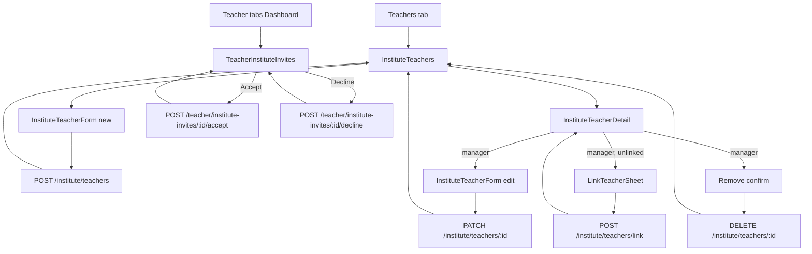
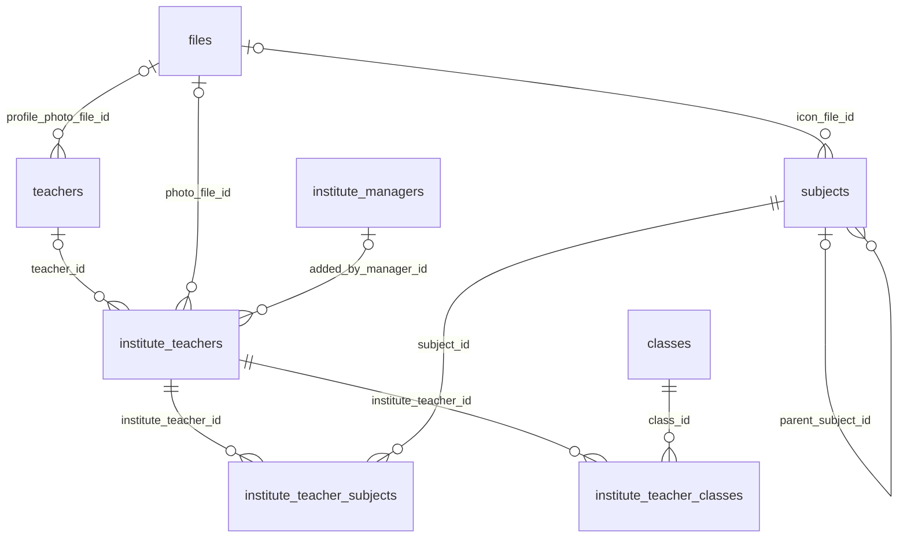

# Module 25 · Institute Teacher Management

> **Phase 5 · Institute** · **Used by:** Institute manager (add, edit, remove, assign, link), counsellor (view only), teacher (accept/decline a link invite from their own app) · **Depends on:** M00 (masters, uploads, bootstrap limits), M24 (manager role check), M16 (teacher verification status, for linking only approved teachers); Admin M26 · **New tables:** none · **Uses:** `institute_teachers`, `institute_teacher_subjects`, `institute_teacher_classes`, `teachers`, `institute_managers`, `subjects`, `classes`, `files`, `audit_logs` · **Build estimate:** 3–4 days

## 1. Module Purpose

Lets an institute manager build and maintain the faculty list shown on the institute's public profile: add a teacher by name and phone, assign their subjects and classes, edit or remove them, and — when a listed teacher already has their own approved GuruConnect profile — send them a link request that only the teacher can accept from their own app. It owns no new tables (`institute_teachers` and its subject/class join tables belong to Admin M26); this module is the only place the app writes to them, always through the manager-only check defined in M24. The 25-teacher limit, the `id_pending` display rule, and the teacher-side accept/decline flow are the trickiest parts.

## 2. User Stories

- As an **institute manager**, I want to add our six faculty members with their subjects and classes so that parents can see who teaches what.
- As a **manager**, I want to search for a teacher's GuruConnect code and link her listing to her verified profile so that her trust score shows on our page.
- As a **teacher who already has a GuruConnect profile**, I want to see and approve (or decline) an institute's request to link me so that I control what appears under my name.
- As a **manager**, I want to remove a teacher who left without deleting the historical record so that support can still see who taught what and when.
- As an **institute counsellor**, I want to see the faculty list (read-only) so that I can answer a parent's question about who teaches Class 12 Chemistry.

## 3. Business Rules & Logic

**BR-25.1 App rules.** Add / edit / remove / assign / link require an active `institute_managers` row with `staff_role = 'manager'` (M24 BR-24.1); counsellors get `FORBIDDEN` on every write and can only call the `GET` endpoints. Teachers only ever see their own pending invites (BR-25.6) — they can't browse or search institute teacher lists.

**BR-25.2 Add — `POST /institute/teachers`, one transaction.**
1. Caller is an active manager. `InstituteTeacherSchema`: `fullName` 2–100 chars, `phone` E.164, `qualification` ≤ 120 chars optional, `experienceYears` 0–60 optional, `photoFileId` optional (confirmed `teacher_photo` upload, `gc-public`), `subjectIds` 1–6 active `subjects`, `classIds` 1–10 active `classes`, `scheduleText` ≤ 120 chars, `isVisible` default `true`.
2. Phone uniqueness among this institute's non-removed rows is enforced by `uq_institute_teachers_phone`; a duplicate returns `409 CONFLICT_DUPLICATE`, `details.reason = "already_listed"`.
3. Soft abuse cap: at most 50 non-removed rows total (active + id_pending) per institute regardless of the teacher limit, so a manager can't spam invites — `409 CONFLICT_STATE`, `details.reason = "too_many_pending"`. This is separate from BR-25.7's 25-**active**-teacher limit, which is checked only when a row is about to become `active`.
4. `INSERT institute_teachers (institute_id, teacher_id = NULL, full_name, phone, qualification, experience_years, photo_file_id, schedule_text, status = 'id_pending', is_visible, added_by_manager_id = caller's staff id)`; `INSERT institute_teacher_subjects` / `institute_teacher_classes` for each id.
5. Send an SMS to the phone: "Apex JEE Academy added you as faculty on GuruConnect. Verify your identity: <link>." (the identity check itself is outside this app — Admin M26 FR-26.4 — see BR-25.7).
6. `INSERT audit_logs` `app.institute_teacher_added`.

**BR-25.3 Edit — `PATCH /institute/teachers/:id`, If-Match on `institute_teachers.updated_at`.**
- Manager only; the row must belong to the caller's institute and not be `removed` (`409 CONFLICT_STATE`, `details.reason = "removed"`).
- Editable: `fullName`, `qualification`, `experienceYears`, `photoFileId`, `scheduleText`, `isVisible`, and — replacing the full set — `subjectIds`/`classIds` (same limits as BR-25.2; omitted means unchanged).
- `phone` is **not** editable here (it's what the ID-check SMS and any pending link invite are keyed to); a wrong number is fixed by removing the row and adding a new one.
- `INSERT audit_logs` `app.institute_teacher_updated` (changed fields).

**BR-25.4 Remove — `DELETE /institute/teachers/:id { reason? }`.**
- Manager only; sets `status = 'removed'`, `removed_at = now()`, `removed_reason` (optional, ≤ 200 chars — shorter and optional here, unlike M24's disable reason, since it's the manager's own team). The row is never deleted (kept for history, matching the DB comment) and the phone becomes free for a new add. Any pending link invite for the row (BR-25.5) is cancelled. If `teacher_id` was set, it is left in place for history; the teacher's own profile is untouched.
- `INSERT audit_logs` `app.institute_teacher_removed`.

**BR-25.5 Link to an existing GuruConnect teacher — `POST /institute/teachers/link { instituteTeacherId, teacherCode }`.**
1. Manager only; the row must be `id_pending` or `active`, not `removed`, and not already linked (`teacher_id IS NULL`).
2. Look up `teachers` by `public_code` (case-insensitive, e.g. `GC-T10252`); it must be `verification_status = 'approved'` and `account_status = 'active'`, else `409 CONFLICT_STATE`, `details.reason = "teacher_not_approved"`.
3. Its `phone` must equal the institute teacher row's `phone` (normalised E.164); otherwise `409 CONFLICT_STATE`, `details.reason = "phone_mismatch"`, message "This code belongs to a different phone number." — a teacher can be listed under several institutes (Admin FR-26.5), so the check is about identity, not exclusivity.
4. No DB write yet: a pending invite is written to Redis, `inst-teacher-link:<instituteTeacherId> = { teacherId, teacherCode, requestedByManagerId, requestedAt }` (TTL 7 days) and the id is added to a set `teacher-link-invites:<teacherId>` (same TTL) so the teacher's own list can find it. `institute_teachers.teacher_id` is only set on acceptance (BR-25.6).
5. Push to the teacher if they have a registered device (BR-25.6's events); `INSERT audit_logs` `app.institute_teacher_link_requested`.
6. A manager can re-send the same link request at any time (overwrites the Redis entry and its TTL); cancelling is implicit — removing the institute teacher row (BR-25.4) also deletes the Redis key.

**BR-25.6 Teacher side — `GET /teacher/institute-invites`, `POST /teacher/institute-invites/:instituteTeacherId/accept`, `.../decline`.**
- `GET` lists every non-expired Redis invite in the caller teacher's set: institute name, logo, requested date, days left.
- **Accept**, one transaction: verify the Redis key still names this `teacherId`; re-check the 25-active-teacher limit for that institute (BR-25.7) — over the limit, the accept fails with `409 LIMIT_REACHED`, `details.reason = "institute_max_teachers"` and the invite stays pending (the manager is told to make room); otherwise `UPDATE institute_teachers SET teacher_id, status = 'active'`, delete the Redis key and set entry, `INSERT audit_logs` `app.institute_teacher_linked`, notify the requesting manager.
- **Decline**: deletes the Redis key and set entry only, no table write; notifies the requesting manager. A declined institute teacher row stays `id_pending` and unlinked; the manager may try again later (e.g. after confirming the right code with the teacher).
- An invite left untouched for 7 days simply disappears from `GET /teacher/institute-invites` (Redis TTL); the manager re-sends it to renew.

**BR-25.7 The 25-teacher limit and `id_pending` → `active`.** `limits.institute_max_teachers` (read from `GET /bootstrap`, M01 — public setting, default **25**) counts only rows with `status = 'active'` for the institute. A row becomes `active` in exactly two ways, both re-checking the limit at the moment of transition: (a) accepting a link invite (BR-25.6) or (b) completing GuruConnect's lightweight ID check outside this app (Admin M26 FR-26.4 — a phone-verified Aadhaar/PAN self-declaration, not a screen this module owns; support can also flip it manually). Adding a teacher (BR-25.2) never itself hits the limit, since new rows start `id_pending`. `GET /institute/teachers` returns `meta.activeCount`/`meta.limit` so the manager sees how much room is left before inviting more.

**BR-25.8 Public display rule (read by M32, informational here).** A row appears on the institute's public profile only when `is_visible = true` and `status <> 'removed'`: `active` rows show the Verified tick (and the linked teacher's trust score, if any); `id_pending` rows show without the tick. `removed` rows never appear regardless of `is_visible`.

**BR-25.9 Rate limits.** `POST /institute/teachers` 20/day per institute; `POST /institute/teachers/link` 10/day per institute; `PATCH`/`DELETE` 60/day.

## 4. Screen List

| Screen | Route name | Purpose |
| --- | --- | --- |
| Teachers list | `InstituteTeachers` | Faculty list with status, subjects/classes, add button |
| Teacher form | `InstituteTeacherForm` | Add or edit one institute teacher (name, phone, subjects, classes, schedule) |
| Teacher detail | `InstituteTeacherDetail` | Read view for counsellors; managers see Edit/Remove/Link here |
| Link teacher sheet | `LinkTeacherSheet` (bottom sheet) | Enter a GuruConnect teacher code to send a link request |
| Institute invites (teacher app) | `TeacherInstituteInvites` | A teacher's pending link requests from institutes, accept/decline |

## 5. Screen Flow & Navigation


Back from `InstituteTeacherForm` without saving asks "Discard changes?" only if a field was touched. `TeacherInstituteInvites` is reached from a push tap or from the teacher's Notifications inbox; it has no tab of its own.

## 6. Screen Wireframe Description

**InstituteTeachers** — header "Teachers", subtitle "6 of 25 active". Sticky "+ Add teacher" (managers). Each card: photo/initials, name, subjects chips ("Physics, Chemistry"), classes ("Class 11, Class 12, Droppers"), status pill (Active with a small Verified tick and linked trust score "Trust 90" when linked · Pending ID check · greyed "Hidden" when `isVisible=false`), schedule line. Empty: illustration, "No teachers yet", "Add your faculty so parents can see who teaches.", button "Add your first teacher".

**InstituteTeacherForm** — header "Add teacher" / "Edit teacher". Fields: "Full name" (placeholder "e.g. Imran Qureshi"), "Mobile" (`PhoneField`, locked once saved with helper "To change the number, remove and re-add this teacher"), "Qualification" (placeholder "e.g. M.Sc. Chemistry"), "Experience (years)" (number pad), "Photo" (avatar picker), "Subjects" (chip multi-select, 1–6, opens a `SubjectSheet`), "Classes" (chip multi-select, 1–10), "Schedule" (placeholder "e.g. Weekdays 4–7 PM"), "Show on our public profile" switch. Sticky "Save teacher" / "Add teacher".

**InstituteTeacherDetail** — header = teacher name, status pill. Info rows (qualification, experience, subjects, classes, schedule). "Linked GuruConnect profile" card when `teacherId` is set: code, trust score, "View profile" link; when unlinked and a manager is viewing: "Link to a GuruConnect profile" button → `LinkTeacherSheet`. Managers see "Edit" and a red "Remove teacher" at the bottom (confirm sheet with an optional reason field). Counsellors see the same screen with no action buttons.

**LinkTeacherSheet** — title "Link Imran Qureshi to GuruConnect", field "Teacher code" (placeholder "e.g. GC-T10252", uppercase), helper "Ask the teacher for their code from their GuruConnect profile.", sticky "Send request". Success state: "Request sent — Imran will confirm in the GuruConnect app."

**TeacherInstituteInvites** — header "Institute requests". Each card: institute logo, name, area, "Wants to list you as faculty · 3 days left", buttons "Accept" and "Decline" (secondary, opens a one-line optional reason field before confirming). Empty: "No pending requests."

## 7. UI Components & Component Tree

```
InstituteTeachersScreen
├─ HeaderCounts ("6 of 25 active")
├─ TeacherCard × n → InstituteTeacherDetailScreen
└─ StickyActionBar "Add teacher" → InstituteTeacherFormScreen
InstituteTeacherFormScreen (PhoneField locked-after-save, SubjectSheet, ClassSheet, PhotoPicker)
InstituteTeacherDetailScreen
├─ InfoRows · LinkedProfileCard | LinkPromptCard → LinkTeacherSheet
└─ DangerZone (Edit, Remove)
TeacherInstituteInvitesScreen
└─ InviteCard × n (Accept, Decline)
```
- `TeacherCard({ teacher, onPress })`, `StatusPill({ status, isVisible })`.
- `LinkTeacherSheet({ instituteTeacherId, onSent })`.
- `InviteCard({ invite, onAccept, onDecline })`.
- Hooks: `useInstituteTeachersQuery()`, `useCreateInstituteTeacherMutation()`, `useUpdateInstituteTeacherMutation()`, `useRemoveInstituteTeacherMutation()`, `useLinkInstituteTeacherMutation()`, `useTeacherInstituteInvitesQuery()`, `useAcceptInstituteInviteMutation()`, `useDeclineInstituteInviteMutation()`.

## 8. Validation Rules

Shared schema: `InstituteTeacherSchema` (add/edit share it; `phone` immutable after create is enforced server-side, not in the schema).

| Field | Rule | Message shown |
| --- | --- | --- |
| fullName | 2–100 chars | "Enter the teacher's full name." |
| phone | E.164; unique among this institute's non-removed teachers | "This teacher is already listed." |
| qualification | ≤ 120 chars | "Keep it under 120 characters." |
| experienceYears | 0–60 | "Enter years between 0 and 60." |
| subjectIds | 1–6 active subjects | "Choose 1 to 6 subjects." |
| classIds | 1–10 active classes | "Choose 1 to 10 classes." |
| scheduleText | ≤ 120 chars | "Keep it under 120 characters." |
| teacherCode (link) | active `teachers.public_code`, approved, matching phone | "This code belongs to a different phone number." / "This teacher isn't verified yet." |
| removed reason | ≤ 200 chars, optional | "Keep it under 200 characters." |

## 9. API Endpoints

| Method | Path | Auth | Description |
| --- | --- | --- | --- |
| GET | /institute/teachers | Institute staff | Faculty list with counts and limit |
| POST | /institute/teachers | Institute staff (manager) | Add a teacher. 20/day |
| PATCH | /institute/teachers/:id | Institute staff (manager) | Edit fields and/or reassign subjects/classes (If-Match) |
| DELETE | /institute/teachers/:id | Institute staff (manager) | Remove (soft) with an optional reason |
| POST | /institute/teachers/link | Institute staff (manager) | Request a link to an approved GuruConnect teacher by code. 10/day |
| GET | /teacher/institute-invites | Teacher | Pending link requests for the caller |
| POST | /teacher/institute-invites/:id/accept | Teacher | Accept — sets `teacher_id`, `status = active` |
| POST | /teacher/institute-invites/:id/decline | Teacher | Decline — cancels the request, no table change |

Uses: M00 `GET /masters` (subjects, classes), `GET /bootstrap` (`limits.institute_max_teachers`), `POST /uploads/presign`/`confirm` (teacher photo); M24 (`institute_managers` role check); M16 (`teachers.verification_status`/`account_status` for linking).

## 10. Request Payloads

```json
// POST /institute/teachers
{ "fullName": "Imran Qureshi", "phone": "+919845098450", "qualification": "M.Sc. Chemistry", "experienceYears": 12,
  "subjectIds": ["…physics…"], "classIds": ["…class-11…", "…class-12…", "…droppers…"], "scheduleText": "Weekdays 4–7 PM", "isVisible": true }

// PATCH /institute/teachers/:id   (If-Match: "2026-09-20T08:00:00.000Z")
{ "classIds": ["…class-11…", "…class-12…"], "scheduleText": "Weekdays 4–8 PM" }

// DELETE /institute/teachers/:id
{ "reason": "Left in August" }

// POST /institute/teachers/link
{ "instituteTeacherId": "…", "teacherCode": "GC-T10252" }

// POST /teacher/institute-invites/:id/accept
{}
```

## 11. Response Payloads

```json
// 200 GET /institute/teachers
{ "data": [ { "id": "…", "fullName": "Imran Qureshi", "phone": "+91 98450 98450", "qualification": "M.Sc. Chemistry", "experienceYears": 12,
  "subjects": ["Physics"], "classes": ["Class 11", "Class 12", "Droppers"], "status": "active", "isVisible": true,
  "linkedTeacher": { "id": "…", "publicCode": "GC-T10252", "trustScore": 90 }, "scheduleText": "Weekdays 4–7 PM" } ],
  "meta": { "activeCount": 6, "limit": 25 } }

// 201 POST /institute/teachers
{ "data": { "id": "…", "fullName": "Imran Qureshi", "status": "id_pending", "createdAt": "…" } }

// 409 link with a mismatched phone
{ "error": { "code": "CONFLICT_STATE", "message": "This code belongs to a different phone number.",
  "details": { "reason": "phone_mismatch" }, "requestId": "…" } }

// 200 GET /teacher/institute-invites
{ "data": [ { "instituteTeacherId": "…", "institute": { "id": "…", "name": "Apex JEE Academy", "logoUrl": "…", "area": "Koramangala" },
  "requestedAt": "2026-09-24T06:00:00Z", "expiresAt": "2026-10-01T06:00:00Z" } ] }

// 409 accept over the teacher limit
{ "error": { "code": "LIMIT_REACHED", "message": "This institute has reached its teacher limit.",
  "details": { "reason": "institute_max_teachers", "limit": 25 }, "requestId": "…" } }
```

## 12. PostgreSQL Tables & Columns


**Existing tables this module reads or writes** (full definitions in the owning module)

| Table | Owner | Purpose |
| --- | --- | --- |
| `institute_teachers` | Admin M26 | Teachers listed under an institute. Added, edited and removed only by an institute manager (or an admin). |
| `institute_teacher_subjects` | Admin M26 | Subjects assigned to an institute teacher. |
| `institute_teacher_classes` | Admin M26 | Classes assigned to an institute teacher. |
| `teachers` | Admin M16 | Teacher profile and verification state. One row per teacher app account. |
| `institute_managers` | Admin M25 | App accounts that act for an institute. Exactly one active primary manager; counsellors can only handle leads. |
| `subjects` | Admin M12 | Subjects, exams and skills teachers can teach. |
| `classes` | Admin M11 | Grades and levels learners study at, from Class 1 to competitive exam preparation. |
| `files` | Admin M00 | Metadata for every uploaded object stored in S3 / Cloudflare R2. Binary content never touches PostgreSQL. |
| `audit_logs` | Admin M00 | Append-only record of every admin action and security event. Never updated or deleted by the application. |

- `institute_teachers`: this module inserts (add), updates (edit, link accept, remove) and reads every row of the caller's institute; `teacher_id` is set only on link acceptance, never directly by `PATCH`.
- `institute_teacher_subjects` / `institute_teacher_classes`: replaced wholesale on add/edit (delete-then-insert in the same transaction) inside `packages/shared`'s `InstituteTeacherSchema` validated set.
- `teachers`: read-only, to validate a link's target (`public_code`, `verification_status`, `account_status`, `phone`) and to show the linked trust score.
- `institute_managers`: read-only, for the manager role check (M24) and `added_by_manager_id`.
- The pending-link invite itself is **not** a database row — it lives in Redis (BR-25.5/25.6) with a 7-day TTL, so an invite that is never answered simply disappears without leaving a stale table row.

## 13. Relationships


**Entity relationship diagram** (tables this module uses; `admins` omitted)



## 14. State Management

- Query keys: `instituteTeacherKeys.list`, `teacherInvitesKeys.mine` (teacher side). Persisted; `staleTime` 30 s.
- After add/edit/remove/link: invalidate `instituteTeacherKeys.list`, `dashboardKeys.institute` (M23 counts and tasks).
- After accept/decline: invalidate `teacherInvitesKeys.mine`; accept also invalidates the teacher's own `teacherKeys.dashboard` (M18, now listed under one more institute) and, for the institute side, a push-triggered refetch of `instituteTeacherKeys.list`.
- `isVisible` toggle is optimistic (reversible, idempotent); everything else waits for the server.

## 15. Offline Handling

- Teacher list and detail render from cache with "Updated …".
- Add, edit, remove and link are class 2 (save draft, submit online): the form keeps values while offline, submit disabled with a hint.
- Teacher accept/decline are class 3 (online only, security-adjacent — they change what's shown under the teacher's name) — buttons disabled offline.

## 16. Push Notification Requirements

| Event | Recipient | Title / Body | Deep link | Category | Urgent |
| --- | --- | --- | --- | --- | --- |
| Link request sent | Teacher (if a device is registered) | "Apex JEE Academy wants to list you" / "Confirm or decline in 2 taps." | `/teacher/institute-invites` | account | No |
| Link accepted | Requesting manager and primary manager | "Imran Qureshi confirmed" / "He's now listed as verified faculty." | `/institute/teachers` | account | No |
| Link declined | Requesting manager | "Request declined" / "Imran Qureshi declined the link request." | `/institute/teachers` | account | No |
| Teacher limit reached on accept | Primary manager | "Teacher limit reached" / "Remove a teacher or contact us to add more than 25." | `/institute/teachers` | account | No |

## 17. Security Rules

- Every endpoint scopes writes by `iid` from the token; a `:id` from another institute returns `NOT_FOUND`.
- Manager-only enforcement is the same check as M24 (`institute_managers.staff_role = 'manager'`, `status = 'active'`); counsellors get `FORBIDDEN`, not a hidden button.
- Teacher accept/decline check the Redis invite's `teacherId` against the caller's own `pid`; a teacher can never act on another teacher's invite even with a guessed `instituteTeacherId`.
- Linking requires an exact phone match (BR-25.5.3) so a manager cannot attach an institute listing to an unrelated approved teacher just by knowing their code.
- The full PAN/Aadhaar the ID-check flow may collect never touches this module or its logs; it is handled entirely by the process referenced in BR-25.7(b).

## 18. Error Handling

| Scenario | Code | HTTP | App behaviour |
| --- | --- | --- | --- |
| Counsellor calls a write endpoint | `FORBIDDEN` | 403 | Toast "Only a manager can manage teachers." |
| Duplicate phone in this institute | `CONFLICT_DUPLICATE` (`already_listed`) | 409 | Inline "This teacher is already listed." |
| Too many pending/active rows | `CONFLICT_STATE` (`too_many_pending`) | 409 | "Remove someone before adding more." |
| Link: teacher not approved | `CONFLICT_STATE` (`teacher_not_approved`) | 409 | "This teacher isn't verified yet." |
| Link: phone mismatch | `CONFLICT_STATE` (`phone_mismatch`) | 409 | "This code belongs to a different phone number." |
| Accept over the 25-teacher limit | `LIMIT_REACHED` (`institute_max_teachers`) | 409 | Teacher sees "This institute is full right now."; manager gets the reminder push |
| Invite expired (7 days) | `NOT_FOUND` | 404 | Row simply absent from the invites list; manager can re-send |
| Edit/remove a removed row | `CONFLICT_STATE` (`removed`) | 409 | Refetch, row shows Removed |
| Stale edit | `VERSION_CONFLICT` | 409 | "Updated on another device. Review and save again." |
| Network / 5xx | `GATEWAY_ERROR` / `INTERNAL_ERROR` | 502 / 500 | Retry; form values kept |

## 19. Testing Scenarios

- T25.1 Happy path (Maestro `institute_teacher_add`): manager adds a teacher with 2 subjects and 3 classes → `id_pending` row, subject/class rows inserted, SMS sent (test double).
- T25.2 Duplicate phone in the same institute → `already_listed`; same phone at a different institute succeeds.
- T25.3 Link flow: manager sends a link with a matching phone and approved code → Redis invite created; teacher's `GET /teacher/institute-invites` lists it; teacher accepts → `teacher_id` set, `status = active`, both notified.
- T25.4 Link with a mismatched phone → `phone_mismatch`; with an unapproved teacher code → `teacher_not_approved`.
- T25.5 Teacher declines → no `institute_teachers` change; manager gets the decline push; manager can re-send later.
- T25.6 Accept when the institute already has 25 active teachers → `institute_max_teachers`; invite remains listed for the teacher.
- T25.7 Invite left 8 days → gone from `GET /teacher/institute-invites` (TTL expired); manager re-sends successfully.
- T25.8 Counsellor calls every write endpoint → 403 on each; `GET /institute/teachers` still works for them.
- T25.9 Edit reassigns subjects/classes → old join rows replaced, not accumulated (count matches the new set exactly).
- T25.10 Remove a linked teacher → `status = removed`, `teacher_id` left as-is for history; the phone can be reused for a new add.
- T25.11 `isVisible = false` teacher with `active` status is fetched by `GET /institute/teachers` but is documented (BR-25.8) as excluded from M32's public profile query.
- T25.12 Stale `If-Match` on edit → `VERSION_CONFLICT`.

## 20. Audit Log Events

| Event | When | Details |
| --- | --- | --- |
| `app.institute_teacher_added` | Teacher added | phone (masked), subjects, classes |
| `app.institute_teacher_updated` | Fields or assignments changed | changed fields |
| `app.institute_teacher_removed` | Teacher removed | reason (if given) |
| `app.institute_teacher_link_requested` | Manager sent a link request | teacher code |
| `app.institute_teacher_linked` | Teacher accepted a link | teacher id, public code |

## 21. Future Scalability Notes

- An in-app identity check for directly-added (unlinked) institute teachers, instead of relying on the external lightweight flow (Admin M26 FR-26.4) to move them out of `id_pending`.
- Per-batch teacher assignment (which teacher teaches which `institute_batches` row) once batches carry a teacher reference.
- Bulk import (CSV) of a faculty list for onboarding a large institute.
- Teacher-visible history of which institutes have listed them, with an option to unlink themselves.
- Public faculty change history on the profile ("3 new teachers this term").
- Admin portal additions: none; Admin M26 already covers support overrides and the cross-institute phone/teacher search.
