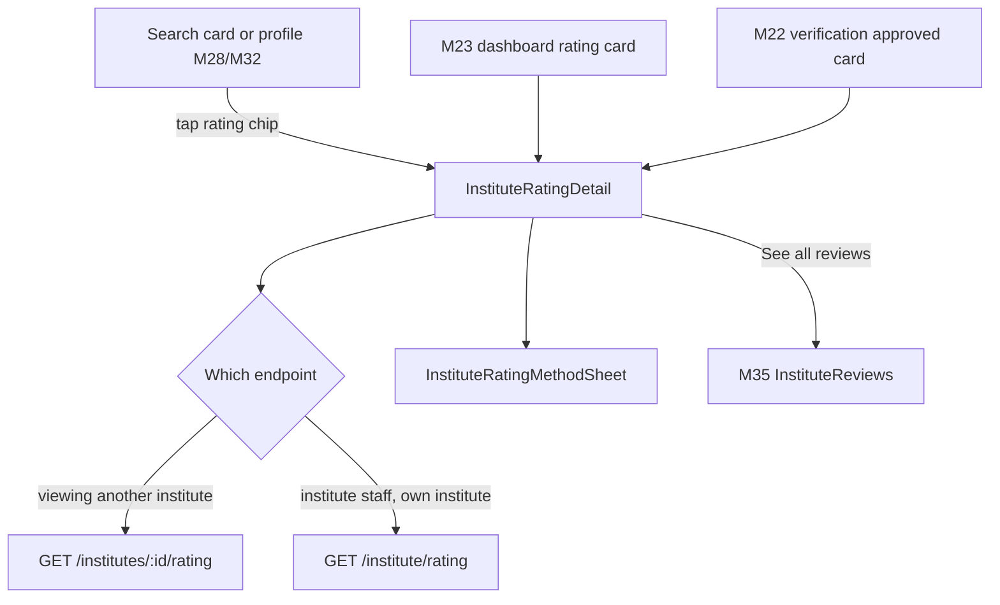
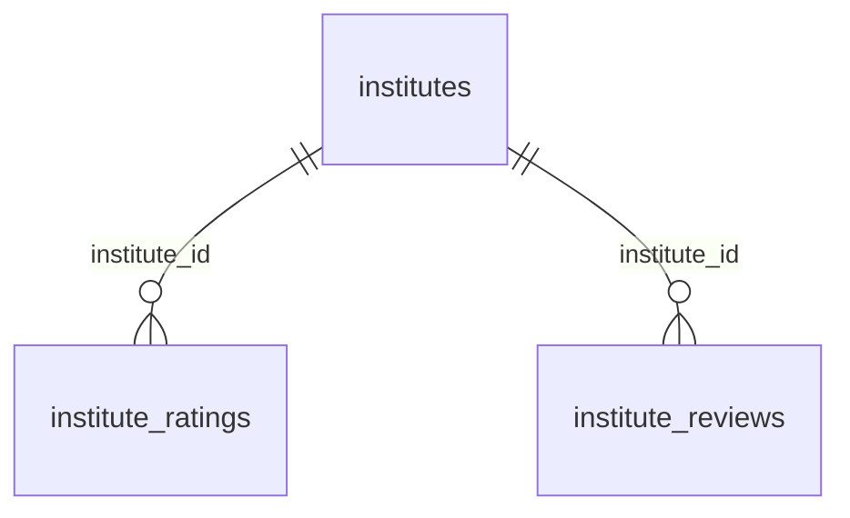

# Module 26 · Institute Rating Display

> **Phase 5 · Institute** · **Used by:** Any signed-in user and limited public viewers (see the rating on a profile, search card or share link), institute staff (see the same numbers plus the next review date and history) · **Depends on:** M00, M22 (verification produces the first rating), M23 (embeds the rating card); Admin M27, Admin M34 · **New tables:** none · **Uses:** `institutes`, `institute_ratings`, `institute_reviews` · **Build estimate:** 2–3 days

## 1. Module Purpose

Displays GuruConnect's own evaluation of an institute — Infrastructure, Faculty and Overall ratings, sourced from the **current** row of `institute_ratings` (Admin M27) — next to, but never mixed with, the separate average of parent and student reviews (`institutes.user_rating_avg`/`user_rating_count`, Admin M34). It is the single place the mobile app reads a rating summary from, so M22's verification screen, M23's dashboard, M32's profile view and M35's institute reviews screen all call the same shape. Institute staff additionally see when the rating was last updated, when the next re-evaluation is due, and a short version history — information a parent never sees.

## 2. User Stories

- As a **parent comparing two coaching centres**, I want to see GuruConnect's Infrastructure and Faculty scores, not just star reviews, so that I get an independent signal alongside what other parents said.
- As a **parent**, I want the GuruConnect rating and the parent-review average kept clearly separate so that I don't mistake one for the other.
- As an **institute manager**, I want to see exactly when we'll next be re-evaluated so that I can prepare the campus in time.
- As a **manager whose infrastructure score dropped**, I want to read the public summary GuruConnect wrote so that I understand what to improve.
- As **any signed-in user browsing search results**, I want a quick rating chip on each card so that I can shortlist without opening every profile.

## 3. Business Rules & Logic

**BR-26.1 What's shown, and where.**

| Surface | Fields | Source |
| --- | --- | --- |
| Search card / list row (M28) | `InstituteRatingChip` — overall rating only (★ 4.5) or "Not yet rated" | `institutes.overall_rating` |
| Profile header (M32) | `InstituteRatingChip` + user rating badge, separately labelled | `institutes.overall_rating`, `user_rating_avg`/`user_rating_count` |
| Verification status (M22) | Same chip plus `badge` once approved | this module's summary service |
| Dashboard rating card (M23) | Chip + `ScoreBars` (Infrastructure, Faculty) | this module's summary service |
| `InstituteRatingDetail` (public) | Overall, Infrastructure, Faculty, evaluation method + date, public summary, badge, user review average with distribution link (M35), 3 latest published reviews preview | `GET /institutes/:id/rating` |
| `InstituteRatingDetail` (institute staff, own institute) | Everything above **plus** next review date, a short history of past overall ratings by date | `GET /institute/rating` |
Only these three numbers ever leave the server for a rating: **overall** (1–5, half steps), **infrastructure** (0–10) and **faculty** (0–10) — `institute_ratings.student_feedback_score`, `trustworthiness_score`, `criteria`, `notes` and `rated_by` are never returned to the app at any role, matching Admin M27 FR-27.5.

**BR-26.2 Summary service (`InstituteRatingService.summary(instituteId, { asStaff })`), used by this module's two endpoints and read directly by M22 and M23.**
1. Load `institutes` (`overall_rating`, `infrastructure_score`, `faculty_score`, `is_verified_badge`, `user_rating_avg`, `user_rating_count`) and the current `institute_ratings` row (`is_current = true`) if one exists.
2. No current row (institute not yet evaluated — always true before the first evaluation, and possible briefly right after `evaluation_done` if the draft hasn't been submitted): return `hasRating: false` with a friendly placeholder; every numeric field is `null`. This is a normal `200`, not an error.
3. With a current row: `overall`, `infrastructure`, `faculty` from the cached `institutes` columns (kept in lock-step with `institute_ratings` by Admin M27 FR-27.3, so this module never recomputes them); `evaluationMethod`, `evaluatedAt` (`submitted_at`), `publicSummary` from the current `institute_ratings` row itself (not cached on `institutes`).
4. `asStaff = true` adds `nextReviewDue` (`institute_ratings.next_review_due`) and `history` — up to 5 rows, `{ version, overall, evaluatedAt }`, newest first, from all `institute_ratings` rows of the institute regardless of `status`.
5. Result is cached in Redis 5 minutes per `(instituteId, asStaff)`; a webhook from Admin M27's submit step (FR-27.3) purges both cache entries for that institute.

**BR-26.3 `GET /institutes/:id/rating` (Any user, limited for signed-out/shared-link viewers).** Public summary (BR-26.2 step 3) plus `userRating: { avg, count }` and, when `count ≥ 3`, `recentReviews`: the 3 latest `institute_reviews` rows with `status = 'published'`, newest first (`{ id, rating, comment excerpt (≤ 140 chars), authorType, publishedAt }` — no author name, matching M35's masking). Institute soft-deleted → `404 NOT_FOUND`. A suspended institute (`account_status = 'suspended'`) still returns its rating (rating and suspension are independent; M32 shows the suspension banner separately).

**BR-26.4 `GET /institute/rating` (Institute staff, any role — managers and counsellors both just view).** Same payload as BR-26.3 for the caller's own `iid`, plus `nextReviewDue` and `history` (BR-26.2 step 4). When `nextReviewDue` is within 30 days, the response adds `reviewDueSoon: true` so the app can show an informational line — never a task or a blocking banner, since re-evaluation scheduling is entirely Admin M27's process.

**BR-26.5 Never mixing the two numbers.** Every screen that shows both labels them separately — "4.5 GuruConnect rating" and "4.7 from 486 parent & student reviews" — and never averages or re-weights them client-side (BR-35.8 states the same rule from the reviews side; this module is where the rule is defined once and both screens follow it).

**BR-26.6 Formatting.** Overall rating: one decimal out of 5 (`"4.5"`, never "4.50"). Infrastructure/Faculty: one decimal out of 10. `evaluationMethod` maps to copy: `site_visit` → "Evaluated by an in-person visit", `video_walkthrough` → "Evaluated by video walkthrough", `document_only` → "Evaluated from documents". `publicSummary` is shown verbatim (already validated ≤ 200 chars, no contact details, by Admin M27) inside a quote card; `null` hides the card entirely rather than showing an empty one.

**BR-26.7 Badge.** `badge` mirrors `institutes.is_verified_badge`, granted and revoked only by Admin M23 (never by this module); it is shown next to the rating chip whenever true, independent of the numeric scores (a badge can in principle be revoked — e.g. for a policy issue — while the last rating stays on file, or a fresh rating can exist a few hours before the badge is (re-)granted).

**BR-26.8 Caching and freshness.** Both endpoints are Redis-cached 5 minutes per institute (BR-26.2 step 5); the app additionally treats the response as a persisted query with a 5-minute `staleTime`, so opening the same profile twice in a session rarely refetches. Pull-to-refresh on `InstituteRatingDetail` bypasses both caches once per 30 seconds.

**BR-26.9 Rate limits.** Default limits (conventions §5) apply; no endpoint here writes anything, so there is nothing to rate-limit beyond abuse of the public `GET`.

## 4. Screen List

| Screen | Route name | Purpose |
| --- | --- | --- |
| Rating detail | `InstituteRatingDetail` | Full breakdown: scores, evaluation date, public summary, user review summary, recent reviews; staff variant adds next review date and history |
| How we rate institutes | `InstituteRatingMethodSheet` (bottom sheet) | Plain-language explainer of the four criteria and the 1–5 scale |

## 5. Screen Flow & Navigation


`InstituteRatingDetail` never edits anything, so there is no save/cancel state; back always returns to whichever card opened it.

## 6. Screen Wireframe Description

**InstituteRatingDetail (public)** — header "Apex JEE Academy's rating". Hero: big "4.5" with 5-star graphic, "GuruConnect rating" label, Verified badge chip if applicable, "Evaluated by an in-person visit · 14 Aug 2026". Two `ScoreBars` rows: "Infrastructure 8.8/10", "Faculty 9.1/10" (each bar 0–10, filled proportionally, number at the end — colour never the only signal, a numeric label always shown). Quote card (when present): "Well-run NEET centre with a separate biology lab." Divider. "What parents & students say" section: "4.7 ★ · 486 reviews" with a link "See all reviews" (→ M35), and up to 3 short review snippets ("★★★★★ · Faculty for JEE Physics is excellent… — Parent"). Footer link "How we rate institutes" → `InstituteRatingMethodSheet`. Not-yet-rated state: illustration, "Not yet rated by GuruConnect", body "This institute hasn't completed GuruConnect's evaluation yet.", and — for staff only — a status line reusing M22's verification copy with a link to `InstituteVerification`.

**InstituteRatingDetail (institute staff, own institute)** — same layout with an added card above the footer: "Next evaluation" — "Due around 14 Aug 2027" (or, when `reviewDueSoon`, an amber "Due in 12 days"), and a small "Rating history" list (version chips, e.g. "v2 · 4.5 · 14 Aug 2026", "v1 · 4.0 · 20 Jul 2025"), read-only.

**InstituteRatingMethodSheet** — title "How we rate institutes", four short rows with icons: "Infrastructure — classrooms, safety, labs and hygiene", "Faculty — qualifications, experience and demo classes", "Student feedback — from published reviews" (not shown as a number, explained as a contributing factor), "Trustworthiness — documents, complaints and fee transparency", closing line "GuruConnect's team evaluates every institute in person or by video before it's Verified.", close button "Got it".

## 7. UI Components & Component Tree

```
InstituteRatingDetailScreen
├─ RatingHero (overall, stars, VerifiedBadge, evaluation line)
├─ ScoreBars (infrastructure, faculty)
├─ PublicSummaryCard (hidden when null)
├─ NextReviewCard (staff only)
├─ RatingHistoryList (staff only)
├─ UserReviewSummaryRow (avg, count) → M35 InstituteReviews
├─ RecentReviewSnippet × ≤3
└─ MethodologyLink → InstituteRatingMethodSheet
InstituteRatingChip (used inline in M22/M23/M28/M32) — not a screen of its own
```
- `InstituteRatingChip({ overall, hasRating, size: 'sm'|'md', showLabel })` — the small badge embedded elsewhere; M35's screens call the same component under the alias `GuruConnectRatingBadge` (same props, same file) so both names resolve to one implementation.
- `ScoreBars({ infrastructure, faculty })` — accessible summary label, e.g. "Infrastructure 8.8 out of 10, Faculty 9.1 out of 10".
- `RatingHistoryList({ items })` — staff only, read-only.
- Hooks: `useInstituteRatingQuery(instituteId?)` — calls `GET /institute/rating` when `instituteId` is omitted and the caller is institute staff, otherwise `GET /institutes/:id/rating`; `useInstituteRatingMethodCopy()` (static content, no network).

## 8. Validation Rules

No user input — this module only reads. The single parameter, `instituteId` in the path, is validated as an existing, non-deleted institute; an unknown or malformed id returns `404 NOT_FOUND` rather than `422`, since it's a route parameter, not a form field.

## 9. API Endpoints

| Method | Path | Auth | Description |
| --- | --- | --- | --- |
| GET | /institutes/:id/rating | Any user (public, limited for signed-out) | Public rating summary, user review average, up to 3 recent reviews |
| GET | /institute/rating | Institute staff | Same summary for the caller's own institute, plus next review date and history |

Uses: M35 `GET /institutes/:id/reviews` (full list, when the user taps "See all reviews"); read by M22 `GET /institute/verification` (`rating` field), M23 `GET /institute/dashboard` (`kpis.rating`), M32 `GET /institutes/:idOrSlug` (profile header) — all three embed this module's summary shape rather than calling it a second time from the client.

## 10. Request Payloads

```json
// GET /institutes/:id/rating
// GET /institute/rating
```

## 11. Response Payloads

```json
// 200 GET /institutes/:id/rating
{ "data": { "hasRating": true, "overall": 4.5, "infrastructure": 8.8, "faculty": 9.1,
  "evaluationMethod": "site_visit", "evaluatedAt": "2026-08-14T05:00:00Z", "publicSummary": "Well-run NEET centre with a separate biology lab.",
  "badge": true, "userRating": { "avg": 4.7, "count": 486 },
  "recentReviews": [ { "id": "…", "rating": 5, "comment": "Faculty for JEE Physics is excellent, small batch sizes really help.", "authorType": "parent", "publishedAt": "2026-09-20T10:00:00Z" } ] } }

// 200 GET /institutes/:id/rating   (not yet evaluated)
{ "data": { "hasRating": false, "overall": null, "infrastructure": null, "faculty": null, "publicSummary": null, "badge": false,
  "userRating": { "avg": null, "count": 0 }, "recentReviews": [] } }

// 200 GET /institute/rating   (staff, excerpt)
{ "data": { "hasRating": true, "overall": 4.5, "infrastructure": 8.8, "faculty": 9.1, "evaluationMethod": "site_visit", "evaluatedAt": "2026-08-14T05:00:00Z",
  "nextReviewDue": "2027-08-14", "reviewDueSoon": false,
  "history": [ { "version": 2, "overall": 4.5, "evaluatedAt": "2026-08-14T05:00:00Z" }, { "version": 1, "overall": 4.0, "evaluatedAt": "2025-07-20T05:00:00Z" } ],
  "badge": true, "userRating": { "avg": 4.7, "count": 486 } } }

// 404 unknown institute
{ "error": { "code": "NOT_FOUND", "message": "This is no longer available.", "requestId": "…" } }
```

## 12. PostgreSQL Tables & Columns


**Existing tables this module reads or writes** (full definitions in the owning module)

| Table | Owner | Purpose |
| --- | --- | --- |
| `institutes` | Admin M22 | Coaching centres, tuition centres, schools and academies. Rated by GuruConnect after verification. |
| `institute_ratings` | Admin M27 | Evaluations by GuruConnect admins. The latest submitted version is current and drives the public rating. |
| `institute_reviews` | Admin M34 | Reviews of institutes by parents and students. |

- `institutes`: reads `overall_rating`, `infrastructure_score`, `faculty_score`, `is_verified_badge`, `user_rating_avg`, `user_rating_count` — all cached by Admin M27/M34, never written here.
- `institute_ratings`: reads the current row (`is_current = true`) for `evaluation_method`, `visit_at`/`submitted_at`, `public_summary`, `next_review_due`; reads up to 5 non-current rows for the staff-only history. `criteria`, `notes`, sub-scores and `rated_by` are never selected into the response DTO.
- `institute_reviews`: reads up to 3 latest `status = 'published'` rows for the recent-reviews preview; no write access.

## 13. Relationships


**Entity relationship diagram** (tables this module uses; `admins` omitted)



## 14. State Management

- Query keys: `ratingKeys.public(instituteId)`, `ratingKeys.mine`. Persisted; `staleTime` 5 minutes, matching the server cache.
- No mutations, so no invalidation rules of its own; other modules invalidate these keys when they know a rating changed — M23 already lists `verification` push category as a dashboard-refresh trigger, which covers a fresh rating too.

## 15. Offline Handling

- Fully readable offline from cache with "Updated …"; a first-ever open with no cache shows the standard error state with Retry.
- No writes exist in this module.

## 16. Push Notification Requirements

| Event | Recipient | Title / Body | Deep link | Category | Urgent |
| --- | --- | --- | --- | --- | --- |
| New GuruConnect rating submitted (Admin M27 FR-27.3) | All active managers | "Your GuruConnect rating is 4.5" / "Read what our evaluator noted about Apex JEE Academy." | `/institute/rating` | verification | No |
| Re-evaluation due in 14 days (Admin M27 FR-27.6, informational) | Primary manager | "Your next evaluation is coming up" / "GuruConnect will re-evaluate Apex JEE Academy around 14 Aug 2027." | `/institute/rating` | verification | No |

## 17. Security Rules

- The public endpoint never returns `notes`, `criteria`, sub-scores other than infrastructure/faculty, or `rated_by`; `GET /institute/rating` adds only `nextReviewDue` and `history` (both harmless to the institute's own staff) — the private fields stay withheld even for staff.
- `GET /institute/rating` scopes strictly by the caller's `iid`; there is no way to pass another institute's id to this endpoint.
- No PII is involved; recent-review snippets reuse M35's existing masking (no author name).

## 18. Error Handling

| Scenario | Code | HTTP | App behaviour |
| --- | --- | --- | --- |
| Institute not found or deleted | `NOT_FOUND` | 404 | "This is no longer available." with back button |
| Institute exists, never evaluated | — | 200 | `hasRating: false` placeholder, not an error |
| Institute staff without an active row calling `/institute/rating` | `FORBIDDEN` | 403 | Sign out, same as other institute-staff endpoints |
| Network / 5xx | `GATEWAY_ERROR` / `INTERNAL_ERROR` | 502 / 500 | Cached summary + toast; ErrorState with Retry when no cache |

## 19. Testing Scenarios

- T26.1 Happy path (Maestro `institute_rating_view`): open a search card's rating chip → `InstituteRatingDetail` shows overall/infrastructure/faculty, evaluation date, public summary, badge and 3 recent reviews.
- T26.2 Institute with no current rating → `hasRating: false`; chip on the card and profile reads "Not yet rated" instead of a number.
- T26.3 GuruConnect rating and user rating are rendered as two separately labelled numbers on the same screen (never combined into one value).
- T26.4 Staff view of the caller's own institute includes `nextReviewDue` and `history`; the same institute viewed via the public endpoint by another user does not.
- T26.5 `reviewDueSoon: true` when `nextReviewDue` is within 30 days; `false` otherwise.
- T26.6 `publicSummary: null` hides the quote card entirely (no empty card rendered).
- T26.7 Suspended institute still returns its rating; the suspension banner is drawn by M32/M23, not hidden by this module.
- T26.8 Recent reviews only include `status = 'published'` rows; a `flagged` or `hidden` review of the same institute never appears.
- T26.9 Cache: two `GET /institutes/:id/rating` calls inside 5 minutes hit Redis once; a rating resubmission (Admin M27) purges both `public` and `mine` cache entries for that institute before the next call.
- T26.10 Unknown `instituteId` → `404 NOT_FOUND`, not `422`.
- T26.11 Offline with a cached rating → renders with "Updated …"; no cache and offline → ErrorState with Retry.
- T26.12 `InstituteRatingChip` and `GuruConnectRatingBadge` (M35) render identical output for the same props (shared component, verified by a snapshot test).

## 20. Audit Log Events

None. Every endpoint in this module is a read; nothing here changes data, so there is nothing to audit (Admin M27's own submission and M34's review moderation carry their own audit trails).

## 21. Future Scalability Notes

- A public "rating history" timeline on the profile (currently staff-only) once ratings are frequent enough to be a positive signal rather than noise.
- Featured/leaderboard rails ("Top-rated JEE coaching in Bengaluru") built on Admin M27's leaderboard endpoint.
- Push a comparison ("your rating vs. similar institutes in your city") using anonymised medians.
- Cache the summary in the CDN edge for the public endpoint once traffic justifies it (currently Redis only).
- Admin portal additions: none; Admin M27 already owns rating creation, submission and the leaderboard.
