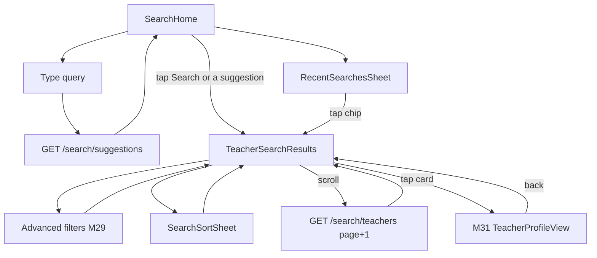
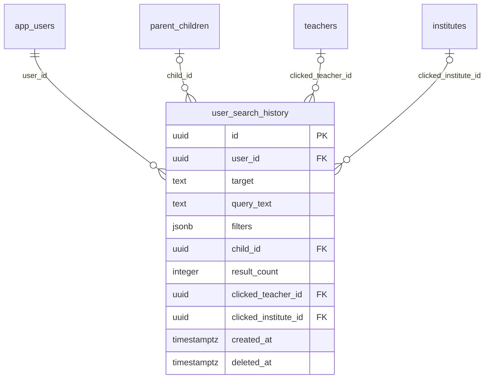

# Module 27 · Teacher Search

> **Phase 6 · Search & Discovery** · **Used by:** Learner (parent or student, browse also Public-limited on shared links) · **Depends on:** M00 (masters, events), M07 (active child context), M08 (v0 rails this replaces for "see all"), M19 (availability shown on cards), M29 (Advanced Filters sheet), M31 (profile), M42 (trust score); Admin M16, M18, M19, M20, M36 · **New tables:** `user_search_history` · **Uses:** `teachers`, `teacher_subjects`, `teacher_classes`, `teacher_locations`, `teacher_teaching_modes`, `trust_scores`, `areas`, `cities` · **Build estimate:** 6–7 days

## 1. Module Purpose

Lets a parent or student find teachers by name, subject or structured filters (Subject, Class, City, Area, Experience, Rating, Trust Score, Online, Offline) and returns a ranked, paged list that blends text relevance, trust and rating with fair, capped placement for featured and premium teachers. It owns `user_search_history`, powering "Recent searches" and autocomplete suggestions, and is the base signal M30's Recommendation Engine reads from. Results only ever include teachers who are actually bookable: approved, active and not paused.

## 2. User Stories

- As a **parent in Bengaluru**, I want to search "maths class 8" and see nearby, well-rated teachers first so that I don't scroll through irrelevant ones.
- As a **student prepping for JEE**, I want to filter by Subject = Physics and Trust Score ≥ 80 so that I only see teachers I can rely on.
- As a **parent on 3G**, I want my last search to load from cache instantly while fresh results come in behind it.
- As a **new teacher who just got approved**, I want to appear in search the moment my profile is approved, not the next day.
- As a **parent comparing tutors**, I want to tell Online from Offline (home tuition) teachers at a glance so that I filter to what actually works for us.

## 3. Business Rules & Logic

**BR-27.1 Entry and default filters.** `TeacherSearch` opens with `subjectIds`, `classId` and `cityId` pre-filled from the parent's active child (M07 `useActiveChild()`) or, for a student, from `students.class_id`/`students.city_id`; a signed-out or Public viewer gets no defaults. Filters live in `useSearchFilters` (Zustand, persisted per role), so returning to Search keeps the last filter set for the session; a fresh child selection resets subject/class only.

**BR-27.2 Text query — trigram matching.** `q` (2–60 chars) matches, using `pg_trgm` (extension `CREATE EXTENSION IF NOT EXISTS pg_trgm;`, already required by M17 profile search — enabled once in the base migration):
- `similarity(teachers.full_name, q) >= 0.25` (name match), OR
- `similarity(subjects.name, q) >= 0.30` OR `EXISTS (SELECT 1 FROM unnest(subjects.aliases) a WHERE similarity(a, q) >= 0.30)` via the joined `teacher_subjects`.
Matches are unioned and de-duplicated on `teachers.id`; `textScore = GREATEST(name_sim, subject_sim)`. Empty `q` skips this branch entirely and ranks by structured relevance only. Required indexes (schema request, section below): `idx_teachers_full_name_trgm ON teachers USING gin (full_name gin_trgm_ops)`, `idx_subjects_name_trgm ON subjects USING gin (name gin_trgm_ops)`.

**BR-27.3 Structured filters.**

| Filter | Column(s) | Behaviour |
| --- | --- | --- |
| Subject | `teacher_subjects.subject_id IN (...)` | OR within the list, ANDed with other filters |
| Class | `teacher_classes.class_id = :classId` | exact match; board is a separate Advanced Filter (M29) |
| City | `teacher_locations.city_id = :cityId` | required for any location-bound result; Online-only teachers still need a primary city for display |
| Area | `teacher_locations.area_id = :areaId` | narrows within the city; ignored if not set |
| Experience | `teachers.experience_years >= :experienceMin` | steps 0, 1, 3, 5, 10 years |
| Rating | `teachers.rating_avg >= :ratingMin` | steps 3.0, 3.5, 4.0, 4.5 |
| Trust Score | `trust_scores.score >= :trustScoreMin` | steps 60, 70, 80, 90 |
| Mode | see BR-27.5 | `online`, `offline`, or both (default) |
Multiple `subjectIds` and one `classId` at a time in v1 (matches how a parent's child is set up, M07); `GET /search/filters` (M29) supplies the option lists with facet counts.

**BR-27.4 Eligibility (always applied, never a user-visible filter).** A teacher appears in search only if: `teachers.verification_status = 'approved'`, `teachers.account_status = 'active'`, `teachers.deleted_at IS NULL`, and not currently paused — no `teacher_time_off` row with `pause_leads = true` and `CURRENT_DATE BETWEEN starts_on AND ends_on`. A teacher who pauses leads for an exam-season break disappears from search but their shared-link profile (M31) still resolves with an "Away until 12 Oct" banner.

**BR-27.5 Online vs Offline.** `teaching_modes.code = 'online'` is the only Online mode. Offline covers every mode where `requires_location = true` (`home_tuition`, `offline_at_teachers_place`, `hybrid`'s in-person leg). `mode = 'online'` filters to teachers with a live `teacher_teaching_modes` row for the online mode (no location filter applied). `mode = 'offline'` requires a `teacher_locations` row for the search city whose `travel_radius_km`, from that location's lat/long, covers the search area's centroid (haversine, BR-27.6) — or, if no area is chosen, any location in the city. Default (`mode` unset) unions both, tagging each card `Online` / `Offline` / `Online · Offline` from the teacher's live `teacher_teaching_modes`.

**BR-27.6 Distance and ranking — the query.** One SQL statement (a CTE) per request:
1. `eligible` — apply BR-27.4, then filters (subject/class/city/area/mode/experience/rating/trust), joining `teacher_locations` (nearest matching row per teacher when several), `trust_scores`, and the text branch (BR-27.2) when `q` is present.
2. Distance (only when `areaId` or a device lat/long is given): `distance_km = 2 * 6371 * asin(sqrt(sin(radians((lat2-lat1)/2))^2 + cos(radians(lat1))*cos(radians(lat2))*sin(radians((lon2-lon1)/2))^2))` between the teacher's location and the search area/city centroid; `distanceScore = GREATEST(0, 1 - distance_km / GREATEST(travel_radius_km, 5))`, else `distanceScore = 0.5` (neutral) when no location signal.
3. Normalise 0–1: `trustNorm = trust_scores.score / 100`, `ratingNorm = teachers.rating_avg / 5`, `textNorm = textScore` (already 0–1, 0 when no `q`).
4. `relevance = 0.30*textNorm + 0.25*trustNorm + 0.20*ratingNorm + 0.15*distanceScore + 0.10*availabilityBoost` where `availabilityBoost = 1` if the teacher has any `teacher_availability` row in the next 7 days else `0.4`.
5. Premium boost: `+8` **points** (relevance is scaled ×100 first, so plain `relevance*100`, then `+8` if `teachers.is_premium AND premium_until > now()`), capped so premium never overtakes a non-premium teacher more than 15 relevance points ahead — implemented as `final = relevance*100 + LEAST(8, max(0, competitorGapAllowance))`, in practice just the flat `+8` since 8 < 15 always; documented here as the deliberate ceiling for future tuning.
6. `ORDER BY final DESC, teachers.rating_count DESC, teachers.id`.
Featured placement is layered on top, not part of `final`: on **page 1 only**, up to **3** teachers with `is_featured AND featured_until > now()` that also satisfy `eligible` are prepended, ranked among themselves by `final`, each carrying `"featured": true` and a "Featured" tag; they are removed from their natural position in the ranked list beneath so no teacher appears twice. Premium-boosted teachers are capped at **4 per page of 20** (the 5th-highest-scoring premium teacher on a page drops its +8 and is re-ranked on natural relevance) so premium can influence order but never fill a page.

**BR-27.7 Suggestions / autocomplete — `GET /search/suggestions?q=&target=`.** `q` ≥ 2 chars, debounced 250 ms client-side; `target` is `teacher` (default) or `institute` (M28 reuses this endpoint rather than owning a second one). For `target=teacher`, returns up to 8 items merged from: subject names/aliases (`similarity >= 0.3`, only subjects with `is_active`), teacher names (`similarity >= 0.3`, BR-27.4 eligibility, max 3), area/city names (`similarity >= 0.3`), and up to 2 "Popular searches" — the most frequent `query_text` values from `user_search_history` in the last 30 days for the same city, `result_count > 0`, grouped and capped. For `target=institute`, the teacher-name branch is replaced with an institute-name branch (`similarity(institutes.name, q) >= 0.3`, M28 BR-28.2 eligibility, max 3) and popular searches are filtered to `user_search_history.target = 'institute'`. Each item carries `type` (`subject`, `teacher`, `institute`, `location`, `popular`) so the app can route the tap directly (a teacher or institute suggestion opens its profile, not a filtered list).

**BR-27.8 Recording a search.** `GET /search/teachers` inserts one `user_search_history` row **after** the query executes (`target = 'teacher'`, `query_text`, `filters` = the applied filter object as jsonb, `child_id` = the active child if a parent, `result_count`). To avoid bloat, the app only sends the "commit" signal (a `logSearch: true` flag on the request) when the user pauses typing for 800 ms, changes a filter, or taps Search — not on every keystroke; the server additionally de-duplicates: if the caller's last row (any time) has an identical `filters` hash within the last 5 minutes, it updates that row's `result_count` and `created_at` instead of inserting. Kept 180 days (nightly job hard-deletes older rows, per the table's purpose).

**BR-27.9 Recent searches and clicks.** `GET /search/history` returns the last 10 distinct rows (already de-duplicated by BR-27.8) newest first, each rendered as a chip ("Maths · Class 8 · Koramangala" or the raw `query_text`). `DELETE /search/history` clears all of the caller's rows; `DELETE /search/history/:id` removes one. When the user taps a result card from a search whose history row was just recorded, the app calls `POST /search/history/:id/click { teacherId }` (fire-and-forget, best-effort) which sets `clicked_teacher_id`; this is the strongest per-user relevance signal M30 reads. Only the caller's own row can be updated.

**BR-27.10 Pagination.** `?page=1&limit=20` (max `limit` 20). The single ranking query uses `COUNT(*) OVER()` so total and rows return in one round trip; `meta.total` is exact up to **1,000** — beyond that the query is capped with `LIMIT 1000` inside the CTE before windowing and `meta.total = 1000` with `meta.totalIsFloor = true`, and the app shows "1,000+ results — narrow your search" instead of a page count. `meta.page`, `meta.totalPages` (`ceil(total/20)`, capped 50). Statement timeout 3 s; a timeout (rare, only pathological unfiltered nationwide queries) falls back to city-only + trust-sorted results and logs a Sentry warning.

**BR-27.11 Zero results.** When `eligible` returns 0 rows, the response includes `meta.suggestions`: the same query re-run once without the least-selective filter in this drop order — Area → Trust Score → Rating → Experience → Class — labelled "Try without {filter}", plus a count for each, computed in the same request (cheap, since eligibility is already narrow). The app renders these as one-tap "Try without Area (12 results)" chips above the empty state.

## 4. Screen List

| Screen | Route name | Purpose |
| --- | --- | --- |
| Search home | `SearchHome` | Teacher/Institute segmented control (Institute tab hands off to M28), search bar, quick filter chips, recent searches |
| Teacher search results | `TeacherSearchResults` | Ranked, paged list with sort and quick filters |
| Suggestions dropdown | (inline overlay) | Live suggestions under the search bar while typing |
| Sort sheet | `SearchSortSheet` (bottom sheet) | Relevance (default) · Highest rated · Highest trust score · Nearest · Most experienced |
| Recent searches sheet | `RecentSearchesSheet` (bottom sheet) | Full list of recent searches with per-item delete and "Clear all" |

## 5. Screen Flow & Navigation


Back from `TeacherSearchResults` returns to `SearchHome` with filters kept for the session. Back from the profile returns to the exact scroll position in the results list.

## 6. Screen Wireframe Description

**SearchHome** — header with segmented control "Teachers | Institutes" (Teachers active, green underline). Search bar "Search by subject, class or teacher name" with a leading search icon; typing 2+ chars opens the suggestions overlay: rows grouped "Subjects", "Teachers", "Locations", each with an icon and a highlighted matched substring; "Popular near you" chip row below the bar when the field is empty. Quick filter chips (horizontal scroll): "Subject", "Class", "Online", "Offline", "Near me" — tapping "Subject"/"Class" opens a single-select bottom sheet from masters; "Online"/"Offline" toggle directly. Section "Recent searches" — up to 5 chips with an "×" per chip and "See all" → RecentSearchesSheet. Section "Popular subjects near you" — chip grid from trending subjects.

**TeacherSearchResults** — sticky header: search bar (editable), row of active filter chips with counts ("Class 8", "Koramangala ×", "Trust 80+ ×") and a "Filters" button (badge = count) opening M29's sheet, "Sort" button opening `SearchSortSheet`. Result count line "128 teachers in Koramangala, Bengaluru". List of `TeacherCard`s (FlashList): photo, name, "Featured" ribbon when applicable, subjects (max 3 + "+2"), experience "6 yrs experience", `TrustScoreRing` (small), `RatingStars` + count, mode chips "Online · Home tuition", `PriceTag` "From ₹500/hr", distance line "2.4 km away" when relevant, VerifiedBadge. Loading: 6 skeleton cards. Empty: illustration, "No teachers match these filters", suggestion chips (BR-27.11), button "Clear filters". Error: ErrorState with Retry. Offline: banner + last cached page, "Filters" disabled with hint.

**SearchSortSheet** — radio list: "Relevance (recommended)", "Highest rated", "Highest trust score", "Nearest first" (disabled with "Set your location or area" if no location signal), "Most experienced".

**RecentSearchesSheet** — list rows "Maths, Physics · Class 8 · Koramangala" with a timestamp ("2 hours ago") and a trailing ⋮ → "Delete"; header action "Clear all" (confirm sheet "Clear all recent searches?").

## 7. UI Components & Component Tree

```
SearchHomeScreen
├─ SearchModeToggle (Teachers | Institutes)
├─ SearchBar (debounced 250 ms) → SuggestionsOverlay
├─ QuickFilterChips (Subject, Class, Online, Offline, Near me)
├─ RecentSearchesRow → RecentSearchesSheet
└─ PopularSubjectsGrid
TeacherSearchResultsScreen
├─ StickyHeader (SearchBar, FilterChipsRow, FiltersButton → M29 sheet, SortButton → SearchSortSheet)
├─ ResultCountLine
├─ FlashList<TeacherCard> (onEndReached → next page)
├─ EmptyState (SuggestionChips)
└─ ListFooterLoader
```
- `TeacherCard({ teacher, onPress, onFavourite, featured, distanceKm, variant: 'search' | 'compact' })` (shared with M30, M40).
- `SuggestionsOverlay({ query, items, onSelect })`.
- Hooks: `useSearchFilters()` (Zustand, persisted), `useTeacherSearchInfinite(filters)` (TanStack `useInfiniteQuery`, key `searchKeys.teachers(filters)`), `useSearchSuggestions(query)`, `useSearchHistoryQuery()`, `useLogSearchClick()`, `useDeleteSearchHistoryMutation()`.

## 8. Validation Rules

| Field | Rule | Message shown |
| --- | --- | --- |
| q | 0–60 chars, trimmed; suggestions require ≥ 2 | — |
| subjectIds | 0–5 uuids from `/masters` | "Choose up to 5 subjects." |
| classId | uuid from `/masters`, optional | — |
| cityId | active city | "Choose a city to search." |
| areaId | active area of the chosen city | — |
| experienceMin | one of 0, 1, 3, 5, 10 | — |
| ratingMin | one of 3.0, 3.5, 4.0, 4.5 | — |
| trustScoreMin | one of 60, 70, 80, 90 | — |
| mode | `online`, `offline`, or omitted | — |
| page | 1–50 | — |
| limit | 1–20, default 20 | — |

## 9. API Endpoints

| Method | Path | Auth | Description |
| --- | --- | --- | --- |
| GET | /search/teachers | Learner (browse limited for Public — city required, no trust/rating filters, results capped at page 1) | Ranked, paged teacher results. 120/min per user |
| GET | /search/suggestions | Any user / Public | Autocomplete for the search bar (`target=teacher\|institute`). 60/min per install |
| GET | /search/history | Learner | Last 10 recent searches |
| DELETE | /search/history | Learner | Clear all recent searches |
| DELETE | /search/history/:id | Learner | Delete one recent search |
| POST | /search/history/:id/click | Learner | Record which result was opened from that search (best-effort) |

Uses: M29 `GET /search/filters` (facet counts, filter sheet), `GET/POST/PATCH/DELETE /saved-searches`; M31 `GET /teachers/:idOrCode` (card tap target); M00 `GET /masters`, `GET /masters/areas`, `POST /events`.

## 10. Request Payloads

```json
// GET /search/teachers?subjectIds=8f1a...,2c9b...&classId=91de...&cityId=5b1e...blr&areaId=9c2d...kor&mode=offline&trustScoreMin=80&page=1&limit=20&logSearch=true&q=maths

// POST /search/history/e41a.../click
{ "teacherId": "b7c2…" }
```

## 11. Response Payloads

```json
// 200 GET /search/teachers
{ "data": [
  { "id": "b7c2…", "publicCode": "GC-T10241", "fullName": "Dr. Ananya Iyer", "photoUrl": "https://cdn.guruconnect.in/…", "featured": true,
    "subjects": [ { "id": "…", "name": "Mathematics" }, { "id": "…", "name": "Physics" } ], "experienceYears": 6,
    "trustScore": 91.5, "ratingAvg": 4.8, "ratingCount": 214, "feePerHourPaise": 80000, "modes": ["online", "home_tuition"],
    "distanceKm": 2.4, "isVerifiedBadge": true, "areaName": "Koramangala", "cityName": "Bengaluru" } ],
  "meta": { "page": 1, "limit": 20, "total": 128, "totalPages": 7, "totalIsFloor": false, "appliedFilters": { "cityId": "5b1e…blr" } } }

// 200 GET /search/suggestions?q=mat
{ "data": [ { "type": "subject", "id": "…", "label": "Mathematics" }, { "type": "teacher", "id": "…", "label": "Dr. Ananya Iyer", "publicCode": "GC-T10241" },
  { "type": "location", "id": "…", "label": "Koramangala, Bengaluru" }, { "type": "popular", "label": "maths tuition class 8" } ] }

// 200 GET /search/history
{ "data": [ { "id": "e41a…", "queryText": "maths tuition", "filters": { "subjectIds": ["8f1a…"], "classId": "91de…", "areaName": "Koramangala" },
  "resultCount": 128, "createdAt": "2026-09-26T09:40:00Z" } ] }

// 200 GET /search/teachers  (zero results)
{ "data": [], "meta": { "page": 1, "total": 0, "suggestions": [ { "label": "Try without Area", "dropFilter": "areaId", "resultCount": 34 },
  { "label": "Try without Trust Score 80+", "dropFilter": "trustScoreMin", "resultCount": 12 } ] } }
```

## 12. PostgreSQL Tables & Columns

**New tables owned by this module** (migration `sql/migrations/127_app_m27_teacher_search_search_history.sql`)

### `user_search_history`

Searches made by a user, used for "Recent searches" and as a recommendation signal. Kept 180 days.

| Column | Type | Null | Default | Constraints / References | Description |
| --- | --- | --- | --- | --- | --- |
| `id` | uuid | no | gen_random_uuid() | PK | Primary key |
| `user_id` | uuid | no | — | FK → `app_users.id` (on delete cascade) | Searcher |
| `target` | text | no | — | CHECK target IN ('teacher','institute') | What was searched |
| `query_text` | text | yes | — | — | Free text, max 100 chars |
| `filters` | jsonb | no | '{}'::jsonb | — | Normalised filters, e.g. {"subjectIds":[…],"classId":"…","cityId":"…"} |
| `child_id` | uuid | yes | — | FK → `parent_children.id` (on delete set null) | Child the parent searched for, if chosen |
| `result_count` | integer | no | 0 | — | Results returned |
| `clicked_teacher_id` | uuid | yes | — | FK → `teachers.id` (on delete set null) | First result opened |
| `clicked_institute_id` | uuid | yes | — | FK → `institutes.id` (on delete set null) | First result opened |
| `created_at` | timestamptz | no | now() | — | Searched |
| `deleted_at` | timestamptz | yes | — | — | Cleared by the user (soft delete) |

<details><summary>DDL</summary>

```sql
CREATE TABLE user_search_history (
  id uuid PRIMARY KEY DEFAULT gen_random_uuid(), -- Primary key
  user_id uuid NOT NULL REFERENCES app_users(id) ON DELETE CASCADE, -- Searcher
  target text NOT NULL CHECK (target IN ('teacher','institute')), -- What was searched
  query_text text, -- Free text, max 100 chars
  filters jsonb NOT NULL DEFAULT '{}'::jsonb, -- Normalised filters, e.g. {"subjectIds":[…],"classId":"…","cityId":"…"}
  child_id uuid REFERENCES parent_children(id) ON DELETE SET NULL, -- Child the parent searched for, if chosen
  result_count integer NOT NULL DEFAULT 0, -- Results returned
  clicked_teacher_id uuid REFERENCES teachers(id) ON DELETE SET NULL, -- First result opened
  clicked_institute_id uuid REFERENCES institutes(id) ON DELETE SET NULL, -- First result opened
  created_at timestamptz NOT NULL DEFAULT now(), -- Searched
  deleted_at timestamptz -- Cleared by the user (soft delete)
);
CREATE INDEX idx_user_search_history_user ON user_search_history (user_id, created_at DESC) WHERE deleted_at IS NULL;
```

</details>

**Indexes:** `idx_user_search_history_user` on `(user_id, created_at DESC) WHERE deleted_at IS NULL`

**Existing tables this module reads or writes** (full definitions in the owning module)

| Table | Owner | Purpose |
| --- | --- | --- |
| `teachers` | Admin M16 | Teacher profile and verification state. One row per teacher app account. |
| `teacher_subjects` | Admin M18 | Subjects a teacher teaches. |
| `teacher_classes` | Admin M19 | Classes (and optionally boards) a teacher covers. |
| `teacher_locations` | Admin M20 | Cities and areas a teacher serves, with travel radius for home tuition. |
| `teacher_teaching_modes` | Admin M20 | Teaching modes a teacher offers (Online, Home tuition, …). |
| `trust_scores` | Admin M36 | Current trust score per teacher with its factor breakdown. |
| `areas` | Admin M10 | Localities within a city, used for "nearby" search and teacher coverage. |
| `cities` | Admin M09 | Cities where teachers and institutes can be listed. |

- `user_search_history`: one row per committed search (BR-27.8/27.9); `filters` stores the applied filter object as sent (not the raw UI state); `clicked_teacher_id` set by `POST /search/history/:id/click`; `deleted_at` used for user-initiated deletes, hard-deleted after 180 days by the nightly retention job.
- `teachers`, `teacher_subjects`, `teacher_classes`, `teacher_locations`, `teacher_teaching_modes`: read-only; eligibility and filters (BR-27.3–27.6).
- `trust_scores`: read for the Trust Score filter and ranking; `is_frozen`/`is_overridden` scores are used as-is (`score` column already reflects any override).
- `areas`, `cities`: read for filter option lists and distance centroids.

## 13. Relationships

**Foreign keys of new tables**

- `user_search_history.user_id` → `app_users` — required, many-to-one, on delete **cascade**
- `user_search_history.child_id` → `parent_children` — optional, many-to-one, on delete **set null**
- `user_search_history.clicked_teacher_id` → `teachers` — optional, many-to-one, on delete **set null**
- `user_search_history.clicked_institute_id` → `institutes` — optional, many-to-one, on delete **set null**

**Entity relationship diagram**



## 14. State Management

- `useSearchFilters` (Zustand + MMKV, per role): `{ q, subjectIds, classId, cityId, areaId, experienceMin, ratingMin, trustScoreMin, mode, sort, setFilter(), reset() }`.
- Query keys: `searchKeys.teachers(filters)` (infinite, persisted only for page 1), `searchKeys.suggestions(q)` (not persisted, `staleTime` 0), `searchKeys.history`.
- After `useDeleteSearchHistoryMutation` / clear-all: optimistic removal from `searchKeys.history`, rollback on error.
- `useLogSearchClick` fires and forgets; no cache invalidation.

## 15. Offline Handling

- Page 1 of the last few distinct filter sets is persisted (max 5 filter sets, LRU) so recent results open instantly; further pages are online-only.
- Class 1 (queue offline): `POST /search/history/:id/click` queues and replays; harmless if the row was since deleted (server no-ops on `NOT_FOUND`).
- Class 3 (online only): `GET /search/teachers` beyond page 1 and `GET /search/suggestions` need network; suggestions overlay shows nothing (no error) when offline.
- Recent-search deletes are queued (class 1) and applied optimistically.

## 16. Push Notification Requirements

None. Search is a pull interaction; new-teacher and price-drop alerts for a saved filter set are M29's `saved_searches` alerts, not this module.

## 17. Security Rules

- `GET /search/teachers` for a **Public** (signed-out) caller requires `cityId` (no nationwide scraping), omits `trustScoreMin`/`ratingMin` fine-grained filters, and returns only page 1 (`page` > 1 → `403 FORBIDDEN`, `details.reason = "signin_required"`).
- Only `eligible` teachers (BR-27.4) are ever returned or suggested; a paused, rejected or suspended teacher's data never appears in search or suggestions even if `q` matches their name.
- Rate limited per BR above; `q` is parameterised (no raw SQL interpolation) and length-capped to bound `pg_trgm` cost.
- `POST /search/history/:id/click` checks `user_search_history.user_id = sub` before updating.
- No PII in analytics; `search_result_click` events carry ids and position only.

## 18. Error Handling

| Scenario | Code | HTTP | App behaviour |
| --- | --- | --- | --- |
| Public caller, no cityId | `VALIDATION_FAILED` | 422 | Prompt "Choose a city to see teachers near you." |
| Public caller, page > 1 | `FORBIDDEN` (`signin_required`) | 403 | Sheet "Sign in to see more results" |
| Query timeout (BR-27.10) | — (fallback response, no error) | 200 | Results still shown; no user-visible error |
| Invalid filter value | `VALIDATION_FAILED` | 422 | Filter reset to default, toast "That filter was reset." |
| History item not caller's own | `NOT_FOUND` | 404 | Row already removed from the list (idempotent) |
| Network / suggestions fails | — | — | Overlay silently shows nothing; results screen shows ErrorState + Retry |

## 19. Testing Scenarios

- T27.1 Happy path (Maestro `teacher_search_happy`): open Search → type "maths" → suggestions appear → apply City + Trust Score 80+ → results ranked, Featured teachers pinned first 3 on page 1.
- T27.2 `q = "phyiscs"` (typo) still matches "Physics" via trigram similarity ≥ 0.3.
- T27.3 Teacher with `pause_leads` active today is absent from results and suggestions but resolves via a direct shared link (M31) with an Away banner.
- T27.4 `mode=offline`, area 6 km from a teacher whose `travel_radius_km = 5` → excluded; radius 10 → included with correct `distanceKm`.
- T27.5 4 premium teachers already placed on page 1 → a 5th premium match is re-ranked on natural relevance only (no +8).
- T27.6 Zero results for Area + Trust 90+ → suggestions list "Try without Area" and "Try without Trust Score 90+" with non-zero counts.
- T27.7 Same filters searched twice within 5 minutes → one `user_search_history` row, `result_count` and `created_at` updated, not duplicated.
- T27.8 Tap a result card → `POST /search/history/:id/click` sets `clicked_teacher_id`; offline tap queues and applies on reconnect.
- T27.9 Public (signed-out) request without `cityId` → 422; with `cityId` and `page=2` → 403 `signin_required`.
- T27.10 Total capped at 1000 for an unfiltered citywide search; `totalIsFloor = true` and the app shows "1,000+ results".
- T27.11 Offline: last searched filter set renders from cache instantly; scrolling to page 2 offline shows "Connect to the internet to see more."
- T27.12 `DELETE /search/history/:id` for another user's row → 404, list unaffected.

## 20. Audit Log Events

None. Searches and suggestions are reads (BR-27.8 writes are an app-usage signal, not an auditable action) and are logged to `user_search_history` and analytics instead, per conventions §11.

## 21. Future Scalability Notes

- Move ranking to OpenSearch/Elasticsearch once `teachers` passes ~200k rows and `pg_trgm` scan cost rises; keep the same scoring formula as the relevance function.
- Personalise `relevance` weights per user from click-through (feeds into M30's model rather than duplicating logic here).
- Location-aware suggestions using device GPS instead of area-name text once permission UX is validated.
- Add `subjectIds` multi-select synonyms (e.g. "Maths" ↔ "Mathematics") as a small curated table instead of relying on `aliases` alone.
- Schema requests: GIN trigram indexes on `teachers.full_name` and `subjects.name` (BR-27.2) — no new columns, index-only migration.
