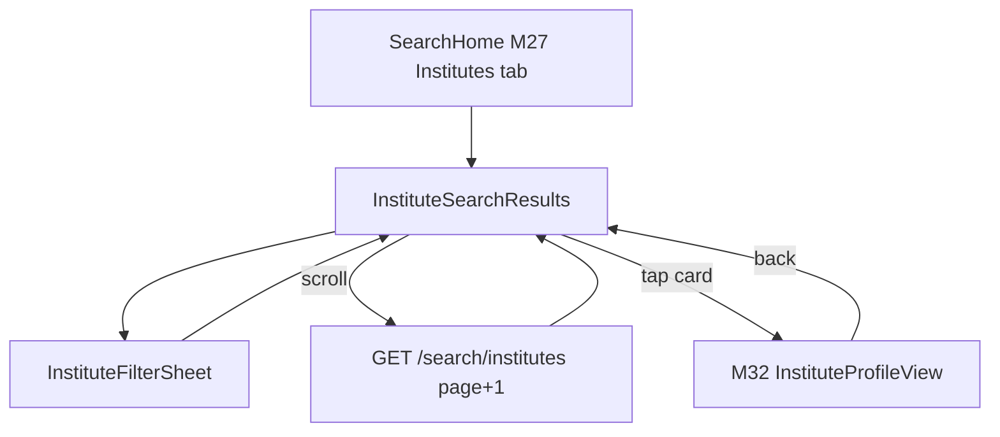
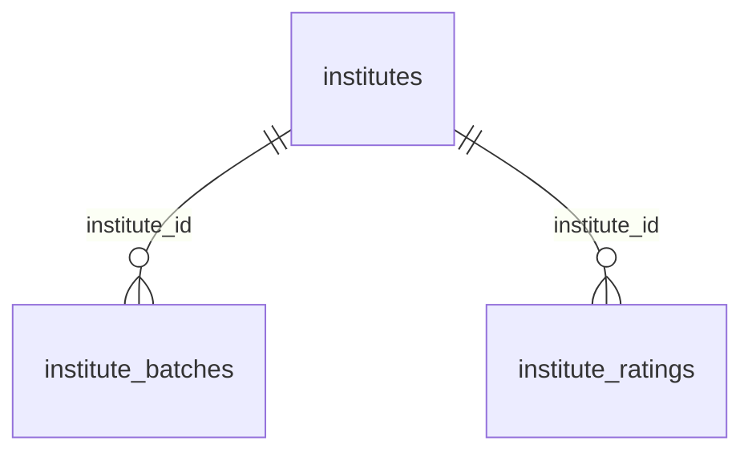

# Module 28 · Institute Search

> **Phase 6 · Search & Discovery** · **Used by:** Learner (parent or student, browse also Public-limited) · **Depends on:** M00 (masters, events), M27 (shared SearchHome toggle, suggestions pattern), M32 (profile), M35 (institute reviews for rating); Admin M22, M24, M27 · **New tables:** none · **Uses:** `institutes`, `institute_batches`, `institute_ratings` · **Build estimate:** 3–4 days

## 1. Module Purpose

The Institutes tab of Search: lets a parent or student find coaching centres, tuition centres, schools and academies filtered by Category (institute type), City and Rating, ranked by GuruConnect's independent rating rather than by a text-match score, since institutes compete on trust and infrastructure more than on keyword relevance. It shares `SearchHome` (M27) for the Teachers/Institutes toggle and reuses M27's suggestion and recent-search patterns without owning any tables of its own.

## 2. User Stories

- As a **parent choosing a coaching centre for JEE**, I want to filter by Category = Coaching Centre and Rating ≥ 4 so that I only see well-evaluated ones.
- As a **student**, I want to see which institutes run a batch for my class and subject so that I don't open ones that don't teach it.
- As a **parent new to a city**, I want institutes near my area shown first so that daily commute is realistic.
- As a **parent on a slow connection**, I want the last institute search to load instantly from cache.

## 3. Business Rules & Logic

**BR-28.1 Entry and filters.** Reached from `SearchHome`'s "Institutes" toggle (M27) or the Institutes quick-access on the parent/student dashboard. Filters: `institute_type` (Category — one of `coaching_centre`, `tuition_centre`, `school`, `music_school`, `coding_academy`, `language_institute`, `sports_academy`, `other`), `cityId` (required), `areaId` (optional), `ratingMin` (steps 3.0, 3.5, 4.0, 4.5, matching `institutes.overall_rating`), plus an optional free-text `q` matched against `institutes.name` only (`similarity(name, q) >= 0.3`, same `pg_trgm` extension as M27; no separate index request since `institutes.name` is short and low-cardinality enough for a trigram scan at institute volumes — revisit if it passes 20k rows).

**BR-28.2 Eligibility.** Only `verification_status = 'approved'`, `account_status = 'active'`, `deleted_at IS NULL`. Unlike teachers, institutes have no per-day pause; a temporarily unavailable institute is handled by support suspending `account_status` (Admin M22), which already excludes it here.

**BR-28.3 Ranking.** No relevance blending — parents choose institutes on trust more than keyword match. `ORDER BY (CASE WHEN :q IS NOT NULL THEN similarity(name, :q) ELSE 0 END) DESC, is_premium DESC, overall_rating DESC NULLS LAST, user_rating_count DESC, id`. Institutes with `is_premium AND premium_until > now()` are boosted to sort immediately after any text match but are capped at **3 per page of 20** (same anti-domination rule as M27); beyond the cap, remaining premium institutes sort purely on rating. There is no "Featured" pinned strip for institutes in v1 (that placement type is teacher-only, tied to `teachers.is_featured` — institutes only have `is_premium`).

**BR-28.4 Batch match (soft filter, not a hard exclude).** When the search carries `subjectIds`/`classId` (passed through from a child's profile or the last teacher search, to keep the two tabs consistent), institutes with at least one live `institute_batches` row (`is_active`, `deleted_at IS NULL`) matching `class_id` and overlapping `subject_ids` are tagged `hasMatchingBatch: true` and shown a "Runs a Class 8 Physics batch" line on the card; they are not excluded when no batch matches, since many institutes list only current/enrolling batches and still take enquiries for others (M39 Contact Institute handles that).

**BR-28.5 Card summary fields.** Each result carries: name, logo, institute type label, area/city, `overall_rating` (x.x/5) with `user_rating_count`, `infrastructure_score` (x.x/10) when present, Verified badge, `fee_min_paise`–`fee_max_paise` range when set, and up to 2 matching batch names (BR-27.4-style tag). Institutes with no `institute_ratings` row yet (freshly approved, evaluation pending) show "Evaluation in progress" instead of a rating and sort after all rated institutes at any given premium tier.

**BR-28.6 Pagination.** Same shape as M27 BR-27.10: page-based, `limit` 20 (max), `COUNT(*) OVER()` in one query, `meta.total` exact up to 1,000 with the same `totalIsFloor` flag. Institute volumes are far lower than teacher volumes, so the 3 s statement timeout and fallback are unlikely to trigger but are implemented identically for consistency.

**BR-28.7 Recording and suggestions.** This module does **not** own `user_search_history` (M27 does) but writes to it identically: `GET /search/institutes` with `logSearch: true` inserts a row with `target = 'institute'`, the same de-duplication window (5 minutes) and 180-day retention. Suggestions for the institute tab reuse M27's `GET /search/suggestions?target=institute` (M27 adds the `target` parameter to also match `institutes.name` and returns `type: "institute"` items) rather than a second endpoint — this module has no suggestions endpoint of its own.

## 4. Screen List

| Screen | Route name | Purpose |
| --- | --- | --- |
| Institute search results | `InstituteSearchResults` | Ranked, paged institute list with Category/Rating quick filters |
| Institute filter sheet | `InstituteFilterSheet` (bottom sheet) | Category, City, Area, Rating |

## 5. Screen Flow & Navigation


Back from `InstituteSearchResults` returns to `SearchHome` on the Institutes tab with filters kept. The Teachers/Institutes toggle preserves each tab's own filter state independently.

## 6. Screen Wireframe Description

**InstituteSearchResults** — sticky header: search bar "Search institutes by name", quick filter chips "Category", "Rating 4+", "Near me", "Filters" button (badge = active count) → `InstituteFilterSheet`. Result count "34 institutes in Bengaluru". List of `InstituteCard`s: logo/cover thumbnail, name, VerifiedBadge, category label ("Coaching centre"), area/city, `RatingStars` "4.5 (312)" or "Evaluation in progress" pill, infrastructure chip "Infra 8.2/10" when present, fee range "₹3,000–₹8,000/month", matching-batch tag "Runs a Class 8 Physics batch" when `hasMatchingBatch`. Loading: 6 skeleton cards. Empty: illustration, "No institutes match these filters", button "Clear filters". Offline: banner + last cached page.

**InstituteFilterSheet** — "Category" (single-select chips, the 8 types), "City"/"Area" (select fields → M00 masters sheets), "Minimum rating" (segmented 3.0 · 3.5 · 4.0 · 4.5), sticky "Show N institutes" (live count from a debounced facet call) and "Clear all".

## 7. UI Components & Component Tree

```
InstituteSearchResultsScreen
├─ StickyHeader (SearchBar, FilterChipsRow, FiltersButton → InstituteFilterSheet)
├─ ResultCountLine
├─ FlashList<InstituteCard> (onEndReached → next page)
└─ EmptyState
InstituteFilterSheet (CategoryChips, CitySelect, AreaSelect, RatingSegmented, LiveCountFooter)
```
- `InstituteCard({ institute, onPress, onFavourite, variant: 'search' | 'compact' })` (shared with M32, M41).
- Hooks: `useInstituteSearchFilters()` (Zustand, persisted, separate store from M27's teacher filters), `useInstituteSearchInfinite(filters)` (key `searchKeys.institutes(filters)`), reuses M27's `useSearchSuggestions(query, { target: 'institute' })`.

## 8. Validation Rules

| Field | Rule | Message shown |
| --- | --- | --- |
| q | 0–60 chars | — |
| instituteType | one of the 8 types or omitted | — |
| cityId | active city, required | "Choose a city to see institutes near you." |
| areaId | active area of the city | — |
| ratingMin | one of 3.0, 3.5, 4.0, 4.5 | — |
| page / limit | 1–50 / 1–20 | — |

## 9. API Endpoints

| Method | Path | Auth | Description |
| --- | --- | --- | --- |
| GET | /search/institutes | Learner (Public browse: cityId required, page 1 only) | Ranked, paged institute results. 120/min per user |

Uses: M27 `GET /search/suggestions?target=institute`, `GET /search/history`, `DELETE /search/history(/:id)` (the tab's recent searches are the same list, filtered client-side by `target`); M32 `GET /institutes/:idOrSlug`; M00 `GET /masters`, `GET /masters/areas`, `POST /events`.

## 10. Request Payloads

```json
// GET /search/institutes?instituteType=coaching_centre&cityId=5b1e...blr&areaId=9c2d...kor&ratingMin=4&page=1&limit=20&logSearch=true
```

## 11. Response Payloads

```json
// 200 GET /search/institutes
{ "data": [
  { "id": "…", "publicCode": "GC-I2143", "slug": "apex-jee-academy-koramangala", "name": "Apex JEE Academy", "logoUrl": "https://cdn.guruconnect.in/…",
    "instituteType": "coaching_centre", "areaName": "Koramangala", "cityName": "Bengaluru", "overallRating": 4.5, "userRatingCount": 312,
    "infrastructureScore": 8.2, "isVerifiedBadge": true, "isPremium": false, "feeMinPaise": 300000, "feeMaxPaise": 800000,
    "hasMatchingBatch": true, "matchingBatchNames": ["Class 8 Physics Foundation"] } ],
  "meta": { "page": 1, "limit": 20, "total": 34, "totalPages": 2, "totalIsFloor": false } }

// 200 GET /search/institutes  (no rating yet)
{ "data": [ { "id": "…", "name": "Bright Minds Tuition Centre", "overallRating": null, "userRatingCount": 0, "evaluationPending": true } ] }
```

## 12. PostgreSQL Tables & Columns


**Existing tables this module reads or writes** (full definitions in the owning module)

| Table | Owner | Purpose |
| --- | --- | --- |
| `institutes` | Admin M22 | Coaching centres, tuition centres, schools and academies. Rated by GuruConnect after verification. |
| `institute_batches` | Admin M24 | Courses and batches an institute runs, shown on its public profile. |
| `institute_ratings` | Admin M27 | Evaluations by GuruConnect admins. The latest submitted version is current and drives the public rating. |

- `institutes`: filtered by `institute_type`, `city_id`/`area_id`, `overall_rating`, `is_premium`; `verification_status`/`account_status` enforce BR-28.2.
- `institute_batches`: read for the soft batch-match tag (BR-28.4); only `is_active` rows with `deleted_at IS NULL`.
- `institute_ratings`: not joined directly — `institutes.overall_rating`/`infrastructure_score` are the cached current-rating columns (Admin M27 keeps them in sync on submit), so search never has to resolve `is_current` itself.

## 13. Relationships


**Entity relationship diagram** (tables this module uses; `admins` omitted)



## 14. State Management

- `useInstituteSearchFilters` (Zustand + MMKV): `{ q, instituteType, cityId, areaId, ratingMin, setFilter(), reset() }` — independent from M27's teacher filter store so switching tabs doesn't clobber either.
- Query keys: `searchKeys.institutes(filters)` (infinite, page 1 persisted).

## 15. Offline Handling

- Page 1 of the last filter set is cached (same LRU-of-5 policy as M27, sharing the cache bucket by `target`).
- `GET /search/institutes` beyond page 1 is online-only; offline shows the cached page with the offline banner.

## 16. Push Notification Requirements

None. Saved-search alerts for institutes reuse M29's `saved_searches` with `target = 'institute'`.

## 17. Security Rules

- Public (signed-out) callers require `cityId`, page 1 only, same 403 `signin_required` beyond page 1 as M27.
- Only approved, active institutes are ever returned (BR-28.2); a suspended institute's page still resolves via direct link with a "temporarily unavailable" state (M32), never through search.
- Rate limited as stated; `q` parameterised.

## 18. Error Handling

| Scenario | Code | HTTP | App behaviour |
| --- | --- | --- | --- |
| Public caller, no cityId | `VALIDATION_FAILED` | 422 | Prompt to choose a city |
| Public caller, page > 1 | `FORBIDDEN` (`signin_required`) | 403 | Sheet "Sign in to see more results" |
| Invalid instituteType/ratingMin | `VALIDATION_FAILED` | 422 | Filter reset to default |
| Network / timeout | `GATEWAY_ERROR` / `NETWORK_TIMEOUT` | 502 / — | ErrorState + Retry, cached page kept visible if any |

## 19. Testing Scenarios

- T28.1 Happy path (Maestro `institute_search_happy`): open Institutes tab → filter Category = Coaching centre, Rating 4+ → ranked list, premium institutes capped at 3/page.
- T28.2 Institute with no `institute_ratings` row shows "Evaluation in progress" and sorts after all rated institutes at the same premium tier.
- T28.3 `subjectIds`/`classId` carried from a child profile tags matching institutes `hasMatchingBatch: true` with correct batch names; institutes without a match still appear.
- T28.4 Suspended institute never appears in results even when its name matches `q` exactly.
- T28.5 Public caller without `cityId` → 422; with `cityId`, `page=2` → 403.
- T28.6 4th premium institute on a page of 20 sorts on rating only (cap of 3 enforced).
- T28.7 Offline: last institute search renders from cache; page 2 disabled with hint.

## 20. Audit Log Events

None (search is a read; `user_search_history` writes are an app-usage signal per M27, not an audited action).

## 21. Future Scalability Notes

- Personalised institute ranking blended with M30's model once enough click-through data exists.
- Distance-based ranking (haversine, like M27) once institute density per city justifies it — today a city-level list is small enough that rating order reads better than distance order.
- Batch-level search ("show only institutes with an open Class 10 CBSE batch starting this month") as a dedicated filter once `institute_batches` volume supports it.
