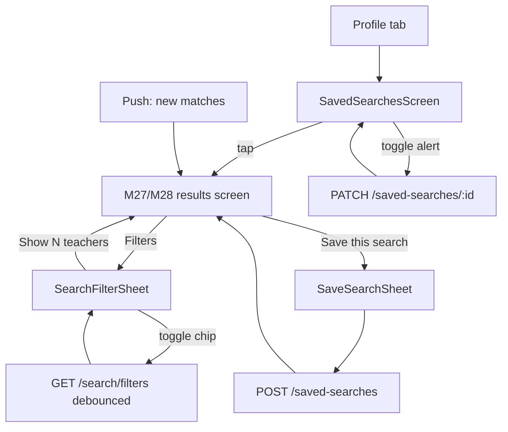
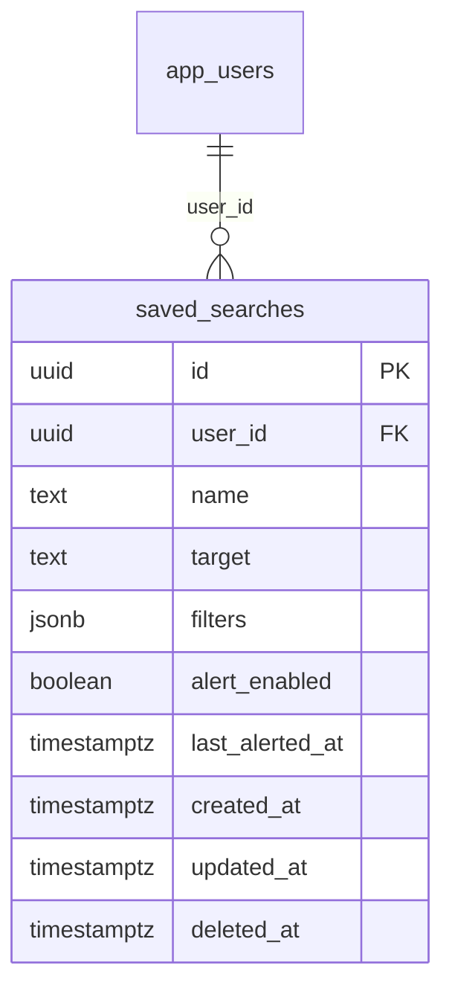

# Module 29 · Advanced Filters

> **Phase 6 · Search & Discovery** · **Used by:** Learner · **Depends on:** M00 (masters, push), M27 (teacher search this filters), M28 (institute search this filters); Admin M16, M17, M18, M19, M20 · **New tables:** `saved_searches` · **Uses:** `teacher_availability`, `teacher_fee_plans` · **Build estimate:** 4–5 days

## 1. Module Purpose

The full filter sheet behind M27 and M28's "Filters" button: fee range (from `teacher_fee_plans`), availability days/time (from `teacher_availability`), gender, languages, verified-only, demo-available, board and teacher category for teacher search, plus facet counts next to every option so a parent can see before tapping whether a filter narrows to 40 teachers or 2. It owns `saved_searches` — a named filter set with an optional daily alert email/push when new matching teachers are approved or a new matching institute batch opens.

## 2. User Stories

- As a **parent with a ₹500–₹800/hr budget**, I want to filter by fee range so that I don't browse tutors I can't afford.
- As a **parent who only wants a female tutor for her daughter**, I want a gender filter so that results match her comfort.
- As a **parent who works late**, I want to filter by evening availability so that only teachers who can actually take that slot show up.
- As a **parent who searches every week for a Hindi-speaking maths tutor in HSR Layout**, I want to save that search and get notified the moment a new one is approved.
- As a **student wanting a free trial first**, I want a "Demo available" filter so that I only see teachers offering one.

## 3. Business Rules & Logic

**BR-29.1 Filter sheet contents (teacher target).** In addition to M27's basic filters (Subject, Class, City, Area, Experience, Rating, Trust Score, Mode):

| Filter | Source | Values |
| --- | --- | --- |
| Fee range | `teacher_fee_plans.amount_paise` (per matching `fee_unit`, `subject_id`/class range if set) | Slider ₹100–₹5,000/hr in ₹50 steps (per-hour plans); per-month and per-course plans are converted to an implied hourly rate at 4 sessions/week × 4 weeks for filtering purposes only, never shown as the displayed price |
| Availability | `teacher_availability.day_of_week`, `start_time`/`end_time` | Day chips (Mon–Sun) + time-of-day chips (Morning 6–12, Afternoon 12–17, Evening 17–21, Night 21–23); a teacher matches if any row overlaps any selected day × time-of-day combination |
| Gender | `teachers.gender` | Female, Male, Other, Any (default) |
| Languages | `teachers.languages` (`text[]`) | Multi-select from the distinct values seeded (English, Hindi, Kannada, Tamil, Telugu, Marathi, Bengali, …); teacher matches if any selected language is in their array |
| Verified only | `teachers.is_verified_badge` | Toggle |
| Demo available | `teachers.demo_available` | Toggle |
| Board | `teacher_classes.board_id` | Single-select from `/masters` boards, only enabled once a Class is chosen |
| Teacher category | `teachers.category_id` | Single-select from `/masters` teacher categories (Home Tutor, Coaching Faculty, …) |
Institute target (M28) exposes only Category, City, Area and Rating (M28 BR-28.1) plus a "Has an open batch" toggle (`institute_batches.seats_available > 0`); the fee/availability/gender/language/board/category rows above do not apply and are hidden for that target.

**BR-29.2 `GET /search/filters`.** Given the current filter selections (query string, same shape as M27/M28) and `target`, returns the full option list for every filter **with a facet count**: running the base eligibility + already-applied filters, grouped per candidate value of each other filter (one lightweight query per filter dimension, all against the same eligible-teacher CTE via a temp result reused across the seven grouped counts in one transaction). Counts update live as the parent toggles chips inside the sheet (debounced 300 ms, cancels the previous in-flight request). A count of 0 greys out the chip but does not hide it (so the parent can see "Female (0)" and understand why).

**BR-29.3 Applying filters.** The sheet holds a **draft** copy of `useSearchFilters`/`useInstituteSearchFilters` (M27/M28); "Show N teachers" (the live BR-29.2 total) commits the draft to the real store and closes the sheet. "Clear all" resets the draft to defaults but keeps Subject/Class/City if they came from the child's profile (BR-27.1) — those three are considered identity, not preference, and have their own "×" outside the sheet.

**BR-29.4 Saved searches.** `POST /saved-searches { name, target, filters }` snapshots the **applied** filter object (same shape M27/M28 send to `GET /search/teachers|institutes`) under a user-given name (e.g. "HSR maths tutors"). `GET /saved-searches` lists them newest first (max **10** per user, `LIMIT_REACHED` `details.reason = "saved_searches_max"` beyond that — the app suggests deleting an old one). `PATCH /saved-searches/:id` renames or replaces `filters` (re-applying an updated version of the same search) or toggles `alert_enabled`. `DELETE /saved-searches/:id` soft-deletes.

**BR-29.5 Daily alerts.** A worker runs at **09:00 IST** daily: for every `saved_searches` row with `alert_enabled = true`, re-run the saved `filters` through the same M27/M28 eligibility query but scoped to rows whose `teachers.approved_at` (or, for institutes, `institutes.approved_at`) is **after** `last_alerted_at` (or the save time, on the first run). If the count is > 0, send one push/in-app notification ("3 new maths tutors match 'HSR maths tutors'" → deep link `/search/results?savedSearchId=…`) and set `last_alerted_at = now()`; zero matches sends nothing (no "no new results" spam). Alerts respect `user_notification_preferences.category = 'recommendations'` and quiet hours (conventions §9). A saved search with `alert_enabled = false` is still usable to re-run the filters manually but is skipped by the job entirely (not even counted).

**BR-29.6 Opening a saved search.** Tapping a saved search from its list or its push deep link re-applies `filters` verbatim into the results screen's filter store (M27/M28) and runs the query fresh — it never replays cached results, since the whole point is to see what is new. If a referenced `subjectId`/`classId`/`cityId` has since been deactivated by an admin, that piece of the filter is dropped silently and the rest still applies (never a hard error on a saved search).

**BR-29.7 One draft, no server round trip until commit.** Every chip toggle inside the sheet updates local draft state instantly (client-side facet display uses the last fetched counts until the debounced refetch lands, so the UI never blocks on typing/tapping).

## 4. Screen List

| Screen | Route name | Purpose |
| --- | --- | --- |
| Filter sheet | `SearchFilterSheet` (bottom sheet, full-screen on small devices) | All filters for the current target, with live facet counts |
| Save search sheet | `SaveSearchSheet` (bottom sheet) | Name the current filter set, toggle daily alert |
| Saved searches list | `SavedSearchesScreen` | All saved searches with edit/delete/alert toggle |

## 5. Screen Flow & Navigation


`SearchFilterSheet` opens over the results screen without navigating away; closing it (back or "Show N") always returns to the same results screen. `SavedSearchesScreen` lives under the Profile tab, not under Search.

## 6. Screen Wireframe Description

**SearchFilterSheet** — header "Filters" with "Reset" (top-right) and a live subtotal footer "Show 42 teachers" (sticky, updates as chips change; disabled with a spinner during the debounce window). Sections, each collapsible: "Fee range" (dual-handle slider, "₹300–₹1,200/hr"), "Availability" (day chips row + time-of-day chips row), "Gender" (segmented, counts inline "Female (18)"), "Languages" (chip multi-select, counts), "Board" (select, disabled with helper "Choose a class first" until Class is set), "Teacher category" (select), toggles "Verified only" and "Demo available" (switch + count). Institute target shows only "Category", "Rating" and "Has an open batch".

**SaveSearchSheet** — heading "Save this search", field "Name" prefilled from the top two active filters ("HSR Layout · Female"), row "Notify me daily about new matches" (switch, on by default), sticky "Save".

**SavedSearchesScreen** — list rows: name, one-line filter summary ("Maths · HSR Layout · Female"), bell icon (filled when `alert_enabled`), last alert time ("Notified 2 days ago · 3 new") or "No new matches yet"; swipe or ⋮ → "Edit", "Turn off alerts", "Delete". Empty state: "No saved searches yet", body "Save a search from any results screen to get notified about new matches.", illustration.

## 7. UI Components & Component Tree

```
SearchFilterSheet
├─ FeeRangeSlider · AvailabilityPicker (DayChips + TimeOfDayChips)
├─ GenderSegmented · LanguagesMultiSelect · BoardSelect · CategorySelect
├─ ToggleRow ×2 (Verified only, Demo available)
└─ StickyFooter (live count, "Show N", "Reset")
SaveSearchSheet (NameField, AlertToggle, StickyActionBar)
SavedSearchesScreen (SavedSearchRow × n, EmptyState)
```
- `FeeRangeSlider({ min, max, value, onChange, counts })`, `AvailabilityPicker({ days, timesOfDay, onChange })`.
- Hooks: `useSearchFacets(draftFilters, target)` (debounced 300 ms, cancels in-flight), `useSavedSearchesQuery()`, `useCreateSavedSearchMutation()`, `useUpdateSavedSearchMutation()`, `useDeleteSavedSearchMutation()`.

## 8. Validation Rules

| Field | Rule | Message shown |
| --- | --- | --- |
| feeMinPaise / feeMaxPaise | 10,000–500,000 paise, min ≤ max | "Set a valid fee range." |
| availabilityDays | 0–7 of `mon..sun` | — |
| timeOfDay | 0–4 of `morning,afternoon,evening,night` | — |
| gender | `female`, `male`, `other`, or omitted (Any) | — |
| languages | 0–10 values from the seeded list | — |
| boardId | active board; requires `classId` set | "Choose a class first." |
| categoryId | active teacher category | — |
| name (saved search) | 3–60 chars | "Give this search a short name." |
| target (saved search) | `teacher` or `institute` | — |
| filters (saved search) | valid per M27/M28 shapes, ≤ 2 KB jsonb | "Couldn't save these filters. Try again." |

## 9. API Endpoints

| Method | Path | Auth | Description |
| --- | --- | --- | --- |
| GET | /search/filters | Learner | Full option lists with live facet counts for the current draft filters and target |
| GET | /saved-searches | Learner | List the caller's saved searches |
| POST | /saved-searches | Learner | Save a named filter set (Idempotency-Key). Max 10 per user |
| PATCH | /saved-searches/:id | Learner | Rename, update filters, or toggle alert (If-Match) |
| DELETE | /saved-searches/:id | Learner | Remove a saved search |

Uses: M27 `GET /search/teachers` (re-run on open/alert), M28 `GET /search/institutes`; M00 `GET /masters`, `PUT /notification-preferences` (M20).

## 10. Request Payloads

```json
// GET /search/filters?target=teacher&subjectIds=8f1a...&cityId=5b1e...blr&gender=female

// POST /saved-searches   (Idempotency-Key: 3c9e…)
{ "name": "HSR maths tutors", "target": "teacher",
  "filters": { "subjectIds": ["8f1a…"], "classId": "91de…", "cityId": "5b1e…blr", "areaId": "7a2c…hsr", "gender": "female", "languages": ["hi"] },
  "alertEnabled": true }

// PATCH /saved-searches/:id   (If-Match: "2026-09-26T09:00:00Z")
{ "alertEnabled": false }
```

## 11. Response Payloads

```json
// 200 GET /search/filters
{ "data": { "feeRange": { "min": 10000, "max": 500000, "histogram": [ { "bucket": 30000, "count": 12 }, { "bucket": 50000, "count": 22 } ] },
  "gender": { "female": 18, "male": 24, "other": 1 }, "languages": { "en": 40, "hi": 22, "kn": 15 },
  "board": [ { "id": "…", "name": "CBSE", "count": 30 }, { "id": "…", "name": "ICSE", "count": 8 } ],
  "category": [ { "id": "…", "name": "Home Tutor", "count": 35 } ], "verifiedOnly": 40, "demoAvailable": 12, "total": 42 } }

// 201 POST /saved-searches
{ "data": { "id": "e41a…", "name": "HSR maths tutors", "target": "teacher", "alertEnabled": true, "lastAlertedAt": null, "createdAt": "2026-09-26T09:05:00Z" } }
```

## 12. PostgreSQL Tables & Columns

**New tables owned by this module** (migration `sql/migrations/129_app_m29_advanced_filters_saved_searches.sql`)

### `saved_searches`

Named filter sets a user saved, with optional alerts when new matching teachers are approved.

| Column | Type | Null | Default | Constraints / References | Description |
| --- | --- | --- | --- | --- | --- |
| `id` | uuid | no | gen_random_uuid() | PK | Primary key |
| `user_id` | uuid | no | — | FK → `app_users.id` (on delete cascade) | Owner |
| `name` | text | no | — | — | e.g. Physics · Class 12 · Koramangala |
| `target` | text | no | — | CHECK target IN ('teacher','institute') | Search type |
| `filters` | jsonb | no | — | — | Same shape as the search API filters |
| `alert_enabled` | boolean | no | false | — | Notify when new matches appear |
| `last_alerted_at` | timestamptz | yes | — | — | Last alert sent (max one per day) |
| `created_at` | timestamptz | no | now() | — | Created |
| `updated_at` | timestamptz | no | now() | — | Updated |
| `deleted_at` | timestamptz | yes | — | — | Soft delete |

<details><summary>DDL</summary>

```sql
CREATE TABLE saved_searches (
  id uuid PRIMARY KEY DEFAULT gen_random_uuid(), -- Primary key
  user_id uuid NOT NULL REFERENCES app_users(id) ON DELETE CASCADE, -- Owner
  name text NOT NULL, -- e.g. Physics · Class 12 · Koramangala
  target text NOT NULL CHECK (target IN ('teacher','institute')), -- Search type
  filters jsonb NOT NULL, -- Same shape as the search API filters
  alert_enabled boolean NOT NULL DEFAULT false, -- Notify when new matches appear
  last_alerted_at timestamptz, -- Last alert sent (max one per day)
  created_at timestamptz NOT NULL DEFAULT now(), -- Created
  updated_at timestamptz NOT NULL DEFAULT now(), -- Updated
  deleted_at timestamptz -- Soft delete
);
CREATE INDEX idx_saved_searches_user ON saved_searches (user_id, created_at DESC) WHERE deleted_at IS NULL;
CREATE INDEX idx_saved_searches_alerts ON saved_searches (target) WHERE alert_enabled AND deleted_at IS NULL;
CREATE TRIGGER trg_saved_searches_updated BEFORE UPDATE ON saved_searches FOR EACH ROW EXECUTE FUNCTION set_updated_at();
```

</details>

**Indexes:** `idx_saved_searches_user` on `(user_id, created_at DESC) WHERE deleted_at IS NULL`; `idx_saved_searches_alerts` on `(target) WHERE alert_enabled AND deleted_at IS NULL`

**Existing tables this module reads or writes** (full definitions in the owning module)

| Table | Owner | Purpose |
| --- | --- | --- |
| `teacher_availability` | App M19 | Weekly recurring time windows when a teacher can take classes or demos (IST). |
| `teacher_fee_plans` | App M17 | A teacher's fee structure: price per class group, subject and mode, per hour, per month or per course. |

- `saved_searches`: `filters` stores the exact applied filter object (same jsonb shape sent to `GET /search/teachers|institutes`); `last_alerted_at` gates BR-29.5's incremental scan; `deleted_at` for user deletes.
- `teacher_availability`: read to build the Availability facet and to filter matching teachers; overlap check is `day_of_week = ANY(:days) AND (start_time, end_time) OVERLAPS (:slotStart, :slotEnd)` per selected time-of-day band.
- `teacher_fee_plans`: read for the Fee range facet histogram and filter; only `is_active` rows.

## 13. Relationships

**Foreign keys of new tables**

- `saved_searches.user_id` → `app_users` — required, many-to-one, on delete **cascade**

**Entity relationship diagram**



## 14. State Management

- Draft filter state lives inside `SearchFilterSheet` only (not a global store); on commit it's written into M27's `useSearchFilters` or M28's `useInstituteSearchFilters`.
- Query keys: `searchKeys.facets(draftFilters, target)` (not persisted, cancelled on change), `savedSearchKeys.list`.
- After create/update/delete: invalidate `savedSearchKeys.list`; optimistic add/remove in the list.

## 15. Offline Handling

- The filter sheet needs network for facet counts; offline it shows the last-known counts greyed out with a small "Offline — counts may be outdated" note, and "Show N" still applies the filters (M27/M28 render from their own offline cache).
- Saved searches list is persisted (class: cached read); create/update/delete are class 2 (save draft, submit online) since they involve a named record the user expects confirmed, not fire-and-forget — the sheet's "Save" button is disabled offline with a hint.

## 16. Push Notification Requirements

| Event | Recipient | Title / Body | Deep link | Category | Urgent |
| --- | --- | --- | --- | --- | --- |
| Daily alert has new matches | Saved search owner | "3 new matches for 'HSR maths tutors'" / "New teachers were just approved near you." | `/search/results?savedSearchId=…` | recommendations | No |

## 17. Security Rules

- `saved_searches` rows are scoped to `user_id = sub` on every read/write; `PATCH`/`DELETE` on another user's id → `404 NOT_FOUND` (existence not confirmed or denied).
- Facet queries run under the same eligibility rules as M27/M28 (never reveal counts including paused/suspended/rejected teachers or institutes).
- `filters` jsonb is size-capped (2 KB) and shape-validated before storage to prevent an oversized or malformed blob from breaking the daily alert job.

## 18. Error Handling

| Scenario | Code | HTTP | App behaviour |
| --- | --- | --- | --- |
| Board chosen without a class | `VALIDATION_FAILED` | 422 | Inline "Choose a class first." |
| Fee min > max | `VALIDATION_FAILED` | 422 | Inline on the slider |
| 11th saved search | `LIMIT_REACHED` (`saved_searches_max`) | 429 | Sheet "You've saved 10 searches. Delete one to save a new one." |
| Editing another user's saved search | `NOT_FOUND` | 404 | Row removed from the list, toast "This search is no longer available." |
| Stale PATCH | `VERSION_CONFLICT` | 409 | Reload the row and retry |
| Facets request fails | `GATEWAY_ERROR` | 502 | Sheet still usable; counts show "—" |

## 19. Testing Scenarios

- T29.1 Happy path (Maestro `advanced_filters_happy`): open Filters → toggle Gender=Female, Board=CBSE (after Class set) → live counts update → "Show 18 teachers" → results screen reflects the filters.
- T29.2 Availability filter: teacher with only a Sunday-morning slot excluded when "Evening" is selected; included when "Morning" + "Sunday" are.
- T29.3 Fee range excludes a ₹2,000/hr teacher when max is set to ₹1,200; per-month plan converted correctly for filtering (4 sessions/week × 4 weeks).
- T29.4 Save a search, then 09:00 IST job runs with 3 newly approved matching teachers → one push sent, `last_alerted_at` updated; running again same day with no new approvals sends nothing.
- T29.5 11th `POST /saved-searches` → 429 `saved_searches_max`.
- T29.6 Delete a subject referenced by a saved search (admin deactivates it) → opening the saved search drops that filter silently and still runs.
- T29.7 `PATCH /saved-searches/:id` on another user's id → 404.
- T29.8 Offline: filter sheet shows stale counts with the offline note; "Show N" still filters from cache; "Save" is disabled with a hint.
- T29.9 Board select stays disabled until a Class is chosen; choosing a different Class clears a previously selected Board that isn't valid for it.
- T29.10 Institute target's filter sheet shows only Category/Rating/Has an open batch; teacher-only fields are absent, not just disabled.

## 20. Audit Log Events

| Event | When | Details |
| --- | --- | --- |
| `app.saved_search_created` | `POST /saved-searches` committed | name, target, alertEnabled |
| `app.saved_search_updated` | `PATCH /saved-searches/:id` committed | changed fields |
| `app.saved_search_deleted` | `DELETE /saved-searches/:id` committed | name |

## 21. Future Scalability Notes

- Move facet counting to a search index (same migration point as M27's scalability note) so seven grouped counts become sub-100 ms even at high teacher volumes.
- Weekly digest option (in addition to daily) once alert volume data shows daily is too frequent for low-density cities.
- Filter presets ("Budget-friendly", "Highly rated") as one-tap combinations built from the same facet data.
- Cross-target saved searches (one alert covering both teachers and institutes) if usage shows parents want a single combined feed.
