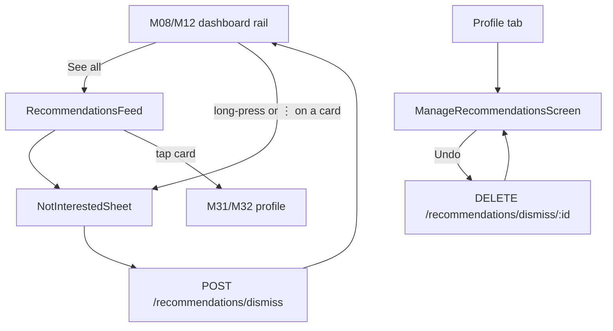
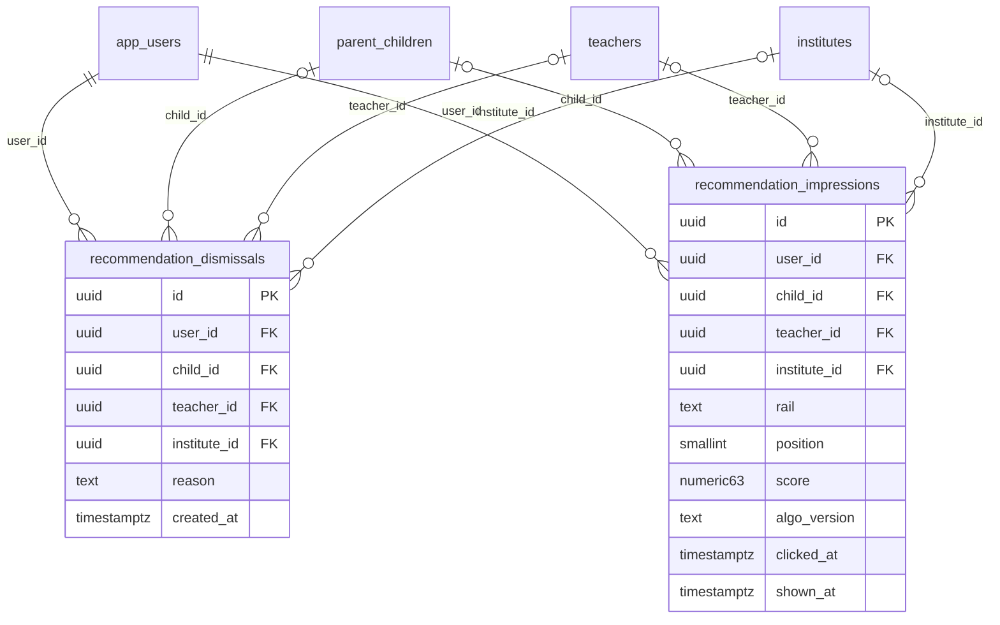

# Module 30 · Recommendation Engine

> **Phase 6 · Search & Discovery** · **Used by:** Learner · **Depends on:** M00 (events), M07 (child profiles), M08 and M12 (dashboards consume this), M27 (search signal), M40 (favourites signal), M37 (leads signal); Admin M16, M22, M36 · **New tables:** `recommendation_dismissals`, `recommendation_impressions` · **Uses:** `parent_children`, `user_search_history`, `teachers`, `institutes`, `user_favorites`, `leads` · **Build estimate:** 6–7 days

## 1. Module Purpose

Produces personalised "Recommended for you" teacher and institute rails per child (parent) or per student, replacing M08/M12's v0 rule-based dashboard ranking behind the same response shape. It scores candidates from Child Class, Subject Needs, Location and Previous Searches, generates candidates cheaply before scoring them, handles a brand-new child with no signal yet (cold start), keeps rails diverse rather than one repeated teacher, remembers "Not interested" dismissals, and caches the computed list per child in Redis so opening the dashboard is fast. It owns `recommendation_dismissals` and `recommendation_impressions`.

## 2. User Stories

- As a **parent with two children**, I want each child's home rail to reflect that child's class and subjects, not a blend of both.
- As a **parent who searched for "NEET biology" three times this week**, I want that interest reflected in what I'm shown without having to search again.
- As a **parent whose child just switched from Class 5 to a preferred category**, I want to mark a suggested teacher "Not interested" and never see them again for that child.
- As a **new parent who just added a child**, I want useful suggestions on day one, not an empty rail.
- As a **student**, I want recommendations based on my own class and subjects, not diluted by unrelated activity.

## 3. Business Rules & Logic

**BR-30.1 Scope of "a user" for recommendations.** For a parent, recommendations are computed **per child** (`parent_children.id`) since each child has its own class, subjects and teacher-category needs (M07); a parent with 2 children gets 2 independent rails, selected by the active-child switcher shown on the dashboard. For a student, recommendations are computed once for the account (no child concept), using `students.class_id`/`board_id` and any subjects implied by their search history in place of `parent_child_subjects`.

**BR-30.2 Candidate generation (cheap, before scoring).** Never scores the whole teacher table. Build a candidate pool of at most **300** teachers per request by unioning, until 300 or exhausted: (a) teachers matching the child's `class_id` (via `teacher_classes`) AND any of the child's subjects (via `teacher_subjects`) in the child's city (via `teacher_locations`) — up to 150; (b) teachers the account searched for or viewed in the last 30 days (`user_search_history.clicked_teacher_id`, `teacher_profile_views` for this user) not already included — up to 50; (c) teachers matching only the child's teacher category or only the city (broader net) — up to 100. All three pools apply M27 BR-27.4 eligibility (approved, active, not paused) before scoring. The equivalent pool for institutes unions matching `institute_batches` (class/subject), the child's city, and recently viewed/searched institutes, capped at 150.

**BR-30.3 Scoring formula.** Each candidate gets `score = Σ(weight_i × signal_i)` using weights from `system_settings` key **`recommendations.weights`** (a JSON object the app never sees raw, admin-editable like `institutes.rating_weights` in Admin M27), default:
```json
{ "classSubjectMatch": 30, "categoryMatch": 10, "locationProximity": 15, "trustScore": 20, "rating": 10, "searchAffinity": 10, "recency": 5 }
```
Signals (each normalised 0–1 before weighting):
- `classSubjectMatch` — fraction of the child's subjects the teacher teaches for that class (1.0 if all match).
- `categoryMatch` — 1.0 if `teachers.category_id` is in the child's `parent_child_teacher_categories`, else 0.3.
- `locationProximity` — same `distanceScore` formula as M27 BR-27.6 against the child's city/area.
- `trustScore` — `trust_scores.score / 100`.
- `rating` — `teachers.rating_avg / 5` (0.5 neutral if `rating_count = 0`).
- `searchAffinity` — 1.0 if the teacher appeared in a `user_search_history.clicked_teacher_id` in the last 30 days, 0.5 if only shown in results the user scrolled past (`result_count > 0` for a matching filter set), else 0.
- `recency` — `1 / (1 + daysSinceApproval / 30)`, giving newly approved teachers a small, decaying boost so the catalogue doesn't calcify around early winners.
Weights are read once per computation (cached with the same TTL as the recommendation cache, BR-30.7) and are copied into each `recommendation_impressions.algo_version` alongside a formula version string (e.g. `v1-2026.09`) so a weights change is attributable in analytics.

**BR-30.4 Cold start (no signal yet).** A child added in the last 24 h with no `user_search_history` and no `teacher_profile_views` for the account: `searchAffinity` defaults to 0 for everyone (no penalty relative to peers — the weight simply contributes nothing), and the pool leans on (a) and (c) from BR-30.2 only. If the child's city has fewer than **10** eligible candidates after class/subject matching (a genuinely thin market), the pool is widened to the whole state before scoring, and cards from outside the city are tagged `"outOfCity": true` with the actual distance shown rather than hidden. A child with zero subjects/class set (registration incomplete) gets a category-only, city-wide "Popular near you" rail instead of a personalised one, clearly labelled as such.

**BR-30.5 Diversity.** After scoring, re-rank with a simple bounded re-ranking pass: no more than **2** teachers sharing the same `category_id` in the first 5 slots, and no more than **1** teacher per `institute_teachers` linkage (an institute's own listed teacher and the institute itself don't both dominate the same rail) — implemented by walking the score-sorted list and skipping a candidate that would violate a cap, re-inserting it later in the list rather than dropping it. This keeps a rail from being 8 near-identical "Home Tutor, Mathematics" cards.

**BR-30.6 Dismissals.** `POST /recommendations/dismiss { teacherId | instituteId, childId?, reason? }` inserts `recommendation_dismissals`; that teacher/institute is excluded from candidate generation for that `(user, child)` pair permanently (no expiry — re-surfacing a "Not interested" pick would undo the point of asking). `DELETE /recommendations/dismiss/:id` undoes one (shown in a "Manage recommendations" list so a misclick is recoverable within reason, not silently forgotten). `reason` (`too_far`, `too_expensive`, `wrong_subject`, `not_relevant`, `other`) is optional but, when given, is aggregated (not per-user) to tune future weight changes — never fed back into that single user's live score in v1 (that personalisation is a scalability item).

**BR-30.7 Caching.** The scored, diversified, dismissal-filtered list for a `(userId, childId|null)` pair is cached in **Redis** under `reco:<userId>:<childId|'self'>` for **6 hours**, serialising the ranked candidate ids and scores (not full teacher payloads, which are hydrated fresh on each read so profile changes show immediately). Cache is invalidated early on: the child's subjects/class/category changing (M07), a new dismissal for that pair, or the nightly trust-score/rating recalculation touching a candidate already in the cached list by more than 5 points (a lightweight check the nightly job performs, not a full recompute trigger for every score change). A cache miss recomputes synchronously (typically < 400 ms for a 300-candidate pool) rather than returning stale or empty — recommendations are read-heavy and low-write, so synchronous compute-on-miss is simpler than a background warm job for v1.

**BR-30.8 Impressions and metrics.** Every card actually rendered on screen (not just returned by the API — the app fires this on 50%-visible-for-300ms, the same viewability rule used for ad impressions) posts to `POST /events` with `name: "recommendation_impression"`; the server inserts one `recommendation_impressions` row per card (`rail`, `position`, `score`, `algo_version`, `shown_at`) and updates `clicked_at` when the corresponding profile is opened within the session. `GET /recommendations` itself does not write impressions (a returned-but-unscrolled-to card is not "shown"). Click-through rate per rail/algo_version is the primary offline metric for evaluating a weights change (compared via the same `POST /trust-weights/draft/simulate`-style before/after, but for recommendations this is an analytics query, not an admin endpoint in v1).

**BR-30.9 Rails and consumption by M08/M12.** `GET /recommendations?childId=&rail=` returns one named rail at a time: `recommended_teachers` (the scored list, BR-30.3), `recommended_institutes`, `nearby` (location-only, no scoring — a simple distance-sorted fallback used when a rail would otherwise be too thin), `top_rated` (rating/trust only, city-wide, no personalisation — good for a brand-new account), `verified` (verified-badge teachers only), `for_you` (an alias for `recommended_teachers`, kept as a separate rail name so M08/M12 can A/B which label performs better without an API change). M08 `GET /home/parent` and M12 `GET /home/student` call this module's internal `RecommendationService.getRail(userId, childId, rail, limit)` in-process (not a network hop) to fill their dashboard sections, so the dashboards' own specs describe layout only; the scoring, caching and dismissal logic lives here exactly once.

## 4. Screen List

| Screen | Route name | Purpose |
| --- | --- | --- |
| Recommendations feed | `RecommendationsFeed` | Full-screen "See all" for a dashboard rail, paged |
| Not-interested sheet | `NotInterestedSheet` (bottom sheet) | Confirm dismissal, optional reason |
| Manage recommendations | `ManageRecommendationsScreen` | List of dismissals for the active child, with undo |

## 5. Screen Flow & Navigation


`RecommendationsFeed` is reached only from "See all"; there is no separate tab for it. Dismissing from the dashboard removes the card in place (optimistic) without leaving the screen.

## 6. Screen Wireframe Description

**Dashboard rail (rendered by M08/M12, cards owned here)** — horizontal `TeacherCard`/`InstituteCard` list, each with a small ⋮ opening `NotInterestedSheet` directly (no separate long-press gesture, for accessibility). Cold-start rail carries a small label "Popular near you" instead of "Recommended for you" when `cold_start` is true in the response.

**RecommendationsFeed** — header "Recommended for Aarav" (child name) or "Recommended for you" (student/self), vertical list of full `TeacherCard`s with the same ⋮ action, pull-to-refresh (forces a cache bypass), footer loader on scroll (paged from the same cached ranked list, not re-scored per page).

**NotInterestedSheet** — heading "Not interested in Dr. Ananya Iyer?", optional reason chips (Too far · Too expensive · Wrong subject · Not relevant · Other), sticky "Confirm" and text "Undo" toast after confirming, valid 5 seconds before the dismissal is treated as final (the "Undo" toast action calls the DELETE immediately, cancelling the just-created row — so no dismissal ships to the server for a within-5-seconds regret, kept simple as a client-side optimistic delay rather than a server-side grace window).

**ManageRecommendationsScreen** — child switcher at top (parents only), list of dismissed teachers/institutes with name, dismissed date, reason chip if given, trailing "Undo" button. Empty state: "You haven't marked anything as not interested."

## 7. UI Components & Component Tree

```
RecommendationsFeedScreen
├─ Header (child name or "you")
├─ FlashList<TeacherCard | InstituteCard> (rail-specific)
└─ ListFooterLoader
NotInterestedSheet (ReasonChips, ConfirmButton)
ManageRecommendationsScreen (ChildSwitcher, DismissalRow × n, EmptyState)
```
- Hooks: `useRecommendationsQuery(childId, rail)` (persisted, `staleTime` matches the 6 h server cache), `useDismissRecommendationMutation()`, `useUndoDismissalMutation()`, `useRecommendationImpressionTracker()` (IntersectionObserver-equivalent via `onViewableItemsChanged` on FlashList, 50%/300 ms rule).

## 8. Validation Rules

| Field | Rule | Message shown |
| --- | --- | --- |
| childId | uuid of the caller's own child, or omitted for a student/self rail | — |
| rail | one of `recommended_teachers`, `recommended_institutes`, `nearby`, `top_rated`, `verified`, `for_you` | — |
| teacherId / instituteId (dismiss) | exactly one of the two, uuid | "Something went wrong. Try again." |
| reason | one of the 5 enum values or omitted | — |

## 9. API Endpoints

| Method | Path | Auth | Description |
| --- | --- | --- | --- |
| GET | /recommendations | Learner | One named rail for the caller (and child, if a parent), paged |
| POST | /recommendations/dismiss | Learner | Mark a teacher or institute "Not interested" for a child/account (Idempotency-Key) |
| DELETE | /recommendations/dismiss/:id | Learner | Undo a dismissal |

Uses: M27 `user_search_history` (read-only, as a signal, not an owned dependency); M40 `user_favorites` (read-only signal — a favourited teacher is never re-recommended as "new", it simply scores normally but the card shows a filled heart); M37 `leads` (read-only signal — a teacher already contacted for this child scores normally but is deduplicated to the bottom half of the rail rather than the top, so the rail surfaces new options first); M00 `POST /events` (impressions).

## 10. Request Payloads

```json
// GET /recommendations?childId=91de...&rail=recommended_teachers&page=1&limit=10

// POST /recommendations/dismiss   (Idempotency-Key: 5f2a…)
{ "teacherId": "b7c2…", "childId": "91de…", "reason": "too_far" }
```

## 11. Response Payloads

```json
// 200 GET /recommendations
{ "data": [
  { "teacherId": "b7c2…", "publicCode": "GC-T10241", "fullName": "Dr. Ananya Iyer", "photoUrl": "https://cdn.guruconnect.in/…",
    "trustScore": 91.5, "ratingAvg": 4.8, "feePerHourPaise": 80000, "distanceKm": 2.4, "isFavourite": false, "hasExistingLead": false,
    "score": 0.87, "reasons": ["Teaches Mathematics for Class 8", "Highly trusted", "Near HSR Layout"] } ],
  "meta": { "rail": "recommended_teachers", "childId": "91de…", "coldStart": false, "algoVersion": "v1-2026.09", "page": 1, "total": 46 } }

// 200 GET /recommendations  (cold start, thin city market)
{ "data": [ { "teacherId": "…", "fullName": "Rahul Menon", "outOfCity": true, "distanceKm": 68.0, "score": 0.61, "reasons": ["Teaches Mathematics for Class 8"] } ],
  "meta": { "rail": "recommended_teachers", "coldStart": true, "algoVersion": "v1-2026.09" } }

// 201 POST /recommendations/dismiss
{ "data": { "id": "d9a1…", "teacherId": "b7c2…", "childId": "91de…", "dismissedAt": "2026-09-26T10:00:00Z" } }
```

## 12. PostgreSQL Tables & Columns

**New tables owned by this module** (migration `sql/migrations/130_app_m30_recommendation_engine_dismissals_and_impressions.sql`)

### `recommendation_dismissals`

Teachers or institutes a user marked "Not interested" so they stop being recommended.

| Column | Type | Null | Default | Constraints / References | Description |
| --- | --- | --- | --- | --- | --- |
| `id` | uuid | no | gen_random_uuid() | PK | Primary key |
| `user_id` | uuid | no | — | FK → `app_users.id` (on delete cascade) | User |
| `child_id` | uuid | yes | — | FK → `parent_children.id` (on delete cascade) | Scope to one child (NULL = all) |
| `teacher_id` | uuid | yes | — | FK → `teachers.id` (on delete cascade) | Dismissed teacher |
| `institute_id` | uuid | yes | — | FK → `institutes.id` (on delete cascade) | Dismissed institute |
| `reason` | text | yes | — | CHECK reason IN ('too_far','too_expensive','wrong_subject','not_relevant','other') | Optional reason |
| `created_at` | timestamptz | no | now() | — | When |

**Table constraints:** `CONSTRAINT ck_recommendation_dismissals_target CHECK ((teacher_id IS NULL) <> (institute_id IS NULL))`

<details><summary>DDL</summary>

```sql
CREATE TABLE recommendation_dismissals (
  id uuid PRIMARY KEY DEFAULT gen_random_uuid(), -- Primary key
  user_id uuid NOT NULL REFERENCES app_users(id) ON DELETE CASCADE, -- User
  child_id uuid REFERENCES parent_children(id) ON DELETE CASCADE, -- Scope to one child (NULL = all)
  teacher_id uuid REFERENCES teachers(id) ON DELETE CASCADE, -- Dismissed teacher
  institute_id uuid REFERENCES institutes(id) ON DELETE CASCADE, -- Dismissed institute
  reason text CHECK (reason IN ('too_far','too_expensive','wrong_subject','not_relevant','other')), -- Optional reason
  created_at timestamptz NOT NULL DEFAULT now(), -- When
  CONSTRAINT ck_recommendation_dismissals_target CHECK ((teacher_id IS NULL) <> (institute_id IS NULL))
);
CREATE INDEX idx_recommendation_dismissals_user ON recommendation_dismissals (user_id);
```

</details>

**Indexes:** `idx_recommendation_dismissals_user` on `(user_id)`

### `recommendation_impressions`

Recommendations shown to a user (sampled 100% at launch) to measure click-through and avoid showing the same card too often.

| Column | Type | Null | Default | Constraints / References | Description |
| --- | --- | --- | --- | --- | --- |
| `id` | uuid | no | gen_random_uuid() | PK | Primary key |
| `user_id` | uuid | no | — | FK → `app_users.id` (on delete cascade) | Viewer |
| `child_id` | uuid | yes | — | FK → `parent_children.id` (on delete set null) | Child the list was for |
| `teacher_id` | uuid | yes | — | FK → `teachers.id` (on delete cascade) | Recommended teacher |
| `institute_id` | uuid | yes | — | FK → `institutes.id` (on delete cascade) | Recommended institute |
| `rail` | text | no | — | CHECK rail IN ('recommended_teachers','recommended_institutes','nearby','top_rated','verified','for_you') | Dashboard section |
| `position` | smallint | no | — | — | 1-based position in the rail |
| `score` | numeric(6,3) | no | — | — | Engine score at the time |
| `algo_version` | text | no | — | — | e.g. rules-v1 |
| `clicked_at` | timestamptz | yes | — | — | Card opened |
| `shown_at` | timestamptz | no | now() | — | Shown |

<details><summary>DDL</summary>

```sql
CREATE TABLE recommendation_impressions (
  id uuid PRIMARY KEY DEFAULT gen_random_uuid(), -- Primary key
  user_id uuid NOT NULL REFERENCES app_users(id) ON DELETE CASCADE, -- Viewer
  child_id uuid REFERENCES parent_children(id) ON DELETE SET NULL, -- Child the list was for
  teacher_id uuid REFERENCES teachers(id) ON DELETE CASCADE, -- Recommended teacher
  institute_id uuid REFERENCES institutes(id) ON DELETE CASCADE, -- Recommended institute
  rail text NOT NULL CHECK (rail IN ('recommended_teachers','recommended_institutes','nearby','top_rated','verified','for_you')), -- Dashboard section
  position smallint NOT NULL, -- 1-based position in the rail
  score numeric(6,3) NOT NULL, -- Engine score at the time
  algo_version text NOT NULL, -- e.g. rules-v1
  clicked_at timestamptz, -- Card opened
  shown_at timestamptz NOT NULL DEFAULT now() -- Shown
);
CREATE INDEX idx_recommendation_impressions_user ON recommendation_impressions (user_id, shown_at DESC);
```

</details>

**Indexes:** `idx_recommendation_impressions_user` on `(user_id, shown_at DESC)`

**Existing tables this module reads or writes** (full definitions in the owning module)

| Table | Owner | Purpose |
| --- | --- | --- |
| `parent_children` | Admin M29 | Children a parent is finding teachers for. Drives per-child recommendations. |
| `user_search_history` | App M27 | Searches made by a user, used for "Recent searches" and as a recommendation signal. Kept 180 days. |
| `teachers` | Admin M16 | Teacher profile and verification state. One row per teacher app account. |
| `institutes` | Admin M22 | Coaching centres, tuition centres, schools and academies. Rated by GuruConnect after verification. |
| `user_favorites` | App M40 | Teachers and institutes a user saved to their favourites. |
| `leads` | Admin M38 | Enquiries and call-back requests from parents/students to a teacher or institute. |

- `recommendation_dismissals`: one row per `(user_id, child_id, teacher_id|institute_id)`, no expiry; excluded from candidate generation (BR-30.2) via a `NOT EXISTS` check.
- `recommendation_impressions`: one row per card actually shown (BR-30.8), `clicked_at` set when the profile opens within the same app session; `algo_version` ties every impression to the weights version active at scoring time for offline evaluation.
- `parent_children`, `user_search_history`, `teachers`, `institutes`, `user_favorites`, `leads`: read-only signals (BR-30.2, BR-30.3, requests table above).

## 13. Relationships

**Foreign keys of new tables**

- `recommendation_dismissals.user_id` → `app_users` — required, many-to-one, on delete **cascade**
- `recommendation_dismissals.child_id` → `parent_children` — optional, many-to-one, on delete **cascade**
- `recommendation_dismissals.teacher_id` → `teachers` — optional, many-to-one, on delete **cascade**
- `recommendation_dismissals.institute_id` → `institutes` — optional, many-to-one, on delete **cascade**
- `recommendation_impressions.user_id` → `app_users` — required, many-to-one, on delete **cascade**
- `recommendation_impressions.child_id` → `parent_children` — optional, many-to-one, on delete **set null**
- `recommendation_impressions.teacher_id` → `teachers` — optional, many-to-one, on delete **cascade**
- `recommendation_impressions.institute_id` → `institutes` — optional, many-to-one, on delete **cascade**

**Entity relationship diagram**



## 14. State Management

- Query keys: `recommendationKeys.rail(userId, childId, rail)`, persisted with a `staleTime` of 6 h to mirror the server cache (so a foreground refetch after 6 h feels intentional, not jarring).
- After `useDismissRecommendationMutation`: optimistic removal of the card from every cached rail containing it (teacher/institute ids are shared across rails); rollback re-inserts on error.
- `useUndoDismissalMutation`: optimistic re-insertion is not attempted (the ranked position is unknown after removal) — the rail is invalidated instead and refetched.

## 15. Offline Handling

- Rails are persisted (read cache); a card dismissed offline is queued (class 1, idempotent by `teacherId`+`childId`) and removed from the cached list immediately.
- `RecommendationsFeed` pagination beyond the first cached page is online-only.
- Impression events batch through M00's existing offline-tolerant `POST /events` queue.

## 16. Push Notification Requirements

None sent directly by this module. A saved search's new-match alert (M29) and a dashboard's "New teachers near you" banner are separate features; this module only supplies the ranked data they might use.

## 17. Security Rules

- Recommendations for a `childId` are only ever computed and returned when that child belongs to the caller (`parent_children.parent_id` resolves to the token's `pid`); a mismatched `childId` → `403 FORBIDDEN`.
- Dismissals and their reasons are private to the user; aggregate reason stats used for weight tuning are never joined back to a user id in reporting.
- The candidate pool and scoring never leak ineligible (unapproved/paused/suspended) teachers or institutes — BR-30.2 filters before scoring, not after.

## 18. Error Handling

| Scenario | Code | HTTP | App behaviour |
| --- | --- | --- | --- |
| `childId` not the caller's own | `FORBIDDEN` | 403 | Toast "You can't do that."; child switcher resets to the caller's first child |
| Unknown `rail` value | `VALIDATION_FAILED` | 422 | Falls back to `recommended_teachers` client-side |
| Both `teacherId` and `instituteId` on dismiss | `VALIDATION_FAILED` | 422 | Toast "Something went wrong. Try again." |
| Dismissal already exists (idempotent) | — (200, no-op) | 200 | No visible change |
| Compute-on-miss exceeds 1.5 s | — (served anyway) | 200 | No user-visible error; Sentry warning logged for tuning the 300-candidate cap |
| Network / 5xx | `GATEWAY_ERROR` / `INTERNAL_ERROR` | 502 / 500 | Rail shows ErrorState + Retry under the dashboard section, rest of the dashboard unaffected |

## 19. Testing Scenarios

- T30.1 Happy path (Maestro `recommendations_happy`): open dashboard → rail shows class/subject-matched teachers first, reasons chips present, dismiss one → card removed and excluded on next fetch.
- T30.2 Two children with different classes/subjects on the same parent account get visibly different rails; switching the child switcher refetches the correct `childId`.
- T30.3 Brand-new child (< 24 h, no history) in a thin-market city (< 10 candidates) → pool widens state-wide, `outOfCity` flagged with real distance, `coldStart: true`.
- T30.4 Diversity cap: seed 6 candidates in the same category scoring highest → no more than 2 appear in the first 5 slots of the rendered rail.
- T30.5 Dismiss → undo within the app's grace toast → `DELETE /recommendations/dismiss/:id` cancels it before it affects the next fetch; dismiss → close app → reopen after the toast window → dismissal stands and the teacher is excluded.
- T30.6 Cache: two consecutive `GET /recommendations` within 6 h return the same ranked order (from Redis) even though `trust_scores` changed slightly in between (below the 5-point invalidation threshold); a ≥ 5-point change forces a recompute.
- T30.7 A teacher already the subject of an open `leads` row for that child appears lower in the rail than an equally-scored teacher with no existing lead.
- T30.8 Impressions: a card scrolled past quickly (< 300 ms visible) does not create a `recommendation_impressions` row; one held on-screen 400 ms does.
- T30.9 `childId` belonging to another parent → 403.
- T30.10 Offline: cached rail renders; dismiss offline is queued and reflected immediately; reconnect applies it server-side without duplicating on retry (Idempotency-Key).

## 20. Audit Log Events

None. Recommendations and impressions are behavioural/analytics data (`recommendation_impressions` is itself the record), not admin-relevant actions; dismissals are a personal preference, not an audited event.

## 21. Future Scalability Notes

- Feed dismissal reasons back into that user's own live scoring (a lightweight per-user category penalty) once enough dismissal volume exists to do so without overfitting on 1–2 data points.
- Replace the in-process candidate SQL with a vector/embedding-based similarity service once subject/category taxonomies grow past what a hand-tuned weighted sum models well.
- A/B testing harness for `recommendations.weights` versions (parallel to Admin M36's trust-weight simulate/activate pattern) rather than a single live version.
- Background pre-warm of the Redis cache for active users overnight, so the first dashboard open of the day never pays the compute-on-miss cost.
- Cross-child household signals (what similar households with a Class 8 CBSE child in the same city responded to) once privacy and volume both support it.
