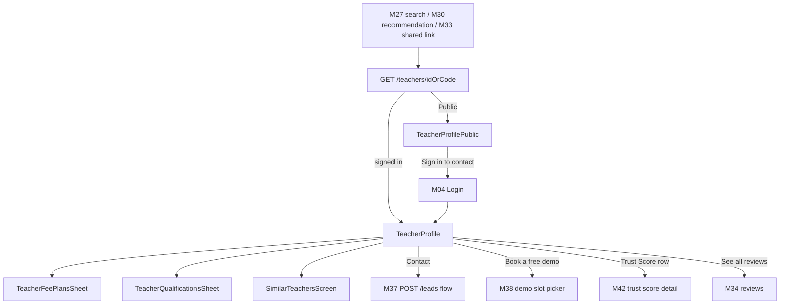
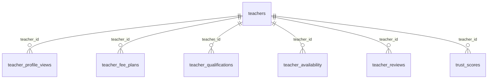

# Module 31 · Teacher Profile View

> **Phase 7 · Profiles** · **Used by:** Learner, Public (shared link, limited view) · **Depends on:** M00 (events, uploads for viewing photos), M27 (arrival from search), M30 (arrival from recommendations), M33 (share), M34 (reviews tab), M37/M38 (contact/demo handoff), M42 (trust score detail); Admin M16, M17, M18, M19, M20, M33, M36 · **New tables:** none · **Uses:** `teachers`, `teacher_profile_views`, `teacher_fee_plans`, `teacher_qualifications`, `teacher_availability`, `teacher_reviews`, `trust_scores` · **Build estimate:** 5–6 days

## 1. Module Purpose

The public-facing teacher profile: verification badge, Trust Score, reviews summary, experience, subjects/classes taught, fee plans, qualifications, weekly availability summary and a "Similar teachers" rail. It records every view in `teacher_profile_views` (owned by Admin M21) for the teacher's own analytics and this module's `GET /teachers/:id/similar`. Contact and demo actions on the profile hand off entirely to M37 (Contact Teacher) and M38 (Demo Class Request) — this module never creates a lead or demo itself. A limited public view renders for a shared link (M33) or a search-engine/WhatsApp preview without requiring sign-in.

## 2. User Stories

- As a **parent evaluating a tutor**, I want to see their Trust Score breakdown, reviews and fee plans on one screen before I contact them.
- As a **parent who received a WhatsApp link** to a teacher's profile from a friend, I want to view the basics without signing in first.
- As a **student comparing options**, I want a "Similar teachers" list so that I'm not stuck picking from just one search result.
- As a **new teacher**, I want my profile to show my verified badge and completeness immediately once approved so that parents trust me from day one.
- As a **teacher on a break**, I want my profile to clearly show I'm away rather than look abandoned.

## 3. Business Rules & Logic

**BR-31.1 Resolving the profile — `GET /teachers/:idOrCode`.** Accepts either the uuid or the human `public_code` (e.g. `GC-T10241`, used in shared links and support). Returns `404 NOT_FOUND` for a soft-deleted or never-existing id; returns the profile with a `"suspended": true` limited card (name, "This profile is temporarily unavailable") for `account_status = 'suspended'` rather than a hard 404, so an existing lead thread or review doesn't suddenly reference a ghost. A teacher who is `pause_leads` (M19 `teacher_time_off`) still resolves fully but with an `"away": { "untilDate": "…", "message": "…" }` banner and contact/demo buttons disabled with that reason (BR-31.7).

**BR-31.2 What the profile shows (Learner, signed in).**

| Section | Source | Notes |
| --- | --- | --- |
| Header | `teachers.full_name`, `profile_photo_file_id`, `public_code`, `category_id` | VerifiedBadge if `is_verified_badge`; "Featured"/"Premium" tags mirror M27 BR-27.6 definitions |
| Trust Score | `trust_scores.score` (or `override_score` if `is_overridden`), factor summary | Tapping opens M42's detail (this module links out, doesn't duplicate the breakdown) |
| Reviews | `teachers.rating_avg`, `rating_count`, top 3 recent published `teacher_reviews` | "See all N reviews" → M34 |
| Experience & bio | `experience_years`, `highest_qualification`, `bio`, `languages` | |
| Subjects & classes | `teacher_subjects`, `teacher_classes` (with board) | Grouped "Class 6–8: Mathematics, Science (CBSE, ICSE)" |
| Fee plans | `teacher_fee_plans` (`is_active`) | Grouped by subject/class/mode, "From ₹500/hr" summary + full list on tap |
| Qualifications | `teacher_qualifications` | Degree, institution, year; highest flagged |
| Availability summary | `teacher_availability` | "Available Mon–Fri evenings, weekends" (not a booking calendar — that's M38's demo slot picker) |
| Locations & modes | `teacher_locations`, `teacher_teaching_modes` | Areas served, travel radius for home tuition, Online/Offline chips |
| Similar teachers | `GET /teachers/:id/similar` | BR-31.5 |
Demo-available (`demo_available`) surfaces a "Book a free demo" button; its absence surfaces only "Contact".

**BR-31.3 Limited public view (`Public` auth, no token).** Returns a strict subset: name, photo, category, city/area (no exact address), subjects/classes, experience, Trust Score and rating (numbers only, no factor breakdown or written reviews beyond the top 1), "From ₹X/hr" (no full fee table), VerifiedBadge. No qualifications detail, no full availability, no similar-teachers rail, no contact/demo buttons — instead a single "Open in GuruConnect app / Sign in to contact" CTA that deep-links to the full profile after auth (`pendingDeepLink`, conventions §4). This is also exactly the payload rendered server-side for the Open Graph web preview page (M33) so a WhatsApp/Google preview never shows more than a signed-in-but-anonymous learner would.

**BR-31.4 Recording a view.** On profile open (learner or Public), the app calls `POST /events` with `name: "teacher_profile_view"`, `props: { teacherId, source }` where `source` is one of `search, home_featured, home_recommended, nearby, shared_link, institute_page, other` (matching `teacher_profile_views.source`) — M00's event pipeline inserts the `teacher_profile_views` row server-side (this module defines the contract, M00 owns the ingestion, per conventions §11 "reads and searches are not audit-logged" and BR-0.10). A signed-in viewer's `viewer_user_id` is set; a Public viewer's is `NULL`. Repeated views by the same viewer within the same day count once for the teacher's daily stats (Admin M21 `teacher_daily_stats.unique_viewers`) but every open still inserts a raw row (the daily job does the de-duplication, not this module).

**BR-31.5 Similar teachers — `GET /teachers/:id/similar`.** Up to **8** teachers sharing at least one subject with this teacher, in the same city, same `teaching_modes` overlap where possible, ranked by `trust_scores.score` then `rating_avg`, excluding the current teacher and anyone the viewer has already dismissed for the active child (reuses M30's `recommendation_dismissals` check when a `childId` is passed, so "Not interested" carries over here too). This is a lightweight relevance list, not a scored M30 rail — it has no impressions/caching of its own and is small enough (≤ 8) to compute per request.

**BR-31.6 Profile completeness shown to the teacher only.** When the caller **is** the profile's own teacher (viewing their own public page via "Preview my profile", M17), an additional completeness banner and missing-field checklist render from `teachers.profile_completeness`; this is the only place a teacher sees their own profile as others see it plus what's incomplete, reusing M17's `GET /teacher/profile/preview` rather than duplicating that logic — this module's `GET /teachers/:idOrCode` simply detects `sub == teacher.user_id` and adds the `"ownerView": true` flag with the checklist.

**BR-31.7 Contact and demo handoff.** "Contact" opens M37's `POST /leads` flow pre-filled with `teacherId` (and `childId` if a parent); "Book a free demo" opens M38's slot picker. Both buttons are disabled with the away/suspended reason text when BR-31.1's states apply, and disabled with "Sign in to contact" for a Public viewer (routes to Login with the profile as the pending deep link). This module renders the buttons and passes context; it owns no lead or demo state itself.

## 4. Screen List

| Screen | Route name | Purpose |
| --- | --- | --- |
| Teacher profile | `TeacherProfile` | Full profile for a signed-in learner |
| Teacher profile (limited) | `TeacherProfilePublic` | Subset shown to a signed-out Public viewer |
| Fee plans (all) | `TeacherFeePlansSheet` (bottom sheet) | Full fee table beyond the "From ₹X" summary |
| Qualifications detail | `TeacherQualificationsSheet` (bottom sheet) | Full list with institution/year |
| Similar teachers (all) | `SimilarTeachersScreen` | Full list beyond the inline rail |

## 5. Screen Flow & Navigation


Back from any sub-sheet returns to `TeacherProfile` at the same scroll position. A profile opened from a push or deep link while signed out routes through `TeacherProfilePublic` first if the link itself is a public share URL, else straight to Login.

## 6. Screen Wireframe Description

**TeacherProfile** — hero: photo, name, VerifiedBadge, "Featured"/"Premium" tag if applicable, category label, area/city, share icon (→ M33). Away banner when paused: amber strip "Away until 12 Oct — back to taking new students soon." Row: `TrustScoreRing` + score + "See details" → M42; `RatingStars` + "4.8 (214 reviews)" → M34. Section "About" — bio (max 6 lines, "Read more"), experience "6 years", languages chips, highest qualification line. Section "Subjects & classes" — grouped chips per class range. Section "Fees" — 2–3 summary rows "Class 6–8 Maths · ₹800/hr", "See all fee plans" → sheet. Section "Qualifications" — top 2, "See all" → sheet. Section "Availability" — "Mon–Fri evenings · Weekends" text summary + mode chips "Online · Home tuition (5 km)". Section "Similar teachers" — horizontal `TeacherCard` rail, "See all" → `SimilarTeachersScreen`. Sticky bottom bar: "Book a free demo" (secondary, only if `demo_available`) and "Contact" (primary); both replaced by a single disabled "Away — check back later" / "Sign in to contact" per state.

**TeacherProfilePublic** — same hero and About/Subjects/Fees-summary/reviews-count sections, no Qualifications/Availability/Similar-teachers sections, sticky bar single button "Open in GuruConnect app" (or "Sign in to contact").

**TeacherFeePlansSheet** — table-like rows: label, subject/class/mode, "₹800/hr" or "₹6,000/month", session count/length when set. Empty state not applicable (button only shown when plans exist).

**SimilarTeachersScreen** — vertical `TeacherCard` list, same card component as M27 search results, "See why" not shown here (reasons are M30's feature, not this list's).

## 7. UI Components & Component Tree

```
TeacherProfileScreen
├─ ProfileHero (Photo, VerifiedBadge, FeaturedTag, ShareButton → M33)
├─ AwayBanner (conditional)
├─ TrustRatingRow (TrustScoreRing, RatingStars)
├─ AboutSection · SubjectsSection · FeesSummarySection → TeacherFeePlansSheet
├─ QualificationsSummarySection → TeacherQualificationsSheet
├─ AvailabilitySummarySection
├─ SimilarTeachersRail → SimilarTeachersScreen
├─ OwnerCompletenessBanner (conditional, BR-31.6)
└─ StickyActionBar (BookDemo?, Contact)
TeacherProfilePublicScreen (subset, single CTA)
```
- `ProfileHero({ teacher, onShare })`, `TrustRatingRow({ score, ratingAvg, ratingCount })`.
- Hooks: `useTeacherProfileQuery(idOrCode)` (persisted, `staleTime` 5 min), `useSimilarTeachersQuery(id, childId?)`, `useLogProfileView(source)` (fires once per screen mount), `useTeacherOwnerPreview()` (M17, only when `ownerView`).

## 8. Validation Rules

| Field | Rule | Message shown |
| --- | --- | --- |
| idOrCode | uuid or `^GC-T\d{4,8}$` | "This teacher's profile isn't available." |
| source (view event) | one of the 7 enum values | — |
| childId (similar teachers) | uuid of the caller's own child, optional | — |

## 9. API Endpoints

| Method | Path | Auth | Description |
| --- | --- | --- | --- |
| GET | /teachers/:idOrCode | Learner (full), Public (limited, BR-31.3) | Teacher profile |
| GET | /teachers/:id/similar | Learner, Public (limited fields) | Up to 8 similar teachers |

Uses: M00 `POST /events` (view logging), `GET /files/:id/url`; M27's card/search shapes for consistency; M37 `POST /leads`; M38 demo slot picker; M42 `GET /teachers/:id/trust-score`; M34 `GET /teachers/:id/reviews`; M17 `GET /teacher/profile/preview` (owner view).

## 10. Request Payloads

```json
// GET /teachers/GC-T10241?childId=91de...

// GET /teachers/b7c2.../similar?childId=91de...
```

## 11. Response Payloads

```json
// 200 GET /teachers/:idOrCode (learner)
{ "data": { "id": "b7c2…", "publicCode": "GC-T10241", "fullName": "Dr. Ananya Iyer", "photoUrl": "https://cdn.guruconnect.in/…",
  "isVerifiedBadge": true, "isFeatured": true, "isPremium": false, "categoryName": "Home Tutor", "areaName": "Koramangala", "cityName": "Bengaluru",
  "away": null, "suspended": false, "trustScore": 91.5, "ratingAvg": 4.8, "ratingCount": 214,
  "bio": "12 years teaching CBSE Mathematics and Physics …", "experienceYears": 6, "languages": ["en", "hi", "kn"],
  "highestQualification": "M.Sc. Mathematics, Bengaluru University",
  "subjects": [ { "classFrom": "Class 6", "classTo": "Class 8", "boards": ["CBSE", "ICSE"], "subjectNames": ["Mathematics", "Science"] } ],
  "feeSummary": [ { "label": "Class 6–8 Maths", "amountPaise": 80000, "unit": "per_hour" } ], "feePlanCount": 5,
  "qualificationsSummary": [ { "degree": "M.Sc. Mathematics", "institution": "Bengaluru University", "year": 2014 } ], "qualificationCount": 3,
  "availabilitySummary": "Mon–Fri evenings · Weekends", "modes": ["online", "home_tuition"], "travelRadiusKm": 5,
  "demoAvailable": true, "ownerView": false } }

// 200 GET /teachers/:idOrCode (Public, limited)
{ "data": { "id": "b7c2…", "publicCode": "GC-T10241", "fullName": "Dr. Ananya Iyer", "photoUrl": "https://cdn.guruconnect.in/…",
  "isVerifiedBadge": true, "categoryName": "Home Tutor", "cityName": "Bengaluru", "trustScore": 91.5, "ratingAvg": 4.8, "ratingCount": 214,
  "topReview": { "authorInitial": "P.", "rating": 5, "comment": "Excellent with weak students, very patient." },
  "subjects": [ { "subjectNames": ["Mathematics", "Science"] } ], "feeFrom": { "amountPaise": 80000, "unit": "per_hour" } } }

// 200 GET /teachers/:id/similar
{ "data": [ { "id": "…", "fullName": "Rahul Menon", "trustScore": 88.0, "ratingAvg": 4.6, "feeFrom": { "amountPaise": 70000, "unit": "per_hour" } } ] }
```

## 12. PostgreSQL Tables & Columns


**Existing tables this module reads or writes** (full definitions in the owning module)

| Table | Owner | Purpose |
| --- | --- | --- |
| `teachers` | Admin M16 | Teacher profile and verification state. One row per teacher app account. |
| `teacher_profile_views` | Admin M21 | Raw profile-view events from the app. High volume; partition by month when it exceeds ~50M rows. |
| `teacher_fee_plans` | App M17 | A teacher's fee structure: price per class group, subject and mode, per hour, per month or per course. |
| `teacher_qualifications` | App M14 | Degrees and certifications a teacher lists during registration and in the profile builder. |
| `teacher_availability` | App M19 | Weekly recurring time windows when a teacher can take classes or demos (IST). |
| `teacher_reviews` | Admin M33 | Reviews of teachers by parents and students. Only published reviews count toward ratings and trust. |
| `trust_scores` | Admin M36 | Current trust score per teacher with its factor breakdown. |

- `teachers`, `teacher_fee_plans`, `teacher_qualifications`, `teacher_availability`, `teacher_reviews`, `trust_scores`: read-only for the profile and similar-teachers query (BR-31.2, BR-31.5); no writes from this module.
- `teacher_profile_views`: written through M00's `POST /events` pipeline per the contract in BR-31.4, not directly by this module's own endpoint handler.

## 13. Relationships


**Entity relationship diagram** (tables this module uses; `admins` omitted)



## 14. State Management

- Query keys: `teacherKeys.profile(idOrCode)` (persisted, `staleTime` 5 min so re-opening from search feels instant), `teacherKeys.similar(id, childId)` (persisted 24 h).
- `useLogProfileView` is a fire-and-forget mutation with no cache effect.

## 15. Offline Handling

- A profile opened recently is served from the persisted cache with an "Updated 2 h ago" note; Contact/Demo buttons are disabled offline with "Connect to the internet to contact this teacher."
- Similar teachers and fee/qualification sheets read from the same cached payload; no separate offline handling needed since they're sub-views of one query.
- View logging queues through M00's existing `POST /events` offline queue (best-effort, order doesn't matter for analytics).

## 16. Push Notification Requirements

None. Arriving at a profile via push (e.g. a saved-search alert, M29) is a deep-link target, not an event this module sends.

## 17. Security Rules

- Full profile fields (qualifications, availability, similar teachers, fee detail) require a Learner token; a Public request never receives them even if it guesses the right query parameters — the server, not the client, decides the field set from auth state.
- A suspended teacher's exact address/location is never returned even in the limited "temporarily unavailable" card.
- `childId` passed to `/similar` is only honoured when it belongs to the caller; otherwise it's ignored (falls back to the non-personalised ranking) rather than erroring, since this is a soft personalisation, not an authorization boundary.
- The Open Graph preview (M33) is rendered server-side from exactly BR-31.3's payload — never more.

## 18. Error Handling

| Scenario | Code | HTTP | App behaviour |
| --- | --- | --- | --- |
| Unknown id/code | `NOT_FOUND` | 404 | "This teacher's profile isn't available." with back button |
| Soft-deleted teacher | `NOT_FOUND` | 404 | Same as above |
| Suspended teacher | — (200, limited card) | 200 | "This profile is temporarily unavailable." card, no actions |
| Paused (away) teacher | — (200, banner) | 200 | Away banner, actions disabled with reason |
| Contact/Demo tapped, Public | — (client-side redirect) | — | Routes to Login with the profile as pending deep link |
| Network / 5xx | `GATEWAY_ERROR` / `INTERNAL_ERROR` | 502 / 500 | ErrorState + Retry; cached profile shown if available |

## 19. Testing Scenarios

- T31.1 Happy path (Maestro `teacher_profile_happy`): open from search → all sections render → Contact opens M37 pre-filled with the teacher id.
- T31.2 Public (signed-out) open via a shared link shows only the limited fields; tapping "Open in GuruConnect app" after login lands back on the full profile.
- T31.3 Suspended teacher shows the limited "temporarily unavailable" card with no address or contact button.
- T31.4 Teacher with an active `teacher_time_off` (`pause_leads = true`) shows the Away banner and disabled Contact/Demo with the correct return date.
- T31.5 Owner viewing their own profile sees `ownerView: true` and the completeness checklist; another learner viewing the same profile does not.
- T31.6 `GET /teachers/:id/similar` excludes a teacher already dismissed (M30) for the passed `childId`, and excludes the profile's own teacher id.
- T31.7 `demo_available = false` hides the "Book a free demo" button entirely (not disabled, absent).
- T31.8 View event fires exactly once per screen mount, not on every re-render; offline view events queue and flush on reconnect.
- T31.9 Invalid `idOrCode` format (neither uuid nor `GC-T` pattern) → 404 without a database round trip.
- T31.10 Offline: cached profile renders with "Updated 2 h ago"; Contact/Demo disabled with the offline hint.

## 20. Audit Log Events

None. Profile views are analytics/behavioural data via `teacher_profile_views`, not an audited admin-relevant action (conventions §11).

## 21. Future Scalability Notes

- Server-rendered, cacheable HTML preview pages per teacher for search-engine indexing beyond the Open Graph share preview (SEO growth channel).
- "Compare teachers" (2–3 side by side) reusing this module's field set once M40/M41 favourites data shows people shortlisting before contacting.
- Video introduction clips on the profile (a new `files` purpose) once upload/transcoding infrastructure exists.
- Personalised "why this teacher" reasons (reused from M30) surfaced directly on the profile hero, not only in rails.
