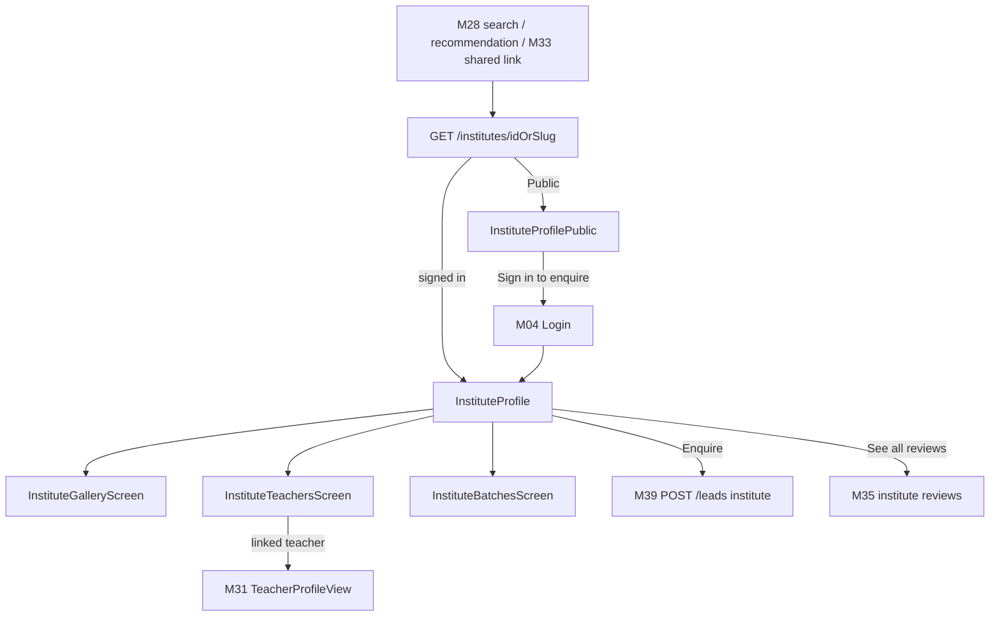
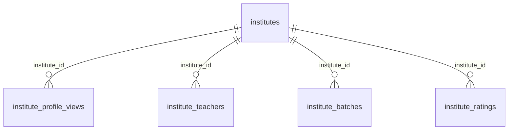

# Module 32 · Institute Profile View

> **Phase 7 · Profiles** · **Used by:** Learner, Public (limited) · **Depends on:** M00 (events), M28 (arrival from search), M33 (share), M35 (institute reviews tab), M39 (contact handoff); Admin M22, M24, M26, M27 · **New tables:** none · **Uses:** `institutes`, `institute_profile_views`, `institute_teachers`, `institute_batches`, `institute_ratings` · **Build estimate:** 4–5 days

## 1. Module Purpose

The public-facing institute profile: GuruConnect's independent rating (overall + infrastructure), verified badge, gallery, facilities, listed teachers, running batches, and reviews summary. It records every view in `institute_profile_views` (owned by this module, App M23) and exposes the teachers and batches sub-lists used from the profile. Enquiry actions hand off entirely to M39 (Contact Institute), which itself is the `targetType=institute` path of M37's `leads` endpoint. A limited public view renders for shared links and previews without sign-in, mirroring M31's contract exactly so the two profile types feel like one family.

## 2. User Stories

- As a **parent choosing between two coaching centres**, I want to see GuruConnect's rating breakdown, not just star reviews, so that I trust the comparison.
- As a **parent**, I want to see which teachers are listed at an institute and their subjects so that I know who would actually teach my child.
- As a **student**, I want to see running batches for my class and subject with seats available so that I know if I can still join.
- As a **parent sent an institute link on WhatsApp**, I want to preview it without installing the app first.

## 3. Business Rules & Logic

**BR-32.1 Resolving the profile — `GET /institutes/:idOrSlug`.** Accepts the uuid or the `slug` (e.g. `apex-jee-academy-koramangala`, used in shared links and the website). `404 NOT_FOUND` for soft-deleted or unknown; `account_status = 'suspended'` renders the same limited "temporarily unavailable" card pattern as M31 BR-31.1 rather than a hard 404 (existing reviews/enquiries keep a valid reference). Institutes have no per-day "away" state (M27 BR-28.2) — verification status other than `approved` (still `pending`/`under_review`/etc.) simply cannot be reached from search or a valid public slug, since a slug/uuid is only shareable once approved; a manager previewing their own unapproved institute uses M24's own preview, not this endpoint.

**BR-32.2 What the profile shows (Learner, signed in).**

| Section | Source | Notes |
| --- | --- | --- |
| Header | `institutes.name`, `logo_file_id`, `cover_file_id`, `public_code`, `institute_type` | VerifiedBadge if `is_verified_badge`; "Premium" tag mirrors M28 BR-28.3 |
| Rating | `overall_rating` (x.x/5), `infrastructure_score` (x.x/10), `user_rating_avg`/`user_rating_count` (learner reviews) | Exactly the public contract of Admin M27 FR-27.5 — never the private sub-scores or notes |
| About | `about`, `established_year`, `facilities` (`text[]`) | Facility chips, e.g. "Library", "CCTV", "Parking" |
| Gallery | `institute_documents` of type `campus_photo` published to `gc-public` (Admin M22 FR-22.7) | Shown as `cover_file_id` + gallery grid; private/unreviewed photos never appear here |
| Teachers | `GET /institutes/:id/teachers` | BR-32.3 |
| Batches | `GET /institutes/:id/batches` | BR-32.4 |
| Reviews | Top 3 recent published `institute_reviews` (M35), "See all N reviews" | |
| Location | `address_line`, `city_id`/`area_id`, map preview | Exact address shown to signed-in learners only (BR-32.5) |
Fee shown as `fee_min_paise`–`fee_max_paise` range (institute-level; per-batch fee is on the batch card, BR-32.4).

**BR-32.3 Listed teachers — `GET /institutes/:id/teachers`.** Returns `institute_teachers` rows with `status = 'active'` and `is_visible = true`, each with `full_name`, `photo_file_id`, `qualification`, `experience_years`, `schedule_text`, and subjects/classes (`institute_teacher_subjects`/`institute_teacher_classes`). When a row's `teacher_id` is linked to a GuruConnect `teachers` account (Admin M26's link flow), the card also shows that teacher's Trust Score and links through to the full M31 profile ("View full profile"); an unlinked institute-only teacher shows the institute-entered fields only, with no Trust Score and no tap-through (nothing to link to). `status = 'id_pending'` or `'removed'` rows never appear here regardless of `is_visible`.

**BR-32.4 Running batches — `GET /institutes/:id/batches`.** Returns `institute_batches` with `is_active = true` and `deleted_at IS NULL`, each with `name`, resolved `subject_ids` → names, `class_id` → name, `teaching_mode_id` → name, `schedule_text`, `seats_total`/`seats_available`, `fee_paise`/`fee_period`, `starts_on`. Sorted by `starts_on` ascending (soonest first), batches with `seats_available = 0` sort last within that order and show a "Batch full" pill rather than being hidden (a parent may still want to join a waitlist by contacting the institute, M39). Optional `?classId=&subjectId=` narrows the list to match a child's needs, reusing the exact filter the profile's "Batches for my child" toggle sends when a child is active.

**BR-32.5 Limited public view.** Name, logo/cover, institute type, city/area (no exact address or map), rating numbers (no infrastructure sub-detail beyond the single score, no private notes ever), top 1 review, facilities chips, up to 3 gallery photos, fee range, and a single "Open in GuruConnect app / Sign in to enquire" CTA. Teachers and batches lists are not shown to Public (BR-32.3/32.4 require a Learner token) — a parent must sign in to see who actually teaches there and what's running, which is also the strongest reason to complete registration. This is the exact payload used for the Open Graph web preview (M33).

**BR-32.6 Recording a view.** Mirrors M31 BR-31.4 exactly but into `institute_profile_views` (owned here): `POST /events` with `name: "institute_profile_view"`, `props: { instituteId, source }` where `source` matches `institute_profile_views.source` (`search, recommendation, dashboard, favorites, share_link, notification, other`). One row per view; `institute_daily_stats.profile_views` (Admin M23/M24) is the de-duplicated nightly roll-up, this table stays raw. `viewed_on` is a generated/derived date column for the "one per viewer per institute per day" description in the schema reference — enforced by the nightly stats job's grouping, not a uniqueness constraint on insert (repeated raw views are fine, matching M31's approach).

**BR-32.7 Owner/manager preview.** When the caller is an active manager or counsellor of the institute, `GET /institutes/:idOrSlug` adds `"ownerView": true`; this module does not add a completeness checklist here (institutes don't have a `profile_completeness` column) — the manager's own verification checklist lives in M22, and this flag exists only so the app can show a small "This is how parents see your institute" banner rather than duplicate any status logic.

**BR-32.8 Enquiry handoff.** "Enquire" opens M39's `POST /leads { targetType: "institute", instituteId, ... }`; "View batch" on a specific batch card pre-fills the enquiry message with that batch's name. Both require a Learner token; Public sees "Sign in to enquire" routing to Login with the profile as the pending deep link, identically to M31 BR-31.7.

## 4. Screen List

| Screen | Route name | Purpose |
| --- | --- | --- |
| Institute profile | `InstituteProfile` | Full profile for a signed-in learner |
| Institute profile (limited) | `InstituteProfilePublic` | Subset shown to a signed-out Public viewer |
| Gallery | `InstituteGalleryScreen` | Full-screen photo gallery |
| Teachers list | `InstituteTeachersScreen` | Full list beyond the inline preview |
| Batches list | `InstituteBatchesScreen` | Full list with the class/subject filter toggle |

## 5. Screen Flow & Navigation


Back from any sub-screen returns to `InstituteProfile` at the same scroll position. Tapping a linked teacher inside `InstituteTeachersScreen` opens the full M31 profile in the same stack (back returns to the teacher list, not the institute profile).

## 6. Screen Wireframe Description

**InstituteProfile** — cover photo (16:9) with logo overlapping bottom-left, name, VerifiedBadge, "Premium" tag if applicable, institute type label, area/city, share icon (→ M33). Rating row: big "4.5 ★" with "(312 reviews)", "Infrastructure 8.2/10" chip, "See rating details" (links to the same public rating contract, no separate screen needed — it's already all shown). Section "About" — about text, established year, facility chips. Section "Gallery" — 3-photo preview row, "See all N photos" → `InstituteGalleryScreen`. Section "Teachers" — up to 4 `InstituteTeacherCard`s (photo, name, qualification, subjects), "See all N teachers" → `InstituteTeachersScreen`. Section "Batches" — toggle "All batches | For my child" (child toggle only shown when a child is active), 2–3 `BatchCard`s (name, schedule, seats, fee), "See all" → `InstituteBatchesScreen`. Section "Reviews" — top 3, "See all" → M35. Section "Location" — map preview, address, "Get directions". Sticky bottom bar: "Enquire".

**InstituteProfilePublic** — cover/logo/name/rating/about/facilities/3-photo gallery/1 review/fee range, sticky "Open in GuruConnect app".

**InstituteBatchesScreen** — filter row "All classes ▾ · All subjects ▾", list of `BatchCard`s sorted soonest-first, full ones tagged "Batch full" and sorted last; empty state "No batches match this filter" with "Clear filter".

**InstituteTeachersScreen** — grid/list of `InstituteTeacherCard`s; a card for a linked GuruConnect teacher additionally shows `TrustScoreRing` (small) and "View full profile →".

## 7. UI Components & Component Tree

```
InstituteProfileScreen
├─ ProfileHero (Cover, Logo, VerifiedBadge, PremiumTag, ShareButton → M33)
├─ RatingRow (overallRating, infrastructureScore, userReviewCount)
├─ AboutSection · GalleryPreview → InstituteGalleryScreen
├─ TeachersPreview → InstituteTeachersScreen
├─ BatchesPreview (ChildToggle) → InstituteBatchesScreen
├─ ReviewsPreview → M35
├─ LocationSection (MapPreview)
├─ OwnerPreviewBanner (conditional, BR-32.7)
└─ StickyActionBar ("Enquire")
InstituteProfilePublicScreen (subset, single CTA)
```
- `InstituteTeacherCard({ teacher, linked, onPress })`, `BatchCard({ batch, isFull })`.
- Hooks: `useInstituteProfileQuery(idOrSlug)` (persisted, `staleTime` 5 min), `useInstituteTeachersQuery(id)`, `useInstituteBatchesQuery(id, { classId?, subjectId? })`, `useLogInstituteView(source)`.

## 8. Validation Rules

| Field | Rule | Message shown |
| --- | --- | --- |
| idOrSlug | uuid or `^[a-z0-9-]{3,80}$` | "This institute's profile isn't available." |
| source (view event) | one of the 6 enum values | — |
| classId / subjectId (batches filter) | uuid from `/masters`, optional | — |

## 9. API Endpoints

| Method | Path | Auth | Description |
| --- | --- | --- | --- |
| GET | /institutes/:idOrSlug | Learner (full), Public (limited, BR-32.5) | Institute profile |
| GET | /institutes/:id/teachers | Learner | Listed, visible active teachers |
| GET | /institutes/:id/batches | Learner | Active batches, optional class/subject filter |

Uses: M00 `POST /events`, `GET /files/:id/url`; M39 `POST /leads`; M35 `GET /institutes/:id/reviews`; M31 (deep link for a linked teacher card).

## 10. Request Payloads

```json
// GET /institutes/apex-jee-academy-koramangala

// GET /institutes/e3a1.../batches?classId=91de...&subjectId=8f1a...
```

## 11. Response Payloads

```json
// 200 GET /institutes/:idOrSlug (learner)
{ "data": { "id": "e3a1…", "publicCode": "GC-I2143", "slug": "apex-jee-academy-koramangala", "name": "Apex JEE Academy",
  "logoUrl": "https://cdn.guruconnect.in/…", "coverUrl": "https://cdn.guruconnect.in/…", "isVerifiedBadge": true, "isPremium": false,
  "instituteType": "coaching_centre", "areaName": "Koramangala", "cityName": "Bengaluru", "suspended": false,
  "overallRating": 4.5, "infrastructureScore": 8.2, "userRatingAvg": 4.4, "userRatingCount": 312,
  "about": "Established in 2015, Apex specialises in JEE and NEET coaching …", "establishedYear": 2015,
  "facilities": ["Library", "CCTV", "Parking", "Air-conditioned classrooms"],
  "galleryPreview": [ "https://cdn.guruconnect.in/…1.jpg", "https://cdn.guruconnect.in/…2.jpg" ], "galleryCount": 14,
  "feeMinPaise": 300000, "feeMaxPaise": 800000, "addressLine": "3rd Floor, 80 Feet Road, 6th Block", "latitude": 12.9352, "longitude": 77.6245,
  "ownerView": false } }

// 200 GET /institutes/:id/teachers
{ "data": [ { "id": "…", "fullName": "Suresh Menon", "photoUrl": "…", "qualification": "M.Sc. Physics", "experienceYears": 10,
  "subjects": ["Physics"], "classes": ["Class 11", "Class 12"], "linkedTeacherId": "b7c2…", "trustScore": 91.5 } ] }

// 200 GET /institutes/:id/batches
{ "data": [ { "id": "…", "name": "Class 8 Physics Foundation", "subjects": ["Physics"], "className": "Class 8", "mode": "offline",
  "scheduleText": "Mon, Wed, Fri · 5:00–6:30 PM", "seatsTotal": 30, "seatsAvailable": 6, "feePaise": 500000, "feePeriod": "quarterly",
  "startsOn": "2026-10-06", "isFull": false } ] }
```

## 12. PostgreSQL Tables & Columns


**Existing tables this module reads or writes** (full definitions in the owning module)

| Table | Owner | Purpose |
| --- | --- | --- |
| `institutes` | Admin M22 | Coaching centres, tuition centres, schools and academies. Rated by GuruConnect after verification. |
| `institute_profile_views` | App M23 | Raw institute profile views from the app (one per viewer per institute per day). |
| `institute_teachers` | Admin M26 | Teachers listed under an institute. Added, edited and removed only by an institute manager (or an admin). |
| `institute_batches` | Admin M24 | Courses and batches an institute runs, shown on its public profile. |
| `institute_ratings` | Admin M27 | Evaluations by GuruConnect admins. The latest submitted version is current and drives the public rating. |

- `institutes`: read-only for the profile (BR-32.1/32.2); `overall_rating`/`infrastructure_score` are the cached current-rating columns kept in sync by Admin M27 on submit, so this module never resolves `institute_ratings.is_current` itself.
- `institute_profile_views`: written through M00's `POST /events` pipeline per BR-32.6, the same contract as M31 for teachers — this table is owned here (App M23) since it's a mobile-app table, unlike `teacher_profile_views` which predates it under Admin M21.
- `institute_teachers`, `institute_batches`: read-only, filtered to visible/active rows only (BR-32.3, BR-32.4); never expose `id_pending`/`removed` teachers or inactive/deleted batches.
- `institute_ratings`: not queried directly by this module (same reasoning as M28 BR-28.5) — the cached columns on `institutes` are the public contract.

## 13. Relationships


**Entity relationship diagram** (tables this module uses; `admins` omitted)



## 14. State Management

- Query keys: `instituteKeys.profile(idOrSlug)` (persisted, `staleTime` 5 min), `instituteKeys.teachers(id)`, `instituteKeys.batches(id, filters)` (persisted 24 h each).
- `useLogInstituteView` is fire-and-forget, no cache effect.

## 15. Offline Handling

- A recently opened profile, its teacher list and batch list are all persisted; "Updated 2 h ago" note when offline. "Enquire" is disabled offline with "Connect to the internet to enquire."
- View logging queues through M00's existing offline event queue.

## 16. Push Notification Requirements

None. Arrival via push (e.g. an institute's new-batch notification, out of scope for this module) is a deep-link target only.

## 17. Security Rules

- Full teacher and batch lists require a Learner token; Public never receives them regardless of query parameters (server-decided field set, same principle as M31 BR-31.5's boundary note).
- Exact address/coordinates are withheld from the limited public view (BR-32.5); only city/area are public.
- A suspended institute's profile returns the same minimal "temporarily unavailable" card with no address, teachers or batches.
- Gallery only ever serves `gc-public` photos the admin flow has explicitly published (Admin M22 FR-22.7) — never a raw, unreviewed `institute_documents` row.

## 18. Error Handling

| Scenario | Code | HTTP | App behaviour |
| --- | --- | --- | --- |
| Unknown id/slug | `NOT_FOUND` | 404 | "This institute's profile isn't available." with back button |
| Suspended institute | — (200, limited card) | 200 | "This profile is temporarily unavailable." card, no actions |
| Enquire tapped, Public | — (client-side redirect) | — | Routes to Login with the profile as pending deep link |
| Batches filter matches nothing | — (200, empty) | 200 | "No batches match this filter." + "Clear filter" |
| Network / 5xx | `GATEWAY_ERROR` / `INTERNAL_ERROR` | 502 / 500 | ErrorState + Retry; cached profile shown if available |

## 19. Testing Scenarios

- T32.1 Happy path (Maestro `institute_profile_happy`): open from search → all sections render → Enquire opens M39 pre-filled with the institute id.
- T32.2 Public open via a shared link shows only the limited fields, no teachers/batches sections; "Open in GuruConnect app" after login lands on the full profile.
- T32.3 Suspended institute shows the limited card with no address, teachers or batches.
- T32.4 Teachers list excludes `id_pending` and `removed` rows even when `is_visible = true`; a linked teacher card taps through to the exact M31 profile.
- T32.5 Batches list sorts a full batch (`seats_available = 0`) last within its `starts_on` order and shows "Batch full"; class/subject filter narrows correctly.
- T32.6 Manager of the institute sees `ownerView: true` and the preview banner; a learner viewing the same institute does not.
- T32.7 Gallery shows only published `gc-public` campus photos, never a photo still `submitted`/`rejected` in `institute_documents`.
- T32.8 View event fires once per screen mount; offline events queue and flush on reconnect.
- T32.9 Invalid slug format → 404 without a database round trip.
- T32.10 Offline: cached profile, teacher list and batch list all render with "Updated 2 h ago"; Enquire disabled with the offline hint.

## 20. Audit Log Events

None. Institute profile views are analytics/behavioural data via `institute_profile_views`, not an audited admin-relevant action (conventions §11).

## 21. Future Scalability Notes

- Server-rendered, indexable HTML preview pages per institute for SEO, matching M31's equivalent note.
- "Compare institutes" side by side once favourites/shortlisting data (M41) shows demand.
- Virtual campus tour (360° photos or short video) on the gallery once upload infrastructure supports larger media.
- Batch waitlist ("Notify me when a seat opens") tied into M39's enquiry flow instead of only a generic enquiry message.
