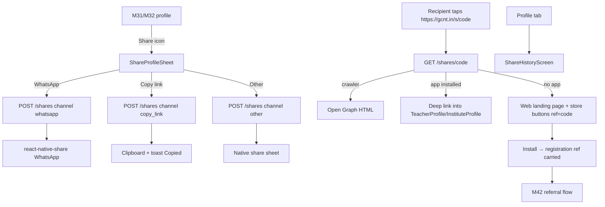
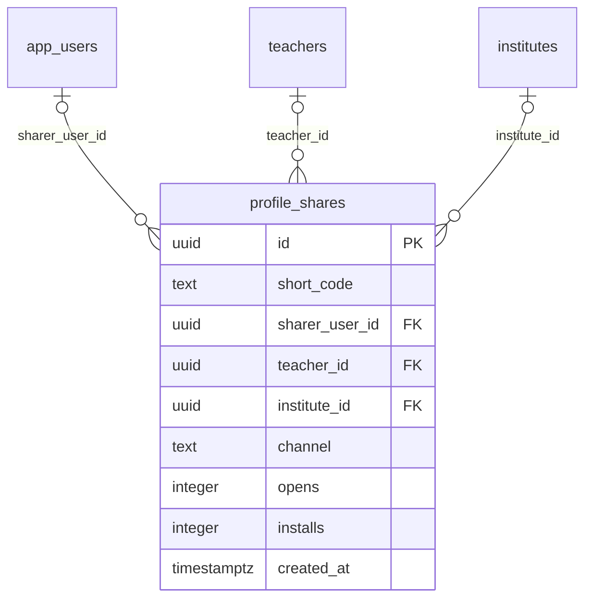

# Module 33 · Profile Sharing

> **Phase 7 · Profiles** · **Used by:** Any user (create a share), Public (resolve a shared link) · **Depends on:** M00 (share sheet plumbing), M31 (teacher profile payload), M32 (institute profile payload), M42 (referral attribution); Admin M42 · **New tables:** `profile_shares` · **Uses:** `teachers`, `institutes`, `referral_codes` · **Build estimate:** 3–4 days

## 1. Module Purpose

Lets any user share a teacher's or institute's profile — over WhatsApp or a copied link — as a short, trackable `https://gcnt.in/s/<code>` URL that resolves to a full Open Graph preview on the web and deep-links straight into the app when installed. It owns `profile_shares`, counting opens and app installs attributed to each share, and stamps the sharer's own referral code onto the link so a share that leads to a sign-up feeds M42's referral program automatically — sharing and referring are the same action from the user's point of view.

## 2. User Stories

- As a **parent who found a great tutor**, I want to share their profile on our building's WhatsApp group with one tap.
- As a **teacher**, I want to share my own profile with prospective parents outside the app.
- As a **friend who receives a shared link but doesn't have the app**, I want a clean web preview so I can decide before installing.
- As a **user who shares often**, I want my shares to count toward my referral rewards when someone new joins because of them.

## 3. Business Rules & Logic

**BR-33.1 Creating a share — `POST /shares { teacherId | instituteId, channel }`.** Exactly one of `teacherId`/`instituteId`. Generates a `short_code` — 7 chars, base62, collision-checked against `uq_profile_shares_code` (retry on the rare collision, expected ~1 in 3.5 trillion at this length so effectively never) — and inserts `profile_shares` (`sharer_user_id = sub`, `channel`, `opens = 0`, `installs = 0`). Returns the short URL `https://gcnt.in/s/<code>`. `channel` is one of `whatsapp` (uses `react-native-share`'s WhatsApp target with a prefilled message + link), `copy_link` (copies to clipboard via `expo-clipboard`), `sms`, `other` (any other native share-sheet target, e.g. email or a different app) — the client tells the server which button was tapped; the server does not infer channel from the request.

**BR-33.2 The prefilled message.** Client-built from a template, not stored server-side: for a teacher, `"Check out {fullName} on GuruConnect — {categoryName}, {subjectNames}, Trust Score {trustScore}. {shortUrl}"`; for an institute, `"Check out {name} on GuruConnect — rated {overallRating}★. {shortUrl}"`. Kept under 300 characters (WhatsApp-friendly) and never includes phone numbers or the sharer's own contact details.

**BR-33.3 Resolving a share — `GET /shares/:code` (Public).** Looks up `profile_shares` by `short_code`; `404 NOT_FOUND` (rendered as a generic "This link isn't available" web page, never a raw API error, since this endpoint is hit directly by browsers and WhatsApp's link-preview crawler) for an unknown code or a share whose target teacher/institute has since been deleted. On a valid code:
1. Increments `opens` (a single `UPDATE ... SET opens = opens + 1`, not a per-viewer log — `profile_shares` counts, it doesn't attribute individual opens beyond that).
2. If the request's `User-Agent` matches a known link-preview crawler (WhatsApp, Facebook, Twitter/X, Slack, Google), responds with server-rendered HTML carrying Open Graph tags (`og:title`, `og:description`, `og:image`, `og:url`) built from exactly M31 BR-31.3's or M32 BR-32.5's limited public payload — no crawler ever sees more than a signed-out learner would.
3. Otherwise (a real browser or the app's own deep-link handler), redirects: **mobile browser with the app installed** → opens the app via the universal/app link (conventions §4 `/t/<code>` doesn't apply here; the canonical share path is `/s/<code>` and the app's `linking.ts` maps it straight to `TeacherProfile`/`InstituteProfile` with the resolved `teacherId`/`instituteId`) with `?ref=<sharerReferralCode>` attached (BR-33.5); **mobile browser without the app** → a lightweight HTML landing page (logo, the same preview card, "Get the app" store buttons that carry the referral code forward via a deferred-deep-link mechanism, section 21); **desktop browser** → the same landing page, no store buttons emphasised, "Open in GuruConnect" link that just deep-links (harmless no-op on desktop, matches the mobile-only nature of the app).

**BR-33.4 Counting an install.** The referral code carried through the store link (BR-33.3) is the same mechanism M42 already uses at registration (`referralCode` field on `POST /registration/*`); when a new `app_users` row is created with a `referral_codes.code` that traces back to a `profile_shares` row created by that code's owner within the last **30 days**, this module's worker increments that share's `installs` counter (best-effort attribution, not a hard join — if several shares exist for the same sharer/target pair, the most recent one before the install is credited). This is purely a **count** for the sharer's own "N people installed from your shares" stat; the actual referral reward logic, fraud scoring and payout are entirely M42's, unchanged.

**BR-33.5 Referral code attribution.** Every share created by a signed-in user automatically carries that user's own personal referral code (`referral_codes` row for `LEARNER_REFERRAL`/`TEACHER_REFERRAL`/`INSTITUTE_REFERRAL` per the sharer's `user_type`, created on first need via M42 FR-42.1 if it doesn't exist yet) appended as `?ref=<code>` on every resolved link (BR-33.3 step 3) and embedded in the Open Graph landing page's store buttons. A share created by a user with no personal code yet (e.g. their program is disabled) simply omits `ref` — the share and its open/install counts still work; only the referral attribution is skipped.

**BR-33.6 My shares.** `GET /shares/me` (not in the module map's key list but owned here, alongside the two listed endpoints) returns the caller's own shares — target name/photo, channel, `opens`, `installs`, `createdAt` — so "Share history" under the Profile tab shows what's working. Not paginated beyond a simple 50-row cap (shares are a light-usage feature; a heavy sharer is themselves a signal worth noticing operationally, not a pagination problem in v1).

## 4. Screen List

| Screen | Route name | Purpose |
| --- | --- | --- |
| Share sheet | `ShareProfileSheet` (bottom sheet, wraps the native share sheet) | Choose channel, see the short link, copy or send |
| Share history | `ShareHistoryScreen` | The caller's past shares with open/install counts |

## 5. Screen Flow & Navigation


The share sheet never blocks on the network for the native share action itself — the short link is created first (fast, single insert), then handed to whichever native target the user picks.

## 6. Screen Wireframe Description

**ShareProfileSheet** — heading "Share {name}", preview card (photo, name, one-line summary — exactly what the recipient will see), row of channel buttons: WhatsApp (brand-coloured icon), "Copy link", "More" (native share sheet). Below, the short link shown as selectable text with a small "Copy" icon next to it even before picking a channel. Loading state while the short code is created (usually < 300 ms, shown as a brief skeleton on the link row only, buttons stay tappable and queue the tap).

**ShareHistoryScreen** — list rows: target photo/logo, name, channel icon, "12 opens · 2 installs", relative time ("Shared 3 days ago"); empty state "You haven't shared anything yet", body "Share a teacher or institute's profile to help others find them.", illustration.

**Web landing page (not an app screen, server-rendered)** — logo, the preview card, heading "GuruConnect", body "India's trusted platform to find verified tutors and coaching centres.", two store buttons ("Get it on Google Play", "Download on the App Store"), small text "Already have the app? Open GuruConnect" (deep link attempt).

## 7. UI Components & Component Tree

```
ShareProfileSheet (PreviewCard, ChannelButtonRow, ShortLinkRow)
ShareHistoryScreen (ShareHistoryRow × n, EmptyState)
```
- `ShareProfileSheet({ targetType, target, onShared })` — wraps `react-native-share` and `expo-clipboard`.
- Hooks: `useCreateShareMutation()`, `useShareHistoryQuery()`.

## 8. Validation Rules

| Field | Rule | Message shown |
| --- | --- | --- |
| teacherId / instituteId | exactly one, uuid, must exist and not be soft-deleted | "This profile can't be shared right now." |
| channel | one of `whatsapp`, `copy_link`, `sms`, `other` | — |

## 9. API Endpoints

| Method | Path | Auth | Description |
| --- | --- | --- | --- |
| POST | /shares | Any user | Create a short share link for a teacher or institute profile (Idempotency-Key). 30/hour per user |
| GET | /shares/:code | Public | Resolve a short code: crawler preview, app deep link, or web landing page |
| GET | /shares/me | Any user | The caller's own share history |

Uses: M31 `GET /teachers/:idOrCode` (limited payload for the preview/landing page); M32 `GET /institutes/:idOrSlug` (same); M42 `referral_codes` lookup/creation (FR-42.1), registration's existing `referralCode` field (no new endpoint — BR-33.4/33.5 ride the existing mechanism).

## 10. Request Payloads

```json
// POST /shares   (Idempotency-Key: 4d8e…)
{ "teacherId": "b7c2…", "channel": "whatsapp" }
```

## 11. Response Payloads

```json
// 201 POST /shares
{ "data": { "id": "9f3c…", "shortCode": "aB3xK9m", "shortUrl": "https://gcnt.in/s/aB3xK9m", "channel": "whatsapp",
  "prefilledMessage": "Check out Dr. Ananya Iyer on GuruConnect — Home Tutor, Mathematics, Trust Score 91.5. https://gcnt.in/s/aB3xK9m" } }

// 200 GET /shares/me
{ "data": [ { "id": "9f3c…", "targetType": "teacher", "targetName": "Dr. Ananya Iyer", "targetPhotoUrl": "…", "channel": "whatsapp",
  "opens": 12, "installs": 2, "createdAt": "2026-09-20T11:00:00Z" } ] }

// 404 GET /shares/:code (unknown or deleted target)
{ "error": { "code": "NOT_FOUND", "message": "This link isn't available.", "details": {}, "requestId": "…" } }
```

## 12. PostgreSQL Tables & Columns

**New tables owned by this module** (migration `sql/migrations/133_app_m33_profile_sharing.sql`)

### `profile_shares`

Each time a user shares a teacher or institute profile, with a short code for attribution.

| Column | Type | Null | Default | Constraints / References | Description |
| --- | --- | --- | --- | --- | --- |
| `id` | uuid | no | gen_random_uuid() | PK | Primary key |
| `short_code` | text | no | — | — | 8-char code in the link, e.g. https://gcnt.in/s/k7Qm2xPa |
| `sharer_user_id` | uuid | yes | — | FK → `app_users.id` (on delete set null) | Who shared (NULL if signed out) |
| `teacher_id` | uuid | yes | — | FK → `teachers.id` (on delete cascade) | Shared teacher |
| `institute_id` | uuid | yes | — | FK → `institutes.id` (on delete cascade) | Shared institute |
| `channel` | text | no | — | CHECK channel IN ('whatsapp','copy_link','sms','other') | Chosen share target |
| `opens` | integer | no | 0 | — | Link opens |
| `installs` | integer | no | 0 | — | Installs attributed |
| `created_at` | timestamptz | no | now() | — | Shared |

**Table constraints:** `CONSTRAINT ck_profile_shares_target CHECK ((teacher_id IS NULL) <> (institute_id IS NULL))`

<details><summary>DDL</summary>

```sql
CREATE TABLE profile_shares (
  id uuid PRIMARY KEY DEFAULT gen_random_uuid(), -- Primary key
  short_code text NOT NULL, -- 8-char code in the link, e.g. https://gcnt.in/s/k7Qm2xPa
  sharer_user_id uuid REFERENCES app_users(id) ON DELETE SET NULL, -- Who shared (NULL if signed out)
  teacher_id uuid REFERENCES teachers(id) ON DELETE CASCADE, -- Shared teacher
  institute_id uuid REFERENCES institutes(id) ON DELETE CASCADE, -- Shared institute
  channel text NOT NULL CHECK (channel IN ('whatsapp','copy_link','sms','other')), -- Chosen share target
  opens integer NOT NULL DEFAULT 0, -- Link opens
  installs integer NOT NULL DEFAULT 0, -- Installs attributed
  created_at timestamptz NOT NULL DEFAULT now(), -- Shared
  CONSTRAINT ck_profile_shares_target CHECK ((teacher_id IS NULL) <> (institute_id IS NULL))
);
CREATE UNIQUE INDEX uq_profile_shares_code ON profile_shares (short_code);
CREATE INDEX idx_profile_shares_teacher ON profile_shares (teacher_id, created_at DESC);
CREATE INDEX idx_profile_shares_institute ON profile_shares (institute_id, created_at DESC);
```

</details>

**Indexes:** `uq_profile_shares_code` (unique) on `(short_code)`; `idx_profile_shares_teacher` on `(teacher_id, created_at DESC)`; `idx_profile_shares_institute` on `(institute_id, created_at DESC)`

**Existing tables this module reads or writes** (full definitions in the owning module)

| Table | Owner | Purpose |
| --- | --- | --- |
| `teachers` | Admin M16 | Teacher profile and verification state. One row per teacher app account. |
| `institutes` | Admin M22 | Coaching centres, tuition centres, schools and academies. Rated by GuruConnect after verification. |
| `referral_codes` | Admin M42 | One personal referral code per app user. |

- `profile_shares`: one row per created link; `opens`/`installs` are simple counters incremented in place (BR-33.3/33.4), not event logs — kept lightweight since per-open detail isn't a product need in v1.
- `teachers`, `institutes`: read to build the preview payload and prefilled message; the same eligibility as M31/M32 applies (a deleted target resolves to 404, a suspended one still resolves per those modules' own "temporarily unavailable" rule since a share link should behave exactly like a direct profile link).
- `referral_codes`: read (and created via M42 FR-42.1 on first need) to attach `?ref=` to resolved links (BR-33.5); this module never writes `referrals` itself — M42 owns that entirely from the existing registration flow.

## 13. Relationships

**Foreign keys of new tables**

- `profile_shares.sharer_user_id` → `app_users` — optional, many-to-one, on delete **set null**
- `profile_shares.teacher_id` → `teachers` — optional, many-to-one, on delete **cascade**
- `profile_shares.institute_id` → `institutes` — optional, many-to-one, on delete **cascade**

**Entity relationship diagram**



## 14. State Management

- Query keys: `shareKeys.history`. `useCreateShareMutation` has no cache dependency (fire-and-open-native-sheet); on success it also invalidates `shareKeys.history` so a freshly opened `ShareHistoryScreen` includes it.

## 15. Offline Handling

- `POST /shares` is class 3 (online only) — creating a trackable link needs the server; the button is disabled offline with "Connect to the internet to share."
- `GET /shares/me` is a persisted read (class: cached), shows "Updated 2 h ago" offline.
- `GET /shares/:code` is a Public web/redirect endpoint, not something the app itself calls offline.

## 16. Push Notification Requirements

None.

## 17. Security Rules

- `POST /shares` requires the target to exist and not be soft-deleted; it does not require the target to be otherwise "eligible" (BR-27.4/BR-28.2) — a user can still share a profile they already have a relationship with (e.g. a suspended teacher they'd previously booked) since sharing itself is harmless; the resolve step (BR-33.3) is what enforces what a recipient actually sees.
- Short codes are random (not sequential/guessable) and carry no embedded user data; `sharer_user_id` is never exposed to the recipient or the crawler preview.
- Rate limited (30/hour per user) to prevent short-code exhaustion spam; `GET /shares/:code` is public and cached at the CDN edge for crawler hits only (never for the redirect/deep-link path, which must always see live `opens` semantics — actually incremented server-side on origin, so the CDN rule is "cache the OG HTML variant, bypass cache for the redirect variant," decided by the `User-Agent` check in BR-33.3).
- The web landing page never reveals more than M31 BR-31.3/M32 BR-32.5's limited payload, so a share link can never be used to scrape private profile detail without an app account.

## 18. Error Handling

| Scenario | Code | HTTP | App behaviour |
| --- | --- | --- | --- |
| Neither/both of teacherId/instituteId | `VALIDATION_FAILED` | 422 | Toast "Something went wrong. Try again." |
| Target deleted since share creation | `NOT_FOUND` | 404 | Web page "This link isn't available."; app's own share history still shows the row with the counts it had |
| Too many shares in an hour | `RATE_LIMITED` | 429 | Toast "You're sharing a lot right now — try again in a bit." |
| Network / 5xx creating a share | `GATEWAY_ERROR` / `INTERNAL_ERROR` | 502 / 500 | Sheet stays open with Retry; native share not triggered until the link exists |

## 19. Testing Scenarios

- T33.1 Happy path (Maestro `profile_share_happy`): open a teacher profile → Share → WhatsApp → native share sheet opens with the correct prefilled message and link.
- T33.2 `GET /shares/:code` with a WhatsApp crawler User-Agent returns Open Graph HTML matching M31's limited payload exactly (no extra fields).
- T33.3 `GET /shares/:code` from a mobile browser with the app installed deep-links straight to the profile; without the app, shows the landing page with store buttons carrying `?ref=`.
- T33.4 A new sign-up whose `referralCode` traces to a share created 10 days ago by its owner increments that share's `installs`; one created 40 days ago is not credited (BR-33.4's 30-day window).
- T33.5 Sharer with no personal referral code yet (program disabled) still gets a working share link with no `ref` parameter.
- T33.6 31st share within an hour → 429.
- T33.7 Share a target, then it's deleted → `GET /shares/:code` returns 404 web page; the sharer's `ShareHistoryScreen` still lists the row (counts frozen at their last value).
- T33.8 `opens` increments on each resolve regardless of crawler vs. real browser vs. deep-link path; concurrent resolves don't lose increments (atomic `UPDATE ... SET opens = opens + 1`).
- T33.9 Offline: "Share" button disabled with the offline hint; `ShareHistoryScreen` renders from cache.
- T33.10 Idempotency-Key replay within 24 h on `POST /shares` returns the same short code, not a second row.

## 20. Audit Log Events

None. Sharing is a light user action, not an admin-relevant event; its own counters (`opens`, `installs`) are the record, matching conventions §11's "reads and searches are not audit-logged" spirit extended here to shares.

## 21. Future Scalability Notes

- Deferred deep linking (e.g. Branch.io-style) so a store install truly resumes into the exact shared profile even without a referral code round trip, rather than relying on BR-33.4's registration-time join.
- Per-share analytics (which channel converts best) once volume justifies a breakdown beyond the two counters.
- QR codes for offline sharing (a teacher's visiting card, an institute's front-desk poster) generated from the same short codes.
- Expiring or one-time share links for time-limited promotions, as a `expires_at` column addition if ever needed.
