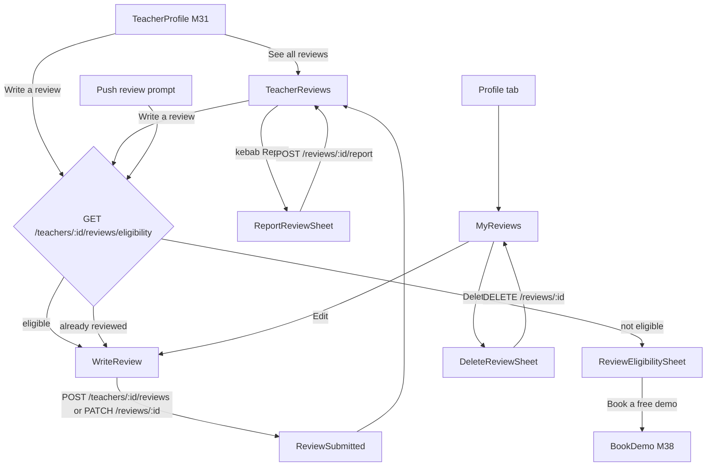
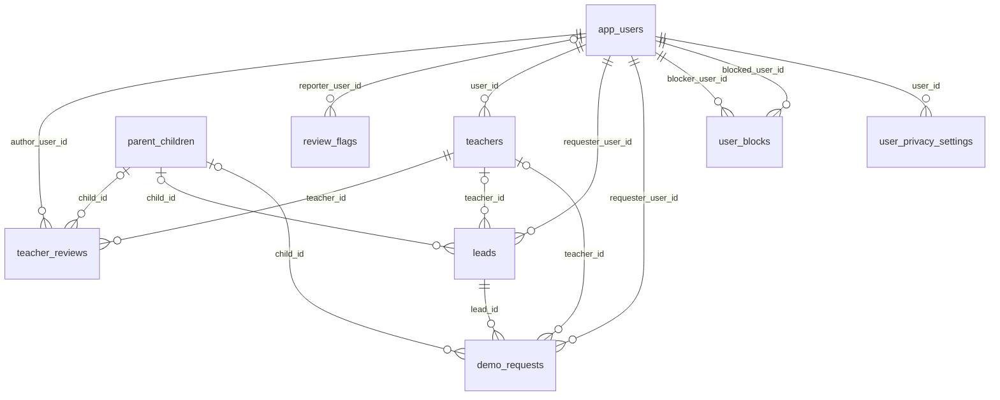

# Module 34 · Teacher Reviews

> **Phase 8 · Reviews** · **Used by:** Parents and students (write, edit, delete, report); any signed-in user (read); teachers (report reviews on their own profile) · **Depends on:** M00, M31 (profile entry point), M37/M38 (interaction data), M36 (teacher replies), M49 (blocks); Admin M33, Admin M35, Admin M36 · **New tables:** none · **Uses:** `teacher_reviews`, `review_flags`, `review_moderation_logs`, `teachers`, `leads`, `demo_requests`, `parent_children`, `app_users`, `user_blocks`, `user_privacy_settings`, `system_settings`, `audit_logs` · **Build estimate:** 3–4 days

## 1. Module Purpose

Lets parents and students rate a teacher (1–5 stars) and write a review after a real interaction, edit it within the edit window, delete it, and report other people's reviews; and lets anyone signed in read a teacher's published reviews with the rating summary. Reviews are the input to the teacher's rating and to the Reviews factor of the Trust Score, so the app enforces eligibility (a completed demo or a lead older than 3 days), sends every new or edited review to the moderation pipeline of Admin M35, and never shows unpublished reviews to anyone but their author. Teachers reply to reviews in M36; institute reviews are M35.

## 2. User Stories

- As a **parent** whose son Aarav finished a demo with Dr. Ananya Iyer, I want to rate her and describe the class so that other parents can decide faster.
- As a **student**, I want to fix a typo in my review a month later so that it reads correctly, knowing it will be checked again.
- As a **parent on a patchy 3G connection**, I want my half-written review saved on the phone so that I don't lose it when the app closes.
- As a **teacher**, I want to report a review from someone who never took a class with me so that moderators remove fake reviews.
- As a **parent browsing teachers**, I want to see the rating distribution and read recent reviews with "Took a demo" labels so that I can trust what I read.
- As a **new teacher with no reviews**, I want my profile to say "No reviews yet" rather than show a low number so that I am not penalised for being new.

## 3. Business Rules & Logic

**BR-34.1 Who can review.** Role `parent` or `student`, `app_users.account_status = 'active'`, role row not suspended. A student whose `students.parental_consent` is `pending` or `declined` cannot review (`FORBIDDEN`, `details.reason = "parental_consent_pending"`). One live review per (teacher, author) — enforced by `uq_teacher_reviews_author`; a second attempt returns `CONFLICT_DUPLICATE` with `details.existingReviewId` and the app opens the edit form.

**BR-34.2 Eligibility (interaction).** The author is eligible when at least one of these exists for `teacher_id = :teacherId` and `requester_user_id = sub`:
1. a `demo_requests` row with `status = 'completed'`, or
2. a `leads` row with `deleted_at IS NULL`, `status <> 'spam'`, `decline_reason` not starting with `spam`, and `created_at <= now() - interval '3 days'`.
If neither exists and `reviews.allow_unverified = true` (default false), the author may still review and `is_verified_interaction = false`; otherwise `CONFLICT_STATE` with `details.reason = "no_interaction"`. If the only lead is younger than 3 days, eligibility returns `eligibleFrom` = lead `created_at + 3 days` ("You can review Dr. Ananya Iyer from Tue, 29 Sep"). An existing `user_blocks` row in either direction between the author and `teachers.user_id` → `BLOCKED`.

**BR-34.3 Content rules.** `rating` integer 1–5. `comment` trimmed, `limits.review_min_chars` (30) to 1,500 characters, at least 5 words, not only emoji or repeated characters. For a parent, `childId` is optional but must belong to the parent (`parent_children.parent_id = pid`, not deleted); default = the child on the most recent demo or lead with this teacher. The client warns (does not block) when the text looks like it contains a phone number, email, UPI id or link: "Reviews with phone numbers, emails or links are not published." The server's pipeline flags these (`contact_info`) and never auto-publishes them.

**BR-34.4 Create — server steps (one transaction).**
1. Validate `ReviewInputSchema`; re-run BR-34.1/34.2 (never trust the eligibility call).
2. If the author soft-deleted a review of this teacher in the last 30 days (`audit_logs` action `app.review_deleted`, `entity_id` = that review, `actor_id = sub`) → `CONFLICT_STATE`, `details.reason = "recently_deleted"`, `details.retryAfter`. This stops delete-and-repost to reset the edit window or bury a rejection.
3. Insert `teacher_reviews` with `author_type` from the token role, `child_id`, `rating`, `comment`, `status = 'pending'`, `auto_flags = '{}'`, `is_verified_interaction` from BR-34.2.
4. Insert `audit_logs` `app.review_created`.
5. After commit, enqueue `review:moderate` (Admin M35 FR-35.1 pipeline). The pipeline sets `spam_score` and `auto_flags` and moves the review to `published` (score < 0.15, no flags), `flagged` (≥ 0.85) or leaves it `pending` for a moderator (target decision within 24 h).
Requests carry `Idempotency-Key`; a replay within 24 h returns the first response.

**BR-34.5 Status as seen in the app.**

| `status` | Author sees | Others see | Counts in rating |
| --- | --- | --- | --- |
| `pending` | "Waiting for approval · usually within 24 hours" | nothing | no |
| `published` | "Live" | the review | yes |
| `flagged` | "Being checked" | the review, unless `reviews.hide_when_flagged = true` | no |
| `rejected` | "Not published" + reason copy (BR-34.8) + "Edit and resubmit" | nothing | no |
| `hidden` | "Removed by GuruConnect" (no edit) | nothing | no |

**BR-34.6 Edit.** `PATCH /reviews/:id` with `If-Match: <updatedAt>`. Allowed when the author owns it, `now() <= created_at + reviews.edit_window_days` (90) days, and `status IN ('pending','published','rejected')`; `flagged` → `CONFLICT_STATE` `details.reason = "under_review"`; `hidden` → `CONFLICT_STATE` `details.reason = "removed"`; window passed → `CONFLICT_STATE` `details.reason = "edit_window_closed"`. In one transaction: update `rating`/`comment`/`child_id`, set `edited_at = now()`, `status = 'pending'`, `spam_score = NULL`, `auto_flags = '{}'`, `rejection_reason_code = NULL`; if the previous status was `published`, recompute `teachers.rating_avg`/`rating_count` (Admin M33 FR-33.2 `ReviewRatingService.recompute(teacherId)`) and enqueue trust recalculation (`review_removed`); audit `app.review_edited` with old/new rating (text lengths only); then enqueue `review:moderate`. The teacher's reply stays attached. The form tells the author: "Your updated review will be checked again before it appears."

**BR-34.7 Delete.** `DELETE /reviews/:id` (author only, any status except `hidden`): set `deleted_at`; if it was `published`, recompute the rating cache and enqueue trust recalculation (`review_removed`) in the same transaction; audit `app.review_deleted`. Confirmation sheet first. Open `review_flags` on a deleted review are left for moderators.

**BR-34.8 Rejection reasons shown to the author** (codes from Admin M35): `CONTACT_DETAILS` "Remove phone numbers, emails or links, then submit again." · `ABUSIVE` "Please keep it respectful and remove offensive words." · `NOT_A_TEACHING_EXPERIENCE` "Reviews should describe classes or demos with this teacher." · `FAKE_OR_PAID` "We couldn't confirm this review is genuine." · `DUPLICATE` "This looks like a copy of another review." · `PERSONAL_INFORMATION` "Remove personal details such as addresses or a child's school." · `LEGAL_REQUEST` "This review was removed after a legal request." · `OTHER` "It didn't meet our review guidelines." A moderator note shared by the admin arrives in the rejection notification body.

**BR-34.9 Report a review.** `POST /reviews/:id/report { reason, details }`. Reporters: any learner (on any published or flagged review) and the reviewed teacher (on reviews of their own profile only). Not allowed on your own review (`FORBIDDEN`). One report per reporter per review (`uq_review_flags_reporter` → `CONFLICT_DUPLICATE`). Max 10 reports per user per day (`LIMIT_REACHED`, `details.reason = "reports_daily"`). In one transaction: insert `review_flags` (`review_type = 'teacher'`, `status = 'open'`); if the review is `published` and now has ≥ 3 open flags, set `status = 'flagged'`, insert `review_moderation_logs` (`target = 'review'`, `action = 'flagged'`, `from_status = 'published'`, `to_status = 'flagged'`, `note = '3 user reports'`, `admin_id = NULL`), recompute the rating cache and enqueue trust recalculation; audit `app.review_reported`. The reporter sees "Thanks. Our team will look at this review." — outcome is not reported back in v1.

**BR-34.10 Reading reviews.** `GET /teachers/:id/reviews` returns a summary (cached `teachers.rating_avg`, `rating_count`, distribution 5→1, averages by author type) and published reviews (plus flagged ones when `hide_when_flagged = false`), cursor-paginated 20 per page, `sort = recent | highest | lowest`, optional `rating` (1–5) and `withReply=true`. The viewer's own review (any status except deleted) is returned separately in `data.mine` so it can be pinned on top. Author display: first name + last initial ("Lakshmi V."); first name only when `user_privacy_settings.show_last_name = false`; label "Parent · Class 12" (child's class, never the child's name) or "Student · Class 11". `is_verified_interaction` shows a "Took a demo / Contacted via GuruConnect" tick. Published replies (`reply_status = 'published'`) appear under the review. Teachers with `rating_count = 0` show "No reviews yet" — never "0.0".

**BR-34.11 My reviews.** `GET /me/reviews` lists all reviews the user wrote (teacher and institute reviews, `type` field) with status, reason copy and `editableUntil` (`created_at + edit_window_days`), newest first.

**BR-34.12 Review prompts.** 24 h after a demo becomes `completed` (M38) and 4 days after a lead is created, a job sends a "How was it?" notification if the user is eligible, has no review for that teacher and the lead is not `spam` (dedupe key `review_prompt:<userId>:<teacherId>`; at most one prompt per teacher, ever).

## 4. Screen List

| Screen | Route name | Purpose |
| --- | --- | --- |
| Teacher reviews | `TeacherReviews` | Rating summary, filters and the full list of a teacher's published reviews |
| Write / edit review | `WriteReview` | Stars, child picker, text; create or edit (modal stack) |
| Not eligible sheet | `ReviewEligibilitySheet` (bottom sheet) | Explains why the user can't review yet and what to do |
| Review submitted | `ReviewSubmitted` | Confirmation with moderation expectation |
| Report review sheet | `ReportReviewSheet` (bottom sheet) | Reason chips and optional details |
| Delete review sheet | `DeleteReviewSheet` (bottom sheet) | Confirm deletion |
| My reviews | `MyReviews` | Reviews the user wrote, with status and actions |

## 5. Screen Flow & Navigation


Back from `WriteReview` asks "Discard changes?" only when the draft differs from the saved version; the draft stays in MMKV either way. After submit, `ReviewSubmitted` → "Done" returns to the screen that opened the form.

## 6. Screen Wireframe Description

**TeacherReviews** — header "Reviews" with subtitle "Dr. Ananya Iyer". Summary card: large "4.9" with 5 stars, "312 reviews", distribution bars 5★ 244 · 4★ 47 · 3★ 15 · 2★ 3 · 1★ 3 (tapping a bar filters by that rating), small line "Parents 4.9 (181) · Students 4.8 (131)". Filter chips row: "Most recent" (sort menu: Most recent / Highest / Lowest), "5★", "4★", "3★ and below", "With teacher reply". If the viewer has a review, a pinned "Your review" card with status pill ("Waiting for approval") and "Edit" link. Review cards (FlashList): author "Lakshmi V." + label "Parent · Class 12" + tick "Took a demo"; stars; date "12 Sep 2026" and "(edited)" when `edited_at`; text clamped to 6 lines with "Read more"; reply block (indented, grey): "Reply from Dr. Ananya Iyer" + text; kebab (⋮) → "Report review". Sticky bottom button "Write a review" (hidden for teachers and for the teacher's own profile). Empty: illustration, "No reviews yet", body "Dr. Ananya Iyer is new on GuruConnect. Book a free demo and be the first to review." button "Book free demo". Loading: summary skeleton + 3 card skeletons. Error: ErrorState with Retry.

**WriteReview** — header "Review Dr. Ananya Iyer" with close (X). Teacher mini-card (photo, name, subject "Physics · Class 11–12"). Section "Your rating": five 44 dp stars, label under them changes: "Poor", "Below average", "Average", "Good", "Excellent". Section "Reviewing for" (parents with more than one child): child chips "Aarav · Class 12", "Diya · Class 7" (single select; preselected from the interaction). Text area label "Your review", placeholder "What did Aarav learn? How does she explain concepts? Was she on time?", multiline, `keyboardType="default"`, autoCapitalize sentences, counter "42 / 1,500" (turns red under 30: "Write at least 30 characters"). Inline warning banner when contact details are detected. Collapsible "Review guidelines": "Describe your own experience · No phone numbers, emails or links · No personal details about children · Be respectful". When editing: info banner "Edits are checked again before they appear. You can edit until 25 Dec 2026." Sticky bar: primary "Submit review" (create) / "Update review" (edit), disabled until rating and 30 chars; offline → disabled with hint "You're offline. Your review is saved and you can submit when you're back online."

**ReviewEligibilitySheet** — icon, heading by reason: no interaction → "Reviews come from real classes", body "You can review Dr. Ananya Iyer after a demo class or 3 days after you contact her. This keeps reviews honest.", buttons "Book free demo" (primary), "Contact teacher" (secondary). Too early → "You can review from Tue, 29 Sep", body "Give the teacher a few days to respond to your request.", button "OK". Blocked → "You can't review this teacher."

**ReviewSubmitted** — check-mark animation, heading "Thanks for your review!", body "We check every review to keep GuruConnect honest. It usually appears within 24 hours. We'll let you know.", button "Done". If notifications are not yet allowed, the M47 pre-permission explainer is offered here.

**ReportReviewSheet** — heading "Report this review", radio list: "Fake — they never took a class" (fake), "Abusive or hateful" (abusive), "Shares personal details" (personal_details), "Not about teaching" (off_topic), "Spam or advertising" (spam), "Something else" (other). Text field "Tell us more (optional)" (required for Something else, placeholder "E.g. This parent contacted me only once and never attended a class."), counter 0/500. Buttons "Send report" / "Cancel".

**DeleteReviewSheet** — "Delete your review?", body "It will be removed from Dr. Ananya Iyer's profile. You can write a new one after 30 days.", buttons "Delete" (destructive) / "Keep review".

**MyReviews** — header "My reviews". Segments "Teachers" / "Institutes". Cards: target photo + name, stars, first two lines of text, status pill (Live / Waiting for approval / Being checked / Not published / Removed), for rejected a red box with the reason copy and button "Edit and resubmit"; footer "Editable until 25 Dec 2026" and kebab (Edit, Delete). Empty: "You haven't written any reviews yet."

## 7. UI Components & Component Tree

```
TeacherReviewsScreen
├─ RatingSummaryCard (average, count, RatingDistribution, byRole line)
├─ ReviewFilterChips
├─ MyReviewPinnedCard (if data.mine)
├─ FlashList<ReviewCard>
│  └─ ReviewCard → AuthorLine, RatingStars, ReviewText (clamp), ReplyBlock, ReviewMenu
└─ StickyActionBar → Button "Write a review"
WriteReviewScreen
├─ TeacherMiniCard
├─ StarRatingInput
├─ ChildChipSelect (parents with ≥ 2 children)
├─ ReviewTextArea (counter, ContactInfoWarning)
├─ GuidelinesAccordion
└─ StickyActionBar
ReviewEligibilitySheet · ReportReviewSheet · DeleteReviewSheet
MyReviewsScreen → SegmentedControl, FlashList<MyReviewCard>
```
- `ReviewCard({ review, onReport, onPressReadMore, showReply = true })` — shared with M35 (institute variant adds `AspectRatingsRow`) and M36 (teacher variant adds reply actions).
- `StarRatingInput({ value, onChange, size = 44 })` — accessible as an adjustable control ("Rating, 4 of 5 stars").
- `RatingDistribution({ distribution, onPressRow })`.
- `detectContactInfo(text)` in `packages/shared/contact-detect.ts` — same regexes as the server (BR-37.8), returns matched spans.
- Hooks: `useTeacherReviewsInfiniteQuery(teacherId, filters)`, `useReviewEligibilityQuery(teacherId)`, `useCreateReviewMutation(teacherId)`, `useUpdateReviewMutation(reviewId)`, `useDeleteReviewMutation(reviewId)`, `useReportReviewMutation(reviewType)`, `useMyReviewsQuery()`, `useReviewDraft(teacherId)`.

## 8. Validation Rules

Shared schemas `ReviewInputSchema` and `ReviewReportSchema` in `packages/shared/reviews.ts`.

| Field | Rule | Message shown |
| --- | --- | --- |
| rating | integer 1–5, required | "Tap a star to rate." |
| comment | trimmed length ≥ `limits.review_min_chars` (30) | "Write at least 30 characters." |
| comment | ≤ 1,500 characters | "Keep it under 1,500 characters." |
| comment | ≥ 5 words; not only emoji/repeated characters | "Tell other parents a little more about the classes." |
| childId | uuid of the parent's own live child; only for parents | "Pick a child." |
| If-Match (edit) | equals current `updatedAt` | "Updated on another device. Review and save again." |
| report.reason | fake, abusive, personal_details, off_topic, spam, other | "Pick a reason." |
| report.details | 0–500 chars; 10–500 when reason = other | "Tell us a little more (at least 10 characters)." |

## 9. API Endpoints

| Method | Path | Auth | Description |
| --- | --- | --- | --- |
| GET | /teachers/:id/reviews | Any user | Summary + published reviews (cursor), `sort`, `rating`, `withReply`; `data.mine` for the viewer |
| GET | /teachers/:id/reviews/eligibility | Learner | Can the user review this teacher, why not, existing review id, `eligibleFrom` |
| POST | /teachers/:id/reviews | Learner | Create a review (Idempotency-Key). 5/hour per user |
| PATCH | /reviews/:id | Learner (author) | Edit within the window (If-Match); back to pending |
| DELETE | /reviews/:id | Learner (author) | Soft-delete own review |
| POST | /reviews/:id/report | Learner, Teacher | Report a teacher review (Idempotency-Key). 10/day per user |
| GET | /me/reviews | Learner | Reviews the user wrote (teacher + institute), with status and edit window |

## 10. Request Payloads

```json
// POST /teachers/7d1c2e9a-4b5f-4c8e-9a10-3f2b1c0d9e8a/reviews   (Idempotency-Key: 5b0c…)
{ "rating": 5, "childId": "c2a1…", "comment": "Aarav's Physics marks went from 58 to 91 in two terms. Dr. Ananya explains numericals step by step and shares weekly practice sheets." }

// PATCH /reviews/0f3e…   (If-Match: "2026-09-20T11:02:13.412Z")
{ "rating": 4, "comment": "Very clear teaching and regular tests. Classes sometimes start 10 minutes late, but she always completes the full hour." }

// POST /reviews/0f3e…/report
{ "reason": "fake", "details": "This parent sent one enquiry and never attended a class." }

// GET /teachers/7d1c…/reviews?sort=recent&rating=5&limit=20&cursor=eyJwIjoiMjAyNi0wOS0xMlQxMDowMDowMFoifQ
```

## 11. Response Payloads

```json
// 200 GET /teachers/:id/reviews
{ "data": {
    "summary": { "avg": 4.9, "count": 312, "distribution": { "5": 244, "4": 47, "3": 15, "2": 3, "1": 3 },
                 "byRole": { "parent": { "avg": 4.9, "count": 181 }, "student": { "avg": 4.8, "count": 131 } } },
    "mine": { "id": "0f3e…", "rating": 5, "status": "pending", "createdAt": "2026-09-25T09:10:00Z", "editableUntil": "2026-12-24T09:10:00Z" },
    "items": [ { "id": "9a7b…", "rating": 5, "comment": "My son's Physics went from 58 to 91…", "author": { "displayName": "Lakshmi V.", "type": "parent", "classLabel": "Class 12" },
                 "verifiedInteraction": true, "editedAt": null, "publishedAt": "2026-09-12T06:30:00Z",
                 "reply": { "text": "Thank you! Aarav worked very hard.", "repliedAt": "2026-09-13T04:00:00Z" } } ] },
  "meta": { "nextCursor": "eyJwIjoiMjAyNi0wOS0wMVQxMjowMDowMFoifQ", "limit": 20 } }

// 200 GET /teachers/:id/reviews/eligibility
{ "data": { "eligible": false, "reason": "too_early", "eligibleFrom": "2026-09-29T08:15:00Z", "existingReviewId": null,
            "verifiedInteraction": true, "defaultChildId": "c2a1…", "editWindowDays": 90, "minChars": 30 } }

// 201 POST /teachers/:id/reviews
{ "data": { "id": "0f3e…", "status": "pending", "rating": 5, "isVerifiedInteraction": true, "createdAt": "2026-09-26T10:20:00Z",
            "updatedAt": "2026-09-26T10:20:00Z", "editableUntil": "2026-12-25T10:20:00Z" } }

// 409 POST /teachers/:id/reviews (already reviewed)
{ "error": { "code": "CONFLICT_DUPLICATE", "message": "You've already reviewed this teacher.", "details": { "existingReviewId": "0f3e…" }, "requestId": "a1b2…" } }

// 200 GET /me/reviews
{ "data": [ { "id": "0f3e…", "type": "teacher", "target": { "id": "7d1c…", "name": "Dr. Ananya Iyer", "photoUrl": "https://cdn.guruconnect.in/t/…/w=96" },
              "rating": 3, "commentPreview": "Good teacher but call me on 98…", "status": "rejected", "rejectionReasonCode": "CONTACT_DETAILS",
              "reasonText": "Remove phone numbers, emails or links, then submit again.", "editableUntil": "2026-12-24T09:10:00Z" } ],
  "meta": { "nextCursor": null } }
```

## 12. PostgreSQL Tables & Columns


**Existing tables this module reads or writes** (full definitions in the owning module)

| Table | Owner | Purpose |
| --- | --- | --- |
| `teacher_reviews` | Admin M33 | Reviews of teachers by parents and students. Only published reviews count toward ratings and trust. |
| `review_flags` | Admin M35 | Reports raised against a review by users or teachers. |
| `review_moderation_logs` | Admin M35 | Every moderation decision on reviews and replies. |
| `teachers` | Admin M16 | Teacher profile and verification state. One row per teacher app account. |
| `leads` | Admin M38 | Enquiries and call-back requests from parents/students to a teacher or institute. |
| `demo_requests` | Admin M39 | Free demo class bookings and their outcome. |
| `parent_children` | Admin M29 | Children a parent is finding teachers for. Drives per-child recommendations. |
| `app_users` | Admin M00 | Login identity for every mobile app account (parent, student, teacher, institute staff). Role profiles hang off this table. |
| `user_blocks` | App M49 | Users one user has blocked. Blocked users can't contact, message or review the blocker. |
| `user_privacy_settings` | App M52 | What a user shows to others and allows the platform to do with their data. |
| `system_settings` | Admin M04 | Typed key–value settings that change platform behaviour without a deploy. |
| `audit_logs` | Admin M00 | Append-only record of every admin action and security event. Never updated or deleted by the application. |

- `teacher_reviews`: inserts (`status = 'pending'`, `author_type`, `child_id`, `is_verified_interaction`), author edits (`rating`, `comment`, `child_id`, `edited_at`, status reset), soft delete (`deleted_at`). `spam_score`, `auto_flags`, `published_at`, `moderated_*` are written only by the Admin M35 pipeline and moderators. `teacher_reply*` belongs to M36.
- `review_flags`: one row per report (`review_type = 'teacher'`).
- `review_moderation_logs`: system row when 3 reports flag a review.
- `teachers.rating_avg` / `rating_count`: recomputed through the shared Admin M33 service whenever a review leaves `published` because of an app action.
- Eligibility reads `demo_requests` (`status`, `requester_user_id`, `teacher_id`) and `leads` (`status`, `decline_reason`, `created_at`).

## 13. Relationships


**Entity relationship diagram** (tables this module uses; `admins` omitted)



## 14. State Management

- Query keys (`reviewKeys`): `reviewKeys.teacherList(teacherId, filters)`, `reviewKeys.eligibility(teacherId)`, `reviewKeys.mine()`. The first page of `teacherList` and `mine` are persisted; `eligibility` is not (`persist: false`, `staleTime` 0).
- `useReviewDraftStore` (Zustand + encrypted MMKV): `{ drafts: Record<teacherId, { rating, childId, comment, updatedAt }>, saveDraft(), clearDraft() }`; debounced save 500 ms; cleared on successful submit.
- After create/edit: invalidate `reviewKeys.teacherList(teacherId)`, `reviewKeys.mine()`, `reviewKeys.eligibility(teacherId)`, `teacherKeys.detail(teacherId)` (M31). After delete: same plus optimistic removal from `mine` (rolled back on error). After report: mark the card locally as "Reported" (no refetch).
- No optimistic insert of a new review into the public list (it is pending).

## 15. Offline Handling

- Read: the teacher's first reviews page and "My reviews" render from cache with "Updated 2 h ago".
- Write review / edit: class 2 *save draft, submit online* — the draft survives restarts; the submit button is disabled offline with the hint above.
- Delete and report: online only (buttons disabled offline with "Connect to the internet to do this.").

## 16. Push Notification Requirements

| Event | Recipient | Title / Body | Deep link | Category | Urgent |
| --- | --- | --- | --- | --- | --- |
| `review_published` | Author | "Your review is live" / "Thanks, {firstName}! Your review of {teacherName} is now on their profile." | `/me/reviews` | reviews | No |
| `review_rejected` | Author | "Your review needs a change" / "Your review of {teacherName} wasn't published: {reasonText}" | `/me/reviews` | reviews | No |
| `review_prompt` | Parent / student (BR-34.12) | "How was {teacherName}?" / "Share a quick review to help other parents choose." | `/t/{publicCode}?action=review` | reviews | No |

The two moderation events are emitted by the Admin M35 decision service and the auto-moderation job; this module owns their templates and deep-link handling. Teacher-side review events are listed in M36. In-app only: none.

## 17. Security Rules

- Every write is scoped by `author_user_id = sub`; `PATCH`/`DELETE` on someone else's review → `NOT_FOUND` (does not reveal existence).
- Unpublished reviews are returned only to their author. Public DTOs never include `author_user_id`, phone, email, child name, `spam_score`, `auto_flags`, moderator ids or `rejection_reason_code`.
- Children are shown only by class label; the child's name typed into the text is not blocked but the pipeline flags `PERSONAL_INFORMATION` cases.
- Rate limits: create 5/hour, edit 10/hour, report 10/day per user; eligibility 60/min.
- Abuse: delete-and-repost blocked for 30 days (BR-34.4); review bursts and self-reviews (same device/IP as the teacher) are detected by Admin M35 (`rating_burst`, `self_review`) — the app sends `X-Install-Id` so the check has device data.
- Blocked pairs cannot review each other (`BLOCKED`).

## 18. Error Handling

| Scenario | Code | HTTP | App behaviour |
| --- | --- | --- | --- |
| No qualifying demo or lead | `CONFLICT_STATE` (`details.reason = "no_interaction"`) | 409 | Open ReviewEligibilitySheet |
| Lead younger than 3 days | `CONFLICT_STATE` (`too_early`, `eligibleFrom`) | 409 | Sheet "You can review from Tue, 29 Sep" |
| Already reviewed | `CONFLICT_DUPLICATE` (`existingReviewId`) | 409 | Open WriteReview in edit mode |
| Deleted a review of this teacher < 30 days ago | `CONFLICT_STATE` (`recently_deleted`, `retryAfter`) | 409 | Toast "You can review this teacher again from 20 Oct." |
| Edit after the window | `CONFLICT_STATE` (`edit_window_closed`) | 409 | Banner "This review can no longer be edited." Hide Edit |
| Edit while flagged / hidden | `CONFLICT_STATE` (`under_review` / `removed`) | 409 | Toast with reason, refetch |
| Stale edit | `VERSION_CONFLICT` | 409 | Reload the review, keep the user's text in the field |
| Text too short / invalid rating | `VALIDATION_FAILED` | 422 | Inline under the field |
| Blocked pair | `BLOCKED` | 403 | "You can't review this teacher." |
| Student without parental consent | `FORBIDDEN` (`parental_consent_pending`) | 403 | Sheet explaining a parent must approve (links M11) |
| Report twice | `CONFLICT_DUPLICATE` | 409 | Toast "You've already reported this review." |
| Too many reports / reviews | `LIMIT_REACHED` / `RATE_LIMITED` | 429 | Toast, disable button until `Retry-After` |
| Review or teacher gone | `NOT_FOUND` | 404 | "This is no longer available." |

## 19. Testing Scenarios

- T34.1 Parent with a completed demo writes a 5★ review → 201 `pending`; appears as "Your review · Waiting for approval" pinned; not in the public list (Maestro `reviews_write_happy`).
- T34.2 Pipeline auto-approves (score 0.04) → push `review_published`; review visible to others; `teachers.rating_count` +1.
- T34.3 Lead created 2 days ago, no demo → eligibility `too_early` with `eligibleFrom` = created + 3 days; POST also rejected server-side.
- T34.4 No interaction, `reviews.allow_unverified = true` → review created with `is_verified_interaction = false`; no "Took a demo" tick.
- T34.5 Second POST for the same teacher → `CONFLICT_DUPLICATE`; app opens edit mode with existing text.
- T34.6 Edit a published review on day 30 → status `pending`, rating cache recomputed without it, trust job enqueued; edit on day 91 → `edit_window_closed`.
- T34.7 Two devices edit the same review → second gets `VERSION_CONFLICT`; typed text is preserved.
- T34.8 Delete a published review → gone from list, cache recomputed; new review for the same teacher within 30 days → `recently_deleted`.
- T34.9 Three different users report a published review → status `flagged`, moderation log with `admin_id` NULL, excluded from the average; fourth report from the same user → `CONFLICT_DUPLICATE`.
- T34.10 Teacher reports a review on another teacher's profile → `FORBIDDEN`; on own profile → 201.
- T34.11 Offline: draft typed, app killed, reopened → draft restored; Submit disabled until online.
- T34.12 Text containing "call 98450 12345" → client warning shown; server stores it; pipeline flags `contact_info`; rejection push shows the CONTACT_DETAILS copy.
- T34.13 Blocked pair → eligibility `blocked`; POST → `BLOCKED`.
- T34.14 Same Idempotency-Key replayed after a timeout → one row, same 201 body.
- T34.15 Screen states: TeacherReviews renders loading, empty ("No reviews yet"), error and content; font scale 130 % does not clip the distribution bars.

## 20. Audit Log Events

| Event | When | Details |
| --- | --- | --- |
| `app.review_created` | Review inserted | teacherId, rating, verifiedInteraction, childId present (no text) |
| `app.review_edited` | Author edit | old/new rating, previous status, text length |
| `app.review_deleted` | Author delete | previous status, rating |
| `app.review_reported` | Report inserted | reviewType `teacher`, reason, flagged now (true/false) |

## 21. Future Scalability Notes

- Aspect ratings for teachers (clarity, punctuality, patience) using a new `teacher_reviews.aspect_ratings` jsonb, mirroring institute reviews.
- "Helpful" votes and sort by helpfulness (needs a `review_votes` table).
- Photo attachments on reviews (homework improvement, report cards with names blurred) through M00 uploads and moderation.
- Hindi and regional-language reviews with on-device translation toggle.
- Report outcome notifications to reporters once Admin M35 records a user-facing outcome message.
- Admin portal additions: none — Admin M33/M35 cover reviews, reports and moderation.
