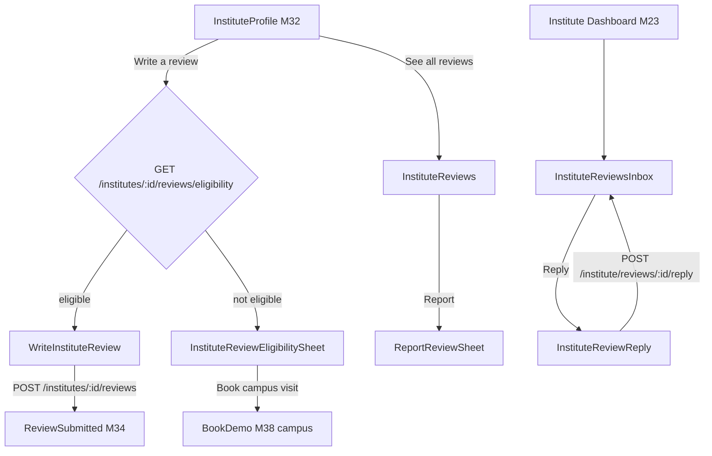
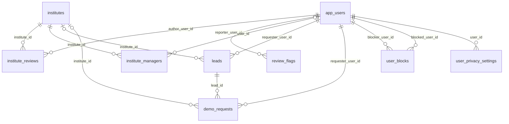

# Module 35 · Institute Reviews

> **Phase 8 · Reviews** · **Used by:** Parents and students (write, edit, delete, report); any signed-in user (read); institute managers and counsellors (reply, report) · **Depends on:** M00, M32 (institute profile), M34 (shared review components and rules), M37/M39 (enquiries), M38 (campus visits), M26 (rating display); Admin M34, Admin M35, Admin M27 · **New tables:** none · **Uses:** `institute_reviews`, `review_flags`, `review_moderation_logs`, `institutes`, `institute_managers`, `leads`, `demo_requests`, `app_users`, `user_blocks`, `user_privacy_settings`, `system_settings`, `audit_logs` · **Build estimate:** 3 days

## 1. Module Purpose

Reviews of coaching centres, tuition centres and academies by parents and students: an overall 1–5 rating, optional aspect ratings for Teaching, Infrastructure, Value for money and Safety, and written feedback — plus a public reply from the institute's staff. It reuses the review rules, components and moderation pipeline of M34 with institute-specific eligibility (an enquiry older than 3 days or a completed campus visit) and feeds `institutes.user_rating_avg`, which the Student Feedback criterion of the GuruConnect institute rating uses (Admin M27). Institute managers and counsellors see their reviews and reply from the institute app.

## 2. User Stories

- As a **parent** whose daughter attended a campus visit at Excel Academy, Jayanagar, I want to rate safety and infrastructure separately so that other parents know what the centre is really like.
- As an **institute counsellor**, I want to reply politely to a 2★ review about fees so that parents see our side.
- As an **institute manager**, I want to report a review written by a competitor so that it is removed.
- As a **student** comparing two coaching centres, I want to see aspect averages side by side so that I can judge value for money.

## 3. Business Rules & Logic

**BR-35.1 Same rules as M34** for who can review, content (30–1,500 chars, stars 1–5), draft behaviour, statuses (BR-34.5), the edit window `reviews.edit_window_days`, deletion (including the 30-day re-review block), rejection copy (BR-34.8), reports (BR-34.9 with `review_type = 'institute'`) and prompts (BR-34.12) — with the differences below.

**BR-35.2 Eligibility.** At least one of, for `institute_id = :id` and `requester_user_id = sub`: a `leads` row (`target_type = 'institute'`, not `spam`, not declined as spam, `created_at <= now() - 3 days`), or a `demo_requests` row with `institute_id = :id` and `status = 'completed'` (campus visit, M38/M39). `reviews.allow_unverified` applies as in M34. The institute must be `verification_status = 'approved'` and `account_status = 'active'`. A block between the author and any active `institute_managers.user_id` of the institute → `BLOCKED`.

**BR-35.3 Aspect ratings.** Optional object `aspectRatings` with any of the keys `teaching`, `infrastructure`, `value`, `safety`, each an integer 1–5; unknown keys → `VALIDATION_FAILED`. Stored in `institute_reviews.aspect_ratings` (`{}` when none). The form shows them after the overall stars as "Rate specific things (optional)". Aspect averages in the summary are computed over published reviews that include that aspect, and shown only when at least 3 reviews rated it.

**BR-35.4 Create / edit / delete steps** mirror BR-34.4, BR-34.6, BR-34.7 on `institute_reviews`. Every transition out of `published` caused by the app recomputes `institutes.user_rating_avg` and `user_rating_count` in the same transaction (Admin M34 FR-34.2 service); there is no trust-score job for institutes. `child_id` does not exist on institute reviews: parents pick the child only to fill the class label, which is not stored (the author label reads "Parent").

**BR-35.5 Institute reply.** `POST /institute/reviews/:id/reply { text }` by an active `institute_managers` row of the review's institute (`staff_role` manager or counsellor). Allowed only when the review is `published` or `flagged`. Creates or replaces the single reply: `institute_reply = text`, `institute_replied_at = now()`, `reply_status = 'pending'`; the reply goes through the same auto-moderation job (`review:moderate` with `target = 'reply'`) — contact details are never auto-approved. `DELETE /institute/reviews/:id/reply` clears `institute_reply`, `institute_replied_at`, `reply_status`. Text 2–1,000 chars. Max 10 reply saves per review per day (`LIMIT_REACHED`). Audit `app.institute_review_reply_saved` / `_deleted` with the staff member's `institute_managers.id`. A rejected reply shows the reason (BR-34.8 codes) and can be edited.

**BR-35.6 Institute's review list.** `GET /institute/reviews?filter=all|needs_reply|replied|low_rating` returns the institute's published and flagged reviews (never pending/rejected/hidden), newest first, with reply and reply status, plus the summary. `needs_reply` = no reply or reply rejected; `low_rating` = rating ≤ 2.

**BR-35.7 Staff reports.** Institute staff may report reviews of their own institute through `POST /institute-reviews/:id/report` (same reasons and limits as learners). Staff cannot write reviews (role check).

**BR-35.8 Display.** Summary: `institutes.user_rating_avg`, `user_rating_count`, distribution, by-role averages, aspect averages. Separately and clearly labelled, the GuruConnect rating (`institutes.overall_rating`, Admin M27, shown by M26) — the app never mixes the two numbers: "4.5 GuruConnect rating" vs "4.7 from 486 parent & student reviews".

## 4. Screen List

| Screen | Route name | Purpose |
| --- | --- | --- |
| Institute reviews | `InstituteReviews` | Summary with aspect bars and published reviews of an institute |
| Write / edit institute review | `WriteInstituteReview` | Overall stars, optional aspects, text |
| Institute review eligibility sheet | `InstituteReviewEligibilitySheet` (bottom sheet) | Why the user can't review yet |
| Report review sheet | `ReportReviewSheet` (bottom sheet, from M34) | Reused with `reviewType = institute` |
| Institute reviews inbox | `InstituteReviewsInbox` | Staff list of reviews with filters and reply status |
| Reply to review | `InstituteReviewReply` | Staff write, edit or delete the institute's reply |

## 5. Screen Flow & Navigation


Staff reach the inbox from the dashboard card "Reviews · 3 need a reply" and from push. Learner success lands on the shared `ReviewSubmitted` screen.

## 6. Screen Wireframe Description

**InstituteReviews** — header "Reviews" / subtitle "Excel Academy, Jayanagar". Two badges on top: "4.5 GuruConnect rating" (tap opens M26 explanation) and the user rating card "4.7 ★ · 486 reviews" with distribution bars. "What parents say" aspect bars (only aspects with ≥ 3 ratings): Teaching 4.8 · Infrastructure 4.5 · Value for money 4.2 · Safety 4.7. Filter chips as M34. Review cards reuse `ReviewCard` with an aspect row "Teaching 5 · Infrastructure 4 · Value 3 · Safety 5" and reply header "Reply from Excel Academy". Sticky "Write a review". Empty: "No reviews yet — enquire or visit the campus, then share your experience."

**WriteInstituteReview** — header "Review Excel Academy". Institute mini-card (logo, name, area). "Overall rating" 5 stars with labels. Collapsible section "Rate specific things (optional)" expanded by default: four rows (label + 5 small stars, 36 dp): "Teaching quality", "Classrooms & facilities", "Value for money", "Safety & supervision"; each row has a "Clear" link. Text area placeholder "How are the faculty and batches? Are classrooms clean and safe? Is the fee worth it?", counter "0 / 1,500". Guidelines accordion. Sticky "Submit review".

**InstituteReviewsInbox** (staff) — header "Reviews". Summary strip "4.7 ★ · 486 · Reply rate 71 %". Chips: "All", "Needs reply (3)", "Replied", "1–2 ★". Cards: author label "Parent", stars, date, text (4 lines), aspect row, reply status pill: "No reply" / "Reply waiting for approval" / "Reply live" / "Reply not approved — edit"; buttons "Reply" or "Edit reply"; kebab "Report review". Empty: "No reviews yet. Happy families are your best advertisement — ask them to review you on GuruConnect."

**InstituteReviewReply** — header "Reply to review". Quoted review card (read-only). Text area label "Your public reply", placeholder "Thank you for your feedback, Lakshmi. We have added a doubt-clearing hour on Saturdays…", counter 0/1,000. Tips box: "Thank the parent · Address the concern · Don't share phone numbers — parents can contact you through GuruConnect." Footer note "Replies are checked before they appear. Signed as Excel Academy." Sticky "Post reply" (edit mode: "Update reply" + text button "Delete reply" → confirm sheet "Delete your reply?").

## 7. UI Components & Component Tree

```
InstituteReviewsScreen
├─ RatingBadgesRow (GuruConnectRatingBadge from M26, UserRatingCard)
├─ AspectBars
├─ ReviewFilterChips
└─ FlashList<ReviewCard variant="institute">
WriteInstituteReviewScreen
├─ InstituteMiniCard · StarRatingInput · AspectRatingGroup (4 × AspectRatingRow)
└─ ReviewTextArea · GuidelinesAccordion · StickyActionBar
InstituteReviewsInboxScreen → SummaryStrip, FilterChips, FlashList<StaffReviewCard>
InstituteReviewReplyScreen → QuotedReview, ReplyTextArea, ReplyTips, StickyActionBar
```
- `AspectBars({ aspects })` — hides aspects with fewer than 3 ratings.
- `AspectRatingGroup({ value, onChange })` — value `{ teaching?, infrastructure?, value?, safety? }`.
- Hooks: `useInstituteReviewsInfiniteQuery(instituteId, filters)`, `useInstituteReviewEligibilityQuery(id)`, `useCreateInstituteReviewMutation(id)`, `useUpdateInstituteReviewMutation(reviewId)`, `useDeleteInstituteReviewMutation(reviewId)`, `useReportReviewMutation('institute')`, `useInstituteInboxReviewsQuery(filter)`, `useSaveInstituteReplyMutation(reviewId)`, `useDeleteInstituteReplyMutation(reviewId)`.

## 8. Validation Rules

Shared schemas `InstituteReviewInputSchema` (extends `ReviewInputSchema` without `childId`) and `ReviewReplySchema` in `packages/shared/reviews.ts`.

| Field | Rule | Message shown |
| --- | --- | --- |
| rating | integer 1–5, required | "Tap a star to rate." |
| aspectRatings | object; keys only teaching, infrastructure, value, safety; values integer 1–5 | "Use 1 to 5 stars." |
| comment | 30–1,500 chars, ≥ 5 words | "Write at least 30 characters." |
| reply.text | trimmed 2–1,000 chars | "Replies can be up to 1,000 characters." |
| If-Match (edit review) | equals `updatedAt` | "Updated on another device. Review and save again." |
| report.reason / details | as M34 | as M34 |

## 9. API Endpoints

| Method | Path | Auth | Description |
| --- | --- | --- | --- |
| GET | /institutes/:id/reviews | Any user | Summary with aspect averages + published reviews (cursor); `data.mine` |
| GET | /institutes/:id/reviews/eligibility | Learner | Eligibility, reason, `eligibleFrom`, existing review id |
| POST | /institutes/:id/reviews | Learner | Create (Idempotency-Key). 5/hour per user |
| PATCH | /institute-reviews/:id | Learner (author) | Edit within the window (If-Match) |
| DELETE | /institute-reviews/:id | Learner (author) | Soft-delete own review |
| POST | /institute-reviews/:id/report | Learner, Institute staff | Report a review (Idempotency-Key). 10/day |
| GET | /institute/reviews | Institute staff | Own institute's published/flagged reviews with reply state and summary |
| POST | /institute/reviews/:id/reply | Institute staff | Create or replace the institute's reply (goes to moderation) |
| DELETE | /institute/reviews/:id/reply | Institute staff | Delete the institute's reply |

## 10. Request Payloads

```json
// POST /institutes/5e2d…/reviews   (Idempotency-Key: 8c1f…)
{ "rating": 4, "aspectRatings": { "teaching": 5, "infrastructure": 4, "value": 3, "safety": 5 },
  "comment": "Faculty for JEE Physics and Maths is excellent and doubt sessions are regular. Fees are on the higher side for the weekend batch." }

// POST /institute/reviews/2b9a…/reply
{ "text": "Thank you, Lakshmi. We now offer a 10% sibling discount and a monthly payment option for the weekend batch." }
```

## 11. Response Payloads

```json
// 200 GET /institutes/:id/reviews
{ "data": { "summary": { "avg": 4.7, "count": 486, "distribution": { "5": 360, "4": 90, "3": 22, "2": 8, "1": 6 },
      "byRole": { "parent": { "avg": 4.7, "count": 301 }, "student": { "avg": 4.6, "count": 185 } },
      "aspects": { "teaching": { "avg": 4.8, "count": 402 }, "infrastructure": { "avg": 4.5, "count": 377 }, "value": { "avg": 4.2, "count": 390 }, "safety": { "avg": 4.7, "count": 351 } },
      "guruConnectRating": 4.5 },
    "mine": null,
    "items": [ { "id": "2b9a…", "rating": 4, "aspectRatings": { "teaching": 5, "value": 3 }, "comment": "Faculty for JEE Physics…",
                 "author": { "displayName": "Lakshmi V.", "type": "parent" }, "verifiedInteraction": true, "publishedAt": "2026-09-20T05:00:00Z",
                 "reply": { "text": "Thank you, Lakshmi…", "repliedAt": "2026-09-21T06:10:00Z" } } ] },
  "meta": { "nextCursor": "eyJwIjoi…", "limit": 20 } }

// 200 GET /institute/reviews?filter=needs_reply
{ "data": { "summary": { "avg": 4.7, "count": 486, "replyRatePct": 71, "needsReply": 3 },
    "items": [ { "id": "2b9a…", "rating": 2, "comment": "Batch timings changed twice…", "status": "published", "author": { "displayName": "Rahul", "type": "student" },
                 "reply": { "text": null, "status": null, "rejectionReasonCode": null } } ] },
  "meta": { "nextCursor": null } }

// 200 POST /institute/reviews/:id/reply
{ "data": { "reviewId": "2b9a…", "reply": { "text": "Thank you, Lakshmi…", "status": "pending", "repliedAt": "2026-09-26T10:40:00Z" } } }
```

## 12. PostgreSQL Tables & Columns


**Existing tables this module reads or writes** (full definitions in the owning module)

| Table | Owner | Purpose |
| --- | --- | --- |
| `institute_reviews` | Admin M34 | Reviews of institutes by parents and students. |
| `review_flags` | Admin M35 | Reports raised against a review by users or teachers. |
| `review_moderation_logs` | Admin M35 | Every moderation decision on reviews and replies. |
| `institutes` | Admin M22 | Coaching centres, tuition centres, schools and academies. Rated by GuruConnect after verification. |
| `institute_managers` | Admin M25 | App accounts that act for an institute. Exactly one active primary manager; counsellors can only handle leads. |
| `leads` | Admin M38 | Enquiries and call-back requests from parents/students to a teacher or institute. |
| `demo_requests` | Admin M39 | Free demo class bookings and their outcome. |
| `app_users` | Admin M00 | Login identity for every mobile app account (parent, student, teacher, institute staff). Role profiles hang off this table. |
| `user_blocks` | App M49 | Users one user has blocked. Blocked users can't contact, message or review the blocker. |
| `user_privacy_settings` | App M52 | What a user shows to others and allows the platform to do with their data. |
| `system_settings` | Admin M04 | Typed key–value settings that change platform behaviour without a deploy. |
| `audit_logs` | Admin M00 | Append-only record of every admin action and security event. Never updated or deleted by the application. |

- `institute_reviews`: author columns as M34; staff write only `institute_reply`, `institute_replied_at`, `reply_status`. Pipeline/moderator columns are never written by the app.
- `institutes.user_rating_avg` / `user_rating_count`: recomputed on app-caused transitions out of `published`.
- `institute_managers`: authorises replies (`institute_id = iid`, `status = 'active'`).

## 13. Relationships


**Entity relationship diagram** (tables this module uses; `admins` omitted)



## 14. State Management

- `instituteReviewKeys.list(instituteId, filters)`, `instituteReviewKeys.eligibility(instituteId)`, `instituteReviewKeys.inbox(filter)`; first pages persisted; eligibility not persisted.
- Draft store shared with M34 (`useReviewDraftStore`, key `institute:<id>`); reply drafts keyed `reply:<reviewId>`.
- After reply save/delete: invalidate `instituteReviewKeys.inbox(*)` and `instituteReviewKeys.list(iid)`; the card flips to "Reply waiting for approval" from the mutation result (no optimistic text change).

## 15. Offline Handling

- Lists and summaries readable from cache.
- Write/edit review and write reply: class 2 (draft kept, submit online). Delete and report: online only.

## 16. Push Notification Requirements

| Event | Recipient | Title / Body | Deep link | Category | Urgent |
| --- | --- | --- | --- | --- | --- |
| `institute_review_published` | Author | "Your review is live" / "Your review of {instituteName} is now on its profile." | `/me/reviews` | reviews | No |
| `institute_review_rejected` | Author | "Your review needs a change" / "Your review of {instituteName} wasn't published: {reasonText}" | `/me/reviews` | reviews | No |
| `institute_review_new` | All active staff of the institute | "New {rating}★ review" / "{authorName} reviewed {instituteName}. Tap to reply." | `/institute/reviews/{reviewId}` | reviews | No |
| `institute_reply_approved` | Staff member who wrote the reply | "Your reply is live" / "Your reply to {authorName}'s review is now public." | `/institute/reviews/{reviewId}` | reviews | No |
| `institute_reply_rejected` | Staff member who wrote the reply | "Reply not published" / "{reasonText} Edit and post again." | `/institute/reviews/{reviewId}` | reviews | No |
| `review_prompt` (institute) | Learner (BR-34.12) | "How was {instituteName}?" / "Rate teaching, facilities and safety in a minute." | `/i/{slug}?action=review` | reviews | No |

## 17. Security Rules

- Staff endpoints scope by `institute_id = iid` from the token and require an active `institute_managers` row; a disabled counsellor gets `FORBIDDEN`.
- Replies are signed as the institute, never with the staff member's name; the staff id is kept in audit.
- Public DTOs exclude author ids, contact details, spam data and moderator data (as M34).
- Rate limits: create 5/hour, reply saves 10 per review per day, reports 10/day.
- Institutes cannot see pending, rejected or hidden reviews, or who reported them.

## 18. Error Handling

| Scenario | Code | HTTP | App behaviour |
| --- | --- | --- | --- |
| No enquiry or campus visit | `CONFLICT_STATE` (`no_interaction`) | 409 | Eligibility sheet with "Book campus visit" |
| Enquiry younger than 3 days | `CONFLICT_STATE` (`too_early`) | 409 | Sheet with the date |
| Unknown aspect key or value 0 | `VALIDATION_FAILED` | 422 | Inline under the aspect row |
| Reply on a pending/hidden review | `CONFLICT_STATE` (`review_not_public`) | 409 | Toast "This review isn't public any more." Refetch inbox |
| Reply by staff of another institute | `NOT_FOUND` | 404 | "This is no longer available." |
| Too many reply edits | `LIMIT_REACHED` (`reply_edits_daily`) | 429 | Toast "You can edit this reply again tomorrow." |
| Others | as M34 | — | as M34 |

## 19. Testing Scenarios

- T35.1 Parent with an enquiry 4 days old reviews with all four aspects → 201 pending (Maestro `institute_review_happy`).
- T35.2 Completed campus visit, no enquiry → eligible.
- T35.3 Aspect averages hide an aspect with only 2 ratings.
- T35.4 Review published → `user_rating_avg` updated; delete by author → recomputed in the same transaction.
- T35.5 Counsellor replies → `reply_status = 'pending'`; approved → author sees the reply; staff push `institute_reply_approved`.
- T35.6 Reply containing "call 080-4718 2200" → pipeline keeps it pending; moderator rejects with CONTACT_DETAILS → inbox shows "Reply not approved — edit".
- T35.7 Manager of institute A replies to a review of institute B → `NOT_FOUND`.
- T35.8 Disabled counsellor → `FORBIDDEN` on reply.
- T35.9 Staff report their own institute's review → 201; staff tries to POST a review → `FORBIDDEN`.
- T35.10 GuruConnect rating and user rating shown as separate badges with separate labels.
- T35.11 Offline reply draft survives restart; "Post reply" disabled offline.
- T35.12 Edit window, duplicate and 30-day re-review rules behave exactly as T34.5–T34.8.

## 20. Audit Log Events

| Event | When | Details |
| --- | --- | --- |
| `app.institute_review_created` | Review inserted | instituteId, rating, aspects given, verifiedInteraction |
| `app.institute_review_edited` | Author edit | old/new rating and aspects, previous status |
| `app.institute_review_deleted` | Author delete | previous status |
| `app.review_reported` | Report inserted | reviewType `institute`, reason, reporter role |
| `app.institute_review_reply_saved` | Reply created or replaced | reviewId, instituteManagerId, text length, first reply or edit |
| `app.institute_review_reply_deleted` | Reply removed | reviewId, instituteManagerId |

## 21. Future Scalability Notes

- Batch-level reviews (review a specific `institute_batches` row) once institutes run many batches.
- Verified-result badges ("Student cleared JEE Main 2026") with document proof.
- Reply templates saved per institute.
- Response-time metric for replies shown on the institute profile.
- Admin portal additions: none — Admin M34/M35 cover institute reviews and reply moderation.
