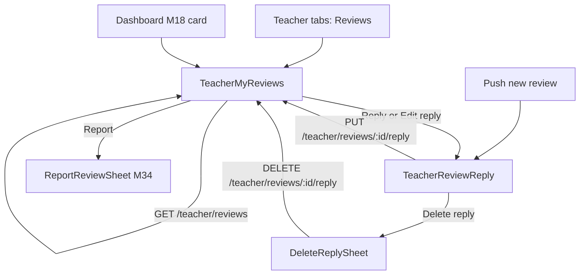
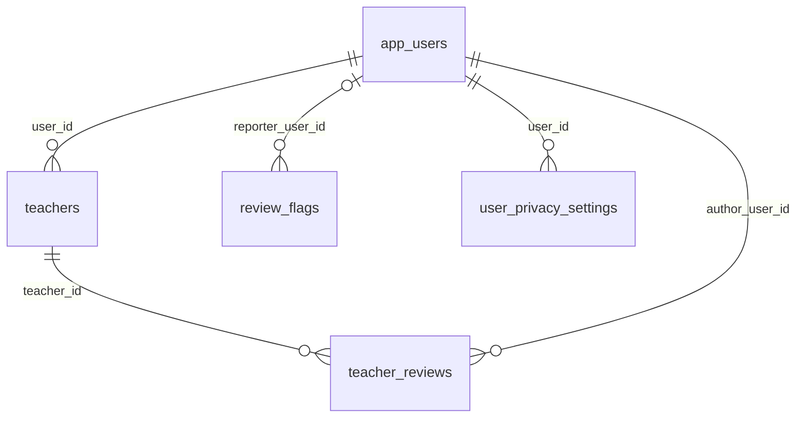

# Module 36 · Teacher Reply To Review

> **Phase 8 · Reviews** · **Used by:** Teachers (read their reviews, reply, edit or delete a reply, report) · **Depends on:** M00, M18 (dashboard card), M34 (review rules, report endpoint, components); Admin M33, Admin M35 · **New tables:** none · **Uses:** `teacher_reviews`, `review_flags`, `teachers`, `app_users`, `user_privacy_settings`, `audit_logs` · **Build estimate:** 2 days

## 1. Module Purpose

The teacher's Reviews tab: a list of every published review on the teacher's profile with the rating summary, a "Needs reply" filter, and a screen to write one public reply per review, edit it or delete it. Replies are moderated (Admin M35) exactly like reviews, so a teacher can't use them to share phone numbers or attack a reviewer. Teachers can also report a review from here using the M34 report endpoint. Replying well is the main thing a teacher can do about reviews, so the screen gives short guidance and shows reply rate.

## 2. User Stories

- As a **teacher**, I want to see new reviews first with a "Needs reply" count so that I thank families quickly.
- As a **teacher** who got an unfair 2★ review, I want to reply calmly with my side and report it if it is fake so that parents see a balanced picture.
- As a **new teacher**, I want tips on writing a good reply so that my first replies look professional.
- As a **teacher on a slow connection**, I want my reply draft kept if the app closes so that I don't rewrite it.

## 3. Business Rules & Logic

**BR-36.1 What the teacher sees.** `GET /teacher/reviews` returns reviews with `teacher_id = pid`, `deleted_at IS NULL` and `status IN ('published','flagged')`. Pending, rejected and hidden reviews are never shown to the teacher. Flagged reviews carry `underReview: true` ("Being checked by GuruConnect"). Filters: `all` (default), `needs_reply` (no reply or `reply_status = 'rejected'`), `replied` (`reply_status IN ('pending','published')`), `low_rating` (rating ≤ 2). Sort newest `published_at` first; cursor 20 per page. Summary: `teachers.rating_avg`, `rating_count`, distribution, `replyRatePct` = reviews with a published reply ÷ published reviews, `needsReply` count. Author display as M34 BR-34.10.

**BR-36.2 Reply rules.** One reply per review. Allowed when the review is `published` or `flagged`; otherwise `CONFLICT_STATE` (`review_not_public`). Text trimmed 2–1,000 characters. `PUT /teacher/reviews/:id/reply` creates or replaces the reply; any save sets `teacher_reply`, `teacher_replied_at = now()`, `reply_status = 'pending'`; while a new version is pending, the previously published reply is no longer shown (the column holds one text). Max 10 saves per review per day (`LIMIT_REACHED`, `details.reason = "reply_edits_daily"`).

**BR-36.3 Server steps for PUT (one transaction).** 1) Load the review with `FOR UPDATE`, check `teacher_id = pid`; 2) check status and limits; 3) update the reply columns; 4) insert `audit_logs` `app.review_reply_saved` (review id, text length, `isEdit`); 5) after commit enqueue `review:moderate` with `target = 'reply'` (Admin M35): a reply with no flags and spam score < 0.15 is published automatically; one with contact details, abuse or a reviewer's personal details waits for a moderator.

**BR-36.4 Delete reply.** `DELETE /teacher/reviews/:id/reply` sets `teacher_reply`, `teacher_replied_at`, `reply_status` to NULL; audit `app.review_reply_deleted`. Confirmation sheet.

**BR-36.5 Rejected reply.** The card shows "Reply not published" and the reason copy (codes as M34 BR-34.8, wording adapted: `CONTACT_DETAILS` → "Remove phone numbers, emails or links. Families can contact you through GuruConnect."; `ABUSIVE` → "Keep replies polite, even when you disagree."; `PERSONAL_INFORMATION` → "Don't mention the reviewer's or child's personal details."). Editing starts from the rejected text.

**BR-36.6 Client guidance.** The reply screen detects contact details with the shared `detectContactInfo()` and shows an inline warning; it also warns if the reply contains the reviewer's full name or a child's name taken from the lead (not blocked). Suggested openers (tap to insert): "Thank you, {firstName}!", "Thank you for the feedback.", "I'm sorry to hear this." — inserted text is editable.

**BR-36.7 Reporting.** The card menu "Report review" opens the M34 `ReportReviewSheet` → `POST /reviews/:id/report`. Teachers are told: "Reports don't remove a review automatically. Our team checks it within 24–48 hours."

**BR-36.8 Edited reviews.** When an author edits a review, it leaves the teacher's list until re-approved (status `pending`); when it returns, the existing reply is still attached and the card shows "Review edited on 3 Oct — check your reply still fits."

## 4. Screen List

| Screen | Route name | Purpose |
| --- | --- | --- |
| Teacher reviews tab | `TeacherMyReviews` | Summary, filters and list of published/flagged reviews on my profile |
| Reply to review | `TeacherReviewReply` | Write, edit or delete my reply |
| Delete reply sheet | `DeleteReplySheet` (bottom sheet) | Confirm reply deletion |
| Report review sheet | `ReportReviewSheet` (bottom sheet, M34) | Report a review of my profile |

## 5. Screen Flow & Navigation


Back from `TeacherReviewReply` keeps the draft. After saving, the list scrolls to the same card, now showing "Reply waiting for approval".

## 6. Screen Wireframe Description

**TeacherMyReviews** — tab header "Reviews". Summary card: "4.9 ★" large, "312 reviews", distribution bars, row of two stats "Reply rate 64 %" and "Needs reply 5". Chips: "All", "Needs reply (5)", "Replied", "1–2 ★". Cards: author "Lakshmi V." · "Parent · Class 12" · tick "Took a demo"; stars; "12 Sep 2026"; text (6 lines + Read more); if flagged, amber strip "Being checked by GuruConnect"; reply area: none → button "Reply"; pending → grey box with the text and pill "Waiting for approval" + "Edit"; published → box "Your reply" + "Edit"; rejected → red box "Reply not published: Remove phone numbers, emails or links…" + "Edit reply". Kebab: "Report review". Empty (no reviews): illustration, "No reviews yet", body "Families can review you after a demo or 3 days after they contact you. Complete demos on time to earn your first review.", button "Share my profile" (M33). Loading skeleton; error with Retry.

**TeacherReviewReply** — header "Reply to review". Quoted review card (stars, author, text). Chips row "Thank you, Lakshmi!" · "Thank you for the feedback." · "I'm sorry to hear this." Text area label "Your public reply", placeholder "Thank you, Lakshmi! Aarav worked very hard for his boards.", counter 0 / 1,000, warning banner for contact details. Tip card: "Good replies are short and polite. Thank the family, answer the concern, and never share phone numbers — families reach you through GuruConnect." Footer "Replies are checked before they appear. Everyone can see your reply." Sticky bar: "Post reply" (edit: "Update reply"); in edit mode a text button "Delete reply". Offline: button disabled with "You're offline. Your reply is saved."

**DeleteReplySheet** — "Delete your reply?", body "The review will show without a reply.", "Delete" (destructive) / "Cancel".

## 7. UI Components & Component Tree

```
TeacherMyReviewsScreen
├─ TeacherRatingSummaryCard (RatingDistribution, StatPill × 2)
├─ ReviewFilterChips
└─ FlashList<ReviewCard variant="teacher">
   └─ ReplyStatusBox (none | pending | published | rejected) · ReviewMenu
TeacherReviewReplyScreen
├─ QuotedReview · OpenerChips · ReplyTextArea (ContactInfoWarning) · ReplyTips
└─ StickyActionBar
DeleteReplySheet
```
- `ReplyStatusBox({ reply, onEdit })`, `OpenerChips({ firstName, onInsert })`.
- Hooks: `useTeacherReviewsInfiniteQuery(filter)`, `useSaveReplyMutation(reviewId)`, `useDeleteReplyMutation(reviewId)`, `useReplyDraft(reviewId)`, `useReportReviewMutation('teacher')` (M34).

## 8. Validation Rules

Shared schema `ReviewReplySchema` in `packages/shared/reviews.ts` (also used by M35).

| Field | Rule | Message shown |
| --- | --- | --- |
| text | trimmed length 2–1,000 | "Replies can be 2 to 1,000 characters." |
| text | not identical to the current published reply | "Make a change before updating." |
| filter (query) | all, needs_reply, replied, low_rating | — (ignored, defaults to all) |

## 9. API Endpoints

| Method | Path | Auth | Description |
| --- | --- | --- | --- |
| GET | /teacher/reviews | Teacher | Published/flagged reviews on my profile, summary, filters (cursor) |
| PUT | /teacher/reviews/:id/reply | Teacher | Create or replace my reply; goes to moderation. 10 saves/review/day |
| DELETE | /teacher/reviews/:id/reply | Teacher | Delete my reply |

## 10. Request Payloads

```json
// PUT /teacher/reviews/9a7b…/reply
{ "text": "Thank you, Lakshmi! Aarav worked very hard, and it was a pleasure teaching him. All the best for his JEE preparation." }

// GET /teacher/reviews?filter=needs_reply&limit=20
```

## 11. Response Payloads

```json
// 200 GET /teacher/reviews?filter=needs_reply
{ "data": { "summary": { "avg": 4.9, "count": 312, "distribution": { "5": 244, "4": 47, "3": 15, "2": 3, "1": 3 }, "replyRatePct": 64, "needsReply": 5 },
    "items": [ { "id": "9a7b…", "rating": 5, "comment": "My son's Physics went from 58 to 91…", "author": { "displayName": "Lakshmi V.", "firstName": "Lakshmi", "type": "parent", "classLabel": "Class 12" },
                 "verifiedInteraction": true, "underReview": false, "publishedAt": "2026-09-12T06:30:00Z", "editedAt": null,
                 "reply": { "text": null, "status": null, "repliedAt": null, "reasonText": null } } ] },
  "meta": { "nextCursor": "eyJwIjoi…", "limit": 20 } }

// 200 PUT /teacher/reviews/:id/reply
{ "data": { "reviewId": "9a7b…", "reply": { "text": "Thank you, Lakshmi!…", "status": "pending", "repliedAt": "2026-09-26T11:05:00Z" } } }

// 409 PUT /teacher/reviews/:id/reply
{ "error": { "code": "CONFLICT_STATE", "message": "This review isn't public any more.", "details": { "reason": "review_not_public" }, "requestId": "c9d0…" } }
```

## 12. PostgreSQL Tables & Columns


**Existing tables this module reads or writes** (full definitions in the owning module)

| Table | Owner | Purpose |
| --- | --- | --- |
| `teacher_reviews` | Admin M33 | Reviews of teachers by parents and students. Only published reviews count toward ratings and trust. |
| `review_flags` | Admin M35 | Reports raised against a review by users or teachers. |
| `teachers` | Admin M16 | Teacher profile and verification state. One row per teacher app account. |
| `app_users` | Admin M00 | Login identity for every mobile app account (parent, student, teacher, institute staff). Role profiles hang off this table. |
| `user_privacy_settings` | App M52 | What a user shows to others and allows the platform to do with their data. |
| `audit_logs` | Admin M00 | Append-only record of every admin action and security event. Never updated or deleted by the application. |

- `teacher_reviews`: the teacher writes only `teacher_reply`, `teacher_replied_at`, `reply_status` (always `pending` on save; `published`/`rejected` set by Admin M35).
- `teachers.rating_avg`, `rating_count`: read for the summary.

## 13. Relationships


**Entity relationship diagram** (tables this module uses; `admins` omitted)



## 14. State Management

- `teacherReviewKeys.list(filter)`; first page persisted; refetched on tab focus and on `reviews` push receipt.
- `useReviewDraftStore` entries keyed `reply:<reviewId>`.
- After save: update the item in all cached filter lists from the response (`setQueryData`), then invalidate `teacherReviewKeys.list('needs_reply')` and `teacherDashboardKeys.summary` (M18). After delete: optimistic reply removal, rollback on error.

## 15. Offline Handling

- Reviews list readable from cache. Reply save/delete: class 2 for save (draft kept, button disabled offline), delete online only.

## 16. Push Notification Requirements

| Event | Recipient | Title / Body | Deep link | Category | Urgent |
| --- | --- | --- | --- | --- | --- |
| `teacher_review_new` | Teacher | "New {rating}★ review" / "{authorName}: “{first 60 chars}” Tap to reply." | `/teacher/reviews/{reviewId}` | reviews | No |
| `teacher_review_edited` | Teacher (after the edited review is re-published) | "A review was updated" / "{authorName} edited their review. Check your reply still fits." | `/teacher/reviews/{reviewId}` | reviews | No |
| `teacher_reply_approved` | Teacher | "Your reply is live" / "Your reply to {authorName} is now on your profile." | `/teacher/reviews/{reviewId}` | reviews | No |
| `teacher_reply_rejected` | Teacher | "Reply not published" / "{reasonText}" | `/teacher/reviews/{reviewId}` | reviews | No |

All four are emitted by the Admin M35 pipeline/decision service; this module owns templates and routing. Low ratings are not sent at a different urgency.

## 17. Security Rules

- All queries scoped by `teacher_id = pid`; a review of another teacher returns `NOT_FOUND`.
- Teachers never see reviewer ids, phone numbers, child names, pending/rejected/hidden reviews or who reported what.
- Rate limits: 10 reply saves per review per day; 60 list requests/min.
- A suspended teacher (`teachers.account_status = 'suspended'`) can read but not reply (`FORBIDDEN`, `details.reason = "account_suspended"`).

## 18. Error Handling

| Scenario | Code | HTTP | App behaviour |
| --- | --- | --- | --- |
| Review pending, hidden, rejected or deleted | `CONFLICT_STATE` (`review_not_public`) | 409 | Toast, remove card, refetch |
| Not my review | `NOT_FOUND` | 404 | "This is no longer available." |
| Too short / too long | `VALIDATION_FAILED` | 422 | Inline under the text area |
| Too many saves today | `LIMIT_REACHED` (`reply_edits_daily`) | 429 | Toast "You can edit this reply again tomorrow." |
| Teacher suspended | `FORBIDDEN` (`account_suspended`) | 403 | Banner with support link |
| Network drop on save | `NETWORK_OFFLINE` (client) | — | Keep draft, show "Couldn't send. Try again." |

## 19. Testing Scenarios

- T36.1 Teacher replies to a 5★ review → `pending`; auto-approved → card shows "Your reply"; parent sees the reply on the profile (Maestro `teacher_reply_happy`).
- T36.2 Reply with a phone number → warning shown; saved as pending; moderator rejects → push `teacher_reply_rejected`; card shows the reason; edit and resubmit works.
- T36.3 `needs_reply` count drops by one after a reply is saved; rises again when a reply is rejected.
- T36.4 Reply to a review that became hidden a second ago → `review_not_public`; card removed.
- T36.5 Eleventh save of the same reply in a day → `LIMIT_REACHED`.
- T36.6 Delete reply → review shows without reply for parents; audit row written.
- T36.7 Teacher A calls PUT on teacher B's review → `NOT_FOUND`.
- T36.8 Flagged review shows the "Being checked" strip and can still be replied to.
- T36.9 Draft survives app kill; offline disables "Post reply".
- T36.10 Report from the teacher tab → M34 report created with reporter = teacher's user id.
- T36.11 Author edits a review → it disappears from the teacher list while pending; returns with "Review edited" note and push `teacher_review_edited`.
- T36.12 Screen renders loading, empty, error and content states.

## 20. Audit Log Events

| Event | When | Details |
| --- | --- | --- |
| `app.review_reply_saved` | Reply created or replaced | reviewId, text length, isEdit, previous reply status |
| `app.review_reply_deleted` | Reply deleted | reviewId, previous reply status |

## 21. Future Scalability Notes

- AI-assisted reply suggestions (tone check before posting) running server-side with the same moderation rules.
- Private message to the reviewer from a review (needs a lead/message link for reviews without a lead).
- Reply-rate badge on the public profile ("Replies to 90 % of reviews").
- Admin portal additions: none — reply moderation is in Admin M35.
