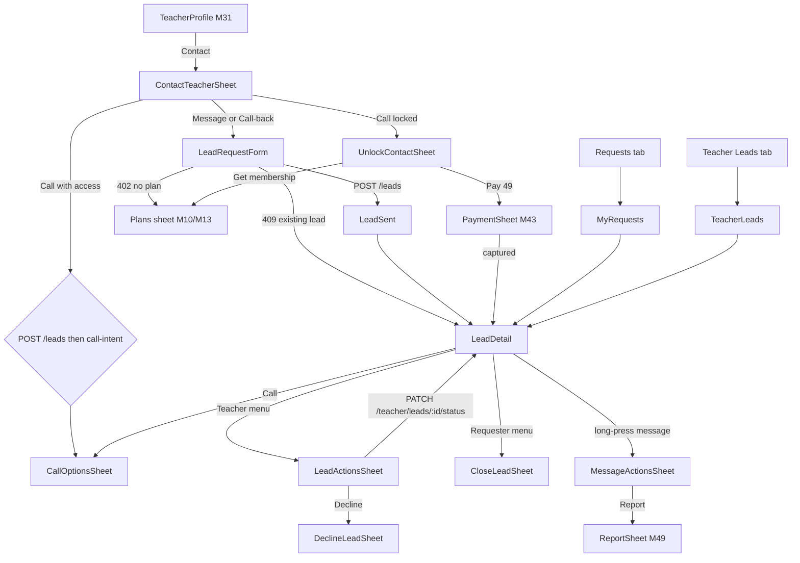
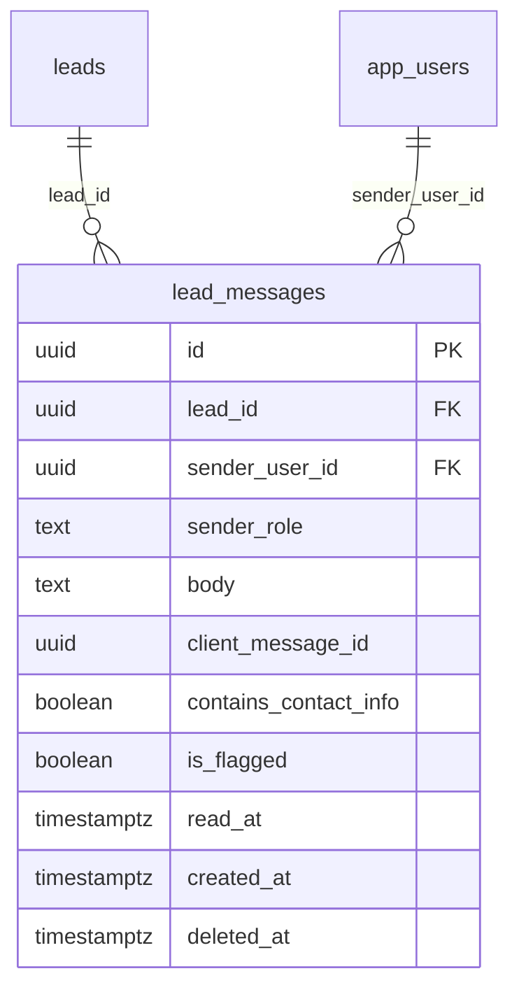

# Module 37 · Contact Teacher

> **Phase 9 · Leads** · **Used by:** Parents and students (call, message, request a call-back); teachers (lead inbox, reply, call back, change status); institute staff use the same lead and message endpoints for enquiries (M39) · **Depends on:** M00, M31 (profile contact bar), M10/M13 (plans sheet), M43 (CONTACT_UNLOCK payment), M44 (live subscription), M49 (blocks, reports), M38 (demo leads), M39 (institute enquiries); Admin M38, Admin M05, Admin M40, Admin M43 · **New tables:** `lead_messages` · **Uses:** `leads`, `teachers`, `institutes`, `institute_managers`, `subscriptions`, `payment_configurations`, `transactions`, `user_blocks`, `teacher_time_off`, `parent_children`, `students`, `subjects`, `classes`, `app_users`, `user_privacy_settings`, `system_settings`, `user_notifications`, `complaints`, `audit_logs` · **Build estimate:** 6–7 days

## 1. Module Purpose

Turns interest into a conversation. From a teacher's profile a parent or student can **Call**, **Message** or send a **Call-back request**; each creates (or reuses) a `leads` row that the teacher sees in the Leads tab. The module owns the lead creation rules (daily limit, one open lead per requester/teacher/subject, blocks, teacher away), the **contact unlock** rules (phone numbers are shared when the requester has a live membership, or after a one-time CONTACT_UNLOCK payment through M43 when that fee is enabled), a **masked calling** alternative that connects both phones without revealing numbers, in-app **lead messages** with contact-info detection, and the teacher-side lead inbox with status changes (contacted, converted, declined). Admin M38 shows the same leads to support; the lifecycle here matches it exactly.

## 2. User Stories

- As a **parent**, I want to request a call-back from Dr. Ananya Iyer for Aarav's Class 12 Physics with a time window so that she calls when I'm free.
- As a **student without a membership**, I want to message a teacher and pay ₹49 only if I want her number so that I don't have to buy a plan to ask one question.
- As a **teacher**, I want a push the moment a family contacts me and a one-tap call-back so that I respond within minutes and keep my response rate high.
- As a **new teacher**, I want to decline requests I can't take with a reason so that families aren't left waiting.
- As a **parent on 2G at my village home**, I want my message to send automatically when the network comes back so that I don't have to retype it.
- As a **teacher**, I want numbers hidden until the family unlocks contact, but still be able to call them through a masked number so that neither side's phone is exposed.

## 3. Business Rules & Logic

**BR-37.1 Lead lifecycle** (same as Admin M38 FR-38.1; actors in the app):

| From | To | Who / trigger | Side effects |
| --- | --- | --- | --- |
| — | `new` | Requester: `POST /leads`, Call on a profile, or `POST /demos` (M38) | `public_code` `LD-` + 6 digits (`seq_lead_code`); push to teacher; SMS if still `new` after 30 min (08:00–21:30 IST) |
| `new` | `viewed` | Teacher opens `GET /leads/:id` the first time | Inbox-only notice to requester; `first_response_at` not set |
| `new`, `viewed` | `contacted` | Teacher sends a message, calls (call-intent), confirms a demo, or taps "Mark as contacted" | `first_response_at = now()` if null |
| `contacted` | `converted` | Teacher "Classes started", or requester "I've started classes", or demo outcome `enrolled` (M38) | `closed_at = now()` |
| `new`, `viewed`, `contacted` | `declined` | Teacher with a reason (BR-37.10) | `closed_at`, `first_response_at` if null; push to requester |
| `new`, `viewed`, `contacted` | `converted` | Requester "I've started classes" (response metrics untouched) | `closed_at` |
| `new`, `viewed`, `contacted` | `closed` | Requester closes; system after 30 days without a status change or message (Admin M38 job); block created (M49) | `closed_at` |
| any | `spam` | Admin, or BR-37.11 | hidden from both inboxes' open tabs |
Open = `new`, `viewed`, `contacted`. Requesters never see the word "spam": a spam lead shows as "Closed".

**BR-37.2 Who can create a lead.** Role `parent` or `student`; `app_users.account_status = 'active'`, role row `active`; students with `parental_consent IN ('pending','declined')` → `FORBIDDEN` (`details.reason = "parental_consent_pending"`). Target teacher: `verification_status = 'approved'`, `account_status = 'active'`, `deleted_at IS NULL` (else `NOT_FOUND`). A `teacher_time_off` row with `pause_leads = true` covering today (IST) → `CONFLICT_STATE` (`details.reason = "teacher_away"`, `details.awayUntil = ends_on`). A `user_blocks` row in either direction between `sub` and `teachers.user_id` → `BLOCKED`.

**BR-37.3 Limits.**
- **Daily limit:** leads created by the requester since 00:00 IST (all types, including demo leads) must be < `leads.daily_limit` (10) → else `LIMIT_REACHED` `{ reason: "leads_daily", limit: 10, resetsAt }`.
- **One open lead per (requester, target, subject):** if an open lead exists with the same `requester_user_id`, same `teacher_id`/`institute_id` and `subject_id IS NOT DISTINCT FROM :subjectId`, the create returns `CONFLICT_DUPLICATE` with `details.existingLeadId`; the app opens that lead instead (for Call it silently reuses it). A per-(requester, target) advisory lock (`pg_advisory_xact_lock(hashtext(requester||target))`) makes concurrent taps safe.
- Burst guard: max 3 lead creations per minute per user (`RATE_LIMITED`).

**BR-37.4 Lead types from the profile.**
- **Call-back request** → `lead_type = 'callback'`, `preferred_callback_window` required (chips "Today 6–8 PM", "Tomorrow 9–11 AM", "Weekend", or custom text ≤ 60 chars), `message` optional.
- **Message** → `lead_type = 'inquiry'`, `message` required 10–500 chars; the thread opens immediately.
- **Call** → reuses an open lead for the target+subject or creates `lead_type = 'inquiry'` with `message = NULL`, then calls `call-intent` (BR-37.7). Requires contact access.
- **Book free demo** → M38 (`lead_type = 'demo'`).
Parents pick the child (`child_id` must be their own live child; class defaults from the child); students send `child_id = NULL` and class from `students.class_id`. `subject_id` must be one of the teacher's `teacher_subjects` (else `VALIDATION_FAILED` path `subjectId`). `source` is sent by the client (`profile`, `search`, `recommendation`, `featured`, `compare`, `institute_page`, `other`).

**BR-37.5 Contact access (evaluated at create and at unlock).** `ContactAccessService.resolve(userId, role)` returns the first that applies:
1. A live `subscriptions` row (`status IN ('trial','active','grace','free_access')`) for `subscriber_type = role`. For a **student trial**, access only while leads unlocked during the trial (`contact_unlocked = true AND unlock_transaction_id IS NULL AND created_at >= trial starts_at`) are fewer than `limits.student_trial_free_contacts` (5).
2. A student with `parent_link_status = 'confirmed'` whose parent has a live parent subscription ("Covered by parent's plan").
3. Otherwise none.
With access, the lead is created with `contact_unlocked = true`. Without access: if `CONTACT_UNLOCK` resolves to an enabled active version (Admin M05 `resolveFee`), the lead is still created with `contact_unlocked = false` — the request and messages reach the teacher, both phone numbers stay hidden, and the requester can unlock (BR-37.6); if `CONTACT_UNLOCK` is disabled → `SUBSCRIPTION_REQUIRED` (`details.reason = "no_plan"`) and the app opens the plans sheet (M10/M13). When both membership fees are switched off, everyone holds `free_access`, so leads are always unlocked.

**BR-37.6 Unlock contact.** `POST /leads/:id/unlock-contact` (requester only, lead open):
- already unlocked → 200 with contact details;
- access now exists (e.g. plan bought after the lead) → set `contact_unlocked = true`, insert a system message "Contact details shared", audit `app.lead_contact_unlocked` (`method: subscription`), notify the teacher → 200;
- no access and `CONTACT_UNLOCK` enabled → `SUBSCRIPTION_REQUIRED` with `details = { reason: "contact_locked", options: ["subscribe","pay_per_contact"], contactUnlock: { feeCode: "CONTACT_UNLOCK", amountPaise: 4900 } }`. The app shows `UnlockContactSheet`; "Unlock for ₹49" runs the M43 flow `POST /payments/orders { feeCode: "CONTACT_UNLOCK", context: { leadId } }` → Razorpay → `POST /payments/verify`. M43 validates the order with `LeadContactService.assertUnlockable(leadId, userId)` (mine, open, locked) and, on capture, fulfils with `LeadContactService.unlockPaid(leadId, transactionId)`: in one transaction set `contact_unlocked = true`, `unlock_transaction_id`, insert the system message, audit (`method: paid`), then notify the teacher. If the lead was unlocked meanwhile, fulfilment is a no-op and M43 raises a refund request with reason `duplicate_charge`.
Unlocked leads stay unlocked after the plan ends.

**BR-37.7 Calling (`POST /leads/:id/call-intent { channel }`).** `channel` = `phone` or `whatsapp`. Returns one of:
- `direct` — the other side's phone (teacher: `teachers.phone`; requester: `app_users.phone`) when the lead is unlocked and masked calling is off.
- `masked` — when `calls.masked_enabled = true` (settings key, default false): the API asks the telephony provider (Exotel virtual numbers) for a bridge valid 30 minutes that connects the caller's registered phone to the other side; response `{ bridgeNumber, validUntil }`. The app dials the bridge; neither number is revealed. Bridges are cached in Redis `callbridge:<leadId>:<userId>`.
- `whatsapp` — only when unlocked and the other side's `user_privacy_settings.allow_whatsapp_contact = true`; returns a `wa.me` URL with a prefilled line ("Hi, I'm Lakshmi from GuruConnect about Class 12 Physics").
Who may call: the **requester** needs `contact_unlocked` (else `SUBSCRIPTION_REQUIRED` as BR-37.6). The **teacher** may always call back: direct when unlocked, masked when locked and masked calling is on; locked with masked calling off → `CONFLICT_STATE` (`details.reason = "contact_locked_use_messages"`). A teacher's call-intent moves `new`/`viewed` → `contacted`. Every call-intent writes `app.lead_call_started` (channel, mode; never the number). Limit 10 call-intents per lead per user per hour.

**BR-37.8 Contact-info detection** (shared `packages/shared/contact-detect.ts`, same code on client and server). Before matching, the text is normalised: Devanagari and full-width digits → ASCII, number words ("nine", "nau", "shunya") → digits, separators between single digits removed. Patterns: Indian mobile `(\+?91|0)?[6-9]\d{9}`; landline `0\d{2,4}\d{6,8}`; email; UPI id `[\w.-]{2,}@[a-z]{2,}` without a dot TLD (e.g. `lakshmi@okaxis`); URLs and `www.`; `wa.me`, `t.me`, `instagram.com`, `telegram`. Applies to `leads.message` and every `lead_messages.body` while the lead is locked:
- the message is stored as written with `contains_contact_info = true`; the **receiver's** DTO replaces each matched span with "•••• (hidden until contact is unlocked)"; the sender sees their text with a note "Numbers and links are hidden until contact is unlocked.";
- audit `app.lead_message_contact_detected`;
- after 3 detections by the same sender on the same lead within 24 h, further detected messages are rejected: `VALIDATION_FAILED` (`details.reason = "contact_info_blocked"`) "Sharing contact details isn't allowed before contact is unlocked."
Once the lead is unlocked, stored messages are returned unmasked to both sides.

**BR-37.9 Messages.** Enabled when `messages.enabled = true` (else `CONFLICT_STATE` `messages_disabled` and the app hides Message). `POST /leads/:id/messages { clientMessageId, body }`: sender is the requester, the lead's teacher, or (M39) active staff of the lead's institute; lead status open or `converted` (else `CONFLICT_STATE` `lead_closed`); no block (`BLOCKED`); body trimmed 1–1,000 chars. Insert with `sender_role` = `requester` / `teacher` / `institute_staff`; `ON CONFLICT (sender_user_id, client_message_id) DO NOTHING` then return the existing row (idempotent offline replay). A teacher's or staff member's first message moves `new`/`viewed` → `contacted`. Rate limits: 20 messages/min per user, 200 per lead per day. Push to the other side (collapse key `lead:<id>`, suppressed in-app when the thread is open). `DELETE /leads/:id/messages/:messageId` by the sender within 10 minutes sets `deleted_at` (others see "Message deleted"). `POST /leads/:id/messages/:messageId/report` by the receiver sets `is_flagged = true` and returns `{ reportPrefill }` so the app can open the M49 report sheet with the lead attached. `POST /leads/:id/messages/read { upToMessageId }` sets `read_at` on the other side's messages up to that one. System messages (`sender_role = 'system'`, `sender_user_id` = the user whose action caused them) record unlocks, demo bookings (M38) and status changes; they are never pushed.

**BR-37.10 Teacher status changes** (`PATCH /teacher/leads/:id/status`, `If-Match`): to `contacted` (from `new`/`viewed`), `converted` (from `contacted`), `declined` (from any open; `declineReason` required: `not_available`, `subject_not_taught`, `too_far`, `fee_mismatch`, `batch_full`, `spam`, `other`; `declineNote` 10–300 chars required for `other`). Stored as `decline_reason = "<code>"` or `"<code>: <note>"`. The requester sees only the copy for the code: not_available "The teacher has no free slots right now." · subject_not_taught "The teacher doesn't teach this subject or class." · too_far "Your area is outside the teacher's travel range." · fee_mismatch "The fee didn't work out." · batch_full "Batches are full at the moment." · other and spam "The teacher couldn't take this request." Declining closes any open demo on the lead (M38 cancel with `cancelled_by = 'teacher'`).

**BR-37.11 Spam reports.** Declining with `spam` counts as a receiver report. When a requester has leads declined as spam by 3 different receivers within 30 days, a job sets those leads to `spam` and each counts as a strike; 5 spam leads in 30 days creates a Module 43 complaint (`complaint_type = 'fraud'`, `reporter_type` = the most recent receiver's role, description generated) — Admin M38 FR-38.1.

**BR-37.12 Requester status changes** (`PATCH /leads/:id/status`): `closed` with reason `found_teacher`, `not_needed`, `no_response`, `other` (stored in `decline_reason` is not used — the reason goes to the audit row), or `converted` ("I've started classes with this teacher"). Closing cancels an open demo on the lead (`cancelled_by = 'requester'`).

**BR-37.13 Teacher registration lapsed.** If `TEACHER_REGISTRATION` is enabled and the teacher has no live `subscriptions` row (`subscriber_type = 'teacher'`), new leads still arrive but the teacher's lead detail, messages and calls return `SUBSCRIPTION_REQUIRED` (`details.reason = "registration_expired"`); the inbox shows cards with first name, class and subject and a banner "Renew to reply to 3 waiting families" (renewal via M44/M43).

**BR-37.14 Reminders and nudges.** Lead still `new` after 30 min (inside 08:00–21:30 IST) → SMS to the teacher; after 2 h → push reminder; both deduped per lead. Requester gets an inbox-only notice when the teacher views the lead. Lead closed by the 30-day job → inbox-only notice to the requester ("Contact again anytime").

**BR-37.15 What each side sees.** Requester: teacher name, photo, subjects, status label (Sent / Seen / Teacher responded / Classes started / Not available + reason copy / Closed), phone only when unlocked. Teacher: requester display name (first name + last initial, or first name only per `show_last_name`), "Parent of Aarav · Class 12 CBSE" or "Student · Class 11", area name only when `show_area_to_teachers = true`, message, call-back window, phone only when unlocked, time since creation with a "Reply within 24 h" hint.

## 4. Screen List

| Screen | Route name | Purpose |
| --- | --- | --- |
| Contact sheet | `ContactTeacherSheet` (bottom sheet) | Choose Call / Message / Call-back and pick child and subject |
| Call-back / message form | `LeadRequestForm` | Details for a call-back request or first message |
| Request sent | `LeadSent` | Confirmation with next steps |
| Unlock contact sheet | `UnlockContactSheet` (bottom sheet) | Membership or pay-per-contact to reveal numbers |
| Call options sheet | `CallOptionsSheet` (bottom sheet) | Direct call, masked call, WhatsApp |
| My requests | `MyRequests` | Learner Requests tab: leads (and demos segment from M38) |
| Lead conversation | `LeadDetail` | Header with status and actions + message thread (both roles) |
| Message actions sheet | `MessageActionsSheet` (bottom sheet) | Copy, delete (own, 10 min), report (other side) |
| Close request sheet | `CloseLeadSheet` (bottom sheet) | Requester closes or marks classes started |
| Teacher leads inbox | `TeacherLeads` | Teacher Leads tab: New / In progress / Closed |
| Lead actions sheet | `LeadActionsSheet` (bottom sheet) | Teacher: mark contacted, classes started, decline |
| Decline sheet | `DeclineLeadSheet` (bottom sheet) | Teacher picks a decline reason |

## 5. Screen Flow & Navigation


Success of a new request lands on `LeadSent`; "Open conversation" replaces it with `LeadDetail` so Back returns to the profile. Push taps open `LeadDetail` directly (`/leads/<id>`), with the role's tab underneath.

## 6. Screen Wireframe Description

**ContactTeacherSheet** — handle, teacher row "Dr. Ananya Iyer · Physics, Maths". "For" child chips (parents): "Aarav · Class 12" (selected), "Diya · Class 7"; "Subject" chips from the teacher's subjects filtered by the child's class: "Physics", "Mathematics". Three large option rows with icons: "Call now" (subtitle "Talk to the teacher directly"; lock icon and "Unlock to call" when no access), "Send a message" ("Ask about timings, fees or batches"), "Request a call-back" ("She'll call you at a time you choose"). Below, for users without a plan: info line "Membership includes unlimited contacts · or unlock this teacher for ₹49". If an open lead exists for the child+subject: banner "You already contacted Dr. Ananya for Physics" with button "Open conversation".

**LeadRequestForm** — header "Request a call-back" or "Message Dr. Ananya". Summary row "For Aarav · Class 12 · Physics" with "Change". Call-back: label "When should she call?" chips "Today 6–8 PM", "Tomorrow 9–11 AM", "Weekend", "Other…" (text field placeholder "e.g. Weekdays after 7 PM", max 60). Message field label "Message (optional)" / "Your message", placeholder "Hi, Aarav is preparing for JEE Main 2027 and needs help with Physics numericals. Are weekend classes possible?", multiline, counter 0/500, contact-info warning. Note under the field "Your phone number is shared only after contact is unlocked." Sticky "Send request" / "Send message"; offline: button disabled "You're offline. Your message is saved as a draft."

**LeadSent** — check icon, heading "Request sent to Dr. Ananya Iyer", body "Teachers usually reply within 2 hours. We'll notify you when she responds.", reference "LD-240981", buttons "Open conversation" (primary), "Book a free demo" (secondary, M38), text link "Back to profile". Push pre-permission explainer offered here if not asked before.

**UnlockContactSheet** — heading "Unlock contact details", body "See Dr. Ananya's number, call her directly and share yours.", two cards: "Parent membership · ₹299/month · Unlimited contacts and free demos · 7-day free trial" button "See plans"; "Just this teacher · ₹49 one time (incl. GST)" button "Unlock for ₹49". Footer "Your message has already been sent — you can keep chatting for free."

**CallOptionsSheet** — heading "Call Dr. Ananya Iyer". Direct: row "Call +91 98450 12345" (tel:). Masked: row "Call via GuruConnect" with text "Dial +91 80471 00200 from your registered number within 30 minutes. Your number stays private." and a countdown. WhatsApp row "Chat on WhatsApp" when allowed. "Cancel".

**MyRequests** — tab header "Requests", segments "Enquiries" | "Demos" (M38). Filter chips "Open" (default), "Closed". Cards: teacher photo + name, "Physics · for Aarav", status pill (Sent / Seen / Teacher responded / Classes started / Not available / Closed), last message preview "Dr. Ananya: Saturday 5 PM works…", unread dot + count, time "2 h ago", lock icon when contact is locked. Empty: "No requests yet — find a teacher and tap Contact." button "Find teachers". Offline: cached list with "Updated 10 min ago".

**LeadDetail** — header: back, avatar + name (teacher sees "Lakshmi V."), subtitle status pill + "LD-240981", right icons "Call" (phone) and ⋮. Context card (collapsible): requester view "Physics · Class 12 · Call-back Today 6–8 PM"; teacher view "Parent of Aarav · Class 12 CBSE · Jayanagar · Call-back Today 6–8 PM · 3 min ago · Reply within 24 h". Lock banner when locked: requester "Numbers are hidden. Unlock contact to call." [Unlock]; teacher "Lakshmi's number is shared once she unlocks contact. Reply here or call via GuruConnect." Demo card when a demo exists (M38). Thread: first bubble = original message; bubbles right (me) / left (them), time, ticks (sent ✓, read ✓✓), pending clock icon for queued messages, masked spans in grey italics, system messages centred small grey ("Contact details shared · 26 Sep, 4:10 PM"). Composer: text input "Type a message", send button; disabled with reason when closed ("This request is closed. Contact the teacher again from their profile."). Teacher bottom bar above the composer when status is new/viewed: "Mark as contacted" and "Decline". Declined (requester view): banner "Not available: The teacher has no free slots right now." + button "See similar teachers" (M31 similar).

**TeacherLeads** — tab header "Leads", segments "Enquiries" | "Demos" (M38). Chips "New (3)", "In progress (12)", "Closed". Banner (registration lapsed) "Renew to reply to 3 waiting families" [Renew]. Cards: name "Lakshmi V.", "Class 12 · Physics · Call-back", time "12 min ago", red "Reply within 24 h" timer for new, unread count, icons for call-back/message/demo. Empty New: "No new leads. Complete your profile and add availability to get more requests." buttons "Improve profile" (M17), "Set availability" (M19).

**LeadActionsSheet** — "Mark as contacted", "Classes started" (only when contacted), "Decline request", "Report user" (M49), "Block" (M49).

**DeclineLeadSheet** — heading "Why can't you take this?", radios with the reason labels, note field (required for Other, 10–300), note "The family sees a polite message, not your note." Buttons "Decline" (destructive) / "Cancel".

**CloseLeadSheet** — "Close this request?", options "I've started classes with Dr. Ananya", "I found another teacher", "No longer needed", "No response", "Other"; button "Close request".

## 7. UI Components & Component Tree

```
ContactTeacherSheet
├─ TeacherMiniRow · ChildChipSelect · SubjectChipSelect
├─ ContactOptionRow × 3 (Call, Message, Call-back) · ExistingLeadBanner
└─ AccessHint (useContactAccess)
LeadRequestFormScreen → LeadSummaryRow, CallbackWindowChips, MessageTextArea (ContactInfoWarning), StickyActionBar
LeadDetailScreen
├─ LeadHeader (Avatar, StatusPill, CallButton, OverflowMenu)
├─ LeadContextCard · LockBanner · DemoSummaryCard (M38)
├─ MessageThread (inverted FlashList<MessageBubble | SystemMessage>)
├─ TeacherQuickActions (Mark as contacted, Decline)
└─ Composer (useSendMessageMutation, queued state)
MyRequestsScreen / TeacherLeadsScreen → SegmentedControl, FilterChips, FlashList<LeadCard>
UnlockContactSheet · CallOptionsSheet · MessageActionsSheet · LeadActionsSheet · DeclineLeadSheet · CloseLeadSheet
```
- `LeadCard({ lead, viewerRole, onPress })`, `MessageBubble({ message, isMine, status: 'queued'|'sent'|'read'|'failed', onLongPress })`, `LockBanner({ side, onUnlock })`, `CallButton({ leadId, locked })`.
- Hooks: `useContactAccess()` (from `/me` subscription + `GET /payments/quote?feeCode=CONTACT_UNLOCK`), `useCreateLeadMutation()`, `useLeadsInfiniteQuery(filter)`, `useLeadQuery(id)`, `useLeadMessagesQuery(id)` (polls every 5 s while focused), `useSendMessageMutation(leadId)` (offline queue), `useMarkReadMutation(leadId)`, `useDeleteMessageMutation()`, `useUnlockContactMutation(leadId)`, `useCallIntentMutation(leadId)`, `useTeacherLeadsInfiniteQuery(tab)`, `useTeacherLeadStatusMutation(leadId)`, `useRequesterLeadStatusMutation(leadId)`.

## 8. Validation Rules

Shared schemas in `packages/shared/leads.ts`: `LeadCreateSchema`, `LeadMessageSchema`, `TeacherLeadStatusSchema`, `RequesterLeadStatusSchema`, `CallIntentSchema`.

| Field | Rule | Message shown |
| --- | --- | --- |
| targetType | `teacher` (M39 sends `institute`) | — |
| teacherId | uuid, approved active teacher | "This teacher isn't available." |
| leadType | `inquiry` or `callback` (demo via M38) | — |
| childId | parents: own live child, required when the parent has children; students: must be absent | "Pick a child." |
| subjectId | uuid in the teacher's subjects | "Pick a subject this teacher teaches." |
| classId | uuid; defaults from child/student | "Pick a class." |
| preferredCallbackWindow | required for callback; 3–60 chars | "Choose when the teacher should call." |
| message | inquiry: 10–500 chars required; callback: 0–500 | "Write at least 10 characters." |
| source | profile, search, recommendation, featured, compare, institute_page, other | — |
| message body (thread) | trimmed 1–1,000 chars | "Messages can be up to 1,000 characters." |
| clientMessageId | uuid v4 | — |
| status (teacher) | contacted, converted, declined | — |
| declineReason | not_available, subject_not_taught, too_far, fee_mismatch, batch_full, spam, other | "Pick a reason." |
| declineNote | 10–300 chars when reason = other; else 0–300 | "Add a short note (at least 10 characters)." |
| status (requester) | closed or converted; `closeReason` found_teacher, not_needed, no_response, other when closed | "Pick a reason." |
| channel | phone or whatsapp | — |
| If-Match | current `updatedAt` on teacher status change | "This request changed. Review and try again." |

## 9. API Endpoints

| Method | Path | Auth | Description |
| --- | --- | --- | --- |
| POST | /leads | Learner | Create an inquiry or call-back lead (Idempotency-Key); `targetType` teacher or institute (M39). 3/min, daily limit |
| GET | /leads | Learner | My requests (cursor); `status=open|closed`, `targetType` |
| GET | /leads/:id | Learner, Teacher, Institute staff | Lead detail for either side; receiver's first read sets `viewed` |
| PATCH | /leads/:id/status | Learner | Requester closes or marks classes started |
| POST | /leads/:id/unlock-contact | Learner | Unlock with plan entitlement, or get pay-per-contact options (402) |
| POST | /leads/:id/call-intent | Learner, Teacher, Institute staff | Direct number, masked bridge or WhatsApp link; teacher call marks contacted. 10/lead/hour |
| GET | /leads/:id/messages | Learner, Teacher, Institute staff | Thread (`after` / `before` cursors, 50 per page) |
| POST | /leads/:id/messages | Learner, Teacher, Institute staff | Send a message (idempotent by `clientMessageId`). 20/min |
| POST | /leads/:id/messages/read | Learner, Teacher, Institute staff | Mark the other side's messages read up to an id |
| DELETE | /leads/:id/messages/:messageId | Learner, Teacher, Institute staff | Sender deletes within 10 minutes |
| POST | /leads/:id/messages/:messageId/report | Learner, Teacher, Institute staff | Flag a received message; returns M49 report prefill |
| GET | /teacher/leads | Teacher | Lead inbox (`tab=new|active|closed`, cursor) with tab counts |
| PATCH | /teacher/leads/:id/status | Teacher | Contacted / converted / declined (If-Match) |

## 10. Request Payloads

```json
// POST /leads   (Idempotency-Key: 3e9c…)
{ "targetType": "teacher", "teacherId": "7d1c2e9a-4b5f-4c8e-9a10-3f2b1c0d9e8a", "leadType": "callback", "childId": "c2a1…",
  "subjectId": "5f1e…", "classId": "a9d0…", "preferredCallbackWindow": "Today 6–8 PM",
  "message": "Aarav is preparing for JEE Main 2027 and needs help with Physics numericals.", "source": "recommendation" }

// POST /leads/9b0f…/messages
{ "clientMessageId": "1f7a2c3d-8e9b-4c0d-a1b2-c3d4e5f6a7b8", "body": "Is Saturday 5 PM possible for the first class?" }

// POST /leads/9b0f…/messages/read
{ "upToMessageId": "e41c…" }

// POST /leads/9b0f…/call-intent
{ "channel": "phone" }

// PATCH /teacher/leads/9b0f…/status   (If-Match: "2026-09-26T10:31:22.004Z")
{ "status": "declined", "declineReason": "too_far", "declineNote": "Jayanagar to Whitefield is 22 km" }

// PATCH /leads/9b0f…/status
{ "status": "closed", "closeReason": "found_teacher" }
```

## 11. Response Payloads

```json
// 201 POST /leads
{ "data": { "id": "9b0f…", "publicCode": "LD-240981", "leadType": "callback", "status": "new", "contactUnlocked": false,
    "teacher": { "id": "7d1c…", "name": "Dr. Ananya Iyer", "photoUrl": "https://cdn.guruconnect.in/t/…/w=96", "phone": null, "phoneMasked": "+91 98••• ••345" },
    "subject": "Physics", "class": "Class 12", "child": { "id": "c2a1…", "name": "Aarav" }, "preferredCallbackWindow": "Today 6–8 PM",
    "unlock": { "options": ["subscribe", "pay_per_contact"], "contactUnlockPaise": 4900 }, "createdAt": "2026-09-26T10:30:00Z", "updatedAt": "2026-09-26T10:30:00Z" } }

// 409 POST /leads (open lead exists)
{ "error": { "code": "CONFLICT_DUPLICATE", "message": "You already have an open request with this teacher for Physics.", "details": { "existingLeadId": "9b0f…" }, "requestId": "7c1d…" } }

// 429 POST /leads (daily limit)
{ "error": { "code": "LIMIT_REACHED", "message": "You can send 10 requests a day.", "details": { "reason": "leads_daily", "limit": 10, "resetsAt": "2026-09-26T18:30:00Z" }, "requestId": "…" } }

// 200 GET /leads/:id   (teacher viewing)
{ "data": { "id": "9b0f…", "publicCode": "LD-240981", "leadType": "callback", "status": "viewed", "contactUnlocked": false,
    "requester": { "displayName": "Lakshmi V.", "type": "parent", "child": { "name": "Aarav", "class": "Class 12", "board": "CBSE" }, "area": "Jayanagar", "phone": null, "whatsapp": false },
    "subject": "Physics", "message": "Aarav is preparing for JEE Main 2027…", "preferredCallbackWindow": "Today 6–8 PM", "source": "recommendation",
    "demo": null, "unreadCount": 0, "canCall": { "mode": "masked" }, "createdAt": "2026-09-26T10:30:00Z", "updatedAt": "2026-09-26T10:31:22.004Z" } }

// 200 GET /leads/:id/messages?after=e41c…
{ "data": [ { "id": "f02d…", "senderRole": "teacher", "isMine": false, "body": "Yes, my number is •••• (hidden until contact is unlocked). Saturday 5 PM works.",
              "containsContactInfo": true, "deleted": false, "readAt": null, "createdAt": "2026-09-26T10:40:05Z" },
            { "id": "f02e…", "senderRole": "system", "isMine": false, "body": "Contact details shared", "createdAt": "2026-09-26T10:42:00Z" } ],
  "meta": { "nextCursor": null, "prevCursor": "eyJpZCI6ImU0MWMifQ", "unlocked": true } }

// 402 POST /leads/:id/unlock-contact
{ "error": { "code": "SUBSCRIPTION_REQUIRED", "message": "Unlock contact to see the number.", "details": { "reason": "contact_locked", "options": ["subscribe", "pay_per_contact"],
  "contactUnlock": { "feeCode": "CONTACT_UNLOCK", "amountPaise": 4900 } }, "requestId": "…" } }

// 200 POST /leads/:id/call-intent
{ "data": { "mode": "masked", "bridgeNumber": "+918047100200", "validUntil": "2026-09-26T11:12:00Z", "leadStatus": "contacted" } }

// 200 GET /teacher/leads?tab=new
{ "data": [ { "id": "9b0f…", "requesterName": "Lakshmi V.", "requesterType": "parent", "class": "Class 12", "subject": "Physics", "leadType": "callback",
              "status": "new", "unreadCount": 1, "contactUnlocked": false, "hasDemo": false, "createdAt": "2026-09-26T10:30:00Z", "respondBy": "2026-09-27T10:30:00Z" } ],
  "meta": { "nextCursor": null, "counts": { "new": 3, "active": 12, "closed": 58 }, "registrationActive": true } }
```

## 12. PostgreSQL Tables & Columns

**New tables owned by this module** (migration `sql/migrations/137_app_m37_contact_teacher_lead_messages.sql`)

### `lead_messages`

In-app messages between the requester and the teacher / institute on a lead. Text only in v1.

| Column | Type | Null | Default | Constraints / References | Description |
| --- | --- | --- | --- | --- | --- |
| `id` | uuid | no | gen_random_uuid() | PK | Primary key |
| `lead_id` | uuid | no | — | FK → `leads.id` (on delete cascade) | Conversation |
| `sender_user_id` | uuid | no | — | FK → `app_users.id` (on delete restrict) | Author |
| `sender_role` | text | no | — | CHECK sender_role IN ('requester','teacher','institute_staff','system') | Side of the conversation |
| `body` | text | no | — | — | 1–1,000 chars |
| `client_message_id` | uuid | no | — | — | Generated by the app; makes sending idempotent offline |
| `contains_contact_info` | boolean | no | false | — | Phone/UPI/email detected before contact unlock (masked for the receiver) |
| `is_flagged` | boolean | no | false | — | Reported by the receiver |
| `read_at` | timestamptz | yes | — | — | Read by the other side |
| `created_at` | timestamptz | no | now() | — | Sent |
| `deleted_at` | timestamptz | yes | — | — | Soft delete by sender within 10 minutes |

<details><summary>DDL</summary>

```sql
CREATE TABLE lead_messages (
  id uuid PRIMARY KEY DEFAULT gen_random_uuid(), -- Primary key
  lead_id uuid NOT NULL REFERENCES leads(id) ON DELETE CASCADE, -- Conversation
  sender_user_id uuid NOT NULL REFERENCES app_users(id) ON DELETE RESTRICT, -- Author
  sender_role text NOT NULL CHECK (sender_role IN ('requester','teacher','institute_staff','system')), -- Side of the conversation
  body text NOT NULL, -- 1–1,000 chars
  client_message_id uuid NOT NULL, -- Generated by the app; makes sending idempotent offline
  contains_contact_info boolean NOT NULL DEFAULT false, -- Phone/UPI/email detected before contact unlock (masked for the receiver)
  is_flagged boolean NOT NULL DEFAULT false, -- Reported by the receiver
  read_at timestamptz, -- Read by the other side
  created_at timestamptz NOT NULL DEFAULT now(), -- Sent
  deleted_at timestamptz -- Soft delete by sender within 10 minutes
);
CREATE UNIQUE INDEX uq_lead_messages_client ON lead_messages (sender_user_id, client_message_id);
CREATE INDEX idx_lead_messages_lead ON lead_messages (lead_id, created_at);
```

</details>

**Indexes:** `uq_lead_messages_client` (unique) on `(sender_user_id, client_message_id)`; `idx_lead_messages_lead` on `(lead_id, created_at)`

**Existing tables this module reads or writes** (full definitions in the owning module)

| Table | Owner | Purpose |
| --- | --- | --- |
| `leads` | Admin M38 | Enquiries and call-back requests from parents/students to a teacher or institute. |
| `teachers` | Admin M16 | Teacher profile and verification state. One row per teacher app account. |
| `institutes` | Admin M22 | Coaching centres, tuition centres, schools and academies. Rated by GuruConnect after verification. |
| `institute_managers` | Admin M25 | App accounts that act for an institute. Exactly one active primary manager; counsellors can only handle leads. |
| `subscriptions` | Admin M41 | Paid access periods for parents, students, teachers and institutes, including trials. |
| `payment_configurations` | Admin M05 | One row per version of each fee. The app charges whichever version is active at payment time. |
| `transactions` | Admin M40 | Every payment attempt through Razorpay, plus refunds and reward payouts. Amounts in paise. |
| `user_blocks` | App M49 | Users one user has blocked. Blocked users can't contact, message or review the blocker. |
| `teacher_time_off` | App M19 | Dates when a teacher is unavailable (holidays, exams). Blocks demo booking and shows "Away" on the profile. |
| `parent_children` | Admin M29 | Children a parent is finding teachers for. Drives per-child recommendations. |
| `students` | Admin M31 | Student profile, one per student app account. |
| `subjects` | Admin M12 | Subjects, exams and skills teachers can teach. |
| `classes` | Admin M11 | Grades and levels learners study at, from Class 1 to competitive exam preparation. |
| `app_users` | Admin M00 | Login identity for every mobile app account (parent, student, teacher, institute staff). Role profiles hang off this table. |
| `user_privacy_settings` | App M52 | What a user shows to others and allows the platform to do with their data. |
| `system_settings` | Admin M04 | Typed key–value settings that change platform behaviour without a deploy. |
| `user_notifications` | App M00 | The in-app notification inbox for every user: transactional events and copies of admin campaigns. |
| `complaints` | Admin M43 | Two-way safety reports: learners about teachers/institutes, teachers about parents/students. |
| `audit_logs` | Admin M00 | Append-only record of every admin action and security event. Never updated or deleted by the application. |

- `leads` (Admin M38): inserted here (`status = 'new'`, `contact_unlocked` per BR-37.5); updated for `status`, `first_response_at`, `closed_at`, `decline_reason`, `contact_unlocked`, `unlock_transaction_id`. `admin_note` is never read or written by the app. `assigned_institute_teacher_id` is M39.
- `lead_messages` (owned): one row per message including system messages; `contains_contact_info` set by detection; `is_flagged` by receiver report; `read_at` by the read endpoint; `deleted_at` by sender within 10 minutes.
- `subscriptions`, `payment_configurations`: read by `ContactAccessService`; `transactions`: linked through `unlock_transaction_id` (written by M43 fulfilment calling this module's service).
- `teacher_time_off.pause_leads`, `user_blocks`, `user_privacy_settings`: read for gating and display.

## 13. Relationships

**Foreign keys of new tables**

- `lead_messages.lead_id` → `leads` — required, many-to-one, on delete **cascade**
- `lead_messages.sender_user_id` → `app_users` — required, many-to-one, on delete **restrict**

**Entity relationship diagram**



A lead has many `lead_messages` (cascade delete with the lead, which only happens in account erasure, M54). Messages from a user who later deletes their account are kept with the sender shown as "GuruConnect user" (M54 anonymises `app_users`).

## 14. State Management

- `leadKeys`: `leadKeys.list(filter)`, `leadKeys.detail(id)`, `leadKeys.messages(id)`, `teacherLeadKeys.list(tab)`, `leadKeys.unreadTotal`. Lists and details persisted; messages persisted (last 100 per lead); nothing containing full phone numbers is persisted — `call-intent` results are `persist: false` and phone fields are stripped by the persister's `dehydrate` filter.
- `useLeadDraftStore` (Zustand + encrypted MMKV): drafts per `teacherId:subjectId` for the request form and per `leadId` for the composer.
- `useChatStore` (memory): `{ activeLeadId }` used to suppress foreground banners for the open thread.
- Send message: optimistic append to `leadKeys.messages(id)` with `status: 'queued'` and the `clientMessageId`; on success replace with server row; on failure (non-network) mark `failed` with "Tap to retry".
- After create lead: invalidate `leadKeys.list(*)`, set `leadKeys.detail(id)` from the response. After unlock/payment: invalidate `leadKeys.detail(id)` and `leadKeys.messages(id)`. After teacher status change: update detail from response, invalidate `teacherLeadKeys.list(*)` and `teacherDashboardKeys.summary` (M18).
- Polling: `useLeadMessagesQuery` refetches with `after=<lastId>` every 5 s while the screen is focused and the app is foreground; a `leads` push for that lead triggers an immediate refetch.

## 15. Offline Handling

- Read: My requests, Teacher leads, lead details and the last 100 messages per lead from cache.
- Messages: class 1 *queue offline* — composed messages show a clock icon and are replayed FIFO on reconnect; the server dedupes by `(sender_user_id, client_message_id)`. Mark-read is queued (latest id wins).
- New lead (request form): class 2 — draft kept, "Send" disabled offline.
- Unlock, payment, call-intent, status changes, delete/report message: online only.

## 16. Push Notification Requirements

| Event | Recipient | Title / Body | Deep link | Category | Urgent |
| --- | --- | --- | --- | --- | --- |
| `lead_new` | Teacher | "New request from {requesterName}" / "{className} · {subject} · {leadTypeLabel}. Reply within 24 h." | `/leads/{leadId}` | leads | No (high-importance `leads` channel) |
| `lead_unviewed_reminder` | Teacher (2 h after, still `new`) | "{requesterName} is waiting" / "Reply to keep your response rate high." | `/leads/{leadId}` | leads | No |
| `lead_message` | Other side | "{senderName}" / "{message preview, masked if locked}" | `/leads/{leadId}` | leads | No |
| `lead_contact_unlocked` | Teacher | "Contact shared" / "{requesterName}'s number is now visible. Call them back." | `/leads/{leadId}` | leads | No |
| `lead_declined` | Requester | "{teacherName} can't take this request" / "{reasonCopy} See similar teachers." | `/leads/{leadId}` | leads | No |
| `lead_converted` | Teacher (when the requester marks it) | "Classes started with {requesterName}" / "Congratulations! Ask them for a review after a few classes." | `/leads/{leadId}` | leads | No |

In-app inbox only: `lead_viewed` (requester: "{teacherName} saw your request"), `lead_auto_closed` (requester). SMS (not push): `lead_new_sms` to the teacher after 30 min unviewed, template "GuruConnect: {requesterName} requested {subject} classes. Open the app to reply: https://guruconnect.in/leads/{leadId}".

## 17. Security Rules

- Every lead query is scoped to one of: `requester_user_id = sub`; `teacher_id = pid` for teachers; `institute_id = iid` with an active `institute_managers` row for staff. Anything else → `NOT_FOUND`.
- Phone numbers leave the API only in `GET /leads/:id` (when unlocked) and `call-intent`; never in lists, pushes, SMS, analytics, audit or Sentry. Masked calling hides both numbers.
- Contact-info detection runs server-side on every message regardless of the client; the client check is advisory.
- Minors: students under 18 need confirmed parental consent to create leads; child names are shown only to the lead's teacher; a child's school is never shown.
- Rate limits: lead create 3/min and `leads.daily_limit`/day; messages 20/min and 200/lead/day; call-intent 10/lead/hour; unlock 10/hour.
- Blocks (M49) stop leads, messages, calls and demos in both directions; creating a block closes open leads between the pair.
- Abuse: mass messaging the same text to many teachers (> 20 identical first messages in 1 h) returns `RATE_LIMITED` and raises an Admin M38 spam signal; spam strikes per BR-37.11.
- `LeadDetail` is not FLAG_SECURE, but `CallOptionsSheet` hides the number from screenshots on Android (`FLAG_SECURE` while open).

## 18. Error Handling

| Scenario | Code | HTTP | App behaviour |
| --- | --- | --- | --- |
| Open lead already exists | `CONFLICT_DUPLICATE` (`existingLeadId`) | 409 | Open that `LeadDetail`; toast "You already contacted this teacher for Physics." |
| 10 requests today | `LIMIT_REACHED` (`leads_daily`, `resetsAt`) | 429 | Sheet "You've reached today's limit of 10 requests. Try again after midnight." |
| No plan and pay-per-contact off | `SUBSCRIPTION_REQUIRED` (`no_plan`) | 402 | Plans sheet (M10/M13), form kept as draft |
| Contact locked on call/unlock | `SUBSCRIPTION_REQUIRED` (`contact_locked`) | 402 | `UnlockContactSheet` |
| Teacher on leave with leads paused | `CONFLICT_STATE` (`teacher_away`, `awayUntil`) | 409 | "Dr. Ananya is away until 5 Oct. Save her and try later." with Save button (M40) |
| Teacher locked, masked calling off | `CONFLICT_STATE` (`contact_locked_use_messages`) | 409 | Toast "Reply by message until the family unlocks contact." |
| Message on a closed lead | `CONFLICT_STATE` (`lead_closed`) | 409 | Composer disabled with the closed copy |
| Messages switched off | `CONFLICT_STATE` (`messages_disabled`) | 409 | Hide composer and Message option |
| Contact details after 3 warnings | `VALIDATION_FAILED` (`contact_info_blocked`) | 422 | Inline under the composer; text kept |
| Blocked pair | `BLOCKED` | 403 | "You can't contact this user." |
| Student without parental consent | `FORBIDDEN` (`parental_consent_pending`) | 403 | Sheet explaining parent approval (M11) |
| Teacher registration lapsed | `SUBSCRIPTION_REQUIRED` (`registration_expired`) | 402 | Renew banner → M44 |
| Stale teacher status change | `VERSION_CONFLICT` | 409 | Refetch lead; show "This request changed." |
| Invalid transition | `CONFLICT_STATE` | 409 | Toast with the server message, refetch |
| Delete after 10 minutes | `CONFLICT_STATE` (`delete_window_passed`) | 409 | Hide Delete option |
| Masked calling provider down | `GATEWAY_ERROR` | 502 | "Calling isn't available right now. Send a message instead." |
| Too many requests | `RATE_LIMITED` | 429 | Disable the button until `Retry-After` |

## 19. Testing Scenarios

- T37.1 Parent with an active plan requests a call-back → 201 unlocked; teacher gets `lead_new`; teacher opens it → `viewed`; teacher taps Call → direct number, lead `contacted`, `first_response_at` set (Maestro `lead_callback_happy`).
- T37.2 Student without plan, CONTACT_UNLOCK enabled → lead created locked; teacher sees masked phone; student pays ₹49 via M43 → `contact_unlocked = true`, `unlock_transaction_id` set, system message, teacher push `lead_contact_unlocked` (Maestro `lead_unlock_paid`).
- T37.3 No plan, CONTACT_UNLOCK disabled → `SUBSCRIPTION_REQUIRED no_plan`; plans sheet opens; draft kept.
- T37.4 Second request for the same teacher+subject → `CONFLICT_DUPLICATE`; different subject → allowed; two simultaneous taps → one lead.
- T37.5 11th lead of the day → `LIMIT_REACHED` with `resetsAt` = next 00:00 IST; demo leads count toward the limit.
- T37.6 Message "call me on nine eight four five 0 1 2 3 4 5" on a locked lead → stored with `contains_contact_info`; teacher sees the masked span; after unlock both see full text; 4th attempt within 24 h → `contact_info_blocked`.
- T37.7 Offline: send 3 messages → clock icons; reconnect → sent in order once; replaying the queue twice creates no duplicates.
- T37.8 Teacher declines with `too_far` → requester sees "Your area is outside the teacher's travel range." and push; open demo on the lead cancelled.
- T37.9 Three different teachers decline one requester's leads as spam in 30 days → leads set to `spam`; fifth spam lead → Admin M43 complaint created.
- T37.10 Masked calling on, teacher on a locked lead → `masked` bridge valid 30 min; off → `contact_locked_use_messages`.
- T37.11 Blocked pair → `BLOCKED` for create, message and call; block created → open leads closed.
- T37.12 Teacher with lapsed registration → inbox shows banner; lead detail → `SUBSCRIPTION_REQUIRED registration_expired`.
- T37.13 Student trial with 5 free contacts used → 6th lead created locked with unlock options.
- T37.14 Delete own message at 9 min → "Message deleted" for the other side; at 11 min → `delete_window_passed`.
- T37.15 Teacher B requests `GET /leads/:id` of teacher A's lead → `NOT_FOUND`.
- T37.16 Unlock paid after the lead was already unlocked by a new plan → fulfilment no-op and refund request `duplicate_charge` created (M43).
- T37.17 Push tap on `lead_message` from cold start opens `LeadDetail` and marks messages read.

## 20. Audit Log Events

| Event | When | Details |
| --- | --- | --- |
| `app.lead_created` | Lead inserted | leadType, targetType, source, contactUnlocked, subjectId (no message text) |
| `app.lead_status_changed` | Any app status change | from, to, actor side, declineReason code or closeReason |
| `app.lead_contact_unlocked` | Unlock | method (`subscription`, `paid`), transactionId |
| `app.lead_call_started` | call-intent | channel, mode (`direct`, `masked`, `whatsapp`); no numbers |
| `app.lead_message_contact_detected` | Detection on a locked lead | leadId, messageId, pattern types, count in 24 h |
| `app.lead_message_deleted` | Sender deletes | messageId, age in seconds |
| `app.lead_message_reported` | Receiver flags | messageId |

## 21. Future Scalability Notes

- Real-time delivery over WebSockets or SSE (`/leads/stream`) to replace 5-second polling when active threads exceed ~20k.
- Image and PDF attachments in messages (syllabus, fee receipts) through M00 uploads with contact-info OCR.
- Call recording and call-outcome logging from the masked-calling provider (needs a `lead_calls` table).
- Smart replies for teachers ("Share fee details", "Propose demo time").
- Partition `lead_messages` by month after ~50M rows.
- Admin portal additions: a read-only "Messages" tab on the Admin M38 lead detail (with `users.pii` masking and flagged messages highlighted), a queue of flagged messages and contact-info detections, and settings UI for `calls.masked_enabled` and the telephony provider.
