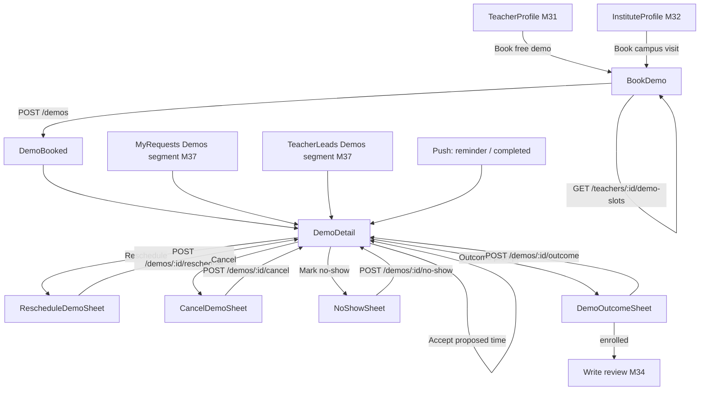
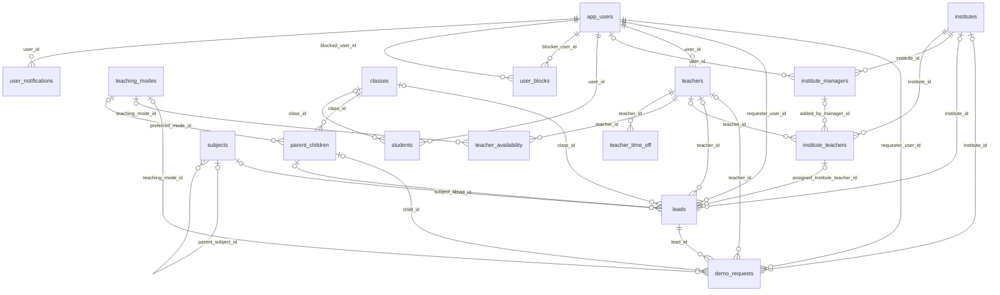

# Module 38 · Demo Class Request

> **Phase 9 · Leads** · **Used by:** Parents and students (book, reschedule, cancel a demo and report the outcome); teachers (confirm, reschedule, mark complete or no-show); institute staff (confirm and manage campus visits) · **Depends on:** M00, M19 (owns teacher_availability/teacher_time_off), M31 (profile entry point), M37 (lead lifecycle, daily limit, blocks, contact display, reused MyRequests/TeacherLeads Demos segment); Admin M38, Admin M39 · **New tables:** none · **Uses:** `demo_requests`, `leads`, `teachers`, `institutes`, `institute_managers`, `institute_teachers`, `teacher_availability`, `teacher_time_off`, `teaching_modes`, `parent_children`, `students`, `subjects`, `classes`, `app_users`, `user_blocks`, `user_notifications`, `audit_logs` · **Build estimate:** 5–6 days

## 1. Module Purpose

Lets a parent or student book a free demo class with a teacher, or a campus visit with an institute, from a slot computed straight from the teacher's own weekly availability, and gives both sides the full lifecycle from request through confirm, reschedule, completion or no-show, to outcome. Every demo carries a parent `leads` row (`lead_type = 'demo'`) so it lives in the same Requests/Leads inbox as an ordinary enquiry (M37) — this module owns only the demo-specific screens and endpoints: the slot picker, the confirm/reschedule/cancel/complete/no-show/outcome actions, the reminder job, and the sync back to the lead that feeds Admin M39's completion, no-show and enrolment metrics.

## 2. User Stories

- As a **parent**, I want to see Dr. Ananya Iyer's free slots this week and book one for Aarav in two taps so that I don't have to call and ask when she's free.
- As a **teacher**, I want a clash-free calendar so that a confirmed demo never double-books me against another family.
- As a **parent** who can't make a booked slot, I want to reschedule instead of cancelling so that I don't lose my place in the teacher's day.
- As a **new teacher** on a slow connection, I want to confirm a demo with one tap and have the meeting link generated for me so that I don't type it wrong.
- As a **student**, I want a reminder an hour before my demo and a one-tap join button so that I don't miss it.
- As an **institute counsellor**, I want to confirm a campus visit on the same calendar as our other appointments so that front-desk timings don't clash.

## 3. Business Rules & Logic

**BR-38.1 Lifecycle** (matches Admin M39 FR-39.1; actors in the app):

| From | To | Who / trigger | Side effects |
| --- | --- | --- | --- |
| — | `requested` | Requester: `POST /demos` | inserts a `leads` row (`lead_type = 'demo'`, `status = 'new'`) and a `demo_requests` row (`status = 'requested'`); push to the teacher/institute |
| `requested` | `confirmed` | Teacher / institute staff: `POST /demos/:id/confirm` | sets `confirmed_start_at`; meeting link required for online mode; lead `new`/`viewed` → `contacted`, `first_response_at` if null |
| `requested`, `confirmed` | `reschedule_proposed` | Either side: `POST /demos/:id/reschedule` | new slot stored in `confirmed_start_at` as a proposal; push to the other side |
| `reschedule_proposed` | `confirmed` | The other side: `POST /demos/:id/accept-reschedule` | confirms the proposed slot |
| `requested` | `expired` | System job, 1 h before `requested_start_at` if still `requested` | push to the requester; the lead stays open |
| `confirmed` | `completed` | Either side after start + duration, or `POST /demos/:id/complete`, or a job 2 h after the window if neither side acted | sets `completed_at`; triggers the outcome prompt and the M34 review prompt clock |
| `confirmed` | `no_show` | Either side within 24 h of the start: `POST /demos/:id/no-show` | `cancelled_by` = the side that reports the other didn't attend |
| any open | `cancelled` | Either side or admin: `POST /demos/:id/cancel` | `cancelled_by`, `cancel_reason` required; the lead stays open for follow-up |

Open = `requested`, `confirmed`, `reschedule_proposed`.

**BR-38.2 Who can book.** Same eligibility as leads (M37 BR-37.2): role `parent`/`student`, `app_users.account_status = 'active'`; a student with `parental_consent IN ('pending','declined')` → `FORBIDDEN` (`details.reason = "parental_consent_pending"`). Target teacher `verification_status = 'approved'`, `account_status = 'active'`; target institute `verification_status = 'approved'`, `account_status = 'active'`. A `user_blocks` row in either direction → `BLOCKED`. A teacher `teacher_time_off` row covering the requested slot's date (any row, not only `pause_leads = true` — time off always blocks demos, per its purpose "blocks demo booking") makes that slot unavailable; it is simply absent from `GET /teachers/:id/demo-slots`, never surfaced as an error.

**BR-38.3 Slot computation (teacher demos).** `GET /teachers/:id/demo-slots?teachingModeId=&from=&to=` builds candidate slots for the next 21 days from `teacher_availability` rows where `accepts_demos = true` and, when `teachingModeId` is given, `teaching_mode_id` matches (otherwise every accepting mode is offered, grouped by mode): each weekly window (`day_of_week`, `start_time`–`end_time`) is sliced into 30-minute-aligned starts that fit the default 45-minute duration before `end_time`. Removed from the candidate list:
1. any start that overlaps an existing `requested`, `confirmed` or `reschedule_proposed` `demo_requests` row for that teacher (`idx_demo_requests_teacher_time`);
2. any date inside a live `teacher_time_off` row for that teacher;
3. any start earlier than now + 1 hour.
Response groups slots by IST calendar date with a `teachingMode` per slot; a day with zero slots is omitted, not returned empty. `demo_available = false` on the teacher (Admin M16) short-circuits to an empty list with `reason: "demo_available_false"`.

**BR-38.4 Institute campus visits.** Institutes have no availability table, so there is no slot picker: the requester sends a preferred date/time as `requestedStartAt` (any time 1 hour to 21 days ahead, shown to the requester as a free chip set — "This week", "Next week", "Weekend" — mapped to a representative time) plus an optional note; institute staff confirm with the real `confirmedStartAt` from `POST /demos/:id/confirm`. No clash check is run for institutes (no per-institute calendar in v1).

**BR-38.5 Create — server steps (one transaction, `Idempotency-Key`).**
1. Validate `DemoRequestSchema`; re-check BR-38.2 eligibility and, for a teacher target, that the slot is still free (re-run BR-38.3 inside a per-(requester,target) advisory lock, `pg_advisory_xact_lock`).
2. Requester must have fewer than 3 open demos (`status IN ('requested','confirmed','reschedule_proposed')`, any target) → else `LIMIT_REACHED` (`details.reason = "demos_open"`, `details.limit = 3`).
3. Requester's total leads today (all `lead_type`, IST) must be under `leads.daily_limit` (10), shared with M37 BR-37.3 → else `LIMIT_REACHED` (`details.reason = "leads_daily"`).
4. Insert `leads` (`lead_type = 'demo'`, `target_type`, `teacher_id`/`institute_id`, `requester_type`, `child_id`, `subject_id`, `class_id`, `message` = the optional note, `source`, `status = 'new'`, `contact_unlocked` resolved exactly as BR-37.5 `ContactAccessService`).
5. Insert `demo_requests` (`lead_id`, `teacher_id`/`institute_id`, `requester_user_id`, `child_id`, `teaching_mode_id`, `requested_start_at`, `duration_minutes` = 45 unless the client sent 15–120, `status = 'requested'`).
6. Audit `app.demo_requested`; push to the receiver (`demos` category, high-importance channel like `leads`).
No duplicate-lead check runs against BR-37.3's one-open-lead-per-subject rule — a family may have an open enquiry and an open demo with the same teacher at once.

**BR-38.6 Confirm.** `POST /demos/:id/confirm { confirmedStartAt?, meetingLink? }` by the teacher, or by active institute staff (`institute_managers.status = 'active'`) of the target institute. Teacher demos: default `confirmedStartAt = requested_start_at` unless a different slot is sent, in which case it must itself be a free slot (BR-38.3 checks 1–3) or `CONFLICT_STATE` (`details.reason = "slot_taken"`). `meetingLink` (https URL) is required when `teaching_mode_id` resolves to an online mode; otherwise it is optional (address is shown from `teacher_locations`, not stored here). Sets `status = 'confirmed'`, `confirmed_start_at`; updates the lead (`status` `new`/`viewed` → `contacted`, `first_response_at` if null, mirroring BR-37.1). Audit `app.demo_confirmed`; push to the requester.

**BR-38.7 Reschedule.** `POST /demos/:id/reschedule { startAt, durationMinutes? }` by either side while the demo is `requested`, `confirmed` or `reschedule_proposed`; clash-checked against the teacher's other open demos exactly as BR-38.3 point 1 (institutes: no clash check). Sets `status = 'reschedule_proposed'`, `confirmed_start_at` = the proposed slot; push to the other side with "Propose a different time" / "Accept" actions. Max 3 reschedule proposals per demo (`LIMIT_REACHED`, `details.reason = "reschedule_limit"`) — after that, either side must cancel and rebook. `POST /demos/:id/accept-reschedule` by the side that did not propose sets `status = 'confirmed'`; a second `reschedule` call from the other side instead of accepting replaces the proposal.

**BR-38.8 Cancel.** `POST /demos/:id/cancel { reason }` (10–300 chars) by the requester, the teacher, active institute staff, or admin, on any open demo. Sets `status = 'cancelled'`, `cancelled_by`, `cancel_reason`; the parent lead is **not** closed (FR-39.2) so the family can rebook or keep messaging. Confirmation sheet first. Audit `app.demo_cancelled`; push to the other side.

**BR-38.9 Complete.** `POST /demos/:id/complete` by either side once `now() >= confirmed_start_at + duration_minutes`, or automatically by a job 2 hours after that window if neither side has acted (`cancelled_by`/`completed_at` untouched by the auto-path other than `status`, `completed_at`). Sets `status = 'completed'`, `completed_at`. Triggers: the M34 BR-34.12 review-prompt clock starts from here for teacher demos; both sides get the outcome prompt (BR-38.10).

**BR-38.10 Outcome.** `POST /demos/:id/outcome { outcome }` (`enrolled`, `not_enrolled`, `undecided`) by the requester or the teacher/institute staff, only once the demo is `completed` and `outcome IS NULL`; the first submission wins (`CONFLICT_STATE`, `details.reason = "outcome_already_set"` on a second call — the app shows the recorded outcome instead of the form). When `outcome = 'enrolled'`, in the same transaction set the lead `status = 'converted'`, `closed_at = now()` (FR-39.2); other outcomes leave the lead open. Audit `app.demo_outcome_recorded`.

**BR-38.11 No-show.** `POST /demos/:id/no-show { noShowParty, reason }` (`teacher`, `requester` or, for institute demos, `institute`) within 24 hours of `confirmed_start_at`, by the side that showed up (or admin). Sets `status = 'no_show'`, `cancelled_by = noShowParty`, `cancel_reason`; audit `app.demo_no_show`; push to the reported side ("Marked as no-show for {date}. If this is wrong, contact support."). After the 24-hour window a no-show can only be recorded by an admin (Admin M39).

**BR-38.12 Reminders and expiry (jobs).** 1 hour before `confirmed_start_at` on a `confirmed` demo: push to both sides, sets `reminder_sent_at` (deduped, sent once). A `requested` demo not confirmed by 1 hour before `requested_start_at`: `status = 'expired'`, push to the requester ("{teacherName} didn't confirm in time. Pick another slot or teacher."); the lead is untouched and stays open. The 2-hour auto-complete job (BR-38.9) and the expiry job both run every 5 minutes.

**BR-38.13 What each side sees.** Requester: teacher/institute name and photo, slot, status label (Requested / Confirmed / Reschedule proposed / Completed / Cancelled / No-show recorded / Expired), meeting link only once confirmed and only within the app's `FLAG_SECURE` join screen. Teacher/institute: requester display name, child/class as BR-37.15, subject, note.

## 4. Screen List

| Screen | Route name | Purpose |
| --- | --- | --- |
| Book demo | `BookDemo` | Pick a date/time slot (teacher) or a preferred window (institute), subject, child, note |
| Demo booked | `DemoBooked` | Confirmation and what happens next |
| Demo detail | `DemoDetail` | Slot, meeting link, status and actions for either side |
| Reschedule sheet | `RescheduleDemoSheet` (bottom sheet) | Pick a new slot to propose |
| Cancel sheet | `CancelDemoSheet` (bottom sheet) | Reason, confirm |
| No-show sheet | `NoShowSheet` (bottom sheet) | Who didn't attend, reason |
| Outcome sheet | `DemoOutcomeSheet` (bottom sheet) | Enrolled / Not enrolled / Still deciding |

## 5. Screen Flow & Navigation


`BookDemo` reached from a teacher/institute profile always shows the slot picker (or the preferred-window chips for institutes); success replaces it with `DemoBooked`, whose "Open request" swaps in `DemoDetail` so Back returns to the profile. Push taps open `DemoDetail` directly (`/demos/<id>`).

## 6. Screen Wireframe Description

**BookDemo** — header "Book a free demo" / subtitle "Dr. Ananya Iyer · Physics". Summary row "For Aarav · Class 12" with "Change". Mode toggle (only modes the teacher offers): "Online", "At her place", "At home". Date strip (7 visible days, scrollable to 21), each day showing a dot if slots exist; selected day expands a grid of time chips ("4:00 PM", "4:45 PM" …), 44 dp each, disabled/greyed when full. Note field (optional) "Anything to tell the teacher? (optional)", placeholder "Aarav needs help with rotational motion.", counter 0/300. Sticky "Book demo" (disabled until a slot is picked); offline: disabled, "You're offline. Pick a slot when you're back online." Institute variant: no day/time grid — instead chips "This week", "Next week", "Weekend", "Pick a date" (opens a date picker, any day 1 h–21 days out) and the same note field.

**DemoBooked** — check-mark animation, heading "Demo requested", body (teacher) "Dr. Ananya usually confirms within a few hours. We'll notify you." / (institute) "Excel Academy will confirm your visit time.", reference "Wed, 1 Oct · 4:00 PM" or "This week", buttons "Open request" (primary), text link "Back to profile".

**DemoDetail** — header back, avatar + name, status pill (Requested amber / Confirmed green / Reschedule proposed amber / Completed grey / Cancelled red / No-show red / Expired grey), ⋮ menu. Slot card: date/time large ("Wed, 1 Oct · 4:00 PM – 4:45 PM"), mode chip, "Join class" button (only when confirmed, online, within 10 min of start; deep-links the `meetingLink`), address block for offline modes. Context row "Physics · Class 12 · for Aarav" (requester view) or "Parent of Aarav · Class 12 CBSE" (teacher view) plus the note if any. Proposed-reschedule banner (either side) "New time proposed: Thu, 2 Oct · 5:00 PM" with "Accept" / "Propose another time". Reminder note once confirmed: "We'll remind you 1 hour before." Sticky bar changes by status/role: requested+teacher → "Confirm" / "Reschedule" / "Decline" (declining a demo request uses the lead decline flow, M37); confirmed → "Reschedule" / "Cancel"; after the window → "Mark complete" / "Mark as no-show"; completed with no outcome yet → banner "How did it go?" with "Enrolled" / "Not enrolled" / "Still deciding" buttons. Linked lead strip "Part of your conversation with Dr. Ananya" → opens `LeadDetail` (M37).

**RescheduleDemoSheet** — heading "Propose a new time", same date-strip/time-chip picker as `BookDemo` (teacher) or a date/time picker (institute); note "The other side needs to accept before this time is confirmed." Buttons "Send proposal" / "Cancel".

**CancelDemoSheet** — "Cancel this demo?", reason field (10–300, required), "Cancel demo" (destructive) / "Keep demo".

**NoShowSheet** — heading "Who didn't join?", radios "The teacher" / "I (or my child) couldn't join" (labels flip for the teacher's view), note field 10–300, buttons "Report no-show" / "Cancel". Info line "This is recorded and may be reviewed by GuruConnect."

**DemoOutcomeSheet** — heading "How did the demo go?", three large cards: "Started classes 🎉" (enrolled), "Not going ahead" (not_enrolled), "Still deciding" (undecided); footer note "This helps other families and doesn't affect the teacher's score directly." On "Started classes" a follow-up prompt to write a review (M34) is offered.

## 7. UI Components & Component Tree

```
BookDemoScreen
├─ TargetMiniCard · ModeToggle
├─ DateStrip · TimeSlotGrid (teacher) | PreferredWindowChips + DatePicker (institute)
├─ NoteTextArea
└─ StickyActionBar
DemoDetailScreen
├─ DemoHeader (Avatar, StatusPill, OverflowMenu)
├─ SlotCard (JoinButton, AddressBlock)
├─ ReschedulePendingBanner
├─ ContextRow · LinkedLeadStrip
└─ StickyActionBar (role- and status-aware)
RescheduleDemoSheet · CancelDemoSheet · NoShowSheet · DemoOutcomeSheet
```
- `TimeSlotGrid({ slots, selected, onSelect })`, `DemoStatusPill({ status })`, `JoinButton({ meetingLink, confirmedStartAt })` (enabled 10 min before start to 15 min after).
- Hooks: `useDemoSlotsQuery(teacherId, teachingModeId)`, `useCreateDemoMutation()`, `useDemoQuery(id)`, `useDemosInfiniteQuery(role, tab)`, `useConfirmDemoMutation(id)`, `useRescheduleDemoMutation(id)`, `useAcceptRescheduleMutation(id)`, `useCancelDemoMutation(id)`, `useCompleteDemoMutation(id)`, `useNoShowMutation(id)`, `useOutcomeMutation(id)`.

## 8. Validation Rules

Shared schemas in `packages/shared/demos.ts`: `DemoCreateSchema`, `DemoConfirmSchema`, `DemoRescheduleSchema`, `DemoCancelSchema`, `DemoNoShowSchema`, `DemoOutcomeSchema`.

| Field | Rule | Message shown |
| --- | --- | --- |
| targetType | `teacher` or `institute` | — |
| teacherId / instituteId | uuid; approved, active target | "This isn't available for a demo right now." |
| requestedStartAt | ≥ now + 1 hour, ≤ now + 21 days | "Pick a time between 1 hour and 21 days from now." |
| durationMinutes | 15–120, default 45 | "Choose a length between 15 and 120 minutes." |
| teachingModeId | one the target offers | "Pick how the demo will happen." |
| childId | parents: own live child | "Pick a child." |
| subjectId | uuid the teacher teaches | "Pick a subject." |
| note | 0–300 chars | "Keep it under 300 characters." |
| meetingLink (confirm) | https URL, required for online mode | "Add a valid meeting link." |
| confirmedStartAt (reschedule) | ≥ now + 1 hour, ≤ now + 21 days, free slot | "That time isn't available any more." |
| cancel.reason | 10–300 chars | "Add a short reason (at least 10 characters)." |
| noShowParty | `teacher`, `requester` or `institute` | "Choose who didn't attend." |
| noShow.reason | 10–300 chars | "Add a short reason (at least 10 characters)." |
| outcome | `enrolled`, `not_enrolled`, `undecided` | "Choose one." |

## 9. API Endpoints

| Method | Path | Auth | Description |
| --- | --- | --- | --- |
| GET | /teachers/:id/demo-slots | Learner | Available slots for the next 21 days, grouped by date |
| POST | /demos | Learner | Book a demo or campus visit (Idempotency-Key); creates the lead |
| GET | /demos | Learner, Teacher, Institute staff | My demos (cursor), `tab=upcoming|past` |
| GET | /demos/:id | Learner, Teacher, Institute staff | Detail for either side |
| POST | /demos/:id/confirm | Teacher, Institute staff | Confirm the slot (or a new one) |
| POST | /demos/:id/reschedule | Learner, Teacher, Institute staff | Propose a new slot |
| POST | /demos/:id/accept-reschedule | Learner, Teacher, Institute staff | Accept the other side's proposed slot |
| POST | /demos/:id/cancel | Learner, Teacher, Institute staff | Cancel with a reason |
| POST | /demos/:id/complete | Learner, Teacher, Institute staff | Mark completed |
| POST | /demos/:id/no-show | Learner, Teacher, Institute staff | Report the other side's no-show |
| POST | /demos/:id/outcome | Learner, Teacher, Institute staff | Record enrolled / not enrolled / undecided (first submission wins) |

## 10. Request Payloads

```json
// GET /teachers/7d1c…/demo-slots?teachingModeId=3a2b…&from=2026-09-26&to=2026-10-17

// POST /demos   (Idempotency-Key: 4a7e…)
{ "targetType": "teacher", "teacherId": "7d1c2e9a-4b5f-4c8e-9a10-3f2b1c0d9e8a", "requestedStartAt": "2026-10-01T10:30:00Z",
  "durationMinutes": 45, "teachingModeId": "3a2b…", "childId": "c2a1…", "subjectId": "5f1e…", "classId": "a9d0…",
  "note": "Aarav needs help with rotational motion.", "source": "profile" }

// POST /demos/9c2e…/confirm
{ "meetingLink": "https://meet.google.com/xyz-abcd-efg" }

// POST /demos/9c2e…/no-show
{ "noShowParty": "requester", "reason": "Waited 20 minutes online, no one joined." }

// POST /demos/9c2e…/outcome
{ "outcome": "enrolled" }
```

## 11. Response Payloads

```json
// 200 GET /teachers/:id/demo-slots
{ "data": { "days": [ { "date": "2026-10-01", "slots": [ { "startAt": "2026-10-01T10:30:00Z", "durationMinutes": 45, "teachingModeId": "3a2b…", "teachingMode": "Online" },
      { "startAt": "2026-10-01T11:15:00Z", "durationMinutes": 45, "teachingModeId": "3a2b…", "teachingMode": "Online" } ] } ] } }

// 201 POST /demos
{ "data": { "id": "9c2e…", "leadId": "bb31…", "status": "requested", "requestedStartAt": "2026-10-01T10:30:00Z", "durationMinutes": 45,
    "teachingMode": "Online", "teacher": { "id": "7d1c…", "name": "Dr. Ananya Iyer", "photoUrl": "https://cdn.guruconnect.in/t/…/w=96" },
    "subject": "Physics", "child": { "id": "c2a1…", "name": "Aarav" }, "createdAt": "2026-09-26T11:05:00Z", "updatedAt": "2026-09-26T11:05:00Z" } }

// 409 POST /demos (limit)
{ "error": { "code": "LIMIT_REACHED", "message": "You can have up to 3 open demo requests at a time.", "details": { "reason": "demos_open", "limit": 3 }, "requestId": "…" } }

// 200 POST /demos/:id/confirm
{ "data": { "id": "9c2e…", "status": "confirmed", "confirmedStartAt": "2026-10-01T10:30:00Z", "meetingLink": "https://meet.google.com/xyz-abcd-efg", "updatedAt": "2026-09-26T12:00:00Z" } }

// 200 GET /demos/:id
{ "data": { "id": "9c2e…", "lead": { "id": "bb31…", "publicCode": "LD-241002" }, "status": "confirmed", "teachingMode": "Online",
    "teacher": { "id": "7d1c…", "name": "Dr. Ananya Iyer" }, "requester": { "displayName": "Lakshmi V.", "type": "parent" },
    "child": { "name": "Aarav", "class": "Class 12" }, "subject": "Physics", "note": "Aarav needs help with rotational motion.",
    "requestedStartAt": "2026-10-01T10:30:00Z", "confirmedStartAt": "2026-10-01T10:30:00Z", "durationMinutes": 45,
    "meetingLink": "https://meet.google.com/xyz-abcd-efg", "reminderSentAt": null, "outcome": null, "createdAt": "…", "updatedAt": "…" } }
```

## 12. PostgreSQL Tables & Columns


**Existing tables this module reads or writes** (full definitions in the owning module)

| Table | Owner | Purpose |
| --- | --- | --- |
| `demo_requests` | Admin M39 | Free demo class bookings and their outcome. |
| `leads` | Admin M38 | Enquiries and call-back requests from parents/students to a teacher or institute. |
| `teachers` | Admin M16 | Teacher profile and verification state. One row per teacher app account. |
| `institutes` | Admin M22 | Coaching centres, tuition centres, schools and academies. Rated by GuruConnect after verification. |
| `institute_managers` | Admin M25 | App accounts that act for an institute. Exactly one active primary manager; counsellors can only handle leads. |
| `institute_teachers` | Admin M26 | Teachers listed under an institute. Added, edited and removed only by an institute manager (or an admin). |
| `teacher_availability` | App M19 | Weekly recurring time windows when a teacher can take classes or demos (IST). |
| `teacher_time_off` | App M19 | Dates when a teacher is unavailable (holidays, exams). Blocks demo booking and shows "Away" on the profile. |
| `teaching_modes` | Admin M14 | How classes are delivered, e.g. Online, Offline at teacher's place, Home tuition, Hybrid. |
| `parent_children` | Admin M29 | Children a parent is finding teachers for. Drives per-child recommendations. |
| `students` | Admin M31 | Student profile, one per student app account. |
| `subjects` | Admin M12 | Subjects, exams and skills teachers can teach. |
| `classes` | Admin M11 | Grades and levels learners study at, from Class 1 to competitive exam preparation. |
| `app_users` | Admin M00 | Login identity for every mobile app account (parent, student, teacher, institute staff). Role profiles hang off this table. |
| `user_blocks` | App M49 | Users one user has blocked. Blocked users can't contact, message or review the blocker. |
| `user_notifications` | App M00 | The in-app notification inbox for every user: transactional events and copies of admin campaigns. |
| `audit_logs` | Admin M00 | Append-only record of every admin action and security event. Never updated or deleted by the application. |

- `demo_requests` (Admin M39): inserted here (`status = 'requested'`); updated for `status`, `confirmed_start_at`, `meeting_link`, `cancelled_by`, `cancel_reason`, `outcome`, `completed_at`, `reminder_sent_at` (job only).
- `leads` (Admin M38): one `lead_type = 'demo'` row per demo, inserted here (mirrors M37's insert); `status`/`first_response_at`/`closed_at` updated from BR-38.6 and BR-38.10.
- `teacher_availability`, `teacher_time_off` (owned by M19): read-only for slot computation, never written by this module.
- `institute_managers`: authorises institute confirm/reschedule/cancel/no-show (`status = 'active'`).

## 13. Relationships


**Entity relationship diagram** (tables this module uses; `admins` omitted)



## 14. State Management

- `demoKeys`: `demoKeys.slots(teacherId, mode)` (not persisted, `staleTime` 30 s), `demoKeys.list(role, tab)`, `demoKeys.detail(id)`; lists and details persisted.
- After create: invalidate `demoKeys.list(*)`, `demoKeys.slots(teacherId, *)`, and M37's `leadKeys.list(*)` (the new demo lead appears there too). After confirm/reschedule/cancel/complete/no-show/outcome: set `demoKeys.detail(id)` from the response, invalidate `demoKeys.list(*)` and, when the outcome converts the lead, `leadKeys.detail(leadId)`.
- No optimistic writes — every action changes shared calendar state that must come from the server.

## 15. Offline Handling

- Read: my demos list and detail render from cache with "Updated 2 h ago"; the slot picker is online-only (no cached slots, since a stale slot may already be taken).
- Book, confirm, reschedule, accept, cancel, complete, no-show, outcome: all class 3 *online only* — every action either claims a calendar slot or reports a fact needing certainty; buttons disabled offline with "You're offline. Try again once you're connected."

## 16. Push Notification Requirements

| Event | Recipient | Title / Body | Deep link | Category | Urgent |
| --- | --- | --- | --- | --- | --- |
| `demo_requested` | Teacher / institute staff | "New demo request" / "{requesterName} wants a demo for {subject}, {classLabel}." | `/demos/{id}` | demos | No |
| `demo_confirmed` | Requester | "Demo confirmed" / "{targetName} confirmed {date} at {time}." | `/demos/{id}` | demos | No |
| `demo_reschedule_proposed` | Other side | "New time proposed" / "{proposerName} proposed {date} at {time}." | `/demos/{id}` | demos | No |
| `demo_reschedule_accepted` | Proposer | "New time accepted" / "Your demo is now {date} at {time}." | `/demos/{id}` | demos | No |
| `demo_reminder` | Both sides | "Demo in 1 hour" / "{targetName} · {date} at {time}. Tap to join." | `/demos/{id}` | demos | Yes |
| `demo_cancelled` | Other side | "Demo cancelled" / "{cancellerName} cancelled: {reason}" | `/demos/{id}` | demos | No |
| `demo_expired` | Requester | "No confirmation yet" / "{targetName} didn't confirm in time. Pick another slot." | `/demos/{id}` | demos | No |
| `demo_no_show` | Reported side | "Marked as a no-show" / "For {date}. Contact support if this is wrong." | `/demos/{id}` | demos | No |
| `demo_outcome_prompt` | Both sides (2 h after completion, if not yet recorded) | "How did the demo go?" / "Let us know so we can keep recommendations useful." | `/demos/{id}?action=outcome` | demos | No |

In-app inbox only: none beyond the pushes above.

## 17. Security Rules

- Every query is scoped: requester by `requester_user_id = sub`, teacher by `teacher_id = pid`, institute staff by `institute_id = iid` with an active `institute_managers` row; otherwise `NOT_FOUND`.
- Meeting links are never sent in push payloads or shown in list screens — only inside `DemoDetail`'s `JoinButton`, which is `FLAG_SECURE` while visible.
- Slot generation never reveals another family's identity — only "3 of 5 4 PM slots taken" style unavailability, never who booked them.
- Rate limits: create 3/min (shared bucket with M37 leads), reschedule 5/demo/hour, confirm/cancel/complete/no-show/outcome 20/min.
- Blocks (M49) stop demo creation and every action on an existing demo between blocked pairs, same as M37.
- A suspended teacher (`teachers.account_status = 'suspended'`) cannot confirm, reschedule or complete (`FORBIDDEN`, `details.reason = "account_suspended"`) but the requester can still cancel.

## 18. Error Handling

| Scenario | Code | HTTP | App behaviour |
| --- | --- | --- | --- |
| Slot no longer free | `CONFLICT_STATE` (`slot_taken`) | 409 | Refetch slots, keep the form open |
| 3 open demos already | `LIMIT_REACHED` (`demos_open`) | 429 | Sheet listing the open demos with a link to cancel one |
| 10 leads today | `LIMIT_REACHED` (`leads_daily`) | 429 | Same copy as M37 |
| Action not allowed in current status | `CONFLICT_STATE` | 409 | Toast with the server message, refetch |
| Online demo, no meeting link | `VALIDATION_FAILED` | 422 | Inline under the link field |
| Too many reschedules | `LIMIT_REACHED` (`reschedule_limit`) | 429 | Toast "This demo has been rescheduled too many times. Cancel and rebook." |
| Outcome already recorded | `CONFLICT_STATE` (`outcome_already_set`) | 409 | Show the recorded outcome instead of the sheet |
| Blocked pair | `BLOCKED` | 403 | "You can't book a demo with this teacher." |
| Student without parental consent | `FORBIDDEN` (`parental_consent_pending`) | 403 | Sheet explaining a parent must approve (M11) |
| Teacher suspended | `FORBIDDEN` (`account_suspended`) | 403 | Banner with support link |
| Demo or target gone | `NOT_FOUND` | 404 | "This is no longer available." |

## 19. Testing Scenarios

- T38.1 Parent picks a free slot and books a Physics demo for Aarav → 201 `requested` with a linked lead; teacher confirms with an online meeting link → `confirmed`, requester pushed (Maestro `demo_book_confirm_happy`).
- T38.2 Teacher availability Mon 4–6 PM, one demo already confirmed at 4:30 (45 min) → the 4:00 and 4:30 slots are absent from `GET /demo-slots`; 5:15 remains.
- T38.3 Teacher has `teacher_time_off` covering the whole week → no slots returned that week.
- T38.4 Requester at 3 open demos tries a 4th → `LIMIT_REACHED demos_open`.
- T38.5 Requester reschedules a confirmed demo → `reschedule_proposed`; teacher accepts → `confirmed` with the new time; teacher instead proposes another time → replaces the pending proposal.
- T38.6 Requested demo not confirmed by T‑1h → job sets `expired`; requester pushed; the parent lead is still `new`.
- T38.7 Confirmed demo, nobody acts → job marks `completed` 2 h after the window; both sides get `demo_outcome_prompt`.
- T38.8 Either side marks outcome `enrolled` → lead `status = converted`, `closed_at` set; a second outcome submission → `outcome_already_set`.
- T38.9 Requester reports `no_show` for the teacher within 24 h → `cancelled_by = teacher`; attempt after 24 h → `CONFLICT_STATE`.
- T38.10 Institute campus visit: requester picks "This week", institute counsellor confirms a real date/time → `confirmed`; no slot clash check applied.
- T38.11 Blocked pair → booking `BLOCKED`; existing demo actions also `BLOCKED`.
- T38.12 Offline: `Book demo`, `Confirm`, `Cancel` all disabled with the offline hint; no queued writes.
- T38.13 Teacher B calls `POST /demos/:id/confirm` on teacher A's demo → `NOT_FOUND`.
- T38.14 Screen states: `BookDemo` slot grid loading/empty ("No free slots in the next 3 weeks — send a message instead")/error/content; font scale 130% doesn't clip time chips.

## 20. Audit Log Events

| Event | When | Details |
| --- | --- | --- |
| `app.demo_requested` | Demo + lead inserted | targetType, teacherId or instituteId, requestedStartAt, teachingMode |
| `app.demo_confirmed` | Confirm | confirmedStartAt, hadMeetingLink |
| `app.demo_rescheduled` | Reschedule proposed or accepted | from, to, proposedBy |
| `app.demo_cancelled` | Cancel | previousStatus, cancelledBy |
| `app.demo_completed` | Complete (manual or job) | manual (true/false) |
| `app.demo_no_show` | No-show reported | party, reason |
| `app.demo_outcome_recorded` | Outcome set | outcome, recordedBy |

## 21. Future Scalability Notes

- Teacher-side bulk slot templates ("copy this week to the next 4 weeks") — already served by M19, referenced here for context.
- In-app video for the demo itself, replacing external meeting links (needs a `demo_sessions` table and a WebRTC/SFU provider).
- Institute per-counsellor calendars with real slot picking, once campus-visit volume justifies it.
- Automatic rebooking suggestion when a demo expires or is cancelled (reuse the M30 recommendation engine).
- Waitlist for a fully booked teacher's next opening.
- Admin portal additions: none — Admin M39 already covers demo scheduling, cancellation, rescheduling and outcome for support.
