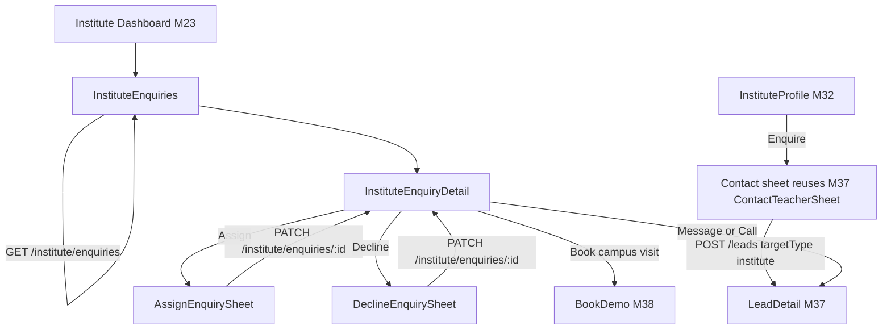
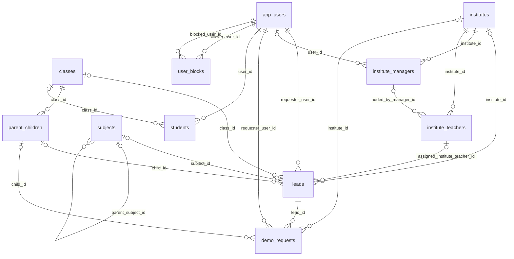

# Module 39 · Contact Institute

> **Phase 9 · Leads** · **Used by:** Parents and students (send an enquiry, message, call, book a campus visit); institute managers and counsellors (enquiry inbox, assignment, status, reply) · **Depends on:** M00, M32 (institute profile contact bar), M37 (owns lead creation, unlock, messaging, calling — this module reuses every endpoint), M38 (campus visits are demos with `targetType: institute`); Admin M38, Admin M25, Admin M26 · **New tables:** none · **Uses:** `leads`, `institutes`, `institute_managers`, `institute_teachers`, `demo_requests`, `app_users`, `subjects`, `classes`, `parent_children`, `students`, `user_blocks`, `audit_logs` · **Build estimate:** 2–3 days

## 1. Module Purpose

Turns interest in a coaching centre, tuition centre or academy into a conversation with its staff. A parent or student enquires about an institute exactly the way they contact an individual teacher — through M37's `POST /leads { targetType: "institute" }`, with the same lifecycle, limits, contact-unlock rules, messaging and calling — so this module does not redefine any of that. What it owns is the institute side: a shared enquiry inbox for every active manager and counsellor, the ability for a manager to route an enquiry to the right member of staff (`institute_teachers`), and the status corrections institute staff make on their own leads. A campus visit is simply a demo booked through M38 against the institute.

## 2. User Stories

- As a **parent**, I want to enquire about JEE coaching at Excel Academy the same way I'd contact a private tutor so that the app feels consistent everywhere.
- As an **institute manager**, I want every enquiry in one inbox, unanswered ones first, so that none is missed.
- As an **institute manager**, I want to assign an enquiry about a Physics batch to our actual Physics faculty so that the right person replies, not whoever happens to open the app.
- As a **counsellor**, I want a "Mine" tab so that I don't duplicate a colleague's reply on the same family.
- As an **institute counsellor on the front desk tablet**, I want to book a campus visit straight from an enquiry so that I don't lose an interested family while switching screens.

## 3. Business Rules & Logic

**BR-39.1 Enquiry creation is entirely M37's.** The contact bar on an institute profile (M32) opens the same `ContactTeacherSheet`-style flow (renamed for institutes) calling M37 `POST /leads { targetType: "institute", instituteId, subjectId, classId, childId, leadType, message, preferredCallbackWindow, source }`. Every rule that governs a teacher lead governs an institute lead identically: the lifecycle (M37 BR-37.1), the daily limit and one-open-lead-per-(requester, institute, subject) rule (BR-37.3), contact access and paid unlock (BR-37.5/37.6), calling and masked bridges (BR-37.7), contact-info detection (BR-37.8) and messaging (BR-37.9). This module reads those same `leads` and `lead_messages` rows, scoped to the institute; it never writes lead creation, unlock or message rows.

**BR-39.2 Who can see an enquiry.** Every `institute_managers` row of the target institute with `status = 'active'` (both `staff_role` values, manager and counsellor) can open and reply to any of the institute's open enquiries in the "All" tab. Once assigned (BR-39.3) to a specific `institute_teachers` row, the enquiry still shows to every active staff member in "All", but only the assignee (when that `institute_teachers` row is linked to their own `teacher_id`, i.e. they are also a registered teacher on the platform) sees it in "Mine" — assignment changes routing and visibility emphasis, never access.

**BR-39.3 Assignment.** `PATCH /institute/enquiries/:id { assignedInstituteTeacherId }` (`If-Match`), manager only (`staff_role = 'manager'`; a counsellor gets `FORBIDDEN`). `assignedInstituteTeacherId` must reference an `institute_teachers` row of the same institute with `status = 'active'`; `null` unassigns. Sets `leads.assigned_institute_teacher_id`; does not change `leads.status`. Inserts a staff-only system message ("Assigned to {teacherName} by {managerName}.") that never reaches the requester's thread (a separate internal note, not a `lead_messages` row — see BR-tables_note). Audit `app.institute_enquiry_assigned` (previous and new assignee, admin/manager id).

**BR-39.4 Status changes by institute staff.** `PATCH /institute/enquiries/:id { status?, declineReason?, declineNote? }` (`If-Match`), any active staff member, on the institute's own leads only: transitions and copy exactly as M37 BR-37.10 — `contacted` (from `new`/`viewed`), `converted` (from `contacted`), `declined` (from any open, with `declineReason` from the same code list and `declineNote` 10–300 chars required for `other`). `first_response_at` is set the moment any active staff member messages, calls, changes status, or confirms a campus-visit demo (Admin M38 FR-38.3) — assignment alone does not count as a response. Declining also cancels any open campus-visit demo on the lead (M38 BR-38.8, `cancelled_by = 'institute'`). `status` and `assignedInstituteTeacherId` may be sent together in one call; at least one of the two must be present, else `VALIDATION_FAILED`.

**BR-39.5 Enquiry inbox.** `GET /institute/enquiries?filter=all|mine|unassigned|needs_reply|closed&instituteTeacherId=` (any active staff): `all` = every non-deleted institute lead, open first then closed; `mine` = staff whose own `teacher_id` matches the assigned `institute_teachers.teacher_id`; `unassigned` = `assigned_institute_teacher_id IS NULL` and open; `needs_reply` = open and `first_response_at IS NULL`; `closed` = `status IN ('converted','declined','closed','spam')` (spam shown to staff as "Closed", same masking as M37). `instituteTeacherId` narrows to one staff member's queue (manager view only). Cursor 20/page, newest first within each filter, with tab counts and unread message counts per card.

**BR-39.6 Enquiry detail.** `GET /institute/enquiries/:id` returns the institute-facing shape of the same lead M37's `GET /leads/:id` already serves to institute staff (this endpoint adds nothing the requester's data model doesn't already carry) plus `assignedTeacher` (name, photo, subjects, from `institute_teachers`) and `demo` (the linked campus-visit `demo_requests` row, if any, in M38's shape). Messaging, calling and unlock stay on M37's endpoints (`/leads/:id/messages`, `/leads/:id/call-intent`, `/leads/:id/unlock-contact`); this module's own mutation is BR-39.3/39.4 only.

**BR-39.7 Campus visits.** "Book a campus visit" from the institute profile or from an open enquiry calls M38 `POST /demos { targetType: "institute", instituteId, ... }` unchanged; the visit is confirmed, rescheduled, completed or reported no-show entirely through M38's endpoints and lifecycle. This module only surfaces the resulting `demo_requests` row on the enquiry card and detail (BR-39.6) so staff see the enquiry and the visit together.

**BR-39.8 Response-time metrics.** Admin M38 FR-38.3 computes response rate and median first-response time for institutes from `first_response_at` exactly as it does for teachers; this module contributes no separate metric — the institute dashboard (M23) reads the same `institute_daily_stats.leads_responded`.

## 4. Screen List

| Screen | Route name | Purpose |
| --- | --- | --- |
| Institute enquiries inbox | `InstituteEnquiries` | Staff tabs All / Mine / Unassigned / Needs reply / Closed |
| Enquiry detail | `InstituteEnquiryDetail` | Thread (M37 components), assigned staff, linked campus visit, actions |
| Assign sheet | `AssignEnquirySheet` (bottom sheet) | Pick an active institute teacher, or unassign |
| Decline sheet | `DeclineEnquirySheet` (bottom sheet, M37 reasons) | Institute-worded decline reasons |

## 5. Screen Flow & Navigation


`InstituteEnquiryDetail` embeds M37's `MessageThread` and `Composer` directly (same `useLeadMessagesQuery`/`useSendMessageMutation` hooks, `leadId`); it is a thin institute-branded shell around `LeadDetail`, not a second implementation. Push taps for institute events open it directly (`/institute/enquiries/<id>`).

## 6. Screen Wireframe Description

**InstituteEnquiries** — header "Enquiries". Chips: "All", "Mine", "Unassigned (4)", "Needs reply (2)", "Closed". Manager-only staff filter chip "Any teacher ▾" opening a picker over `instituteTeacherId`. Cards: requester "Lakshmi V." · "Parent · Class 12 · Physics", time "12 min ago", assigned-teacher tag "Assigned: Prof. Rao" or "Unassigned" (amber), unread dot, campus-visit icon if a demo is linked, red "Reply within 24 h" timer for `needs_reply`. Empty (no enquiries): illustration, "No enquiries yet", body "Complete your profile and add batches to appear in more searches.", button "Edit institute profile" (M24). Empty (Mine, none assigned): "Nothing assigned to you yet."

**InstituteEnquiryDetail** — header back, requester name + "Physics · Class 12", status pill, ⋮ menu ("Assign", "Decline", "Report user", "Block"). Assignment row (visible to all staff): "Assigned to Prof. Rao" with "Change" (managers) or plain text (counsellors). Campus-visit card when linked (M38 `DemoDetail` summary: date/time, status, "Open visit"). Message thread and composer identical to M37's `LeadDetail`. Bottom quick-actions for open leads: "Mark as contacted", "Decline"; "Classes started" once contacted.

**AssignEnquirySheet** — heading "Assign this enquiry", search field "Search teachers", list of active `institute_teachers` (photo, name, subjects, "Currently: 3 open") with radio select, "Unassign" as the first row when already assigned. Button "Save assignment".

**DeclineEnquirySheet** — reused from M37 with institute-worded reasons: "We don't have space right now" (batch_full), "We don't teach this subject/class" (subject_not_taught), "Too far from our campus" (too_far), "The fee didn't work out" (fee_mismatch), "Something else" (other, note required 10–300).

## 7. UI Components & Component Tree

```
InstituteEnquiriesScreen → FilterChips, StaffPicker (manager only), FlashList<EnquiryCard>
InstituteEnquiryDetailScreen
├─ EnquiryHeader (StatusPill, OverflowMenu)
├─ AssignmentRow (onAssign)
├─ DemoSummaryCard (M38, optional)
├─ MessageThread · Composer (from M37)
└─ StaffQuickActions (Mark as contacted, Decline)
AssignEnquirySheet · DeclineEnquirySheet (M37 component, institute copy)
```
- `EnquiryCard({ lead, assignedTeacherName, onPress })` — a thin variant of M37's `LeadCard`.
- Hooks: `useInstituteEnquiriesInfiniteQuery(filter, instituteTeacherId?)`, `useInstituteEnquiryQuery(id)` (wraps M37's `useLeadQuery`), `useAssignEnquiryMutation(id)`, `useInstituteEnquiryStatusMutation(id)`, plus M37's `useLeadMessagesQuery`, `useSendMessageMutation`, `useCallIntentMutation` reused unchanged.

## 8. Validation Rules

Shared schema `InstituteEnquiryUpdateSchema` in `packages/shared/leads.ts` (extends M37's `TeacherLeadStatusSchema` with `assignedInstituteTeacherId`).

| Field | Rule | Message shown |
| --- | --- | --- |
| assignedInstituteTeacherId | uuid of an active `institute_teachers` row of this institute, or null | "Pick a teacher on your staff." |
| status | contacted, converted, declined (not new) | — |
| declineReason | not_available, subject_not_taught, too_far, fee_mismatch, batch_full, spam, other | "Pick a reason." |
| declineNote | 10–300 chars when reason = other | "Add a short note (at least 10 characters)." |
| If-Match | current `updatedAt` | "This enquiry changed. Review and try again." |
| body (payload) | at least one of status / assignedInstituteTeacherId present | "Nothing to update." |

## 9. API Endpoints

| Method | Path | Auth | Description |
| --- | --- | --- | --- |
| GET | /institute/enquiries | Institute staff | Inbox with filters and tab counts (cursor) |
| GET | /institute/enquiries/:id | Institute staff | Detail: lead + assigned teacher + linked campus visit |
| PATCH | /institute/enquiries/:id | Institute staff | Assign to a teacher and/or correct status (If-Match) |

## 10. Request Payloads

```json
// GET /institute/enquiries?filter=needs_reply&limit=20

// PATCH /institute/enquiries/9b0f…   (If-Match: "2026-09-26T10:31:22.004Z")
{ "assignedInstituteTeacherId": "e51a…" }

// PATCH /institute/enquiries/9b0f…   (If-Match: "2026-09-26T11:02:00.900Z")
{ "status": "declined", "declineReason": "batch_full", "declineNote": "The 5 PM JEE batch is full until January." }
```

## 11. Response Payloads

```json
// 200 GET /institute/enquiries?filter=needs_reply
{ "data": { "items": [ { "id": "9b0f…", "publicCode": "LD-241010", "requesterName": "Lakshmi V.", "requesterType": "parent",
      "subject": "Physics", "class": "Class 12", "status": "new", "assignedTeacher": null, "hasDemo": false,
      "unreadCount": 1, "createdAt": "2026-09-26T10:30:00Z" } ] },
  "meta": { "nextCursor": null, "counts": { "all": 34, "mine": 6, "unassigned": 4, "needsReply": 2, "closed": 58 } } }

// 200 GET /institute/enquiries/:id
{ "data": { "id": "9b0f…", "publicCode": "LD-241010", "status": "new", "requester": { "displayName": "Lakshmi V.", "type": "parent",
      "child": { "name": "Aarav", "class": "Class 12" } }, "subject": "Physics", "message": "Looking for weekend JEE batches.",
      "assignedTeacher": null, "demo": null, "unreadCount": 1, "createdAt": "2026-09-26T10:30:00Z", "updatedAt": "2026-09-26T10:30:00Z" } }

// 200 PATCH /institute/enquiries/:id
{ "data": { "id": "9b0f…", "status": "new", "assignedTeacher": { "id": "e51a…", "name": "Prof. Rao", "photoUrl": "https://cdn.guruconnect.in/it/…/w=96" }, "updatedAt": "2026-09-26T11:05:00Z" } }

// 403 PATCH /institute/enquiries/:id (counsellor tries to assign)
{ "error": { "code": "FORBIDDEN", "message": "Only a manager can assign enquiries.", "details": { "reason": "manager_only" }, "requestId": "…" } }
```

## 12. PostgreSQL Tables & Columns


**Existing tables this module reads or writes** (full definitions in the owning module)

| Table | Owner | Purpose |
| --- | --- | --- |
| `leads` | Admin M38 | Enquiries and call-back requests from parents/students to a teacher or institute. |
| `institutes` | Admin M22 | Coaching centres, tuition centres, schools and academies. Rated by GuruConnect after verification. |
| `institute_managers` | Admin M25 | App accounts that act for an institute. Exactly one active primary manager; counsellors can only handle leads. |
| `institute_teachers` | Admin M26 | Teachers listed under an institute. Added, edited and removed only by an institute manager (or an admin). |
| `demo_requests` | Admin M39 | Free demo class bookings and their outcome. |
| `app_users` | Admin M00 | Login identity for every mobile app account (parent, student, teacher, institute staff). Role profiles hang off this table. |
| `subjects` | Admin M12 | Subjects, exams and skills teachers can teach. |
| `classes` | Admin M11 | Grades and levels learners study at, from Class 1 to competitive exam preparation. |
| `parent_children` | Admin M29 | Children a parent is finding teachers for. Drives per-child recommendations. |
| `students` | Admin M31 | Student profile, one per student app account. |
| `user_blocks` | App M49 | Users one user has blocked. Blocked users can't contact, message or review the blocker. |
| `audit_logs` | Admin M00 | Append-only record of every admin action and security event. Never updated or deleted by the application. |

- `leads` (Admin M38): `assigned_institute_teacher_id` is written only here (BR-39.3); `status`, `first_response_at`, `closed_at`, `decline_reason` are written here for institute staff exactly as M37 writes them for teachers.
- `institute_teachers` (Admin M26): read to validate and display the assignee; `status = 'active'` required.
- `institute_managers`: authorises every action (`institute_id = iid`, `status = 'active'`; `staff_role = 'manager'` for assignment).
- `demo_requests` (Admin M39/App M38): read-only here to show the linked campus visit; never written by this module.
- The staff-only assignment note (BR-39.3) is stored as a `lead_messages` row with `sender_role = 'system'` and a `visibility = 'staff_only'` marker carried in `data` at the API layer, not a schema column — it is filtered out of the requester's `GET /leads/:id/messages` response by M37 before this module's inbox ever sees the raw table, so no new column or table is needed.

## 13. Relationships


**Entity relationship diagram** (tables this module uses; `admins` omitted)



## 14. State Management

- `instituteEnquiryKeys.list(filter, instituteTeacherId)`, `instituteEnquiryKeys.detail(id)` — first page persisted; detail persisted and shares cache entries with M37's `leadKeys.detail(id)` (same id, same shape) so a message sent from either surface updates both instantly.
- After assign/status change: set `instituteEnquiryKeys.detail(id)` and `leadKeys.detail(id)` from the response; invalidate `instituteEnquiryKeys.list(*)` and `institute DashboardKeys.summary` (M23).

## 15. Offline Handling

- Read: inbox and detail render from cache with "Updated 2 h ago" (shared cache with M37's lead detail).
- Assign and status change: online only (buttons disabled offline, "Connect to the internet to do this."). Messaging and calling follow M37's offline classes unchanged.

## 16. Push Notification Requirements

| Event | Recipient | Title / Body | Deep link | Category | Urgent |
| --- | --- | --- | --- | --- | --- |
| `institute_enquiry_new` | All active staff of the institute | "New enquiry" / "{requesterName} asked about {subject}, {classLabel}." | `/institute/enquiries/{id}` | leads | No |
| `institute_enquiry_assigned` | The assigned staff member (if also a registered teacher with a device) | "An enquiry was assigned to you" / "{requesterName} · {subject}. Reply within 24 h." | `/institute/enquiries/{id}` | leads | No |
| `institute_enquiry_unviewed_reminder` | All active staff (2 h after, still `new`) | "An enquiry is waiting" / "Reply to keep your response rate high." | `/institute/enquiries/{id}` | leads | No |

Messaging, call and unlock pushes reuse M37's `lead_message`/`lead_contact_unlocked` templates unchanged; declined/converted pushes to the requester reuse M37's `lead_declined`/`lead_converted`.

## 17. Security Rules

- Every query scoped by `institute_id = iid` from an active `institute_managers` row; a lead of another institute or `target_type <> 'institute'` → `NOT_FOUND`.
- Assignment is manager-only (`FORBIDDEN` for counsellors); a disabled staff row (`status <> 'active'`) gets `FORBIDDEN` on every action.
- Staff-only assignment notes never reach the requester's thread or push (BR-tables_note).
- Rate limits: 60 inbox reads/min, 20 assign/status changes/min per staff member.
- Blocks (M49) between the requester and any active staff of the institute behave as M37 BR-37.2 — the enquiry is not created in the first place.

## 18. Error Handling

| Scenario | Code | HTTP | App behaviour |
| --- | --- | --- | --- |
| Counsellor tries to assign | `FORBIDDEN` (`manager_only`) | 403 | Toast; hide "Assign" for counsellors up front |
| Teacher not on this institute's staff, or inactive | `VALIDATION_FAILED` | 422 | Inline in `AssignEnquirySheet` |
| Neither status nor assignment sent | `VALIDATION_FAILED` | 422 | Toast "Nothing to update." |
| Stale If-Match | `VERSION_CONFLICT` | 409 | Reload the enquiry, keep any typed decline note |
| Invalid transition (e.g. decline a closed lead) | `CONFLICT_STATE` | 409 | Toast with the server message, refetch |
| Enquiry of another institute | `NOT_FOUND` | 404 | "This is no longer available." |
| Disabled staff account | `FORBIDDEN` (`account_suspended`) | 403 | Banner with support link |

## 19. Testing Scenarios

- T39.1 Parent enquires about Excel Academy via the institute profile → 201 lead `targetType = institute`; appears in `GET /institute/enquiries?filter=all` for every active staff member (Maestro `institute_enquiry_happy`).
- T39.2 Manager assigns the enquiry to Prof. Rao → `assigned_institute_teacher_id` set; Prof. Rao (also a registered teacher) sees it under "Mine"; other staff still see it under "All".
- T39.3 Counsellor attempts to assign → `FORBIDDEN manager_only`.
- T39.4 Staff sends the first message → `first_response_at` set; `needsReply` count drops by one across all staff devices.
- T39.5 Staff declines with `batch_full` and an open campus-visit demo exists → demo `cancelled` (`cancelled_by = institute`); requester sees "We don't have space right now."
- T39.6 Manager books a campus visit from the enquiry (M38 `POST /demos`) → visit appears on `InstituteEnquiryDetail` and in `GET /institute/enquiries/:id.demo`.
- T39.7 `instituteTeacherId` filter (manager) narrows the inbox to one teacher's assigned queue.
- T39.8 Assignment note never appears in the requester's `GET /leads/:id/messages` response.
- T39.9 Stale If-Match on assign+decline in one call → `VERSION_CONFLICT`; reload shows the latest assignee.
- T39.10 Staff of institute A calls `GET /institute/enquiries/:id` for institute B's lead → `NOT_FOUND`.
- T39.11 Offline: Assign and Decline buttons disabled; the message composer still queues per M37.
- T39.12 Screen states: `InstituteEnquiries` loading/empty/error/content for a brand-new institute with zero enquiries.

## 20. Audit Log Events

| Event | When | Details |
| --- | --- | --- |
| `app.institute_enquiry_assigned` | Assignment changed | leadId, previousInstituteTeacherId, newInstituteTeacherId, managerId |
| `app.institute_enquiry_status_changed` | Status corrected by staff | leadId, from, to, declineReason code, staffId |

## 21. Future Scalability Notes

- Round-robin or load-based auto-assignment across active counsellors once enquiry volume per institute justifies it.
- A dedicated "team" view showing every staff member's open count and response time, feeding a lightweight institute-side leaderboard.
- SMS fallback for institute staff exactly as M37's teacher SMS nudge, once institute response rates lag behind teachers'.
- Admin portal additions: none — Admin M38 already shows institute leads and their assignment in the lead detail's target card.
