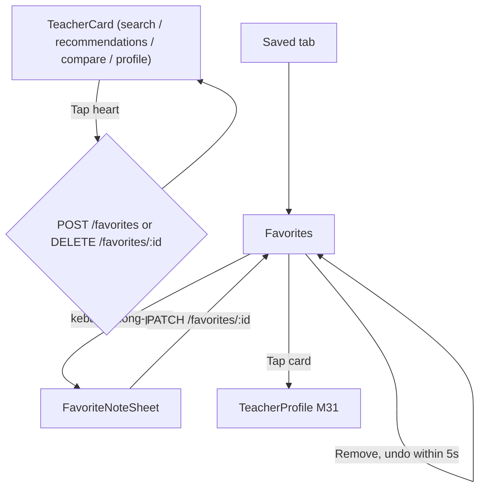
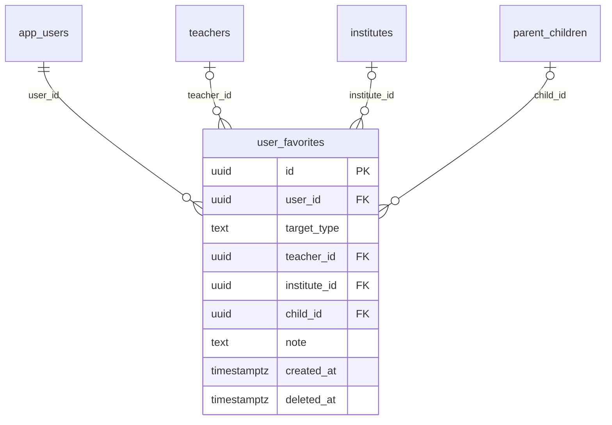

# Module 40 · Favorite Teachers

> **Phase 10 · Favourites** · **Used by:** Parents and students (save, tag, note, remove); no institute or teacher role · **Depends on:** M00, M27/M31 (heart control on search cards and the profile header), M30 (reads favourites as a recommendation signal); Admin M16 · **New tables:** `user_favorites` · **Uses:** `teachers`, `app_users`, `parent_children`, `audit_logs` · **Build estimate:** 2 days

## 1. Module Purpose

Lets a parent or student save a teacher with one tap from anywhere in the app — search results, recommendations, compare, the profile header — tag the favourite to a specific child, add a short private note, and manage the resulting list. It owns `user_favorites` for `target_type = 'teacher'`; M41 reuses every endpoint here unchanged for institutes with `target_type = 'institute'`. Because favouriting is the single most-repeated low-stakes tap in the app, every write is instant, optimistic and safe offline.

## 2. User Stories

- As a **parent**, I want to heart a teacher from a search result without leaving the list so that I can keep browsing and compare later.
- As a **parent with two children**, I want to tag a favourite "for Aarav" so my saved list doesn't turn into a jumble.
- As a **student on a train with patchy signal**, I want my heart tap to fill in immediately and sync later so the app never feels broken.
- As a **parent**, I want a private note like "asked about weekend batch" on a favourite so I remember why I saved them weeks later.
- As a **parent**, I want to undo an accidental un-favourite in the next few seconds so that I don't lose a teacher I meant to keep.

## 3. Business Rules & Logic

**BR-40.1 Who can favourite.** Role `parent` or `student`, `app_users.account_status = 'active'`. Unlike leads and reviews, a student with `parental_consent = 'pending'` may still favourite — bookmarking is not contact and needs no consent gate.

**BR-40.2 Create (idempotent).** `POST /favorites { targetType: "teacher", teacherId, childId?, note? }` with `Idempotency-Key`. One live favourite per (user, teacher) — enforced by `uq_user_favorites_teacher` (partial unique on `deleted_at IS NULL`). A repeat call for a teacher already favourited is **not** an error: it returns `200` with the existing row unchanged (never `CONFLICT_DUPLICATE`), because a filled heart tapped again — often an offline-queue replay — must always look like success to the user. `childId`, when sent, must be the parent's own live child (`parent_children.parent_id = pid`, not deleted); `note` trimmed 0–200 chars. The target teacher must exist (a suspended or rejected teacher can still be favourited/kept — see BR-40.6).

**BR-40.3 Limit.** A user may hold at most `limits.favorites_max` (300) live favourites in total across both target types (teachers + institutes; M41 shares the same count) → `LIMIT_REACHED` (`details.reason = "favorites_max"`, `details.limit = 300`).

**BR-40.4 Update.** `PATCH /favorites/:id { childId?, note? }`, owner only: replaces the child tag and/or note without touching `created_at`, so editing a note never reorders the list. `user_favorites` has no `updated_at` column, so there is no `If-Match` — the last write from the (single) owning device wins, which is acceptable for a private, single-editor list.

**BR-40.5 Delete.** `DELETE /favorites/:id`, owner only: sets `deleted_at`. Idempotent — deleting an id that is already removed, or that never belonged to this user, returns `204` rather than `NOT_FOUND`, so an offline-queue replay of a delete never surfaces an error to the user. Removing a favourite frees the slot: the same teacher can be favourited again later (the unique index is partial on live rows).

**BR-40.6 List.** `GET /favorites?targetType=teacher&childId=&sort=recent|name` (cursor, 20/page). Each item is a **live** snapshot of the teacher card — photo, name, subjects, trust-score band, rating, fee-from, city — resolved at read time from `teachers`, never copied into `user_favorites`, so a favourite always reflects the teacher's current profile. A teacher who has since been suspended, rejected or soft-deleted is still returned (looked up by id regardless of `account_status`/`deleted_at`) with a `status: "unavailable"` flag and the card shows "Currently unavailable" instead of silently vanishing from the list.

**BR-40.7 One control everywhere.** The heart appears on `TeacherCard` (search, recommendations, compare, saved teachers of an institute) and the profile header (M31); every instance shares one `useFavoriteMutation('teacher')`, so tapping it in any one place updates every other visible card for that teacher through query-cache patching — never a refetch of the whole screen.

**BR-40.8 Signal to recommendations.** M30's recommendation engine reads `user_favorites` directly as a strong positive signal (and treats a removal within 24 hours of adding as a soft negative one); this module writes nothing beyond the row itself for that purpose.

**BR-40.9 Update notifications** (opt-in, `user_notification_preferences.category = 'recommendations'`): a job notifies the user, at most once per event, when a favourited teacher's `is_verified_badge` newly turns on, a fee plan changes, or `demo_available` turns back on after being off (dedupe key `favorite_update:<userId>:<teacherId>:<eventType>`).

## 4. Screen List

| Screen | Route name | Purpose |
| --- | --- | --- |
| Favorites | `Favorites` | Saved teachers list (segment shared with M41's institutes) |
| Favorite note sheet | `FavoriteNoteSheet` (bottom sheet) | Tag a child and add/edit a private note |

## 5. Screen Flow & Navigation


The heart never navigates; it only toggles in place. Removing from the list itself shows an "Undo" snackbar for 5 seconds before the row is actually gone from the screen (the API call still fires immediately; Undo re-adds via a fresh `POST /favorites`).

## 6. Screen Wireframe Description

**Favorites** — header "Saved" with segments "Teachers" | "Institutes" (M41). Filter chip "For: Aarav ▾" (child names + "All children"), sort menu "Recently saved ▾" / "Name A–Z". `TeacherCard` rows: photo, name, subjects, rating, trust badge, fee-from, filled heart (tap removes with 5 s undo snackbar "Removed from saved · Undo"), private note shown italic under the subjects line ("Asked about weekend batch") when set, grey "Currently unavailable" tag replacing the fee line for an unavailable teacher (card still tappable, opens the read-only last-known profile state). Empty: illustration, "No saved teachers yet", body "Tap the heart on any teacher to save them here.", button "Find teachers" (M27). Loading: card skeletons. Offline: cached list, "Updated 2 h ago"; hearts everywhere still tappable.

**FavoriteNoteSheet** — heading "Prof. Ananya Iyer" with mini photo. Child chips (parents with ≥ 1 child): "Aarav · Class 12", "Diya · Class 7", "No child" (default). Text field "Note (optional)", placeholder "e.g. Asked about weekend batch", counter 0/200. Button "Save".

## 7. UI Components & Component Tree

```
FavoritesScreen
├─ SegmentedControl (Teachers | Institutes, M41)
├─ ChildFilterChip · SortMenu
└─ FlashList<TeacherCard variant="favorite"> (undo snackbar)
FavoriteNoteSheet → ChildChipSelect · NoteTextArea
```
- `useFavoriteMutation('teacher')` (shared with M41 via `targetType`): optimistic toggle, offline queue keyed by `teacherId`, patches every cached `TeacherCard` instance across `searchKeys`, `recommendationKeys` and `teacherKeys.detail` via `setQueriesData`; rolls back on a non-network error.
- Hooks: `useFavoritesInfiniteQuery('teacher', filters)`, `useUpdateFavoriteMutation(id)`, `useRemoveFavoriteMutation(id)`.

## 8. Validation Rules

Shared schema `FavoriteInputSchema` in `packages/shared/favorites.ts` (also used by M41 with `targetType: "institute"`).

| Field | Rule | Message shown |
| --- | --- | --- |
| targetType | `teacher` | — |
| teacherId | uuid, existing teacher | "This teacher isn't available right now." |
| childId | parent's own live child, optional | "Pick a child." |
| note | 0–200 chars | "Keep it under 200 characters." |
| sort | `recent` or `name` | — (ignored, defaults to recent) |

## 9. API Endpoints

| Method | Path | Auth | Description |
| --- | --- | --- | --- |
| GET | /favorites | Learner | List (cursor), `targetType`, `childId`, `sort` |
| POST | /favorites | Learner | Add a favourite (Idempotency-Key); idempotent on repeat |
| DELETE | /favorites/:id | Learner | Remove (idempotent) |
| PATCH | /favorites/:id | Learner | Update the child tag and/or note |

## 10. Request Payloads

```json
// POST /favorites   (Idempotency-Key: 6b2e…)
{ "targetType": "teacher", "teacherId": "7d1c2e9a-4b5f-4c8e-9a10-3f2b1c0d9e8a", "childId": "c2a1…", "note": "Asked about weekend batch" }

// PATCH /favorites/aa31…
{ "note": "Weekend batch starts in January" }

// GET /favorites?targetType=teacher&sort=recent&limit=20
```

## 11. Response Payloads

```json
// 201 POST /favorites
{ "data": { "id": "aa31…", "targetType": "teacher", "teacher": { "id": "7d1c…", "name": "Dr. Ananya Iyer", "photoUrl": "https://cdn.guruconnect.in/t/…/w=96",
      "subjects": ["Physics","Maths"], "ratingAvg": 4.9, "trustBand": "excellent", "feeFromPaise": 60000, "city": "Bengaluru", "status": "active" },
    "child": { "id": "c2a1…", "name": "Aarav" }, "note": "Asked about weekend batch", "createdAt": "2026-09-26T11:20:00Z" } }

// 200 GET /favorites?targetType=teacher
{ "data": { "items": [ { "id": "aa31…", "teacher": { "id": "7d1c…", "name": "Dr. Ananya Iyer", "status": "active", "feeFromPaise": 60000 },
      "child": { "id": "c2a1…", "name": "Aarav" }, "note": "Asked about weekend batch", "createdAt": "2026-09-26T11:20:00Z" } ] },
  "meta": { "nextCursor": null } }

// 429 POST /favorites (limit)
{ "error": { "code": "LIMIT_REACHED", "message": "You can save up to 300 teachers and institutes in total.", "details": { "reason": "favorites_max", "limit": 300 }, "requestId": "…" } }
```

## 12. PostgreSQL Tables & Columns

**New tables owned by this module** (migration `sql/migrations/140_app_m40_favorite_teachers_favourites.sql`)

### `user_favorites`

Teachers and institutes a user saved to their favourites.

| Column | Type | Null | Default | Constraints / References | Description |
| --- | --- | --- | --- | --- | --- |
| `id` | uuid | no | gen_random_uuid() | PK | Primary key |
| `user_id` | uuid | no | — | FK → `app_users.id` (on delete cascade) | Owner |
| `target_type` | text | no | — | CHECK target_type IN ('teacher','institute') | Kind |
| `teacher_id` | uuid | yes | — | FK → `teachers.id` (on delete cascade) | Saved teacher |
| `institute_id` | uuid | yes | — | FK → `institutes.id` (on delete cascade) | Saved institute |
| `child_id` | uuid | yes | — | FK → `parent_children.id` (on delete set null) | Optional: saved for which child |
| `note` | text | yes | — | — | Private note, max 200 chars |
| `created_at` | timestamptz | no | now() | — | Saved |
| `deleted_at` | timestamptz | yes | — | — | Removed (soft delete) |

**Table constraints:** `CONSTRAINT ck_user_favorites_target CHECK ((target_type = 'teacher' AND teacher_id IS NOT NULL AND institute_id IS NULL) OR (target_type = 'institute' AND institute_id IS NOT NULL AND teacher_id IS NULL))`

<details><summary>DDL</summary>

```sql
CREATE TABLE user_favorites (
  id uuid PRIMARY KEY DEFAULT gen_random_uuid(), -- Primary key
  user_id uuid NOT NULL REFERENCES app_users(id) ON DELETE CASCADE, -- Owner
  target_type text NOT NULL CHECK (target_type IN ('teacher','institute')), -- Kind
  teacher_id uuid REFERENCES teachers(id) ON DELETE CASCADE, -- Saved teacher
  institute_id uuid REFERENCES institutes(id) ON DELETE CASCADE, -- Saved institute
  child_id uuid REFERENCES parent_children(id) ON DELETE SET NULL, -- Optional: saved for which child
  note text, -- Private note, max 200 chars
  created_at timestamptz NOT NULL DEFAULT now(), -- Saved
  deleted_at timestamptz, -- Removed (soft delete)
  CONSTRAINT ck_user_favorites_target CHECK ((target_type = 'teacher' AND teacher_id IS NOT NULL AND institute_id IS NULL) OR (target_type = 'institute' AND institute_id IS NOT NULL AND teacher_id IS NULL))
);
CREATE UNIQUE INDEX uq_user_favorites_teacher ON user_favorites (user_id, teacher_id) WHERE teacher_id IS NOT NULL AND deleted_at IS NULL;
CREATE UNIQUE INDEX uq_user_favorites_institute ON user_favorites (user_id, institute_id) WHERE institute_id IS NOT NULL AND deleted_at IS NULL;
CREATE INDEX idx_user_favorites_user ON user_favorites (user_id, target_type, created_at DESC) WHERE deleted_at IS NULL;
```

</details>

**Indexes:** `uq_user_favorites_teacher` (unique) on `(user_id, teacher_id) WHERE teacher_id IS NOT NULL AND deleted_at IS NULL`; `uq_user_favorites_institute` (unique) on `(user_id, institute_id) WHERE institute_id IS NOT NULL AND deleted_at IS NULL`; `idx_user_favorites_user` on `(user_id, target_type, created_at DESC) WHERE deleted_at IS NULL`

**Existing tables this module reads or writes** (full definitions in the owning module)

| Table | Owner | Purpose |
| --- | --- | --- |
| `teachers` | Admin M16 | Teacher profile and verification state. One row per teacher app account. |
| `app_users` | Admin M00 | Login identity for every mobile app account (parent, student, teacher, institute staff). Role profiles hang off this table. |
| `parent_children` | Admin M29 | Children a parent is finding teachers for. Drives per-child recommendations. |
| `audit_logs` | Admin M00 | Append-only record of every admin action and security event. Never updated or deleted by the application. |

- `user_favorites`: inserted (`target_type = 'teacher'`, `teacher_id`, `child_id`, `note`) by `POST`; `child_id`/`note` updated by `PATCH`; `deleted_at` set by `DELETE`. `institute_id` is always null for rows this module writes (M41 writes the institute-typed rows through the same table and endpoints).
- `teachers`: read-only, resolved fresh on every list/detail read for the card snapshot (BR-40.6); never joined into a stored copy.

## 13. Relationships

**Foreign keys of new tables**

- `user_favorites.user_id` → `app_users` — required, many-to-one, on delete **cascade**
- `user_favorites.teacher_id` → `teachers` — optional, many-to-one, on delete **cascade**
- `user_favorites.institute_id` → `institutes` — optional, many-to-one, on delete **cascade**
- `user_favorites.child_id` → `parent_children` — optional, many-to-one, on delete **set null**

**Entity relationship diagram**



## 14. State Management

- `favoriteKeys.list('teacher', filters)`; first page persisted. A per-teacher `isFavorited` flag is derived client-side from a lightweight persisted id set (`favoriteIds.teacher`), kept in sync by every mutation, so any `TeacherCard` anywhere can render its heart state without its own query.
- Add/remove: optimistic — flip the heart and the local id set immediately; roll back both on a non-network failure with a toast "Couldn't save. Try again."; queued while offline (see below) and reconciled on reconnect using the server's response, not a client-guessed id.
- After update (note/child): patch the item in `favoriteKeys.list('teacher', *)` from the response; no other cache is affected (the note is private and never shown elsewhere).

## 15. Offline Handling

- Read: the favourites list and the `favoriteIds.teacher` set render/apply from cache instantly.
- Add / remove: class 1 *queue offline* — the heart toggles immediately from local state; the `POST`/`DELETE` is queued and replayed in order on reconnect, deduplicated server-side by `Idempotency-Key` (add) and by the idempotent-delete rule (BR-40.5) (remove) — a rapid add-then-remove while offline collapses to a no-op on replay if both are still queued.
- Update note/child tag: class 1 as well (last one queued wins; no conflict surfaced).

## 16. Push Notification Requirements

| Event | Recipient | Title / Body | Deep link | Category | Urgent |
| --- | --- | --- | --- | --- | --- |
| `favorite_teacher_verified` | User (favourited this teacher) | "{teacherName} is now verified" / "One of your saved teachers just completed GuruConnect verification." | `/t/{publicCode}` | recommendations | No |
| `favorite_teacher_fees_changed` | User | "{teacherName} updated their fees" / "Check the new plans before you decide." | `/t/{publicCode}` | recommendations | No |
| `favorite_teacher_demos_open` | User | "{teacherName} is accepting demos again" / "Book a free demo now." | `/t/{publicCode}?action=demo` | recommendations | No |

## 17. Security Rules

- Every query and mutation is scoped by `user_id = sub`; another user's favourite id → `NOT_FOUND` on PATCH/DELETE (not `FORBIDDEN`, so existence isn't leaked).
- Notes are private: never returned to anyone but the owner, never shown to the teacher, never included in analytics or Sentry.
- Rate limits: 60 add/remove/update per minute per user (well above normal use; guards against a scripted client).

## 18. Error Handling

| Scenario | Code | HTTP | App behaviour |
| --- | --- | --- | --- |
| 300 favourites already saved | `LIMIT_REACHED` (`favorites_max`) | 429 | Sheet "You've saved 300 teachers and institutes. Remove one to save another." |
| childId not the caller's child | `VALIDATION_FAILED` | 422 | Inline in `FavoriteNoteSheet` |
| Teacher id unknown | `NOT_FOUND` | 404 | Toast "This teacher isn't available." |
| Update/delete someone else's favourite | `NOT_FOUND` | 404 | Toast "Couldn't find that." (never reveals ownership) |
| Repeat add (already favourited) | 200, not an error | 200 | Heart simply stays filled |
| Repeat delete (already removed) | 204, not an error | 204 | Row simply stays gone |

## 19. Testing Scenarios

- T40.1 Parent hearts a teacher from search results → 201; the same teacher's card in Recommendations also shows filled instantly (Maestro `favorite_add_happy`).
- T40.2 Tapping an already-filled heart again (offline queue replay) → 200 with the existing row, no duplicate, no error toast.
- T40.3 Un-favourite then tap Undo within 5 s → favourite restored with a fresh id; after 5 s, Undo is gone and the row stays removed.
- T40.4 Parent tags a favourite "for Aarav" with a note, edits the note later → `created_at` and list position unchanged.
- T40.5 301st favourite (teacher or institute combined) → `LIMIT_REACHED favorites_max`.
- T40.6 Favourited teacher gets suspended by admin → still appears in the list tagged "Currently unavailable"; tapping it still opens the last-known profile view.
- T40.7 Offline: three hearts tapped in a row, app killed and reopened → all three replay once on reconnect, in order, no duplicates.
- T40.8 Un-favourite a teacher, then favourite the same teacher again a minute later → succeeds (partial unique index allows a new live row).
- T40.9 `sort=name` orders alphabetically by teacher display name; `childId` filter shows only that child's tagged favourites.
- T40.10 User A calls `PATCH`/`DELETE` on user B's favourite id → `NOT_FOUND`.
- T40.11 A newly verified favourited teacher triggers exactly one `favorite_teacher_verified` push, never a repeat for the same event.
- T40.12 Screen states: `Favorites` loading/empty ("No saved teachers yet")/error/content; font scale 130% doesn't clip the note line.

## 20. Audit Log Events

| Event | When | Details |
| --- | --- | --- |
| `app.favorite_added` | Row inserted | targetType `teacher`, teacherId, hadChildTag (true/false) |
| `app.favorite_removed` | Soft delete | targetType `teacher`, teacherId |
| `app.favorite_note_updated` | Note or child tag changed | favoriteId, noteLength |

## 21. Future Scalability Notes

- Shareable favourite lists ("Teachers I'm considering for Aarav") a parent can send to a co-parent or grandparent, read-only.
- Price-drop or new-fee-plan alerts specifically for favourited teachers, beyond the generic update notification.
- A "Compare my favourites" shortcut straight into M29's advanced filters/compare view once favourites exceed 5.
- Admin portal additions: none — favourites are private, personal data with no admin-facing use in v1.
