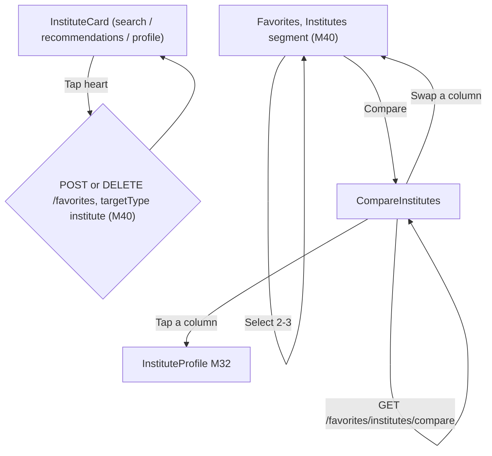
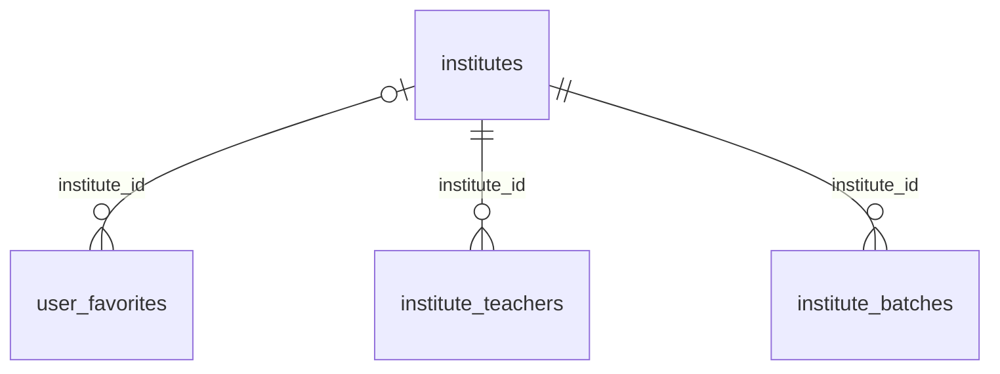

# Module 41 · Favorite Institutes

> **Phase 10 · Favourites** · **Used by:** Parents and students (save, tag, note, remove, compare); no institute or teacher role · **Depends on:** M00, M40 (owns `user_favorites` and every add/remove/tag/list endpoint, reused here unchanged), M32 (institute profile heart), M26 (GuruConnect rating shown alongside user rating); Admin M22, Admin M27 · **New tables:** none · **Uses:** `user_favorites`, `institutes`, `institute_teachers`, `institute_batches`, `parent_child_subjects`, `audit_logs` · **Build estimate:** 1–2 days

## 1. Module Purpose

Lets a parent or student save an institute with the identical mechanics as favouriting a teacher (M40) — same table, same endpoints, same limit, same private note and child tag, same offline queue — with `target_type = 'institute'` in place of `'teacher'`. The one thing this module adds is institute-specific: a side-by-side comparison of up to three saved institutes across rating, fees, facilities and open batches, since choosing between coaching centres is usually a compare-and-decide task rather than a single pick.

## 2. User Stories

- As a **parent** shortlisting JEE coaching, I want to save three centres and compare them side by side so that I can decide with my child.
- As a **student**, I want to heart an institute from search results the exact same way I heart a teacher so that the app doesn't feel like two different apps.
- As a **parent**, I want to swap one institute out of a comparison for another without starting the compare over.
- As a **parent on 3G**, I want my institute hearts to save the same offline-first way teacher hearts do.

## 3. Business Rules & Logic

**BR-41.1 Everything from M40 applies unchanged.** Eligibility (BR-40.1), idempotent create with `Idempotency-Key` (BR-40.2, `institute_id` in place of `teacher_id`), the shared 300-favourite cap across **both** target types combined (BR-40.3), update/delete semantics with no `If-Match` (BR-40.4/40.5), the live-snapshot list read with an `institutes`-shaped card and an `"unavailable"` flag for a suspended/rejected/deleted institute (BR-40.6), one shared heart control patching every visible `InstituteCard` (BR-40.7), and the recommendation-engine signal (BR-40.8) all apply verbatim with `targetType: "institute"`. This module defines no new table columns, no new create/update/delete endpoint, and no new validation beyond swapping the target id field.

**BR-41.2 Compare.** `GET /favorites/institutes/compare?ids=a,b,c` — 2 or 3 ids, each one of the caller's own live (`deleted_at IS NULL`) institute favourites, else `VALIDATION_FAILED` (wrong count) or `NOT_FOUND` (an id not owned by the caller, named individually so the app knows which column failed rather than dropping it silently). Returns, per institute: `overallRating`/`infrastructureScore`/`facultyScore` (Admin M27), `userRatingAvg`/`userRatingCount` (M35), `feeMinPaise`–`feeMaxPaise`, `establishedYear`, `city`/`area`, `facilities` (array), `subjects` (aggregated distinct subjects across the institute's active `institute_teachers`), and `openBatches` (count of `institute_batches` rows with `is_active = true` and `seats_available > 0`). Computed fresh on every call — no caching beyond the request, since ratings and open seats change often.

**BR-41.3 Institute update notifications** (the institute-shaped version of M40 BR-40.9): a job notifies the user, at most once per event, when a favourited institute's `is_verified_badge` turns on, its `overall_rating` (Admin M27) changes by ≥ 0.5, or a new `institute_batches` row opens with `seats_available > 0` in a subject one of the user's children needs (matched against `parent_child_subjects` for the user's own children) — dedupe key `favorite_update:<userId>:<instituteId>:<eventType>`.

**BR-41.4 Compare selection.** The Favorites screen's Institutes segment (M40, reused) adds a checkbox-select mode once the user long-presses or taps "Compare"; 2–3 selections enable a sticky "Compare" bar; selecting a 4th replaces the oldest selection with a toast "You can compare up to 3 at a time."

## 4. Screen List

| Screen | Route name | Purpose |
| --- | --- | --- |
| Favorites — Institutes segment | `Favorites` (M40, `segment=institutes`) | Reused unchanged; adds compare-select mode |
| Compare institutes | `CompareInstitutes` | Side-by-side of 2–3 saved institutes |

## 5. Screen Flow & Navigation



## 6. Screen Wireframe Description

**Favorites — Institutes segment** — identical to M40's Favorites layout with `InstituteCard` rows (logo, name, area, "4.5 GuruConnect rating" badge, "4.7 ★ · 486 reviews" user rating, fee range) in place of `TeacherCard`, filled heart to remove, private note preview, "Currently unavailable" grey tag for a suspended/rejected institute. Long-press or a top-right "Compare" text button enters select mode: checkboxes appear on each card; sticky bar reads "Compare (2) · Tap one more" then "Compare (3)" with a primary "Compare" button once ≥ 2 are picked.

**CompareInstitutes** — header "Compare" with back. Column headers: logo, name, area, small "×" to drop a column, "+ Swap" to replace it from the favourites list. Rows (label left, one cell per column): "GuruConnect rating" (badge + tap opens M26 explanation), "Parent & student rating" ("4.7 ★ · 486"), "Fees" ("₹8,000–₹15,000/month"), "Established" ("2014"), "Facilities" (chip list: "AC classrooms", "Library", "Parking"), "Subjects" (chip list, overflow "+4 more"), "Open batches" (green "3 seats open in Physics" or grey "No open batches"). Sticky footer, one "View profile" button per column. With only 1 selected: banner "Select at least 2 institutes to compare." with a "Choose" button back to the list.

## 7. UI Components & Component Tree

```
FavoritesInstitutesSegment (M40 reused) → CompareSelectBar (appears in select mode)
CompareInstitutesScreen
├─ CompareColumnHeader × (2-3) (swap, remove)
├─ CompareRow × 6 (rating, user rating, fees, established, facilities, subjects, open batches)
└─ StickyProfileLinks
```
- Hooks: `useFavoriteMutation('institute')` and `useFavoritesInfiniteQuery('institute', filters)` (both M40, reused unchanged), `useCompareInstitutesQuery(ids)`.

## 8. Validation Rules

Reuses `FavoriteInputSchema` (M40) with `targetType: "institute"` and `instituteId` in place of `teacherId` — no new schema for add/update/remove.

| Field | Rule | Message shown |
| --- | --- | --- |
| ids (compare) | 2–3 uuids, each the caller's own live institute favourite | "Pick 2 or 3 saved institutes to compare." |

## 9. API Endpoints

| Method | Path | Auth | Description |
| --- | --- | --- | --- |
| GET | /favorites?targetType=institute | Learner | Reused from M40 |
| POST | /favorites | Learner | Reused from M40 (`targetType: "institute"`) |
| PATCH | /favorites/:id | Learner | Reused from M40 |
| DELETE | /favorites/:id | Learner | Reused from M40 |
| GET | /favorites/institutes/compare | Learner | Side-by-side of 2–3 saved institutes |

## 10. Request Payloads

```json
// POST /favorites   (Idempotency-Key: 7f1d…)
{ "targetType": "institute", "instituteId": "5e2d5f1a-9c3b-4a7e-8b2c-1d0e9f8a7b6c", "note": "Weekend JEE batch, near home" }

// GET /favorites/institutes/compare?ids=5e2d…,6a1f…,8c3b…
```

## 11. Response Payloads

```json
// 200 GET /favorites/institutes/compare
{ "data": { "institutes": [
    { "id": "5e2d…", "name": "Excel Academy, Jayanagar", "logoUrl": "https://cdn.guruconnect.in/i/…/w=96", "area": "Jayanagar", "city": "Bengaluru",
      "overallRating": 4.5, "userRatingAvg": 4.7, "userRatingCount": 486, "feeMinPaise": 800000, "feeMaxPaise": 1500000, "establishedYear": 2014,
      "facilities": ["AC classrooms","Library","Parking"], "subjects": ["Physics","Chemistry","Maths"], "openBatches": 3 },
    { "id": "6a1f…", "name": "Bright Minds, Koramangala", "logoUrl": "https://cdn.guruconnect.in/i/…/w=96", "area": "Koramangala", "city": "Bengaluru",
      "overallRating": 4.2, "userRatingAvg": 4.4, "userRatingCount": 210, "feeMinPaise": 600000, "feeMaxPaise": 1100000, "establishedYear": 2019,
      "facilities": ["Library"], "subjects": ["Physics","Maths"], "openBatches": 0 } ] } }

// 422 GET /favorites/institutes/compare (only 1 id)
{ "error": { "code": "VALIDATION_FAILED", "message": "Pick 2 or 3 saved institutes to compare.", "details": [ { "path": "ids", "message": "Pick 2 or 3 saved institutes to compare." } ], "requestId": "…" } }
```

## 12. PostgreSQL Tables & Columns


**Existing tables this module reads or writes** (full definitions in the owning module)

| Table | Owner | Purpose |
| --- | --- | --- |
| `user_favorites` | App M40 | Teachers and institutes a user saved to their favourites. |
| `institutes` | Admin M22 | Coaching centres, tuition centres, schools and academies. Rated by GuruConnect after verification. |
| `institute_teachers` | Admin M26 | Teachers listed under an institute. Added, edited and removed only by an institute manager (or an admin). |
| `institute_batches` | Admin M24 | Courses and batches an institute runs, shown on its public profile. |
| `parent_child_subjects` | Admin M29 | Subjects needed for a child. |
| `audit_logs` | Admin M00 | Append-only record of every admin action and security event. Never updated or deleted by the application. |

- `user_favorites`: no new writes — M40 already covers every insert/update/delete for `target_type = 'institute'` (the CHECK constraint `ck_user_favorites_target` is what enforces `institute_id` XOR `teacher_id`).
- `institutes`, `institute_teachers`, `institute_batches`, `parent_child_subjects`: read-only, resolved fresh for the list snapshot (M40 BR-40.6) and the compare endpoint (BR-41.2); nothing here is stored.

## 13. Relationships


**Entity relationship diagram** (tables this module uses; `admins` omitted)



## 14. State Management

- Reuses M40's `favoriteKeys.list('institute', filters)` and the persisted `favoriteIds.institute` id set for heart state everywhere.
- `compareKeys.result(ids)` — not persisted (`staleTime` 0; always refetched, since seats and ratings move), cleared when a column is swapped.
- Add/remove/update follow M40's cache rules exactly (optimistic toggle, id-set patch across every `InstituteCard` instance).

## 15. Offline Handling

- List and heart toggle: identical to M40 — cached reads, class 1 queued add/remove.
- Compare: online only (button disabled offline, "Connect to the internet to compare institutes.") — comparison data must be current, not cached.

## 16. Push Notification Requirements

| Event | Recipient | Title / Body | Deep link | Category | Urgent |
| --- | --- | --- | --- | --- | --- |
| `favorite_institute_verified` | User (favourited this institute) | "{instituteName} is now verified" / "One of your saved institutes just completed GuruConnect verification." | `/i/{slug}` | recommendations | No |
| `favorite_institute_rating_changed` | User | "{instituteName}'s rating updated" / "Its GuruConnect rating is now {rating}." | `/i/{slug}` | recommendations | No |
| `favorite_institute_batch_open` | User (child needs that subject) | "New batch open at {instituteName}" / "{seats} seats open in {subject}." | `/i/{slug}?tab=batches` | recommendations | No |

## 17. Security Rules

- Same scoping as M40: every mutation is `user_id = sub`; another user's favourite id → `NOT_FOUND`.
- Compare only operates on ids the caller already owns as live favourites — an id belonging to someone else's favourite (even if it's a real institute) → `NOT_FOUND`, never silently substituted.
- Notes stay private exactly as M40; never shown to institute staff.
- Rate limit: `GET /favorites/institutes/compare` 30/min per user (heavier read than a list page).

## 18. Error Handling

| Scenario | Code | HTTP | App behaviour |
| --- | --- | --- | --- |
| Compare with 1 or 4+ ids | `VALIDATION_FAILED` | 422 | Inline banner on `CompareInstitutes` |
| Compare id not the caller's own favourite | `NOT_FOUND` | 404 | That column shows "No longer saved" with a "Swap" prompt; others still render |
| Everything else (add/remove/update/limit) | as M40 | — | as M40, with `targetType = "institute"` copy |

## 19. Testing Scenarios

- T41.1 Parent hearts an institute from search → 201; same institute's card in Recommendations shows filled instantly (Maestro `favorite_institute_add_happy`).
- T41.2 Parent selects 3 saved institutes and compares → all 6 rows populated; open-batches count matches `institute_batches` with available seats.
- T41.3 Swap one column for a different saved institute without leaving `CompareInstitutes` → the row refetches for the new set.
- T41.4 Attempt to select a 4th institute in compare mode → oldest selection replaced, toast shown.
- T41.5 Compare with an id that is someone else's favourite → that column `NOT_FOUND`, the other two still render.
- T41.6 Total of 300 favourites (teachers + institutes combined) reached via institutes → 301st institute favourite → `LIMIT_REACHED favorites_max` (shared counter, verifies BR-41.1 cross-type cap).
- T41.7 Un-favourite an institute mid-compare → its column shows "No longer saved" without crashing the other columns.
- T41.8 Offline: institute heart taps queue and replay exactly as M40's T40.7; Compare button is disabled offline.
- T41.9 A favourited institute's `overall_rating` moves from 4.0 to 4.6 → exactly one `favorite_institute_rating_changed` push.
- T41.10 A new batch opens with seats in a subject the user's child needs → push sent; a batch opening in an unrelated subject → no push.
- T41.11 Screen states: `CompareInstitutes` with 1 selected (prompt), 2 (content), loading, and a network error with Retry.

## 20. Audit Log Events

Reuses M40's `app.favorite_added` / `app.favorite_removed` / `app.favorite_note_updated` with `targetType = "institute"`. Reading a comparison is not audit-logged (analytics only, event `institutes_compared` with the id count).

## 21. Future Scalability Notes

- A saved "Shortlist" note per compare session, so a parent can pick up a comparison later without reselecting.
- Comparison across teachers and institutes together once a family is deciding between a private tutor and a coaching centre for the same subject.
- Share a comparison (read-only link) with a co-parent, reusing M33's profile-sharing short codes.
- Admin portal additions: none — favourites and comparisons are private, personal data with no admin-facing use in v1.
