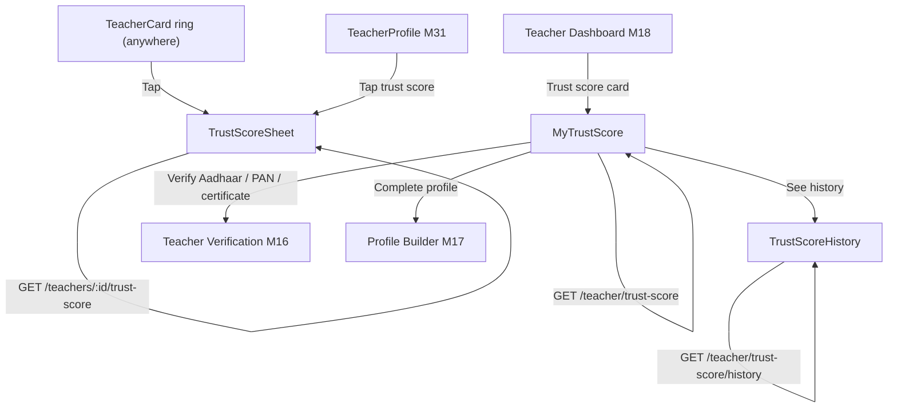
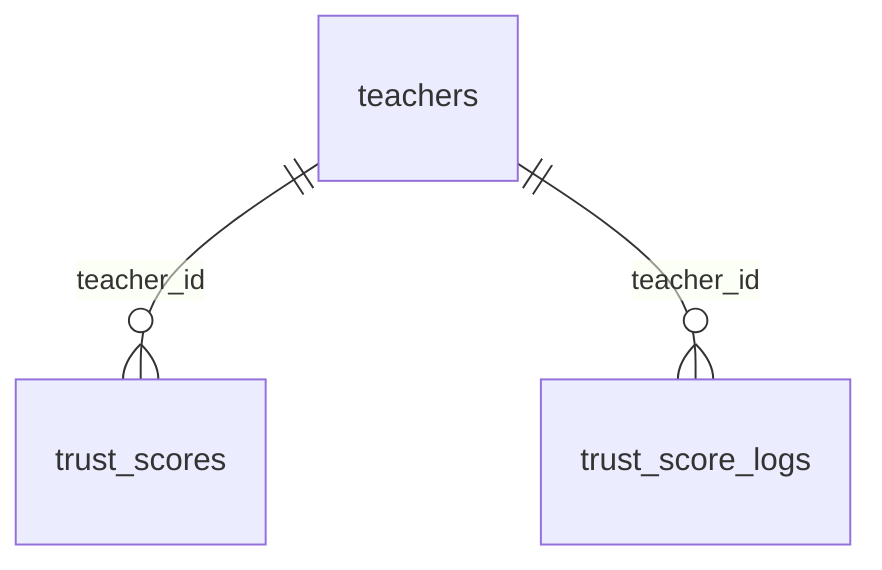

# Module 42 · Trust Score Display

> **Phase 11 · Trust Score** · **Used by:** Any user (view a teacher's public score); teachers (view their own detailed breakdown, tips and history) · **Depends on:** M00, M16 (teacher verification, the source of Aadhaar/PAN/certificate factors), M17 (profile completeness factor and its own missing-items list), M27/M31 (where the score is shown), M34 (reviews factor input); Admin M36, Admin M37 · **New tables:** none · **Uses:** `trust_scores`, `trust_score_logs`, `trust_score_weights`, `teachers`, `system_settings` · **Build estimate:** 3 days

## 1. Module Purpose

Shows every user a teacher's Trust Score — one 0–100 number the backend computes from six weighted factors (Admin M36) — as a simple ring with a one-line explanation on cards and the profile, and gives the teacher their own detailed view: the full factor breakdown, plain-language tips for raising each one, and a 90-day history. This module owns no tables and performs no calculation; it reads `trust_scores`, `trust_score_weights` and `trust_score_logs` exactly as Admin M36/M37 write them and is careful never to leak admin-only fields (raw weights, override reasons beyond a setting-gated line, admin ids) to the app.

## 2. User Stories

- As a **parent**, I want a trust score I can read in one glance without decoding jargon like "Bayesian smoothing".
- As a **teacher**, I want to see exactly why my score is 82 and not 95 so that I know what to fix first.
- As a **teacher** who was just downgraded, I want to know plainly whether GuruConnect paused or adjusted my score, without being handed an audit log.
- As a **new teacher** with no reviews yet, I want to know my Reviews factor isn't being scored as zero so that I'm not discouraged before my first class.
- As a **teacher**, I want a quick history so that I can tell a drop from a genuine complaint apart from a weights change that affected everyone.

## 3. Business Rules & Logic

**BR-42.1 Public display groups.** `GET /teachers/:id/trust-score` groups the six backend factors (Admin M36 FR-36.1) into four plain-language categories for anyone but the teacher themself:

| Public category | Backend factor(s) | Combined weight |
| --- | --- | --- |
| Verification | Aadhaar (20) + PAN (10) + Certificates (20) | 50 |
| Reviews | Reviews (25) | 25 |
| Complaints | Complaints (15) | 15 |
| Profile completion | Profile completeness (10) | 10 |

"Verification" is shown as one bar whose value is its own weighted average (`(aadhaar_score×20 + pan_score×10 + certificate_score×20) / 50`); tapping it expands three one-line checks ("Aadhaar verified", "PAN verified", "2 certificates verified", or "Not yet verified" per item). This grouping is presentation only — the backend still stores and computes six separate factors and one weighted `score` exactly as Admin M36 FR-36.2; the app never recomputes anything.

**BR-42.2 The number and its band.** The public score is `trust_scores.score` (which is already `override_score` when `is_overridden = true` — the backend, not this module, resolves that). Bands, matching Admin M36's own distribution buckets: 90–100 "Excellent", 80–89 "Very good", 60–79 "Good", below 60 "New or building trust". A teacher without `is_verified_badge` cannot show above 60 (Admin M36 FR-36.2); this cap is never explained as a separate rule to the viewer — it is already folded into the number the API returns.

**BR-42.3 Frozen display.** `is_frozen = true` changes nothing in the public view (families never see that a score is frozen — the freeze exists to stop movement during an investigation, not to flag it, per Admin M36 FR-36.4). In the teacher's own view (BR-42.6) it shows a neutral banner: "Your score is temporarily paused while GuruConnect reviews an account matter." — no reason, no expiry, no appeal action; this is a trust & safety hold, and the teacher is directed to support only if they ask.

**BR-42.4 Overridden display.** `is_overridden = true` also changes nothing in the public view. In the teacher's own view it shows: "GuruConnect has set your score to {override_score} until {override_expires_at, formatted as a date}." followed, only when `system_settings` key `trust.show_override_reason_to_teacher` (boolean, default `true`) is on, by `override_reason` verbatim; when the setting is off, the line reads "Contact support for details." instead. The six-factor breakdown underneath still shows the **computed** factors (`computed_score` and its inputs), labelled "What your score would be without the current adjustment", so a teacher can see both numbers without confusion about which one is live.

**BR-42.5 Public breakdown contents.** `GET /teachers/:id/trust-score` (any signed-in user, and the public shared-link viewer per M31/M33) returns: `score`, `band`, the four grouped categories with their combined value and one plain sentence each (never raw per-factor numbers, never `weightsVersion`, never `inputs`, never admin ids, never history). Example sentences: "Verification: Aadhaar, PAN and 2 certificates verified.", "Reviews: 4.9 from 312 published reviews.", "Complaints: No upheld complaints in the last 12 months.", "Profile: 95% complete." A teacher with zero published reviews shows "Reviews: Not enough reviews yet" rather than a score, even though the backend's Reviews factor is internally 60 for zero reviews (BR-36.1) — the app never shows a specific number where there is no real signal behind it.

**BR-42.6 Teacher's own detailed view.** `GET /teacher/trust-score` (teacher role, own profile only) returns everything in BR-42.5 plus the full six-factor breakdown — factor key, label, weight, raw value (0–100), points contributed (`weight × value / 100`) — and one improvement tip per factor currently below its own maximum contribution:

| Factor | Tip shown while below its own maximum |
| --- | --- |
| Aadhaar | "Upload and verify your Aadhaar to add up to {gapPoints} points." |
| PAN | "Upload and verify your PAN to add up to {gapPoints} points." |
| Certificates | Fewer than 2 approved: "Add and verify another qualification certificate to add up to {gapPoints} points." · 2+ approved, no professional certificate: "Add a verified professional certificate to add up to {gapPoints} points." |
| Reviews | 0 published reviews: "Complete a few demos and ask families for a review — this factor starts once you have your first ones." · below 90: "Reply to reviews and keep classes on schedule — happier families raise this over time." · 90+: no tip |
| Complaints | Any upheld complaint in the last 12 months: "Avoid upheld complaints — each one costs 35 points on this factor for 12 months." · otherwise no tip |
| Profile completion | "Finish your profile ({missingItems, from M17's own breakdown, referenced not recomputed}) to reach 100%." |

`gapPoints = round(weight × (100 − value) / 100, 1)`, computed client-side from the already-returned weight and value — no extra backend field. A "Points to the next band" line ("12 more points would take you to Excellent (90+).") is likewise computed client-side from `score` and the band thresholds in BR-42.2; it is omitted once the teacher is already Excellent.

**BR-42.7 History.** `GET /teacher/trust-score/history?days=30|90|180` (teacher, own profile; default 90) is a thin, de-identifying proxy over Admin M37's history service scoped to `teacher_id = pid`: it returns the `(date, score)` series unchanged, but replaces every event's admin-facing detail with one neutral label by `trigger_type` — `document_decision` → "Verification updated", `review_published`/`review_removed` → "A review was published"/"A review was removed", `complaint_resolved` → "A complaint was resolved", `profile_updated` → "Your profile changed", `weights_changed`/`scheduled` → "Your score was recalculated", `manual_override`/`override_expired`/`override_removed`/`freeze`/`unfreeze` → "Your score was reviewed by GuruConnect". `admin_id`, `note` and `trigger_ref_id` are never included.

**BR-42.8 Cards everywhere.** The compact ring on every `TeacherCard` (search, recommendations, favourites, compare) and the profile header renders from fields already present on the card/profile payload (`trustScore`, `trustBand` — sourced from the cached `teachers.trust_score`), so it needs no extra call; tapping it opens the same `TrustScoreSheet` as BR-42.5 without leaving the current screen.

## 4. Screen List

| Screen | Route name | Purpose |
| --- | --- | --- |
| Trust score sheet | `TrustScoreSheet` (bottom sheet) | Public breakdown for any teacher, opened from a card or the profile |
| My trust score | `MyTrustScore` | Teacher's own full breakdown, tips and frozen/override banner |
| Score history | `TrustScoreHistory` | 90-day line chart and a de-identified event timeline |

## 5. Screen Flow & Navigation


`TrustScoreSheet` is a read-only overlay reachable from anywhere without navigating away; `MyTrustScore` is reached only by the teacher role from their own dashboard or profile tab.

## 6. Screen Wireframe Description

**TrustScoreSheet** — handle, heading "Dr. Ananya Iyer's trust score". Large ring "94 · Excellent". Four rows, each a label and a mini bar: "Verification ✓✓✓" (tap expands "Aadhaar verified · PAN verified · 2 certificates verified"), "Reviews — 4.9 from 312 reviews", "Complaints — No upheld complaints", "Profile — 95% complete". Footer line "GuruConnect checks identity, reviews, complaints and profile completeness to calculate this score." Link "How trust scores work" (static article, M53). Zero-reviews teacher shows "Reviews — Not enough reviews yet" in place of a bar.

**MyTrustScore** — header "My trust score". Large ring "82 · Very good" with "12 more points would take you to Excellent (90+)." underneath. Frozen banner (amber, BR-42.3) or override banner (blue, BR-42.4) shown above the ring when applicable, each with no dismiss (persists until the state clears). Six `FactorCard`s in weight order (Reviews 25, Verification split into Aadhaar 20/Certificates 20, Complaints 15, Profile 10, PAN 10): label, "20 / 25 pts", thin bar, tip line in grey, action button when the tip implies one ("Verify Aadhaar" → M16 flow, "Add certificate" → M15, "Complete profile" → M17). Footer link "See score history →".

**TrustScoreHistory** — header "Score history". Segmented control "30 days / 90 days / 180 days". Line chart (0–100 y-axis) with dots on days the score changed; tapping a dot scrolls the list below to that entry. Timeline rows: date, "82 → 85" (green if up, red if down, never colour-only — an up/down arrow icon accompanies it), the neutral label from BR-42.7. Empty: "Your score hasn't changed in the last {days} days."

## 7. UI Components & Component Tree

```
TrustScoreSheet → TrustRing, CategoryBar × 4 (Verification expandable)
MyTrustScoreScreen
├─ TrustRing (large) · NextBandHint · FrozenBanner | OverrideBanner
├─ FactorCard × 6 (label, weight, bar, points, tip, action)
└─ HistoryLink
TrustScoreHistoryScreen → RangeSegmentedControl, ScoreLineChart (markers), ScoreEventList
```
- `TrustRing({ score, band, size })` — band colour plus the number and text label together, never colour alone.
- `CategoryBar({ label, value, expandable, children })`, `FactorCard({ factor, weight, value, points, tip, actionLabel, onAction })`.
- Hooks: `useTeacherTrustScoreQuery(teacherId)` (public), `useMyTrustScoreQuery()` (teacher), `useTrustScoreHistoryQuery(days)`.

## 8. Validation Rules

No user input beyond a display parameter — this module is entirely read-only.

| Field | Rule | Message shown |
| --- | --- | --- |
| days (history) | one of 30, 90, 180 | client clamps any other value to 90 without contacting the server |

## 9. API Endpoints

| Method | Path | Auth | Description |
| --- | --- | --- | --- |
| GET | /teachers/:id/trust-score | Any user | Public score, band and the four grouped categories with plain-language lines |
| GET | /teacher/trust-score | Teacher | Own full six-factor breakdown, tips, and frozen/override banner |
| GET | /teacher/trust-score/history | Teacher | Own score series and a de-identified event timeline |

## 10. Request Payloads

```json
// GET /teachers/7d1c2e9a-4b5f-4c8e-9a10-3f2b1c0d9e8a/trust-score

// GET /teacher/trust-score/history?days=90
```

## 11. Response Payloads

```json
// 200 GET /teachers/:id/trust-score
{ "data": { "score": 94.1, "band": "excellent", "categories": {
      "verification": { "value": 100, "weight": 50, "text": "Aadhaar, PAN and 2 certificates verified" },
      "reviews": { "value": 96, "weight": 25, "text": "4.9 from 312 published reviews" },
      "complaints": { "value": 100, "weight": 15, "text": "No upheld complaints in the last 12 months" },
      "profileCompletion": { "value": 95, "weight": 10, "text": "95% complete" } } } }

// 200 GET /teacher/trust-score
{ "data": { "score": 82.0, "computedScore": 82.0, "band": "very_good", "isFrozen": false, "override": null,
    "pointsToNextBand": 8.0, "nextBand": "excellent",
    "factors": [
      { "key": "aadhaar", "label": "Aadhaar verification", "weight": 20, "value": 100, "points": 20.0, "tip": null },
      { "key": "pan", "label": "PAN verification", "weight": 10, "value": 50, "points": 5.0, "tip": "Upload and verify your PAN to add up to 5.0 points." },
      { "key": "certificates", "label": "Certificate verification", "weight": 20, "value": 70, "points": 14.0, "tip": "Add a verified professional certificate to add up to 6.0 points." },
      { "key": "reviews", "label": "Reviews", "weight": 25, "value": 88, "points": 22.0, "tip": "Reply to reviews and keep classes on schedule — happier families raise this over time." },
      { "key": "complaints", "label": "Complaints", "weight": 15, "value": 100, "points": 15.0, "tip": null },
      { "key": "profileCompletion", "label": "Profile completion", "weight": 10, "value": 60, "points": 6.0, "tip": "Finish your profile (add a bio, 2 more qualifications) to reach 100%." } ],
    "calculatedAt": "2026-09-25T02:00:00Z" } }

// 200 GET /teacher/trust-score (frozen)
{ "data": { "score": 88.0, "computedScore": 91.4, "band": "very_good", "isFrozen": true,
    "banner": "Your score is temporarily paused while GuruConnect reviews an account matter.", "override": null, "factors": [ "…" ] } }

// 200 GET /teacher/trust-score/history?days=90
{ "data": { "series": [ { "at": "2026-07-01T02:00:00Z", "score": 79.0 }, { "at": "2026-09-14T09:12:00Z", "score": 85.0 } ],
    "events": [ { "at": "2026-09-14T09:12:00Z", "from": 79.0, "to": 85.0, "label": "A review was published" } ] } }
```

## 12. PostgreSQL Tables & Columns


**Existing tables this module reads or writes** (full definitions in the owning module)

| Table | Owner | Purpose |
| --- | --- | --- |
| `trust_scores` | Admin M36 | Current trust score per teacher with its factor breakdown. |
| `trust_score_logs` | Admin M37 | Every change to a teacher's trust score and what caused it. |
| `trust_score_weights` | Admin M36 | Versioned factor weights. Exactly one active version; weights must add up to 100. |
| `teachers` | Admin M16 | Teacher profile and verification state. One row per teacher app account. |
| `system_settings` | Admin M04 | Typed key–value settings that change platform behaviour without a deploy. |

- `trust_scores` (Admin M36): read-only — `score`, `computed_score`, the six `*_score` columns, `is_overridden`, `override_score`, `override_expires_at`, `is_frozen`, `calculated_at`. `override_reason` is read only when `system_settings.trust.show_override_reason_to_teacher` is true.
- `trust_score_weights` (Admin M36): read only to label the active version's weights on the six factor rows (never shown as a raw weights object, never editable here).
- `trust_score_logs` (Admin M37): read-only for the history proxy (BR-42.7); `admin_id`, `note`, `trigger_ref_id` are stripped before the response leaves the server.
- `teachers.trust_score`: the cached value already on every teacher card/profile payload — no extra call for BR-42.8.

## 13. Relationships


**Entity relationship diagram** (tables this module uses; `admins` omitted)



## 14. State Management

- `trustScoreKeys.public(teacherId)` and `trustScoreKeys.mine()` persisted (`staleTime` 5 min); `trustScoreKeys.history(days)` persisted per range, refetched on pull-to-refresh.
- No mutations, so no invalidation rules beyond a manual pull-to-refresh on `MyTrustScore` and `TrustScoreHistory`.

## 15. Offline Handling

- All three reads render from cache with "Updated 2 h ago" when offline; nothing in this module writes, so there is no offline queue.

## 16. Push Notification Requirements

| Event | Recipient | Title / Body | Deep link | Category | Urgent |
| --- | --- | --- | --- | --- | --- |
| `trust_score_frozen` | Teacher | "Your score is paused" / "GuruConnect is reviewing an account matter. This doesn't affect how your profile looks to families." | `/teacher/trust-score` | verification | No |
| `trust_score_unfrozen` | Teacher | "Your score is active again" / "GuruConnect finished its review." | `/teacher/trust-score` | verification | No |
| `trust_score_overridden` | Teacher | "Your score was adjusted" / "GuruConnect set your score to {overrideScore} until {date}." | `/teacher/trust-score` | verification | No |

In-app inbox only: none. Ordinary factor movement (a review published, a document approved) does not push from this module — it pushes from the module that owns that event (M34, M16).

## 17. Security Rules

- The public endpoint never returns raw per-factor numbers, weights, `inputs`, admin ids, freeze/override flags, or anything from `trust_score_logs` — only the four grouped categories and their plain sentences.
- `GET /teacher/trust-score` and its history are scoped to `teacher_id = pid`; there is no path for a teacher to view another teacher's detailed breakdown.
- `override_reason` is gated by the `system_settings` flag (BR-42.4) so a sensitive internal note is never shown to the teacher unless the platform explicitly allows it.
- Rate limits: 60/min per user on the public endpoint (cards render many at once — the client batches/dedupes identical teacher ids in a single screen rather than firing one call per card); 30/min on the teacher's own endpoints.

## 18. Error Handling

| Scenario | Code | HTTP | App behaviour |
| --- | --- | --- | --- |
| Teacher has no `trust_scores` row yet (not yet approved) | `CONFLICT_STATE` (`details.reason = "not_computed"`) | 409 | Card shows "Trust score not available yet" instead of a ring |
| Teacher id unknown or deleted | `NOT_FOUND` | 404 | Hide the trust section |
| `days` not a number | `VALIDATION_FAILED` | 422 | Client never sends this — a malformed value is clamped before the request |
| Non-teacher calls `/teacher/trust-score` | `FORBIDDEN` | 403 | Not reachable from any teacher-only screen; defensive only |

## 19. Testing Scenarios

- T42.1 Any user opens `TrustScoreSheet` for an approved teacher with reviews → four categories render with plain sentences, no raw numbers visible (Maestro `trust_score_public_view`).
- T42.2 Teacher with 0 published reviews → public sheet shows "Not enough reviews yet", not a 60.
- T42.3 Unverified-badge teacher with a computed 78 → public score capped and displayed at 60, band "Good".
- T42.4 Teacher opens `MyTrustScore` → sees all 6 factors, correct points math (`weight × value / 100`), and a tip only on factors below their max.
- T42.5 Frozen teacher → `MyTrustScore` shows the amber banner and no reason/appeal action; the public sheet for the same teacher looks identical to a non-frozen one at the same score.
- T42.6 Overridden teacher with the setting off → banner shows "Contact support for details."; with the setting on → the real `override_reason` text appears; the six-factor section is labelled "What your score would be without the current adjustment" using `computed_score`'s factors.
- T42.7 History with `days=90` returns a series and a timeline whose labels never include an admin name, a complaint case number or a raw reason string.
- T42.8 `pointsToNextBand` is omitted once `band = "excellent"`; present and correctly rounded otherwise.
- T42.9 A teacher calls `GET /teacher/trust-score/history?days=400` (invalid) — clamped client-side to 90, never sent to the server.
- T42.10 Teacher not yet approved (no `trust_scores` row) → card and sheet show "Trust score not available yet", no crash.
- T42.11 Ten `TeacherCard`s for ten different teachers on one search results screen fire at most one batched request per unique teacher id, never ten redundant calls for a repeated id.
- T42.12 Screen states: `MyTrustScore` loading/error/content; font scale 130% doesn't clip the six factor cards.

## 20. Audit Log Events

This module is entirely read-only. No app action here changes `trust_scores`, `trust_score_weights` or `trust_score_logs` — every write to those tables happens in Admin M36/M37 in response to events owned by other modules (M16 verification, M34 reviews, M43 complaints, M17 profile). Reads are not audit-logged, matching conventions §11.

## 21. Future Scalability Notes

- A "what changed since last week" push summarising the biggest single mover, once teachers ask for more proactive updates than the raw history screen gives.
- Per-category weight visibility for parents (e.g. showing that Reviews outweighs Profile completion) if user research shows it builds more trust than the current four-line summary.
- Comparable trust-score context on `CompareInstitutes`-style teacher comparison, once teacher-to-teacher compare ships.
- Localised (Hindi) plain-language sentences alongside the rest of the app's i18n rollout.
- Admin portal additions: none — Admin M36/M37 already own every write and every admin-facing view of trust scores and their history.
