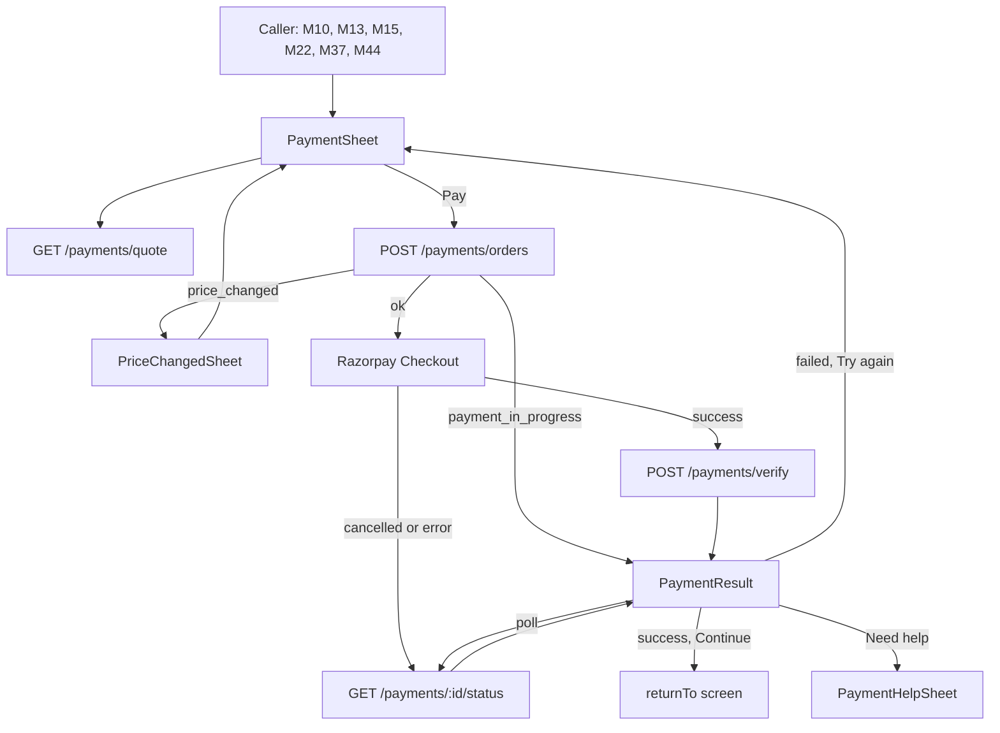
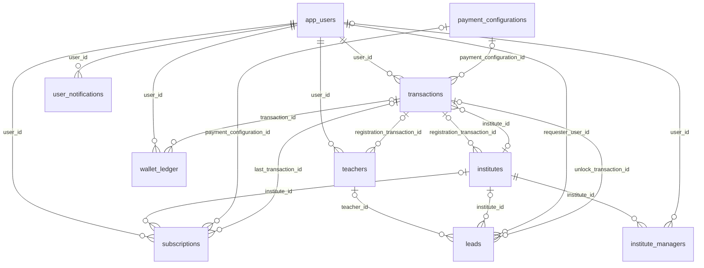

# Module 43 · Payment Gateway

> **Phase 12 · Payments** · **Used by:** Parents, students, teachers and institute managers (every paid action in the app) · **Depends on:** M00, M04, M10, M46 (wallet, optional); Admin M05 (fees), Admin M40 (transactions, webhook receiver), Admin M41 (subscriptions) · **New tables:** none · **Uses:** `transactions`, `payment_configurations`, `payment_webhook_events`, `wallet_ledger`, `subscriptions`, `teachers`, `institutes`, `institute_managers`, `leads`, `app_users`, `system_settings`, `audit_logs`, `user_notifications` · **Build estimate:** 5–6 days

## 1. Module Purpose

The single way money moves from a user to GuruConnect in the app. It prices a purchase from the **active** `payment_configurations` version (Admin M05), adds or splits GST at 18 %, optionally redeems GuruConnect wallet credit (M46), creates a Razorpay order and a `transactions` row, opens **Razorpay Standard Checkout** through `react-native-razorpay` (UPI intent apps, UPI ID, cards, net banking), verifies the signature on the server, and shows a clear result — success, processing, failed or cancelled. The Razorpay webhook handled by Admin M40 is the source of truth: access is granted only when the gateway confirms capture. The module ships two reusable pieces used by every paying screen: the `PaymentSheet` (price breakdown and Pay button) and the `PaymentResult` screen. Callers: parent and student memberships (M10, M13), teacher registration fee (M15), institute registration fee (M22), contact unlock (M37) and renewals, premium and featured boosts (M44). Build this module's API and `PaymentSheet` before any purchase button; until then M10/M13 ship in "view plans" mode.

## 2. User Stories

- As a **parent in Mysuru paying by UPI**, I want to tap Pay, finish in Google Pay and come back to a confirmed membership so that I can contact teachers right away.
- As a **new teacher**, I want to pay the ₹499 registration fee with my debit card and see a GST-inclusive receipt so that my profile goes to verification.
- As a **parent on a weak 3G connection**, I want the app to tell me "Payment processing" instead of "Failed" when my bank is slow so that I don't pay twice.
- As an **institute manager**, I want to pay the institute registration by net banking from the office PC-linked account so that verification can start.
- As a **referred parent**, I want my ₹100 wallet credit applied at checkout so that my first month costs less.
- As **finance**, I want every order priced from the active fee version and confirmed by webhook so that what users pay always matches the admin configuration.

## 3. Business Rules & Logic

**BR-43.1 Fee codes, purposes and who may pay.**

| Fee code | `transactions.purpose` | Payer role (`payer_type`) | Context required | Extra preconditions |
| --- | --- | --- | --- | --- |
| `TEACHER_REGISTRATION` | `teacher_registration` | teacher (`teacher`) | — | First payment: `teachers.verification_status` in `draft`, `reupload_requested` and `registration_transaction_id` null. Renewal (`context.renewal = true`): approved teacher, registration period ends within 30 days or has ended |
| `INSTITUTE_REGISTRATION` | `institute_registration` | institute staff with `staff_role = manager` (`institute`, `institute_id = iid`) | — | Same rules as teacher, on `institutes` |
| `PARENT_SUBSCRIPTION_MONTHLY` / `_YEARLY` | `subscription` | parent (`parent`) | — | See BR-43.9 |
| `STUDENT_SUBSCRIPTION_MONTHLY` / `_YEARLY` | `subscription` | student (`student`) | — | Student with `parental_consent` in `not_required`, `confirmed` |
| `PREMIUM_TEACHER` | `premium_listing` | teacher | — | `verification_status = approved`, account active, live registration period (when the registration fee is enabled); the new end date may not be more than 90 days from today (`boost_limit`) |
| `FEATURED_TEACHER` | `featured_listing` | teacher | — | As premium, plus a free featured slot in the teacher's primary city (`limits.featured_slots_per_city`, default 12) |
| `CONTACT_UNLOCK` | `contact_unlock` | parent, student | `leadId` | Lead owned by the requester (`requester_user_id = sub`), `contact_unlocked = false`, status not `spam`/`closed` |

Any other role/fee combination → `FORBIDDEN`. A disabled fee (`is_enabled = false`) → `CONFLICT_STATE` `details.reason = "fee_disabled"`; callers follow Admin M05 FR-5.10 (skip payment, hide button).

**BR-43.2 Price resolution.** `resolveFee(feeCode, now())` (Admin M05 FR-5.9) returns the single version in force. The quote and the order both call it; the order stores `payment_configuration_id` and `fee_code` so the user pays the version they saw. If the version id sent with the order differs from the one in force (an admin published between quote and Pay), the order is refused with `CONFLICT_STATE` `details.reason = "price_changed"` and the new quote in `details.quote`; the sheet refreshes and shows "The price was updated. Please review." The app never sends an amount that is charged; `expectedPayablePaise` is only compared.

**BR-43.3 GST and wallet calculation (integers, paise, round half up).**
1. List total `L`: if `gst_inclusive` then `L = amount_paise`; else `L = amount_paise + round(amount_paise × gst_rate_bps / 10000)`.
2. Wallet (only when M46 is live and the user ticks "Use wallet balance"): `maxRedeem = floor(L × wallet.max_redeem_percent / 100)` (setting, default 50); `W = min(walletBalance, maxRedeem)`; `W = 0` when the balance is ≤ 0.
3. Charged `C = L − W` (always ≥ 50 % of `L`, so never below Razorpay's ₹1 minimum for any seeded fee).
4. Split: `base = round(C × 10000 / (10000 + gst_rate_bps))`, `gst = C − base`. Wallet credit is a discount before tax, so GST is on the amount actually paid.
5. Stored on `transactions`: `amount_paise = C`, `base_amount_paise = base`, `gst_paise = gst`, `discount_paise = W`, `metadata.listAmountPaise = L`, `metadata.walletRedeemedPaise = W`.

Worked examples with the launch prices (all `gst_inclusive`, 1800 bps): Teacher registration ₹499 → base ₹422.88 + GST ₹76.12. Parent monthly ₹299 → ₹253.39 + ₹45.61. Parent monthly with ₹100 wallet → pay ₹199 = ₹168.64 + ₹30.36. Parent yearly ₹1,999 with ₹100 wallet → pay ₹1,899 = ₹1,609.32 + ₹289.68. Contact unlock ₹49 → ₹41.53 + ₹7.47.

**BR-43.4 Wallet visibility.** The wallet row is hidden unless `/bootstrap` `features.walletEnabled` is true **and** M46 is deployed (the server returns `quote.wallet = null` otherwise). When hidden, `useWallet` is ignored server-side. When shown with a zero balance the row is not rendered at all.

**BR-43.5 Order creation (`POST /payments/orders`, Idempotency-Key).** In one database transaction, holding `pg_advisory_xact_lock(hashtext('pay:' || user_id || ':' || fee_code))`:
1. Validate role, preconditions (BR-43.1) and price version (BR-43.2).
2. **Reuse** an open order: if a `created` transaction exists for the same user, fee code and context, younger than 25 minutes, with the same `payment_configuration_id` and the same `W`, return it (no new Razorpay order). If an `authorized` transaction exists for the same key → `CONFLICT_STATE` `details.reason = "payment_in_progress"` with its `transactionId`; the app opens `PaymentResult` in processing state for it.
3. Compute BR-43.3. If `W > 0`, insert `wallet_ledger` (`entry_type = checkout_redemption`, `amount_paise = −W`, `transaction_id`, `idempotency_key = redeem:<transactionId>`, description "Used at checkout · TXN-7702140"). The balance is re-read under the per-user lock `pg_advisory_xact_lock(hashtext('wallet:' || user_id))`.
4. Insert `transactions` (`status = created`, `gateway = razorpay`, `direction = credit`, purpose/payer from BR-43.1, `institute_id` for institutes, amounts, `metadata = { context, listAmountPaise, walletRedeemedPaise, platform, appVersion, installId }`).
5. Call Razorpay `POST /v1/orders { amount: C, currency: "INR", receipt: public_code, notes: { transactionId, feeCode, userId } }` (timeout 8 s). On success store `gateway_order_id`. On Razorpay error roll back everything (wallet debit included) → `GATEWAY_ERROR`.
6. Audit `app.payment_started`. Return checkout options (BR-43.6).
Idempotency: the key and a hash of the body are stored in Redis `idem:app:<userId>:<key>` for 24 h; a replay with the same body returns the stored response; a different body → `VALIDATION_FAILED` `details.reason = "idempotency_key_reused"`.

**BR-43.6 Checkout options (built by the server, passed unchanged to `RazorpayCheckout.open`).** `key` (public key id only; the secret never leaves the server), `order_id`, `amount`, `currency`, `name: "GuruConnect"`, `description` (fee `name`), `image` (CDN logo), `prefill { name, contact, email }` of the signed-in user, `readonly { contact: true }`, `theme { color: "#1B7F5A" }`, `method { upi: true, card: true, netbanking: true, wallet: false, emi: false, paylater: false }`, `config.display.preferences.show_default_blocks: true` with UPI first, `retry { enabled: true, max_count: 3 }`, `timeout: 900` (15 min), `send_sms_hash: true` (Android OTP autofill for card OTPs), `notes`.

**BR-43.7 Client payment sequence.**
1. `PaymentSheet` loads `GET /payments/quote`; user taps **Pay ₹199** → `POST /payments/orders`.
2. Before opening Checkout the app writes `usePendingPayment` (MMKV): `{ transactionId, feeCode, returnTo, startedAt }` — survives the app being killed while the UPI app is in front (common on 2 GB phones).
3. `RazorpayCheckout.open(options)`:
   - resolves `{ razorpay_payment_id, razorpay_order_id, razorpay_signature }` → `POST /payments/verify` → `PaymentResult`.
   - rejects with `code 0` / `reason payment_cancelled` → `PaymentResult` state **cancelled** after one status check (a UPI payment can succeed even when the user backs out).
   - rejects with `code 2` (network) or any other error → one status check, then **failed** or **processing** depending on the server state.
4. `PaymentResult` polls `GET /payments/:id/status` until a final state (BR-43.10). On a final state `usePendingPayment` is cleared.
5. **Cold start with a pending payment** (app killed during UPI intent): M01 launch sequence checks `usePendingPayment`; if younger than 30 minutes it routes to `PaymentResult` for that transaction after the gates pass; older entries are checked once silently and cleared.

**BR-43.8 Signature verification (`POST /payments/verify`).** Server loads the transaction by id **and** `user_id = sub`, checks `gateway_order_id = razorpayOrderId`, computes `HMAC_SHA256(order_id + "|" + payment_id, key_secret)` and compares in constant time. Mismatch → `PAYMENT_FAILED` `details.reason = "signature_mismatch"`, transaction unchanged, security log and Sentry alert (never trust a client "success"). Match → set `gateway_payment_id`, and `status = authorized` if still `created`/`failed`. Then the server fetches the payment from Razorpay (`GET /v1/payments/:id`, timeout 5 s): if `captured`, it runs the same idempotent `PaymentCaptureService.apply(payment)` that the webhook job uses; otherwise it returns `processing`. The client signature alone never grants access.

**BR-43.9 Subscription purchase rules.** Payer may buy when: no live row (`trial`, `active`, `grace`, `free_access`) → period starts at capture; a live `trial` → trial ends at capture and `active` starts (Admin M41 FR-41.2); a live `active`/`grace` ending within 30 days → the new period is queued to start at `ends_at` (stored in `transactions.metadata.pendingPeriod`, activated by the M41 job); a live `active` ending in more than 30 days → `CONFLICT_STATE` `details.reason = "already_subscribed"`; `free_access` → purchase hidden (fee off). A user-cancelled row whose `ends_at` is still in the future counts as `active` for these rules (the new period starts at its `ends_at`). Switching monthly → yearly follows the same queue rule. Price changes apply only to new purchases and renewals.

**BR-43.10 Status model shown to the app.**

| `transactions.status` | App state (`status` field) | PaymentResult copy |
| --- | --- | --- |
| `created` (no payment attempt yet or attempt in progress) | `pending` | "Waiting for payment…" |
| `authorized`, or `created` after a successful verify | `processing` | "Payment processing. This can take up to 5 minutes." |
| `captured` + fulfilment done | `success` | "Payment successful" |
| `captured` + fulfilment not yet done | `processing` | Same as processing (fulfilment normally < 2 s) |
| `failed` | `failed` | "Payment failed" + gateway reason |
| `cancelled` | `expired` | "This payment session expired. No money was taken." |
| `refund_pending`, `refunded`, `partially_refunded` | `refunded` | Links to M45 detail |

Polling: every 2 s for 10 s, then every 5 s until 60 s; then the screen stays in processing with "We'll notify you when it's confirmed" and a **Done** button. The server, when asked for status of a transaction still `created`/`authorized` more than 20 s after verify, fetches the order's payments from Razorpay at most once per 10 s (Redis lock `paysync:<id>`), applying capture or failure idempotently. `failed` is not final for the order: Razorpay allows up to 3 attempts per order, so a later `payment.captured` on the same order moves `failed → captured`.

**BR-43.11 Webhook is the source of truth (Admin M40 FR-40.1).** `POST /webhooks/razorpay` (owned by Admin M40) stores every event in `payment_webhook_events` and processes it in a BullMQ job. This module defines what `PaymentCaptureService.apply` does on `payment.captured`, in one transaction, with `SELECT … FOR UPDATE` on the transaction row, skipping if already `captured`:
1. Set `status = captured`, `captured_at`, `gateway_payment_id`, `method` (`upi`, `card`, `netbanking`), `metadata.payerFingerprint = sha256(vpa or card id or bank code)` (used by M46 fraud rules; the raw value is never stored), invoice number (Admin M40).
2. Fulfil by purpose (each step checks current state first):
   - `teacher_registration` first payment: `teachers.registration_transaction_id = id`; the 12-month period is created at approval (Admin M16 FR-16.8). Renewal: insert the next `subscriptions` period (`subscriber_type = teacher`, `fee_code = TEACHER_REGISTRATION`, starting at the current `ends_at` or now if ended).
   - `institute_registration`: same on `institutes` (period starts at approval, Admin M23 FR-23.3).
   - `subscription`: Admin M41 FR-41.2 (BR-43.9).
   - `premium_listing`: `teachers.is_premium = true`, `premium_until = greatest(now(), coalesce(premium_until, now())) + validity_days`.
   - `featured_listing`: `is_featured = true`, `featured_until` the same way.
   - `contact_unlock`: `leads.contact_unlocked = true`, `unlock_transaction_id = id`.
3. After commit: M46 referral qualification hook (`first_payment`), notification `payment.captured` (M47), invoice PDF job (Admin M40), `meKeys` change signalled through the push `data`.
`payment.failed` sets `failed`, `failure_code`, `failure_reason` (unless already captured) and sends `payment.failed`. Orders still `created` after 30 minutes are set `cancelled` by the Admin M40 job; this module adds: if `W > 0`, post `wallet_ledger` `redemption_refund` (+W, `idempotency_key = redeem_refund:<id>`) in the same transaction. A late capture on a `cancelled` transaction is still captured and fulfilled; if its wallet redemption was already refunded, a new `checkout_redemption` (−W, `idempotency_key = redeem_retry:<id>`) is posted; the balance may go negative (M46 BR-46.9). If the purchase is no longer valid (lead already unlocked by another payment, subscription already bought), a system refund request (`duplicate_charge`) is created for Admin M40.

**BR-43.12 UPI intent handling.** Android 11+ needs package visibility for UPI apps: the Expo config plugin adds `<queries><intent><action android:name="android.intent.action.VIEW"/><data android:scheme="upi"/></intent></queries>`. iOS `LSApplicationQueriesSchemes`: `tez`, `phonepe`, `paytmmp`, `bhim`, `credpay`, `amazonpay`. Checkout lists installed UPI apps; if none, "UPI ID" (collect) is offered. While the UPI app is in front the JS thread may be paused; when the app returns to foreground with a pending payment and no Checkout result within 5 s, the app starts status polling itself.

**BR-43.13 Limits.** At most 3 open (`created`, < 30 min) orders per user; `POST /payments/orders` 10/min and 30/hour per user; `POST /payments/verify` 20/min; `GET /payments/:id/status` 60/min. A user with 5 failed transactions in 24 h sees "Having trouble paying? Contact support." under the Pay button (payments keep working).

**BR-43.14 Reusable components contract.** Callers open the sheet with `navigation.navigate('PaymentSheet', { feeCode, context, returnTo, title })`. On success `PaymentResult` invalidates query keys by purpose (BR in @state) and its **Continue** button navigates to `returnTo` (e.g. `{ route: 'LeadDetail', params: { id } }`). Callers never call Razorpay directly.

## 4. Screen List

| Screen | Route name | Purpose |
| --- | --- | --- |
| Payment sheet | `PaymentSheet` (modal bottom sheet) | Item, price breakdown, GST, wallet toggle, Pay button |
| Razorpay Checkout | (native, opened by `react-native-razorpay`) | UPI apps, UPI ID, cards, net banking |
| Payment result | `PaymentResult` | Success, processing, failed, cancelled, expired states with next actions |
| Price changed sheet | `PriceChangedSheet` (bottom sheet) | Shows old vs new price after `price_changed` |
| Payment help sheet | `PaymentHelpSheet` (bottom sheet) | "Money debited but not confirmed?" guidance and support link |

## 5. Screen Flow & Navigation


Back on `PaymentSheet` closes it (no order is created until Pay). Hardware back on `PaymentResult` in processing asks "Leave this screen? We'll notify you when the payment is confirmed."; in success it behaves like Continue.

## 6. Screen Wireframe Description

**PaymentSheet** (bottom sheet, 70 % height, FLAG_SECURE) — drag handle; title from caller, e.g. "Parent membership · Monthly"; description line in muted text "Unlimited teacher contacts and free demo bookings". Period line for subscriptions "Valid 30 days · 26 Sep – 25 Oct" or, when queued, "Starts after your current plan ends on 3 Oct". Breakdown card (`KeyValueRow`s, right-aligned tabular numbers):
- "Price" ₹299
- "Wallet balance used" −₹100 (only when the wallet toggle is on)
- divider; "You pay" **₹199** (20 sp bold)
- small text "Includes ₹30.36 GST (18%)".
Wallet row (only when wallet available and balance > 0): checkbox "Use wallet balance (₹100 available)" with helper "Up to 50% of the price can be paid from your wallet." Below: "By paying you agree to the Terms and Refund policy" with both links. Payment method icons row (UPI, RuPay, Visa, Mastercard, Net banking) and "Secured by Razorpay". Sticky button **Pay ₹199** (loading spinner while the order is created; disabled offline with helper "Connect to the internet to pay"). Loading state: skeleton for the breakdown card. Error state: "Couldn't load the price" + **Retry**. Fee disabled: sheet closes with toast "This is free right now." and the caller continues.

**Razorpay Checkout** — Razorpay's native UI; shows GuruConnect name and logo, amount ₹199, prefilled phone; UPI apps (Google Pay, PhonePe, Paytm) on top on Android.

**PaymentResult** — full screen, no tab bar, FLAG_SECURE.
- *Success*: green check animation (once, 600 ms), heading "Payment successful", amount "₹199 paid", line per purpose, e.g. "Your membership is active till 25 Oct 2026" / "Contact unlocked. You can now call Dr. Ananya Iyer." / "Registration fee received. We'll verify your documents within 48 hours."; reference "TXN-7702140 · UPI" (long-press copies); buttons **Continue** (primary) and "View receipt" (text, opens M45 PaymentDetail).
- *Processing*: clock icon, heading "Payment processing", body "Your bank is confirming the payment. This usually takes a few seconds, sometimes up to 5 minutes. Don't pay again.", progress indicator; after 60 s text "We'll send you a notification when it's confirmed." and button **Done**; link "Money debited but not confirmed?" opens `PaymentHelpSheet`.
- *Failed*: red cross, heading "Payment failed", reason from the gateway mapped to plain text (e.g. "Your bank declined the payment."), note "If money was debited, it will be refunded to your account within 5–7 working days."; buttons **Try again** and "Choose another method" (both reopen the sheet), link "Contact support".
- *Cancelled*: heading "Payment cancelled", body "No money was taken."; buttons **Try again** and "Not now".
- *Expired*: heading "Payment session expired", body "No money was taken. Start again to pay."; button **Start again**.

**PriceChangedSheet** — heading "The price was updated", rows "Earlier ₹1,999" (struck through) and "Now ₹1,799", buttons **Continue with ₹1,799** and "Cancel".

**PaymentHelpSheet** — three short steps: "1. Wait 5 minutes — most payments confirm on their own. 2. Check your bank SMS for the UPI reference. 3. Still stuck? Contact support with reference TXN-7702140." Buttons **Contact support** (M53 new ticket with `transactionId` prefilled) and "Close".

## 7. UI Components & Component Tree

```
PaymentSheet (route modal)
├─ SheetHeader (title, description)
├─ PeriodLine
├─ PriceBreakdownCard
│  ├─ KeyValueRow × n
│  └─ GstNote
├─ WalletToggleRow (hidden until M46)
├─ LegalLine (Terms, Refund policy links)
├─ PaymentMethodsStrip
└─ StickyActionBar → Button "Pay ₹199"
PaymentResult
├─ ResultIllustration (success | processing | failed | cancelled | expired)
├─ ResultHeading · ResultBody · PurposeLine
├─ ReferenceLine (TXN code, method; copy on long-press)
└─ ResultActions
PriceChangedSheet · PaymentHelpSheet (BottomSheet)
PendingPaymentWatcher (mounted in RootNavigator; resumes BR-43.7 step 5)
```
- `PaymentSheet` route params `{ feeCode: FeeCode; context?: { leadId?: string; renewal?: boolean }; returnTo: { route: string; params?: object }; title?: string }`.
- `PriceBreakdownCard({ quote, useWallet })`, `WalletToggleRow({ wallet, value, onChange })`, `ResultActions({ state, onContinue, onRetry, onHelp })`.
- Hooks: `usePaymentQuote({ feeCode, context, useWallet })`, `useCreateOrderMutation()`, `useVerifyPaymentMutation()`, `usePaymentStatusQuery(transactionId, { poll })`, `useRazorpayCheckout()` (wraps `RazorpayCheckout.open`, normalises errors to `{ kind: 'cancelled' | 'network' | 'failed', gatewayCode, description }`), `usePay()` (orchestrates quote → order → pending store → checkout → verify → navigate).
- `lib/format.ts` `formatINR(paise, { decimals })` shows paise only in the GST note.

## 8. Validation Rules

Shared schemas in `packages/shared/payments.ts`: `PaymentQuoteQuerySchema`, `CreateOrderSchema`, `VerifyPaymentSchema`.

| Field | Rule | Message shown |
| --- | --- | --- |
| feeCode | one of the 9 fee codes | "This item can't be bought here." |
| context.leadId | uuid; required for `CONTACT_UNLOCK`, forbidden otherwise | "Pick the request you want to unlock." |
| context.renewal | boolean; only for registration fee codes | — |
| useWallet | boolean, default false | — |
| paymentConfigurationId | uuid of the quoted version | "The price was updated. Please review." |
| expectedPayablePaise | integer ≥ 100; must equal the server's computed `C` | "The price was updated. Please review." |
| Idempotency-Key header | uuid v4, required on orders | "Something went wrong. Try again." |
| transactionId | uuid owned by the caller | "Payment not found." |
| razorpayOrderId | `^order_[A-Za-z0-9]{14}$` | "We couldn't confirm this payment." |
| razorpayPaymentId | `^pay_[A-Za-z0-9]{14}$` | "We couldn't confirm this payment." |
| razorpaySignature | 64 hex chars | "We couldn't confirm this payment." |

## 9. API Endpoints

| Method | Path | Auth | Description |
| --- | --- | --- | --- |
| GET | /payments/quote | Any user | Price, GST split, wallet redemption and period for a fee code (`?feeCode=&useWallet=&leadId=&renewal=`) |
| POST | /payments/orders | Any user | Create transaction + Razorpay order and return checkout options (Idempotency-Key). 10/min, 30/hour |
| POST | /payments/verify | Any user | Verify Checkout signature, fetch payment, apply capture if confirmed. 20/min |
| GET | /payments/:id/status | Any user (owner) | Polling status with fulfilment state; triggers throttled gateway sync. 60/min |

The Razorpay webhook receiver `POST /webhooks/razorpay` is owned by Admin M40; the pricing list for plan screens is M10 `GET /plans`.

## 10. Request Payloads

```json
// GET /payments/quote?feeCode=PARENT_SUBSCRIPTION_MONTHLY&useWallet=true

// POST /payments/orders   (Idempotency-Key: 5d0c2f4e-8a1b-4f7e-9d3c-7b2a1e0f9c11)
{ "feeCode": "PARENT_SUBSCRIPTION_MONTHLY", "context": {}, "useWallet": true,
  "paymentConfigurationId": "0a6f2b8e-3c1d-4e5f-9a7b-1c2d3e4f5a6b", "expectedPayablePaise": 19900 }

// POST /payments/orders   (contact unlock)
{ "feeCode": "CONTACT_UNLOCK", "context": { "leadId": "7c9e6679-7425-40de-944b-e07fc1f90ae7" }, "useWallet": false,
  "paymentConfigurationId": "…", "expectedPayablePaise": 4900 }

// POST /payments/verify
{ "transactionId": "b3f1c2d4-5e6f-4a7b-8c9d-0e1f2a3b4c5d", "razorpayOrderId": "order_OZ4kQ9xY2mN7pL",
  "razorpayPaymentId": "pay_OZ4lA1bC2dE3fG", "razorpaySignature": "9f86d081884c7d659a2feaa0c55ad015a3bf4f1b2b0b822cd15d6c15b0f00a08" }

// GET /payments/b3f1c2d4-5e6f-4a7b-8c9d-0e1f2a3b4c5d/status
```

## 11. Response Payloads

```json
// 200 GET /payments/quote
{ "data": { "feeCode": "PARENT_SUBSCRIPTION_MONTHLY", "paymentConfigurationId": "0a6f2b8e-3c1d-4e5f-9a7b-1c2d3e4f5a6b", "version": 1,
  "name": "Parent membership · Monthly", "description": "Unlimited teacher contacts and free demo bookings", "billingPeriod": "monthly", "validityDays": 30,
  "listAmountPaise": 29900, "gstRateBps": 1800, "gstInclusive": true,
  "wallet": { "balancePaise": 10000, "maxRedeemPercent": 50, "maxRedeemPaise": 14950, "appliedPaise": 10000 },
  "discountPaise": 10000, "payablePaise": 19900, "basePaise": 16864, "gstPaise": 3036,
  "period": { "startsAt": "2026-09-26T10:30:00Z", "endsAt": "2026-10-26T10:30:00Z", "queued": false } } }

// 201 POST /payments/orders
{ "data": { "transactionId": "b3f1c2d4-5e6f-4a7b-8c9d-0e1f2a3b4c5d", "publicCode": "TXN-7702140", "status": "created", "expiresAt": "2026-09-26T11:00:00Z",
  "checkout": { "key": "rzp_live_Kx7…", "order_id": "order_OZ4kQ9xY2mN7pL", "amount": 19900, "currency": "INR", "name": "GuruConnect",
    "description": "Parent membership · Monthly", "image": "https://cdn.guruconnect.in/brand/logo-192.png",
    "prefill": { "name": "Lakshmi Venkatesh", "contact": "+919845012345", "email": "lakshmi.v@gmail.com" }, "readonly": { "contact": true },
    "theme": { "color": "#1B7F5A" }, "method": { "upi": true, "card": true, "netbanking": true, "wallet": false, "emi": false, "paylater": false },
    "retry": { "enabled": true, "max_count": 3 }, "timeout": 900, "send_sms_hash": true,
    "notes": { "transactionId": "b3f1c2d4-5e6f-4a7b-8c9d-0e1f2a3b4c5d", "feeCode": "PARENT_SUBSCRIPTION_MONTHLY" } } } }

// 200 POST /payments/verify   (captured during verify)
{ "data": { "transactionId": "b3f1c2d4-…", "status": "success", "fulfilment": { "type": "subscription", "state": "done", "subscriptionId": "…", "endsAt": "2026-10-26T10:30:00Z" } } }

// 200 POST /payments/verify   (bank still confirming)
{ "data": { "transactionId": "b3f1c2d4-…", "status": "processing", "fulfilment": { "type": "subscription", "state": "pending" }, "nextPollAfterMs": 2000 } }

// 200 GET /payments/:id/status
{ "data": { "transactionId": "b3f1c2d4-…", "publicCode": "TXN-7702140", "status": "failed", "rawStatus": "failed", "amountPaise": 19900, "method": "upi",
  "failure": { "code": "BAD_REQUEST_ERROR", "reason": "Payment was declined by the bank." }, "fulfilment": null, "invoiceAvailable": false,
  "canRetry": true, "nextPollAfterMs": null } }

// 409 POST /payments/orders   (admin published a new price)
{ "error": { "code": "CONFLICT_STATE", "message": "The price was updated. Please review.",
  "details": { "reason": "price_changed", "quote": { "paymentConfigurationId": "…", "listAmountPaise": 179900, "payablePaise": 179900 } }, "requestId": "…" } }

// 402 POST /payments/verify   (signature mismatch)
{ "error": { "code": "PAYMENT_FAILED", "message": "We couldn't confirm this payment.", "details": { "reason": "signature_mismatch" }, "requestId": "…" } }
```

## 12. PostgreSQL Tables & Columns


**Existing tables this module reads or writes** (full definitions in the owning module)

| Table | Owner | Purpose |
| --- | --- | --- |
| `transactions` | Admin M40 | Every payment attempt through Razorpay, plus refunds and reward payouts. Amounts in paise. |
| `payment_configurations` | Admin M05 | One row per version of each fee. The app charges whichever version is active at payment time. |
| `payment_webhook_events` | Admin M40 | Raw Razorpay webhooks, stored before processing so every event is processed exactly once. |
| `wallet_ledger` | App M46 | Append-only ledger of GuruConnect wallet credits and debits (referral rewards, use at checkout, reversals). Balance = sum(amount_paise). |
| `subscriptions` | Admin M41 | Paid access periods for parents, students, teachers and institutes, including trials. |
| `teachers` | Admin M16 | Teacher profile and verification state. One row per teacher app account. |
| `institutes` | Admin M22 | Coaching centres, tuition centres, schools and academies. Rated by GuruConnect after verification. |
| `institute_managers` | Admin M25 | App accounts that act for an institute. Exactly one active primary manager; counsellors can only handle leads. |
| `leads` | Admin M38 | Enquiries and call-back requests from parents/students to a teacher or institute. |
| `app_users` | Admin M00 | Login identity for every mobile app account (parent, student, teacher, institute staff). Role profiles hang off this table. |
| `system_settings` | Admin M04 | Typed key–value settings that change platform behaviour without a deploy. |
| `audit_logs` | Admin M00 | Append-only record of every admin action and security event. Never updated or deleted by the application. |
| `user_notifications` | App M00 | The in-app notification inbox for every user: transactional events and copies of admin campaigns. |

- `payment_configurations`: read only, through `resolveFee` (Admin M05 FR-5.9); never cached longer than 60 s (Redis `pricing:v1`, purged on publish).
- `transactions`: this module inserts (`created`) and updates `gateway_order_id`, `gateway_payment_id`, `status` (`authorized` on verify); capture, failure, invoice number and cancellation are written by `PaymentCaptureService` / Admin M40 jobs. `metadata` keys written here: `context`, `listAmountPaise`, `walletRedeemedPaise`, `pendingPeriod`, `payerFingerprint`, `platform`, `appVersion`, `installId`.
- `wallet_ledger` (M46): `checkout_redemption` (−W) on order, `redemption_refund` (+W) on cancel/expiry, a second `checkout_redemption` (key `redeem_retry:<id>`) on late capture. Balance = `SUM(amount_paise)` for the user.
- `payment_webhook_events`: written by Admin M40; this module's status endpoint reads nothing from it (it syncs from Razorpay instead).
- `subscriptions`, `teachers`, `institutes`, `leads`: written only by the fulfilment step (BR-43.11).

## 13. Relationships


**Entity relationship diagram** (tables this module uses; `admins` omitted)



Every paid object points back to its payment: `teachers.registration_transaction_id`, `institutes.registration_transaction_id`, `subscriptions.last_transaction_id`, `leads.unlock_transaction_id`, `wallet_ledger.transaction_id`. `transactions.payment_configuration_id` fixes the price version charged.

## 14. State Management

- `usePendingPayment` (Zustand + encrypted MMKV): `{ current: { transactionId, feeCode, returnTo, startedAt } | null, set(), clear() }`.
- Query keys (`paymentKeys`): `paymentKeys.quote(feeCode, contextHash, useWallet)` (not persisted, `staleTime` 30 s), `paymentKeys.status(id)` (not persisted, `meta.persist = false`, polling via `refetchInterval` per BR-43.10).
- Mutations: `useCreateOrderMutation` (not auto-retried; uses the same Idempotency-Key for a manual retry of the same attempt), `useVerifyPaymentMutation` (retried twice on network error — verify is idempotent).
- Invalidation on `success`, by purpose: `subscription` → `subscriptionKeys.all`, `planKeys.all`, `meKeys.me`; `teacher_registration` → `teacherRegKeys.all`, `teacherVerificationKeys.all`, `meKeys.me`; `institute_registration` → `instituteVerificationKeys.all`, `meKeys.me`; `premium_listing`/`featured_listing` → `boostKeys.all`, `teacherDashboardKeys.all`; `contact_unlock` → `leadKeys.detail(leadId)`, `leadKeys.list`; always `paymentHistoryKeys.all` and `walletKeys.all`.
- No optimistic updates anywhere in this module.

## 15. Offline Handling

- Everything here is **online only** (conventions §8 class 3). Offline, the Pay button is disabled with "Connect to the internet to pay"; the quote is never served from cache.
- Connection lost after Checkout returned: `POST /payments/verify` is retried automatically when back online (idempotent); `PaymentResult` shows processing with the offline banner.
- Connection lost while the UPI app is open: the payment continues in the UPI app; on return the watcher polls status once online.
- `usePendingPayment` survives restarts so a result is never lost.

## 16. Push Notification Requirements

| Event | Recipient | Title / Body | Deep link | Category | Urgent |
| --- | --- | --- | --- | --- | --- |
| `payment.captured` | Payer | "Payment successful" / "₹199 received for Parent membership · Monthly. Receipt TXN-7702140." | `gc://payments/<id>` | payments | yes (user just paid) |
| `payment.failed` | Payer | "Payment failed" / "Your ₹199 payment didn't go through. If money was debited, it will be refunded in 5–7 days." | `gc://payments/<id>` | payments | yes |
| `payment.late_captured` | Payer | "Payment confirmed" / "Your bank confirmed ₹199. Your membership is now active." | `gc://payments/<id>` | payments | no |

In-app only: none. The push `data.entityId` is the transaction id; `PaymentResult` listens for it in the foreground and stops polling when it arrives.

## 17. Security Rules

- Razorpay key secret and webhook secret live in the secrets manager; the app only receives the public key id.
- Amounts are computed server-side only; `expectedPayablePaise` is a comparison, not an input.
- Ownership: every lookup is `WHERE id = :id AND user_id = :sub` (institutes: `institute_id = :iid` and the caller is a `manager`); counsellors get `FORBIDDEN`.
- Signature check with constant-time compare; mismatches are counted per user (3 in 24 h → account flagged for review in Admin M40).
- Fulfilment only from gateway-confirmed state (webhook or server fetch), never from the client.
- `PaymentSheet` and `PaymentResult` use `useSecureScreen()` (FLAG_SECURE / iOS snapshot blur). No card or UPI data touches the app code or our servers; `payerFingerprint` is a SHA-256 hash.
- Checkout options, order ids and payment ids are never written to analytics or Sentry breadcrumbs (scrubbed by key name).
- Wallet debits run under a per-user advisory lock so two devices cannot spend the same balance.

## 18. Error Handling

| Scenario | Code | HTTP | App behaviour |
| --- | --- | --- | --- |
| Fee switched off | `CONFLICT_STATE` (`fee_disabled`) | 409 | Close sheet, toast "This is free right now.", caller continues |
| Price changed between quote and Pay | `CONFLICT_STATE` (`price_changed`) | 409 | `PriceChangedSheet` with the new quote |
| Existing payment still processing | `CONFLICT_STATE` (`payment_in_progress`) | 409 | Open `PaymentResult` for that transaction |
| Already subscribed (> 30 days left) | `CONFLICT_STATE` (`already_subscribed`) | 409 | Toast "You already have an active plan till 3 Oct." |
| No featured slot in the city | `CONFLICT_STATE` (`featured_slots_full`) | 409 | Inline "All featured spots in Bengaluru are taken. Try Premium." |
| Boost already bought 90 days ahead | `CONFLICT_STATE` (`boost_limit`) | 409 | Inline "You can buy up to 90 days ahead." |
| Lead already unlocked | `CONFLICT_STATE` (`already_unlocked`) | 409 | Close sheet, refetch lead |
| Wrong role for the fee / counsellor paying | `FORBIDDEN` | 403 | Toast "You can't do that." |
| Too many open orders or requests | `RATE_LIMITED` | 429 | Disable Pay until `Retry-After` |
| Idempotency key reused with another body | `VALIDATION_FAILED` (`idempotency_key_reused`) | 422 | New key, toast "Please try again." |
| Razorpay order API down | `GATEWAY_ERROR` | 502 | Inline "Payments are temporarily unavailable. Try again in a minute." + Retry |
| Signature mismatch | `PAYMENT_FAILED` (`signature_mismatch`) | 402 | `PaymentResult` failed with "We couldn't confirm this payment." + support link |
| Gateway declined | status `failed` | 200 | `PaymentResult` failed with mapped reason, Try again |
| User closed Checkout | client `cancelled` | — | Status check, then `PaymentResult` cancelled |
| Transaction of another user | `NOT_FOUND` | 404 | "This is no longer available." |

## 19. Testing Scenarios

- T43.1 Happy path (Maestro `payments_upi_success`): parent opens plans → PaymentSheet shows ₹299 incl. ₹45.61 GST → Pay → test-mode UPI success → verify → PaymentResult success → Continue returns to plans with "Active till …".
- T43.2 GST maths unit tests for all 9 seeded prices, inclusive and exclusive, with and without wallet; `base + gst = amount` always.
- T43.3 Wallet: balance ₹100, price ₹299 → pay ₹199, ledger has −10000; order expires after 30 min → +10000 `redemption_refund`; balance back to ₹100.
- T43.4 Two taps on Pay within 1 s send the same Idempotency-Key → one transaction, one Razorpay order.
- T43.5 Admin publishes ₹1,799 while the sheet shows ₹1,999 → `price_changed` → PriceChangedSheet → pay ₹1,799.
- T43.6 Forged signature → 402 `signature_mismatch`, transaction stays `created`, audit/security log written, no access granted.
- T43.7 Verify arrives before webhook: server fetch says `authorized` → processing; webhook `payment.captured` 20 s later → status poll returns success; fulfilment ran exactly once.
- T43.8 Kill the app while PhonePe is open, pay, relaunch → Splash → PaymentResult for the pending transaction → success.
- T43.9 Cancel in Checkout → status check → cancelled screen; Try again within 25 min reuses the same order id.
- T43.10 First attempt fails (card declined), second attempt on the same order captures → final status success, `failed → captured`.
- T43.11 Late capture after the 30-min cancel → transaction captured, wallet re-debited, subscription activated, `payment.late_captured` push.
- T43.12 Institute counsellor calls `POST /payments/orders` for `INSTITUTE_REGISTRATION` → 403.
- T43.13 Offline: Pay disabled; go offline right after Checkout success → verify retried on reconnect → success.
- T43.14 Featured purchase when 12 teachers in Bengaluru are featured → `featured_slots_full`.
- T43.15 Contact unlock for a lead owned by another parent → 404; for an already unlocked lead → `already_unlocked`.

## 20. Audit Log Events

| Event | When | Details |
| --- | --- | --- |
| `app.payment_started` | Order created (`POST /payments/orders`) | transaction id, fee code, version, list amount, wallet used, payable; no gateway ids |
| `app.payment_verified` | Signature valid on verify | transaction id, resulting status |
| `app.payment_signature_failed` | Signature mismatch | transaction id, install id, IP |
| `app.wallet_redeemed` | Wallet debit at checkout | transaction id, amount |
Capture, failure, cancellation and fulfilment are audited by Admin M40 as `system` actor.

## 21. Future Scalability Notes

- Razorpay Turbo UPI (in-app UPI without app switch) once available for the account, cutting drop-off on UPI intent.
- Second gateway (Cashfree / PhonePe PG) behind the `PaymentGateway` interface with automatic failover when Razorpay's order API errors.
- Promo codes as a second discount line in `PriceBreakdownCard` (Admin M05 future coupons), stored in `discount_paise` with `metadata.promoCode`.
- Play Integrity / App Attest token on `POST /payments/orders` to block scripted order creation.
- Saved UPI IDs / tokenised cards via Razorpay Customer and Tokens APIs for one-tap renewals.
