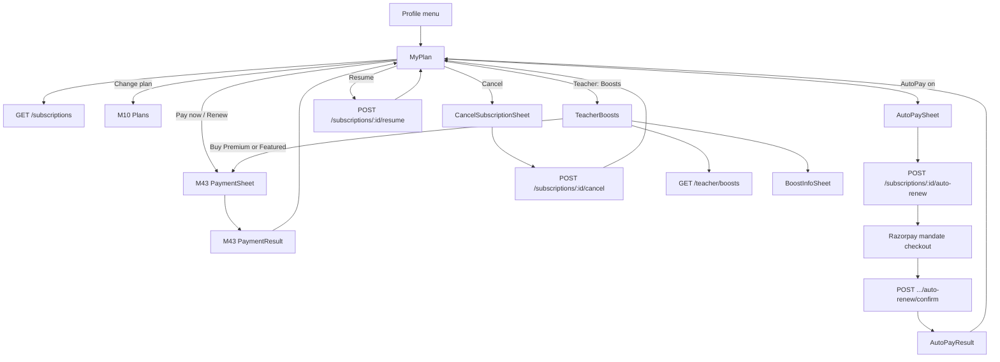
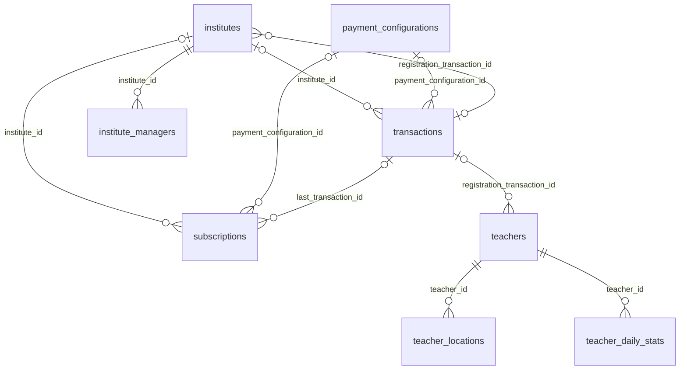

# Module 44 · Subscriptions

> **Phase 12 · Payments** · **Used by:** Parents and students (membership), teachers (registration renewal, premium and featured boosts), institute managers (registration renewal) · **Depends on:** M10, M13 (plans, current subscription), M43 (PaymentSheet, orders), M45 (refund request), M47 (events); Admin M05, Admin M40, Admin M41 · **New tables:** none · **Uses:** `subscriptions`, `payment_configurations`, `transactions`, `teachers`, `institutes`, `institute_managers`, `teacher_locations`, `teacher_daily_stats`, `system_settings`, `audit_logs` · **Build estimate:** 4–5 days

## 1. Module Purpose

One "My plan" place for every role to see and manage what they pay for. Parents and students see their membership (trial, active, grace, cancelled, expired, free access), turn **AutoPay** (Razorpay subscription mandate over UPI Autopay or card) on or off, cancel or resume, and see past periods. Teachers and institute managers see their annual registration period and renew it before it lapses; teachers also buy and track **Premium** (search boost) and **Featured** (home-screen rail) listing boosts. All purchases go through the M43 `PaymentSheet`; plan lists and the summary chip come from M10 `GET /plans` and `GET /subscriptions/current`. State rules follow Admin M41 exactly; this module adds the user-side actions, the mandate flow, renewal/boost reminders and the listing-eligibility rule for lapsed registrations.

## 2. User Stories

- As a **parent**, I want to see that my membership renews on 3 Oct for ₹299 by UPI AutoPay so that I'm not surprised by the debit.
- As a **student**, I want to cancel my membership and keep access till the end of the month so that I don't lose what I paid for.
- As a **teacher**, I want a reminder 30 days before my registration expires and a one-tap renew so that my profile never disappears from search.
- As a **new teacher in Pune**, I want to buy Featured for 30 days and see how many featured spots are left in my city so that I know it's worth it.
- As an **institute manager**, I want to renew our registration from the app so that our rating and listing stay live.
- As a **parent whose AutoPay failed**, I want a clear banner with "Pay now" during the 3-day grace period so that my access doesn't stop.

## 3. Business Rules & Logic

**BR-44.1 What each role sees.**

| Role | Cards on "My plan" | Actions |
| --- | --- | --- |
| Parent | Membership (`PARENT_SUBSCRIPTION_MONTHLY`/`_YEARLY`) | Buy/change plan (M10), AutoPay on/off, cancel, resume, pay now in grace |
| Student | Membership (`STUDENT_SUBSCRIPTION_*`) | Same as parent (M13 trial rules) |
| Teacher | Registration (`TEACHER_REGISTRATION`) + Boosts entry | Renew registration, buy Premium / Featured |
| Institute staff, `staff_role = manager` | Registration (`INSTITUTE_REGISTRATION`) | Renew registration |
| Institute counsellor | Menu item hidden; API returns `FORBIDDEN` | — |

Rows are selected by `user_id = sub` (institutes: `subscriber_type = institute AND institute_id = iid`, any manager of that institute).

**BR-44.2 Display status.** From `subscriptions.status` plus dates (Admin M41 FR-41.1):

| Row state | Pill text | Colour + icon | Access |
| --- | --- | --- | --- |
| `trial` | "Free trial · 5 days left" | blue, clock | Full |
| `active` | "Active" | green, check | Full |
| `active` + `auto_renew` | "Active · AutoPay on" | green, repeat | Full |
| `grace` | "Payment due" | amber, alert | Full for 3 days after `ends_at` |
| `cancelled` by user, `ends_at` > now | "Cancelled · access till 25 Oct" | grey | Full until `ends_at` (`trial_ends_at` for a cancelled trial) |
| `cancelled` by admin/system | "Cancelled" | grey | None |
| `expired` | "Expired" | grey | None |
| `free_access` | "Free for now" | green | Full, no end date; buy/cancel/AutoPay hidden |
| queued paid period (from `transactions.metadata.pendingPeriod`) | "Starts 3 Oct" | blue outline | From its start |

`daysLeft = ceil((ends_at − now) / 1 day)` in IST; the progress bar runs from `starts_at` to `ends_at`.

**BR-44.3 AutoPay availability.** Shown only when: fee code is a parent/student subscription; status `trial` or `active`; the fee is enabled; `price_paise > 0` or it is a trial; `granted_by` is null (not complimentary); no queued period exists. Renewal price = list total of the version in force at renewal time (wallet is never used for AutoPay). Maximum mandate: 12 cycles for monthly, 5 for yearly.

**BR-44.4 Turn AutoPay on (`POST /subscriptions/:id/auto-renew { enabled: true }`).**
1. Lock the row (`FOR UPDATE`), check BR-44.3; if `gateway_subscription_id` is set and Razorpay reports it `authenticated`/`active` → return `on` (idempotent).
2. Get the Razorpay plan for the active `payment_configurations` version of the fee (Redis `rzp:plan:<paymentConfigurationId>`; created with `period = monthly|yearly`, `interval = 1`, `item.amount = list total` if missing).
3. Create a Razorpay subscription `{ plan_id, total_count, start_at = unix(trial_ends_at or ends_at), customer_notify: 0, notes: { subscriptionId, userId } }`; store `gateway_subscription_id` (`auto_renew` stays false).
4. Return checkout options `{ key, subscription_id, name, description: "AutoPay for Parent membership · Monthly", prefill, theme, method: { upi: true, card: true, netbanking: false } }`.
5. App opens `RazorpayCheckout.open(options)`; the user approves the mandate in their UPI app or with card OTP. Razorpay takes a small authorisation charge (₹1–₹5) that it refunds itself; it is not recorded in `transactions` (Admin M40's handler ignores payments whose order has no transaction and that carry a `subscription_id` in the `authenticated` phase).
6. App calls `POST /subscriptions/:id/auto-renew/confirm { razorpayPaymentId, razorpaySubscriptionId, razorpaySignature }`. Server verifies `HMAC_SHA256(payment_id + "|" + subscription_id, key_secret)` (constant time), fetches the Razorpay subscription and, if `authenticated`/`active`, sets `auto_renew = true`; otherwise returns `pending`. Webhooks `subscription.authenticated` / `subscription.activated` set `auto_renew = true` if the confirm call never arrived.

**BR-44.5 Turn AutoPay off (`{ enabled: false }`).** Razorpay `POST /v1/subscriptions/:sid/cancel { cancel_at_cycle_end: 0 }` first (no future debits; current period untouched), then `auto_renew = false`. On Razorpay error → `GATEWAY_ERROR`, row unchanged, toggle reverts. Webhook `subscription.cancelled` (mandate revoked from the user's UPI app or bank) also sets `auto_renew = false` and sends `subscription.autopay_off`.

**BR-44.6 AutoPay renewal charge.** Banks send the RBI-mandated pre-debit notice 24 h before. Webhook `subscription.charged` → `RenewalService.onCharged` in one transaction: insert `transactions` (`purpose = subscription`, `status = captured`, `fee_code`, `payment_configuration_id` of the charged plan's version, amounts split as M43 BR-43.3 with `W = 0`, `gateway_payment_id`, `metadata = { renewal: true, subscriptionId, gatewaySubscriptionId }`); set the old row `expired`; insert the next period (`active`, `starts_at = old ends_at`, `ends_at = starts_at + validity_days`, `auto_renew = true`, same `gateway_subscription_id`, `last_transaction_id`); invoice via Admin M40; push `subscription.renewed`. Idempotent on `gateway_payment_id` (unique index). `subscription.pending` (charge failed, Razorpay will retry) → row `grace` from `ends_at` for 3 days, push `subscription.renewal_failed`. `subscription.halted` (retries exhausted) → `auto_renew = false`; the M41 job expires the row after grace.

**BR-44.7 Pay now in grace.** "Pay now" opens M43 `PaymentSheet` with the same fee code; on capture M43 starts the new period (Admin M41 FR-41.2) and this module cancels the Razorpay subscription so the pending retry can't charge twice, then shows "Turn AutoPay on again?".

**BR-44.8 Price change with AutoPay.** When Admin M05 activates a new version of a subscription fee, a `pricing.changed` handler updates each live Razorpay subscription's plan with `schedule_change_at = cycle_end`. If the new amount exceeds the UPI mandate's maximum, the mandate is cancelled, `auto_renew = false` and the user gets `subscription.autopay_reauth`. The 7-day renewal reminder (Admin M41 FR-41.3) always states the new price.

**BR-44.9 Cancel (`POST /subscriptions/:id/cancel`).** Allowed for parent/student rows in `trial`, `active` or `grace`. One transaction: cancel the Razorpay mandate if any (BR-44.5, failure aborts), set `status = cancelled`, `cancelled_at = now()`, `cancelled_by_type = user`, `cancel_reason = "<reasonCode>: <text>"`, `auto_renew = false`. Access continues per BR-44.2. Registration rows, `free_access` and complimentary rows → `CONFLICT_STATE` `details.reason = "not_cancellable"`. Cancelling never refunds automatically; if the last payment was captured within 7 days the sheet links to M45 "Request refund". A queued paid period is not affected (the sheet says so).

**BR-44.10 Resume (`POST /subscriptions/:id/resume`).** Allowed when `status = cancelled`, `cancelled_by_type = user`, the access end is in the future and no other live row exists for `(user_id, subscriber_type)`. Sets `status` back to `trial` (if `trial_ends_at` > now) or `active`, clears `cancelled_at`, `cancel_reason`, `cancelled_by_type`. AutoPay stays off (the user can turn it on again).

**BR-44.11 Registration renewal (teachers and institutes).** The registration card shows "Renew" when `ends_at` is within 30 days or has passed. Renew opens `PaymentSheet` with `{ feeCode: TEACHER_REGISTRATION | INSTITUTE_REGISTRATION, context: { renewal: true } }`; the new 365-day period starts at the current `ends_at` (or at capture if already ended) — M43 BR-43.11. Reminders (job `registration-reminders`, daily 10:00 IST): 30, 7 and 1 day before `ends_at`, and on the day it ends. If the registration fee is disabled, the card shows "Free for now" and no renew button.

**BR-44.12 Listing eligibility after a lapsed registration.** `TeacherListingEligibility.isListed(teacherId)` (and the institute equivalent) — used by M27/M28 search, M30 recommendations and M37/M39 new leads — returns true when the registration fee is disabled, or a live registration row exists, or the last registration row ended less than 7 days ago. Otherwise the profile is hidden from search and new leads are refused with `SUBSCRIPTION_REQUIRED` `details.reason = "teacher_registration_lapsed"`; existing leads, demos and messages keep working. Teachers see a red banner on the dashboard "Your registration ended on 12 Sep. Renew to appear in search again."

**BR-44.13 Boosts (`GET /teacher/boosts`).** Premium: `active = is_premium AND premium_until > now()`. Featured: same with `featured_until`; `slotsLeft = limits.featured_slots_per_city − count(teachers featured now whose primary teacher_locations.city_id = teacher's primary city)`. Buying while active extends by `validity_days` (30) from the current end (M43 BR-43.11); the end may not pass today + 90 days. Performance block: profile views in the last 30 days vs the 30 days before (from `teacher_daily_stats`), leads in the last 30 days. Job `boost-expiry` (hourly) sets `is_premium = false` / `is_featured = false` when the end has passed and sends reminders 3 days before and on expiry. Admin-granted boosts (Admin M17) show "Added by GuruConnect" and no price.

**BR-44.14 History.** `GET /subscriptions` returns live and queued items plus a cursor-paginated history of ended rows (`expired`, `cancelled`), newest first, 20 per page, each with the last payment's public code and amount.

## 4. Screen List

| Screen | Route name | Purpose |
| --- | --- | --- |
| My plan | `MyPlan` | Current plan/registration card, AutoPay row, queued period, actions, history |
| Cancel membership sheet | `CancelSubscriptionSheet` (bottom sheet) | Reason, what happens next, refund hint, confirm |
| AutoPay sheet | `AutoPaySheet` (bottom sheet) | Explains AutoPay before opening the mandate checkout; turn-off confirmation |
| AutoPay setup result | `AutoPayResult` (modal) | On, pending or failed after the mandate checkout |
| Teacher boosts | `TeacherBoosts` | Premium and Featured status, price, slots left, performance, Buy/Extend |
| Boost info sheet | `BoostInfoSheet` (bottom sheet) | What Premium / Featured does, with an example card |

## 5. Screen Flow & Navigation


Payment success returns to the screen that opened the sheet (`returnTo`). Deep links `gc://subscriptions` open `MyPlan`, `gc://teacher/boosts` opens `TeacherBoosts`.

## 6. Screen Wireframe Description

**MyPlan (parent)** — header "My plan", right icon "Payment history" (receipt icon → M45).
- *Plan card*: plan name "Parent membership · Monthly", `StatusPill` "Active · AutoPay on", price line "₹299 / month", progress bar with "18 days left", dates "26 Sep – 25 Oct 2026".
- *AutoPay row*: switch "AutoPay" with helper "₹299 will be charged on 26 Oct via UPI (lakshmi@okaxis). You'll get a reminder 24 hours before." When off: helper "Turn on so your membership never stops." When pending: "AutoPay setup pending — we'll confirm in a few minutes."
- *Queued card* (only if any): "Parent membership · Yearly — starts 26 Oct 2026, paid ₹1,999".
- *Grace banner* (amber, above the card): "Your renewal payment failed. Pay by 29 Sep to keep access." button **Pay now**.
- *Actions*: "Change plan" (secondary button), text button "Cancel membership" (destructive colour). Cancelled state shows **Resume membership** instead.
- *History*: section header "Past plans"; rows "Parent membership · Monthly · 26 Aug – 25 Sep · Expired · ₹299" and "Free trial · 19 – 25 Aug · Ended"; infinite scroll.
- Empty (never subscribed): illustration, "You don't have a plan yet", body "Membership lets you contact any verified teacher and book free demos.", button **See plans**.
- Free access: card "Free for now — GuruConnect membership is free at the moment." and no actions.
- Loading: skeleton card + 3 skeleton rows. Error: `ErrorState` with Retry.

**MyPlan (teacher)** — *Registration card*: "Teacher registration", pill "Active", "Valid till 14 Mar 2027", "171 days left"; when ≤ 30 days: amber text "Renew now to stay listed" and button **Renew for ₹499**; when ended: red banner "Your registration ended on 12 Sep. Renew to appear in search again." *Boosts entry card*: "Boost your profile" with two chips "Premium · Active till 20 Oct" and "Featured · Not active", chevron → `TeacherBoosts`. Institute manager sees the same registration card titled "Institute registration" with "Renew for ₹2,999".

**CancelSubscriptionSheet** — heading "Cancel membership?", body "You'll keep access till 25 Oct 2026. AutoPay will be turned off.", reason radio list: "I found a teacher", "Too expensive", "Not useful for me", "Technical problems", "Other" (shows a text field "Tell us more (optional)", 0–300 chars). If the last payment was within 7 days: info box "Paid in the last 7 days? You can request a refund from Payment history." Buttons **Cancel membership** (destructive) and "Keep membership".

**AutoPaySheet (turn on)** — heading "Turn on AutoPay", bullets "₹299 charged every month on the renewal date", "Your bank or UPI app sends a notice 24 hours before each charge", "Turn it off any time here or in your UPI app", small print "A ₹1–₹5 verification charge may appear and is refunded by your bank." Button **Set up AutoPay**. Turn-off variant: heading "Turn off AutoPay?", body "Your membership will end on 25 Oct unless you renew manually.", buttons **Turn off** and "Keep AutoPay".

**AutoPayResult** — success: "AutoPay is on. Next charge ₹299 on 26 Oct." button **Done**; pending: "We're confirming your AutoPay with the bank. This can take a few minutes." ; failed: "AutoPay couldn't be set up. You haven't been charged." buttons **Try again** / "Not now".

**TeacherBoosts** — header "Boost your profile". Two cards:
- *Premium*: title "Premium listing", subtitle "Appear above other teachers in search for 30 days", status line "Active till 20 Oct" or "Not active", price "₹999 / 30 days", button **Buy Premium** or **Extend 30 days** (disabled with helper "You can buy up to 90 days ahead" when at the limit). "How it works" link → `BoostInfoSheet`.
- *Featured*: title "Featured teacher", subtitle "Show on the home screen of parents in Pune for 30 days", "3 of 12 spots left in Pune", price "₹1,499 / 30 days", button **Buy Featured**; when full: "All featured spots in Pune are taken. We'll notify you when one opens." (button disabled).
- *Performance*: "Profile views (30 days) 412 · up 38%", "New requests (30 days) 9".
- Not approved yet: whole screen shows "Boosts unlock after your profile is verified." with a link to verification status. Fee disabled: card hidden.

## 7. UI Components & Component Tree

```
MyPlanScreen
├─ GraceBanner
├─ PlanCard | RegistrationCard
│  ├─ StatusPill · PriceLine · PeriodProgress
│  └─ AutoPayRow (switch, helper)
├─ QueuedPeriodCard
├─ PlanActions (Change plan, Cancel, Resume, Renew)
├─ BoostsEntryCard (teacher)
└─ HistoryList (FlashList) → HistoryRow
CancelSubscriptionSheet · AutoPaySheet · AutoPayResult
TeacherBoostsScreen
├─ BoostCard (premium) · BoostCard (featured, SlotsLeft)
├─ BoostPerformance
└─ BoostInfoSheet
```
- `PlanCard({ subscription, onToggleAutoPay, onCancel, onResume, onPayNow })`, `RegistrationCard({ subscription, renewal, onRenew })`, `PeriodProgress({ startsAt, endsAt, status })`, `BoostCard({ boost, kind, onBuy })`.
- Hooks: `useSubscriptionsQuery()`, `useSubscriptionHistoryInfinite()`, `useAutoRenewMutation()`, `useConfirmAutoRenewMutation()`, `useCancelSubscriptionMutation()`, `useResumeSubscriptionMutation()`, `useTeacherBoostsQuery()`, `useAutoPayFlow()` (orchestrates BR-44.4 steps 1–6 with `react-native-razorpay`), and M43 `usePay()` for renew/boost/pay-now.

## 8. Validation Rules

Shared schemas in `packages/shared/subscriptions.ts`: `AutoRenewSchema`, `ConfirmAutoRenewSchema`, `CancelSubscriptionSchema`.

| Field | Rule | Message shown |
| --- | --- | --- |
| enabled | boolean | — |
| razorpaySubscriptionId | `^sub_[A-Za-z0-9]{14}$`, equals the row's `gateway_subscription_id` | "We couldn't confirm AutoPay." |
| razorpayPaymentId | `^pay_[A-Za-z0-9]{14}$` | "We couldn't confirm AutoPay." |
| razorpaySignature | 64 hex chars | "We couldn't confirm AutoPay." |
| reasonCode | `found_teacher`, `too_expensive`, `not_useful`, `technical_issues`, `other` | "Pick a reason." |
| reasonText | 0–300 chars, trimmed; required (10+ chars) when `reasonCode = other` | "Tell us a little more (at least 10 characters)." |
| If-Match header | required on cancel, resume and auto-renew; equals the row's `updatedAt` | "Updated on another device. Review and try again." |
| cursor / limit | opaque string; limit 1–50 (default 20) | — |

## 9. API Endpoints

| Method | Path | Auth | Description |
| --- | --- | --- | --- |
| GET | /subscriptions | Parent, Student, Teacher, Institute staff (manager) | Live, queued and history (cursor) items with actions allowed |
| POST | /subscriptions/:id/auto-renew | Parent, Student | Turn AutoPay on (returns mandate checkout options) or off. 10/hour |
| POST | /subscriptions/:id/auto-renew/confirm | Parent, Student | Verify the mandate checkout signature and confirm AutoPay |
| POST | /subscriptions/:id/cancel | Parent, Student | Cancel at period end (If-Match) |
| POST | /subscriptions/:id/resume | Parent, Student | Undo a user cancellation before the period ends (If-Match) |
| GET | /teacher/boosts | Teacher | Premium / Featured status, prices, slots left, performance |

Reused: M10 `GET /plans`, `GET /subscriptions/current`; M43 `GET /payments/quote`, `POST /payments/orders`.

## 10. Request Payloads

```json
// GET /subscriptions?limit=20

// POST /subscriptions/9b2e…/auto-renew   (If-Match: "2026-09-26T10:31:02.114Z")
{ "enabled": true }

// POST /subscriptions/9b2e…/auto-renew/confirm
{ "razorpayPaymentId": "pay_OZ9tR2sV4wX6yZ", "razorpaySubscriptionId": "sub_OZ9sQ1rT3uV5wX",
  "razorpaySignature": "5b1f0c8e2a7d4f6b9c3e1a0d8f7b6c5e4d3a2b1c0f9e8d7c6b5a4f3e2d1c0b9a" }

// POST /subscriptions/9b2e…/cancel   (If-Match: "2026-09-26T10:31:02.114Z")
{ "reasonCode": "found_teacher", "reasonText": "Found a Maths tutor in Jayanagar" }

// POST /subscriptions/9b2e…/resume   (If-Match: "2026-09-27T08:02:44.010Z")
{}
```

## 11. Response Payloads

```json
// 200 GET /subscriptions
{ "data": {
  "live": [ { "id": "9b2e…", "subscriberType": "parent", "feeCode": "PARENT_SUBSCRIPTION_MONTHLY", "planName": "Parent membership · Monthly",
    "status": "active", "displayStatus": "active_autopay", "pricePaise": 29900, "startsAt": "2026-09-26T10:30:00Z", "endsAt": "2026-10-26T10:30:00Z",
    "trialEndsAt": null, "daysLeft": 30, "autoRenew": true, "autoPay": { "state": "on", "method": "upi", "maskedHandle": "lak…@okaxis", "nextChargeAt": "2026-10-26T10:30:00Z", "nextChargePaise": 29900 },
    "actions": { "canCancel": true, "canResume": false, "canToggleAutoPay": true, "canPayNow": false, "canRenew": false },
    "lastPayment": { "transactionId": "b3f1…", "publicCode": "TXN-7702140", "amountPaise": 19900, "capturedAt": "2026-09-26T10:30:41Z", "refundEligible": true },
    "updatedAt": "2026-09-26T10:31:02.114Z" } ],
  "queued": [],
  "history": [ { "id": "51ac…", "planName": "Free trial", "status": "expired", "startsAt": "2026-09-19T06:00:00Z", "endsAt": "2026-09-26T06:00:00Z", "lastPayment": null } ] },
  "meta": { "nextCursor": null } }

// 200 POST /subscriptions/:id/auto-renew   (enabled: true)
{ "data": { "state": "checkout_required", "checkout": { "key": "rzp_live_Kx7…", "subscription_id": "sub_OZ9sQ1rT3uV5wX", "name": "GuruConnect",
  "description": "AutoPay for Parent membership · Monthly", "prefill": { "name": "Lakshmi Venkatesh", "contact": "+919845012345", "email": "lakshmi.v@gmail.com" },
  "theme": { "color": "#1B7F5A" } } } }

// 200 POST /subscriptions/:id/auto-renew/confirm
{ "data": { "state": "on", "nextChargeAt": "2026-10-26T10:30:00Z", "nextChargePaise": 29900 } }

// 200 POST /subscriptions/:id/cancel
{ "data": { "id": "9b2e…", "status": "cancelled", "displayStatus": "cancelled_with_access", "accessUntil": "2026-10-26T10:30:00Z", "autoRenew": false,
  "refundHint": { "eligible": true, "transactionId": "b3f1…", "until": "2026-10-03T10:30:41Z" } } }

// 200 GET /teacher/boosts
{ "data": {
  "premium": { "enabled": true, "pricePaise": 99900, "validityDays": 30, "active": true, "until": "2026-10-20T08:00:00Z", "source": "paid", "canBuy": true, "maxUntil": "2026-12-25T18:29:59Z", "blockedReason": null },
  "featured": { "enabled": true, "pricePaise": 149900, "validityDays": 30, "active": false, "until": null, "city": { "id": "…", "name": "Pune" }, "slotsTotal": 12, "slotsLeft": 3, "canBuy": true, "blockedReason": null },
  "performance": { "profileViews30d": 412, "profileViewsPrev30d": 298, "leads30d": 9 } } }

// 409 POST /subscriptions/:id/cancel   (registration row)
{ "error": { "code": "CONFLICT_STATE", "message": "Registration can't be cancelled.", "details": { "reason": "not_cancellable" }, "requestId": "…" } }
```

## 12. PostgreSQL Tables & Columns


**Existing tables this module reads or writes** (full definitions in the owning module)

| Table | Owner | Purpose |
| --- | --- | --- |
| `subscriptions` | Admin M41 | Paid access periods for parents, students, teachers and institutes, including trials. |
| `payment_configurations` | Admin M05 | One row per version of each fee. The app charges whichever version is active at payment time. |
| `transactions` | Admin M40 | Every payment attempt through Razorpay, plus refunds and reward payouts. Amounts in paise. |
| `teachers` | Admin M16 | Teacher profile and verification state. One row per teacher app account. |
| `institutes` | Admin M22 | Coaching centres, tuition centres, schools and academies. Rated by GuruConnect after verification. |
| `institute_managers` | Admin M25 | App accounts that act for an institute. Exactly one active primary manager; counsellors can only handle leads. |
| `teacher_locations` | Admin M20 | Cities and areas a teacher serves, with travel radius for home tuition. |
| `teacher_daily_stats` | Admin M21 | Daily roll-up per teacher, written by a nightly job. All analytics screens read from here. |
| `system_settings` | Admin M04 | Typed key–value settings that change platform behaviour without a deploy. |
| `audit_logs` | Admin M00 | Append-only record of every admin action and security event. Never updated or deleted by the application. |

- `subscriptions`: read for all cards; this module writes `auto_renew`, `gateway_subscription_id`, `status` (`cancelled` / back to `active`/`trial` on resume), `cancelled_at`, `cancel_reason`, `cancelled_by_type = 'user'`; renewal rows are inserted by `RenewalService.onCharged` (BR-44.6). Expiry, grace and reminders stay with Admin M41 jobs.
- `transactions`: `metadata.pendingPeriod` of captured subscription payments gives the queued card; renewal charges are inserted with `metadata.renewal = true`.
- `teachers.is_premium`, `premium_until`, `is_featured`, `featured_until`: read for boosts; the `boost-expiry` job clears the flags.
- `teacher_locations` (primary city) and `system_settings` `limits.featured_slots_per_city` compute featured slots; `teacher_daily_stats` gives the performance block.

## 13. Relationships


**Entity relationship diagram** (tables this module uses; `admins` omitted)



## 14. State Management

- Query keys (`subscriptionKeys`): `subscriptionKeys.all`, `subscriptionKeys.list()` (persisted), `subscriptionKeys.history(cursor)` (infinite, persisted first page), `boostKeys.all` / `boostKeys.teacher()` (persisted, `staleTime` 60 s). M10's `subscriptionKeys.current` shares the prefix.
- After cancel / resume / auto-renew: invalidate `subscriptionKeys.all` and `meKeys.me`. After a boost or renewal payment M43 invalidates `boostKeys.all`, `subscriptionKeys.all`, `teacherDashboardKeys.all`.
- AutoPay switch is **not** optimistic (money and a gateway call); it shows a spinner in place until the server answers.
- `useAutoPayFlow` keeps the pending mandate `{ subscriptionId, razorpaySubscriptionId, startedAt }` in encrypted MMKV so a killed app re-checks the state (GET /subscriptions) on next launch.

## 15. Offline Handling

- `MyPlan` and `TeacherBoosts` render from the persisted cache offline with "Updated 2 h ago"; the status pill still counts days from the cached `endsAt`.
- All actions (AutoPay, cancel, resume, renew, buy boost) are **online only**; buttons are disabled offline with "Connect to the internet to change your plan."

## 16. Push Notification Requirements

| Event | Recipient | Title / Body | Deep link | Category | Urgent |
| --- | --- | --- | --- | --- | --- |
| `subscription.trial_ending` | Parent/student in trial, 2 days before end | "Your free trial ends in 2 days" / "Continue with membership from ₹299/month to keep contacting teachers." | `gc://plans` | subscription | no |
| `subscription.renewal_reminder` | Live row, 7 days before `ends_at` | AutoPay: "₹299 will be charged on 26 Oct" / "Your membership renews automatically." · Manual: "Your membership ends on 26 Oct" / "Renew to keep access." | `gc://subscriptions` | subscription | no |
| `subscription.renewed` | AutoPay charge captured | "Membership renewed" / "₹299 charged. Active till 25 Nov." | `gc://subscriptions` | subscription | no |
| `subscription.renewal_failed` | Charge failed, grace started | "Renewal payment failed" / "Pay by 29 Oct to keep your membership." | `gc://subscriptions` | subscription | yes |
| `subscription.expired` | Row expired | "Your membership has ended" / "Renew any time to contact teachers again." | `gc://plans` | subscription | no |
| `subscription.autopay_on` | Mandate confirmed | "AutoPay is on" / "Next charge ₹299 on 26 Oct." | `gc://subscriptions` | subscription | no |
| `subscription.autopay_off` | Turned off in app or revoked in UPI app | "AutoPay turned off" / "Your membership ends on 26 Oct unless you renew." | `gc://subscriptions` | subscription | no |
| `subscription.autopay_reauth` | Price rose above the mandate limit | "Please set up AutoPay again" / "The new price is ₹349/month. Approve AutoPay again to keep renewing automatically." | `gc://subscriptions` | subscription | no |
| `subscription.registration_expiring` | Teacher / institute managers, 30, 7, 1 days before | "Registration ends in 7 days" / "Renew for ₹499 to stay in search results." | `gc://subscriptions` | subscription | no |
| `subscription.registration_expired` | Same | "Your registration has ended" / "Renew within 7 days to keep appearing in search." | `gc://subscriptions` | subscription | no |
| `subscription.boost_expiring` | Teacher, 3 days before end | "Premium ends on 20 Oct" / "Extend to stay at the top of search results." | `gc://teacher/boosts` | subscription | no |
| `subscription.boost_expired` | Teacher | "Featured listing ended" / "Your profile is no longer on the home screen." | `gc://teacher/boosts` | subscription | no |
| `subscription.free_access` | Users moved to `free_access` (Admin M41 FR-41.5) | "Membership is free for now" / "Enjoy full access at no cost." | `gc://subscriptions` | subscription | no |
| `subscription.admin_changed` | Admin grant / extend / cancel (Admin M41 FR-41.6) | "Your plan was updated" / "Extended by 7 days — now active till 2 Nov." | `gc://subscriptions` | subscription | no |

In-app only: `subscription.cancelled` confirmation ("Membership cancelled. Access till 25 Oct.") and `subscription.resumed`.

## 17. Security Rules

- Ownership: rows by `user_id = sub`; institute rows by `institute_id = iid` and `staff_role = manager`; `:id` of another user → `NOT_FOUND`.
- Only parent/student rows accept AutoPay, cancel and resume; teachers/institutes → `FORBIDDEN`.
- Mandate signature verified server-side; `gateway_subscription_id` must match the row. Mandate checkout screen uses FLAG_SECURE.
- UPI handles are masked (`lak…@okaxis`); card mandates show "Card •••• 4821" only.
- Cancel/resume/auto-renew require `If-Match`; 10 AutoPay toggles per hour per user (prevents mandate spam).

## 18. Error Handling

| Scenario | Code | HTTP | App behaviour |
| --- | --- | --- | --- |
| Cancel a registration, free or complimentary row | `CONFLICT_STATE` (`not_cancellable`) | 409 | Toast with message |
| Resume when another plan is live or access ended | `CONFLICT_STATE` (`cannot_resume`) | 409 | Toast, refetch |
| AutoPay not available for this row | `CONFLICT_STATE` (`autopay_unavailable`) | 409 | Hide switch, refetch |
| Mandate signature mismatch | `PAYMENT_FAILED` (`signature_mismatch`) | 402 | `AutoPayResult` failed |
| Razorpay down on AutoPay on/off | `GATEWAY_ERROR` | 502 | Switch reverts, toast "Couldn't reach the bank. Try again." |
| Changed on another device | `VERSION_CONFLICT` | 409 | Refetch, "Updated on another device. Review and try again." |
| Counsellor opens My plan / teacher calls cancel | `FORBIDDEN` | 403 | Toast "You can't do that." |
| New lead to a lapsed teacher (M37) | `SUBSCRIPTION_REQUIRED` (`teacher_registration_lapsed`) | 402 | Learner sees "This teacher isn't taking new requests right now." |
| Too many AutoPay toggles | `RATE_LIMITED` | 429 | Disable switch until `Retry-After` |

## 19. Testing Scenarios

- T44.1 Happy path (Maestro `subscriptions_autopay_on`): active parent → AutoPay on → test mandate approved → confirm → pill "Active · AutoPay on", next charge date shown.
- T44.2 Webhook `subscription.charged` → old row expired, new active row, `transactions` row with `metadata.renewal = true`; replayed webhook creates nothing new.
- T44.3 `subscription.pending` → row `grace`, amber banner; Pay now via PaymentSheet → new period, Razorpay subscription cancelled.
- T44.4 Cancel active monthly with reason → status cancelled, access till `ends_at`, AutoPay off; Resume → active again.
- T44.5 Cancel when a queued yearly period exists → queued card remains, sheet explains.
- T44.6 Teacher registration ends in 6 days → Renew → M43 renewal → new period starts at old `ends_at`; card shows "Valid till" + 365 days.
- T44.7 Registration ended 8 days ago → `isListed` false → teacher missing from M27 search; new lead → `teacher_registration_lapsed`.
- T44.8 Featured in Pune with 12 active → card disabled "All featured spots … taken"; `GET /teacher/boosts` `slotsLeft = 0`.
- T44.9 Premium active till +85 days → Extend disabled (would pass 90 days).
- T44.10 Mandate revoked in GPay → `subscription.cancelled` webhook → `auto_renew = false`, push `subscription.autopay_off`.
- T44.11 Admin publishes ₹349 monthly → Razorpay plan updated at cycle end; reminder shows ₹349.
- T44.12 Offline: MyPlan renders from cache, all buttons disabled.
- T44.13 Institute counsellor → `GET /subscriptions` 403; manager sees the institute registration paid by another manager.
- T44.14 Two devices: cancel on phone A with stale `If-Match` from phone B → `VERSION_CONFLICT`.

## 20. Audit Log Events

| Event | When | Details |
| --- | --- | --- |
| `app.subscription_autopay_enabled` | AutoPay confirmed | subscription id, fee code, gateway subscription id |
| `app.subscription_autopay_disabled` | Turned off in app | subscription id |
| `app.subscription_cancelled` | User cancels | subscription id, reason code, access until |
| `app.subscription_resumed` | User resumes | subscription id |
Renewal charges, webhook-driven changes and boost expiry are logged by Admin M40/M41 as `system` actor.

## 21. Future Scalability Notes

- Plan upgrades with pro-rated credit (monthly → yearly immediately) instead of queuing.
- AutoPay for teacher registration and boosts once UPI Autopay limits and demand justify it.
- City-level featured slot waitlist with automatic purchase offer when a slot opens.
- Family membership shared between two guardians (Admin M41 future note).
- Schema request: `payment_configurations.gateway_plan_id` to replace the Redis plan-id cache (BR-44.4).
- Admin portal additions: a "Mandates" tab in the Admin M41 subscription drawer showing Razorpay subscription status, charge attempts and a cancel-mandate button.
