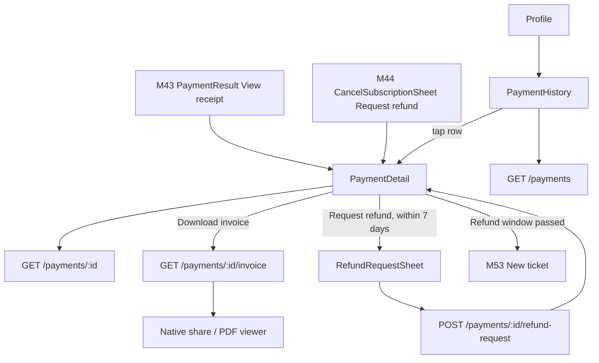
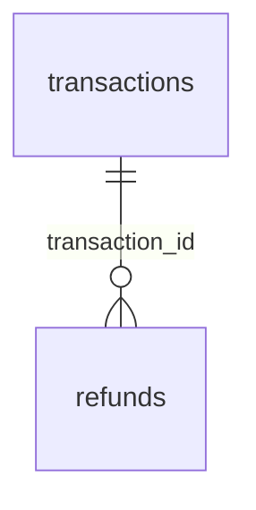

# Module 45 · Payment History

> **Phase 12 · Payments** · **Used by:** Parents, students, teachers and institute managers (anyone who has paid GuruConnect) · **Depends on:** M00, M43 (transactions, PaymentResult "View receipt" link), M44 (subscription refund hint); Admin M40 (refunds, invoices, webhook-driven decisions) · **New tables:** none · **Uses:** `transactions`, `refunds` · **Build estimate:** 2–3 days

## 1. Module Purpose

One place, "Payment history" (opened from Profile and from M43's `PaymentResult`), where anyone who has paid GuruConnect sees every payment they made, opens the GST invoice for each, and — within a 7-day window — asks for a refund. The module owns nothing about how money moves: it lists `transactions` rows scoped to the signed-in user, serves the invoice Admin M40 generated on capture, and creates a `refunds` row that Admin M40's maker-checker flow (FR-40.2) then approves, denies or fails. Refund status the user sees always comes from that same row, so support and the app never disagree about where a refund stands.

## 2. User Stories

- As a **parent**, I want to see every payment I've made — memberships, contact unlocks — with dates and amounts so that I can track what I've spent.
- As a **teacher**, I want to download the GST invoice for my ₹499 registration fee so that I can claim it as a business expense.
- As a **student who was charged twice** by mistake, I want to request a refund for the extra charge so that I get my money back without calling support.
- As an **institute manager**, I want to see the institute's registration payment and its invoice for our accounts team.
- As a **parent whose AutoPay renewal failed**, I want to see the failed attempt in my history so that I understand why my membership lapsed.

## 3. Business Rules & Logic

**BR-45.1 Scope and ownership.** `GET /payments` and `GET /payments/:id` return only rows where `transactions.user_id = sub` — the person who actually paid, never every payment linked to their institute. An institute manager sees the registration and boost payments they personally made; a counsellor, who never pays, sees an empty list (the menu item still shows so they can find the invoice link if a manager forwards it, but `:id` lookups for another user's transaction return `NOT_FOUND`, never `FORBIDDEN`, so the id space isn't enumerable).

**BR-45.2 List (`GET /payments`).** Cursor-paginated, newest first, 20 per page (`limit` 1–50). Each row: purpose (mapped to a plain label — "Parent membership · Monthly", "Teacher registration", "Contact unlock", "Premium listing", "Featured listing"), `amountPaise`, `status` mapped to the same five states as M43 BR-43.10 (`pending`, `processing`, `success`, `failed`, `expired`, `refunded`) plus `partially_refunded` shown as "Partially refunded", `capturedAt` or `createdAt` when never captured, `publicCode`, and `invoiceAvailable`. Optional filters `?status=` and `?purpose=` narrow the list; both accept the same enums as `transactions.status`/`purpose`.

**BR-45.3 Detail (`GET /payments/:id`).** Full breakdown (`basePaise`, `gstPaise`, `discountPaise`, `amountPaise`, `refundedAmountPaise`, `refundableAmountPaise = amountPaise − refundedAmountPaise − sum of open refund requests' amountPaise`), masked method (`upi`, `card`, `netbanking` — never an account or card number, Razorpay never returns one), gateway reference (`gatewayPaymentId`, shown truncated with copy-on-long-press, matching M43's `PaymentResult`), the fulfilment summary reused verbatim from Admin M40 `GET /transactions/:id` (`{ type, state, … }` — e.g. `{ type: "subscription", state: "done", endsAt }`), and the full `refunds` history for that transaction (id, amountPaise, reasonCode, status, decidedAt, denialReason, processedAt) oldest first.

**BR-45.4 Invoice (`GET /payments/:id/invoice`).** Returns a 60-second presigned GET to the PDF Admin M40 generated at capture (FR-40.5), only when `invoice_number IS NOT NULL`. Before capture, or for a `failed`/`cancelled` transaction, → `CONFLICT_STATE` `details.reason = "invoice_not_ready"` and the button is hidden client-side. A refund produces a credit note (Admin M40); when any `refunds` row is `processed`, the response also carries `creditNoteUrl` for that refund.

**BR-45.5 Refund request (`POST /payments/:id/refund-request`, Idempotency-Key).** In one transaction, holding a row lock on the transaction:
1. Transaction must belong to the caller, `status` in `captured`, `partially_refunded` and `refundableAmountPaise > 0` — otherwise `CONFLICT_STATE` `details.reason = "not_refundable"`.
2. No existing `refunds` row for this transaction in `requested`, `approved`, `processing` — otherwise `CONFLICT_STATE` `details.reason = "refund_already_requested"` with that row's id.
3. `captured_at` must be within the last 7 days (`refund_hold_window_days`, matches the hint shown in M44's `CancelSubscriptionSheet`) — otherwise `CONFLICT_STATE` `details.reason = "refund_window_expired"`; the sheet closes and offers "Contact support" (M53, ticket pre-filled with the transaction).
4. Insert `refunds` (`amount_paise = refundableAmountPaise` — v1 only supports requesting the full refundable amount, no partial amount field from the user — `reason_code` one of `duplicate_charge`, `service_not_started`, `user_request`, `other` (never `teacher_rejected`, `institute_rejected` or `goodwill`, which are system/admin-only per Admin M40 FR-40.2), `reason_note`, `status = requested`, `requested_by_type = app_user`, `requested_by_id = sub`).
5. Audit `app.refund_requested`. From here the row is entirely Admin M40's maker-checker: an admin with `refunds.approve` who isn't the requester (always true here, since the app user can never hold that permission) approves or denies; Razorpay processes the approved refund; `refund.processed` / `refund.failed` webhooks finish it.

**BR-45.6 Status shown to the user, per `refunds.status`.**

| `refunds.status` | Shown as | Detail screen copy |
| --- | --- | --- |
| `requested` | "Refund requested" | "We're reviewing your request. This usually takes 1–2 business days." |
| `approved`, `processing` | "Refund in progress" | "Your refund of ₹199 was approved and is being processed by the bank." |
| `processed` | "Refunded" | "₹199 refunded on 3 Oct 2026. It can take 5–7 working days to reflect in your account." + "Download credit note" |
| `denied` | "Refund declined" | `denial_reason` verbatim, plus "Contact support" link |
| `failed` | "Refund failed" | "Something went wrong processing this refund. Our team has been notified and will retry." |

A `partially_refunded` transaction with a further open request is blocked by BR-45.5 step 2 until that request resolves.

**BR-45.7 Reused, not redefined.** Invoice generation, the refund approval/denial/processing pipeline, credit notes, and the nightly reconciliation all belong to Admin M40 (FR-40.2, FR-40.5); this module never calls Razorpay directly and never changes `transactions.status`. M43's `PaymentResult` "View receipt" link and M44's `CancelSubscriptionSheet` "Request a refund" link both open `PaymentDetail` for a given `transactionId` — no separate deep link is needed beyond `gc://payments/:id`.

## 4. Screen List

| Screen | Route name | Purpose |
| --- | --- | --- |
| Payment history | `PaymentHistory` | Every payment, newest first, with status and amount |
| Payment detail | `PaymentDetail` | Breakdown, method, fulfilment, invoice, refund history and action |
| Request refund sheet | `RefundRequestSheet` (bottom sheet) | Reason, note, confirm |

## 5. Screen Flow & Navigation


Back on `PaymentHistory` returns to Profile. Back on `PaymentDetail` returns to wherever it was opened from (history, or the deep link's caller).

## 6. Screen Wireframe Description

**PaymentHistory** — header "Payment history". Rows (`FlashList`): purpose icon (card for subscription, key for contact unlock, badge for registration, star for boosts), title "Parent membership · Monthly", date "26 Sep 2026", right-aligned amount "₹199" with `StatusPill` beneath ("Success" green, "Failed" red, "Refunded" grey, "Partially refunded" amber, "Processing" blue). Pull-to-refresh. Infinite scroll with `ListFooterLoader`. Empty: illustration, "No payments yet", body "Your membership and other purchases will show up here."; Loading: 6 skeleton rows; Error: `ErrorState` + Retry.

**PaymentDetail** — header shows `publicCode` "TXN-7702140" with a copy icon. Purpose title and date. Breakdown card (same `KeyValueRow` layout as M43's `PaymentSheet`): "Amount paid" ₹199, "Base" ₹168.64, "GST (18%)" ₹30.36, "Wallet used" −₹100 (if any), divider, "Refunded" ₹0 (hidden when zero). Method row "UPI · lak…@okaxis" or "Card •••• 4821". Reference row "pay_OZ4lA1bC2dE3fG" (long-press to copy). Fulfilment line, one of: "Membership active till 25 Oct 2026", "Registration fee received. Verification in progress.", "Contact unlocked. You can now call Dr. Ananya Iyer.", "Premium listing active till 20 Oct 2026". Buttons: **Download invoice** (spinner while presigning, then opens the OS share sheet / PDF viewer) — hidden with no message when `invoiceAvailable` is false. Below: **Request refund** (visible only when `refundableAmountPaise > 0` and within 7 days of capture) or, once one exists, a **Refund status card** per BR-45.6 with a "Download credit note" link when processed; after the 7-day window and with no existing request: muted text "It's been more than 7 days since this payment. Contact support if something's wrong." with a **Contact support** link. Loading: skeleton breakdown card. Error: `ErrorState` + Retry.

**RefundRequestSheet** — heading "Request a refund", subheading "You're eligible to refund ₹199 from this payment.", reason radio list: "I was charged twice" (`duplicate_charge`), "The service hasn't started yet" (`service_not_started`), "I don't need this anymore" (`user_request`), "Other" (`other`, reveals a text field), note field "Tell us more" (10–500 chars, required for all reasons), info line "Refund requests are reviewed within 1–2 business days.", buttons **Submit request** and "Cancel".

## 7. UI Components & Component Tree

```
PaymentHistoryScreen
├─ HistoryList (FlashList) → PaymentRow (icon, title, date, amount, StatusPill)
└─ EmptyState | ErrorState | Skeleton × 6
PaymentDetailScreen
├─ AmountBreakdownCard (reused KeyValueRow from M43)
├─ MethodRow · ReferenceRow (copy on long-press)
├─ FulfilmentLine
├─ RefundStatusCard (per BR-45.6) | RefundEligibilityLine
└─ ActionBar → Button "Download invoice" · Button "Request refund" | link "Contact support"
RefundRequestSheet (BottomSheet)
├─ ReasonRadioGroup
├─ ReasonNoteField
└─ StickyActionBar → Button "Submit request"
```
- `PaymentRow({ payment, onPress })`, `RefundStatusCard({ refund })`, `AmountBreakdownCard({ payment })` (shared shape with M43's `PriceBreakdownCard`).
- Hooks: `usePaymentsHistoryInfinite(filters?)`, `usePaymentDetailQuery(id)`, `useDownloadInvoice(id)` (presign then `expo-sharing`), `useRequestRefundMutation()`.

## 8. Validation Rules

Shared schema in `packages/shared/payments.ts`: `RefundRequestSchema`.

| Field | Rule | Message shown |
| --- | --- | --- |
| status (query) | one of `transactions.status` values | — |
| purpose (query) | one of `transactions.purpose` values | — |
| cursor / limit | opaque string; limit 1–50 (default 20) | — |
| reasonCode | `duplicate_charge`, `service_not_started`, `user_request`, `other` | "Pick a reason." |
| reasonNote | 10–500 chars, trimmed | "Tell us a little more (at least 10 characters)." |
| Idempotency-Key header | uuid v4, required on refund-request | "Something went wrong. Try again." |
| transactionId | uuid owned by the caller | "This payment isn't available." |

## 9. API Endpoints

| Method | Path | Auth | Description |
| --- | --- | --- | --- |
| GET | /payments | Any user | Own payments, newest first (cursor), `?status=&purpose=` |
| GET | /payments/:id | Any user (owner) | Full breakdown, method, fulfilment, refund history |
| GET | /payments/:id/invoice | Any user (owner) | Presigned GST invoice URL (and credit note, if refunded) |
| POST | /payments/:id/refund-request | Any user (owner), Idempotency-Key | Create a refund request. 5/hour |

Reused: M43 `PaymentResult` links here after every purchase; M44 `CancelSubscriptionSheet` links here to request a refund on the last payment.

## 10. Request Payloads

```json
// GET /payments?limit=20&status=captured

// GET /payments/b3f1c2d4-5e6f-4a7b-8c9d-0e1f2a3b4c5d

// GET /payments/b3f1c2d4-5e6f-4a7b-8c9d-0e1f2a3b4c5d/invoice

// POST /payments/b3f1c2d4-5e6f-4a7b-8c9d-0e1f2a3b4c5d/refund-request   (Idempotency-Key: 2b7e9c1a-4d3f-4e6b-8a2c-1f0d9e8c7b6a)
{ "reasonCode": "duplicate_charge", "reasonNote": "I was charged for the monthly plan twice within the same minute" }
```

## 11. Response Payloads

```json
// 200 GET /payments
{ "data": [
  { "transactionId": "b3f1c2d4-…", "publicCode": "TXN-7702140", "purpose": "subscription", "planName": "Parent membership · Monthly",
    "amountPaise": 19900, "status": "success", "capturedAt": "2026-09-26T10:30:41Z", "invoiceAvailable": true },
  { "transactionId": "9c4e1f2a-…", "publicCode": "TXN-7702098", "purpose": "contact_unlock", "planName": "Contact unlock",
    "amountPaise": 4900, "status": "failed", "createdAt": "2026-09-20T14:02:11Z", "invoiceAvailable": false } ],
  "meta": { "nextCursor": null } }

// 200 GET /payments/:id
{ "data": { "transactionId": "b3f1c2d4-…", "publicCode": "TXN-7702140", "purpose": "subscription", "planName": "Parent membership · Monthly",
  "status": "success", "method": "upi", "maskedHandle": "lak…@okaxis", "gatewayPaymentId": "pay_OZ4lA1bC2dE3fG",
  "basePaise": 16864, "gstPaise": 3036, "discountPaise": 10000, "amountPaise": 19900, "refundedAmountPaise": 0, "refundableAmountPaise": 19900,
  "capturedAt": "2026-09-26T10:30:41Z", "invoiceAvailable": true,
  "fulfilment": { "type": "subscription", "state": "done", "endsAt": "2026-10-26T10:30:00Z" },
  "refundEligible": true, "refundEligibleUntil": "2026-10-03T10:30:41Z", "refunds": [] } }

// 200 GET /payments/:id/invoice
{ "data": { "invoiceUrl": "https://cdn.guruconnect.in/invoices/GC-2026-27-000412.pdf?X-Amz-Signature=…", "invoiceNumber": "GC/2026-27/000412", "expiresAt": "2026-09-26T11:31:02Z" } }

// 201 POST /payments/:id/refund-request
{ "data": { "refundId": "7a1e2c3d-…", "status": "requested", "amountPaise": 19900, "reasonCode": "duplicate_charge" } }

// 409 POST /payments/:id/refund-request   (outside the 7-day window)
{ "error": { "code": "CONFLICT_STATE", "message": "This payment is more than 7 days old.", "details": { "reason": "refund_window_expired" }, "requestId": "…" } }
```

## 12. PostgreSQL Tables & Columns


**Existing tables this module reads or writes** (full definitions in the owning module)

| Table | Owner | Purpose |
| --- | --- | --- |
| `transactions` | Admin M40 | Every payment attempt through Razorpay, plus refunds and reward payouts. Amounts in paise. |
| `refunds` | Admin M40 | Refund requests and their gateway processing. |

- `transactions`: read only; this module never updates a transaction — status, `refunded_amount_paise` and `invoice_number` all change through Admin M40's capture, webhook and refund pipeline (M43 BR-43.11, Admin M40 FR-40.2).
- `refunds`: this module inserts one row per user-initiated request (`requested_by_type = 'app_user'`, `requested_by_id = sub`); every later transition (`approved` → `processing` → `processed`/`failed`, or `denied`) is written by Admin M40. Reads join back to `transactions.id` for the history list in BR-45.3.

## 13. Relationships


**Entity relationship diagram** (tables this module uses; `admins` omitted)



## 14. State Management

- Query keys (`paymentHistoryKeys`): `paymentHistoryKeys.list(filters)` (infinite, persisted first page), `paymentHistoryKeys.detail(id)` (persisted, `staleTime` 30 s). M43 invalidates `paymentHistoryKeys.all` after every successful purchase (BR-43 @state).
- `useRequestRefundMutation` is not optimistic (creates a real request); on success it invalidates `paymentHistoryKeys.detail(id)`.
- No client-side state beyond the query cache and the open bottom sheet.

## 15. Offline Handling

- `PaymentHistory` and `PaymentDetail` render from the persisted cache offline ("Updated 2 h ago"); refund history and invoice availability reflect the last successful fetch.
- Invoice download and refund request are **online only** (conventions §8 class 3); both buttons disabled offline with "Connect to the internet to do this."

## 16. Push Notification Requirements

| Event | Recipient | Title / Body | Deep link | Category | Urgent |
| --- | --- | --- | --- | --- | --- |
| `payment.refund_processed` | Payer | "Refund completed" / "₹199 refunded to your original payment method for TXN-7702140." | `gc://payments/<id>` | payments | no |
| `payment.refund_denied` | Payer | "Refund request declined" / "<denialReason>" | `gc://payments/<id>` | payments | no |
| `payment.refund_failed` | Payer | "Refund couldn't be processed" / "We're retrying your ₹199 refund for TXN-7702140." | `gc://payments/<id>` | payments | no |

In-app only: the "Refund requested" confirmation toast right after submit. `payment.captured`/`payment.failed`/`payment.late_captured` are M43's events, not repeated here.

## 17. Security Rules

- Ownership: every lookup is `WHERE id = :id AND user_id = :sub`; a valid id belonging to another user returns `NOT_FOUND`, never `FORBIDDEN` (no confirmation that the id exists).
- Invoice and credit-note URLs are 60-second presigned GETs, never cached, never logged.
- `reason_code` is restricted server-side to the four user-selectable values regardless of what the client sends; the other three (`teacher_rejected`, `institute_rejected`, `goodwill`) are rejected with `VALIDATION_FAILED` even if a modified client sends them.
- `PaymentDetail` uses `useSecureScreen()` (FLAG_SECURE / iOS snapshot blur), matching M43.
- Rate limit 5 refund requests per hour per user (abuse/spam protection); gateway ids and masked handles are scrubbed from analytics and Sentry breadcrumbs.

## 18. Error Handling

| Scenario | Code | HTTP | App behaviour |
| --- | --- | --- | --- |
| Transaction not captured/partially refunded | `CONFLICT_STATE` (`not_refundable`) | 409 | Toast "Only completed payments can be refunded." |
| Refund already requested and open | `CONFLICT_STATE` (`refund_already_requested`) | 409 | Sheet closes, `RefundStatusCard` shown instead |
| Fully refunded already | `CONFLICT_STATE` (`already_refunded`) | 409 | Sheet closes, refetch |
| Older than 7 days | `CONFLICT_STATE` (`refund_window_expired`) | 409 | Sheet closes, "Contact support" link shown |
| Invoice not generated yet | `CONFLICT_STATE` (`invoice_not_ready`) | 409 | Button hidden; if tapped via stale cache, toast "Invoice isn't ready yet." |
| Transaction of another user | `NOT_FOUND` | 404 | "This payment isn't available." + back |
| Too many refund requests | `RATE_LIMITED` | 429 | Disable button until `Retry-After` |
| Idempotency key reused with another body | `VALIDATION_FAILED` (`idempotency_key_reused`) | 422 | Toast "Please try again." |

## 19. Testing Scenarios

- T45.1 Happy path (Maestro `payment_history_view`): parent opens Payment history from Profile → list shows a captured and a failed row → tap the captured one → breakdown, method and fulfilment shown → Download invoice opens the PDF.
- T45.2 Refund request within 7 days on a captured contact-unlock payment → `refunds` row inserted `requested`; detail shows "Refund requested".
- T45.3 Refund request 8 days after capture → `refund_window_expired`; sheet closes, "Contact support" link opens M53 with the transaction pre-filled.
- T45.4 Second refund request while one is already `requested` → `refund_already_requested`, existing status shown instead.
- T45.5 Refund request on a `failed` transaction → `not_refundable`.
- T45.6 Invoice tapped on a transaction still `created`/`authorized` → button not shown; direct call → `invoice_not_ready`.
- T45.7 `GET /payments/:id` for a transaction owned by another user → 404.
- T45.8 Offline: history and a previously-opened detail render from cache; Download invoice and Request refund disabled with the offline hint.
- T45.9 Two rapid taps on Submit request with the same Idempotency-Key → exactly one `refunds` row.
- T45.10 Admin approves and Razorpay processes the refund (Admin M40) → `refund.processed` → app polls/refetches on next open → "Refunded ₹199 on 3 Oct" with a credit note link; push `payment.refund_processed` received.
- T45.11 Admin denies with a reason → detail shows "Refund declined: <reason>"; push `payment.refund_denied` received.
- T45.12 45 payments on the account → first page returns 20 with `nextCursor` set; scrolling loads the rest with no duplicates or gaps.

## 20. Audit Log Events

| Event | When | Details |
| --- | --- | --- |
| `app.refund_requested` | Refund request submitted | transaction id, refund id, amount, reason code |
Invoice downloads and history views are reads and are not audit-logged (conventions §11); approvals, denials and processing are logged by Admin M40 as `admin`/`system` actor.

## 21. Future Scalability Notes

- Partial-amount refund requests (currently full refundable amount only) once support needs finer control from the app side.
- Bulk export (CSV/PDF) of a date range for a teacher's or institute's annual tax filing.
- In-app support chat pre-filled from a payment instead of a plain ticket link.
- Push the refund decision the moment Admin M40's webhook lands, instead of relying on the next `GET /payments/:id` (already covered by BR-45's push table; today the app also refetches on foreground).
- A combined annual GST statement (all invoices for a financial year in one PDF) once teachers ask for it at tax time.
