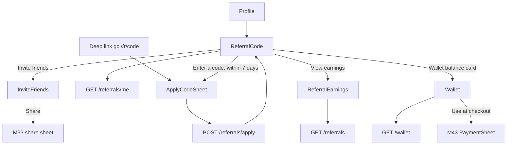
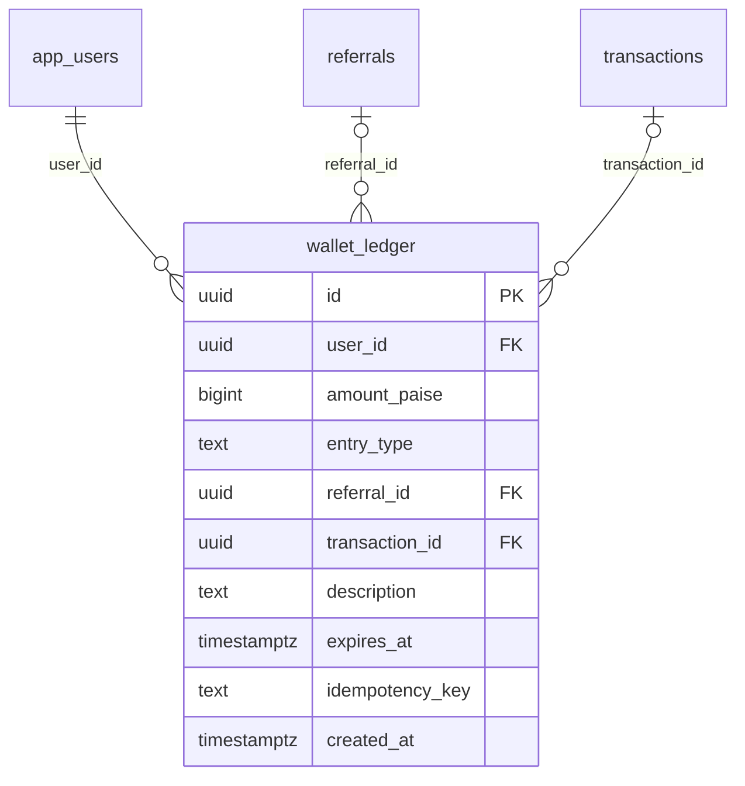

# Module 46 · Referral System

> **Phase 13 · Referrals** · **Used by:** Parents, students (Learner Referral), teachers (Teacher Referral) and institute managers (Institute Referral) — any signed-in user who can invite or be invited · **Depends on:** M00, M05 (referral code field at registration), M33 (share sheet component reused for invites); Admin M06 (referral_settings — program rules and terms), Admin M42 (referral_codes, referrals — attribution, fraud scoring, qualification, payout and admin review) · **New tables:** `wallet_ledger` · **Uses:** `referral_codes`, `referrals`, `referral_settings`, `transactions` · **Build estimate:** 4–5 days

## 1. Module Purpose

The Refer & Earn experience: a personal code every user can share, a screen that shows who they've invited and what they've earned, and the "I have a code" flow for someone who signs up without one. GuruConnect runs three programs — `LEARNER_REFERRAL` for parents and students, `TEACHER_REFERRAL` for teachers, `INSTITUTE_REFERRAL` for institute managers — configured in Admin M06 and each user sees only the one program that matches their role. This module owns `wallet_ledger`, GuruConnect's spendable-credit balance: referral rewards land here, M43 spends from here at checkout, and every entry is visible to the user as a plain-English line. All of the fraud scoring, code attribution, qualification and admin review that decide *whether* a referral earns anything live in Admin M42; this module only shows the resulting status — and never the fraud signals behind it.

## 2. User Stories

- As a **parent**, I want to share my code on WhatsApp so my friend gets ₹100 off and I get ₹100 in my wallet once she subscribes.
- As a **teacher**, I want to see that my invited friend is verified and my ₹200 reward is on its way so I know the invite worked.
- As a **student who installed the app from a friend's link** but signed up without entering the code, I want to add it within a few days so we both still get the reward.
- As a **parent with ₹100 in her wallet**, I want to see exactly where that credit came from before I use it at checkout.
- As an **institute manager**, I want to invite another institute owner I know so that we both get a discount on registration.
- As **anyone whose reward was reversed**, I want a simple "reversed" line in my wallet, not a scary fraud notice.

## 3. Business Rules & Logic

**BR-46.1 One code per user per program.** `RC.getOrCreate(userId)` is called the first time `GET /referrals/me` or `InviteFriends` is opened: it maps the caller's role to a program (`parent`/`student` → `LEARNER_REFERRAL`, `teacher` → `TEACHER_REFERRAL`, institute staff with `staff_role = manager` → `INSTITUTE_REFERRAL`) and creates a `referral_codes` row (`code = upper(first name, transliterated to ASCII) + 2–3 digits` until unique, e.g. `LAKSHMI50`, Admin M42 FR-42.1) if none exists for that `(user_id, program_code)`. Institute counsellors have no program and no code; `InviteFriends`/`ReferralCode` are hidden from their menu and the endpoints return `FORBIDDEN`.

**BR-46.2 Program rules are read live.** `GET /referrals/me` reads the **active** `referral_settings` row for the caller's program (Admin M06) and returns `isEnabled`, `referrerRewardPaise`, `refereeRewardPaise`, `rewardHoldDays`, `qualifyingEvent` mapped to plain copy (`first_payment` → "after your friend's first payment", `teacher_approved` → "after your friend is verified", `institute_approved` → "after your friend's institute is verified"), and `termsText` (rendered as Markdown). When `isEnabled` is false the screen still shows the user's code and past earnings but hides the invite call-to-action behind "Referrals are paused right now — check back soon."; a code shared while paused still opens the app (deep link resolves) but Admin M42 records the referral `rejected` with reason `program_disabled` (Admin M06 FR-6.3.6), which this module shows as "Not eligible" without further explanation.

**BR-46.3 Applying a code after signup (`POST /referrals/apply`, Idempotency-Key).** The same underlying `ReferralService.attribute(refereeUserId, code)` is called from two places: M05's registration step (when the user enters a code inline while signing up) and this endpoint (when they didn't, or weren't sure, and add one afterwards). In one transaction:
1. `app_users.created_at` must be within the last **7 days** — otherwise `CONFLICT_STATE` `details.reason = "referral_window_expired"`.
2. The account must not already have a `referrals` row as referee (`uq_referrals_referee`) — otherwise `CONFLICT_STATE` `details.reason = "already_referred"`.
3. The code must resolve to an active, unexpired `referral_codes` row under its usage limit — otherwise `VALIDATION_FAILED` "That code isn't valid or has expired."; the code's `program_code` must match the caller's own program (a parent can't apply a `TEACHER_REFERRAL` code) — otherwise the same message.
4. The code must not belong to the caller — otherwise `VALIDATION_FAILED` "You can't use your own code."
5. Insert `referrals` (`status = pending`, `referral_setting_id` = the program's active version, `referrer_user_id` from the code, `referee_user_id = sub`) — Admin M42 FR-42.2 then takes over fraud scoring, qualification and payout exactly as it would for a code entered at registration.
Success always returns 200 even when the program is disabled or the code was a now-expired campaign code that still resolves (Admin M06 FR-6.3.6): the copy adapts ("Code applied — rewards aren't available right now" vs "Code applied! You'll both be rewarded once <event>.").

**BR-46.4 Deep link capture.** `https://guruconnect.in/r/<code>` and `gc://r/<code>` (conventions §4) opened before install are stored by the install-attribution SDK and read once after first sign-in; opened after sign-in they pre-fill `ApplyCodeSheet` directly. Either way BR-46.3 is what actually attributes the referral — a stored link by itself does nothing.

**BR-46.5 Status shown to the referrer, mapped from `referrals.status` (Admin M42 FR-42.3/42.4 — fraud detail is never exposed).**

| `referrals.status` | Shown as | Reward line |
| --- | --- | --- |
| `pending`, `on_hold` | "Invited" | "Waiting for <event>" |
| `qualified` | "Qualified" | "₹100 unlocks on 3 Oct" (`reward_release_at`) |
| `rewarded` | "Rewarded" | "₹100 credited to your wallet" |
| `rejected`, `expired`, `reversed` | "Not eligible" | — (no reason shown; `on_hold`'s fraud review and a later `rejected` look identical to the user) |

`GET /referrals` lists every invite the caller has sent, newest first, with the referee shown as first name + last initial ("Priya S.") and `joinedAt`; a campaign code has no referrer view (not applicable here — those are Admin-only, Admin M42 §14).

**BR-46.6 Payout, mirrored into the wallet this module owns.** At `reward_release_at`, Admin M42's job (FR-42.5) marks `qualified` → `rewarded` and, for the currently-seeded programs (`reward_type = wallet_credit`), the same job inserts, alongside its `transactions` row (`purpose = referral_payout`, `direction = debit`, `gateway = wallet`):
1. `wallet_ledger` for the referrer: `entry_type = referral_reward`, `amount_paise = +reward_amount_paise`, `referral_id`, `transaction_id` (the payout transaction), `idempotency_key = referral_reward:<referralId>`, `description = "Referral reward · <referee first name>"`.
2. When `referee_reward_paise > 0`: `wallet_ledger` for the referee: `entry_type = referee_bonus`, `amount_paise = +referee_reward_paise`, `referral_id`, `idempotency_key = referee_bonus:<referralId>`, `description = "Welcome bonus for joining with a referral code"`. (A future `reward_type = discount` program instead applies `refereeRewardPaise` as `transactions.discount_paise` at the referee's first purchase — M43's future scalability note — and writes no wallet row.)
Both entries' `expires_at` is left null (referral credit does not expire at launch).

**BR-46.7 Reversal.** Admin M42's `POST /referrals/:id/reverse` (FR-42.6) posts a matching `wallet_ledger` row (`entry_type = reversal`, negative amount equal to the entry(ies) it undoes, `idempotency_key = reversal:<referralId>`) for whichever of the referrer/referee still hold the credit. The balance may go negative (M43 BR-43.11 already documents this for the checkout side); this module never blocks a negative balance, it only stops "Use wallet balance" from offering more than the (floor-zero) positive amount.

**BR-46.8 Wallet (`GET /wallet`).** `balancePaise = SUM(wallet_ledger.amount_paise) WHERE user_id = sub` (Redis-cached 30 s, invalidated on any write to the user's rows). Cursor-paginated ledger (newest first, 20 per page) with each entry mapped to plain copy by `entry_type`: `referral_reward` → "Referral reward · <description>", `referee_bonus` → "Welcome bonus", `checkout_redemption` → "Used at checkout · <transaction public code>", `redemption_refund` → "Refund · <transaction public code>", `reversal` → "Reward reversed", `expiry` → "Credit expired", `admin_adjustment` → "Adjustment by GuruConnect" (with `reason_note` if the admin set one). Sign and colour follow `amount_paise` (green `+`, muted red `−`). A negative running balance (rare, post-reversal) shows a one-line note: "A previous reward was reversed. Future credits will apply here first."

**BR-46.9 Sharing.** `InviteFriends`'s share text is built server-side per program and returned by `GET /referrals/me` as `shareText` (so copy changes don't need an app release): e.g. "Join GuruConnect with my code LAKSHMI50 and get ₹100 off your first month! https://guruconnect.in/r/LAKSHMI50". Sharing reuses M33's `react-native-share` WhatsApp-first sheet and `expo-clipboard` for "Copy link"; a share does **not** by itself create a `referrals` row (BR-46.3/4 do).

**BR-46.10 Stats on `GET /referrals/me`.** `invitedCount` (all non-`rejected` rows), `qualifiedCount`, `rewardedCount`, `totalEarnedPaise` (sum of `rewarded` rows' `reward_amount_paise`), `pendingPaise` (sum of `qualified` rows' `reward_amount_paise` not yet released). These come from the caller's own `referrals` rows as referrer only; a user is never shown their own referee-side reward inline here (it appears in their wallet once credited, per BR-46.6).

## 4. Screen List

| Screen | Route name | Purpose |
| --- | --- | --- |
| Referral code | `ReferralCode` | The user's code, share button, stats summary, "Enter a code" entry point |
| Invite friends | `InviteFriends` | Share sheet, how-it-works steps, program terms |
| Referral earnings | `ReferralEarnings` | Invited list with status and reward per person |
| Wallet | `Wallet` | Balance and the full credit/debit ledger |
| Apply code sheet | `ApplyCodeSheet` (bottom sheet) | Enter or confirm a referral code within 7 days of signup |

## 5. Screen Flow & Navigation


`ApplyCodeSheet` also opens automatically, once, the first time the app is opened after sign-up if an install-time deep link carried a code (BR-46.4) and no referral is attached yet. Back on any screen returns to where it was opened from.

## 6. Screen Wireframe Description

**ReferralCode** — header "Refer & earn". Code card: big monospace "LAKSHMI50" with a copy icon, subtitle "Share this code — you both get ₹100" (from `shareText`'s first line). Sticky button **Invite friends**. Stats row: "3 invited · 1 qualified · ₹100 earned" (tap → `ReferralEarnings`). Wallet card: "Wallet balance ₹100" with chevron → `Wallet`. Below: link "Have a code? Enter it" (hidden after 7 days from signup or once a code is already attached — shows "Referred by LAKSHMI50" instead, greyed, no action). Paused state: banner "Referrals are paused right now — check back soon." replaces the Invite button. Loading: skeleton card. Error: `ErrorState` + Retry.

**InviteFriends** — header "Invite friends". Big code repeated, buttons **Share on WhatsApp**, **Copy link**, "More options" (native share sheet). "How it works" 3 steps with icons: "1. Share your code", "2. Your friend signs up and pays for membership", "3. You both get ₹100 — released after 7 days." Terms link opens a full-screen Markdown viewer with `termsText`.

**ReferralEarnings** — header "Your invites". Rows: avatar-initial circle, "Priya S.", "Joined 20 Sep 2026", right side `StatusPill` ("Invited" grey, "Qualified" blue, "Rewarded" green, "Not eligible" muted) and reward line ("₹100 unlocks on 3 Oct" / "₹100 credited" / blank). Empty: illustration, "No invites yet", body "Share your code to start earning.", button **Invite friends**.

**Wallet** — header "Wallet", big balance "₹100" top of screen. List of entries (`FlashList`): icon by sign, description, date, amount ("+₹100" green / "−₹100" muted), e.g. "Referral reward · Priya S. · 3 Oct 2026 · +₹100", "Used at checkout · TXN-7702140 · 26 Sep 2026 · −₹100". Negative-balance note banner when relevant. Empty: "No wallet activity yet", body "Refer a friend to start earning credit."

**ApplyCodeSheet** — heading "Have a referral code?", field "Enter code" (auto-uppercase, e.g. "PRIYA22"), helper "You can only add a code within 7 days of signing up." (only shown when relevant), button **Apply code**; success state replaces the sheet content with a check icon and the copy from BR-46.3.

## 7. UI Components & Component Tree

```
ReferralCodeScreen
├─ CodeCard (code, copy, share CTA)
├─ StatsRow · WalletCard
├─ EnterCodeLink | AppliedCodeLine
└─ PausedBanner
InviteFriendsScreen
├─ CodeCard
├─ ShareButtons (WhatsApp, Copy link, More)
└─ HowItWorksSteps · TermsLink
ReferralEarningsScreen → HistoryList (FlashList) → InviteRow (avatar, name, date, StatusPill, rewardLine)
WalletScreen
├─ BalanceHeader
└─ LedgerList (FlashList) → LedgerRow (icon, description, date, signedAmount)
ApplyCodeSheet (BottomSheet) → CodeField · SubmitButton
```
- `CodeCard({ code, shareText, onShare, onCopy })`, `InviteRow({ invite })`, `LedgerRow({ entry })`, `PausedBanner({ programName })`.
- Hooks: `useReferralMeQuery()`, `useReferralsInfinite()`, `useApplyCodeMutation()`, `useWalletQuery()` (balance), `useWalletLedgerInfinite()`, `useShareReferral()` (wraps M33's share sheet with the server-built `shareText`).

## 8. Validation Rules

Shared schema in `packages/shared/referrals.ts`: `ApplyReferralCodeSchema`.

| Field | Rule | Message shown |
| --- | --- | --- |
| code | 4–20 chars, letters/digits only, case-insensitive (upper-cased before sending) | "Enter a valid code." |
| Idempotency-Key header | uuid v4, required on apply | "Something went wrong. Try again." |
| cursor / limit (referrals, wallet) | opaque string; limit 1–50 (default 20) | — |

## 9. API Endpoints

| Method | Path | Auth | Description |
| --- | --- | --- | --- |
| GET | /referrals/me | Any user (not institute counsellor) | Own code, program rules/terms, share text, stats |
| GET | /referrals | Any user (not institute counsellor) | Invites sent, newest first (cursor) |
| POST | /referrals/apply | Any user, Idempotency-Key | Apply a code within 7 days of signup |
| GET | /wallet | Any user | Balance and ledger (cursor) |

Reused: M05 `POST /registration/referral/validate` for the inline code field at signup (owned by M05, calls the same `ReferralService`); M43 `GET /payments/quote` reads the wallet balance this module owns once M46 ships.

## 10. Request Payloads

```json
// GET /referrals/me

// GET /referrals?limit=20

// POST /referrals/apply   (Idempotency-Key: 4a2c8e1f-9b3d-4c7e-a1f0-8d6e5c4b3a2f)
{ "code": "PRIYA22" }

// GET /wallet?limit=20
```

## 11. Response Payloads

```json
// 200 GET /referrals/me
{ "data": { "programCode": "LEARNER_REFERRAL", "isEnabled": true, "code": "LAKSHMI50",
  "referrerRewardPaise": 10000, "refereeRewardPaise": 10000, "rewardHoldDays": 7, "qualifyingEventCopy": "after your friend's first payment",
  "shareText": "Join GuruConnect with my code LAKSHMI50 and get ₹100 off your first month! https://guruconnect.in/r/LAKSHMI50",
  "termsText": "You get ₹100 when a friend buys Membership with your code…",
  "appliedCode": null, "canApplyCode": true, "applyWindowEndsAt": "2026-10-03T00:00:00Z",
  "stats": { "invitedCount": 3, "qualifiedCount": 1, "rewardedCount": 1, "totalEarnedPaise": 10000, "pendingPaise": 10000 } } }

// 200 GET /referrals
{ "data": [
  { "id": "…", "refereeName": "Priya S.", "joinedAt": "2026-09-20T09:12:00Z", "status": "qualified", "rewardAmountPaise": 10000, "rewardReleaseAt": "2026-10-03T10:30:00Z" },
  { "id": "…", "refereeName": "Kavya R.", "joinedAt": "2026-09-05T08:00:00Z", "status": "rewarded", "rewardAmountPaise": 10000, "rewardReleaseAt": null },
  { "id": "…", "refereeName": "Ramesh N.", "joinedAt": "2026-08-30T11:00:00Z", "status": "rejected", "rewardAmountPaise": 0, "rewardReleaseAt": null } ],
  "meta": { "nextCursor": null } }

// 200 POST /referrals/apply
{ "data": { "applied": true, "programEnabled": true, "message": "Code applied! You'll both be rewarded after your first payment." } }

// 200 GET /wallet
{ "data": { "balancePaise": 10000,
  "entries": [
    { "id": "…", "entryType": "referral_reward", "description": "Referral reward · Kavya R.", "amountPaise": 10000, "createdAt": "2026-09-12T10:00:00Z" },
    { "id": "…", "entryType": "checkout_redemption", "description": "Used at checkout · TXN-7701998", "amountPaise": -10000, "createdAt": "2026-08-15T09:00:00Z" } ] },
  "meta": { "nextCursor": null } }

// 409 POST /referrals/apply   (outside the 7-day window)
{ "error": { "code": "CONFLICT_STATE", "message": "Referral codes can only be applied within 7 days of signing up.", "details": { "reason": "referral_window_expired" }, "requestId": "…" } }
```

## 12. PostgreSQL Tables & Columns

**New tables owned by this module** (migration `sql/migrations/146_app_m46_referral_system_wallet.sql`)

### `wallet_ledger`

Append-only ledger of GuruConnect wallet credits and debits (referral rewards, use at checkout, reversals). Balance = sum(amount_paise).

| Column | Type | Null | Default | Constraints / References | Description |
| --- | --- | --- | --- | --- | --- |
| `id` | uuid | no | gen_random_uuid() | PK | Primary key |
| `user_id` | uuid | no | — | FK → `app_users.id` (on delete restrict) | Wallet owner |
| `amount_paise` | bigint | no | — | CHECK amount_paise <> 0 | Positive = credit, negative = debit |
| `entry_type` | text | no | — | CHECK entry_type IN ('referral_reward','referee_bonus','checkout_redemption','redemption_refund','reversal','expiry','admin_adjustment') | Why |
| `referral_id` | uuid | yes | — | FK → `referrals.id` (on delete restrict) | Source referral |
| `transaction_id` | uuid | yes | — | FK → `transactions.id` (on delete restrict) | Related payment / payout record |
| `description` | text | no | — | — | Shown in the app, e.g. Reward: Priya joined with your code |
| `expires_at` | timestamptz | yes | — | — | Credits expire 365 days after issue |
| `idempotency_key` | text | no | — | — | e.g. referral_reward:<referralId> |
| `created_at` | timestamptz | no | now() | — | Posted |

<details><summary>DDL</summary>

```sql
CREATE TABLE wallet_ledger (
  id uuid PRIMARY KEY DEFAULT gen_random_uuid(), -- Primary key
  user_id uuid NOT NULL REFERENCES app_users(id) ON DELETE RESTRICT, -- Wallet owner
  amount_paise bigint NOT NULL CHECK (amount_paise <> 0), -- Positive = credit, negative = debit
  entry_type text NOT NULL CHECK (entry_type IN ('referral_reward','referee_bonus','checkout_redemption','redemption_refund','reversal','expiry','admin_adjustment')), -- Why
  referral_id uuid REFERENCES referrals(id) ON DELETE RESTRICT, -- Source referral
  transaction_id uuid REFERENCES transactions(id) ON DELETE RESTRICT, -- Related payment / payout record
  description text NOT NULL, -- Shown in the app, e.g. Reward: Priya joined with your code
  expires_at timestamptz, -- Credits expire 365 days after issue
  idempotency_key text NOT NULL, -- e.g. referral_reward:<referralId>
  created_at timestamptz NOT NULL DEFAULT now() -- Posted
);
CREATE UNIQUE INDEX uq_wallet_ledger_idem ON wallet_ledger (idempotency_key);
CREATE INDEX idx_wallet_ledger_user ON wallet_ledger (user_id, created_at DESC);
```

</details>

**Indexes:** `uq_wallet_ledger_idem` (unique) on `(idempotency_key)`; `idx_wallet_ledger_user` on `(user_id, created_at DESC)`

**Existing tables this module reads or writes** (full definitions in the owning module)

| Table | Owner | Purpose |
| --- | --- | --- |
| `referral_codes` | Admin M42 | One personal referral code per app user. |
| `referrals` | Admin M42 | One row per referred user, tracking qualification, fraud checks and reward payout. |
| `referral_settings` | Admin M06 | Versioned rules for each referral program. One active version per program. |
| `transactions` | Admin M40 | Every payment attempt through Razorpay, plus refunds and reward payouts. Amounts in paise. |

- `wallet_ledger` (owned here): the `checkout_redemption` and `redemption_refund` entries are inserted by M43 (BR-43.5/43.11); `referral_reward`, `referee_bonus` and `reversal` are inserted by Admin M42's payout/reversal jobs per BR-46.6/46.7; `admin_adjustment` and `expiry` are inserted by Admin-side tooling and a future expiry job respectively (BR-46.8 and @scalability). This module only reads the table (`GET /wallet`) — it performs no writes of its own; the balance is `SUM(amount_paise)`.
- `referral_codes`, `referrals`: read for `GET /referrals/me`/`GET /referrals`; this module's only write is the `referrals` insert in BR-46.3 (`POST /referrals/apply`), matching the shape Admin M42 expects from any attribution source.
- `referral_settings`: read only, always the **active** row for the caller's program (Admin M06 owns edits and publishing).
- `transactions`: read only, to resolve a ledger entry's linked `public_code` for display.

## 13. Relationships

**Foreign keys of new tables**

- `wallet_ledger.user_id` → `app_users` — required, many-to-one, on delete **restrict**
- `wallet_ledger.referral_id` → `referrals` — optional, many-to-one, on delete **restrict**
- `wallet_ledger.transaction_id` → `transactions` — optional, many-to-one, on delete **restrict**

**Entity relationship diagram**



`wallet_ledger.referral_id` ties a reward or reversal back to the `referrals` row that earned it; `wallet_ledger.transaction_id` ties a checkout redemption/refund to the `transactions` row it adjusted, and a referral payout to its `referral_payout` transaction (Admin M42 FR-42.5).

## 14. State Management

- Query keys (`referralKeys`): `referralKeys.me()` (persisted, `staleTime` 60 s), `referralKeys.list(cursor)` (infinite, persisted first page). `walletKeys`: `walletKeys.balance()` (persisted, `staleTime` 30 s — same key M43 reads for "Use wallet balance"), `walletKeys.ledger(cursor)` (infinite).
- After a successful `POST /referrals/apply`: invalidate `referralKeys.me()`, `meKeys.me` (subscription/trial state may change once qualified later, not immediately).
- Push events (BR below) invalidate `referralKeys.me()`, `referralKeys.list`, `walletKeys.balance`, `walletKeys.ledger` for whichever user they target.
- No optimistic updates: applying a code and sharing are not reversible client actions worth faking.

## 15. Offline Handling

- `ReferralCode`, `ReferralEarnings` and `Wallet` render from the persisted cache offline ("Updated 2 h ago").
- `POST /referrals/apply` is **online only** (conventions §8 class 3, it changes account-level attribution); the button is disabled offline with "Connect to the internet to apply a code."
- Sharing works offline for "Copy link" (clipboard) but the WhatsApp/native share sheet needs the app installed on the receiving side regardless of the sharer's connectivity — no special handling needed.

## 16. Push Notification Requirements

| Event | Recipient | Title / Body | Deep link | Category | Urgent |
| --- | --- | --- | --- | --- | --- |
| `referral.qualified` | Referrer | "Your friend is in!" / "Priya just subscribed. Your ₹100 reward unlocks on 3 Oct." | `gc://referrals` | referral | no |
| `referral.rewarded` | Referrer | "₹100 credited to your wallet" / "Thanks for inviting Priya — your reward is ready to use." | `gc://wallet` | referral | no |
| `referral.referee_bonus` | Referee | "₹100 welcome credit added" / "Your referral bonus is in your wallet — use it on your next payment." | `gc://wallet` | referral | no |
| `referral.reversed` | Whoever held the reversed credit | "A referral reward was reversed" / "One of your wallet credits was reversed after a review. Contact support if this looks wrong." | `gc://wallet` | referral | no |

In-app only: the "Code applied" confirmation inline on `ApplyCodeSheet`. `on_hold`/fraud review sends no push (it would reveal the review to a bad actor); the referrer simply keeps seeing "Invited" until it resolves.

## 17. Security Rules

- Ownership: `GET /referrals` and `GET /wallet` always scope to `user_id = sub`; there is no way to view another user's code stats, invites or wallet.
- Fraud signals (`fraud_score`, `fraud_flags`, `on_hold` distinct from `pending`) are computed and stored by Admin M42 and never serialised into any app response — the DTO for `GET /referrals` maps both to the same "Invited" status.
- `POST /referrals/apply` is rate-limited 5/hour per user and 20/hour per install id (code-guessing / brute-force protection); repeated invalid codes from one account are flagged for Admin M42's fraud review the same as at registration.
- The referee's masked name in `GET /referrals` is first name + last initial only, matching how names are shown elsewhere pre-contact-unlock (conventions §13).
- Wallet balance and ledger never reveal another user's data; `admin_adjustment` entries show only the admin's note, never the admin's name.

## 18. Error Handling

| Scenario | Code | HTTP | App behaviour |
| --- | --- | --- | --- |
| Code invalid, inactive, expired or over its usage limit | `VALIDATION_FAILED` | 422 | Inline "That code isn't valid or has expired." |
| Own code | `VALIDATION_FAILED` | 422 | Inline "You can't use your own code." |
| Wrong program for the caller's role | `VALIDATION_FAILED` | 422 | Inline "That code isn't valid or has expired." |
| Already referred | `CONFLICT_STATE` (`already_referred`) | 409 | Sheet closes, "Your account already has a referral applied." |
| Outside the 7-day window | `CONFLICT_STATE` (`referral_window_expired`) | 409 | Sheet closes, message per BR-46.3 |
| Institute counsellor opens Referral Code / Invite Friends | `FORBIDDEN` | 403 | Toast "You can't do that."; menu item hidden |
| Too many apply attempts | `RATE_LIMITED` | 429 | Disable button until `Retry-After` |
| Idempotency key reused with another body | `VALIDATION_FAILED` (`idempotency_key_reused`) | 422 | Toast "Please try again." |

## 19. Testing Scenarios

- T46.1 Happy path (Maestro `referral_apply_and_earn`): parent B enters parent A's code within 7 days of signing up → `pending`; B subscribes → `qualified`, push to A; 7 days later job runs → `rewarded`, `wallet_ledger` credited, push to A and (welcome bonus) to B.
- T46.2 Code applied on day 8 after signup → `referral_window_expired`.
- T46.3 Own code entered → `VALIDATION_FAILED`; a `TEACHER_REFERRAL` code entered by a parent → same error.
- T46.4 Second apply attempt on an account that already has a `referrals` row → `already_referred`.
- T46.5 Program disabled → `ReferralCode` shows the paused banner; applying a still-resolvable expired campaign code returns `applied: true, programEnabled: false` with the paused-copy message.
- T46.6 A referral goes `on_hold` for fraud review → referrer still sees "Invited", never "on hold" or any fraud wording; admin later releases it → referrer sees "Qualified" then "Rewarded" with no gap in messaging.
- T46.7 Admin reverses a paid reward → referrer's wallet shows a `reversal` entry and balance decreases (may go negative); referral status shows "Not eligible" with no reason text.
- T46.8 Deep link `gc://r/PRIYA22` opened pre-install → captured, `ApplyCodeSheet` opens pre-filled on first launch after sign-up; declining leaves the code re-enterable manually until day 7.
- T46.9 Institute counsellor opens `gc://referrals` → 403, redirected with a toast; the tab item is hidden for that role from the start.
- T46.10 Wallet balance used at checkout (M43) then refunded (expiry/cancel) → `redemption_refund` entry appears in `GET /wallet` and the balance is restored.
- T46.11 Offline: `ReferralCode`/`Wallet` render from cache; `ApplyCodeSheet`'s submit button is disabled with the offline hint.
- T46.12 Two rapid taps on Apply code with the same Idempotency-Key → exactly one `referrals` row.

## 20. Audit Log Events

| Event | When | Details |
| --- | --- | --- |
| `app.referral_code_applied` | `POST /referrals/apply` succeeds | referral id, code, program code |
Personal code creation (BR-46.1) is not audit-logged (routine, system-generated); qualification, payout, release, rejection and reversal are logged by Admin M42 as `system`/`admin` actor.

## 21. Future Scalability Notes

- Wallet credit expiry after a configurable number of days (no expiry at launch; `wallet_ledger.expires_at` is already in the schema for this).
- Tiered rewards (a bigger reward after 5 successful referrals) once Admin M42 ships tiered rules.
- A referral leaderboard visible to users themselves (today `GET /referrals/top-referrers` is admin-only), as a light gamification layer.
- Share-link attribution with per-channel tracking (WhatsApp vs SMS vs copy-link conversion) beyond the existing `profile_shares` table (M33).
- `reward_type = discount` programs applying the referee's reward automatically at their first `PaymentSheet` checkout instead of (or in addition to) a wallet credit.
